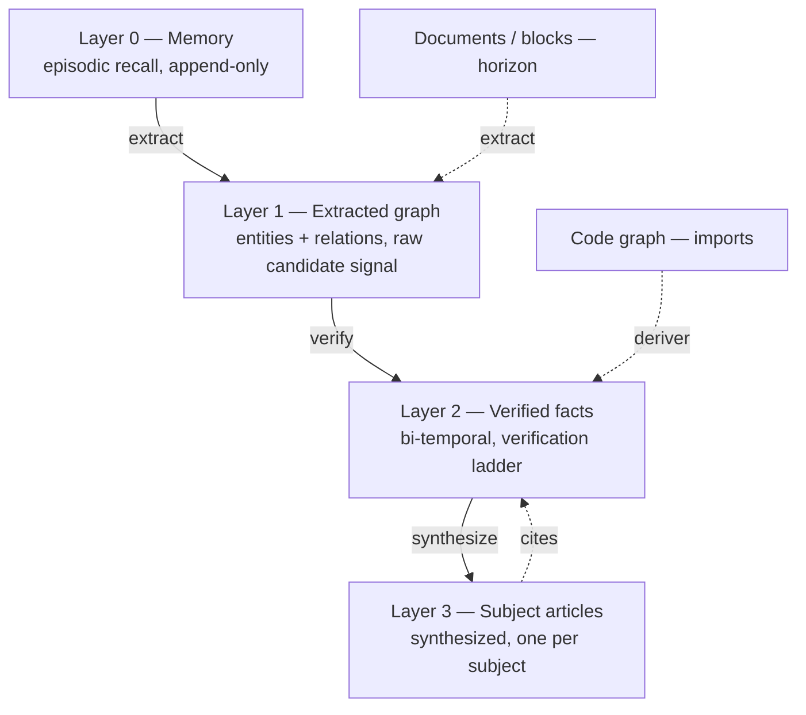
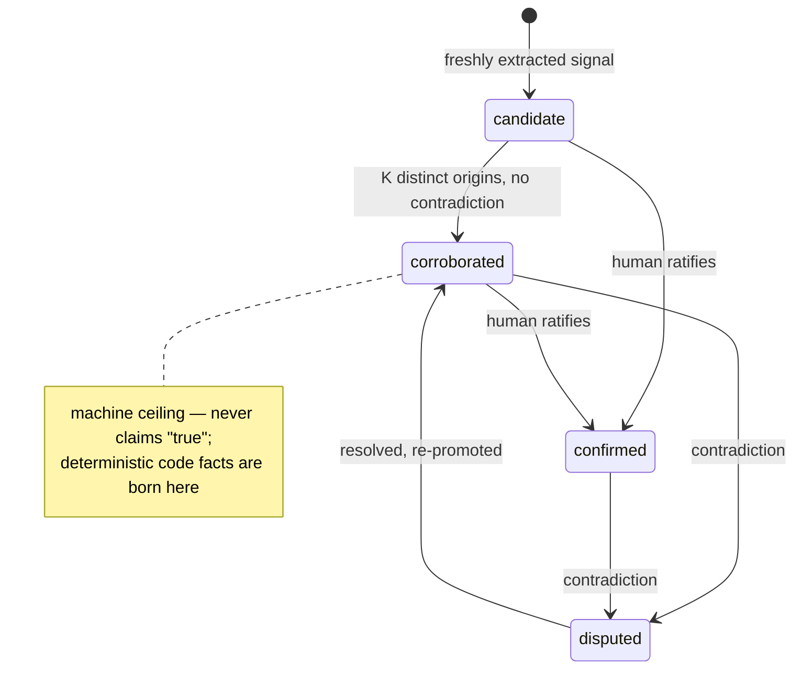
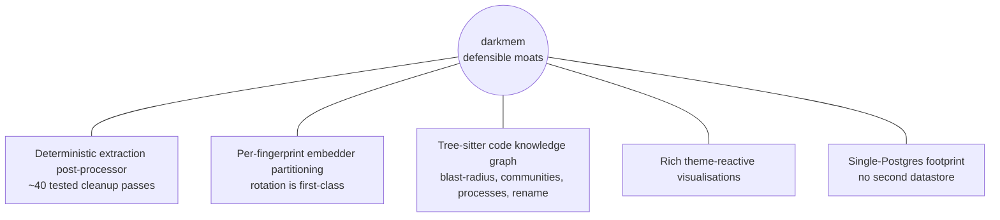

# 00 — Overview, Vision & Principles

**Status:** foundation doc (binds every doc below it). Draft 2026-07-23.
Part of the unified target design — see `docs/design/README.md` for the frame and document map.

---

## 1. What darkmem is

**Core value — a knowledge engine for AI agents.** darkmem is a self-hosted, single-Postgres knowledge engine that captures what agents (and their humans) learn, extracts a typed knowledge graph from it, retrieves it with graph-augmented hybrid search, keeps it true over time, and surfaces all of it in a rich UI — over a first-class **MCP** interface any AI tool can speak. This is the anchor; nothing in the expansion is allowed to dilute it.

**Expansion horizon — a personal memory engine.** The same engine grows into a personal memory engine for the human: ingest personal **documents** (notes, PDFs, files), retrieve over them (**document RAG**), and **analyse** that corpus — all in the one store, one graph. Agents remain the core consumer; the human becomes a first-class *user* of their own memory, not only its curator. The two horizons share one substrate — a document the human files is also knowledge an agent can recall.

In one line: **one brain, self-hosted — the knowledge engine every AI tool reads from and writes to, growing into the personal memory engine its human thinks with.**

The system at a glance — many front doors write into one Postgres, where capture flows through the Layer 1 graph and background verification into the knowledge vault, then back out to every tool by pull and push.

```mermaid
flowchart LR
    subgraph doors["Front doors"]
        mcp["MCP clients"]
        rest["REST / SDK"]
        agent["Coding-agent sessions"]
        browser["Browser AI chats — target"]
    end

    subgraph pg["One Postgres + pgvector"]
        direction TB
        ingest["Capture + ingest<br/>extract + classify"]
        graph["Layer 1 graph<br/>entities + relations"]
        consolidate["Consolidate + verify<br/>background"]
        vault["Knowledge vault<br/>verified facts + articles"]
        retrieval["Graph-augmented retrieval"]
        ingest --> graph --> consolidate --> vault --> retrieval
        graph --> retrieval
    end

    doors -->|write| ingest
    retrieval -->|"pull and push"| doors
```

## 2. Who it is for

- **Core consumer — AI coding agents** (Claude Code, Cursor, Codex, Cline, and any MCP client). They read context at the start of work and write back verified facts, decisions, and bugfixes. darkmem's job is to make an agent in a fresh session as informed as one that lived through the prior sessions.
- **The human — curator, and (expansion) direct user.** One person (or a small team) running darkmem on a homelab or a single box. In the core they *see, trust, and curate* what the brain knows. In the expansion horizon they also *use* it directly — filing their own documents and notes, asking questions over that corpus (document RAG), and getting analysis back — so darkmem is their personal memory engine, not only the agents'.
- **The project — an open-source product.** darkmem is built to be adopted, so it must be easy to stand up, honest about its numbers, and never crippled behind a paywall.

darkmem is **not** built for a multi-tenant cloud SaaS operator or an enterprise data platform; those shape a different product and are explicit non-goals (§5).

## 3. The problem & the value

AI tools forget. Each session, each tool, each device starts cold, and the user re-explains the same context forever. The market's answer is a "memory layer," but most stop at storing chat turns and doing vector search over them. darkmem's bet is that **durable memory is a maintained knowledge graph, not a pile of embedded text** — and that the same engine that remembers can also *reason over time, reconcile contradictions, organise itself into topics and knowledge, and even research to fill its own gaps.*

The value, concretely:
- **Continuity** — an agent recalls verified facts across sessions, tools, and machines.
- **Trust** — memory has provenance, confidence, and a visible lifecycle; the human can see why something was recalled and prune what's wrong.
- **Self-maintenance** — the brain supersedes stale facts, consolidates duplicates, and marks outdated knowledge without the human policing it.
- **Reach** — memory flows into every tool, by pull (the agent asks) and by push (darkmem pre-loads context), not just one app.

## 4. Vision — the north-star target

The target darkmem is a coherent system with seven capabilities, each earning its place:

1. **Capture everywhere.** Ingest from MCP, REST, coding-agent sessions, and (target) browser AI chats — one vault behind many front doors.
2. **A living knowledge graph.** Every memory is decomposed into a typed entity/relationship graph with provenance, hardened by a deterministic post-processor. The graph is not decoration — it is a retrieval and reasoning substrate.
3. **Graph-augmented retrieval.** Hybrid semantic + keyword fusion (RRF), a reranker, and graph signals (associative multi-hop, dual-level) — with a transparent retrieval trace so every result can explain *why* it was recalled.
4. **Reasoning over time.** A bi-temporal lifecycle: facts have validity windows, contradictions invalidate rather than delete, and the system answers "what did we believe as of date X."
5. **Self-organisation & self-maintenance.** Off-the-hot-path consolidation ("dreaming") that dedupes, refines, supersedes stale facts on newer corrections, groups memories into **topics**, and synthesises higher-order **knowledge** (derived `insight`/`profile` rows) — all auditable through the supersession lineage.
6. **Auto-research.** On request, darkmem researches a topic and files organised, cited knowledge back into itself — the deep-research pattern turned inward.
7. **A surface worth using.** A UI that *shows* the engine: a living dashboard with a contribution calendar, live pipeline observability, retrieval explainability, a memory timeline, and human-in-the-loop curation — plus distribution (auto-inject, one-command onboarding, SDKs) so the brain reaches every tool.

**The expansion horizon — personal memory engine.** Beyond the seven agent-facing capabilities, the same substrate extends to the human as their own memory engine: ingest personal **documents** (notes, PDFs, files) as blocks with block-level embeddings, retrieve over them with grounded, cited answers (**document RAG**), and **analyse** the personal corpus — trends, summaries, connections across what the human has filed. This reuses the one graph and one store rather than adding a second product; a document the human files becomes knowledge an agent can also recall. It is deliberately a *horizon* — the core agent engine earns its keep first — but it is designed in from the start so the schema, ingestion, and retrieval never have to be retrofitted for it (specified in doc 16).

This is a big target, and it is **accepted as the target** (see the README's locked frame): existing features and the full evolution are designed as one system, from first principles, with a rebuild treated as an acceptable path.

The knowledge vault as four layers, each with one job — episodic memory, the raw extracted graph, verified bi-temporal facts, and synthesized subject articles grounded back to those facts.



How a fact climbs the verification ladder inside Layer 2 — the machine can promote to corroborated but only a human reaches confirmed, and any contradiction moves it to disputed.



## 5. Non-goals (what darkmem is deliberately NOT)

- **Not a cloud multi-tenant SaaS.** Single-instance, self-hosted, local-network trust is the model. Multi-*project* scoping is in; multi-*tenant* operator tooling is not.
- **Not a general-purpose vector database or graph database.** darkmem is an opinionated memory engine on Postgres, not infrastructure others build unrelated apps on.
- **Not a chat application.** Chat is a lens onto memory, not the product.
- **Not a multi-datastore system.** No Neo4j, no Apache AGE, no external graph store, no Redis. One Postgres is a feature, not a limitation (§6, §7).
- **Not a feature-gated core.** The open-source core stays whole; differentiation is execution, not crippleware.
- **Not a LOCOMO-leaderboard chaser.** Correctness is measured on honest benchmarks (LongMemEval slices) with p95 latency and token cost reported alongside accuracy.

## 6. The moats (defensible advantages to preserve)

The design must keep these — they are why darkmem is not just another memory layer:

- **A deterministic extraction post-processor** (~40 tested cleanup passes) that hardens LLM output far past naive extraction (measured entity/relation F1 gains).
- **Per-embedder-fingerprint partitioning** — embedder rotation is first-class; competitors mostly cannot change embedders at all.
- **A tree-sitter code knowledge graph** (blast-radius, communities, processes, rename) over MCP — no memory competitor has this.
- **Rich, theme-reactive visualisations** — among the strongest UIs in the category.
- **A single-Postgres footprint** — cleaner than the multi-service category it competes in, and the direction the field is consolidating toward.

The five moats that keep darkmem more than another memory layer, all resting on a single-Postgres core.



## 7. Design principles (binding rules)

Every doc below inherits these. A change that breaks one is a design decision, not a detail.

1. **Single Postgres.** Every temporal/graph/vector capability is built on Postgres + pgvector (recursive CTEs, in-process igraph for converged PageRank). No second datastore.
2. **Measurement-first.** Nothing ships without a before/after number from the eval harness (doc 17). Report accuracy *with* p95 latency and token cost, against a full-context baseline.
3. **Spend the graph.** A graph paid for on every ingest must pay off in retrieval and reasoning, not just visualisation.
4. **Taxonomy is closed.** Entity and relationship types come from a fixed vocabulary; anything the LLM emits is normalised into it. New types are landed in the taxonomy (and every hard-coded vocabulary swept) *before* any feature emits them.
5. **Idempotent re-extraction.** Reprocessing a memory strips its prior graph contributions before writing the new set. Every mutation is safely repeatable.
6. **Reconciliation off the hot path.** No LLM contradiction/consolidation/evolution call sits on the ingest path; all such work is background jobs. Ingest stays fast and append-only.
7. **Lowercase on disk, display casing preserved.** Entity names are lowercased for matching; original casing is retained for rendering. Supersession and the technologies denorm assume lowercase.
8. **Local-network trust, with optional hardening.** *(Amended 2026-08-26: the optional hardening was taken — `/mcp` requires a bearer API key on every call, scoped per tool. The sentence below describes the original default.)* The MCP endpoint is unauthenticated on a trusted LAN by default; API-key and bearer auth are available for exposed deployments. Trust-on-first-use setup, no pre-shared secret.
9. **Pull *and* push.** Agents retrieve on demand *and* darkmem can proactively inject the relevant context into a tool before the first prompt.
10. **Every backend signal ships with its UI.** A new retrieval score, temporal validity, or consolidation event lands together with the surface that makes it visible — observability is not deferred to the end.
11. **Honest reporting & no silent degradation.** Failures surface; partial results are labelled; the system never quietly drops matches, cross-project data, or superseded rows into a result.

## 8. Success criteria

darkmem is succeeding when:

- **Retrieval** measurably beats a hybrid-only baseline on the multi-hop, temporal, and knowledge-update slices of the eval harness — within a stated latency and token budget.
- **Extraction** holds or improves its entity/relation F1 on the extraction benchmark as the pipeline evolves.
- **Self-maintenance** reduces duplicate and stale-fact rates without recall loss, and every automated change is auditable.
- **Reach & adoption** — an agent is productive against darkmem in one command per client; a minimal SDK exists; a published, honest benchmark backs the claims.
- **The human trusts it** — they can see what the brain knows, why it recalled something, and curate it, without reading the database.

---

*Downstream: §4's capabilities are specified in docs 05–16; §7's principles are enforced throughout; §8's criteria are operationalised by doc 17 (harness). The domain vocabulary this doc uses (memory, entity/relation, topic, knowledge, project) is defined precisely in doc 01.*
