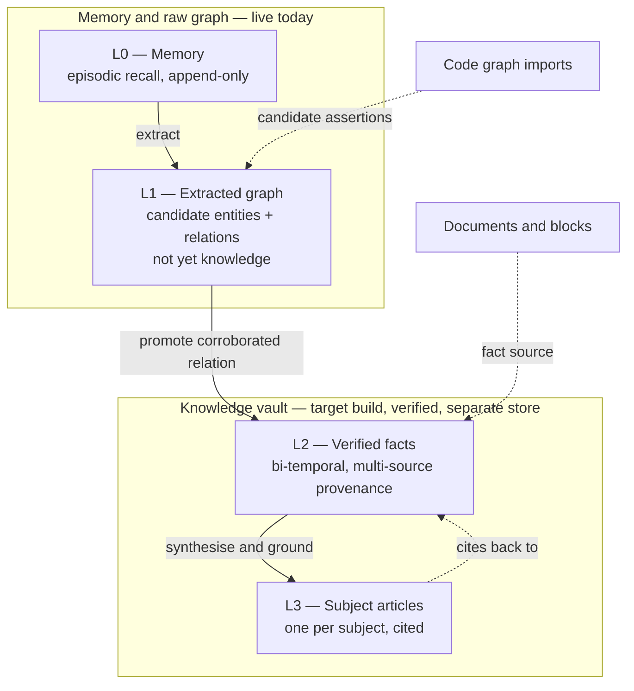
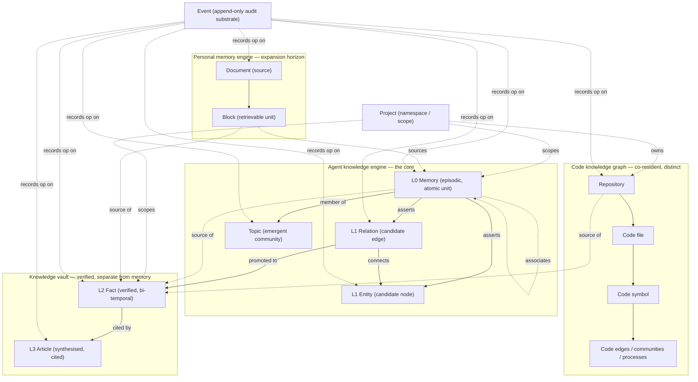
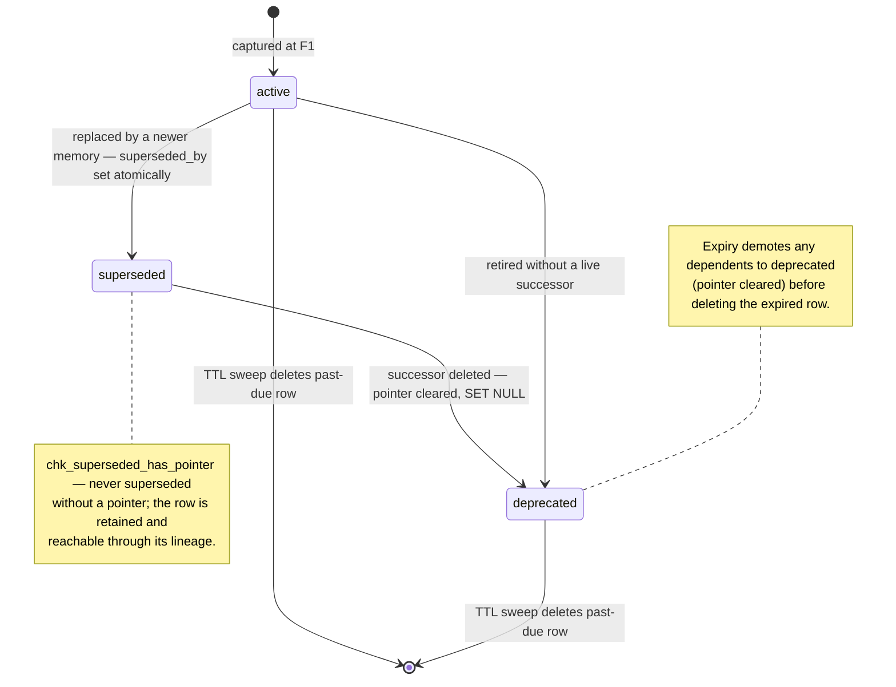
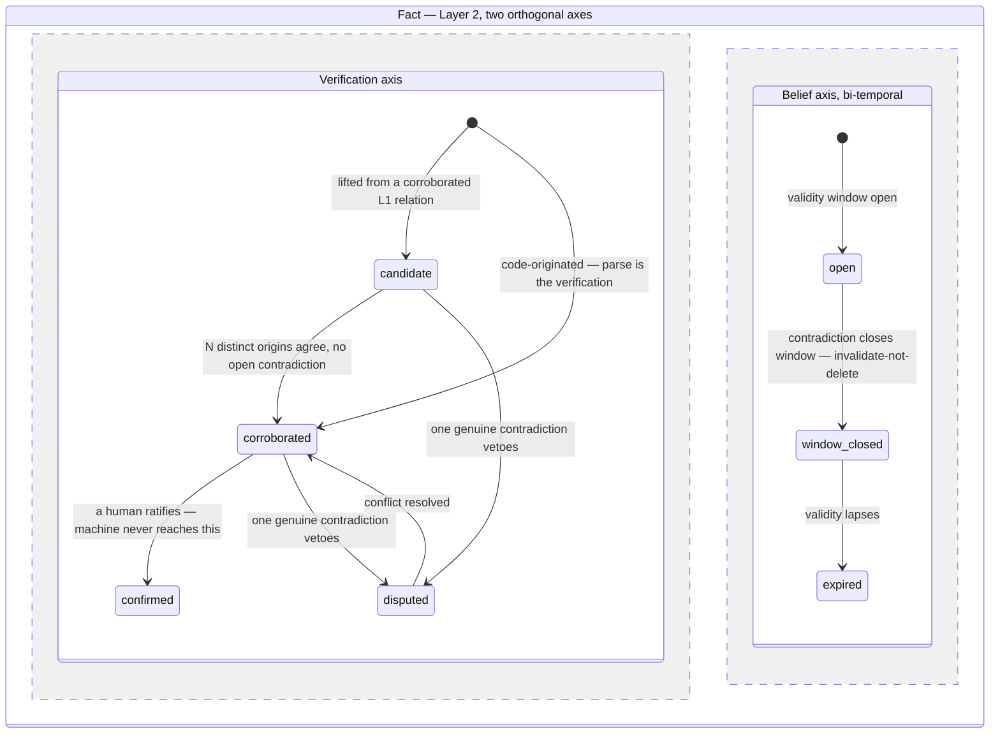
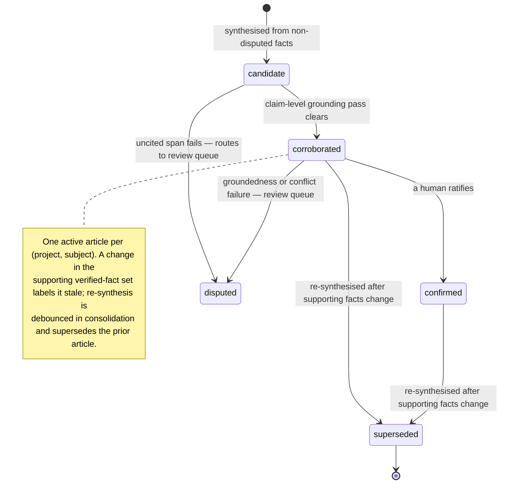
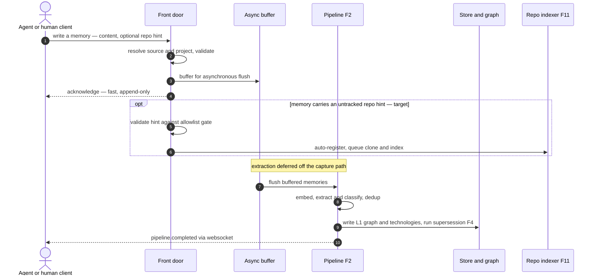

# 01 — Domain Model & Business Flows

**Status:** foundation doc (binds every subsystem doc). Draft 2026-07-23.
Part of the unified target design — see `docs/design/README.md` for the frame and document map.

---

## 1. Purpose & scope

**This doc fixes the vocabulary and the journeys; it does not fix the schema or the algorithms.** It names the objects darkmem reasons about — memory, entity, relation, topic, the knowledge vault of verified facts and subject articles, project, the code graph, documents/blocks, and events — states precisely how they relate, and walks the lifecycles and end-to-end flows that move data through them. It is the conceptual layer: every downstream doc must use these words to mean these things.

**What later docs fix instead.** The physical tables, columns, per-fingerprint partitioning, indexes, and constraints are doc 04 (data model & schema). The system decomposition and the sync-vs-async boundaries are doc 02 (architecture). The mechanics — how extraction cleans LLM output, how retrieval fuses and ranks, how supersession and consolidation decide — live in docs 05–11. When this doc needs a mechanism, it names the object and the invariant and points forward; it never dumps SQL or code. Where a decision here is genuinely a schema question in disguise, it is flagged and deferred to the doc that owns it.

**Audience & authority.** This binds every subsystem doc. An architect or doc-writer working on ingestion, retrieval, temporal reasoning, the code graph, or the product surface reads this first and does not redefine an object it defines. Where this doc and the as-is baseline (`CLAUDE.md`) agree, that behaviour is contract. Where the target extends the baseline, the extension is labelled — most visibly the **expansion horizon** (documents/blocks) and the **target-new** objects (topic, the knowledge vault of verified facts and subject articles, the associative memory-relation layer, the event substrate, and the project→repository bridge) that are designed in now and shipped on the roadmap in doc 20.

## 2. The domain at a glance

darkmem is **one store and one graph** with two horizons layered over it. The core is an *agent knowledge engine*: memories are captured, decomposed into a typed entity/relation graph, retrieved with graph-augmented hybrid search, and kept true over time. Over that same substrate the target grows a *personal memory engine* for the human — documents decomposed into blocks, retrieved with grounded citations — without a second product or a second datastore.

**Knowledge is a separate, higher layer, not a kind of memory.** darkmem's objects form a four-layer **epistemic ladder**, each layer with one job: **L0 memory** is episodic recall (what was captured, said, or happened — append-only, never overwritten); **L1** is the raw extracted entity/relation graph — *candidate signal*, explicitly **not yet knowledge**; **L2** is the store of **verified facts**, bi-temporal, promoted only when independent origins corroborate; and **L3** is one **synthesised subject article** per subject, grounded by citations back to L2. L0 and L1 exist today; the L2/L3 **knowledge vault** is the target build (§3.4), fed by memories, documents, and code but governed separately on its own verification lifecycle. This reverses an earlier model that stored knowledge as derived memory rows — knowledge is now first-class and verified, never an `insight`/`profile` row in the memory table.

The four-layer epistemic ladder — episodic memory and the raw candidate graph exist today, while the verified fact-and-article vault is the target build, fed by memory, documents, and code:

Everything hangs off a small set of objects. A **Memory** is the atomic durable unit; it is scoped by a **Project**. Extracting a memory asserts **Entities** and typed **Relations** into a graph that is *shared* (not memory-scoped) and carries provenance back to every asserting memory. Memories also link **directly to one another** through typed **memory relations** — supersession, contradiction, elaboration, association — a parallel, project-scoped edge set alongside that shared entity graph. **Topics** are not folders the human maintains — they *emerge* as communities in the memory graph. **Knowledge** is not a kind of memory — it is a first-class **verified vault** above memory: raw extractions are promoted, corroborated across independent origins, and synthesised into cited subject articles. Its facts and articles are built *from* memories, documents, and code, but they live and are governed separately, on their own verification lifecycle (§3.4). The **code graph** (repositories, files, symbols, communities, processes) is co-resident in the same Postgres and stays distinct from the memory graph — bridged to it only by *project ownership*: a project declares the remote repositories that belong to it, and referencing one from a memory can auto-provision it. **Documents** and their **Blocks** are the expansion horizon — a source and its retrievable units, from which knowledge can be lifted into the same graph. And every operation on any of these is recorded as an append-only **Event**, the substrate under the timeline and the contribution calendar.

The diagram is the map; the sections below are the legend. The four numbered layers form an **epistemic ladder** — L0 memory (what was captured) → L1 the raw extracted graph (candidate signal, explicitly not-yet-knowledge) → L2 verified facts (promoted only when independent origins corroborate) → L3 synthesised subject articles (grounded by citations back to L2). The **vault (L2/L3) is fed by** memory, documents, and code but is a *separate store on its own verification lifecycle*, not a set of memory rows — the crux of the knowledge decision in §3.4.

## 3. Core entities

Each subsection states the decision and the reason for it. Physical representation is doc 04's job; here the object is defined by its meaning, its identity, and the invariants that constrain it.

### 3.1 Memory — the atomic unit

**A memory is the smallest durable, independently-recallable statement darkmem stores, and it is the unit everything else is derived from.** It carries `content` (the text), a `source` (where it came from — `mcp`, `api`, an agent session), a `project` (its scope), a `memory_type` drawn from the closed `MEMORY_TYPES` vocabulary (today: fact, decision, preference, problem, reference, architecture, milestone — the target adds `episodic` and `procedural` as memory kinds; `insight`/`profile` do **not** join, they became the knowledge vault, §3.4), a `confidence` estimate of content quality, and enrichment the pipeline populates on every ingest (`classified_type`, `summary`, `emotions`, `flags` — the schema drops the historical `llm_` prefix, doc 04 §6.4, since the classifier may be a local model). The two type fields play distinct roles: `memory_type` is the caller-supplied label from the closed vocabulary and is the field type-filtered retrieval matches on, whereas `classified_type` is the pipeline's own classification verdict, kept for enrichment and display rather than as a filter axis (the retrieval mechanism is doc 07). A memory may also carry lightweight **metadata**, notably an optional remote-repository hint that links its project to a codebase and can auto-provision that repo's code knowledge (§3.6). The decision to make one flat statement the atom — rather than a document, a conversation, or a chat turn — is deliberate: it keeps the retrievable unit, the supersession unit, and the provenance unit the same object, so lifecycle and lineage never straddle a boundary. Turn summaries and session transcripts are explicitly *not* memories; they belong in file-based memory, and darkmem stores only verified, durable facts.

**A memory has a visible lifecycle, never a silent one.** Its `status` moves `active → superseded → deprecated`, and the transition is guarded: a memory may not be `superseded` without a `superseded_by` pointer to the memory that replaced it (the `chk_superseded_has_pointer` invariant), and both fields are set atomically. This is what makes correction auditable rather than destructive — a superseded memory is retained, pointed at its successor, and shown in the UI with its lineage, not deleted. A memory may also carry a nullable `expires_at` TTL; the expiry sweep deletes past-due rows, but only after demoting anything that pointed at them (§6). The `technologies` array is a lowercase, denormalised cache of the entity names a memory asserts whose type is a technology; supersession and the retrieval filter read it directly instead of joining. **The supersession scope is the project** — a memory can only supersede another memory in the same project — which is why project is a first-class part of a memory's identity and not a loose label.

### 3.2 Entity & Relation — the living graph

**Entities and relations are a shared graph, not per-memory scratch.** An **Entity** is a canonical node (a tool, a person, a concept, a service) identified by `(name, entity_type)`; a **Relation** is a typed, directed edge identified by `(source, target, rel_type)`. Crucially, neither is memory-scoped or project-scoped. When two memories both mention "postgres", they assert *one* entity row, and each carries its provenance in a `memory_ids` array recording every memory that asserts it. The reason is retrieval: a graph is only worth the cost of building it on every ingest if it accumulates across memories into a substrate you can traverse (principle 3, "spend the graph"). A per-memory graph would be a decoration; a shared graph is a reasoning surface. Memories also connect to *each other* directly — a parallel, project-scoped edge set called memory relations (§3.9).

**The taxonomy is closed, and shared assertions accumulate provenance without duplicating rows.** Entity and relation types come only from `ENTITY_TYPES` and `RELATIONSHIP_TYPES` in `app/taxonomy.py`; whatever the LLM emits is normalised into that vocabulary first (unknown entity types fall back to `concept`, unknown relations to `RELATED_TO`), and legacy names are rewritten at runtime — on both ingest and read — so old rows keep matching new code. Asserting an entity or relation that already exists *appends* the asserting memory to its `memory_ids`, never inserts a duplicate row. The array is not append-only, though: a memory's contributions are stripped from `memory_ids` when it is deleted or re-extracted (§6), so it shrinks as well as grows — only the no-duplicate-rows rule is genuinely append-shaped. Entities are **canonicalised** by a dedup pass that merges same-typed near-duplicates but refuses to merge names separated by a discriminating token (a version, a date, a month) even at high cosine similarity — "february outage" and "march outage" stay distinct. Names are stored **lowercase on disk** for matching, with the original casing preserved for rendering. All of this is contract from the baseline; the *how* (the ~40 cleanup passes, the ANN dedup, the discriminator) is doc 06.

**The raw entity graph is Layer-1 candidate signal, not yet knowledge.** The entities and relations extracted on every ingest are *candidate* assertions — they feed dedup, the `technologies` denorm, topic clustering, and graph-augmented retrieval, and they are the derivation source the verified fact layer is built from, but a raw edge is explicitly **not** a verified fact (§3.4). That is why the bi-temporal *valid-time* dimension — the window over which a fact holds in the world, beyond the *transaction time* a memory's `created_at` already records — lives on the **Layer-2 fact**, not on the raw relation edge. A contradiction **invalidates rather than deletes** a fact: it closes the fact's validity window instead of removing the row (invalidate-not-delete, the fact-level analogue of memory supersession), so darkmem can still answer "what did we believe as of date X" (doc 00, capability 4). That the window rides the fact layer is fixed here (§3.4); how invalidation composes with supersession is doc 08's.

### 3.3 Topic — emergent memory communities

**A topic is a cluster that darkmem discovers, not a folder the human maintains.** The decision: topics are *emergent communities in the memory graph*, produced by generalising the code graph's community detector (Leiden clustering) onto the entities-and-relations of the memory side, and materialised as a memory-community result by an off-path report job. A topic's membership is the set of memories whose entities fall in a community; its name is generated from the community's dominant entities, not typed by a user. The reason to make topics emergent rather than manual is that hand-managed folders rot the moment the corpus grows and force the human back into the librarian role darkmem exists to remove — whereas a clustering pass re-derives grouping for free as memories arrive and supersede. **Topics must not be stored as entities.** They are not extracted assertions, so putting them in the entity table would pollute the closed `ENTITY_TYPES` fallback and collide with the globally-unique `(name, entity_type)` key. Topic membership is a computed grouping over the graph, kept beside it. **Topic clustering runs over a project-scoped projection of the memory graph**, so a topic's membership never mixes projects even though the underlying entity graph is global today (§5) — a community is computed within one project's memories, not across them. Whether a topic is materialised into a durable result or recomputed on read is an open modelling question flagged to docs 06/09 (§9).

### 3.4 Knowledge — the verified fact vault (Layers 2–3)

**Knowledge is a first-class verified vault, separate from memory — not a derived memory row.** This reverses the earlier model that represented an `insight` or a `profile` as a memory row linked by `DERIVED_FROM`. Knowledge instead lives in its own store, built *from* memories, documents, and code but governed on its own lifecycle, because the thing a memory guarantees ("this was captured") and the thing knowledge must guarantee ("this is verified, as of a date, with provenance") are different guarantees that must not share a table. `insight`/`profile` are therefore **not** `MEMORY_TYPES`; the episodic recall kinds (`episodic`, `procedural`, and today's seven) stay memory kinds at Layer 0, but synthesised knowledge is lifted out of the memory table entirely. The vault has two layers above the raw graph: **Layer 2 — verified facts** and **Layer 3 — subject articles**.

**Layer 2 is the verified-fact store — the rebuild of the dormant `knowledge_triples` scaffolding, extended, never an activation of it.** The demo `knowledge_triples` table (free-text slugs, zero live callers, its `unknown` stubs reclaimed by the orphan sweep — doc 00/02 flag it as scaffolding, not shipped behaviour) is *rebuilt* into the physical home of "final, verified understanding": a bi-temporal fact, resolved to real entity endpoints, carrying a verification status, an aggregated confidence, multi-source provenance, and structured context. A fact is minted by lifting a *corroborated* Layer-1 relation, so a fact endpoint is an entity the memory graph already deduped — `postgres` from code is the same node as `postgres` from a memory. This is target-new build: the table name survives, but every column and semantic is new (doc 04 owns the schema).

**A fact climbs a verification ladder, and darkmem states exactly what a rung means.** The ladder is `candidate → corroborated → confirmed`, with a `disputed` sub-state for conflicts. A freshly-lifted fact is a **candidate**; it is promoted to **corroborated** only when independent origins agree — and corroboration counts **distinct origins, never rows**, because an echo is not evidence (two agents re-saving the same claim, or one repository re-derived across many commits, are *one* origin; when origin identity is unknown darkmem merges to one rather than minting distinct ones, so it undercounts rather than manufactures agreement). The machine can never reach **confirmed** on its own; only a human ratifying a fact can, which operationalises the maintainer's under-claiming preference — a delayed promotion costs a label, a wrong promotion costs every article that cites the fact and every agent that propagates it. A single genuine contradiction is an absolute **veto**, not a vote (consensus is not truth). Deterministic **code-originated facts are born `corroborated`** — the parse *is* the verification — carrying a distinct `code@commit` badge. The badge is honest about its ceiling: machine `corroborated` claims exactly **"asserted by K distinct origins, no known contradiction, as of T"** — never "true", never "verified" in UI copy. Under-claiming is the design, not a caveat.

**Facts and articles carry structured context, matched by boost-and-label, never silently filtered.** Each carries an `applies_when` (the env / version / situation the fact holds in) and a `learned_in` (auto-populated from its project and source, and therefore trustworthy). The agent's *current* context arrives only by **explicit declaration** — a per-call argument, a per-session declaration, or a per-project default on the projects registry (§5). Matching is **boost-plus-label by default**: a fact whose `applies_when` matches gets a rank boost; a fact with unstated context is neutral and carries its context as a visible label; only a fact in *explicit conflict* (the caller says `env=prod`, the fact is `dev-only`) is excluded — and even then the excluded count is surfaced, never a silent drop (principle 11). Filtering by default would turn an over-tagged vault into one that returns nothing, since most callers pass no context at all.

**Layer 3 is one synthesised subject article per subject, grounded by claim-level citations — target-new.** An article is a verified write-up for a salient subject (a salient entity, or a human-pinned subject), synthesised **only** from that subject's non-disputed corroborated/confirmed facts, off the hot path. Grounding is *enforced, not asserted*: every article sentence is checked against a cited Layer-2 fact by a claim-level entailment pass, an uncited span fails the article, and the article's confidence is its claim-support coverage; failures route to the review queue. There is exactly one active article per `(project, subject)`; when its supporting fact set changes the article is **labelled stale** (retrieval surfaces the label — honest partial results) and re-synthesised debounced in consolidation. Articles are retrievable, with their own per-fingerprint embedding partition. This layer is sequenced last, behind the groundedness metric (doc 09).

**The review queue is an override, never a stage on the path.** Disputed facts and low-confidence articles are a *state* — a partial-indexed flag in the `pipeline_failures` pattern, not a churning table — prioritised by consequence (retrieval frequency, subject salience), not first-in-first-out. Disputed knowledge is **served labelled with both sides**, never gated behind review, so the system stays useful with a large unreviewed backlog: a solo maintainer cannot be the throughput bottleneck of the truth system. Verification status is recomputed only off the hot path (doc 08), never inline on ingest.

**The human-facing document/PKM surface stays firewalled to doc 16.** The verified vault is darkmem's *own* understanding, not a human-edited wiki; a knowledge base with editable pages is the documents/blocks product (doc 16), gated behind the core's eval gate. The two must not couple — article synthesis reads verified facts, never document blocks directly — so the vault does not depend on the unshipped PKM horizon. This separation is what lets auto-research (§7, F7) file cited results into the vault without inventing a new storage class.

### 3.5 Project — the namespace & scope

**A project is the scoping dimension and the supersession boundary; personal-versus-knowledge-base is expressed as different projects.** Every memory belongs to exactly one `project` (default `default`). The decision to reuse `project` as the single scoping axis — rather than add a separate tenancy concept — keeps the model small: the boundary that separates a person's private memory from a shared knowledge base is the same boundary that bounds supersession (a memory only supersedes within its project) and the same one the UI exposes as a switcher/filter. Multi-*project* scoping is in scope; multi-*tenant* operator tooling is a non-goal (doc 00 §5). A project also **owns the remote repositories** tied to its work: repository references carried on its memories accumulate into the set of codebases the project tracks — the sanctioned bridge from memory context to code knowledge (§3.6).

**Cross-project isolation is an invariant, and it is the one part of this that is genuinely a schema concern.** Because entities are globally unique on `(name, entity_type)` with cross-project `memory_ids`, two projects asserting "postgres" today share one entity row. True per-tenant isolation of the *graph* — per-project dedup and an access predicate on every retrieval channel — is a schema change, not plumbing, and is sequenced later (doc 04 owns the schema, doc 18 the enforcement). What this layer fixes is the *rule*: no channel — retrieval, MCP, supersession, consolidation — may cross a project boundary silently (§5, §8).

**A minimal `projects` registry anchors the namespace (target).** Project has been a bare string on every scoped row; the vault forces a light registry — one row per project name, lazily auto-registered, with no foreign-key enforcement yet (that is the later tenancy phase). The reason is fact identity: a verified fact's identity embeds its `project`, so a typo'd project would silently split corroboration across two identities — and, downstream, two active-article scopes. The registry is a namespace anchor that also holds the per-project `applies_when` defaults (§3.4) and scopes the review queue and the one-active-article-per-subject rule. Doc 04 owns its shape.

### 3.6 Code graph objects — co-resident, distinct

**The code knowledge graph lives in the same Postgres as the memory graph but is a separate world.** Its objects are repositories, code files, code symbols (functions, classes, methods with signatures and docstrings), and a polymorphic node/edge graph over them that also carries `community` and `process` nodes — Leiden communities and traced execution flows written as graph rows rather than getting their own tables. It is *repo-scoped*, not project-scoped, and **no query joins** it to the memory-side entity graph: a symbol is not an entity, a call edge is not a relation. Keeping them distinct is deliberate — the code graph is a moat (blast-radius, communities, processes, rename over MCP that no memory competitor has), and conflating it with the memory taxonomy would corrupt both. It **surfaces over MCP** through its own tool family (code search, symbol lookup, 360-degree context, blast-radius, dependencies, communities, processes, rename), the same way the memory side surfaces through the memory tools. The mechanics are doc 10.

**Projects link to the repositories they own — a bridge, not a merge.** The code graph never joins the memory-side entity graph, but the two worlds are associated at the *project* boundary. A project declares the remote repositories that belong to it, seeded from a memory's optional repository hint (§3.1) and accumulated onto the project. Ownership is **many-to-many over a single shared `Repository` row**: two projects that reference the same remote own the *same* repository and its one repo-scoped code graph, not private copies — because the code graph is repo-scoped, shared indexing is both correct and cheaper than re-cloning per project. When a memory arrives referencing a repository the project does not yet track, **capture** resolves and validates the hint against the allowlist gate (§9), auto-registers it with default options, and hands it to F11 — which clones or pulls it and runs indexing (and, per the default-options decision deferred to docs 10/15, optionally enrichment) asynchronously, never on the capture path — so the human never has to register it by hand. Once tracked, the repository stays current **automatically**: when an agent pushes code to it, darkmem re-pulls and re-indexes (change-gated, so an unchanged `HEAD` is a no-op), by a periodic sync today and (target) a push webhook. This ownership link is the one sanctioned connection between the memory and code worlds — it lets an agent working a project's memory reach that project's code knowledge and back — and it associates the graphs without merging them: a symbol is still not an entity. Because the remote is taken from memory metadata, auto-provisioning is gated (a validated/allowlisted remote, a per-project opt-out) — a security concern owned by doc 18.

**Code originates verified facts, through a narrow one-direction bridge — not a graph join (target).** Beyond owning repositories, a project's code is a *fact-originating source* for the vault. A deriver mints deterministic, LLM-free facts from a repository's **imports only** — `repo → project`, and each external dependency into a `tool`/`database`/`language` entity through the existing closed taxonomy — asserting `repo —USES/DEPENDS_ON→ dep`. These land at **Layer 1** (like a memory's extractions, but tagged with a repository assertion rather than a memory assertion), and consolidation lifts the corroborated ones to Layer-2 facts, born `corroborated` because the parse is the verification (§3.4). **Symbols, calls, communities, and processes never originate facts** — a symbol-level claim stays *memory-asserted*, carrying a commit-addressed code **citation** as evidence, never promoted structurally. The never-join rule is reworded, not weakened: **no query joins the two graphs**; the only sanctioned crossings are two application-level, one-direction components — the code→fact deriver and the citation re-verifier. A symbol is still not an entity, and a call edge is still not a relation.

### 3.7 Document & Block — the expansion horizon

**This is the expansion horizon: designed in now, shipped later.** A **Document** is a filed source — a note, a PDF, a file — and it is decomposed into **Blocks**, the retrievable units: a block is at once the chunk unit for RAG, the embedding unit, the citation anchor, the link endpoint, and the transclusion target. The reason for one block abstraction rather than several parallel chunk types is that a single unit keeps retrieval, citation, and linking pointing at the same object, so a grounded answer can cite an exact span. The pipeline generalises the core's idempotency rule: "strip a memory's prior graph contributions before rewrite" becomes "delete a document's blocks before re-ingest."

**Documents and memory share one substrate; the differentiator is proposition ingestion.** A filed document becomes knowledge an agent can recall because the same graph and store back both — a document can be lifted into memory-shaped rows that participate in cross-document supersession in the one graph, not siloed in a separate document store. This is why the horizon is designed in from the start (schema, ingestion, retrieval all leave room for it) even though the core earns its keep first. The committed scope is parse, chunk, blocks, block retrieval, and grounded span-anchored citations; the editor/canvas/CRDT/connectors are a separate, demand-gated product, not committed to v1. All of it is specified in doc 16; this layer only fixes the vocabulary (document, block) and the shared-substrate rule.

### 3.8 Event / Operation — the audit substrate

**Every operation on any object is recorded as an append-only event.** Creating, superseding, deprecating, expiring, extracting, consolidating, filing a document, registering/syncing/indexing a repository — each is journaled as an event against the object it touched. The decision to make this a first-class substrate (rather than leaving lifecycle transitions to transient websocket broadcasts and the failure table) is that two product surfaces depend on a durable operation stream: the **memory timeline** ("what happened to this, and when") and the **contribution calendar** (the GitHub-style activity heatmap). The target extends the existing coarse memory-level audit log down to entity-level operations — it is an *extension* of what exists, not greenfield. Events are append-only and never rewritten, which is what makes the timeline trustworthy and the calendar honest. What this layer fixes is the requirement: the event stream must be durable and queryable by day and by object, so the timeline can reconstruct an object's history and a click on a calendar day can drill into that day's activity — the query surface and analytics plumbing are doc 13/18.

### 3.9 Memory relations — the associative layer

**Memories form a graph among themselves, not only through shared entities.** Where the entity graph (§3.2) links memories *indirectly* — two memories relate because they mention the same entity — a **memory relation** is a typed, directed edge *between two memory rows* directly. One such special case already exists: supersession (`superseded_by`, "replaced by"). The design generalises it into one associative layer that stores exactly **five** associative types — `CONTRADICTS`, `ELABORATES`, `DEPENDS_ON`, `FOLLOWS` (temporal succession), and `RELATES_TO` (the fallback) — plus **`SUPERSEDES`**, which is *projected* from the `superseded_by` pointer at read time and never stored as its own row. **`DERIVED_FROM` is cut for v1:** the reshape removed its only writer when knowledge left the memory table, and the rule is one provenance mechanism per layer (multi-source provenance for verified facts, claim-level citations for articles, the projected pointer for supersession) — shipping a zero-writer edge type would claim scaffolding as substrate. So a human or agent can still ask "what relates to this memory" directly, and retrieval can traverse memory-to-memory links as a first-class hop rather than only entity hops.

**A memory-level `CONTRADICTS` edge is a signal, not a verdict.** When consolidation asserts that one memory contradicts another, that edge is an *input into* the fact-level dispute machinery of the vault (§3.4) — it can help flag a Layer-2 fact `disputed` — but it is never itself the dispute. Truth is adjudicated at the fact layer, where the multi-source provenance and the contradiction veto live, not at the episodic memory layer.

**Why a second graph layer instead of reusing entity relations: the node type differs.** Entity relations connect *concepts* (`postgres → runs-on → linux`); memory relations connect *statements* (this decision → `CONTRADICTS` → that earlier decision). Folding memory rows into the entity table would force them into the globally-unique `(name, entity_type)` space and corrupt the closed entity taxonomy — exactly what §3.3 forbids for topics. Kept distinct, the two compose cleanly: the entity graph is the semantic layer, the memory-relation graph is the episodic/associative layer, and both feed retrieval and the graph views.

**Memory relations are project-scoped and obey the same discipline as the rest of the graph.** Both endpoints share a project, so the associative layer stays inside the isolation boundary supersession already respects (unlike the global entity graph). Edges carry provenance (which pass asserted them) and are typed only from the closed vocabulary. **The idempotent strip-before-rewrite-and-self-heal discipline is scoped to the consolidation-derived associative types** (`CONTRADICTS`, `ELABORATES`, `RELATES_TO`, `FOLLOWS`, `DEPENDS_ON`): re-deriving that pass strips its prior memory edges before rewriting, and such an edge self-heals when either endpoint memory is deleted. **The supersession edge is not one of those.** A `SUPERSEDES` edge is the *same fact* as the baseline `superseded_by` pointer — not a second source of truth — so whichever physical form doc 04 picks (a `SUPERSEDES` row in the memory-relation set, or the `superseded_by` column), status-plus-pointer atomicity (`chk_superseded_has_pointer`) stays the contract, and the edge is directed **successor → superseded** (the new memory points at the memory it replaced). Consequently supersession follows F4's monotonic rules under reprocess — reprocessing *re-fires* the flip (the `(created_at, id)` tie-break exists precisely so re-extraction re-establishes it) rather than stripping it the way an association pass strips its own edges; a re-extraction that no longer emits `REPLACES` does not revert a prior supersession. As for who asserts what: supersession at write time (F4); the five associative types **off the hot path** in consolidation (F6) from entity overlap, embedding proximity, and contradiction checks. Whether these edges live in their own table or extend the relation table with a memory-endpoint variant is a schema question for doc 04; this layer fixes that they exist, are closed-vocabulary, project-scoped, and provenance-bearing.

## 4. The object map

The relationships, stated tightly — this is the contract the diagram in §2 draws:

- **Memory asserts Entity and Relation.** Extraction decomposes a memory into typed nodes and edges; the memory's id is appended to each asserted object's `memory_ids`.
- **Relation connects Entity to Entity.** A relation is a directed, typed edge between two canonical entities, unique on `(source, target, rel_type)`.
- **Memory is a member of a Topic.** Membership is a computed grouping — a memory belongs to the topic(s) whose community its entities fall in; it is not stored on the memory as a foreign key the user sets.
- **Knowledge is a verified vault fed by Memory, Document, and Code — not a Memory.** A Layer-2 fact is lifted from a corroborated Layer-1 relation and carries multi-source provenance to every memory, document block, or repository that asserts it; a Layer-3 article is synthesised from non-disputed facts. Knowledge lives in its own store on its own verification lifecycle (§3.4), never in the memory table.
- **Fact is promoted from Relation; Article cites Fact.** A verified fact is lifted from a corroborated candidate relation, resolved to real entity endpoints; a subject article grounds each of its claims with a hard citation to a Layer-2 fact, and facts are invalidate-not-delete so the citation never dangles.
- **Code originates Facts.** A repository's imports mint deterministic Layer-1 assertions that consolidation lifts to verified facts — an application-level, one-direction bridge, never a graph join (§3.6).
- **Memory is scoped by Project.** Exactly one project per memory; the project bounds supersession and every retrieval channel.
- **Document has Blocks; a Block sources Memory and Fact.** A document decomposes into ordered blocks; a block can be a provenance source of a verified fact and the evidence a grounded answer cites (expansion horizon).
- **Event records an operation on any object.** Every mutation of a memory, entity, relation, fact, article, topic, document, or repository emits an append-only event.
- **Memory relates to Memory.** Typed, directed, project-scoped edges between memory rows — supersession (projected from the pointer), contradiction, elaboration, dependency, temporal succession, association — the associative layer parallel to the entity graph; `DERIVED_FROM` is cut for v1 (§3.9).
- **Project owns Repositories.** A project declares the remote repos that belong to it (seeded from memory metadata); referencing one can auto-provision it, bridging memory context to code knowledge without joining the two graphs.
- **Repository has Files has Symbols (code graph).** Repo-scoped, co-resident, and never joined to the memory-side graph.

## 5. Identity, scope & namespacing

**Two scoping regimes coexist: project-scoped memory and global-with-provenance graph.** Memories and the verified facts lifted from them are **project-scoped** — fact identity embeds the `project` (§3.4), so a memory or a fact lives inside one `project` namespace — and topics are project-scoped too, because their clustering runs over a project-scoped projection of the graph (§3.3). Entities and relations are **global**, shared across memories and (today) across projects, carrying their scope implicitly through the `memory_ids` of the memories that assert them. The code graph is a third regime, **repo-scoped** — disjoint from both *as a graph*, and associated to projects only through the repository-ownership link of §3.6 (a registry association, not a graph join). Naming the regimes matters because the isolation guarantees differ per regime, and a subsystem doc must know which it is touching.

**Personal versus knowledge-base is a namespace convention, not a new object.** A person's private memory and a shared, curated knowledge base are simply different `project` values. This is what keeps auto-research and consolidation uniform: filing cited knowledge "into a knowledge base" scopes the vault's facts and articles to a KB-designated `project` — the same registry-and-scope model as a personal project — not a separate storage class.

**The cross-project isolation invariant binds every channel.** No result may cross a project boundary silently — not retrieval (semantic, keyword, graph-augmented), not MCP tool calls, not supersession (candidates must share the new memory's project), not consolidation. Today the honouring is uneven, and doc 02 §9 records the exact gap. The memory *search* channels over-fetch and re-apply the `project`/`status` predicates in Python, so isolation holds there — but at a recall cost, and only when a project filter is actually supplied. Channels that read semantic results with *no* filter — notably the reason path, which feeds them straight to an LLM — leak cross-project and superseded rows today; and the shared entity graph (and any topic clustering over the global graph rather than a project-scoped projection) does not yet isolate per project either. Closing all of it — SQL filter pushdown so every channel scopes in the query, per-tenant dedup, an access predicate on every channel, and project-scoped community detection for topics — is a labelled schema-and-enforcement task (doc 04, doc 18, and docs 06/09 for topics). The two new vault channels (facts, articles) are born with SQL project/status pushdown, so they never inherit that retrofit gap. The invariant itself is fixed here and is non-negotiable regardless of when the enforcement lands: honest reporting means never leaking another project's data into a result (principle 11).

## 6. Lifecycles

Each object has a state machine, and each transition is guarded by an invariant. Mechanics live downstream (docs 05–11); the guarantees are fixed here.

**Memory.** `active → superseded → deprecated`. A memory becomes `superseded` only when a newer memory replaces it, and only atomically with a `superseded_by` pointer (`chk_superseded_has_pointer`); it becomes `deprecated` when it is retired without a live successor (successor deleted, or (target) a correction with no single source). Expiry is a separate axis: a memory with a past-due `expires_at` is swept, but **dependents are demoted before deletion** — anything pointing at it via `superseded_by` is first flipped to `deprecated` with its pointer cleared, because the pointer's `ON DELETE SET NULL` would otherwise leave those rows violating the superseded invariant and abort the whole batch. A superseded or deprecated memory is never silently dropped from results; it is retained, labelled, and reachable through its lineage.

The memory lifecycle — active through superseded to deprecated — with the pointer invariant and the demote-before-delete rule that guards expiry:

**Fact (Layer 2).** `candidate → corroborated → confirmed`, on a **verification axis orthogonal to a belief axis** (`open → window-closed → expired`). A fact is born a **candidate** when a Layer-1 relation is lifted; it is promoted to **corroborated** when distinct independent origins agree with no open contradiction, and only a human can ratify it to **confirmed**; a conflict flips it to the `disputed` sub-state. Promotion counts **distinct origins, never rows**, and a single genuine contradiction vetoes it (§3.4). Invalidation is **invalidate-not-delete** — a contradicted fact has its validity window closed and is retained, never removed — the fact-level analogue of memory supersession. Verification is recomputed only off the hot path, with hysteresis so a demotion does not thrash on a transient re-extraction; every transition is journaled as an Event, so "what did we believe as of X" answers the verification dimension too.

The fact verification ladder runs on two orthogonal axes — verification (candidate to corroborated to confirmed, disputed on conflict) and bi-temporal belief (open to window-closed to expired):

**Article (Layer 3).** `candidate → corroborated → confirmed → superseded`, with a `disputed` sub-state, exactly one active per `(project, subject)`. An article is synthesised from non-disputed facts, **labelled stale** when its supporting fact set changes, and re-synthesised debounced in consolidation; a re-synthesis supersedes the prior article, and its claim-level citations cascade. An article that fails the groundedness or conflict pass flips to `disputed` and routes to the review queue rather than shipping.

The article lifecycle — synthesised, grounded, ratified, then superseded on re-synthesis, with disputed articles routed to the review queue:

**Entity / Relation.** `created (append memory_id — or, for code-derived assertions, a repo id) → shared → orphaned → pruned`. An entity or relation is created (or, if it already exists, has the new `memory_id` appended) during a memory's extraction — or, target, has a `repo_id` appended when a repository's imports assert it (§3.6) — shared as more memories or repositories assert it, and becomes orphaned when the last asserting memory or repository is deleted or re-extracted away. Deletion is **self-healing**: a relation is removed only when no live memory still asserts it; an entity only when no live memory asserts it *and* no surviving relation references it. An hourly orphan sweep runs an unscoped backstop so a fresh entity never dedups onto a stale ghost.

**Memory relation.** A memory-to-memory edge (§3.9) is asserted when a pass produces it. The **associative** types (`CONTRADICTS`, `ELABORATES`, `FOLLOWS`, `DEPENDS_ON`, `RELATES_TO`) are consolidation-derived (F6) and share the entity-relation discipline: self-healing, idempotent, taxonomy-closed, project-scoped — removed when that pass re-derives its edges or when either endpoint memory is deleted. **Supersession is monotonic, not stripped-and-rewritten:** the `SUPERSEDES` edge is the `superseded_by` pointer under another name, so it moves on the memory's own state machine under F4's rules, and reprocessing re-fires it rather than reverting it — a re-extraction that no longer emits `REPLACES` leaves the prior supersession standing. All of it stays within the project scope.

**Topic.** `emerge → grow / merge / split → decay`. Topics are recomputed by clustering, so they are not edited through transitions but *re-derived*: a topic emerges when a community forms, grows as members are added, merges or splits as the graph's community structure shifts, and decays as its member memories are superseded or expire out from under it. Because membership is computed, topic drift is a natural consequence of the underlying graph changing, not a maintenance task.

**Code graph — repository (co-resident, distinct).** `registered → synced → indexed → optionally enriched / wiki'd → re-indexed`. A repository is registered — manually, or **auto-registered when a memory references an untracked repo** (§3.6) — against a local path or remote, its working tree synced, and its files parsed with tree-sitter into the code symbol/edge graph; symbol enrichment and code-wiki generation run only when their toggles are set. Re-indexing is **idempotent and change-gated**: an unchanged `HEAD` sha short-circuits the reindex unless a full rebuild is forced, and sync stays current automatically — a periodic fetch today and (target) a push webhook — so an agent's code push re-indexes without a manual step. This lifecycle is disjoint from the memory lifecycle — its graph contents are repo-scoped and never join the memory graph; ownership by a project (§3.6) is a registry-level association, not a scoping of the graph. Mechanics: doc 10.

**Document (horizon).** `ingested → chunked-to-blocks → embedded → optionally knowledge-extracted → retrievable`. A filed document is parsed, decomposed into blocks, block-embedded, and thereby made retrievable; optionally, propositions are lifted from it into memory rows and, through consolidation, into vault facts (the document being one of their provenance sources). Re-ingest is **idempotent** by the generalised rule — blocks are deleted by `document_id` before the document is re-chunked — so re-filing an edited document does not orphan stale blocks.

## 7. Business flows

Eleven flows, F1–F11. Each states its trigger, actors, the conceptual (not code) steps, the objects it touches, the invariants it upholds, and where the human sits in the loop. Where a flow or a step extends the baseline rather than restating today's contract, it is tagged (target) inline (or (horizon) for the documents/PKM surface), the same way §3 labels target-new objects. Mechanics are downstream; these are the journeys the design must support.

**F1 — Capture.** *Trigger:* an agent or human writes a memory. *Actors:* MCP client, REST caller, coding-agent session, (target) a browser AI-chat capture front door, or (horizon) a filed document. *Steps:* a statement arrives through one of many front doors → its `source` and `project` are resolved → it is validated and buffered for asynchronous flush (target) → acknowledged; (target) if the memory carries a repository hint the project does not yet track, capture validates it against the allowlist gate (§9), auto-registers it with default options, and queues it for indexing (F11). *Objects:* Memory (created, `active`); (target) Repository (auto-registered on an untracked reference, handed to F11); Event (capture recorded). *Invariants:* one vault behind many front doors — every path produces the same Memory object; the write stays fast and append-only (principle 6), with extraction deferred to F2. *Human in the loop:* none required; capture is autonomous, and the human sees the result on the dashboard/calendar afterwards.

**F2 — Extract & classify.** *Trigger:* buffered memories are flushed to the pipeline (target: the async buffer-flush; see F1). *Actors:* the ingestion pipeline. *Steps (conceptually the five phases):* embed the content → extract the entity/relation graph and classify/enrich in the same phase (folded into one LLM call when the classifier is LLM-backed and the mode is simple, otherwise two concurrent calls — docs 05/11) → embed entities with a cache → dedup and canonicalise entities → write the graph, recompute `technologies`, and run supersession. *Objects:* Memory (enriched: `llm_*`, `technologies`, `confidence`); Entity/Relation (asserted, `memory_ids` appended); Event (extraction outcome). *Invariants:* extraction produces the **Layer-1 candidate graph**, not verified facts — promotion into the vault happens later, off the hot path (F6); **idempotent re-extraction** — a memory's prior graph contributions are stripped before the new set is written; the closed taxonomy normalises every emitted type; lowercase-on-disk with display casing preserved. *Human in the loop:* observes the live pipeline stepper and the failure-triage queue; does not gate the flow.

Capture through the asynchronous buffer into extraction (F1 into F2): the write stays fast and append-only while the pipeline builds the Layer-1 graph off the hot path:

**F3 — Retrieve.** *Trigger:* an agent (or human) queries darkmem. *Actors:* MCP/REST caller; the hybrid + graph-augmented retriever. *Steps:* embed the query → run the semantic side against the memory embeddings and the keyword side against the search vector → fuse by reciprocal rank fusion → optionally rerank and apply confidence weighting → (target) augment with graph signals → return ranked results with a (target) "why retrieved" trace. *Objects:* Memory (read); Entity/Relation (traversed); Event (optional read log). *Invariants:* results are **explainable** (every result carries its (target) retrieval trace) and **honest** — no cross-project rows, and superseded/deprecated rows are labelled, never silently mixed in as if active; the `memory_id` type boundary is normalised so matches never drop. *Human in the loop:* reads the explainability trace to trust or challenge a result. Mechanics: doc 07.

**F4 — Supersede / correct.** *Trigger:* a newer memory contradicts or replaces an older one (a `REPLACES`-family relation is asserted during F2). *Actors:* the supersession detector inside the write phase. *Steps:* the new memory is written → candidates in the same project are checked against the supersession rule (active, technology overlap, within the window, strictly ordered before the new memory — older `created_at`, or equal `created_at` with a smaller `id` — and past the per-target speculative gate) → each qualifying candidate is flipped to `superseded` with its `superseded_by` set atomically. *Objects:* Memory (old → `superseded`, new stays `active`); Event (supersession recorded with lineage). *Invariants:* `chk_superseded_has_pointer` (status and pointer set together); the `(created_at, id)` ordering lets one direction of a same-batch `REPLACES` fire while blocking the mutual flip that would make two same-relation rows supersede each other (and vanish from the default `active` view); scope stays within the project. *Human in the loop:* sees the correction and its lineage in the UI (superseded rows shown with an amber badge), and (target) can undo. Mechanics: doc 08.

**F5 — Expire.** *Trigger:* the TTL sweep runs and finds memories past their `expires_at`. *Actors:* the expiry cleanup job. *Steps:* collect past-due memories → for any that others point at via `superseded_by`, demote those dependents to `deprecated` and clear their pointers → then delete the expired rows. *Objects:* Memory (dependents → `deprecated`, expired rows deleted); Entity/Relation (self-healing prune of anything now orphaned); Event (expiry recorded). *Invariants:* **demote-before-delete** so the SET-NULL on the pointer never leaves a superseded row without a target; the batch never half-applies. *Human in the loop:* none on the sweep; the human sees the effect on the timeline and can set/extend TTLs from the hygiene queue.

**F6 — Consolidate / "dreaming".** *Trigger:* a scheduled background job, or the human pressing "Dream now". *Actors:* the consolidation job; the human as reviewer. *Steps (off the hot path):* dedupe near-identical memories → refine (rewrite `summary`/tags with an audit trail) → supersede-on-correction through a (target) direct supersession primitive → **promote corroborated Layer-1 relations into Layer-2 verified facts** (counting distinct origins, applying the contradiction veto, recomputing verification status) → **synthesise Layer-3 subject articles** from non-disputed facts, grounded by claim-level citations → re-derive **topics** from the updated graph → **derive associative memory relations** (`CONTRADICTS`/`ELABORATES`/`FOLLOWS`/`DEPENDS_ON`/`RELATES_TO`) from entity overlap, embedding proximity, and contradiction checks, idempotently (the pass's prior edges are stripped first) → queue disputed facts and low-confidence articles into the review queue and candidates into the **hygiene queue**. *Objects:* Memory (deduped/refined/superseded); Fact (promoted, verification recomputed); Article (synthesised, cited); Topic (re-formed); Memory relation (associative types asserted/re-derived); Event (every change journaled). *Invariants:* **no LLM contradiction/consolidation/synthesis call ever on the ingest path** (principle 6); corroboration counts **distinct origins, not rows**, and the machine never reaches `confirmed`; grounding is enforced at claim level; deletes are off by default, so every change routes through supersession or invalidation and is auditable (lineage, not deletion); re-derivation is idempotent. *Human in the loop:* central — a "dream digest" presents the changes with an audit trail and undo; the hygiene queue (candidate duplicates, low-confidence, expiring-soon, superseded lineage) is triaged with bulk actions. Mechanics: docs 08/09.

**F7 — Auto-research.** *Trigger:* the human requests research on a topic. *Actors:* a research agent reusing the extraction and deep-research patterns; the human as requester and reviewer. *Steps:* the agent researches the topic → extracts and grounds claims against gathered evidence → files that evidence into the chosen `project` as memory rows (or, on the horizon, as document blocks per doc 16) → the corroborated claims are lifted into Layer-2 **verified facts**, and a synthesised, cited Layer-3 **article** is written for the subject, each grounded to its evidence, into the chosen `project` (a personal project or a KB project). *Objects:* Knowledge (facts + a cited article created); Memory/Entity/Relation (the evidence rows and their graph); Event (research run recorded). *Invariants:* the output uses the **verified-vault** model — facts carry multi-source provenance, the article carries claim-level citations to facts; groundedness is measurable and enforced at claim level (support versus linked evidence, citation coverage); no new human-edited KB artifact table (that firewall holds — §3.4). *Human in the loop:* requests the research and reviews the cited result before trusting it. Whether F7 is a committed v1 capability or a demand-gated stretch is an open sequencing question (§9). Mechanics: docs 09/16.

**F8 — Document RAG & analysis (horizon).** *Trigger:* the human files documents and asks questions over them. *Actors:* the human as direct user; the document pipeline and block retriever. *Steps:* file a document → parse and chunk into blocks → block-embed → retrieve relevant blocks for a question → answer with grounded, span-anchored citations → analyse the corpus (trends, summaries, connections). *Objects:* Document (filed); Block (created, embedded, retrieved); optionally Memory/Knowledge (propositions lifted in). *Invariants:* answers are **grounded and cited** to exact block spans, subject to a faithfulness gate; re-ingest is idempotent (blocks deleted by `document_id` before rewrite); the corpus shares the one graph and store. *Human in the loop:* the primary actor — this flow exists to make the human a first-class user of their own memory. Expansion horizon; mechanics: doc 16.

**F9 — Observe & curate.** *Trigger:* the human opens the product surface. *Actors:* the human as curator. *Steps:* watch the live pipeline and the memory timeline → read the contribution calendar and drill into a day → inspect the "why retrieved" trace and the verification badge on a result → triage the hygiene queue and the review queue (disputed facts, stale or ungrounded articles) → prune, edit, extend a TTL, supersede, or ratify a fact to `confirmed`. *Objects:* every object (read); Memory/Fact/Article (curated); Event (curation actions recorded). *Invariants:* every backend signal ships with the UI that makes it visible (principle 10); nothing degrades silently — failures and partial results are surfaced and labelled (principle 11). *Human in the loop:* this *is* the human-in-the-loop flow — the surface that lets the human see, trust, and curate the brain without reading the database. Mechanics: docs 13/14.

**F10 — Inject (push) (target).** *Trigger:* an agent begins a task, or a supported tool opens a session, and darkmem proactively supplies context before the first prompt. *Actors:* the distribution layer (auto-inject); the target tool as recipient; the agent as consumer. *Steps:* the task or session context is detected → the relevant memories are selected through the same retrieval path as F3 → they are pushed into the tool's context ahead of the user's prompt → the interaction proceeds already-informed. *Objects:* Memory (read); Event (an inject recorded). *Invariants:* push is a *delivery* of retrieval, not a second ranking path — it reuses F3's fusion and its honesty guarantees (no cross-project rows; superseded/deprecated rows labelled, never silently mixed in); this is principle 9's "pull *and* push." *Human in the loop:* configures what auto-injects and can see and curb it — the push is transparent, never a silent context swap. Mechanics: doc 15.

**F11 — Index code.** *Trigger:* a repository is registered — manually, or **auto-provisioned when a memory references an untracked repo** (F1) — or its `HEAD` advances (an agent's code push, a scheduled sync, or a manual reindex). *Actors:* the code-indexing pipeline; the repo-sync job; the human as repo owner. *Steps:* register (or auto-register with default options) and sync the repo → parse changed files with tree-sitter into code symbols and edges → optionally enrich symbols and generate the code wiki → surface the graph over the code MCP tool family (search, symbol, 360-degree context, blast-radius, dependencies, communities, processes, rename); on a subsequent push, **auto-pull and re-index** without human action. *Objects:* Repository, Code file, Code symbol, and the code edges/communities/processes (all repo-scoped); Event (index run recorded). *Invariants:* **idempotent, change-gated re-index** — an unchanged `HEAD` sha short-circuits unless a full rebuild is forced; the code graph never joins the memory-side entity graph (a symbol is not an entity, a call edge is not a relation). *Human in the loop:* registers repos and triggers reindex, symbol enrichment, or wiki generation from the UI, and reads the code graph and wiki. Mechanics: doc 10.

## 8. Cross-cutting domain invariants

The doc-00 principles, restated as they bind *this* layer. A subsystem doc that breaks one is changing behaviour, not cleaning up.

- **Project-scope isolation.** Every memory-regime channel respects the project boundary; no retrieval, memory MCP call, supersession, or consolidation ever leaks another project's data into a result. Supersession candidates must share the new memory's project. The **code MCP tool family is the deliberate exception**: it operates on the repo-scoped code graph, which is shared across the projects that own a repository (§3.6), so its access is gated by repository, not by project — it sits outside this memory-regime invariant by design, not by omission.
- **Lowercase on disk, display casing preserved.** Entity names are lowercased for matching, with the original casing retained for rendering; supersession and the `technologies` denorm assume lowercase.
- **Idempotent re-extraction.** Reprocessing a memory strips its prior graph contributions before writing the new set — and the same rule generalises to knowledge re-derivation and document re-ingest. Every mutation is safely repeatable.
- **Provenance always.** Nothing exists without a trail: entities and relations carry `memory_ids` (and, for code-derived assertions, `repo_ids`), verified facts carry multi-source provenance to every origin that asserts them, articles carry claim-level citations to the facts they ground, and every operation emits an Event. A result the human cannot trace back is a defect.
- **Reconciliation off the hot path.** No LLM contradiction, consolidation, or synthesis call sits on ingest; all such work is background jobs. Capture stays fast and append-only.
- **Honest lifecycle.** Superseded and deprecated memories are retained, labelled, and reachable through their lineage — never silently dropped into (or out of) a result as though they were active.
- **Honest verification / under-claim.** A verified fact's badge claims only **"asserted by K distinct origins, no known contradiction, as of T"** — never "true", never "verified" in UI copy; corroboration counts **distinct origins, never rows**; the machine never reaches `confirmed` on its own; and disputed knowledge is served labelled with both sides, never silently dropped or gated behind review. A delayed promotion is the preferred failure; a confident-but-wrong one is the worst.
- **Taxonomy closed.** Three distinct closed vocabularies govern the model — **memory types** (`MEMORY_TYPES` — the episodic recall kinds; `insight`/`profile` are *not* here, they are the vault, §3.4), **entity and entity-relation types** (`ENTITY_TYPES` / `RELATIONSHIP_TYPES`), and **memory-relation types** (the five stored associative types `CONTRADICTS`/`ELABORATES`/`DEPENDS_ON`/`FOLLOWS`/`RELATES_TO`, plus `SUPERSEDES` projected from the pointer; `DERIVED_FROM` is cut for v1 — §3.9). Anything emitted is normalised into the *right* vocabulary, and a new type is landed in its own vocabulary and swept through every hard-coded list *before* any feature emits it.

## 9. Open questions & deferred decisions

Each with its current recommended stance, so downstream docs inherit a default rather than a blank.

- **Knowledge — vault versus derived memory row (resolved).** The earlier recommendation — an `insight`/`profile` `memory_type` plus `DERIVED_FROM` edges, no new table — is **reversed**. Knowledge is a first-class **verified vault** separate from memory: Layer-2 facts (the `knowledge_triples` rebuild extended, §3.4) and Layer-3 subject articles, on their own verification lifecycle. `insight`/`profile` are no longer memory types, and `DERIVED_FROM` is cut for v1. The physical schema is doc 04's; the human-facing knowledge-base surface stays firewalled to doc 16.
- **Corroboration threshold (config, evidence-tuned).** The distinct-origin count for promoting a fact to `corroborated` (N=2 when the origins differ in source-kind or are well separated in time, otherwise 3) and the review-queue policy start conservative and loosen only with measured promotion rates; they live in `config` rows, not code (§3.4). The mechanics are doc 08's.
- **Topic materialised versus computed-on-read.** Whether a topic is persisted as a durable community result or recomputed by clustering at read time is a cost/freshness trade-off flagged to docs 06/09; this doc fixes that topics are *emergent*, not manual, and that clustering runs over a project-scoped projection so membership never crosses a project boundary (§5).
- **Bi-temporal modelling — which object carries valid-time.** Doc 00's capability 4 commits to validity windows, "what did we believe as of date X", and contradiction-invalidates-rather-than-deletes. This layer fixes the vocabulary — *transaction time* (a memory's `created_at`, when darkmem learned a fact) versus *valid time* (a fact's world-truth window) — and that invalidation is the fact-level analogue of supersession. *Resolved: the validity window rides the **Layer-2 fact**, not the raw relation edge (§3.2, §3.4) — a contradiction closes the fact's window (invalidate-not-delete), memories carry transaction time. How invalidation composes with supersession is confirmed in doc 08.*
- **How documents/blocks physically relate to memory rows.** The shared-substrate rule and proposition ingestion are fixed here; the physical relationship (foreign keys, block-to-memory linkage, the block-embedding partition) is deferred to docs 16 and 04.
- **Auto-research: committed capability versus stretch.** The vision and requirements name it (doc 00 §4, F7) and its groundedness metric is definable; it is sequenced after the domain model it depends on, and its harness is stubbed until then. *Recommendation: keep it committed for v1 as the docs do, but confirm its phase in doc 20* — it may land as a demand-gated stretch.
- **Local-network-trust default with optional hardening.** The default is decided (principle 8: unauthenticated MCP on a trusted LAN, trust-on-first-use, no pre-shared secret; fix a LAN block by extending the allowlist, never by disabling protection). *Recommendation: keep the default, and confirm the optional API-key/bearer hardening path for exposed OSS deployments* as a Phase-4 decision in doc 18; client-side E2EE and encrypted device transfer remain a recorded decision, not a commitment.
- **Memory-relation storage and vocabulary.** *Recommendation: the closed memory-relation vocabulary is the five stored associative types (`CONTRADICTS`, `ELABORATES`, `DEPENDS_ON`, `FOLLOWS`, `RELATES_TO`) plus `SUPERSEDES` projected from the `superseded_by` pointer; `DERIVED_FROM` is cut for v1 (§3.9). Project-scoped and provenance-bearing* — defer to doc 04 whether the edges get their own table or extend the relation table with a memory-endpoint variant.
- **Repository auto-provisioning: default-on, and its safety.** The intent is that referencing a repo from a memory auto-registers it with default options, pulls, indexes, and thereafter auto-syncs on push. *Recommendation: keep auto-provision as the default but gate it* — auto-cloning an arbitrary remote URL taken from memory metadata is an SSRF/abuse vector, so the remote should be validated against an allowlist (or require the project to already trust it), with a per-project/global opt-out. The default-options set and the push-trigger mechanism (webhook versus periodic sync) are deferred to docs 10/15; the safety gate to doc 18.

---

*Downstream: this doc's objects are given tables, partitions, and constraints in doc 04 (including the knowledge vault — the `knowledge_triples` rebuild extended, `fact_sources`, articles, and citations); its component boundaries in doc 02; its flows are mechanised in docs 05–11 (ingestion and the Layer-1 candidate graph, graph/taxonomy, retrieval with the four-layer composition and `applies_when` matching, temporal reasoning and the verification ladder, knowledge synthesis with articles and enforced grounding, code knowledge and fact origination, LLM orchestration); the push/inject and browser-capture paths are doc 15; the documents/blocks horizon is specified in doc 16; and its lifecycles are surfaced to the human in docs 13/14. The vocabulary fixed here is binding for all of them.*
