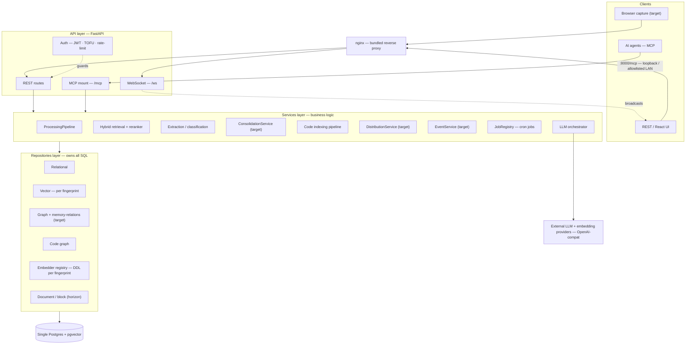
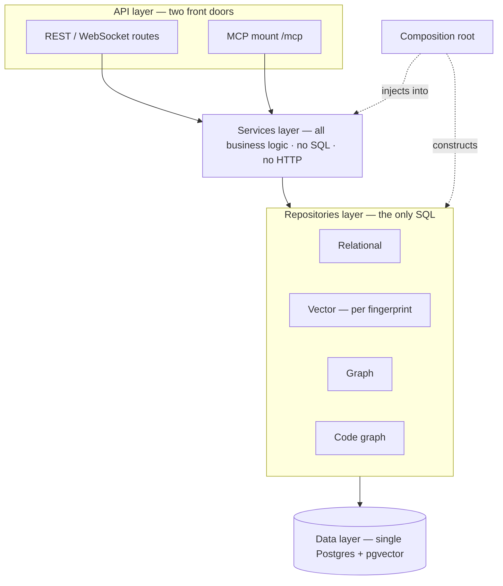
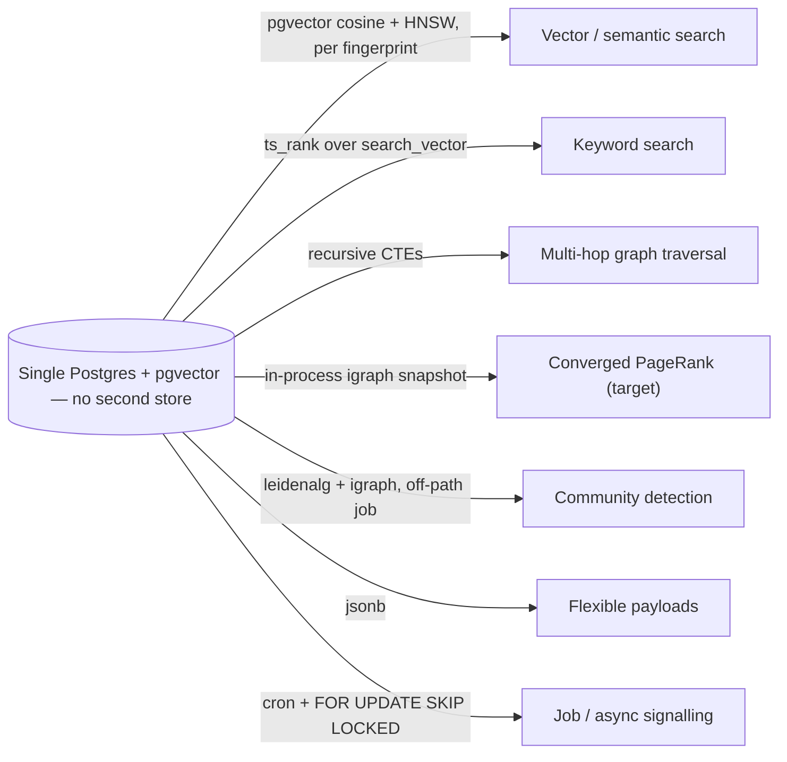
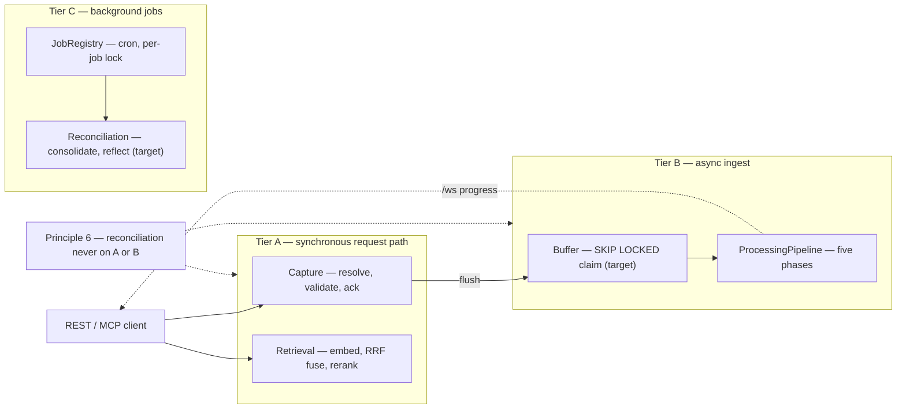
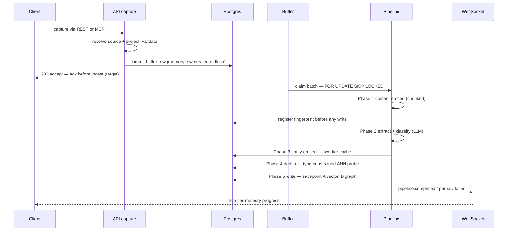
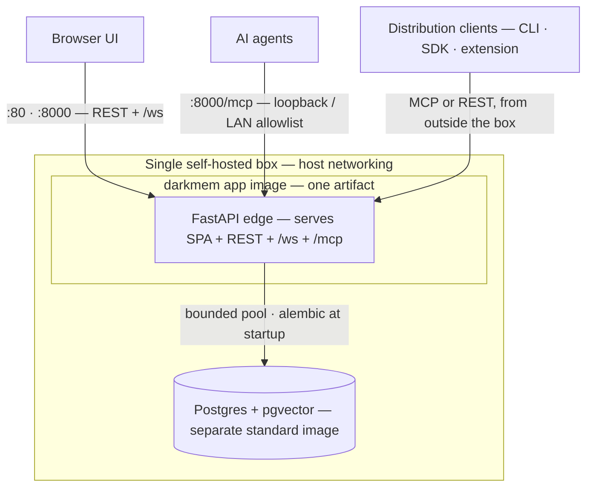

# 02 — System Architecture

**Status:** foundation doc (binds every subsystem doc's runtime shape). Draft 2026-07-23.
Part of the unified target design — see `docs/design/README.md` for the frame and document map.

---

## 1. Purpose & scope

**This doc fixes the runtime decomposition; it does not fix the vocabulary, the schema, or the algorithms.** It settles how darkmem is cut into layers, where the component boundaries fall, how data flows through them, why every capability rides one Postgres, which work is synchronous and which is deferred off the hot path, and how the whole thing is deployed and trusted. It is the structural layer between the conceptual model above it and the mechanisms below it: it names components and boundaries and points forward, and it never dumps a table definition or an algorithm.

**What the neighbouring docs fix instead.** The objects this doc moves around — memory, entity/relation, topic, knowledge, project, the code graph, documents/blocks, events — are defined in doc 01 (domain model); this doc *references* them and must never redefine them. The physical tables, per-fingerprint partitioning, indexes, and constraints are doc 04 (data model & schema). The mechanics — how ingestion chunks and cleans, how retrieval fuses and ranks, how supersession and consolidation decide, how the code graph is built, how the LLM orchestrator dispatches — are docs 05–11. When this doc needs a mechanism it names the component and the boundary and defers; where a decision here is really a schema or a mechanism question in disguise, it is flagged and handed to the doc that owns it.

**Audience & authority.** This binds every subsystem doc's runtime shape. An architect adding a service, a route, a job, or a repository reads this first to learn which layer it belongs in, what it may depend on, whether it sits on the sync path or a background job, and how it attaches without re-architecting the stack. Where this doc and the as-is baseline (`CLAUDE.md`) agree, that structure is contract. Where the target extends the baseline, the extension is labelled **(target)** — or **(horizon)** for the documents/PKM surface — the same way doc 01 labels target-new objects. And the doc is honest about the gap between what exists and what is designed: several assets are latent scaffolding today, and §9 says so plainly rather than letting the architecture over-claim.

## 2. Architecture at a glance

**darkmem is one FastAPI process over one Postgres, cut into four layers with a strict downward dependency rule.** Clients reach it through two front doors — the REST/WebSocket surface behind a bundled nginx, and an MCP surface on a trusted LAN (unauthenticated by design until 2026-08-26; it now requires a bearer API key, see §8) — which both land on the *same* service layer. Services hold all business logic and never touch HTTP; repositories own all SQL and never reach up into services; the data layer is a single pgvector-enabled Postgres. A single component, the LLM orchestrator, is the only door out to external model providers. The runtime today is a single uvicorn worker; the deployment is a single self-hosted box. Everything below is a refinement of this one picture.

The diagram shows the four layers, the two front doors, the bundled nginx, and the one external boundary. Target-new components are labelled `(target)`; the documents/blocks path is `(horizon)`.

## 3. The layered decomposition

**Four layers, one dependency direction: API → services → repositories → data, and never the other way.** Each layer has a single responsibility and may depend only on the layer beneath it. The rule is what keeps the system legible as it grows: a route change cannot silently rewrite SQL, a repository cannot reach up into HTTP concerns, and a service can be tested against a session without a running web server.

The strict downward dependency: two front doors converge on one service layer, services own the only path to repositories, repositories own the only SQL to Postgres, and only the composition root reaches across a boundary — to construct, never to call.

**The API layer is the only front door, and there are two of them onto one service layer.** This is doc 01's F1 made structural — *one vault, many front doors*. REST routes (`auth`, `memories`, `tags`, `graph`, `analytics`, `config`, `pipeline`, `vectors`, `chat`, `repos`, `code`, `setup`, `system`, `jobs`, and the rest) and the MCP server mounted at `/mcp` are **two entry surfaces onto the same services**, resolved per request through the dependency wiring. An MCP `memory_add` and a REST `POST /memories` both call the same `MemoryService` and the same pipeline; they differ only in transport, authentication posture, and how `source` is resolved. The WebSocket surface at `/ws` is a third API-layer concern — outbound only — and auth is enforced as a FastAPI *dependency*, not as middleware (the sole middleware in the app is CORS). Keeping the two front doors thin and convergent is what prevents the MCP and REST paths from drifting into two subtly different memory engines.

**The services layer holds every business rule and owns no SQL and no HTTP.** Each service takes a database session and, where needed, the LLM orchestrator, and returns domain results. This is where ingestion phases, retrieval fusion, supersession, consolidation (target), code indexing, and job scheduling live. A service may call other services and may call repositories; it may not import anything from the API layer.

**The repositories layer is the only place that writes SQL, split by data shape.** Relational rows (memories, tags, audit, crossrefs), vector partitions (memory and code-chunk embeddings, always routed through the per-fingerprint child table), and the graph (entities, entity-relations, per-fingerprint entity embeddings, and the target memory-relation edges) each get their own repository over the one Postgres. A repository exposes typed operations, not raw connections, so the no-cross-fingerprint-join rule and the CAST-your-params rule are enforced in one place rather than scattered across services.

**The data layer is a single Postgres with pgvector — no second store.** Its role, and why it is enough, is §4.

**The one sanctioned deviation is the composition root.** Application startup (and the per-request dependency wiring) instantiates concrete repositories to hand to services — the wiring code reaches across a layer boundary to *construct*, never to *call business logic*. That is the assembly seam every layered system needs; it is not a licence for a route to run a query or a repository to import a service.

## 4. The single-Postgres rationale

**Principle 1 is architectural, not aspirational: one store carries every capability, and there is no second datastore.** darkmem is a knowledge engine that needs vector search, keyword search, multi-hop graph traversal, converged PageRank, community detection, flexible payloads, and job coordination — the exact shopping list that usually spawns a Postgres-plus-Neo4j-plus-vector-DB-plus-Redis stack. darkmem's bet, stated in doc 00, is that Postgres already answers every item, and that collapsing them into one store is a *moat* (one backup, one restore, one connection story, one thing to operate) and the direction the field is consolidating toward — not a limitation to apologise for.

Each capability maps to a native Postgres mechanism:

| Capability | Postgres mechanism |
|---|---|
| Vector / semantic search | pgvector cosine (`<=>`) over per-fingerprint `vector(N)` child tables + HNSW |
| Keyword search | Full-text search — `ts_rank` over `search_vector`, `plainto_tsquery` |
| Multi-hop graph traversal | recursive CTEs (`WITH RECURSIVE`) over the entity / relation tables |
| Converged PageRank (personalised, topics) | in-process **igraph** over a cached snapshot in a thread executor — not per query (target) |
| Community detection (code today; topics (target)) | leidenalg + igraph as an off-path report job |
| Flexible payloads | `jsonb` — entity properties, event payloads, config rows |
| Job / async signalling | in-process `JobRegistry` cron; buffer claims via `FOR UPDATE SKIP LOCKED` (target) |

Every capability rides one native Postgres mechanism — a single hub with no second datastore to keep consistent.

**What was considered and rejected, and why.** These are recorded as decisions so a future contributor does not reopen them without cause:

- **Neo4j or any external graph database — rejected.** Recursive CTEs cover multi-hop traversal and in-process igraph covers converged PageRank, so a second graph store buys nothing but a split source of truth, a second backup, and cross-store consistency problems. The graph is a *view over the same rows*, not a separate database.
- **Apache AGE — rejected explicitly.** Every AGE Cypher query maps to plain SQL darkmem already has (a one-hop neighbour lookup, a recursive CTE for multi-hop), while AGE adds `ag_catalog` search-path juggling, a dollar-quote injection surface, and non-atomic upsert races. That a competitor's Postgres graph backend *requires* AGE is precisely the reason not to port that backend.
- **An external vector database — rejected.** pgvector with per-embedder-fingerprint partitioning already makes embedder rotation first-class (§4's partitioning note), a capability most competitors lack entirely; an external index cannot be partitioned by fingerprint and would fracture the one store for no retrieval gain at darkmem's scale.
- **Redis — rejected.** The target's buffer-flush uses `SELECT … FOR UPDATE SKIP LOCKED`, jobs use the in-process registry, and the only caches are in-process; there is no queue or cache that earns an external broker.

**Per-embedder-fingerprint partitioning is an architectural concern, not a schema footnote.** Because pgvector needs a fixed-dimension `vector(N)` column, every embedder fingerprint gets its **own** child tables — `memory_embeddings__<slug>`, `entity_embeddings__<slug>`, `code_chunk_embeddings__<slug>`, `entity_embedding_cache__<slug>` — created idempotently by the embedder registry the first time a fingerprint is seen. Three rules bind every layer above the data: application code names a child table only through the `child_table(parent, fingerprint)` helper and never inlines a slug; a fingerprint is **registered before any insert** into its partition (the pipeline registers the content fingerprint in Phase 1 — after the embed call returns it, before any partition write — and re-registers in Phase 3 if the active embedder rotated mid-batch); and **no query joins across fingerprints**, because cosine distance between two different embedding spaces is undefined and any such join is a silent-correctness bug. This is what makes embedder rotation a first-class operation rather than a migration crisis, and it is the reason an external vector index was rejected. The physical shape of these tables is doc 04's; the *rule* that they exist per fingerprint and never join is fixed here.

## 5. Sync vs async paths

**Three tiers, and one binding boundary rule between them: no LLM reconciliation ever sits on the synchronous path (principle 6).** Capture and retrieval must stay fast and deterministic; everything that contradicts, consolidates, synthesises, or evolves is deferred to a background job. The tiers are the synchronous request path (Tier A), the asynchronous ingest pipeline (Tier B), and the background job registry (Tier C).

The three tiers and the one boundary rule between them — synchronous capture and retrieval, the asynchronous five-phase ingest, and cron-dispatched jobs where all reconciliation lives.

### 5.1 Tier A — the synchronous request path

**Reads, retrieval, and capture-acknowledgement are awaited inline and must stay fast and append-only.** Two shapes of request live here:

- **Capture.** A statement arrives through REST or MCP → its `source` and `project` are resolved → it is validated and (target) buffered for asynchronous flush → the caller is **acknowledged**. The intent is a fast accept: today the row is committed and ingest is awaited in the same call (§5.2's honesty note); the target moves ingest fully off this path so capture returns a `202`-style accept without waiting on extraction. (target) If a captured memory carries a repository hint the project does not yet track, capture validates it against the allowlist gate, auto-registers it with default options, and *queues* it for F11 — the clone, pull, and index run in Tier C, never on this path.
- **Retrieval.** A query is embedded → the semantic side runs against the per-fingerprint `memory_embeddings__<slug>` table and the keyword side against `search_vector` → the two are fused by reciprocal rank fusion → an optional reranker and confidence weighting refine the order → (target) graph signals augment it → ranked rows return with a (target) "why retrieved" trace. No reconciliation LLM call is allowed on this path — the only model calls are the query embed and the optional reranker score, while fusion, weighting, and filtering are deterministic. Push/inject (F10, target) is a *delivery* of this same retrieval path, not a second ranking path.

The latency intent is explicit: Tier A is the p95-sensitive surface the eval harness measures, so its budget is protected by keeping all LLM reconciliation out of it.

### 5.2 Tier B — the asynchronous ingest pipeline

**Buffer-flush feeds the five-phase pipeline, bounded and idempotent, with per-memory progress broadcast.** The target claims buffered memories (via `FOR UPDATE SKIP LOCKED`) and flushes a batch through `ProcessingPipeline.process_batch`: (1) content embed in one chunked call, (2) extract + classify — folded into one LLM call when the classifier is LLM-backed and the mode is simple, otherwise two concurrent calls, (3) entity embed with a two-tier cache, (4) dedup and canonicalise via one type-constrained ANN probe per unique `(name, entity_type)` pair, (5) write the graph, recompute `technologies`, and run supersession. Each phase is a hard checkpoint, per-phase fan-out is bounded by `pipeline_concurrency`, and re-extraction is idempotent — a memory's prior graph contributions are stripped before the new set is written. Phase 5 splits into two savepoints so a graph failure does not roll back the vector write (§7). Progress is broadcast over `/ws` as `pipeline.completed | partial | failed` per memory, and a per-memory failure row records or resolves what broke.

**Honest note on "async" today.** The tier is *designed* as buffer-then-flush, but the as-is runtime awaits `process_batch` inside the capture call — "async" currently means asyncio-phased fan-out, not deferral, and there is no durable ingest queue or background ingest worker yet. The buffer-flush transport is the named target that closes this gap (§11), and the LLM contradiction check that the target's temporal work implies is a Tier-C consumer, never a Tier-B step.

The target capture-to-write path: capture acknowledges before ingest, a claimed buffer feeds the five-phase pipeline, and per-memory progress is broadcast over the WebSocket.

### 5.3 Tier C — background jobs

**The JobRegistry runs cron-dispatched maintenance under per-job locks, and it is where all reconciliation lives.** Jobs are dispatched by cron expression (five-field minute precision, or six-field seconds-first), each carries its own `asyncio.Lock` shared between the scheduled tick and a manual `trigger(key)` (a trigger while the lock is held returns busy → HTTP 409, never a queued double-run), a `min_interval_seconds` floor that caps runaway expressions, a `max_run_seconds` bound, and per-job state in a `config` row keyed `job:<key>`. Seven jobs exist today: `repo_sync`, `code_enrichment`, `token_blocklist_cleanup`, `pipeline_failure_cleanup`, `graph_orphan_cleanup`, `tag_orphan_cleanup`, and `expired_memory_cleanup`. The target adds the reconciliation work that principle 6 keeps off the hot path: **memory consolidation ("dreaming")** and **reflection** (dedup, refine, supersede-on-correction, `insight`/`profile` synthesis, associative memory-relation derivation, topic re-derivation), **buffer-flush** (if run as a job rather than a claimed loop), **event/timeline maintenance**, **auto-provision indexing** (the F11 hand-off), **auto-research** (F7), and the periodic build of the **cached PPR/igraph snapshot**. Every one of these is additive — a new job registered against the same registry, obeying the same lock, floor, and state discipline.

## 6. Component inventory

Each component below states its responsibility, its collaborators, whether it is synchronous or a background/async concern, and — for target-new components — where it attaches without re-architecting the stack.

### 6.1 API layer

**REST routes** — the HTTP surface; each route resolves a service per request and returns a domain result under the REST contract (201 create, 204 delete, 202 async-accepted, `POST .../search` for complex queries). *Collaborators:* every service, via the dependency wiring. *Sync.*

**MCP server (`/mcp`)** — an `MCPServer` (stateless, JSON-response; the SDK renamed `FastMCP` to `MCPServer` at v2) mounted onto the same app, exposing the memory and code tool families over streamable HTTP. It calls the same `MemoryService`, pipeline, and code services as REST. Its only network defence is **DNS-rebinding protection via a Host allowlist**: localhost is always allowed, `MCP_ALLOWED_HOSTS` adds LAN hosts, `*` disables the check, and a foreign Host gets `421`. It was **unauthenticated by design** on a trusted LAN until 2026-08-26, when doc 18 §5's bearer-key option was activated: every call now carries `Authorization: Bearer dmk_<key_id>_<secret>` and each tool declares one scope. Auth is checked *before* the Host allowlist, so an unkeyed request gets `401` regardless of `Host` and only a keyed request failing the Host check gets `421`. A LAN `421` is still fixed by extending the allowlist, never by disabling the protection. *Collaborators:* the same services as REST; client-identity resolution for `source`. *Sync.*

**WebSocket (`/ws`)** — outbound broadcast only. A single event manager fans each event out to all connected sockets under one send-lock with a per-send timeout, validating against the event schema. *Collaborators:* the pipeline and (target) the event service, which emit; the UI, which subscribes. *Async-broadcast.*

**Auth** — cookie-session JWT enforced as a FastAPI dependency (not middleware), with trust-on-first-use setup gating (`require_uninitialized`), per-IP login rate-limiting with lockout, token revocation via a blocklist, and proxy-header trust so the client IP is read from the header nginx sets rather than a spoofable one. The `ApiKey` model exists but is **unwired today** (§9). *Sync.*

### 6.2 Services layer

**ProcessingPipeline** — owns the five-phase ingest, the entity-embedding LRU cache, and the feature-flag TTL cache. *Collaborators:* extraction/classification, the embedder registry, all three repositories, the LLM orchestrator, supersession, the failure service, and the WebSocket broadcaster. *Async (Tier B).*

**HybridSearchService + RerankerService** — the retrieval path: semantic (pgvector) plus keyword (FTS) fused by RRF, with an optional LLM reranker over the top RRF rows and optional confidence weighting. `search_code` is semantic-only (the code-chunk partitions carry no FTS column). *Note:* today `search` takes no project/status/archived arguments — the search services over-fetch and re-apply those predicates in Python (isolation holds, at a recall cost, whenever a project filter is supplied), while consumers that read semantic results with no filter (`memory_reason`, or any caller passing no project) leak cross-project and superseded rows; SQL filter pushdown is the named blocking prerequisite (§9). *Collaborators:* vector, relational, and graph repositories; the orchestrator (embed + rerank). *Sync (Tier A).*

**Extraction / classification** — build the entity/relation graph and populate the `llm_*` enrichment columns; always on. Extraction forwards a content-derived seed for reproducibility. *Collaborators:* the pipeline (caller), the orchestrator. *Async (Tier B).*

**ConsolidationService (target)** — the "dreaming" work: dedup, refine, supersede-on-correction through a direct `supersede()` primitive shared with write-time detection, `insight`/`profile` synthesis, associative memory-relation derivation, and topic re-derivation. *Attaches as* one or more new `JobRegistry` jobs plus a service; it lives entirely off the hot path (principle 6). *Collaborators:* the graph and relational repositories, the orchestrator, the supersession primitive. *Async (Tier C).*

**Code indexing pipeline** — the multi-phase tree-sitter code indexer (discovery → parse → structure/import/binding/call/heritage → Leiden communities → process detection → validation → embeddings → optional enrich/wiki), repo-scoped and disjoint from the memory graph. *Collaborators:* the code parser, symbol table, resolvers, community detector, process tracer, the repo manager, and the code-graph and vector repositories. *Async (Tier C, triggered by `repo_sync`) and on-demand reindex.*

**LLMOrchestrator** — the single external-LLM boundary (§7). *Collaborators:* every service that calls a model; external providers. *Sync per call.*

**JobRegistry** — cron scheduling, per-job locks, floors, and state (§5.3). *Collaborators:* every registered job runner. *Async (Tier C).*

**DistributionService (target)** — push / auto-inject, browser-capture ingestion, one-command onboarding, and SDK-facing surfaces. It reuses `llm_summary` and the F3 retrieval ranking for what to inject, and writes marker-bounded idempotent managed blocks into a target tool's context (the analog of the pipeline's strip-before-rewrite). Browser capture is a **new ingestion source** feeding `process_batch`; the clients themselves sit *outside* the box (§8). *Attaches as* a new service plus jobs, riding the existing retrieval and ingest paths. *Async (Tier C) + client-side sync.*

**EventService (target)** — extends today's coarse memory-level audit log **down to entity-level** append-only events, feeding the memory timeline and the contribution calendar and broadcasting over `/ws`. *Attaches as* a new service plus a repository over an event store; it generalises the existing audit rows rather than replacing them. *Async-append + sync query.*

### 6.3 Repositories layer

**Relational** — memories, tags, audit, and crossref read/write over the ORM. *Owns SQL. Sync.*

**Vector (per-fingerprint)** — memory and code-chunk embeddings, always routed through `child_table(parent, fingerprint)`; never cross-fingerprint. *Owns SQL. Sync.*

**Graph (+ memory-relations, target)** — entities, entity-relations, per-fingerprint entity embeddings, and the type-constrained ANN dedup probe. The **memory-relation associative layer** (typed, directed, project-scoped memory-to-memory edges from the closed vocabulary) attaches here as a **graph-repository extension**; whether it is a new table or a memory-endpoint variant of the relation table is doc 04's call. *Owns SQL. Sync + async-derived.*

**Code graph** — repo-scoped nodes and edges (files, symbols, communities, processes). *Owns SQL. Sync + async-write.*

**Embedder registry** — maps a fingerprint to its four child tables and creates them idempotently; the register-before-insert authority. *Owns DDL. Sync.*

**Document / block (horizon)** — a new repository pair for documents and their per-fingerprint `block_embeddings__<slug>` partitions, generalising the idempotency rule to "delete blocks by `document_id`". *Owns SQL. Horizon.*

### 6.4 Data layer

**Single Postgres + pgvector** — the one store, with a bounded connection pool. A single `config` table carries three runtime concerns as rows: the merged **feature flags**, per-job **state** (`job:<key>`), and the **LLM configuration** the orchestrator reads at boot and on live reload. Keeping flags, job state, and LLM config in-database (not in env) is what lets the UI change runtime behaviour without a redeploy (§7).

## 7. Cross-cutting runtime concerns

**Feature flags are a `config` row, merged over defaults, behind a TTL single-flight cache.** At read time the DB `feature_flags` row is merged **over** the code defaults, so an absent flag falls back to its default and the DB only carries overrides. The pipeline reads the merged dict through a five-second TTL single-flight cache: concurrent refreshers share one task rather than hammering the database, and a test-only reset hook exists. The behavioural flags govern retrieval and rescue (hybrid search, reranker, relation rescue, confidence weighting); the rest tune concurrency and thresholds.

**All LLM and embedding calls funnel through one orchestrator, configured from the database.** The orchestrator is the single external-model boundary: constructed once at boot from the DB LLM config, replaced live on an admin save, and sharing one HTTP client with split timeouts, a bounded pool, and transport retries. It serves the six purposes (`embedding`, `extraction`, `classification`, `reasoning`, `summarization`, `reranker`; summarization further split into code buckets), each resolving its provider and profile from DB rows — **there are no `LLM_*` environment variables**. `api_kind` is the *only* place vendor quirks live (`openai` compat path, `ollama` native `think:false`, and reserved slots for other vendors that today dispatch through the compat path); a reproducibility seed derived from content is forwarded on extraction/classification so honouring vendors return stable output. The app-side caches named here are the feature-flag TTL cache and the entity-embedding LRU-plus-DB cache, and the content-hash LLM cache lives in the **bench harness** rather than the runtime — but **"the only" was false against the tree and is corrected here (T4.09, 2026-08-16)**: the audit found at least eight more in `backend/app`, including the pipeline's 30-second classifier-resolution cache, the PPR/igraph snapshot, `retry_locks`, `reembed_locks` and the WebSocket connection registry. They are enumerated in `docs/planning/analyses/2026-08-15-t4.09-in-process-assumption-audit.md`, which is the list to read before assuming this sentence is exhaustive. Concentrating every vendor quirk and every model credential behind this one component is what keeps the rest of the codebase provider-agnostic.

**Signals are broadcast now and (target) durably journaled, so every backend signal ships with a surface (principle 10).** The pipeline and services emit transient `/ws` broadcasts (`pipeline.completed | partial | failed`, `memory.deleted`, and the like) that drive live UI. The target **event stream** makes the important ones durable and queryable — the substrate under the memory timeline and the contribution calendar — so a signal is never emitted without a place the human can later see it.

**Async session lifetime is a hard rule: never open a fresh session while the request transaction still holds row locks — commit first.** Capture commits the memory row before dispatching the pipeline for exactly this reason. Related discipline lives in Phase 5's two savepoints (A: vector upsert + memory-row enrichment; B: entity/relationship graph + technologies + supersession) so a graph failure rolls back only B and the embedding survives, with crossrefs computed in a *separate* session after the main commit. And asyncpg needs explicit `CAST` on any raw-SQL param whose type Postgres cannot infer.

**Partial results are surfaced honestly, never swallowed (principle 11).** After Phase 5, a per-memory derivation records or resolves a failure row and the WebSocket reports `completed`, `partial`, or `failed` accordingly; a retry handler re-runs the batch on demand. Failures surface to the triage queue rather than degrading silently.

## 8. Deployment topology

**Deployment constraint (target): the entire darkmem application — backend and the built frontend — ships as ONE Docker image; Postgres is the only other image.** This collapses today's split of a separate API container and an nginx/UI container into a single application artifact. Postgres/pgvector stays its own standard image, so its data volume, backups, and major-version upgrades remain independent of the app (the maintainer's confirmed scope is one image for the *app*, not an all-in-one appliance that bakes in the database). The reverse-proxy duties nginx holds today — serving the SPA, routing `/api`/`/ws`/`/health`, setting the `X-Real-IP` the login rate-limiter trusts, and keeping `/mcp` off the `:80` UI origin — are absorbed one of two ways, an edge-absorption sub-decision deferred to doc 03 — on the **retained Python/FastAPI stack** (the backend language is settled per doc 00's locked frame and annex 03a, not open): either the application process serves the built frontend and is the edge itself (via FastAPI static files, but then the app *is* the edge and `trust_proxy_headers` flips off), or nginx is co-packaged *inside* the one app image and launched by the entrypoint beside the app (preserves today's `X-Real-IP`/allowlist behaviour at the cost of two processes per container). Either way the shipped deliverable is one app image plus Postgres. (The .NET-Kestrel serve-the-SPA idiom belongs to the deferred post-target .NET migration in annex 03a, not this build.)

The shipped topology: one app image that serves the SPA and terminates the edge, one separate Postgres image, and distribution clients that speak MCP or REST from outside the box.

**darkmem deploys as a single self-hosted instance — one box, one Postgres, in-process jobs and caches.** Today the production compose runs three services on host networking: the FastAPI app under uvicorn on `:8000` (`ENVIRONMENT=production`), a bundled nginx serving the built React frontend on `:80`, and the pgvector Postgres bound to loopback. nginx reverse-proxies `/api/`, `/ws` (with a long read timeout), and `/health` to the app, and **deliberately does not re-expose `/mcp` on the UI origin (`:80`)**. The app itself binds `:8000` on all interfaces (`--host 0.0.0.0`), so under host networking that port *is* LAN-reachable by design: agents reach the tool surface there directly — loopback always, and LAN hosts once named in `MCP_ALLOWED_HOSTS` — with the Host allowlist as the only gate, not a second proxy hop. Not proxying `/mcp` keeps it off the browser-facing UI origin; it does not (and is not meant to) keep it off the LAN. Required secrets are `DB_PASSWORD` and a `JWT_SECRET` of at least 32 characters (validated in production); `COOKIE_SECURE=false` allows login over plain-HTTP LAN, and `MCP_ALLOWED_HOSTS` opens the Host allowlist to named LAN agents. Migrations run at startup via the entrypoint (`alembic upgrade head`, then `exec uvicorn …`). The dev compose is the same app on bridge networking with Postgres on a non-default host port, uvicorn under `--reload` with a raised keep-alive timeout, and no secrets required; it overrides the command to skip the startup migration.

**The single-instance assumption is load-bearing and flagged now.** The target's cached in-process igraph snapshot is valid *because* there is one worker — but it is the least of it, and leading with it is what made §11's remedy pair look sufficient: T4.09 enumerated 38 in-process assumptions, 17 of which break at N = 2, and the snapshot is inert at `w_ppr = 0.0` while the WebSocket fan-out, the leaseless scheduler and the per-IP login limiter are not (corrected 2026-08-16). The decision is recorded rather than discovered later (§11). Multi-tenant SaaS operation is a non-goal (doc 00 §5).

**Distribution clients sit outside the box.** The CLI, SDKs, browser extension, and auto-inject writers are last-mile carriers that speak **MCP or REST** into the one instance; they are not part of the server topology, and adding them changes nothing about the four layers.

**Trust is local-network by default, with optional hardening for exposed deployments.** On a trusted LAN the MCP endpoint was unauthenticated behind the Host allowlist until 2026-08-26, when the bearer-key hardening below was activated and became mandatory rather than optional; and setup is trust-on-first-use with no pre-shared secret. For an exposed OSS deployment, API-key or bearer auth over the streamable-HTTP surface is the optional hardening path — owned by doc 18 — and the rule stands that a LAN block is fixed by extending the allowlist, never by disabling the protection.

## 9. How the target extensions fit without a re-architecture

**The rebuild is a clean re-layering on the *same* stack and topology, and every target subsystem is additive.** Python/FastAPI, async SQLAlchemy, Postgres/pgvector, React, and MCP are retained (doc 00's locked frame, reaffirmed 2026-07-24 by annex 03a's .NET viability study — .NET proven fully feasible at 24/0/0 but deferred to a post-target migration on appetite/benefit, with the `spikes/` corpus kept as that migration's de-risking record); "rebuild" means re-cutting the layers cleanly, not adopting new technology. Each target-new subsystem lands as some combination of *a new service, a new job, and a repository extension* against the four layers already described — no new datastore, no new tier, no new front door:

| Target-new subsystem | Attaches as | Layer touched |
|---|---|---|
| Consolidation ("dreaming") / reflection | new `JobRegistry` job(s) + a service sharing a direct `supersede()` primitive | services + jobs (Tier C) |
| Event substrate + timeline/calendar | new service + repository extending the audit log to entity-level append-only events | services + repositories |
| Memory-relation (associative) layer | graph-repository extension — typed, project-scoped memory-to-memory edges, closed vocabulary | repositories/graph |
| Project → repository auto-provision | capture hook (validate/allowlist/auto-register) handing off to F11 | capture path + code pipeline |
| Distribution / push / browser capture | new service reusing retrieval + `llm_summary`; browser capture is a new ingestion source | services + out-of-box clients |
| Documents / blocks (horizon) | new pipeline variant + `blocks` and `block_embeddings__<slug>` repos | services + repositories |
| Retrieval trace + graph-augmented signals | trace payload + graph read on the existing retrieval path | retrieval service |

Topics and knowledge ride existing surfaces rather than new ones: topics generalise the code-side Leiden community detector onto a project-scoped projection of the memory graph, and knowledge (`insight`/`profile`) is a *derived memory row*, inheriting the whole memory lifecycle, retrieval, and provenance with no new table.

**Do not over-claim: several assets are scaffolding, not substrate, and this doc says so.** The architecture must not present latent code as shipped capability:

- `knowledge_triples` and the associated `KnowledgeGraphService` are **untested demo scaffolding with zero callers** — free-text slug endpoints that are not foreign keys into `entities`, `unknown`-type stubs the hourly orphan sweep actively reclaims, free-form predicates outside the closed taxonomy, and SQL that has never executed. The target's bi-temporal/temporal-edge work is a **build that keeps a table name**, not an activation; doc 02 treats bi-temporal edges as target-new (mechanics in doc 08), never as an existing feature.
- The entity graph is **built on every ingest but not yet spent on retrieval** — search and reason are vector + FTS + LLM today; "spend the graph" (principle 3) is the target that graph-augmented retrieval (doc 07) delivers.
- `importance` is populated but never read by ranking; the `ApiKey` model is unwired (every write passes `None`); and `HybridSearchService.search` accepts no project/status/archived filter, so **SQL filter pushdown is a named blocking prerequisite**. The effect is channel-specific. The search services over-fetch and re-apply the project/status predicates in Python, so isolation still holds on those channels — but at a recall cost, since foreign rows are fetched and then dropped whenever a project filter is supplied. The genuine leak is on channels that consume semantic results with *no* filter at all — `memory_reason`, and any caller that passes no project — where cross-project and superseded rows reach the LLM context today. Pushing the filters into SQL closes both the recall cost and the leak, and must land before the isolation invariants (§10) hold on every channel.

These are gaps the target closes, described as target work, not features to claim.

## 10. Architectural invariants

The doc-00/01 principles, restated as they bind *this* runtime layer. A subsystem doc that breaks one is changing architecture, not cleaning up.

- **Single Postgres, no second datastore.** Every vector, keyword, graph, temporal, and job capability is built on the one store (§4). Adding an external graph store, vector index, or broker is a design change, not an optimisation.
- **Strict layering, no skips.** API → services → repositories → data, one direction only; the API never writes SQL, a repository never imports a service, and only the composition root reaches across a boundary to *construct* (§3).
- **Two front doors, one service layer.** REST and MCP converge on the same services; a behaviour must never exist on one front door and not the other.
- **Reconciliation off the hot path.** No LLM contradiction, consolidation, synthesis, or evolution call sits on Tier A or Tier B; all such work is Tier C (§5).
- **Per-fingerprint isolation.** Every embedding table is per fingerprint, a fingerprint is registered before any insert, and no query joins across fingerprints (§4).
- **Async session lifetime.** Never open a fresh session while the request transaction still holds row locks on the same rows — commit first (§7).
- **Honest partial results.** Failures and partial outcomes are recorded and surfaced per memory, never dropped; retrieval never silently mixes in cross-project or superseded rows (§7, and the filter-pushdown prerequisite in §9).
- **Single worker (invariant 13).** Exactly one uvicorn worker, one replica, on every launch path — the knob has three silent spellings (`--workers`, `WEB_CONCURRENCY`, compose `deploy.replicas`) and none may appear in an ops change. **Added 2026-08-16 (T4.09/T4.19)**: §8 and §11 both lean on this invariant, and it was missing from this list, so a subsystem doc could break it while every restated invariant still held. Raising the count is a flagged decision through `docs/planning/analyses/2026-08-16-t4.10-replica-decision.md`, never a side effect of a deployment task.
- **Every backend signal ships with its UI.** A new broadcast, event, or score lands with the surface that makes it visible (principle 10) — the durable event stream exists precisely so timeline and calendar can render what the backend emits.

## 11. Open questions & deferred decisions

Each with a recommended stance, so downstream docs inherit a default rather than a blank.

- **Buffer-flush transport.** Three candidates for the Tier-B ingest buffer: an in-process asyncio queue (simplest, but lost on restart), a Postgres-backed `memory_buffer` claimed via `FOR UPDATE SKIP LOCKED` (durable, single-store, survives restart), or LISTEN/NOTIFY signalling over such a table. *Recommendation: the Postgres-backed buffer claimed with SKIP LOCKED* — it keeps the single-store moat and gives durability the in-process queue cannot; confirm in doc 05.
- **Consolidation as one job versus several.** "Dreaming" spans dedup/refine/supersede, reflection/knowledge synthesis, topic re-derivation, and associative-edge derivation. *Recommendation: several cooperating Tier-C jobs under one schedule umbrella* rather than one monolith, so each can be tuned, floored, and triggered independently; confirm the split in docs 08/09.
- **Event stream as one table versus partitioned.** Whether the durable event substrate is a single append-only table or partitioned (by time or object) is a scale/retention trade-off. *Defer to doc 04*; this doc fixes only that it is durable, append-only, and queryable by day and by object.
- **Push / auto-inject delivery transport.** How injected context reaches a target tool (managed-block file writes, an MCP resource, a tool-side shim) is a distribution mechanism. *Defer to doc 15*; the architecture fixes only that push reuses the F3 retrieval path and is a Tier-C/client-side concern, never a second ranking path.
- **Distribution auth for exposed deployments.** The optional API-key/bearer hardening over the streamable-HTTP surface (and whether it wires the currently-dormant `ApiKey` model) is a security decision. *Defer to doc 18*; the LAN default stays unauthenticated behind the Host allowlist.
- **Single-worker snapshot versus multi-replica — settled 2026-08-16 (T4.10), and the framing here was wrong.** The recommendation stands (keep single-worker), but this entry named the igraph snapshot as the thing at stake and offered sticky routing or a serialised snapshot table as the remedy pair. T4.09's audit found **38** in-process assumptions, **17** of which break at N = 2, and the snapshot is not among the ones that bite: it is inert at `w_ppr = 0.0`. The remedy pair addresses **1 of 38**. What breaks first is the WebSocket fan-out, the leaseless job scheduler (all 21 jobs fire N times per tick), the per-IP login limiter, the live orchestrator swap and seven unlocked job cursors — five unrelated mechanism classes, with no cross-process serialisation primitive in `backend/app` to build on. The decision and what would flip it are recorded in `docs/planning/analyses/2026-08-16-t4.10-replica-decision.md`.
- **Single-image edge: app-serves-static versus nginx-in-image.** The confirmed one-image constraint (§8) requires absorbing nginx's reverse-proxy role into the single app image. *Recommendation: let the application process (FastAPI) serve the built SPA and terminate the edge* (one process), flipping `trust_proxy_headers` off since the app is no longer behind a proxy; fall back to co-packaging nginx in the same image only if a feature it provides (asset caching, header rewriting) proves load-bearing. Settle this edge-absorption sub-decision in doc 03, on the retained Python stack — the stack itself is already decided (annex 03a; Python retained, .NET deferred).

---

*Downstream: this doc's layers are given physical tables, partitions, and constraints in doc 04; its service boundaries are mechanised in docs 05–11 (ingestion, graph/taxonomy, retrieval, temporal/consolidation, knowledge organisation, code, LLM orchestration); the distribution clients that sit outside the box are doc 15; the documents/blocks pipeline variant is doc 16; and the trust posture, filter-pushdown enforcement, and per-channel isolation are doc 18. The runtime shape fixed here is binding for all of them.*
