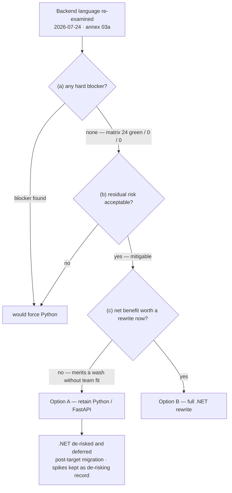
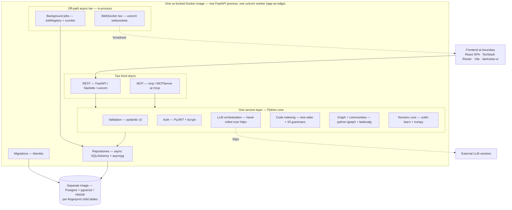

# 03 — Technology & Stack Decisions

**Status:** foundation doc (binds every layer's technology choice). Draft 2026-07-24.
Part of the unified target design — see `docs/design/README.md` for the frame and document map.
The backend-language annex `docs/design/03a-backend-stack-dotnet-viability.md` is a research
appendix to this doc; §4 records its outcome.

---

## 1. Purpose & scope

**This doc records, in ADR form, every significant stack and library choice darkmem stands on, and it settles the one technology sub-decision doc 02 explicitly handed here — how the single-image edge absorbs nginx's duties.** Doc 02 fixed the *runtime decomposition* (four layers, two front doors, one Postgres, three sync/async tiers); this doc fixes the *materials* those layers are built from. For each choice it captures the Decision with its authoritative version, the Context and forces that produced it, the Alternatives considered and why they were rejected, and the Consequences — including which architectural invariant the choice ties back to. It is deliberately an inventory of decisions, not a tutorial: it says *why FastAPI and not what a FastAPI route looks like*, *why one Postgres and not how a recursive CTE is written*.

**The stack is the retained Python one, and that is not reopened here.** Per the 2026-07-24 decision (Option A, §4), darkmem stays Python/FastAPI over async SQLAlchemy on a single pgvector-enabled Postgres, with React at the boundary and MCP as a first-class front door. The .NET re-examination in annex 03a proved a full C#/.NET port *viable* — its viability matrix closed at 24 green, 0 yellow, 0 red — but the maintainer deferred that rewrite to a post-target migration on appetite, not feasibility. Every ADR below is therefore authored on the retained Python stack; where a .NET equivalent exists it appears as a *considered-and-deferred* alternative (the annex evaluated the .NET analogue of each layer), never as a chosen path.

**What this binds, and what it hands on.** The physical tables, per-fingerprint partitions, indexes, and constraints that *realise* these choices are doc 04's; the auth and operational posture the choices imply are doc 18's; the deferred .NET migration and any data cutover are doc 19's. This doc names the technology and the version, states the invariant tie, and defers the mechanism — the same discipline doc 02 keeps. Where a version or a floor-versus-locked ambiguity needed resolving, §3.4 resolves it; where a stale in-repo comment did, §3.3 does — rather than leaving either latent.

## 2. How to read these ADRs

**Every ADR in this doc is DECIDED — there are no proposals here.** Each layer entry states a decision that is in force in the shipping codebase today, or (labelled **target**) is the fixed forward choice the rebuild inherits. The one place a live choice is settled *by this doc* rather than merely recorded is the edge-absorption sub-decision in §3.2, which doc 02 §8/§11 deferred here; it is called out as settled. The backend-language question is likewise settled — Option A — and §4 records the outcome and its rationale, not an open deliberation.

**Version convention: the lock is authoritative, the floor is a compatibility minimum.** darkmem declares dependencies as `>=` floors in `backend/pyproject.toml` and resolves them to exact pins in `backend/requirements.lock` (the file the Docker image installs). Those two numbers diverge widely — many floors sit several minor or major versions below what actually resolves. Throughout this doc the **locked** (resolved, as-shipped) version is the authoritative one an ADR quotes, with the pyproject **floor** noted where it materially lags, because the locked set is what runs in production and what annex 03a measured against. §3.4 makes this policy explicit and recommends the maintenance that keeps the two from drifting into a silent-correctness trap. Annex 03a is the backend-language research appendix; when an ADR cites a `spikes/` path or a matrix row it is pointing into that annex's evidence.

## 3. Cross-cutting decisions

**Four decisions bind every layer ADR below, so they are settled first.** Single-Postgres (§3.1) forbids any layer from reaching for a second store; the one-image constraint and its edge-absorption sub-decision (§3.2) fix how the whole thing is packaged and where the network edge lives; LLM-only (§3.3) removes the native-ML lock-in that once anchored the stack to Python; and the version-and-id policy (§3.4) resolves how a version number in a per-layer ADR should be read and fixes the UUIDv7 id-generation rule the schema inherits. A layer choice that contradicts one of these is a design change, not a library swap.

### 3.1 Single Postgres, no second datastore

**Decision.** Every capability darkmem needs — vector search, keyword search, multi-hop graph traversal, converged PageRank, community detection, flexible payloads, and job coordination — rides one pgvector-enabled Postgres. There is no Neo4j, no Apache AGE, no external vector index, and no Redis. This is doc 00's principle 1 and doc 02 §4 made a stack decision: the store is not a layer that gets to pick its own backend.

**Why.** darkmem's capability list is precisely the shopping list that usually spawns a Postgres-plus-Neo4j-plus-vector-DB-plus-Redis stack (doc 02 §4). Collapsing it into one store is a stated *moat* — one backup, one restore, one connection story, one thing to operate — and the direction the field is consolidating toward, not a limitation to apologise for (doc 00 §6). Each capability maps to a native Postgres mechanism: pgvector cosine (`<=>`) plus HNSW for semantic search; `ts_rank`/`plainto_tsquery` for keyword search; `WITH RECURSIVE` for multi-hop traversal; in-process igraph over a cached snapshot for converged PageRank (target); leidenalg + igraph for community detection as an off-path job; `jsonb` for flexible payloads; and the in-process `JobRegistry` plus `FOR UPDATE SKIP LOCKED` (target) for job and async signalling.

**Alternatives rejected.** These are recorded so no future contributor reopens them without cause; doc 02 §4 states each rejection, and it holds regardless of the backend language.

| Rejected option | Why rejected |
|---|---|
| Neo4j / any external graph database | Recursive CTEs cover multi-hop traversal and in-process igraph covers converged PageRank; a second graph store buys only a split source of truth, a second backup, and cross-store consistency problems. The graph is a *view over the same rows*, not a separate database. |
| Apache AGE | Every AGE Cypher query maps to plain SQL darkmem already has, while AGE adds `ag_catalog` search-path juggling, a dollar-quote injection surface, and non-atomic upsert races. That a competitor's Postgres graph backend *requires* AGE is precisely the reason not to port it. |
| External vector database | pgvector with per-embedder-fingerprint partitioning already makes embedder rotation first-class — a capability most competitors lack — and an external index cannot be partitioned by fingerprint; it would fracture the one store for no retrieval gain at darkmem's scale. |
| Redis / any external broker | The target's buffer-flush uses `SELECT … FOR UPDATE SKIP LOCKED`, jobs use the in-process registry, and the only caches are in-process. Nothing earns an external broker. |

**Consequences / invariant ties.** This binds invariant 1 (single Postgres). It also fixes the per-fingerprint partitioning that layer 5.3 depends on: because pgvector needs a fixed-dimension `vector(N)` column, every embedder fingerprint gets its own child tables — `memory_embeddings__<slug>`, `entity_embeddings__<slug>`, `code_chunk_embeddings__<slug>`, `entity_embedding_cache__<slug>` — created idempotently by the embedder registry, named only through `child_table(parent, fingerprint)`, registered before any insert, and never joined across fingerprints (invariant 2). The Tier-B ingest buffer that §5.8's jobs will flush must be Postgres-backed (SKIP LOCKED) or in-process, never a broker — doc 05 confirms the transport, but the *store* is fixed here.

### 3.2 One-image deployment and the edge-absorption sub-decision — settled here

**Decision (target).** The entire darkmem application — the FastAPI backend and the built React frontend together — ships as **one Docker image**; Postgres/pgvector is the only other image, keeping its data volume, backups, and major-version upgrades independent of the app. This collapses today's split of a separate API container and a separate nginx/UI container into a single application artifact. This much doc 02 §8 already fixed (invariant 22); what doc 02 §8/§11 deferred to *this* doc — and what is now settled — is how nginx's reverse-proxy duties get absorbed into that one image.

**The settlement.** On the retained Python/FastAPI stack, **the single app process serves the built SPA as static files and terminates the network edge itself — one uvicorn worker, no bundled nginx in the default build — and `trust_proxy_headers` flips off** because there is no longer a proxy in front of the app. This is doc 02 §11's recommended default, chosen over co-packaging nginx because it is the cleanest realisation of the one-image, one-process ethos: the container runs a single process, and the deliverable is exactly one app image plus Postgres. The nginx-in-image alternative — nginx co-packaged in the same image and launched beside the app by the entrypoint — stays on the shelf as a labelled fallback, not the default (its trigger is spelled out below). The .NET-Kestrel-serves-the-SPA idiom is the idiomatic one-image pattern *for the deferred .NET migration* (annex 03a §6); it is not this build.

**Why app-as-edge over nginx-in-image.** nginx co-packaged in the image would preserve today's `X-Real-IP` and port-split behaviour, but at the cost of two processes per container, a second thing to configure and supervise, and a heavier image — a permanent tax to keep a proxy hop whose remaining duties (serving static files, routing a handful of paths) a modern ASGI app performs natively. For a single self-hosted box the proxy earns its keep only if a *specific* feature it provides turns out to be load-bearing; absent that, the simpler artifact wins. The trade is deliberately reversible: the fallback is a packaging change, not an architecture change.

**Reconciliation with the invariants the edge touches.** Collapsing the proxy interacts with four invariants, and each is reconciled rather than broken:

- **Single worker (invariant 13).** App-as-edge keeps exactly **one** uvicorn worker; serving static files from that process adds no worker and no replica. The target's cached in-process igraph snapshot, the `JobRegistry` per-job `asyncio.Lock`s, the feature-flag TTL single-flight cache, and the entity-embedding LRU all stay valid precisely because there is one process. The load-bearing caution here is a negative one: static-file serving must *not* tempt a `--workers N` bump to "scale" the SPA delivery, because a second worker silently invalidates the snapshot and the in-process locks. Multi-replica stays a flagged Phase-4 decision (sticky routing or a serialised snapshot table), never a side effect of edge absorption (doc 02 §8/§11).

- **`X-Real-IP` login rate-limiting (invariant 21).** Today the login rate-limiter reads the client IP from the `X-Real-IP` header that nginx sets to the direct peer, trusting it because `trust_proxy_headers` is on. With no proxy, *nothing sets `X-Real-IP`*, so `trust_proxy_headers` flips **off** and the rate-limiter must read the client IP from the direct ASGI transport peer (`scope["client"]`), not from any request header. This is not a downgrade — on a single box with nothing trustworthy in front, a header-derived IP is spoofable, so trusting the real socket peer is *more* correct. The concrete requirement this places on doc 18 is that the rate-limiter carry a no-proxy code path that uses the transport peer and never falls back to the spoofable leftmost `X-Forwarded-For`. If the fallback nginx-in-image build is ever taken, `trust_proxy_headers` goes back on and the `X-Real-IP` path is restored unchanged.

- **`/mcp` off the UI origin, Host allowlist as the sole gate (invariant 20).** Today `/mcp` lives on the app's `:8000` bind (loopback plus allowlisted LAN) while nginx serves the UI on `:80` and *deliberately does not proxy `/mcp`*, so the two sit on different ports and therefore different origins. Because one uvicorn process binds one port, app-as-edge necessarily serves the SPA, REST, `/ws`, and `/mcp` on that **one** origin — the physical port-split disappears. This is reconciled by being honest about what the port-split was: it was defence-in-depth, not the gate. The actual, and only, network defence for `/mcp` is and remains its DNS-rebinding **Host allowlist** — localhost always allowed, `MCP_ALLOWED_HOSTS` adds named LAN hosts, `*` disables the check, a foreign Host gets `421` — paired with the browser-Origin allowlist scoped to the same hosts. App-as-edge makes that allowlist the *sole* gate, which is exactly what invariant 20 mandates ("Host allowlist as the only gate"). The rule that a LAN `421` is fixed by extending the allowlist, never by disabling the protection, is unchanged. If a stricter requirement to keep `/mcp` on a physically distinct origin ever emerges, that is one of the fallback triggers below.

- **One image, Postgres separate (invariant 22).** App-as-edge is the cleanest satisfaction of the constraint: one app image, one process inside it, Postgres its own image with independent volume and upgrades. Migrations still run at startup via the entrypoint (`alembic upgrade head`, then `exec uvicorn …`); the dev compose still overrides the command to skip the startup migration. No all-in-one appliance bakes the database into the app image.

**Fallback trigger to nginx-in-image.** Co-package nginx in the same image (still one image, two processes) only if one of these proves load-bearing: static-asset caching or on-the-fly compression (gzip/brotli) at a volume the app process should not spend cycles on; fine-grained cache-control or security-header rewriting the app does not express cleanly; or a hardening requirement that `/mcp` sit on a physically separate origin/port rather than behind the Host allowlist alone. None of these is anticipated for a single self-hosted homelab instance, which is why app-as-edge is the default and nginx-in-image is the documented escape hatch.

### 3.3 LLM-only — the ML stack is gone, one residual survives

**Decision.** Classification, enrichment, and extraction are LLM-backed by default. The native machine-learning stack (`torch`, `transformers`, `gliner`, `rebel`) was removed from the core dependency set in the 2026-05-01 LLM-only consolidation, along with every `ml_*` flag, route, and UI surface and the regex classifier. Only `relation_rescue` survives as an ingestion-side behavioural flag (CLAUDE.md pipeline terminology).

**Why this is a stack decision and not just a cleanup.** Removing native ML lock-in is what makes darkmem's dependency graph small enough to reason about — and, per annex 03a §1, it is *why the backend-language question was even worth asking in 2026*: native ML would have been the single strongest argument for staying on Python. A port now must reproduce HTTP LLM calls, not a native ML runtime. Within the retained Python stack the same fact keeps the numeric core (layer 5.13) honest: scikit-learn and numpy stay for clustering and projection inside the vector repo, but nothing in the hot path loads a model.

**The one residual, stated precisely so the doc does not over-claim (invariant 23).** The `[ml]` optional extra still exists in `pyproject.toml` (`transformers>=4.40.0`, `torch>=2.2.0`), CPU-only by deliberate choice and lazily imported behind `try/except`. It powers exactly one thing: a lightweight in-process classifier as a fast, no-LLM path on the **classification** purpose only. The reshape's LLM-config flattening (§5.5/§5.6) re-homes how that path is chosen — an inline `classifier_kind = local` on the classification purpose row, replacing the dropped `ml_profile_ref` → `ml_profiles` indirection — but the classifier itself stays. So "the ML stack is gone" means the extraction/classification/retrieval *heads* and the generic ML on/off switch are gone; the optional in-process classifier dispatch remains, now re-homed inline. A design doc that says darkmem has *no* ML dependency is wrong; the accurate statement is that ML is an optional, classification-only, off-by-default extra.

**Correction to a stale in-repo comment.** `pyproject.toml` line 70 still says the runtime "gracefully degrades to the **regex classifier** when these packages aren't available." That is stale: CLAUDE.md records that the regex classifier and its `classified_type`/`classified_confidence` columns were removed, and classification now always runs through the LLM (or the in-process local classifier when the purpose's `classifier_kind = local`). The comment should read that when `[ml]` is absent the classification purpose falls back to the **LLM-backed classifier**, not a regex one — the truth after the LLM-config flattening (§5.6). This is a documentation fix, not a behaviour change, and it is recorded here because a foundation doc must not inherit a false premise from a build file; §7 records it as decided.

### 3.4 Version and id policy — the lock is authoritative; pin numpy; UUIDv7 for app-generated PKs

**Decision.** The exact pins in `backend/requirements.lock` are the authoritative, as-shipped versions of every dependency; the `>=` floors in `backend/pyproject.toml` are compatibility minimums, not deployment targets. Every per-layer ADR below quotes the locked version as the authoritative number and notes the floor only where the two diverge materially.

**Why.** The lock file is what the Docker image installs and what runs in production, and annex 03a measured its viability spikes against the resolved versions, not the floors — so the locked number is the one a downstream doc should treat as real. The floors, by contrast, have drifted far below the resolved set across the board: `fastapi>=0.115.0` resolves to `0.136.3`, `mcp>=1.9.0` to `1.27.2`, `tree-sitter>=0.23.0` to `0.25.2`, `croniter>=2.0.0` to `6.2.2` (four majors), and `python-igraph>=0.11.0` to `1.0.0` (a major-version jump). Treating a floor as the "version darkmem uses" would understate every one of these and, worse, would license a fresh *unlocked* resolve to pull a years-old release that no one has tested.

**The load-bearing gap: numpy has no floor at all.** numpy is not a direct dependency in `pyproject.toml`; it arrives transitively (resolved `2.4.6`, via pgvector, scikit-learn, and scipy). Yet it is load-bearing — it does the vectorised cosine-similarity matrices, DBSCAN inputs, and 2-D eigen-projection inside the vector repository (layer 5.13, annex 03a §3's "hides inside the vector repo" hidden dependency). A capability the system depends on for retrieval correctness is currently pinned only by whatever the transitive resolver happens to choose. **The reshape adopts an explicit numpy pin** in `pyproject.toml` so the numeric core is a first-class, version-controlled dependency rather than a resolver accident; the pin tracks the locked version and moves with it. §7 records this as decided.

**The maintenance that keeps floor and lock from drifting into a trap.** Because the lock is regenerated only via `uv pip compile --universal` (a non-universal Windows resolve leaks `pywin32` and drops `uvloop`), the floors are easy to forget. **The reshape fixes a mechanical cadence:** every `uv pip compile --universal` lock regeneration also raises each direct-dependency floor to its last-tested minor — not to the exact pin, but close enough that an unlocked install cannot silently resolve a release generations behind what has actually been tested. This closes the one real risk the floor-versus-lock gap creates: a contributor building without the lock getting a stack no one has run. §7 records this as decided (the version-floor bump policy).

**The id half: UUIDv7 for every application-generated uuid PK.** Every uuid primary key the application itself mints — `memories`, `documents`, `blocks`, `knowledge_articles`, `knowledge_triples`, `fact_sources`, `memory_buffer`, `repositories`, `article_citations`, `memory_communities`, and every other application-minted uuid PK — is generated as **UUIDv7**, whose millisecond time-ordering gives B-tree insert locality where v4's randomness fragments the index at scale, at zero extra cost and under one generation rule. Two deliberate exceptions preserve today's behaviour: `entities` and `entity_relations` keep their server-side `gen_random_uuid()` (v4) because they are ANN-probed and orphan-sweep-churned rather than range-scanned, so time-ordering buys nothing (a switch to a native `uuidv7()` is reserved for a Postgres major ≥ 18); and `events` plus the code-graph node/edge tables stay **bigint** — a narrow serial key never referenced by uuid. This is a stack-level generation rule, not a schema table: it lives at the driver/repository boundary (§5.2) and its locality benefit lands on the per-fingerprint embedding child tables' uuid keys (§5.3), while doc 04 realises it as column defaults.

## 4. Backend-language ADR — Python retained, .NET de-risked and deferred

**Decision (2026-07-24, Option A).** Python/FastAPI is **retained** as darkmem's backend. The README's locked-frame decision 4 stands unamended. .NET was fully re-examined at the maintainer's request in annex 03a and proven viable with no hard blocker, but the rewrite is **deferred to a post-target migration**, to be revisited on appetite once the feature vision has shipped. This is the headline ADR of the doc; every other layer entry is authored on the Python side of it.

**The three-part viability test the annex applied.** Annex 03a did not ask "can .NET do this" in isolation; it applied a three-part test where all three must hold: (a) no hard blocker, (b) acceptable and mitigable residual risk, and (c) a net benefit large enough to justify rewriting a mature, tuned codebase. Keeping the three separate is what let the annex reach an honest verdict: (a) and (b) both **pass** — feasibility is settled — while (c) was the one genuinely open call, a judgment about appetite that only the maintainer could make.

The three-part test flows to Option A only because the third question — net benefit, not feasibility — was the one left to judgment:

**The matrix closed fully green.** After the 2026-07-23/24 gap-closure spikes, the 24-row component viability matrix reached **24 green / 0 yellow / 0 red**. Every row that had carried feasibility or quality uncertainty was driven down by a hands-on spike committed under `spikes/`: the two genuine reds the research had flagged — tree-sitter's grammar breadth and Leiden community detection — were both cleared, and even the eval-harness core, the maintainer's designated last item, went green. What remains anywhere in the matrix is assembly work (wiring the grammar-pack CI, assembling the full harness around its proven core), not risk. Feasibility is not in question; the annex is explicit that no red survives.

**The four open questions the annex left to judgment, and how they resolved.** Annex 03a §10 named four decision points the evidence could not settle, and all four are now resolved or bounded:

1. **Appetite — rewrite now, or after the Python target ships?** *Resolved: Option A.* Ship the Python target first; treat .NET as a later, separate migration.
2. **Tolerance for native interop in a single-artifact system.** *Narrowed, not forced.* The graph spikes cleared community detection to pure-managed C#, so the *only* remaining native dependency in a hypothetical .NET port is tree-sitter (the stock single-maintainer binding plus a self-built per-RID grammar pack; a fork is optional bus-factor insurance). The question shrank to "is that one standing native dependency acceptable," and it does not gate the Python decision.
3. **The bar — parity-with-today or a clean-slate feature set?** *Framed, left to judgment.* If the bar is behavioural parity, the harness-first faithful-port discipline is mandatory and expensive; if clean-slate, the sunk-cost port surface shrinks. Not a research gap.
4. **Acceptance of Leiden non-determinism.** *Bounded.* The pure-managed full Leiden matches leidenalg at −0.4% RB-modularity and 98.4% partition agreement on the real graph but is never bit-identical (different implementation and RNG), so accepting it means accepting a *measured* residual, not an unknown; any test pinning exact community membership would have to be rewritten.

**The retained-versus-deferred rationale.** Stripped of team fit, the .NET technical merits are a wash. The wins are real — Npgsql eliminates the asyncpg `CAST`/`IndeterminateDatatypeError` bug class outright, typing helps at scale, GIL-free parallelism and roughly 4× faster graph math are genuine — but none is rewrite-sized against Python's AI-ecosystem gravity and its tuning-loop iteration speed. A rewrite *now* would trade months of feature delivery for a case that rests on team fit alone. The deferred path knowingly accepts paying re-architecture twice; what keeps the eventual port bounded is the standing de-risking corpus described next.

**The spike corpus is kept as the deferred migration's de-risking record.** Annex 03a and the `spikes/` tree are retained deliberately, not archived. They hold the fully-green matrix and working spike implementations — full Leiden, the `zig cc` grammar pack, the MCP Host-allowlist middleware, and the benchlib core — and, most importantly, the harness's **byte-compatible LLM-cache reuse** (the .NET harness reused the Python-built content-hash cache 26/26) plus an F1 scorer proven *exactly identical* to `run_bench.py` on real cached outputs (agreement to 1e-12). That parity machinery is the linchpin of the deferred bet: when the port eventually happens, it scores the *same raw LLM outputs* against the *same gold* with a scorer already proven identical, so any F1 delta is attributable purely to the ported cleanup passes rather than to model drift or metric skew. The future port is therefore measured, not faith-based. Were Option B ever pursued, the annex sizes the coarse single-engineer effort at roughly 19–38 weeks (about 5–9 months); that number is a magnitude anchor, not a commitment.

**Consequences / invariant ties.** The React frontend is stack-independent (annex 03a §1) and carries across either decision unchanged, so nothing in §5.14 depends on this ADR. Doc 19 (migration and coexistence) should carry the future stack migration as a known horizon item, with annex 03a plus `spikes/` as its de-risking input. This ADR ties to invariant 23 (do not over-claim): .NET is a fully-de-risked *rejected-for-now* alternative, not a roadmap item, and this doc records it as such.

## 5. Layer-by-layer ADRs

**Each layer states its Decision with the authoritative (locked) version, the Context and forces, the Alternatives rejected — folding in the .NET equivalent annex 03a evaluated as a considered-and-deferred alternative — and the Consequences, including the invariant it ties to.** The layers are ordered API-surface-down, mirroring doc 02's four layers. A consolidated version table sits inside each entry's Decision line; the master rejected-alternatives table is §6.

Each layer below maps to one chosen technology, and the whole application ships as one app image — two front doors over one service layer, one repositories layer, and a single separate Postgres:

### 5.1 Web framework / HTTP surface

**Decision.** **FastAPI** (floor `>=0.115.0`, locked `0.136.3`) on **Starlette** (`1.2.1`) under **uvicorn[standard]** (floor `>=0.34.0`, locked `0.49.0`). One FastAPI process serves the two front doors (REST and MCP) over one service layer; auth is enforced as a FastAPI *dependency*, and **CORS is the sole middleware** (`main.py`).

**Context / forces.** Doc 02 §2–3 fixes two thin front doors converging on one service layer, with the REST contract (201 create, 204 delete, 202 async-accepted, `POST .../search` for complex queries) that FastAPI's typed `Results` map directly. The framework must be async-native because the whole data path is async SQLAlchemy over asyncpg. In the app-as-edge target (§3.2) this same process also serves the built SPA as static files and terminates the edge.

**Alternatives rejected.** No alternative Python framework was reconsidered — FastAPI is the retained incumbent and the rebuild re-cuts layers on the same stack (doc 02 §9). Annex 03a's near-1:1 .NET equivalent is ASP.NET Core 10 Minimal APIs on Kestrel (matrix row 1, green; ".NET 10 is LTS, Nov 2025"), where DI, CORS, route groups, and typed `Results.Created/NoContent/Accepted` map the REST contract 1:1 — a clean swap, but part of the deferred Option-B port, not this build.

**Consequences / invariant ties.** Async-native serving is what lets the request path stay on one event loop; SQLAlchemy's asyncio bridge needs `greenlet` (§5.2), a Python quirk a .NET port would not carry. The uvicorn dev server runs `--reload --timeout-keep-alive 75`, where the 75-second keep-alive prevents sporadic 502s through the Vite proxy (CLAUDE.md; the dev-proxy-502 debugging history). Ties to invariant 17 (two front doors, one service layer): REST and MCP must never diverge into two engines, which the single-app, single-service-layer shape enforces.

### 5.2 DB driver and raw-SQL executor

**Decision.** **SQLAlchemy[asyncio] 2.0** (floor `>=2.0.0`, locked `2.0.50`) over **asyncpg** (floor `>=0.30.0`, locked `0.31.0`), bridged by **greenlet** (`3.5.1`). SQLAlchemy is used *mostly as a raw-SQL executor via `text()`* — recursive CTEs, FTS, savepoints, and per-fingerprint DDL — with the ORM reserved for the flat relational rows (memories, tags, the append-only `events` substrate that replaces `audit_log`, crossref). The connection pool is `db_pool_size=30` with `db_max_overflow=20` (`config.py`).

**Context / forces.** The repositories layer owns all SQL (doc 02 §3, §6.3), and the hot paths need raw recursive CTEs and vector SQL that an ORM abstracts away. Splitting usage — ORM for flat relational rows, raw executor for everything vector and graph — keeps each in its lane rather than fighting the ORM to express a recursive CTE.

**Alternatives rejected.** Annex 03a's .NET equivalent is **Npgsql 10.x** (native async ADO.NET, matrix row 2, green — "the lowest-risk swap in the port"), with an ORM-strategy decision of **Dapper for hot reads and vector plus DbUp for migrations, EF Core avoided if Native AOT is wanted** (EF Core is not AOT-compatible and cannot express runtime fingerprint-parameterised DDL). Those are deferred-port choices. Within Python, no driver alternative was reconsidered.

**Consequences / invariant ties.** This layer carries invariant 10: any raw-SQL bound parameter whose type Postgres cannot infer must be explicitly cast — `CAST(:vec AS vector)`, `CAST(:id AS uuid)`, `CAST(:props AS jsonb)` — especially around variadic `ANY`, `unnest`, and `jsonb_build_object`, or asyncpg raises `IndeterminateDatatypeError`; and the session must be rolled back before mutating ORM objects in an error handler. Annex 03a §6 flags this as an **asyncpg quirk, not a portable invariant** — Npgsql resolves parameter types client-side and sends an explicit OID, so the whole bug class disappears under .NET. That is one of the deferred migration's genuine wins, but on the retained stack the `CAST` discipline stays contract and lives inside the repository layer (invariant 16). This layer also carries invariant 11 (commit before opening a new session on locked rows) and Phase 5's two-savepoint split (A: vector upsert plus memory-row enrichment; B: entity/relationship graph plus technologies plus supersession), which `session.begin_nested()` implements. The application also mints its uuid primary keys as UUIDv7 at this driver/repository boundary (§3.4) so inserts land with B-tree locality; the two v4 exceptions (`entities`/`entity_relations`, server-side `gen_random_uuid()`) and the bigint keys (`events`, the code-graph nodes/edges) are the schema's, realised in doc 04.

### 5.3 Vector store

**Decision.** **pgvector** (floor `>=0.3.6`, locked `0.4.2`) — Postgres `vector(N)` columns in per-fingerprint child tables, cosine similarity as `1 - (embedding <=> :vec)`, indexed with **HNSW**. The default embedding dimension is `embedding_dimensions=1024` (`config.py`).

**Context / forces.** The single-Postgres moat (§3.1) requires vector search to live in the one store, and per-embedder-fingerprint partitioning is what makes embedder rotation a first-class operation rather than a migration crisis (doc 00 §6; doc 02 §4). Because pgvector needs a fixed-dimension column, each fingerprint gets its own child tables.

**Alternatives rejected.** An external vector database was rejected as a cross-cutting decision (§3.1): it cannot be partitioned by fingerprint and would fracture the one store for no retrieval gain at darkmem's scale. Annex 03a's .NET equivalent is pgvector-dotnet (Pgvector `0.3.2`, pre-1.0 — "pin it," small maintainer surface, matrix row 4), where `<=>` is literal SQL that ports verbatim; a deferred-port detail, not a chosen path.

**Consequences / invariant ties.** This layer is the concrete home of invariant 2 (per-fingerprint isolation): no query joins across fingerprints, a fingerprint is registered before any insert, and application code names a child table only through `child_table(parent, fingerprint)`. The numeric core (§5.13) does vectorised cosine matrices over these vectors inside the same repository. The child tables' uuid keys inherit their parent's id policy (§3.4), so where the parent is UUIDv7 — `memory_embeddings` on `memory_id`, and the target-new `block_embeddings`/`article_embeddings` families — the child inserts share that B-tree locality, while the v4-keyed `entity_embeddings` family does not. Doc 04 owns the physical child-table shape and the HNSW index parameters; the *rule* that the tables exist per fingerprint and never join is fixed here.

### 5.4 Migrations

**Decision.** **Alembic** (floor `>=1.14.0`, locked `1.18.4`) with **mako** (`1.3.12`), as a linear chain of hand-written SQL migrations. `migrations/env.py` reads `DATABASE_URL` via app settings and deliberately ignores `alembic.ini`'s URL. Runtime per-fingerprint child-table DDL is **not** a migration — it stays app code in `embedder_registry.register`, because it is runtime-parameterised by fingerprint and cannot be expressed as a static migration.

**Context / forces.** Schema evolves over the one Postgres, and the linear hand-written-SQL model keeps every migration reviewable. The split between static schema (Alembic) and runtime child-table DDL (app code) is deliberate: the partition tables are created idempotently the first time a fingerprint is seen, which no migration can express.

**Alternatives rejected.** Annex 03a recommends **DbUp** as the closest .NET analogue to Alembic's linear hand-written-SQL model (matrix rows 5, 9), and rejects **FluentMigrator and EF Migrations** — EF cannot express the runtime fingerprint DDL, and DbUp is SQL-first like Alembic. The annex also notes the deferred-migration cutover shape: a DbUp chain would baseline from a snapshot of the current schema (dropping `alembic_version`) with the homelab's data carried over via `pg_dump`/restore. All of that is doc 19's concern, not this build's.

**Consequences / invariant ties.** Containers migrate at startup via `entrypoint.sh` (`alembic upgrade head`, then `exec uvicorn …`); host-side runs must set `DATABASE_URL` explicitly because the dev-compose Postgres is on port 5433 while `env.py`'s default is 5432, and the dev compose overrides the command to skip the startup migration. Ties to invariant 2 (the runtime DDL is where register-before-insert is enforced) — doc 04 must not "fix" this by trying to model the child tables as static migrations.

### 5.5 Validation and settings

**Decision.** **pydantic v2** (floor `>=2.0.0`, locked `2.13.4`) with **pydantic-settings** (floor `>=2.0.0`, locked `2.14.1`). `Settings` is env-layered config with `@model_validator`s; the six base inline `LLMPurposeConfig` defaults (self-contained one-row-per-purpose after the reshape drops the provider/profile/ml-profile indirection; summarization is further split into code buckets, so the config-level row count runs higher than six — §5.6) and the `FEATURE_FLAGS_DEFAULTS` dict live in `config.py`, and the production validators (JWT ≥32 chars, CORS `*` strip, `DATABASE_URL` derivation from the `DB_*` vars) live there too.

**Context / forces.** Two jobs, one library: env layering and coercion for runtime settings, and request/response schema validation for the API. Keeping the production-hardening validators in `config.py` puts the security-relevant coercion (the JWT-secret length floor, the CORS wildcard strip) in one auditable place.

**Alternatives rejected.** Annex 03a maps pydantic to **FluentValidation plus `IOptions`** with validators ported by hand, and notes explicitly that "coercion semantics and env layering do **not** map cleanly" between pydantic and the .NET options system (matrix row 19) — the decision there was taken (FluentValidation + `IOptions`) but flagged as re-implementation *effort*, not risk. A deferred-port detail. Within Python nothing was reconsidered.

**Consequences / invariant ties.** This layer expresses several config invariants: `cookie_secure` is tri-state (unset means Secure only in production; explicit `false` allows plain-HTTP LAN login); `trust_proxy_headers` defaults True today but flips **off** under the app-as-edge target (§3.2, invariant 21); and `mcp_allowed_hosts` empty means localhost-only (invariant 20). Ties to invariant 18/19: there are no `LLM_*` environment variables — LLM config lives in DB rows, and settings validation is the schema layer, not the LLM-config source. After the flattening each purpose's inline row is what this layer validates, including the classification purpose's `classifier_kind = llm | local` field.

### 5.6 LLM orchestration

**Decision.** A **hand-rolled multi-vendor orchestrator over raw `httpx`** (floor `>=0.28.0`, locked `0.28.1`) — `LLMOrchestrator`, constructed once at boot from DB config and replaced live on an admin save (`main.py`). There is **no OpenAI SDK**. The `api_kind` switch is the only place vendor quirks live: `openai` (the compat path), `ollama` (native, exposing `think:false`), and reserved slots for `anthropic`, `google`, `deepseek`, and `zai` that today dispatch through the compat path (`config.py`).

**Context / forces.** Six purposes — `embedding`, `extraction`, `classification`, `reasoning`, `summarization`, `reranker` — with summarization further split into code buckets (symbol/module/overview) so the practical purpose count is higher than six at the config level. The reshape **flattens the config surface**: each purpose is now a single inline `LLMPurposeConfig` DB row (`{model, base_url, api_key, api_kind, params, dimensions?, reasoning?}`), and the `llm_providers`/`llm_profiles`/`ml_profiles` indirection tables, every `*_ref` column, and the profile-management UI are dropped. darkmem is not an LLM proxy, so one purpose maps to one self-contained row rather than resolving a provider and profile through two extra tables. The `classification` purpose carries an inline `classifier_kind = llm | local` that chooses between the LLM-backed classifier and the lightweight in-process local classifier (§3.3), re-homing the old `ml_profile_ref` inline. All LLM configuration is in-DB via the setup wizard; there are no `LLM_*` env vars (doc 02 §7). A content-derived reproducibility seed, `sha256(content)[:8]` as a 32-bit int, is forwarded on extraction and classification so vendors that honour it return stable output. **Amended 2026-08-20 (owner ruling, spec `docs/superpowers/specs/2026-08-20-llm-providers-design.md`):** `llm_providers` is reinstated — the connection triple `{api_kind, base_url, api_key}` moves onto a shared provider row a purpose names by a NOT NULL `provider_name`, so a credential rotation reaches every purpose that uses it with no re-apply step. `llm_profiles`, `ml_profiles`, every `*_ref` column and the profile-management UI stay dropped, `classifier_kind` stays inline, and the *resolved* `LLMPurposeConfig` stays flat and unchanged (one query, one join) — which is what keeps the benchlib cache key and the judge identity hash stable. The purpose count is eight, not six: `synthesis` and `verification` joined at T1.05.

**Ingest call topology — one LLM touch per memory (target).** The merged extraction-plus-classification call is the default and only LLM path on ingest: one structured call returns entities, relations, `classified_type`, `summary`, and the enrichment fields together, rather than a second classification round-trip. When the classification purpose's `classifier_kind = local`, that classifier runs out-of-band and the LLM call narrows to extraction-only — never two LLM round-trips per memory. Embeddings stay batched in their own call and reranking stays retrieval-side, so the single merged call is the whole per-memory LLM cost on ingest. Prompt construction is one canonical schema plus the content plus the reproducibility seed plus a minimal rule set; the inline prompt rules that the roughly forty deterministic cleanup passes already enforce downstream are stripped from the prompt and stay post-processing (they are the moat and do not move). This leaves a clean seam for the later area-detection pre-pass (doc 06) to inject a domain-appropriate type vocabulary without touching the call topology.

**Alternatives rejected.** The **OpenAI SDK was rejected deliberately** — darkmem hand-rolled the orchestrator to keep one uniform code path across every vendor rather than adopt a vendor SDK's abstractions (annex 03a §3). In the .NET analysis, raw `HttpClient` is the recommended faithful port, **Semantic Kernel and the Agent Framework are explicitly "do not adopt,"** Microsoft.Extensions.AI.OpenAI (`10.8.0`) is an optional on-ramp, and the official Anthropic SDK (`12.9.0`, beta) is not adopted (matrix row 20). Annex 03a notes .NET would handle *more* natively here — `ChatOptions.Seed` is typed, and several vendor auth/reasoning quirks become library concerns — but the recommended path stays raw `HttpClient` to preserve the one uniform code path, so even the deferred port keeps darkmem's deliberate design.

**Consequences / invariant ties.** This is the single external-model boundary (invariant 18): every vendor auth and reasoning-control quirk (Anthropic's `x-api-key`, DeepSeek's and Gemini's reasoning-disable) is handled inside the orchestrator, never papered over at a call site, which is what keeps the rest of the codebase provider-agnostic. Flattening the config surface does not move that boundary — the orchestrator still constructs from DB rows and is replaced live on save (invariants 18/19); it simply reads one inline row per purpose instead of dereferencing provider/profile tables. The `mcp` package (§5.7) also pulls `httpx`, so the HTTP client is shared. LLM seeds live in `app/services/llm_seed.py`, not in any migration. Ties to invariant 15 (reconciliation off the hot path): the merged extraction-plus-classification call is a Tier-B ingest step, and the only model calls allowed on retrieval are the query embed and the optional reranker score.

### 5.7 MCP surface

**Decision.** **`mcp` / `MCPServer`** (floor `>=2.1.1,<3`, locked `2.1.1`; the v1 name was `FastMCP`) mounted at `/mcp` (`main.py`), speaking streamable-HTTP JSON-RPC 2.0 in stateless mode at protocol revision `2026-07-28`. *(Amended 2026-08-26: was `>=1.9.0`, locked `1.27.2`, via `streamable_http_app()`.)* It calls the same `MemoryService`, pipeline, and code services as REST — two front doors, one service layer.

**Context / forces.** A first-class MCP interface that any AI tool speaks is a stated goal (doc 00 §1). Since 2026-08-26 every call carries a bearer API key scoped per tool; beside it, the network defence is DNS-rebinding protection via a **Host allowlist**: `MCP_ALLOWED_HOSTS` adds LAN hosts, localhost is always allowed, `*` disables the check, and a foreign Host gets `421` (doc 02 §6.1, §8). Browser Origins are allowlisted to the same hosts.

**Alternatives rejected.** The dependency inventory once rated a .NET MCP surface "HIGH friction — no first-party equivalent"; annex 03a *corrected* this. The official Microsoft-collaborated **`ModelContextProtocol` C# SDK reached stable v1.4.1 (2026-07-09)** and is spike-verified green — covering streamable-HTTP JSON-RPC, stateless mode, a subpath mount, and attribute-based tools — with the guidance to pin the v1.4.x line, not the v2.0.0 preview (which removes the `initialize` handshake). The Host allowlist has no .NET-transport equivalent, so the annex hand-wrote a ~50–100-line middleware, spike-verified to return `421` for a foreign Host (matrix rows 10–12). All deferred-port detail.

**Consequences / invariant ties.** This layer carries invariant 20 in full, and §3.2's settlement makes the Host allowlist the *sole* gate once the app is the edge. `memory_batch_add` mirrors the HTTP 1–100 batch cap; `source` resolves in order explicit arg > `X-Darkmem-Client` header > User-Agent map > `mcp`. Note the packaging gotcha the annex flags: `mcp` pulls `pywin32==312` on win32, which is exactly the leak the `uv pip compile --universal` lock compile must avoid (§5.15). Ties to invariant 17 (two front doors) — the MCP tools must not drift from the REST behaviour.

### 5.8 Background jobs

**Decision.** A **custom `JobRegistry`** over **croniter** (floor `>=2.0.0`, locked `6.2.2`) — jobs dispatched by cron expression (five-field minute precision, or six-field seconds-first), each with its own `asyncio.Lock` shared between the scheduled tick and a manual `trigger()`, a `min_interval_seconds` floor, a `max_run_seconds` bound, and per-job state in `config` rows keyed `job:<key>` (`main.py`; doc 02 §5.3).

**Context / forces.** In-process periodic maintenance on the single instance, where a manual `trigger()` while the lock is held returns busy (HTTP 409) rather than queueing a double-run. Seven jobs exist today: `repo_sync`, `code_enrichment`, `token_blocklist_cleanup`, `pipeline_failure_cleanup`, `graph_orphan_cleanup`, `tag_orphan_cleanup`, and `expired_memory_cleanup`. The target adds the reconciliation work principle 6 keeps off the hot path — consolidation, reflection, buffer-flush, event maintenance, auto-research, and the cached PPR/igraph snapshot build — as additional jobs against the same registry (doc 02 §5.3).

**Alternatives rejected.** Annex 03a **rejects Quartz.NET** — "its model fights the floor plus shared-lock plus trigger-returns-busy semantics" — and treats the registry as "app code to port, not a library swap," recommending `BackgroundService` plus Cronos `0.13.0` or NCrontab `3.4.0` plus `SemaphoreSlim(1,1)` (matrix row 21). A deferred-port detail; the point that carries either way is that darkmem's job semantics are bespoke enough that a scheduling *library* is the wrong shape.

**Consequences / invariant ties.** The single-worker assumption (invariant 13) is load-bearing here: the per-job `asyncio.Lock`s and the target cached igraph snapshot are only correct because there is exactly one process, which §3.2's app-as-edge settlement preserves. Ties to invariant 15 (all reconciliation is Tier C) and invariant 19 (per-job state is a `config` row, keeping runtime behaviour DB-driven and redeploy-free).

### 5.9 WebSocket broadcast

**Decision.** **uvicorn `websockets`** (`websockets==16.0`, pulled by `uvicorn[standard]`), serving `/ws` as an outbound-only fan-out (`main.py`). One event manager broadcasts each event to all connected sockets under a single send-lock with a per-send timeout, validating against the event schema.

**Context / forces.** Principle 10 — every backend signal ships with its UI (doc 00 §7 principle 10; doc 02 §7). The pipeline and services emit transient broadcasts (`pipeline.completed | partial | failed`, `memory.deleted`, and the like) that drive live UI, and the target adds a durable event stream underneath so the important signals are also queryable — doc 04's `events` table, one generic append-only substrate for every entity that replaces the coarse memory-level `audit_log` (dropped outright in the greenfield baseline).

**Alternatives rejected.** Annex 03a maps this to native ASP.NET Core WebSocket middleware, reaching for SignalR only if reconnection is later wanted (matrix row 22, green, rated from long-standing framework capability rather than a fresh spike). A deferred-port detail. No Python alternative was reconsidered — the WebSocket support ships with uvicorn.

**Consequences / invariant ties.** `/ws` is outbound only — there are no inbound WebSocket commands — and in the app-as-edge target the app serves `/ws` directly rather than through nginx's long-read-timeout proxy (§3.2). Ties to invariant 14 (honest partial results): the per-memory `pipeline.completed | partial | failed` broadcast is how a partial outcome surfaces rather than being swallowed.

### 5.10 Auth

**Decision.** **PyJWT** (floor `>=2.9.0`, locked `2.13.0`, pulling `cryptography==48.0.0`) plus **bcrypt** (floor `>=4.0.0`, locked `5.0.0`). Cookie-session JWT is enforced as a FastAPI *dependency* (not middleware); setup is trust-on-first-use gated only by `require_uninitialized`; login is rate-limited per-IP with lockout; tokens are revoked via a blocklist; and the client IP is read from a trusted proxy header when `trust_proxy_headers` is on.

**Context / forces.** Local-network trust by default, with optional API-key or bearer hardening for exposed deployments as a doc-18 concern (doc 00 §7 principle 8; doc 02 §8). `SETUP_SECRET` was fully removed — setup is trust-on-first-use, and no pre-shared secret may be reintroduced (invariant 21). The `jwt_secret` production validator requires ≥32 chars and rejects the default (`config.py`).

**Alternatives rejected.** Annex 03a rates JWT, bcrypt, CORS, `/ws`, and the `JobRegistry` as "ordinary application code over standard-library primitives" that port cleanly 1:1 (§3) — no library alternative was singled out because there is no ecosystem lock-in to escape. Within Python nothing was reconsidered.

**Consequences / invariant ties.** The `ApiKey` model exists but is **unwired today** — every write passes `None` — and wiring it for exposed-deployment auth is deferred to doc 18 (invariant 23: do not claim it as shipped; doc 02 §9). This layer is where §3.2's `trust_proxy_headers`-off consequence lands: under app-as-edge the rate-limiter must read the direct transport peer rather than a proxy header (invariant 21), and doc 18 owns wiring that no-proxy path. Ties to invariant 21 (TOFU setup, no pre-shared secret) and invariant 23 (the unwired `ApiKey` is a named gap, not a feature).

### 5.11 Code indexing — the moat

**Decision.** **tree-sitter** (floor `>=0.23.0`, locked `0.25.2`) as the parser core, plus **33 language-grammar packages** (`pyproject.toml`): python, javascript, typescript, go, rust, c-sharp, cpp, c, java, ruby, php, bash, html, css, json, scala, haskell, kotlin, swift, lua, toml, yaml, sql, julia, ocaml, zig, elixir, xml, regex, cmake, make, objc, and markdown. The multi-phase code pipeline runs discovery → parse → structure/import/binding/call/heritage → Leiden communities → process detection → validation → embeddings → optional enrich/wiki (doc 02 §6.2).

**Context / forces.** A tree-sitter code knowledge graph over MCP — blast-radius, communities, processes, cross-file rename — is a stated moat ("no memory competitor has this," doc 00 §6), and the uniformity across 33 languages is the point: one graph shape regardless of source language. On Python this comes nearly free, because each grammar ships prebuilt wheels for all platforms.

**Alternatives rejected.** This was annex 03a's highest-effort risk area, and its sub-decisions are the richest "considered and rejected" record in the doc. The .NET binding is **TreeSitter.DotNet v1.3.0** (MIT, single-maintainer, ~31 stars — a bus-factor of one), whose bundle is missing 12 of darkmem's grammars (kotlin, lua, yaml, sql, zig, elixir, xml, regex, cmake, make, objc, markdown). Four sub-options were rejected outright: a **pure-managed C# port** (a 12–18 person-month trap; 8 of the 12 missing grammars ship hand-written C external scanners that codegen cannot produce and a managed runtime would have to reimplement and then sync forever); **ANTLR** (covers only 8 of the 12, misses exactly the indentation-significant yaml/make/markdown, brings a paradigm split with no S-expression queries); **WASM grammars** (do not compose cleanly and still need a WASM toolchain in CI); and **Roslyn** (C#-only, not a 33-language substitute). The chosen .NET mitigation — proven by the 2026-07-24 spike — was the *stock* binding plus a **`zig cc` grammar-pack CI**: all 12 missing grammars, every external scanner included, compiled with `zig cc` alone, cross-compiled to five RIDs from one box, and loaded 12/12 through the stock binding, packaged as a single-DLL grammar pack (matrix rows 13–14, red→green, residual = CI wiring). All of that is the deferred migration's de-risking record; on the retained Python stack the grammars are prebuilt wheels and none of it is needed.

**Consequences / invariant ties.** The PHP and TypeScript multi-entrypoint quirk stands (the PHP module exposes `language_php()` not `language()`; TypeScript mirrors this) and must be special-cased, with failed grammar lookups cached. `POST /repos/{id}/reindex` accepts `{full, enrich_symbols, generate_wiki}`, and an unchanged HEAD sha short-circuits the reindex unless `full=true`. This is the one layer where the deferred .NET path would reintroduce native compilation and per-RID bundling — the single dent in single-artifact simplicity (annex 03a §7) — which is a real, if isolated, part of why the retained Python stack is the lower-friction default today.

### 5.12 Graph and community detection

**Decision.** **python-igraph** (floor `>=0.11.0`, locked `1.0.0` — a major-version jump) plus **leidenalg** (floor `>=0.10.0`, locked `0.12.0`). Leiden (`RBConfigurationVertexPartition`) detects code-graph communities; Louvain (`_louvain_igraph`) partitions the memory graph; and in-process igraph over a cached snapshot computes the target converged and personalised PageRank in a thread executor, not per query (doc 02 §4).

**Context / forces.** Community detection is an off-path report job (doc 02 §4), and converged PageRank runs over a cached in-process snapshot rather than per request. The single-Postgres moat (§3.1) forbids an external graph engine, so the graph computation happens in-process over rows read from the one store. Both PageRank and `FOR UPDATE SKIP LOCKED` are absent today — they are named targets, greenfield in either language.

**Alternatives rejected.** External graph databases were rejected as a cross-cutting decision (§3.1). Annex 03a records the maintainer's named deal-breaker here and its resolution: **native igraph P/Invoke was rejected** in favour of a **pure-managed full Leiden** (local move, randomized well-connectedness refinement, constrained aggregation), spike-validated against darkmem's exact production leidenalg call — real code graph ΔQ −0.4% at NMI 0.984, exact agreement on planted benchmarks, and 50k nodes / 547k edges in 0.18s versus leidenalg's 0.79s (about 4× faster). Louvain has a library alternative (MNCD, MIT, ~3 stars) but the hand-rolled path was preferred so one code base serves both the code-graph Leiden refinement and the memory-graph Louvain; PPR is a ~50–100-line CSR power iteration, greenfield either way (matrix rows 15–17). The permanent caveat carried by the deferred path is that pure-managed Leiden is never bit-identical to Python (different implementation and RNG) — a now-*measured* residual, not an unknown (annex 03a §5.2, §10 Q4).

**Consequences / invariant ties.** The cached in-process snapshot is valid only under invariant 13 (single worker), which §3.2 preserves; a multi-replica deployment would force sticky routing or a serialised snapshot table, a flagged Phase-4 decision. Community detection stays an off-path Tier-C job (invariant 15). Doc 04 owns any serialised-snapshot table if Phase 4 ever takes it.

### 5.13 Numeric core

**Decision.** **scikit-learn** (floor `>=1.5.0`, locked `1.9.0`) plus **numpy** (transitive `2.4.6`, no explicit floor — see §3.4) plus scipy (`1.17.1`). Together they provide `DBSCAN` clustering, vectorised cosine-similarity matrices, and 2-D eigen-projection of the memory graph, all *inside* the vector repository (annex 03a §3).

**Context / forces.** This is the dependency that is easy to overlook because it does not look like a dependency — annex 03a §3 warns it "hides inside the vector repo," where it drives the clustering and projection surfaces rather than presenting as a distinct component. That is precisely why §3.4 flags numpy's missing floor: a load-bearing library is currently pinned only by transitive resolution.

**Alternatives rejected.** Annex 03a maps the numeric core to **MathNet.Numerics** (linalg and eigen) plus a **ported DBSCAN**, spike-verified — DBSCAN recovered planted clusters and noise, and MathNet's eigen 2-D projection works (matrix row 18, yellow→green, "porting effort remains, not risk"). A deferred-port detail. The honest counterweight the annex records: giving up numpy/scikit-learn iteration speed is a real cost *only if ML re-enters darkmem*, a future the design has deliberately stepped away from (§3.3), so it weighs as a low-probability regret, not a live constraint.

**Consequences / invariant ties.** `joblib`, `threadpoolctl`, and `narwhals` are pulled transitively by scikit-learn. The reshape-adopted numpy pin (§3.4, §7) makes this core a first-class, version-controlled dependency rather than a resolver accident. Ties to invariant 2 indirectly: the cosine matrices operate within a single fingerprint's vectors, never across fingerprints.

### 5.14 Frontend at the boundary

**Decision.** A **React SPA** with **TanStack Router** (file-based `routes/`, generated `routeTree.gen.ts` which is never hand-edited), the **darkraise-ui** component library, and a **Vite** dev server on `:3636` proxying `/api`, `/health`, and `/ws` to `:8000`. Typecheck is `tsc -b` (plain `tsc` misses the project refs), unit tests are vitest, and e2e is Playwright (CLAUDE.md).

**Context / forces.** The UI speaks REST and WebSocket over HTTP and does not care whether the server is Python or C#. It is explicitly *out of scope* of the backend-language decision (annex 03a §1) and carries across either the retained-Python or the deferred-.NET path unchanged.

**Alternatives rejected.** None reconsidered — the frontend is stack-independent by design, which is exactly why annex 03a excluded it from the port analysis.

**Consequences / invariant ties.** In the app-as-edge target (§3.2) the built SPA is served by FastAPI's static-file handling from the one app image; in the fallback nginx-in-image build it is served by the co-packaged nginx. darkraise-ui is the shared component library and is currently pinned older than its template (a known drift documented elsewhere, out of scope here). This layer ties to no backend invariant — that independence is the point.

### 5.15 Deployment and packaging

**Decision.** A **uv-locked Docker image** whose `entrypoint.sh` runs `alembic upgrade head` then `exec uvicorn`, deployed via a production compose (three services on host networking today: uvicorn on `:8000`, nginx on `:80`, pgvector on loopback) and a dev compose (bridge networking, Postgres on a non-default port, uvicorn under `--reload`, no secrets). The lock is `requirements.lock`, regenerated **only** via `uv pip compile --universal`. System and GPU telemetry for the health and system routes comes from **psutil** (floor `>=5.9.0`, locked `7.2.2`) and **pynvml** (floor `>=11.5.0`, locked `13.0.1`, i.e. `nvidia-ml-py 13.610.43`).

**Context / forces.** darkmem deploys as a single self-hosted box — one Postgres, in-process jobs and caches — and the target collapses today's three-service compose into one app image plus Postgres (§3.2, invariant 22). The lock's `--universal` requirement is load-bearing: a non-universal Windows resolve leaks `pywin32` (pulled by `mcp` on win32) and drops `uvloop` (which is `platform != win32`-gated), so the universal compile is the only correct way to regenerate it.

**Alternatives rejected.** Annex 03a's .NET deployment equivalent is a **.NET 10 single-file self-contained Kestrel** artifact (Native AOT optional, reachable only if EF Core is avoided), and it notes the sibling **darkcloud** project already proves this on a 4-core/4 GB LXC (matrix row 23). Kestrel-serving-the-SPA is the idiomatic one-image pattern *for that deferred build*; the Python path satisfies the same one-image constraint via FastAPI static files (the chosen app-as-edge default, §3.2) — "a shade less clean" per doc 02 §8, but one process and one image. A deferred-port detail.

**Consequences / invariant ties.** `entrypoint.sh` must stay LF (enforced by `.gitattributes`), or a CRLF line ending crashes the container at startup. Secrets are `DB_PASSWORD` and a `JWT_SECRET` of ≥32 chars (production-validated); `COOKIE_SECURE=false` allows plain-HTTP LAN login, and `MCP_ALLOWED_HOSTS` opens the Host allowlist to named LAN agents. Note a small coverage gap: **psutil and pynvml have no row in annex 03a's .NET matrix** — a full .NET port would need equivalents (for example `System.Diagnostics` plus a GPU-vendor library), a minor omission rather than a disagreement, recorded here so doc 19 can pick it up. Ties to invariant 22 (one image, Postgres separate) and invariant 13 (single worker).

### 5.16 Testing and eval harness

**Decision.** **pytest** (floor `>=8.0.0`) plus **pytest-asyncio** (floor `>=0.24.0`) as the `dev` extra (`asyncio_mode=auto`, session-scoped loops), plus **`benchlib`** — a bench-DB lifecycle wrapper and a content-hash `sha256` LLM cache — and an **F1 gold benchmark** (`backend/scripts/extraction_bench/`: `gold.json` with 26 memories, plus `run_bench.py`).

**Context / forces.** "Measurement-first" — nothing ships without a before/after number from the harness (doc 00 §7 principle 2; doc 17 makes the harness a first-class deliverable). Backend tests need a `darkmem_test` database on the dev Postgres (`127.0.0.1:5433`); conftest drops the schema and runs `alembic upgrade head`, then pins `DATABASE_URL` to the test URL. The content-hash LLM cache is what lets extraction iterate without re-hitting a model.

**Alternatives rejected.** Annex 03a maps pytest to xUnit/NUnit and — decisively — **spike-rebuilt the harness core in .NET** on 2026-07-24 (`spikes/dotnet-benchlib/`): the bench-DB lifecycle via Npgsql, a **26/26 reuse of the Python-built LLM cache** via byte-identical `sha256` keys, and a 4-dim F1 scorer **exactly identical** to `run_bench.py` on the real cached outputs (all per-memory F1s agreeing to 1e-12, exact tp/fp/fn). Gold data (JSON) carries across unchanged (matrix row 24). This is not merely a considered alternative — it is the linchpin evidence of the deferred-migration bet (§4).

**Consequences / invariant ties.** The cache's byte-compatibility is why the deferred port is measurable rather than faith-based: the future port scores the *same* raw LLM outputs against the *same* gold with a scorer already proven identical, so any F1 delta is attributable purely to the ported cleanup passes, not to model drift or metric skew. On the retained stack the same harness is the measurement gate every ingestion or retrieval change must clear. Ties to invariant 14 (honest reporting — the harness is how "measured" claims stay honest).

## 6. Rejected alternatives at a glance

**Every significant choice and the real alternative it beat, in one table.** The .NET column is the annex 03a equivalent evaluated as a considered-and-deferred alternative under Option A, never a chosen path; the single-store rejections (Neo4j, AGE, external vector DB, Redis) and the deliberate hand-rolled choices (no OpenAI SDK) are language-independent.

| Layer / decision | Chosen | Rejected alternative(s) | Why rejected |
|---|---|---|---|
| Datastore | Single Postgres + pgvector | Neo4j / external graph DB; Apache AGE; external vector DB; Redis | Recursive CTEs + in-process igraph cover graph/PageRank; AGE adds search-path juggling + injection + upsert races; external index cannot be fingerprint-partitioned; nothing earns a broker (§3.1) |
| Backend language | Python / FastAPI (retained) | Full .NET rewrite (viable, 24/0/0) | Deferred on appetite, not feasibility — merits a wash stripped of team fit; rewrite now trades months of features for a team-fit-only case (§4) |
| Edge | FastAPI serves SPA, terminates edge | nginx co-packaged in image | Two processes per container for duties a modern ASGI app does natively; kept as a labelled fallback with a specific trigger (§3.2) |
| Web framework | FastAPI / Starlette / uvicorn | ASP.NET Core 10 Minimal APIs + Kestrel | Deferred-port equivalent (near-1:1); no Python alternative reconsidered (§5.1) |
| DB driver | async SQLAlchemy + asyncpg | Npgsql 10.x (+ Dapper + DbUp) | Deferred-port equivalent; would eliminate the asyncpg `CAST` bug class, a real win but not rewrite-sized (§5.2) |
| Vector store | pgvector + HNSW | External vector DB; pgvector-dotnet | External index not fingerprint-partitionable; pgvector-dotnet is the deferred-port binding (§5.3) |
| Migrations | Alembic (linear SQL) | DbUp; FluentMigrator; EF Migrations | EF can't express runtime fingerprint DDL; DbUp is the deferred-port analogue, FluentMigrator/EF rejected there (§5.4) |
| Validation | pydantic v2 + pydantic-settings | FluentValidation + `IOptions` | Deferred-port equivalent; coercion + env layering don't map cleanly, so a port re-implements validators by hand (§5.5) |
| LLM orchestration | Hand-rolled over raw `httpx` | OpenAI SDK; Semantic Kernel / Agent Framework | SDK rejected to keep one uniform vendor code path; SK/Agent Framework "do not adopt" even in the deferred port (§5.6) |
| MCP surface | `mcp` / `MCPServer` at `/mcp` | `ModelContextProtocol` C# SDK v1.4.1 | Deferred-port equivalent (inventory's "HIGH friction" corrected to green); pin v1.4.x not the v2.0.0 preview (§5.7) |
| Background jobs | Custom `JobRegistry` over croniter | Quartz.NET; Cronos / NCrontab | Quartz's model fights the floor + shared-lock + 409-on-busy semantics; registry is app code, not a library swap (§5.8) |
| Graph / communities | python-igraph + leidenalg | Native igraph P/Invoke; MNCD | Native interop rejected — pure-managed full Leiden proven at measured quality parity; hand-rolled path shares one code base (§5.12) |
| Numeric core | scikit-learn + numpy | MathNet.Numerics + ported DBSCAN | Deferred-port equivalent; losing numpy speed matters only if ML returns, a future the design stepped away from (§5.13) |
| Code parsing | tree-sitter + 33 grammar wheels | pure-managed C# port; ANTLR; WASM grammars; Roslyn | Port is a 12–18 PM trap; ANTLR misses yaml/make/markdown; WASM doesn't compose; Roslyn is C#-only — Python gets prebuilt wheels free (§5.11) |
| Classification stack | LLM-only (+ optional `[ml]` classifier) | Native ML heads (torch/transformers/gliner/rebel) | Removed 2026-05-01; removed the single strongest reason to stay on Python and shrank the dependency graph (§3.3) |

## 7. Open questions and deferred decisions

**Each carries a stance so downstream docs inherit a default rather than a blank. The backend language is deliberately absent — it is decided (Option A, §4), not open.** The 2026-07-24 knowledge-reshape spec has since **decided** three of the items below — the numpy pin, the version-floor bump cadence, and the stale-`[ml]`-comment fix — which are marked *Decided* with their resolved form; the nginx-in-image trigger and the psutil/pynvml matrix gap remain genuinely open.

- **Pin numpy explicitly — Decided (adopt).** numpy is load-bearing (the numeric core, §5.13) yet has no floor and arrives only transitively (`2.4.6`). *Decision (reshape): add an explicit numpy pin to `pyproject.toml`* so the numeric core is a first-class, version-controlled dependency rather than a resolver accident; the pin tracks the locked version and moves with it. A small change that closes a real silent-correctness surface.

- **Version-floor bump policy — Decided (mechanical cadence).** The pyproject `>=` floors have drifted far below the locked set (§3.4), so a fresh *unlocked* install can silently resolve a release generations behind what has been tested. *Decision (reshape): the floor bump is mechanical — every `uv pip compile --universal` lock regeneration also raises each direct-dependency floor to its last-tested minor*, close enough that an unlocked resolve cannot pull an ancient version. The lock stays authoritative; the floors stop being a trap.

- **nginx-in-image fallback trigger.** §3.2 settles the edge as app-as-edge (FastAPI serves the SPA, `trust_proxy_headers` off). *Recommendation: keep app-as-edge as the default and hold nginx-in-image as a labelled fallback*, triggered only if one of these proves load-bearing: static-asset caching or on-the-fly compression at a volume the app should not spend cycles on; fine-grained cache-control or security-header rewriting the app does not express cleanly; or a hardening requirement that `/mcp` sit on a physically separate origin rather than behind the Host allowlist alone. The fallback is a packaging change, not an architecture change.

- **Correct the stale `[ml]` pyproject comment — Decided, folded into the flattening.** `pyproject.toml` line 70 references a "regex classifier" fallback that no longer exists (§3.3). *Decision (reshape): edit the comment* to state that when `[ml]` is absent the classification purpose falls back to the LLM-backed classifier — the truth after the LLM-config flattening (§5.6), where the local classifier is an inline `classifier_kind = local`, not an `ml_profiles` reference. Documentation fix, no behaviour change — recorded here so the false premise does not propagate.

- **psutil / pynvml .NET-matrix gap.** The two telemetry libraries powering the health and system routes have no row in annex 03a's .NET matrix (§5.15). *Recommendation: treat this as a doc-19 pickup* — a full .NET port would need equivalents (for example `System.Diagnostics` plus a GPU-vendor library); it is a minor coverage omission, not a disagreement, and does not affect the retained stack.

---

*Downstream: this doc's technology and version choices are given physical tables, partitions, indexes, and constraints in doc 04 (which realises the pgvector, per-fingerprint, and taxonomy choices as schema, the UUIDv7 id policy as column defaults, the flattened one-row-per-purpose LLM config, and the generic `events` substrate that replaces `audit_log`); the auth, trust-posture, and `trust_proxy_headers`-off / direct-peer rate-limiting consequences of §3.2/§5.10 are enforced in doc 18; and the deferred .NET migration, its data cutover, and the psutil/pynvml matrix gap are doc 19's, with annex 03a plus the `spikes/` corpus as its standing de-risking record. The single-store, one-image, LLM-only, version-authority, and UUIDv7 id decisions fixed here are binding on all of them. The 2026-07-24 knowledge-reshape spec directs the LLM-flattening, UUIDv7, merged-call, and `events` amendments in this revision.*
