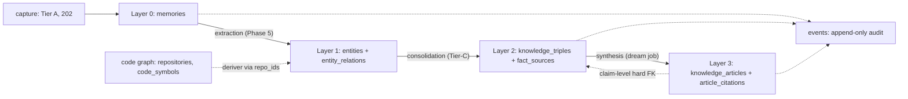
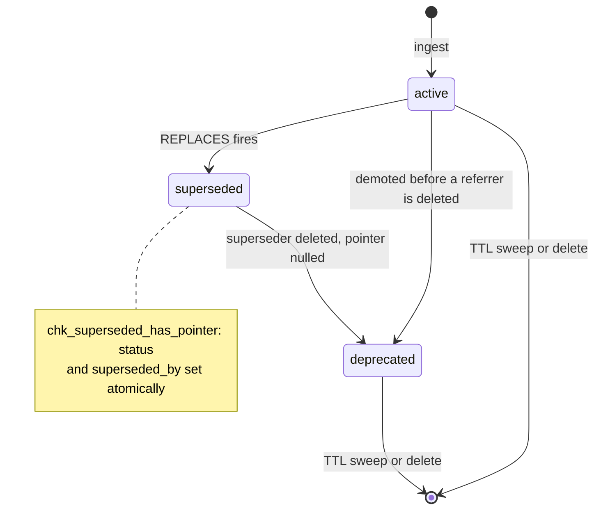
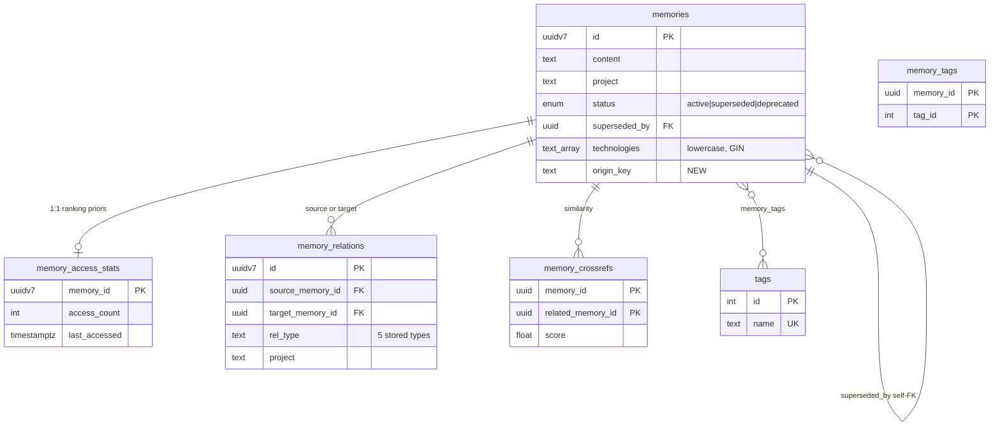
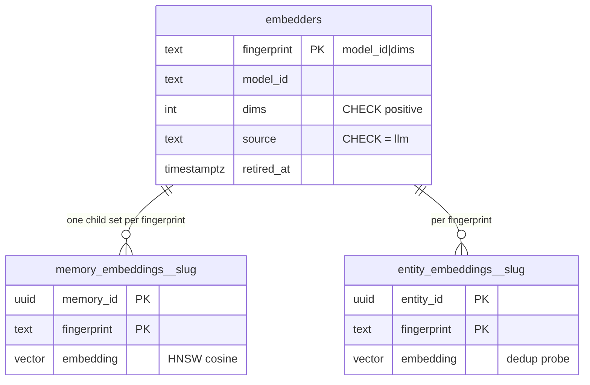
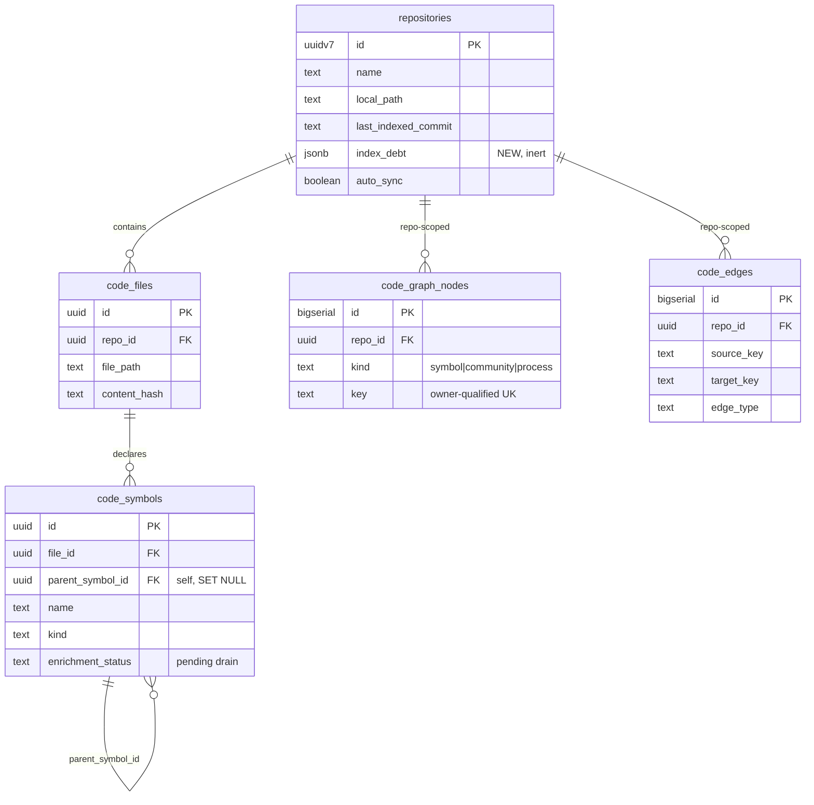
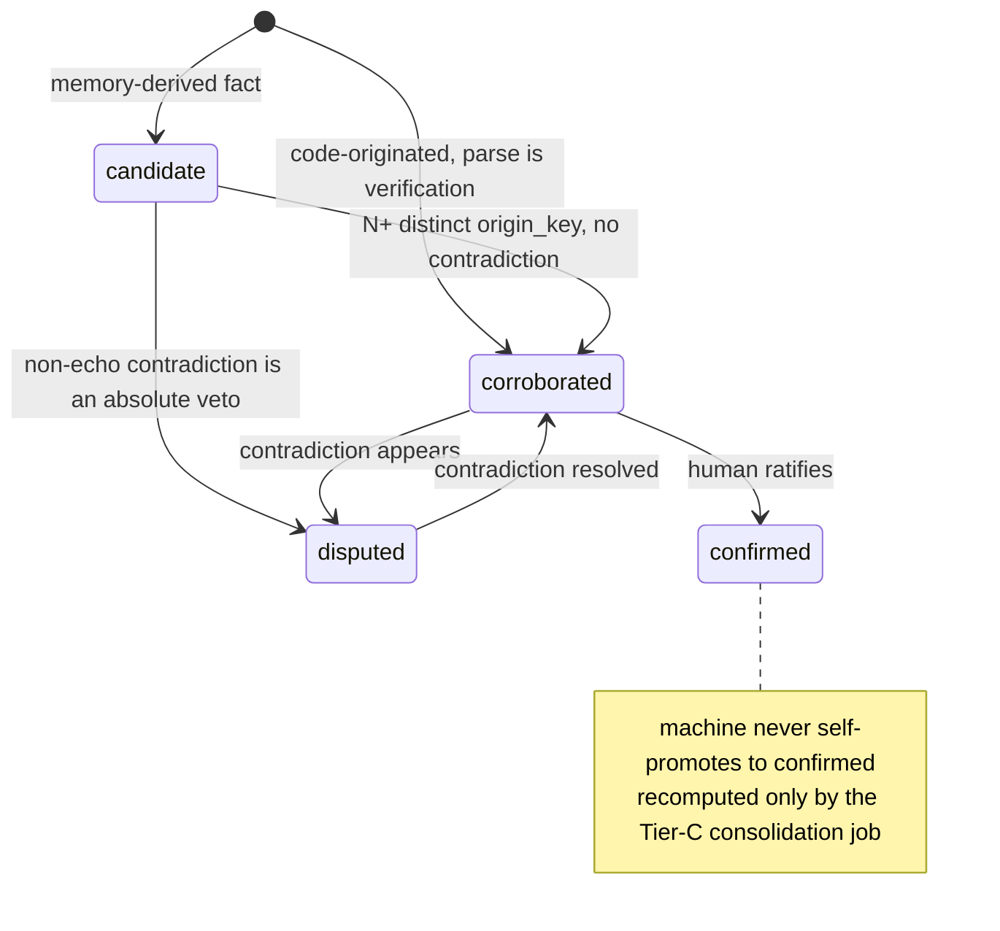
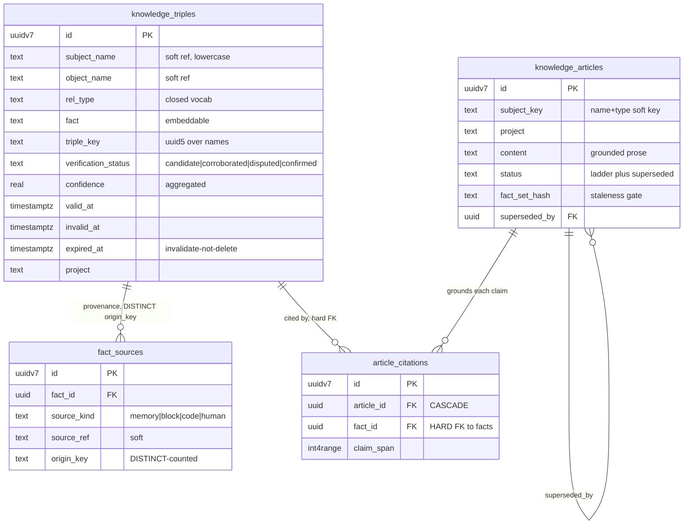

# 04 — Data Model & Schema Design

**Status:** foundation doc (binds every subsystem doc's physical shape). Draft 2026-07-24.
Part of the unified target design — see `docs/design/README.md` for the frame and document map.

---

## 1. Purpose & scope

**This doc fixes the physical schema — every table, column, type, constraint, index, and per-fingerprint partition — that the runtime layers of doc 02 sit on.** Doc 01 defines the domain objects (memory, entity/relation, topic, knowledge, project, code graph, document/block, event, memory-relation); doc 02 decomposes the runtime into layers and names the components; this doc gives each object a table and each rule a constraint. It is the layer where "the graph is a view over the same rows" (doc 02 §4) stops being an aspiration and becomes columns and foreign keys. Where doc 02 said *what* exists per fingerprint and *that* it never joins, this doc gives the child-table shape; where doc 01 fixed a lifecycle, this doc gives the CHECK constraint and the delete order that enforce it.

**The schema is presented as one coherent target on a single Postgres, greenfield-capable, with the reference point being what runs today.** The reference implementation is Alembic HEAD (revision `0006`) plus the runtime child tables the embedder registry creates on first use. This doc is authored on the **retained Python/FastAPI + async SQLAlchemy + Postgres/pgvector stack** (the 2026-07-24 Option A decision; .NET fully de-risked in annex 03a at 24 green / 0 yellow / 0 red but deferred to a post-target migration). Because the deferred .NET port would replay this schema through DbUp (SQL-first, like Alembic), the design stays expressible as plain SQL DDL — no ORM-only construct is load-bearing (§12).

**The doc is scrupulously honest about what exists versus what is designed.** Every table and column is labelled: **(exists today)** for what HEAD ships and the target keeps; **(target-new)** for a net-new table, column, or partition family; **(rebuild)** for `knowledge_triples`, whose name survives but whose every column and semantic is a fresh build; and **(activation)** for a column or model that exists today, is populated but unread, and the target begins to spend. Several assets today are latent scaffolding — `knowledge_triples`, `enrichment_queue`, `api_keys`, and `memories.importance` — and this doc marks each honestly rather than presenting it as shipped capability (invariant 23, doc 02 §9). Nothing here claims the entity graph is spent on retrieval today (it is built on every ingest but not yet read by search), and nothing treats the dormant temporal scaffolding as a working feature.

**Conventions this doc assumes throughout.** Times are `timestamptz`; primary keys are `uuid` — **UUIDv7** for the application-generated ones (time-ordered index locality) and server-side `gen_random_uuid()` (v4) for the two ANN-churned graph tables (`entities`, `entity_relations`) — except the few append-heavy tables that use `bigint`/`serial`; flexible payloads are `jsonb`; entity names live lowercase on disk with original casing preserved in `properties.display_name`; every embedding lives in a per-fingerprint child table, never inline on a core row; and every "type" column holds a value from a **closed taxonomy** normalised in application code before the write, not a free-form string and (with one exception) not a native Postgres enum.

## 2. Schema at a glance

**Every domain object from doc 01 maps to a concrete table (or, for two of them, to no new table at all).** The map below is the spine of the rest of the doc; the sections that follow give each row its columns and constraints. Objects that ride an existing surface rather than a new table are called out explicitly, because "no new table" is itself a design decision this doc is responsible for.

| Doc 01 object | Table(s) | Status |
|---|---|---|
| Memory (§3.1) | `memories`, `tags`, `memory_tags`, `memory_crossrefs` | exists today; `memories` gains `origin_key` and drops the `llm_` prefix; new `memory_access_stats` 1:1 side table (§9) |
| Entity & Relation (§3.2) | `entities`, `entity_relations` | exists today; each gains an inert `repo_ids[]` code-assertion array (§4.1/§4.2) |
| Topic (§3.3) | `memory_communities` (+ membership) | target-new (§8.4) |
| Knowledge vault (§3.4) | `knowledge_triples` (facts) + `fact_sources`; `knowledge_articles` + `article_citations` | Layer-2 facts rebuild-extended + Layer-3 articles/provenance target-new (§8.3/§8.8) |
| Project (§3.5) | `projects` registry; `memories.project` / per-table `project` column; `project_repositories` | registry + M2M join target-new (§7/§8.7); scope column exists |
| Code graph (§3.6) | `repositories`, `code_files`, `code_symbols`, `code_graph_nodes`, `code_edges` | exists today; `repositories` gains inert `index_debt` (§6) |
| Document & Block (§3.7) | `documents`, `blocks`, `block_embeddings__<slug>` | target-new / horizon (§8.5) |
| Event / Operation (§3.8) | `events` (replaces `audit_log`) | target-new; `audit_log` dropped outright (§8.1) |
| Memory relations (§3.9) | `memory_relations` | target-new (§8.2) |
| Bi-temporal facts (§3.2 window) | `knowledge_triples` | rebuild-extended, keeps name; the Layer-2 fact store (§8.3) |
| Ingest buffer (F1) | `memory_buffer` | target-new (§8.6) |
| Embedding vectors (all) | `*_embeddings__<slug>` per fingerprint | four exist, four target-new (§5) |

The four-layer knowledge architecture at a glance, with every table's full column and constraint detail in `docs/design/erd.md`:



**Seven global conventions bind every table above and are stated once here rather than repeated per row.** First, **UUIDv7 primary keys**: every application-generated uuid PK is **UUIDv7** — time-ordered, so B-tree inserts stay local instead of fragmenting the index the way v4's randomness would, at zero extra cost and one generation rule (`memories`, `repositories`, `documents`, `blocks`, `knowledge_triples`, `fact_sources`, `knowledge_articles`, `article_citations`, `memory_buffer`, `memory_communities`, `memory_relations`, …). The two exceptions keep server-side `gen_random_uuid()` (v4) — `entities` and `entity_relations` — because they are ANN-probed and sweep-churned, not range-scanned, so insert locality buys nothing (they move to a native `uuidv7()` only if the Postgres major reaches ≥ 18). The tables that need no uuid identity use integer keys: `tags.id` is plain `serial`, and `events` and the code-graph node/edge tables use `bigserial`/`bigint` because they are append-heavy, never referenced by a uuid FK, and a narrow key is cheaper at volume. Second, **`timestamptz` everywhere** — no naive timestamps; `created_at`/`updated_at` default `now()`, and the target's bi-temporal columns widen the old `date` columns to `timestamptz` (§8.3). Third, **`jsonb` for flexible payloads** — `entities.properties`, `memories.metadata_`, `config.value`, `llm_purpose_configs.params`, embedding `payload`, and every target `payload`/`properties`/`applies_when`/`detail` column — so the shape can evolve without a migration, with the discipline that anything queried in a filter gets promoted to a real column or a GIN index. Fourth, **lowercase-on-disk** for `entities.name` with display casing in `properties.display_name`. Fifth, **per-fingerprint embeddings**: no core table carries an inline `vector(N)` column; vectors always live in `<parent>__<slug>` child tables reached only through `child_table(parent, fingerprint)` (§5). Sixth, **closed-taxonomy type columns**: `entity_type`, `rel_type`, `memory_type`, and the target memory-relation `rel_type` are `varchar` holding a value already normalised against a code-level closed set (`app/taxonomy.py`), not a DB enum — the **one** native enum in the schema is `memory_status AS ENUM ('active','deprecated','superseded')`, because its three values are a true fixed lifecycle the database itself should enforce; the newer ladder/state columns (`verification_status`, article `status`, `memory_buffer.status`, `review_state`) are CHECK-constrained `text`, not enums. Seventh, **partitioning is targeted, not reflexive**: the **only** declaratively partitioned table is `events` (`RANGE(created_at)`, monthly — §8.1); `memories` is deliberately **not** partitioned, because Postgres forces the partition key into every unique/PK constraint, which would break its `superseded_by` self-FK, `memory_tags`, `memory_crossrefs`, the embedding-child FKs, and the composite `(id, project)` FK — UUIDv7 locality plus the existing partial indexes are this table's scale mitigations instead; and the per-fingerprint embedding child tables already **are** the embedding partitioning (§5), never partitioned again inside a child (invariant 2).

## 3. Core memory tables

### 3.1 `memories` — the central rows and the status lifecycle

**Decision. `memories` stays the atomic unit and the home of the supersession lifecycle; the target adds one new column (`origin_key`), drops the `llm_` prefix from its four enrichment columns, adds a 1:1 ranking-prior side table (`memory_access_stats`, §9), and begins to read three columns that already exist — but changes no existing column's *meaning*.** Every stored statement is one row; the row carries content, classification/enrichment output, the denormalised `technologies` cache, and the `active → superseded → deprecated` status machine. The full column set (the target's ranking priors live in the side table, not here):

| Column | PG type | Null | Default | Status |
|---|---|---|---|---|
| id | uuid | NO | app **`uuidv7`** | exists (v4 today → UUIDv7, §2) |
| content | text | NO | — | exists |
| source | varchar(100) | NO | ORM `'api'` | exists |
| source_agent | varchar(255) | YES | — | exists |
| origin_key | text | YES | — | **target-new** — capture session / agent-run identity; the corroboration-independence key (§8.3) |
| memory_type | varchar(50) | YES | — | exists; target widens vocab (§4.3) |
| importance | float8 | NO | 0.5 | exists — **dormant** (populated, unread by ranking) |
| metadata (attr `metadata_`) | jsonb | NO | `{}` | exists; target reuses for episodic/repo-hint payloads |
| created_at | timestamptz | NO | `now()` | exists |
| updated_at | timestamptz | NO | `now()` (onupdate) | exists |
| expires_at | timestamptz | YES | — | exists — **activation** (self-expiring dated facts, §8.3) |
| is_archived | boolean | NO | false | exists |
| classified_type | varchar(50) | YES | — | exists — **renamed** from `llm_classified_type` (`llm_` prefix dropped — source-neutral, the classifier may be the local model) |
| summary | text | YES | — | exists — **renamed** from `llm_summary` |
| emotions | jsonb | YES | — | exists — **renamed** from `llm_emotions` |
| flags | jsonb | YES | — | exists — **renamed** from `llm_flags` |
| project | text | NO | `'default'` | exists — supersession & isolation scope |
| status | `memory_status` enum | NO | `'active'` | exists |
| superseded_by | uuid | YES | — (self-FK) | exists |
| technologies | text[] | NO | `'{}'` | exists — lowercase, denormalised, GIN |
| confidence | real | NO | 0.75 | exists — read by ranking today |
| search_vector | tsvector | YES | — (trigger-maintained) | exists |

Two regex-era columns present in the greenfield migration were dropped at revision `0006` — `classified_type varchar(50)` and `classified_confidence float8` — when the regex classifier was removed and LLM classification became unconditional. `classified_confidence` is not reintroduced. The **name** `classified_type` is reused at HEAD, but as the rename target of `llm_classified_type` (the `llm_` prefix dropped — §3.1 table), carrying the LLM-or-local-classifier verdict, not the old regex semantics.

**The supersession lifecycle is enforced by one CHECK constraint that must hold atomically, and by a delete order the FK forces.** The constraint, exactly as it ships in migration `0001`, is

```sql
CONSTRAINT chk_superseded_has_pointer CHECK (status != 'superseded' OR superseded_by IS NOT NULL)
```

named `chk_superseded_has_pointer`. It forbids a row in `status='superseded'` that does not name its replacement, so supersession code must set `status` and `superseded_by` in the same statement — never one then the other (invariant 3). The self-FK is `superseded_by → memories.id` **ON DELETE SET NULL** (`fk_memories_superseded_by`). That SET-NULL is what makes the delete order load-bearing: **before deleting any memory that others reference via `superseded_by`** — whether the TTL sweep (`expired_memory_cleanup`) or an interactive delete — the code must first **demote those dependents to `status='deprecated'` with `superseded_by=NULL`**, because otherwise the FK nulls their pointer while they are still `superseded`, the CHECK fails, and the whole batch aborts. The target's consolidation/"dreaming" `supersede()` primitive (doc 02 §6.2) obeys the same atomic-set and demote-first rules; it is a new caller of an unchanged contract, not a new lifecycle.

The status lifecycle as a state machine, with the CHECK that forbids a superseded row without a pointer and the demote-first rule the ON DELETE SET NULL forces:



**Full-text search is a trigger-maintained `tsvector` column, and it is the keyword side of hybrid retrieval.** `search_vector` is added by raw `ALTER TABLE` (not the ORM), indexed by `ix_memories_fts` GIN, and populated by a `BEFORE INSERT OR UPDATE OF content` trigger:

```sql
CREATE FUNCTION memories_fts_trigger() RETURNS trigger AS $$
BEGIN
    NEW.search_vector := to_tsvector('english', COALESCE(NEW.content, ''));
    RETURN NEW;
END $$ LANGUAGE plpgsql;
CREATE TRIGGER memories_fts_update BEFORE INSERT OR UPDATE OF content ON memories
    FOR EACH ROW EXECUTE FUNCTION memories_fts_trigger();
```

Hybrid search fuses `ts_rank(search_vector, plainto_tsquery('english', :q))` with pgvector cosine via reciprocal rank fusion (`k=60`); the schema's job is to carry the column, the trigger, and the GIN index so retrieval (doc 07) can do the fusion.

**`technologies` is a lowercase, denormalised, GIN-indexed array — all three properties are load-bearing (invariant 6).** It caches the names of entities whose `entity_type` is in `TECH_TYPES` (§4.3), recomputed in Phase 5 from the memory's entities, and both the supersession detector's overlap gate and the retrieval technology filter consult it instead of joining the graph. It is stored lowercase because the supersession detector lowercases `REPLACES` targets to match it; the `ix_memories_technologies` GIN index carries the array-overlap query. Dropping the denormalisation, the lowercasing, or the index each breaks a different consumer, so all three stay.

**Three quality/priority signals are distinguished by what actually reads them today.** `confidence` (REAL, default 0.75) is read now: when `confidence_rank_gamma > 0`, `_apply_confidence_weighting` multiplies `rrf_score` by `(1 + γ·(confidence − 0.75))`. `importance` (float8, default 0.5) is **populated at ingest but never read by ranking** — it is dormant scaffolding, and the target's plan is not a new column but to fold it, `confidence`, and query-time heat/recency into one `rank_fusion_factor` multiplier, each arm behind a `w_*` feature flag defaulting to 0 (§9). `expires_at` (nullable TTL) exists and is swept by `expired_memory_cleanup`; the target **activates** it further by populating it from a fact's own stated expiry date at extraction (self-expiring dated facts, §8.3) — again a value-population change, not a schema change.

**Indexes on `memories` (HEAD):** `ix_memories_created_at` (btree), `ix_memories_is_archived` partial `WHERE is_archived = false`, `ix_memories_project` (btree), `ix_memories_status` (btree), `ix_memories_technologies` GIN, and `ix_memories_fts` GIN. The single-column `project` and `status` btrees exist today; §10 explains why the target adds a **composite** `(project, status)` support to make the SQL filter-pushdown cheap on the retrieval path.

### 3.2 `tags`, `memory_tags`

**Decision. Tags stay a small allowlist with an M2M join; no change.** `tags` is `id serial PK`, `name varchar(255)` UNIQUE, `category varchar(50)` nullable. `memory_tags` is the join: `(memory_id uuid, tag_id integer)` composite PK, both columns `ON DELETE CASCADE` (`memory_id → memories.id`, `tag_id → tags.id`). The `tag_orphan_cleanup` job reaps tags no memory references. These exist today and the target keeps them verbatim.

### 3.3 `memory_crossrefs`

**Decision. The precomputed similarity edge table stays live and unchanged.** `memory_crossrefs` holds related-memory pairs computed in the Phase-5 crossref step (in a separate session after the main commit, per the async-session-lifetime rule): `(memory_id uuid, related_memory_id uuid)` composite PK, `score float8 NOT NULL`, both FKs `→ memories.id ON DELETE CASCADE`, plus `ix_memory_crossrefs_related` on `related_memory_id` for the bidirectional read. This is a real, live table (written DELETE+INSERT, read bidirectionally in `vector.py`) — distinct from the target `memory_relations` associative layer (§8.2), which is *typed* and *directed* rather than a symmetric similarity score.

The memory core and its satellites, with the 1:1 access-stats side table (§9) and the typed memory-relation edges (§8.2) shown alongside the core row:



## 4. The knowledge graph — non-memory-scoped

### 4.1 `entities`

**Decision. Entities are a global, non-memory-scoped set; the vector lives out-of-line in a per-fingerprint table, and creating a duplicate appends a memory id rather than inserting a row (invariant 4).** Each entity is asserted by many memories, tracked in a `memory_ids` array, so the graph is a shared substrate over all memories rather than a per-memory copy.

| Column | PG type | Null | Default |
|---|---|---|---|
| id | uuid | NO | `gen_random_uuid()` (v4 — kept, not UUIDv7; §2) |
| name | varchar(500) | NO | — (lowercase; original casing in `properties.display_name`) |
| entity_type | varchar(100) | NO | — (a value from `ENTITY_TYPES`) |
| properties | jsonb | YES | `'{}'::jsonb` |
| memory_ids | uuid[] | YES | `'{}'::uuid[]` |
| repo_ids | uuid[] | YES | `'{}'::uuid[]` — **target-new, inert** (code-assertion source; §4.2) |
| created_at | timestamptz | YES | `now()` |

The uniqueness key is **`UNIQUE (name, entity_type)`** — the same name of a different type deduplicates separately, which is why the Phase-4 ANN dedup probe is type-constrained. `ix_entities_memory_ids` is a GIN index on the array, and the target adds a parallel `ix_entities_repo_ids` GIN on `repo_ids` — the code-assertion analog of `memory_ids`, letting a repo assert an entity without a memory. It lands **inert** in the baseline (empty arrays), so the amended orphan sweeps stay byte-identical to today; the full invariant-8 amendment and its lone writer (the code deriver, doc 10) are described in §4.2. There is deliberately **no inline embedding column** and no `entities.entity_type` btree (an earlier draft's btree was not shipped because dedup reads the HNSW vector index, not a type btree — migration `0005` deliberately did not ship it). Names are stored lowercase because both the supersession detector and the technologies denorm assume it for matching; display casing survives in the jsonb (invariant 7).

### 4.2 `entity_relations`

**Decision. Relations are entity-to-entity, non-memory-scoped, and append on conflict, exactly like entities.**

| Column | PG type | Null | Default |
|---|---|---|---|
| id | uuid | NO | `gen_random_uuid()` (v4 — kept; §2) |
| source_entity_id | uuid | NO | — |
| target_entity_id | uuid | NO | — |
| rel_type | varchar(100) | NO | — (a value from `RELATIONSHIP_TYPES`) |
| properties | jsonb | YES | `'{}'::jsonb` |
| weight | float8 | YES | 0.5 |
| memory_ids | uuid[] | YES | `'{}'::uuid[]` |
| repo_ids | uuid[] | YES | `'{}'::uuid[]` — **target-new, inert** (code-assertion source) |
| created_at | timestamptz | YES | `now()` |

The uniqueness key is **`UNIQUE (source_entity_id, target_entity_id, rel_type)`**; both endpoint FKs are `ON DELETE CASCADE`. Indexes are `ix_entity_relations_memory_ids` (GIN), `ix_entity_relations_repo_ids` (GIN, target-new), and `ix_entity_relations_target` (btree on `target_entity_id`, added in migration `0002` for reverse-lookup, neighbour, and orphan-guard queries). The self-healing delete (`delete_by_memory_id`) removes a relation only when no live memory still asserts it and an entity only when no live memory asserts it and no surviving relation references it — the FK cascade means deleting a referenced entity would destroy another memory's edge, so it must not (invariant 8). The hourly `graph_orphan_cleanup` runs the unscoped `prune_orphan_entities` sweep as a backstop.

**The invariant-8 amendment (`repo_ids[]`) lands inert in the baseline.** `repo_ids[]` on `entities` and `entity_relations` (above) is the mechanism by which **code asserts graph rows without a memory**: a repo id in the array is the code-side analog of a memory id. Both orphan sweeps gain **one `NOT EXISTS (live repo)` predicate each** — a relation or entity survives while any live memory *or any live repo* still asserts it — and two new primitives, `assert_from_repo` and `strip_repo_assertions`, do strip-before-rewrite per repo exactly as `delete_by_memory_id` does per memory; dangling `repo_ids` self-heal the same way dangling `memory_ids` do. The amendment ships **inert in v1**: with every `repo_ids` array empty, the amended `NOT EXISTS (live repo)` clauses are always true-vacuous, so the sweeps are byte-identical to today — the load-bearing deletion-logic change is reviewed, tested, and frozen while it is riskless (blast radius: 2 columns + 2 methods + tests), and its only writer, the code deriver, ships later (doc 10, with the T1–T4 code-KB truth-hole hardening). The **never-join invariant is reworded, not weakened**: no *query* joins the memory and code graphs; the only sanctioned crossings are two application-level, one-direction components — the deriver projection and the citation re-verifier — and "a symbol is not an entity" stands verbatim.

**Anti-schema note (target).** Two graph adjuncts the target introduces must **not** become `entity_relations` rows. Entity-KNN synonymy edges (cosine ≥ 0.8) are ephemeral and built *inside* the cached igraph snapshot, because a `SYNONYM` `rel_type` would be rewritten to `RELATED_TO` by the closed taxonomy and pollute the graph (§8, doc 07). And the memory-to-memory associative layer is a separate table (§8.2), not a memory-endpoint overload of this one — its endpoints are memories, not entities.

### 4.3 The closed taxonomy — and the new memory-relation vocabulary kept out of it

**Decision. Four closed vocabularies govern the model; the target adds a fifth (memory-relation types) that must stay separate from the entity-relation types, and every new value lands taxonomy-first before any feature emits it (invariant 5).** The LLM may emit anything; `normalize_entity_type` and `normalize_relation_type` (`app/taxonomy.py`) rewrite everything to a closed value before the write — unknown entity → `concept`, unknown relation → `RELATED_TO` — and `LEGACY_*_TYPE_MAP` rewrites historical names at runtime so old rows keep matching new code. The vocabularies as they stand and as the target extends them:

| Vocabulary | Source | Count | Values |
|---|---|---|---|
| `ENTITY_TYPES` | `app/taxonomy.py` | 15 | tool, service, database, language, protocol, project, algorithm, artifact, concept, entity, person, organization, event, place, paper |
| `RELATIONSHIP_TYPES` | `app/taxonomy.py` | 16 | USES, DEPENDS_ON, HAS_PART, IMPLEMENTS, EXTENDS, REPLACES, IMPROVES_ON, IS_A, DEPLOYED_ON, CAUSES, AUTHORED_BY, HAPPENED_ON, MENTIONS, CITES, INSPIRED_BY, RELATED_TO |
| `TECH_TYPES` | `app/services/relations.py:43` | 5 | tool, service, database, language, protocol |
| `MEMORY_TYPES` | `app/taxonomy.py` | 7 (→ target 9) | fact, decision, preference, problem, reference, architecture, milestone **+ target: episodic, procedural** (`insight`/`profile` are **not** added — knowledge moved to the vault, §8.8) |
| **memory-relation types** | **`app/taxonomy.py` (target-new)** | **6 (5 stored + 1 projected)** | **CONTRADICTS, ELABORATES, DEPENDS_ON, FOLLOWS, RELATES_TO stored; SUPERSEDES projected from `superseded_by`; DERIVED_FROM cut for v1 (§8.2)** |

`TECH_TYPES` is a frozenset defined in `relations.py`, not `taxonomy.py`; it selects which entity types feed `memories.technologies`, and `refine_entity_type` re-types a `project`-named `-ui/-kit/-sdk/.js/-js` entity to `tool` so first-party UI kits flow into the tech denorm. `REPLACES`, `IMPROVES_ON`, and legacy `BUILDS_ON` collapse to one bucket via `REPLACES_FAMILY` for rescue dedup, so adding a replacement-family relation means editing that grouping too (invariant 12).

**Why the memory-relation vocabulary must be a separate table of constants and never enter `RELATIONSHIP_TYPES`.** The new associative edges (§8.2) connect two *memory* rows, and their types (`CONTRADICTS`, `ELABORATES`, `FOLLOWS`, `RELATES_TO`, `DEPENDS_ON`, plus the projected `SUPERSEDES`) describe memory-level relationships, not entity-level ones. If a memory-level type like `ELABORATES` entered `RELATIONSHIP_TYPES`, `normalize_relation_type` would accept it on an entity-to-entity edge and blur the layer boundary — an `entity_relations` row could claim one entity "elaborates" another, which is meaningless. So the target adds a distinct closed set with its own `normalize_*` and legacy map, kept out of `RELATIONSHIP_TYPES`. Within that set, `SUPERSEDES` is a **projected** type: reads surface it from `memories.superseded_by`, and it is never stored as a `memory_relations` row (§8.2), so the write-side vocabulary the normaliser validates is the **five** stored types. A sequencing gotcha: `SUPPORTS` is currently a legacy alias of `RELATED_TO` (`taxonomy.py:116`); promoting any such name to a first-class type means removing its legacy alias first. `episodic`, `procedural` (new `MEMORY_TYPES` values) and the five stored memory-relation types are **not in any vocabulary today** — they must land in `taxonomy.py`, and every hard-coded vocabulary must be swept (the `reason()` 7-type `KNOWN_TYPES`, the `extraction_clean.py` simple-7 gate, the UI type filters), *before* any feature emits them, because widening the vocabulary changes extraction prompts and re-extraction is not bit-identical (§12). `insight`, `profile`, and `DERIVED_FROM` are deliberately **not** added: the reshape moves knowledge into the first-class vault (§8.3/§8.8), so `insight`/`profile` are no longer knowledge memory-types and `DERIVED_FROM`'s only writer (knowledge-as-derived-row) is gone — shipping a zero-writer edge type would violate invariant 23.

## 5. Per-fingerprint embedding partitions

### 5.1 The `embedders` registry

**Decision. One `embedders` row per fingerprint owns the DDL for that fingerprint's child tables; the registry is the register-before-insert authority and the sole namer, and no query ever joins across fingerprints (invariant 2).** pgvector needs a fixed-dimension `vector(N)` column, so each embedder gets its own independent tables rather than one shared table — this is what makes embedder rotation a first-class operation instead of a migration crisis.

| Column | PG type | Null | Default | Constraint |
|---|---|---|---|---|
| fingerprint | text | NO | — | PRIMARY KEY |
| model_id | text | NO | — | |
| dims | integer | NO | — | CHECK `dims > 0` |
| source | text | NO | — | **CHECK `source = 'llm'`** |
| registered_at | timestamptz | NO | `NOW()` | |
| retired_at | timestamptz | YES | — | warm-cache loads only `retired_at IS NULL` |

The fingerprint is `model_id|dims` (e.g. `qwen3-embedding:0.6b|1024`). The partition slug is `re.sub([^A-Za-z0-9]+ → _)`, lowercased and **capped at 48 characters**; `register` refuses a fingerprint whose slug collides with a different registered one, raising a loud `RuntimeError` rather than silently corrupting a vector column. The HNSW index name is a separate blake2b digest (`ix_hnsw_<16hex>`) to stay under Postgres' 63-character `NAMEDATALEN` limit. The `source` CHECK was narrowed to the single value `'llm'` when the ML/regex embedder arms were scrubbed; the target does not widen it. Application code names a child table **only** through `child_table(parent, fingerprint)` and never inlines a slug; `register` is called (which registers the fingerprint) before any insert into a partition, in Phase 1 for the content fingerprint and again in Phase 3 if the embedder rotated mid-batch.

The registry owns the DDL for each fingerprint's child tables; every parent mints an identically-shaped child per fingerprint, reached only via `child_table(parent, fingerprint)` and never cross-joined:



### 5.2 The four existing partition parents

**Decision. The four child-table templates ship today, created idempotently by `EmbedderRegistry.register`, and each carries an HNSW index at `m=16, ef_construction=128`.** The templates live in `_TABLE_TEMPLATES` (`embedder_registry.py:32-79`); `<N>` is the fingerprint's `dims`; every child gets an HNSW index on `embedding vector_cosine_ops WITH (m=16, ef_construction=128)`.

| Parent | Key columns | PK | FKs |
|---|---|---|---|
| `memory_embeddings__<slug>` | memory_id uuid, fingerprint text, embedding vector(N), payload jsonb `{}`, created_at | `(memory_id, fingerprint)` | memory_id → memories.id CASCADE; fingerprint → embedders.fingerprint |
| `entity_embeddings__<slug>` | entity_id uuid, fingerprint text, embedding vector(N), created_at | `(entity_id, fingerprint)` | entity_id → entities.id CASCADE; fingerprint → embedders.fingerprint |
| `code_chunk_embeddings__<slug>` | id uuid `gen_random_uuid()`, fingerprint, repo_id uuid, file_path varchar(1024), language, symbol_name, chunk_content text, line_start/line_end int, embedding vector(N), created_at | `(id, fingerprint)` | repo_id → repositories.id CASCADE; fingerprint → embedders.fingerprint |
| `entity_embedding_cache__<slug>` | name_lower varchar(255), fingerprint, embedding vector(N), created_at, last_used_at, hit_count int `1` | `(name_lower, fingerprint)` | fingerprint → embedders.fingerprint |

`memory_embeddings` is the semantic side of hybrid search (`1 - (embedding <=> :vec)`); `entity_embeddings` drives the Phase-4 dedup ANN probe (`find_similar_entity`, threshold 0.85, type-constrained); `code_chunk_embeddings` backs semantic-only code search (no FTS column, so nothing to fuse); `entity_embedding_cache` is the Phase-3 DB-side entity-embedding cache keyed `(name_lower, fingerprint)`. Aux indexes per parent (`_AUX_INDEXES`, `embedder_registry.py:83-97`) are `memory_id`, `entity_id`, `(repo_id)` + `(repo_id, file_path)`, and `last_used_at` respectively.

### 5.3 The four target-new partition parents

**Decision. The target adds exactly four new per-fingerprint families — `block_embeddings` (horizon), `relation_embeddings` (dual-level retrieval), `article_embeddings` (the Layer-3 subject vault), and `triple_embeddings` (fact-similarity for corroboration and contradiction search) — and these are the ONLY schema items that touch the per-fingerprint machinery.** Everything else the target adds is a flat table, a column, a taxonomy value, or an in-process structure. All four **templates** ship up front (near-free under the boot-time reconciliation below); the `triple_embeddings` **writer** is deferred. Each family requires two coordinated changes plus the reconciliation, described after the table.

| Parent (target-new) | Key columns | PK | Purpose |
|---|---|---|---|
| `block_embeddings__<slug>` | block_id uuid → blocks.id CASCADE, fingerprint → embedders.fingerprint, embedding vector(N), payload jsonb `{}`, created_at | `(block_id, fingerprint)` | block-level retrieval for documents/PKM (§8.5) |
| `relation_embeddings__<slug>` | relation_id uuid → entity_relations.id CASCADE, fingerprint → embedders.fingerprint, embedding vector(N), created_at | `(relation_id, fingerprint)` | global arm of dual-level retrieval — embeds `"src rel_type tgt"` (doc 07) |
| `article_embeddings__<slug>` | article_id uuid → knowledge_articles.id CASCADE, fingerprint → embedders.fingerprint, embedding vector(N), payload jsonb `{}`, created_at | `(article_id, fingerprint)` | Layer-3 subject-article retrieval; long articles chunked at embed time via payload spans, not block rows (§8.8) |
| `triple_embeddings__<slug>` *(template now; writer deferred)* | fact_id uuid → knowledge_triples.id (no cascade — facts are invalidate-not-delete, §8.3), fingerprint, embedding vector(N), created_at | `(fact_id, fingerprint)` | fact-similarity for corroboration's fuzzy fact-merge and bi-temporal contradiction search (§8.3); template shipped up front, writer deferred behind a measured `pg_trgm`-on-`fact` undercount |

**Each new family means a `_TABLE_TEMPLATES` entry and an `_AUX_INDEXES` entry, and the registry's old one-time creation sweep is replaced by a permanent boot-time reconciliation.** `block_embeddings` mirrors the `memory_embeddings` template (`REFERENCES blocks(id) ON DELETE CASCADE`, `payload JSONB DEFAULT '{}'`, `PRIMARY KEY (block_id, fingerprint)`, HNSW aux index); `article_embeddings` mirrors it against `knowledge_articles`. The subtle part is that the registry creates a fingerprint's child tables only *at register time*, so every fingerprint already registered when a new template is introduced would be missing the new parent. This is why the old one-time creation sweep is **retired in favour of a permanent boot-time reconciliation** in `embedder_registry` (§12): at every startup it iterates the live `embedders` rows and runs each template's `CREATE TABLE IF NOT EXISTS` + `CREATE INDEX IF NOT EXISTS`, idempotently — so adding a template is near-free, an existing deployment gains `article_embeddings__<slug>` (and the others) for its current embedder with no re-register and no migration, the mechanism self-heals drift, and it replays mechanically in the deferred .NET port. Two rules bind `relation_embeddings` specifically. First, its rows key on the real `entity_relations.id` with `ON DELETE CASCADE` — no synthetic ids — so when re-extraction's strip-before-rewrite or the self-healing delete removes a relation, its vector dies with it rather than orphaning; the embeddings are written and refreshed **off the hot path** by the Tier-C job that maintains the graph-retrieval artefacts (doc 07 owns the refresh mechanics), never inside Phase 5. Second, because `entity_relations` is global (non-project-scoped), this channel has **no project predicate of its own** — a project-scoped retrieval that consults it must scope through the asserting memories' `memory_ids` (or label the results), or it re-opens exactly the cross-project leak the filter-pushdown work closes (§10, invariant 14). `triple_embeddings` is **template-now, writer-deferred**: the template ships up front, but its writer waits behind a measured undercount of the `pg_trgm`-on-`fact` candidate set, and when it ships it groups facts **for counting only, never merging rows or rewriting `triple_key`**, carrying the `names_distinct` guard (§8.3, §13). None of the four changes the two coupled rules: reached only via `child_table(parent, fingerprint)`, and never joined across fingerprints.

## 6. Code graph tables

**Decision. The code graph is repo-scoped, owner-qualified, and never joins the memory-side entity graph; it ships today and the target keeps it structurally unchanged save one inert new column (`repositories.index_debt`).** It is the tree-sitter code knowledge graph (blast-radius, communities, processes, rename) that no memory competitor has (doc 00 §6), and it lives in five tables plus the `code_chunk_embeddings` partitions of §5.2.

| Table | Key columns | Keys & indexes |
|---|---|---|
| `repositories` | id uuid, name, url, local_path, provider `'local'`, default_branch `'main'`, auth_token_ref, last_indexed_commit, last_indexed_at, **`index_debt` jsonb (target-new, inert)**, auto_sync bool, status, status_message, created_at, updated_at | PK id; `ix_repositories_auto_sync` **partial** `WHERE auto_sync = TRUE` (repo_sync filter) |
| `code_files` | id uuid, repo_id, file_path varchar(1024), language, last_commit_sha, content_hash, indexed_at | PK id; FK repo_id → repositories CASCADE; `ix_code_files_repo_path (repo_id, file_path)` |
| `code_symbols` | id uuid, file_id, name, kind, line_start/end, signature, docstring, visibility, parent_symbol_id (self-FK), source_code, summary, enrichment_status `'pending'`, enrichment_priority, enrichment_attempts int `0` | PK id; FK file_id → code_files CASCADE, parent_symbol_id → code_symbols SET NULL; `ix_code_symbols_file_id`; `ix_code_symbols_enrichment_pending` **partial** on `(enrichment_attempts, enrichment_priority DESC) WHERE enrichment_status='pending'` |
| `code_graph_nodes` | id bigserial, repo_id, kind varchar(20), key varchar(1024), label, properties jsonb | PK id; FK repo_id → repositories CASCADE; **UNIQUE (repo_id, kind, key)** |
| `code_edges` | id bigserial, repo_id, source_kind, source_key, target_kind, target_key, edge_type, properties jsonb | PK id; FK repo_id → repositories CASCADE; **UNIQUE (repo_id, source_kind, source_key, target_kind, target_key, edge_type)**; four indexes: `repo_type`, `repo_source`, `repo_target`, `covering (repo_id, edge_type, source_key, target_key)` |

Two points a schema reader must not miss. First, `code_symbols` keys are **owner-qualified** (`name::file_path::owner` since migration `0003`), which is why method-level nodes resolve without collision; migration `0003` was a data-only reset (`DELETE FROM code_edges`, `DELETE FROM code_graph_nodes`, null `last_indexed_commit`) to rebuild keys under the new scheme. Second, the **enrichment backlog is the `code_symbols.enrichment_status='pending'` partial index, not a queue table** — the `enrichment_queue` table exists in migration `0001` but no app code inserts or selects from it; it is dormant scaffolding (§12), and the live drain uses the `0005` partial index. `code_graph_nodes.kind` is polymorphic: communities and processes are node *kinds*, not separate tables. The code graph is repo-scoped throughout and, per doc 01 §5, never joins the memory entity graph — the target's project→repo bridge (§8.7) is a registry association, not a graph join.

**One inert target-new column, and the hardening logic that lives elsewhere.** `repositories.index_debt jsonb` persists the T2 re-trace drain: the 500-caller re-trace cap currently drops work silently, so the outstanding debt is recorded and drained via continuation batches. It lands as an inert column here; the four code-KB truth-hole fixes it participates in — **T1** fail-stale-not-fail-empty (a diff failure falls back to a full index and the error path leaves the last-good graph in place, marked stale, instead of wiping it), **T2** index-debt drain, **T3** a periodic `code_reconcile` job hashing the working tree against `code_files.content_hash` (**corrected 2026-08-30: shipped instead as a scan folded into the one `repo_sync` loop, gated per repo — no standalone job exists; see doc 10 §3's T3 correction**), and **T4** summary carry-over keyed on name/kind/owner/source-hash — are **doc 10's** logic, not this doc's. Likewise the code→vault bridge is not a table FK: a deriver mints `entities`/`entity_relations` from imports, tagged with `repo_ids[]` (§4), and its writer (doc 10) ships after the fact layer; the columns land inert here.

The repo-scoped code graph — five tables plus the `code_chunk_embeddings` partitions — that never joins the memory-side entity graph:



## 7. LLM, config & operations tables

**Decision. LLM configuration, feature flags, job state, auth revocation, failure tracking, and chat all ship as flat tables or `config` rows; the target simplifies the LLM set (dropping the indirection tables), adds a minimal `projects` registry, and drops `audit_log` outright in favour of the durable `events` table (§8.1).** Keeping LLM config, flags, and job state **in-database as rows** (not env vars) is what lets the UI change runtime behaviour without a redeploy (invariants 18–19).

**LLM configuration collapses to one table.** darkmem is not an LLM proxy, so the `*_ref` indirection is dropped: **`llm_providers`, `llm_profiles`, and `ml_profiles` are removed**, along with every `*_ref` column and the profile-management UI. `llm_purpose_configs` becomes **six inline rows**, PK `(purpose)`, keyset `embedding, extraction, classification, reasoning, summarization, reranker`, each carrying its connection inline: `{model, base_url, api_key, api_kind, params jsonb, dimensions?, reasoning?}`. The `classification` purpose additionally carries an inline **`classifier_kind = llm | local`** — a lightweight local classifier re-homed inline (a fast/cheap no-LLM path at volume) rather than referenced via the deleted `ml_profiles`; when the `[ml]` extra is absent, classification falls back to the LLM-backed classifier. There are no `LLM_*` env vars; the six purpose rows are written by the setup wizard's finalize step from `app/services/llm_seed.py`, not by a migration.

> **AMENDED 2026-08-20 — `llm_providers` is reinstated; `llm_profiles` and `ml_profiles` are not.** Owner ruling, spec `docs/superpowers/specs/2026-08-20-llm-providers-design.md`. The paragraph above is kept because its argument still holds where it matters, and only the storage half of it is reversed.
>
> **What changed.** `llm_providers` is a first-class baseline table, `(name varchar(64) PK, api_kind, base_url, api_key, updated_at)`. `llm_purpose_configs` keeps PK `(purpose)` but loses `api_kind`/`base_url`/`api_key` and gains **`provider_name` NOT NULL** → `llm_providers(name)` `ON UPDATE CASCADE ON DELETE RESTRICT`. A purpose row now carries only `{provider_name, model, params jsonb, dimensions?, reasoning?}` plus `classifier_kind` on `classification`. The keyset is **eight**, not six — `synthesis` and `verification` joined it at T1.05 (doc 11 §6) and this paragraph's "six" was already stale before the reversal.
>
> **Why the reversal.** One requirement the flat shape cannot meet: a credential rotation or an endpoint move must reach every purpose that uses it with **no re-apply step**. That is a live reference, and a live reference is the indirection. The cheaper alternative — a UI-level provider preset stamped down into the purpose rows at save time — was shown to the owner and rejected on exactly that point.
>
> **What did *not* change, and must not.** `llm_profiles` and `ml_profiles` stay dropped, along with the profile-management UI and every `*_ref`/`*_id` column; `classifier_kind` stays inline. And **the resolved object stays flat**: `get_llm_config` becomes one `SELECT` with one `JOIN` and still returns `dict[str, LLMPurposeConfig]` with `base_url`/`api_key`/`api_kind` as flat fields. "darkmem is not an LLM proxy" is why — the indirection is a storage fact, never a runtime one. Two mechanisms hash those field names off the resolved object (`benchlib/caching_llm.py`'s cache key and `verification_judge.py`'s identity hash), so nesting or renaming one would invalidate every benchlib cache on every machine and move the qualified judge identity.
>
> **One frozen field pair.** The provider serving the `verification` purpose refuses a `base_url` or `api_kind` change over the API, because those are two of the judge's six identity fields (spec §9). **Its `api_key` still rotates.**

**A minimal `projects` registry lands in the baseline.** `projects` is `(name text PK, display_name text, properties jsonb, created_at timestamptz)` with **lazy auto-registration** (`INSERT … ON CONFLICT (name) DO NOTHING` on capture) and **no FK enforcement yet** — every scoped table keeps its bare `project text` column. The reshape forces the registry now because `knowledge_triples.triple_key` embeds `project` in *fact identity* (§8.3), so a typo'd project silently splits corroboration across two identities; the registry also anchors per-project `applies_when` context defaults, review-queue scoping, the one-active-article-per-`(project, subject_key)` rule (§8.8), and — in its `properties` jsonb — the per-project **pinned-subject** and **pin-dismissal** lists doc 09 §3.4 relies on (promoted to a dedicated `pinned_subjects` store only if they grow large). (The `memory_overview` cache doc 09 §3.3 reads is a separate `config` row `overview:<project>`, not `projects.properties`.) FK/ACL enforcement stays the later tenancy phase (§9, §13).

**The `config` table carries three runtime concerns as key/value rows.** `config` is `(key varchar(255) PK, value jsonb NOT NULL DEFAULT '{}')`. Its rows are the merged **feature flags** (`feature_flags`, merged over `FEATURE_FLAGS_DEFAULTS` behind a 5-second TTL single-flight cache), per-job **state** (`job:<key>`), the `admin_password_hash` that gates trust-on-first-use setup, and assorted setup/runtime config. The target's new runtime knobs — the `w_*` ranking-arm weights, the auto-provision SSRF **allowlist**, and any distribution render watermark — land as `config` rows or feature flags, **not** new tables (§8.7, §9).

**Operations tables.** `token_blocklist` (id, jti UNIQUE, expires_at, revoked_at) is the live JWT revocation store, swept by `token_blocklist_cleanup`. `pipeline_failures` is the polymorphic retry tracker: `(id, entity_type, entity_id, pipeline_name, failed_step, error_message, attempts int 1, first_failed_at, last_attempt_at, resolved_at, metadata jsonb)` with **three partial indexes** — `idx_pipeline_failures_unresolved` UNIQUE partial `(entity_type, entity_id, pipeline_name) WHERE resolved_at IS NULL` (one open failure per entity+pipeline), `idx_pipeline_failures_pipeline_name` partial `WHERE resolved_at IS NULL`, and `idx_pipeline_failures_resolved_at` partial `WHERE resolved_at IS NOT NULL`. This is the substrate under "honest partial results" (invariant 14): after Phase 5, `derive_memory_failed_step` records or resolves a row here, per memory, never collapsed to a batch pass/fail. `conversations` (id, title, is_archived, timestamps) and `messages` (id, conversation_id → conversations CASCADE, role, content, context jsonb, created_at) back the chat surface.

**`audit_log` is dropped outright — `events` is the sole audit substrate.** Today's `audit_log` is `(id serial, action varchar(50), memory_id uuid nullable **no FK**, api_key_id uuid nullable, details jsonb, timestamp)` — coarse, memory-level, no entity-level operations, no FKs, no indexes beyond the PK, and its `api_key_id` always `NULL` because `api_keys` is unwired (§9). In the greenfield target there is no compatibility window to preserve, so `audit_log` does not exist at all: the universal `events` table (§8.1) is the one append-only audit/event substrate from day one, covering every object down to entity, fact, and article. An optional one-time transform of any legacy `audit_log` rows into `events` at the homelab cutover is a migration convenience only, taken only if the mapping is trivial (§12).

## 8. Target-new tables

Each subsection states the table's purpose, its shape, which doc-02 §9 subsystem it realises, its partitioning, and the invariants it must preserve. All are additive on the single Postgres — no new datastore, tier, or front door.

### 8.1 `events` — the durable, append-only operation stream

**Decision. `events` is a net-new universal, append-only operation stream — one row per lifecycle transition on *every* object — and it fully replaces `audit_log`, which is dropped (§7). It is `PARTITION BY RANGE(created_at)`, monthly, from day one, with composite PK `(id, created_at)`, and append-only is enforced by a forbid-trigger.** This realises doc 02 §6.2's EventService and doc 01 §3.8's audit substrate — extending today's coarse memory-level log down to entity-level operations across memory, entity, relation, fact, article, topic, document, and repository. It uses a `bigint` key because it is append-heavy and never referenced by a uuid FK.

| Column | PG type | Null | Notes |
|---|---|---|---|
| id | bigint `GENERATED ALWAYS AS IDENTITY` | NO | append key; PK is composite `(id, created_at)` (the partition key must sit in the PK) |
| created_at | timestamptz | NO `now()` | **partition key** — `RANGE(created_at)`, monthly; part of the composite PK |
| event_type | text | NO | closed vocabulary, normalised in code (§2 convention): created / superseded / deprecated / expired / extracted / consolidated / verified / sources_changed / document_filed / repo_registered / repo_synced / repo_indexed / inject / inject_curbed / setup_completed / auth_lockout / repo_hint_rejected / … (the distribution and security values are target-new, added taxonomy-first before any emitter ships — docs 15, 18) |
| object_type | text | NO | closed vocabulary covering **every** object: memory / entity / relation / fact / article / topic / document / repository / system (box-level setup + auth/session events that name no domain object, target-new — doc 18) |
| object_id | uuid | YES | nullable — code-graph nodes are bigint-keyed, so carry a polymorphic key in payload or leave null |
| project | text | YES | per-project calendar scoping / isolation |
| actor | text | YES | who/what performed the op |
| api_key_id | uuid | YES | populated once `api_keys` is wired (§9); no FK |
| source | text | YES | ingest channel |
| payload | jsonb | NO `'{}'` | lineage: superseded_by, before/after, counts, verification transition |

**Indexes are the query surface: `(object_type, object_id, created_at)` reconstructs one object's timeline, and a date-bucket index makes a calendar-day click drill into that day's activity.** The date bucket must be written **`(project, ((created_at AT TIME ZONE 'UTC')::date))`** — the bare `created_at::date` cast on a `timestamptz` is only STABLE (it reads the session `TimeZone` GUC), so neither an index expression nor a generated `day` column may use it; the `AT TIME ZONE 'UTC'` form is IMMUTABLE, and it also fixes what "a day" means on the calendar (UTC buckets). One accepted limitation: bigint-keyed code-graph objects carry their key in `payload`, so *their* timelines are payload-queried and cannot use the `(object_type, object_id, …)` index — a deliberate trade, not an oversight.

**Partitioning and append-only are fixed decisions, not deferred.** `events` is declaratively **`PARTITION BY RANGE(created_at)`, monthly, from day one**, with PK `(id, created_at)` — nothing joins events by id, so folding `created_at` into the PK costs nothing; retention becomes a future `DETACH PARTITION`, and a small partition-maintenance arm on a cleanup job pre-creates next month's child. This is the **one** declaratively partitioned table in the schema (§2, §5): `memories` is not partitioned (its FK web forbids it), and the embedding children are their own partitioning. The **append-only invariant** (never rewritten — what makes the timeline trustworthy and the calendar honest) is enforced structurally by **forbid-triggers** that raise, chosen for v1 because they are role-agnostic (survive dump/restore and keep the one-image surface simple); a `REVOKE`-based owner/app role split is recorded as the multi-user upgrade path. **The mechanism is three triggers, not one** (corrected 2026-07-27 by T1.06). The single `BEFORE UPDATE OR DELETE OR TRUNCATE` trigger this paragraph first described is not creatable **at row level** — PostgreSQL rejects it with "TRUNCATE FOR EACH ROW triggers are not supported" — and the statement-level form that *does* create is strictly worse than the shipped design: measured on PG 17, a statement-level trigger on the parent guards nothing addressed directly at a child, leaking all three verbs. TRUNCATE fires only statement-level while UPDATE and DELETE are guarded per row, so they cannot share a trigger; and — measured on PostgreSQL 17 — a **row**-level trigger on a partitioned parent cascades to every child, present and future, while a **statement**-level `BEFORE TRUNCATE` trigger on the parent does **not**. `TRUNCATE events_202607` addresses the child directly, never reaches the parent's trigger, and erases that month of the journal in one statement. So: `BEFORE UPDATE OR DELETE … FOR EACH ROW` on the parent, `BEFORE TRUNCATE … FOR EACH STATEMENT` on the parent, and the same statement trigger on **every child partition** — attached by `events_ensure_partition`, the single function every partition-creating path calls (the baseline, the boot reconciliation, and the maintenance arm), so no path can create an unguarded child. Every backend signal that today is only a transient `/ws` broadcast (`pipeline.completed|partial|failed`, `memory.deleted`) and every verification-status transition (§8.3) gains a durable home here, so "every backend signal ships with its UI" holds (doc 02 §10) and "what did we believe as of X" answers from one substrate.

### 8.2 `memory_relations` — typed, project-scoped memory-to-memory edges

**Decision. Add a net-new `memory_relations` table for typed, directed edges between two memory rows, drawn from the closed memory-relation vocabulary kept separate from `RELATIONSHIP_TYPES`. The table stores exactly the **five** associative types; `SUPERSEDES` is a read-time PROJECTION over `memories.superseded_by`, never a stored row ("same fact, not a second source of truth" is thereby true by construction), and `DERIVED_FROM` is **cut for v1** — its only writer (knowledge as a derived memory row) is gone under the reshape (§8.8), and a zero-writer edge type would violate invariant 23.** This realises doc 02 §6.3's associative layer and doc 01 §3.9 — it lets "what relates to this memory" be a first-class query and lets retrieval traverse memory→memory, not only entity hops. Doc 01 §3.9 deferred the physical form of the supersession edge (a stored `SUPERSEDES` row versus the `superseded_by` column) to this doc; the pick is the **column**, with `SUPERSEDES` surfaced on reads as a projected edge (a SQL view over `memories(superseded_by, id, project)`, or a repository-level UNION into memory-relation reads).

| Column | PG type | Null | Notes |
|---|---|---|---|
| id | uuid | NO | |
| source_memory_id | uuid | NO | composite FK `(source_memory_id, project) → memories(id, project)` **ON DELETE CASCADE** |
| target_memory_id | uuid | NO | composite FK `(target_memory_id, project) → memories(id, project)` **ON DELETE CASCADE** |
| rel_type | text | NO | closed **stored** memory-relation vocab (§4.3), the five associative types: `CONTRADICTS`, `ELABORATES`, `DEPENDS_ON`, `FOLLOWS`, `RELATES_TO` |
| project | text | NO | **both endpoints share a project** — enforced by the composite FKs, not by discipline |
| properties | jsonb | YES | provenance: which pass asserted it |
| created_at | timestamptz | NO | |

The uniqueness key is **`UNIQUE (source_memory_id, target_memory_id, rel_type)`**, plus a btree on **`(target_memory_id)`** for reverse traversal — "what points at this memory" filters on the target, which the UNIQUE's source-prefix cannot serve; this is the exact lesson `entity_relations` learned when migration `0002` had to add `ix_entity_relations_target` (§4.2), applied here from day one. The same-project rule is **declaratively enforced**: a target-new `UNIQUE (id, project)` support on `memories` (trivially satisfiable — `id` is already the PK) exists solely so both endpoint FKs can be declared as composite `(memory_id, project)` references, which makes a cross-project edge *unrepresentable* rather than merely forbidden (invariant 14).

Two lifecycle rules bind this layer. **`SUPERSEDES` is never written here.** It is directed successor → superseded and is the same fact as the baseline `superseded_by` pointer, so it is served as a projection of that pointer: `chk_superseded_has_pointer` stays the single contract, F4's monotonic reprocess semantics are the pointer's own, and undo or demote-first can never leave a stored edge disagreeing with the column — there is no stored edge to drift. (Had the row form been chosen instead, it would have needed a sync trigger plus a partial-unique on `(target_memory_id) WHERE rel_type='SUPERSEDES'` to block multiple superseders; the projection makes both unnecessary.) The **five stored** associative types (`CONTRADICTS`, `ELABORATES`, `FOLLOWS`, `DEPENDS_ON`, `RELATES_TO`) obey strip-before-rewrite and self-heal — derived off the hot path in consolidation (F6), deleted when the pass re-derives, and cascaded away when an endpoint memory is deleted. `DERIVED_FROM` would have been the sixth stored type, but the reshape cuts it (§8.8): knowledge no longer lives as a derived memory row, so nothing writes it, and one provenance mechanism per layer is the rule (`fact_sources` for L2→sources, `article_citations` for L3→L2, the projected `superseded_by` for supersession). If consolidation later grows a real derived-memory writer, `DERIVED_FROM` is reintroduced then, taxonomy-first. The recommended physical form is this own table rather than a memory-endpoint overload of `entity_relations` (a judgment call for the maintainer, §13), because the endpoints, the vocabulary, and the project-scoping all differ from the entity graph, and merging them would blur the layer boundary invariant 4 protects.

### 8.3 `knowledge_triples` — the bi-temporal REBUILD (keeps the name, not an activation)

**Decision. `knowledge_triples` is rebuilt from scratch — the name survives, every column and semantic is new — and it is the **Layer-2 verified-fact store**: the rebuild EXTENDED with a verification ladder, aggregated confidence, structured context, and multi-source provenance in a `fact_sources` child table. It is treated as target-new, NOT as an activation of the dormant demo scaffolding (invariant 23).** Today the table is untested demo scaffolding with zero callers: free-text slug endpoints that are not FKs into `entities`, `unknown`-type stubs the orphan sweep reclaims, free-form predicates outside the closed taxonomy, and SQL that has never executed. The target's fact layer is a *build that keeps a table name* — knowledge is target-new, never a dormant feature switched on. Because the table is empty everywhere, the DDL migration is trivial and risk-free; the cost is the new derivation and verification services, not the schema. The rebuilt shape moves from row-level single-timeline supersession to **fact-level bi-temporal edges** so darkmem can answer "what did we believe as of date X" and invalidate-not-delete, and the reshape extends it into "final, verified understanding" with the ladder and provenance below.

| Column (rebuilt) | Change from today | Purpose |
|---|---|---|
| id | keep uuid PK — now **uuidv7** | time-ordered insert locality (§2) |
| subject_id / object_id + subject_name / object_name | resolve to **real `entities` ids**, not `_slugify` ghosts — held as **soft references** (uuid columns with **no hard FK**) plus denormalised **lowercase name** columns | endpoints resolved against `entities` at derivation time (new triples derive from `entity_relations`); deliberately no FK — see "Why the endpoints carry no hard FK" below |
| predicate → rel_type text | rename/keep | closed relation vocab |
| valid_from → **valid_at** timestamptz | rename + widen `date → timestamptz` | valid-time start |
| valid_to → **invalid_at** timestamptz | rename + widen `date → timestamptz` | valid-time end |
| **expired_at** timestamptz NULL | **ADD** | transaction-time / belief-withdrawn; "live" = `expired_at IS NULL` |
| **reference_time** timestamptz | **ADD** | source-episode anchor for relative dates (= source memory `created_at`) |
| **fact** text | **ADD** | embeddable — load-bearing for contradiction search (§5.3) |
| **project** text NOT NULL `'default'` | **ADD** | isolation scope; embedded in `triple_key`, so a typo'd project splits fact identity (why `projects`, §7) |
| **triple_key** text NOT NULL | **ADD** | app-computed `uuid5` over canonicalised lowercase names (post-Phase-4); carries the partial-unique live-fact identity (the index below) |
| ~~source_memory_id~~ → **`fact_sources` child table** | **externalise** | provenance leaves the row entirely: a `uuid[]` cannot carry per-source metadata, index per-kind reverse lookups, or compute `COUNT(DISTINCT origin_key)` — the child table below does all three |
| **verification_status** text NOT NULL `'candidate'` | **ADD** | `CHECK (verification_status IN ('candidate','corroborated','disputed','confirmed'))` — the honest ladder (below) |
| **confidence** real | keep, **now aggregated** | aggregated support/quality estimate, recomputed with `verification_status`, never a single-source guess |
| **applies_when** jsonb | **ADD** | structured context (env / version / situation) — boost/label/conflict-filter axis |
| **learned_in** text[] | **ADD** | auto-populated from project + source — trustworthy context provenance |
| **review_state** text NULL | **ADD** | `'open'` marks a disputed / under-sourced fact for the review queue — a status + partial index (the `pipeline_failures` pattern), not a churning table |
| source_file, created_at | keep | |

**Why the endpoints carry no hard FK.** The graph side *deletes* entities aggressively — `delete_by_memory_id` self-heals and the hourly `prune_orphan_entities` sweep reclaims orphans (§4.2, invariant 8) — while this table's contract is **invalidate-not-delete**: expired triples are history and must survive their endpoints. A hard FK breaks one side or the other (CASCADE destroys history, RESTRICT aborts the sweep, SET NULL destroys the triple's identity), so the endpoint ids are **soft references**, and the denormalised lowercase `subject_name`/`object_name` carry the durable identity: the deterministic temporal passes and the contradiction candidate lookups (same-endpoint, `pg_trgm`-on-`fact`) match on the **names**, which survive entity pruning and re-creation.

**`fact_sources` — the provenance child table and the corroboration signal.** Provenance moves out of the fact row into a net-new child table: `fact_sources` = `(id uuidv7 PK, fact_id uuid NOT NULL FK → knowledge_triples ON DELETE CASCADE, source_kind text, source_ref text, origin_key text, detail jsonb, created_at)`. `source_kind ∈ {memory, block, code, human}`; `source_ref` is a **soft** reference (no FK — consistent with the endpoints' soft-ref doctrine above, and required by code's commit-addressed refs); `detail` carries per-kind metadata (e.g. code: `{commit_sha, basis, file_path, symbol_key}`). Indexes: btree `(source_kind, source_ref)` — the member-source reverse lookup ("which facts does memory X assert", the role the removed `source_memory_ids` GIN played) — btree `(fact_id)`, and a dedupe key **`UNIQUE (fact_id, source_kind, source_ref)`**. **Corroboration counts `COUNT(DISTINCT origin_key)` per fact, never rows** — echo is not evidence — and origin key by kind is: memory → the capturing session / agent-run (`memories.origin_key`, §3.1); document → `document_id`; code → `repo_id` (one origin per repo regardless of commit count); human review → a `human`-kind row (one origin, dominant). When origin identity is unknown the truth-critical rule is to **merge to one origin (undercount), never mint distinct ones** — undercounting only delays promotion; overcounting manufactures it. A human review decision is *itself* a `fact_sources` row (who / when / what-was-shown), so the source-emptying sweep can never silently discard a `confirmed` fact.

**The verification ladder — honest by construction.** `verification_status` climbs `candidate → corroborated → confirmed` with a `disputed` sub-state; the machine can never reach `confirmed` on its own (only a human ratifies), which operationalises the design's under-claiming preference. Promotion to `corroborated` requires ≥ N distinct `origin_key`s (N a `config` row, defaulting to 2 when the origins differ in source-kind or are ≥ 7 days apart across distinct sessions, else 3), **no derived row ever counting as a source** (a structural exclusion, so an agent re-saving an article cannot inflate the count), and **no open contradiction** — a single non-echo contradiction is an absolute veto, not a vote, and **no newer REPLACES-family / supersession signal** over the fact's live memory sources (a deterministic promotion blocker — a hold, never itself a dispute; T2.60). Deterministic code-originated facts are born `corroborated` (the parse *is* the verification). The badge's honest claim is exactly "asserted by K distinct origins of kinds [X, Y], no known contradiction, as of T" — never "true". `verification_status` is **recomputed only by the Tier-C consolidation job** — never inline in Phase 5 or `delete_by_memory_id`, which merely enqueue the affected facts (invariant 15) — and it is **orthogonal to the belief-lifecycle axis** `(open / window-closed / expired)`: a fact can be `expired` yet `confirmed`. Every verification transition is journaled as an `events` row (§8.1). `review_state='open'` (a status + partial index, not a table) surfaces disputed and under-sourced facts to a consequence-ranked review queue; disputed knowledge is served **labelled with both sides**, never gated on review.

The verification ladder as a state machine: the machine promotes at most to `corroborated`, and only a human ratifies `confirmed`:



**Nullability:** `fact` and `reference_time` are NOT NULL (the fact text is load-bearing for contradiction search, and the reference anchor is always available — it is the source memory's `created_at`); `valid_at`, `invalid_at`, and `expired_at` are nullable (`valid_at NULL` = validity start unknown, treated as unbounded-past by the temporal passes; `invalid_at NULL` = open-ended validity; `expired_at NULL` = still believed).

**Indexes:** partial **non-unique** `(subject_name, rel_type, object_name) WHERE expired_at IS NULL` — non-unique because disjoint validity windows legitimately leave *several* live rows on one S/P/O (two employment stints at the same company are two believed facts); btree `(valid_at, invalid_at)`; **partial-unique on `triple_key WHERE expired_at IS NULL AND invalid_at IS NULL`** — at most one *currently-open* belief per fact, while window-closed rows (`invalid_at` set) leave the unique's scope yet remain live history, which is exactly what the disjoint-window pass produces (the stale-on-arrival pass closes the older row's `invalid_at` before a new open-ended row lands, so the unique never blocks a legitimate insert); the **member-source reverse lookup lives on `fact_sources`'s `(source_kind, source_ref)` btree**, not on this table — the re-extraction/deletion sweep finds a fact's memory (or block/code) sources there, the role the removed `source_memory_ids` GIN once played; and a partial **`(review_state) WHERE review_state='open'`** for the consequence-ranked review queue.

**Lifecycle invariants (B1/B2/B3):** invalidation is a **re-save, never a delete** (`SET expired_at=now, invalid_at=COALESCE(...)`); ingest runs only the two deterministic temporal passes (stale-on-arrival, disjoint-window) with **no LLM on ingest** — the LLM contradiction check is a Phase-3 consolidation consumer, never a Tier-B step (invariant 15); a re-extraction/deletion sweep (the analog of `delete_by_memory_id`) withdraws the memory's `fact_sources` rows and expires any live triple left with no surviving source — verification is **not** recomputed inline (the affected facts are enqueued for the Tier-C job; a strip-and-rewrite that lands the identical source set is a provenance no-op, no verified↔candidate thrash); and the **status bridge** flips a candidate memory to `superseded`+`superseded_by` **only when both guards hold** — the invalidating triple has exactly one live source memory (so the pointer is well-defined), **and** *every* live triple the candidate memory asserts has been expired or invalidated (a memory whose other facts remain live is never superseded wholesale over one invalidated fact) — otherwise `deprecated` with `superseded_by=NULL`. An open decision (§13) is whether to instead extend `entity_relations` with valid-time columns; the recommendation is the rebuild-and-derive-from-`entity_relations` path so there is one graph store, not two drifting ones.

### 8.4 `memory_communities` — topics as Leiden communities, never entities

**Decision. Add a net-new `memory_communities` table (plus membership) holding the result of Leiden community detection over a project-scoped projection of the memory graph; topics must NOT be stored as entities.** This generalises the code side's `CommunityDetector` (leidenalg + igraph) onto the memory graph — topics are emergent communities, not human folders, with membership = memories whose entities fall in a community and a name generated from the community's dominant entities.

| Column (community row) | PG type | Null | Notes |
|---|---|---|---|
| id | uuid | NO | |
| project | text | NO | **clustering runs over a project-scoped projection**; membership never crosses projects |
| label | text | YES | generated name |
| report_string | text | YES | LLM community report — local-context injection |
| properties | jsonb | YES | dominant entities, impact rating |
| created_at | timestamptz | NO | |

Membership is a **`memory_community_members` join table** (recommended over a `memory_ids uuid[]` on the row, §13): `community_id uuid FK → memory_communities ON DELETE CASCADE`, `memory_id uuid FK → memories ON DELETE CASCADE`, `PRIMARY KEY (community_id, memory_id)`, plus a btree on `(memory_id)` so "which topics is this memory in" is an index lookup. **Re-derivation is delete-and-rewrite per project:** a Leiden run deletes the project's community rows (membership cascades away) before inserting the new result — the strip-before-rewrite discipline generalised (invariant 8). Community **ids therefore churn on every run**: nothing durable may FK a community id, and `events` rows about topics reference them by label and payload snapshot, never by id — the accepted cost of emergent, recomputed topics. **Why not entities:** a topic stored as an `entities` row would fall through the closed `ENTITY_TYPES` fallback to `concept` and collide with `UNIQUE(name, entity_type)`, polluting the graph — so topics get their own table (invariant 5, doc 01 §3.3). Two query shapes must not be conflated: *local* injects `report_string` as context alongside RRF, while *global* map-reduce is a separate MCP tool (`memory_overview`), never per-memory RRF. Whether communities are **materialised** (durable rows, this table) or **computed on read** is a cost/freshness trade-off flagged to docs 06/09; this doc fixes the storage shape *if* materialised (recommended: materialise, since Leiden is an off-path job and recomputing per read is wasteful) — §13.

### 8.5 `documents` + `blocks` — the PKM expansion horizon

**Decision. Add net-new `documents` and `blocks` tables (horizon), where a block is simultaneously the chunk unit, the citation anchor, the link endpoint, and the transclusion target; re-ingest strips blocks by `document_id` before re-chunking.** This is the documents/blocks pipeline variant of doc 02 §9 and doc 01 §3.7 — one block abstraction keeps retrieval, citation, and linking pointing at the same object — the single granularity gap that unlocks chunking, citation, linking, and transclusion together.

`documents`: `id uuid PK`, `project text NOT NULL`, `title text`, `source_type text` (pdf/md/note/import), `uri text`, `content_hash text` (change-gate re-ingest), `properties jsonb`, `created_at`, `updated_at` — plus a partial **`UNIQUE (project, uri) WHERE uri IS NOT NULL`** as the identity key, so re-filing the same source finds and re-ingests the existing document row (`content_hash` gating the actual work) instead of minting a duplicate; uri-less sources (ad-hoc notes) are identified by id.

`blocks`: `id uuid PK`, `document_id uuid NOT NULL FK → documents ON DELETE CASCADE`, `parent_id uuid NULL FK → blocks ON DELETE CASCADE` (tree — deleting a block takes its subtree), `order_index int`, `type text` (a closed block-type vocabulary normalised in code, per the §2 convention — paragraph/heading/list/…), `text text`, `properties jsonb` (page/bbox for PDF provenance), and `char_span int4range` for span-anchored citation (the range type is the pick — one column, native containment/overlap operators; it takes the §11 CAST discipline in raw SQL). Indexes: `blocks(document_id, order_index)` and `blocks(parent_id)`.

The **idempotency invariant** is strip-before-rewrite generalised: re-ingesting a document **deletes its blocks by `document_id` before re-chunking** (invariant 8, doc 01 §3.7). Block embeddings live in the per-fingerprint `block_embeddings__<slug>` parent (§5.3), reached only through `child_table("block_embeddings", fp)`, `ON DELETE CASCADE` from `blocks`. A cross-substrate question doc 04 owns (§13): whether a proposition-derived memory or knowledge row carries `(document_id, block_id, char_span)` provenance for span-anchored citations — likely an extension carrying block provenance on the derived row (in `metadata_` jsonb or dedicated columns), with the FK direction (block→memory vs memory→block) deferred to doc 16.

### 8.6 `memory_buffer` — the durable Tier-B ingest buffer, no Redis

**Decision. Add a net-new `memory_buffer` table claimed via `SELECT … FOR UPDATE SKIP LOCKED`, so fast capture-ack (Tier A, 202) is decoupled from the five-phase pipeline (Tier B) with durability an in-process queue cannot give — and no external broker (invariant 1).** This is doc 02 §5.2/§11's recommended buffer-flush transport.

| Column | PG type | Null | Notes |
|---|---|---|---|
| id | uuid | NO | |
| project | text | NO | |
| source | text | YES | ingest channel |
| content | text | NO | |
| token_size | int | YES | |
| status | text | NO `'pending'` | pending / claimed / done / error — CHECK-constrained to the four values |
| attempts | int | NO `0` | incremented per claim — bounds poison rows |
| last_error | text | YES | last flush failure, for triage |
| metadata | jsonb | YES | source_agent, repo hint, and every other caller-supplied field (see below) |
| created_at | timestamptz | NO | |
| claimed_at / claimed_by | timestamptz / text | YES | claim bookkeeping |

The claim uses `FOR UPDATE SKIP LOCKED` (fixing memobase's double-flush FIXME); a `buffer_flush` JobRegistry job sweeps stragglers, and a `wait_process` param serves interactive MCP callers needing immediate queryability. Index: a **partial `(created_at) WHERE status='pending'`** — the claim scan only ever reads pending rows, so the hot index stays small. Three bookkeeping rules keep the buffer honest. A poison row is bounded: `attempts` increments per claim, and a row past the max-attempts threshold flips to `error` with `last_error` set, surfacing in triage instead of looping forever. `done` rows are not retained indefinitely: the `buffer_flush` job's cleanup arm deletes them past a short retention window, so the table never grows unboundedly. And the buffer must carry **everything Tier A accepted**: the caller-supplied `MemoryCreate` fields beyond this table's columns (`memory_type`, `tags`, `importance`, `expires_at`, `source_agent`) ride the `metadata` jsonb and are replayed verbatim at flush — the buffer may never silently drop a captured field. Because this table exists to decouple sessions, the async-session-lifetime rule applies (invariant 11): capture commits the buffer row before the flush worker opens a session over it. The transport choice (this table vs an asyncio queue vs LISTEN/NOTIFY) is confirmed in doc 05, but the **table** is this doc's to design if the Postgres-backed transport is chosen (recommended).

### 8.7 `project_repositories` — M2M over one shared Repository

**Decision. Add a net-new `project_repositories` join so a project declares the remote repos that belong to it, as a many-to-many over a single shared `Repository` row — two projects referencing the same remote own the SAME repo and its one code graph, not private copies.** This realises doc 02 §9's auto-provision hook and doc 01 §3.6.

`project_repositories`: `project text NOT NULL`, `repo_id uuid NOT NULL FK → repositories`, `added_from text` (memory hint / manual), `opt_out bool` (per-project auto-provision opt-out), `created_at`, PK `(project, repo_id)`. The association is seeded from a memory's **optional repository hint**, which rides the **existing `memories.metadata_` jsonb** — no new column (§9). Auto-cloning an arbitrary remote from memory metadata is an SSRF/abuse vector, so it is validated against an **allowlist**, and that allowlist is a `config` row, not a table. This is a registry-level association only: the code graph never joins the memory-side entity graph (doc 01 §5), so `project_repositories` bridges the two without merging them. The `project` column here is the same bare namespace value the new `projects` registry (§7) lazily records; no FK links them yet.

### 8.8 The knowledge vault, Layer 3 — `knowledge_articles` + `article_citations` (and the reversed derived-row model)

**Decision. The reshape reverses the foundation's "knowledge is a derived memory row" model: knowledge is now the first-class, verified **vault** — Layer-2 facts (`knowledge_triples` + `fact_sources`, §8.3) and Layer-3 subject **articles** (`knowledge_articles` + `article_citations`, target-new here) — synthesized from memories, documents, and code, not stored as `insight`/`profile` memory rows.** This is a deliberate reversal of the earlier "no new table" call (doc 02 §9, doc 01 §3.4); knowledge is target-new and labelled as such (invariant 23), and the human-facing "knowledge base" is the vault, not a `project` of derived rows. `episodic` and `procedural` stay genuine memory kinds — their langmem four-field payload (`observation/thoughts/action/result`) still rides the existing `memories.metadata_` jsonb, no new column — but `insight`/`profile` are no longer knowledge memory-types, and `DERIVED_FROM` is cut (§4.3, §8.2), because its only writer was exactly the derived-row path this reversal removes.

**`knowledge_articles` — one verified, synthesized write-up per subject, grounded with claim-level citations.** Subjects are **salient entities** (soft key `(name_lower, entity_type)`) plus pinned subjects only; Leiden communities feed article **pin suggestions** (diffed across runs, which is why `memory_communities` must be durable, §8.4), never a stored `subject_ref` (community ids churn every run).

| Column | PG type | Null | Notes |
|---|---|---|---|
| id | uuidv7 | NO | |
| subject_key | text | NO | `(name_lower, entity_type)` soft key, or a pinned-subject key |
| project | text | NO | isolation scope |
| title | text | YES | |
| content | text | NO | synthesized, grounded prose |
| status | text | NO `'candidate'` | `CHECK (status IN ('candidate','corroborated','disputed','confirmed','superseded'))` — the verification ladder plus the terminal supersession state |
| confidence | real | YES | claim-support coverage from the entailment pass |
| applies_when | jsonb | YES | structured context (§8.3), same axis as facts |
| learned_in | text[] | YES | project + source provenance |
| synthesized_at | timestamptz | YES | |
| fact_set_hash | text | YES | hash of the supporting **verified**-fact set — the staleness gate |
| review_state | text | YES | `'open'` for a low-support / disputed article (the §8.3 review pattern) |
| superseded_by | uuid | YES | self-FK → `knowledge_articles.id` |
| resynthesis_held_at | timestamptz | YES | **added 2026-08-12** (doc 09 §4.4's Tier-3 amendment) — when a re-synthesis of this subject was first held below the coverage bar; T2.112's `since` semantics, so it does not move while the hold is continuous |
| resynthesis_held_coverage | real | YES | the last held attempt's measured claim-support coverage |
| resynthesis_held_hash | text | YES | the fact set that attempt was measured against — what tells a reviewer whether the finding still describes the current set, and what the tick's retry suppression keys on |
| created_at | timestamptz | NO | |

The lifecycle constraint is **exactly one live article per subject**: a **partial-unique `(project, subject_key) WHERE status <> 'superseded'`**. Re-synthesis is strip-before-rewrite by `article_id` (citations cascade), supersedes the prior via `superseded_by`, and runs **debounced in the Tier-C dream job** — the materiality gate is that the *verified* fact set changed (`fact_set_hash`), not candidate churn; a change merely **labels the article stale** (retrieval surfaces the label — honest partial results, invariant 14) until re-synthesis lands. **A second partial index, `(resynthesis_held_at) WHERE resynthesis_held_at IS NOT NULL`, carries the review queue's held lane** — separate from the `review_state='open'` partial index rather than folded into it, because each arm is its own statement and an `OR` across both predicates loses both indexes. The three `resynthesis_held_*` columns are attention, never suppression: a marked article is queued for a human while keeping its status, its badge and its place in retrieval, which is precisely why the marker is not `review_state` (doc 09 §4.4, amended 2026-08-12). Article embeddings live in the per-fingerprint `article_embeddings__<slug>` parent (§5.3), keyed `(article_id, fingerprint)`, `ON DELETE CASCADE` from the article; long articles are chunked at embed time via payload spans, not block rows. Layer 3 is **sequenced after Layer 2** and gated behind the claim-level groundedness metric below.

**`article_citations` — claim-level grounding with a hard FK to facts.** Grounding is enforced, not asserted: one row per article plus a citation child table.

| Column | PG type | Null | Notes |
|---|---|---|---|
| id | uuidv7 | NO | |
| article_id | uuid | NO | FK → `knowledge_articles` **ON DELETE CASCADE** |
| fact_id | uuid | NO | **HARD FK → `knowledge_triples`** — facts are invalidate-not-delete, so a citation can never dangle |
| claim_span | int4range | YES | the article span the cited fact grounds |
| created_at | timestamptz | NO | |

The `fact_id` takes a **hard FK** — the deliberate contrast with §8.3's own soft endpoint refs. The graph side deletes entities aggressively, so the fact table's endpoints must be soft; but facts themselves are **invalidate-not-delete** (rows never deleted, §8.3), so the hard citation FK is safe and buys referential integrity at the one place a dangling citation would be a truth catastrophe — a dead citation under a corroborated badge. Synthesis input is **only** the subject's non-disputed `corroborated`/`confirmed` facts; a **claim-level entailment pass** (the doc-00 §8 / F7 groundedness metric, reused) checks every article sentence against its cited fact, uncited spans fail the article, article `confidence` = claim-support coverage, and failures route to `review_state='open'`. Index: btree `(article_id)` for "cite set of this article".

The knowledge vault: Layer-2 facts with multi-source provenance and Layer-3 articles grounded to those facts by a hard citation FK:



## 9. Column extensions & activations on existing tables

**Decision. Beyond the new tables, the target makes a short list of surgical changes around existing tables: `memories` gains `origin_key` and drops the `llm_` prefix on its four enrichment columns (§3.1); `entities`/`entity_relations` gain an inert `repo_ids[]` (§4); a new 1:1 ranking-prior side table (`memory_access_stats`); three existing columns the ranking finally reads; one dormant model wired; and one uniqueness-key change flagged for a later phase.** Distinguishing a *new object* from an *activation of an existing one* matters because activations carry no migration risk — the column is already there and populated; only the read path changes.

The two **new ranking priors** are `access_count int NOT NULL DEFAULT 0` and `last_accessed timestamptz NULL`, and they live in a **1:1 side table, `memory_access_stats`** (`memory_id uuid PK FK → memories ON DELETE CASCADE`, `access_count`, `last_accessed`), not on `memories` itself. The reason is write shape: `memories` is the widest hot row in the system (content text plus the trigger-maintained `tsvector`), so a per-read bump would rewrite that whole tuple version — MVCC bloat and autovacuum churn on the most-read table — and any ORM-path update would additionally fire `onupdate=now()`, silently corrupting `updated_at`'s "content changed" meaning. The side table takes the churn instead, and bumps run **off the hot path** as batched raw-SQL upserts after a read. The columns feed a unified heat/recency multiplier; the recommendation is to compute heat at query time in SQL from these columns rather than store a heat column (no stored heat → no staleness), folding heat, recency, `importance`, and `confidence` into the one `rank_fusion_factor` multiplier, each arm behind a `w_*` feature flag defaulting to 0. The **activations** are `importance` (exists, populated, unread today → the target reads it), `confidence` (exists, already read, but its regex-placeholder value should be replaced by a real number — a value-quality change, not schema), and `expires_at` (exists, swept today → the target also populates it from a fact's own stated expiry for self-expiring dated facts, §8.3). The **repository hint** and the **episodic payload** are metadata keys on the existing `memories.metadata_` jsonb, not columns. The **`ApiKey` wiring** (`api_keys` table, §7) is an activation of a dormant table for programmatic API-key auth (hashed key + scopes + expiry) plus optional MCP bearer; once wired, `audit_log.api_key_id` and `events.api_key_id`/`events.actor` finally carry a value — this is deferred to doc 18, and the schema change is at most adding columns to the existing table, not a new table.

**The `entities` tenancy-key change is a genuine schema change, flagged for a later phase.** Today `entities` is globally unique on `(name, entity_type)` with a cross-project `memory_ids[]`, so two projects asserting "postgres" share one row. True per-tenant graph isolation means changing the uniqueness key to `UNIQUE(name, entity_type, project)`, adding a `project` column to `entities` (and likely `entity_relations`), per-tenant dedup/canonicalisation in Phases 4–5, per-tenant `delete_by_memory_id`, and an ACL predicate on every retrieval channel. Doc 01 §5 fixes the *rule* (no channel crosses a project boundary silently) as non-negotiable; the schema enforcement is a wide-ripple change sequenced later. The reshape does land the minimal `projects` registry now (§7) — the fact layer forces it, since `triple_key` embeds `project` in fact identity — but that registry carries **no FKs yet**; the `entities` uniqueness-key rewrite and the per-project FK/ACL enforcement remain the later tenancy phase. The recommendation (§13) is to treat `project` as the tenancy unit from Phase 1 onward but to stage that rewrite as its own phase rather than block v1 on it, relying meanwhile on the SQL filter-pushdown (§10) to scope the search channels correctly.

## 10. Indexes & the SQL filter-pushdown prerequisite

**Decision. The schema must ENABLE in-query project/status filtering so retrieval scopes in SQL rather than over-fetching and re-filtering in Python — this is a named blocking prerequisite that closes both a recall cost and a genuine cross-project/superseded leak (invariant 14).** Today `HybridSearchService.search` accepts no project/status/archived arguments; the search services over-fetch and re-apply those predicates in Python, so isolation holds only on channels that supply a project filter, at a recall cost — and channels that consume semantic results with **no filter at all** (`memory_reason`, any caller passing no project) leak cross-project and superseded rows into the LLM context. Pushing the filters into both retrieval channels closes both problems, and it must land before the isolation invariant holds on every channel.

**What the schema owes the pushdown is the supporting indexes; the filter columns themselves already exist on `memories`.** `project`, `status`, and `is_archived` are all present. The single-column `ix_memories_project` and `ix_memories_status` btrees exist today, but a pushed-down predicate filters on `project` **and** `status` (and often `is_archived`) together, so the target adds a **composite** support — a btree on `(project, status)`, optionally `(project, status, is_archived)` or a partial index `WHERE status='active' AND is_archived=false` for the common "live rows in this project" scan — so the pushed-down filter is an index scan on the relational and FTS channels, not a re-filter over an over-fetched set. One honest caveat: the **semantic channel cannot use that btree** — an HNSW scan applies the pushed-down `project`/`status` predicate as a post-scan filter over its candidate stream, so the composite serves the keyword and direct-scan sides; the pushdown still closes the leak on every channel, but the semantic side's win is correctness and reduced over-fetch, not an index-scan plan. This is the one index change the pushdown strictly requires.

**The new tables carry their own load-bearing indexes, summarised here so §12 can order their creation.** `events`: `(object_type, object_id, created_at)`, the date-bucket `(project, ((created_at AT TIME ZONE 'UTC')::date))`, and it is `RANGE(created_at)` monthly-partitioned with PK `(id, created_at)` (§8.1). `knowledge_triples`: partial non-unique `(subject_name, rel_type, object_name) WHERE expired_at IS NULL`, btree `(valid_at, invalid_at)`, partial-unique `triple_key WHERE expired_at IS NULL AND invalid_at IS NULL`, partial `(review_state) WHERE review_state='open'`, plus the `verification_status` CHECK (§8.3). `fact_sources`: btree `(source_kind, source_ref)` (the member-source reverse lookup that replaces the old `source_memory_ids` GIN), btree `(fact_id)`, dedupe `UNIQUE (fact_id, source_kind, source_ref)` (§8.3). `knowledge_articles`: partial-unique `(project, subject_key) WHERE status <> 'superseded'` (one live article per subject), partial `(review_state) WHERE review_state='open'` (§8.8). `article_citations`: FK `article_id` CASCADE, hard FK `fact_id → knowledge_triples`, btree `(article_id)` (§8.8). `memory_relations`: `UNIQUE(source_memory_id, target_memory_id, rel_type)` plus btree `(target_memory_id)` for reverse traversal, backed by the target-new `UNIQUE (id, project)` support on `memories` that lets the same-project composite FKs be declared (§8.2). `memory_buffer`: partial `(created_at) WHERE status='pending'` for SKIP-LOCKED claims (§8.6). `blocks`: `(document_id, order_index)` and `(parent_id)`; `documents`: partial `UNIQUE (project, uri) WHERE uri IS NOT NULL` (§8.5). `project_repositories`: PK `(project, repo_id)` (§8.7); `projects`: PK `(name)` (§7). Every new per-fingerprint parent (`block_embeddings`, `relation_embeddings`, `article_embeddings`, and the template-only `triple_embeddings`) gets its HNSW aux index auto-created by `embedder_registry` once its template is added to `_AUX_INDEXES` (§5.3).

## 11. Constraints & schema invariants

**Decision. The schema-level invariants below are contract; a subsystem doc that breaks one is changing behaviour, not cleaning up.** They restate, at the physical layer, the binding invariants catalogued in CLAUDE.md and doc 02 §10 so the schema is checkable against them.

- **Single Postgres, no second datastore (inv. 1).** Every table here is on the one pgvector Postgres; no table presupposes an external graph/vector engine or broker. The buffer is Postgres-backed SKIP LOCKED (§8.6), not Redis.
- **`chk_superseded_has_pointer` set atomically + ON DELETE SET NULL demotion (inv. 3).** `CHECK (status != 'superseded' OR superseded_by IS NOT NULL)` and the self-FK `ON DELETE SET NULL` stay; every supersession caller sets both fields atomically and demotes dependents to `deprecated`/`NULL` before deleting a referenced memory. The target's `SUPERSEDES` memory-relation type is a read-time projection of this pointer (§8.2), so the pointer remains the single source of truth. `memory_status` stays the one native enum.
- **Per-fingerprint isolation (inv. 2).** Every embedding is in a `<parent>__<slug>` child table reached only via `child_table(parent, fingerprint)`; a fingerprint is registered before any insert; **no query joins two `__<slug>` tables**. The four new parents obey this identically (§5.3).
- **Entities/relations non-memory-scoped, uniqueness + append (inv. 4).** `UNIQUE(name, entity_type)` and `UNIQUE(source_entity_id, target_entity_id, rel_type)` stay; a duplicate appends to `memory_ids[]`, never inserts a row; the new `memory_relations` layer is separate, not a merge.
- **Closed taxonomy, normalize before store (inv. 5).** `entity_type`, `rel_type`, `memory_type`, and the new memory-relation `rel_type` hold only normalised closed values; no free-form type column (which is exactly why the rebuilt `knowledge_triples` resolves endpoints to real `entities` ids — held as soft references with denormalised lowercase names, §8.3 — and a closed `rel_type`, not slugs and free-form predicates).
- **`technologies` lowercase + denormalised + GIN (inv. 6).** All three kept; the lowercasing on `technologies` and on `REPLACES` targets stays paired.
- **Lowercase entity names + `properties.display_name` (inv. 7).** `entities.name` is lowercase on disk; display casing lives in the jsonb.
- **Idempotent re-extraction / strip-before-rewrite (inv. 8).** `memory_ids[]` + FK cascade make the self-healing `delete_by_memory_id` work; the block pipeline generalises it to delete-by-`document_id`; the associative and temporal layers self-heal on re-derive. The target adds `repo_ids[]` as the code-assertion analog of `memory_ids[]` (§4.2), with both orphan sweeps gaining a `NOT EXISTS (live repo)` predicate — landing **inert** in the baseline (empty arrays → byte-identical sweeps) until the code deriver (doc 10) ships.
- **Append-only `events`, the sole audit substrate (audit invariant).** `events` (§8.1) is forbid-trigger-protected against UPDATE/DELETE/TRUNCATE and is `RANGE(created_at)`-partitioned; `audit_log` is dropped outright (§7), so there is exactly one audit surface and it can never be rewritten — every lifecycle and verification transition journals here.
- **Fact layer is the §8.3 rebuild EXTENDED, not an activation (inv. 23).** `knowledge_triples` + `fact_sources` + the verification ladder and the Layer-3 `knowledge_articles`/`article_citations` are target-new build on empty demo scaffolding; nothing here claims the dormant table was "activated", knowledge lives in the vault (not derived memory rows), and the honest badge under-claims by design.
- **memory_id str/UUID drift normalised at every boundary (inv. 9).** Any new id-producing channel (a new retrieval trace, a memory-relation traversal) documents its id type and normalises at the fusion boundary.
- **asyncpg CAST discipline in the repo layer (inv. 10).** All raw-SQL this doc implies — vector ops, jsonb builders, array `ANY`/`unnest`, the `int4range` on `blocks`, the generated `triple_key` — carries explicit `CAST` so asyncpg does not raise `IndeterminateDatatypeError`; the discipline stays inside the repository layer.
- **Two-savepoint Phase-5 + separate-session crossref (inv. 11).** The schema keeps the split that lets a graph failure (savepoint B) roll back without losing the vector write (savepoint A); crossrefs and any new off-commit derivation run in a separate session.
- **SQL filter-pushdown enablement (inv. 14).** The `(project, status[, is_archived])` support index exists so retrieval scopes in-query; no channel returns unfiltered cross-project/superseded rows unlabelled.

## 12. Migration & sequencing

**Decision. The rollout is taxonomy-first, then a single baseline migration with a boot-time registry reconciliation, with dormant objects dispositioned explicitly — and it stays SQL-first so the deferred .NET port can replay it through DbUp.** Because widening a closed vocabulary changes extraction prompts and makes re-extraction non-bit-identical, **no new type may be emitted before it lands in `app/taxonomy.py` and every hard-coded vocabulary is swept** (`reason()` `KNOWN_TYPES`, the `extraction_clean.py` simple-7 gate, UI filters). Concretely: `episodic`, `procedural` into `MEMORY_TYPES` (`insight`/`profile` are **not** added — knowledge moved to the vault, §8.8); the new memory-relation set — the **five stored** types `CONTRADICTS`, `ELABORATES`, `DEPENDS_ON`, `FOLLOWS`, `RELATES_TO`, with `SUPERSEDES` projected from `superseded_by` (never stored, §8.2) and `DERIVED_FROM` **cut** — as its own closed set with its own `normalize_*` and legacy map, after removing the `SUPPORTS→RELATED_TO` legacy alias if such names are promoted. Only then may `memory_relations` (§8.2), the fact/article vault (§8.3/§8.8), and the topic labels (§8.4) write.

**The Alembic chain collapses to a single baseline, frozen by event.** The chain is regenerated freely — paired with drop/recreate — until the **first deploy whose data must survive** (the homelab production cutover); at that event it is tagged `0001` and every change after is a new linear revision forever. A CI assertion holds `alembic history` at exactly one revision until the freeze tag exists. This replaces the HEAD-`0006` linear chain the reference implementation carries today. The partition-parent creation sweep is **retired** and replaced by the **permanent boot-time reconciliation** below, which dissolves the sweep/baseline coexistence problem: the reconciliation works identically pre- and post-freeze.

**The embedder-registry template set is the one non-trivial DDL concern.** Adding `block_embeddings`, `relation_embeddings`, `article_embeddings`, and (template-only) `triple_embeddings` to `_TABLE_TEMPLATES`/`_AUX_INDEXES` only creates child tables for *future* registrations, so the old one-time creation sweep is retired in favour of a permanent **boot-time reconciliation** in `embedder_registry`: at every startup it iterates the live `embedders` rows and runs each template's `CREATE TABLE IF NOT EXISTS` + `CREATE INDEX IF NOT EXISTS`, idempotently — so an existing deployment gains every new parent for its current fingerprint with no re-register, the mechanism self-heals drift, and it replays mechanically in the deferred .NET port (§5.3). Everything else — `events`, `memory_relations`, `knowledge_triples` + `fact_sources`, `knowledge_articles` + `article_citations`, `memory_communities` (+ `memory_community_members`), `documents`, `blocks`, `memory_buffer`, `project_repositories`, `projects`, and the `memory_access_stats` side table, plus the `entities`/`entity_relations` `repo_ids[]` and `repositories.index_debt` columns and the `memories` `origin_key` add + `llm_`-prefix rename — is ordinary `CREATE TABLE` / `ALTER TABLE` in the baseline.

**Disposition of the dormant and dropped objects, stated honestly:** `knowledge_triples` is **rebuilt and extended** into the Layer-2 fact store (empty everywhere today, so the DDL is trivial and risk-free; the cost is the new services — §8.3), a build that keeps a name, not an activation. `audit_log` is **dropped outright** — the greenfield baseline has no compatibility window, so `events` (§8.1) is the sole audit substrate from day one; an optional one-time transform of any legacy rows into `events` at the homelab cutover is a convenience only. `llm_profiles` and `ml_profiles` are **dropped** with the LLM-config flattening (§7); `llm_purpose_configs` loses the `*_ref` columns and gains `classifier_kind`. (**Amended 2026-08-20:** `llm_providers` is *not* dropped — the owner reinstated it as a first-class table and `llm_purpose_configs` references it by a NOT NULL `provider_name` instead of carrying the connection inline. It keeps eight rows, not six. §7's amendment box carries the ruling.) `enrichment_queue` stays **dormant / droppable** — no code uses it, the live backlog is the `code_symbols.enrichment_status` partial index; it can be dropped in a cleanup once confirmed unreferenced. `api_keys` is **activated** (wired for programmatic auth in the doc-18 phase, at most adding columns). `memories.importance` is **activated by read** (no schema change; ranking begins to use it behind a `w_*` flag). The `llm_purpose_configs` redundant `UNIQUE(purpose)` (belt-and-suspenders over the PK) can stay or be dropped; it is harmless.

**SQL-first is a sequencing constraint, not just a preference.** The deferred .NET migration (annex 03a; doc 19) would replay this schema through **DbUp**, the SQL-first analogue of Alembic, and the runtime per-fingerprint DDL would move into the registry's C# equivalent — so the design deliberately avoids any ORM-only construct as load-bearing. The baseline therefore authors **three trigger kinds**, not two: the `memories` FTS trigger (§3.1), the `events` append-only forbid-trigger (§8.1), and `touch_updated_at` — a `BEFORE UPDATE` bump on every table carrying `updated_at` (`memories`, `conversations`, `repositories`, `documents`). The third exists *because* of this rule: SQLAlchemy's `onupdate` is client-side, so a raw-SQL `UPDATE` never fired it and the column silently went stale on paths that write SQL directly — including the demote-before-delete sweeps. §9's reasoning depends on the bump being real (it is the whole justification for `memory_access_stats` being a side table), so the bump needs a SQL home. Doc 19 (migration & coexistence) should record the future stack migration as a known horizon item; this doc's job is to keep every table, constraint, trigger, and the registry sweep expressible as plain SQL so that replay stays mechanical.

## 13. Open questions & deferred decisions

Each with a recommended stance, so downstream docs inherit a default rather than a blank.

- **`events` — resolved by the reshape.** *A fresh `events` table (dropping `audit_log` outright, §7/§8.1), `RANGE(created_at)` monthly-partitioned from day one with PK `(id, created_at)`, append-only via a `BEFORE UPDATE OR DELETE OR TRUNCATE` forbid-trigger; retain indefinitely until a measured size problem, then prune by `DETACH PARTITION`.* Only the optional legacy-row transform at the homelab cutover remains to confirm (doc 12/18).
- **`memory_relations`: own table vs memory-endpoint variant of `entity_relations`.** *Recommendation: own table, storing only the **five** associative types, with `SUPERSEDES` projected from `superseded_by` at read time and `DERIVED_FROM` cut for v1 (§8.2)* — the endpoints (memories), the vocabulary (separate closed set), and the project-scoping all differ from the entity graph, and merging would blur invariant 4's boundary.
- **`projects` registry — resolved: create it now.** The reshape forces the minimal `projects(name PK, display_name, properties, created_at)` registry into the baseline with lazy auto-registration and **no FKs yet** (§7), because `triple_key` embeds `project` in *fact identity* (a typo would silently split corroboration across two identities). FK/ACL enforcement and the `entities` tenancy-key rewrite remain the later phase (below) — the moment `project` stops being a label and becomes an enforcement boundary.
- **Topics: materialised community rows vs computed on read.** *Recommendation: materialise (`memory_communities` + a `memory_community_members` join)* — Leiden is an off-path job (doc 06/09), so recomputing per read is wasteful; membership as a join table keeps "which topics is this memory in" a clean query.
- **PPR/igraph snapshot: single-worker in-process vs serialised table (Phase 4).** *Recommendation: keep the single-worker in-process snapshot for v1* (invariant 13); a two-replica deployment would force sticky routing or a serialised `snapshot(project, graph_blob, built_at)` table — a flagged Phase-4 decision, not a v1 requirement.
- **`entities` tenancy key now vs later.** *Recommendation: treat `project` as the tenancy unit from Phase 1, but stage the `UNIQUE(name, entity_type, project)` rewrite (with per-tenant dedup/delete and per-channel ACL) as its own later phase*, relying meanwhile on the SQL filter-pushdown to scope the search channels. Doc 18 owns enforcement.
- **`triple_embeddings` — template now, writer deferred.** *The template ships up front (near-free under boot-time reconciliation); the writer waits behind a measured `pg_trgm`-on-`fact` undercount and, when it ships, groups facts for counting only — never merging rows or rewriting `triple_key`, carrying the `names_distinct` guard (§5.3, §8.3).*
- **Block↔memory provenance FK direction.** *Recommendation: carry `(document_id, block_id, char_span)` provenance on the derived memory/knowledge row (in `metadata_` or dedicated columns) rather than a reverse FK from `blocks`*, so retrieval can cite spans without a join; settle the direction with doc 16.
- **Retrieval trace: transient payload vs persisted `retrieval_traces`.** *Recommendation: assemble the trace on the retrieval path and return it (no table) for v1*; persist a `retrieval_traces` table only if the ADE viewer or eval harness needs durable audit, tying each persisted trace to an `events` inject/read row.

---

*Downstream: this schema is realised by the subsystem docs that own its mechanics — doc 05 (ingestion pipeline, the `memory_buffer` claim, and `memories.origin_key` capture), doc 06 (graph, taxonomy & topics over `memory_communities`), doc 07 (retrieval, hybrid fusion, the four-layer composition, `applies_when` matching, and the graph-augmented `relation_embeddings` channel), doc 08 (temporal/bi-temporal `knowledge_triples`, the verification ladder over `fact_sources`, and consolidation), doc 09 (knowledge synthesis into the Layer-3 `knowledge_articles` vault with claim-level `article_citations`, and the associative `memory_relations` layer), doc 10 (the code graph tables of §6, the code-KB T1–T4 hardening, and the inert `repo_ids[]` fact-origination deriver), and doc 11 (the flattened LLM/config tables of §7). The `documents`/`blocks` horizon and block-provenance FK direction are doc 16; project/status isolation, the SQL filter-pushdown enforcement, and `ApiKey` wiring are doc 18; and the single baseline, dormant-object disposition, and the deferred SQL-first .NET replay are doc 19. Every table, constraint, and per-fingerprint partition fixed here is binding for all of them.*
