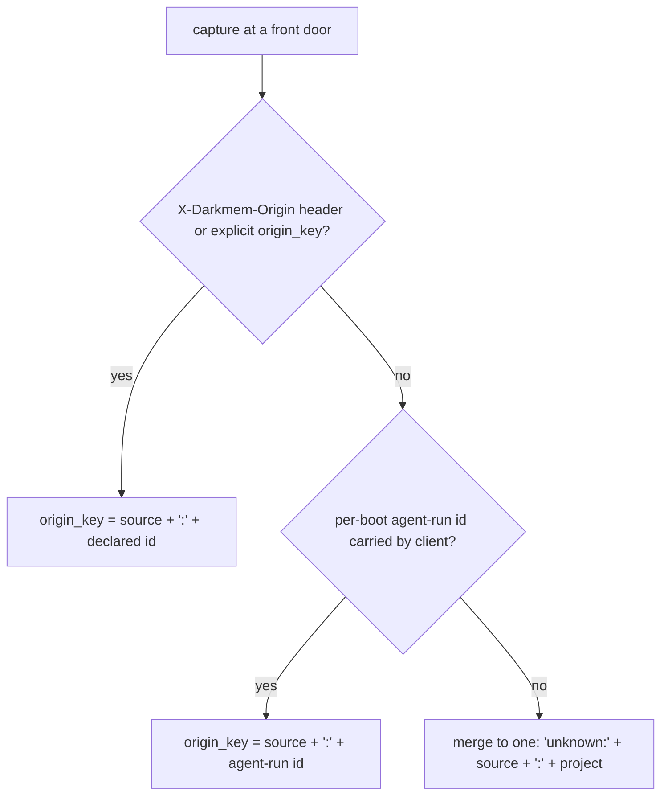
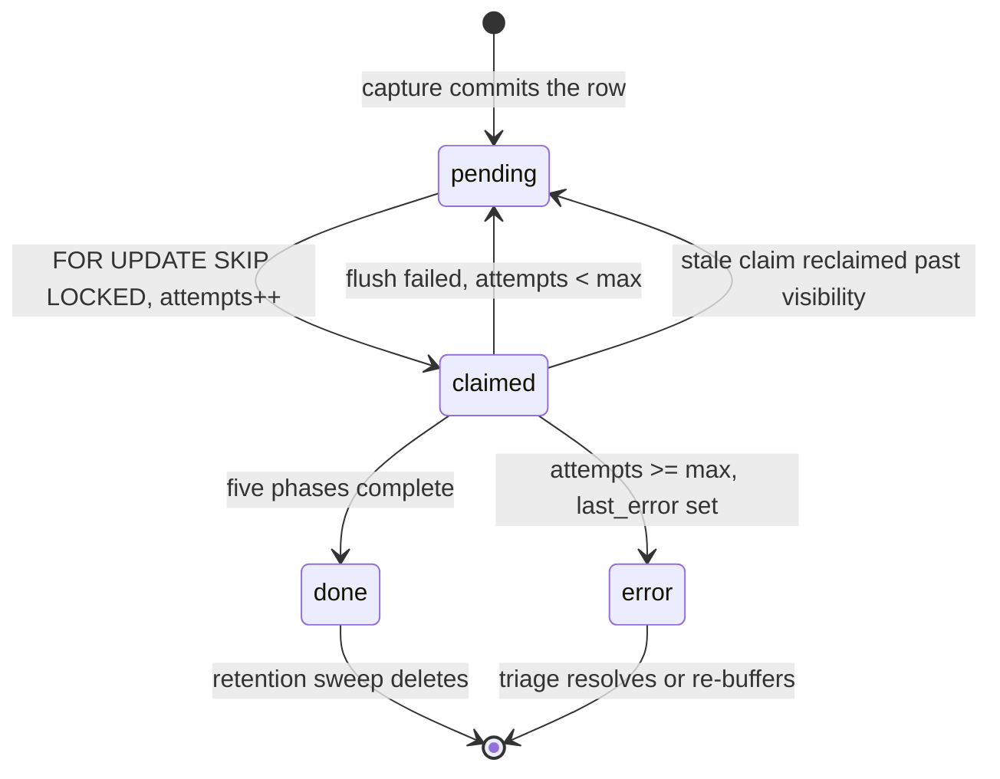
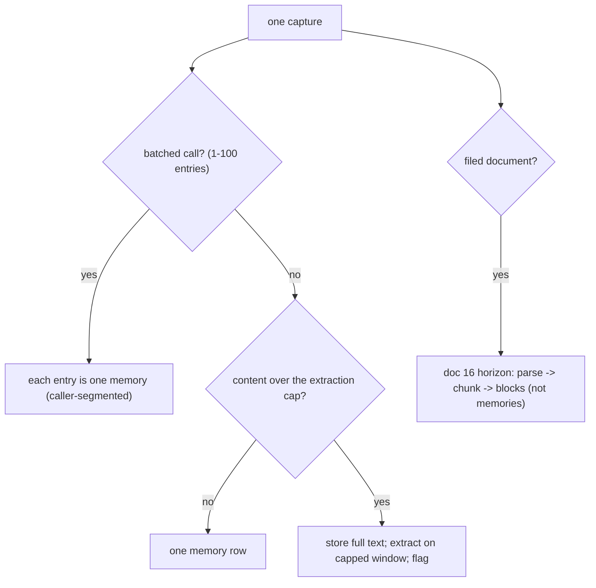
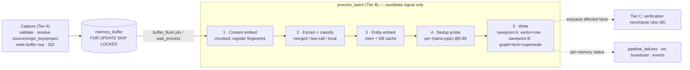
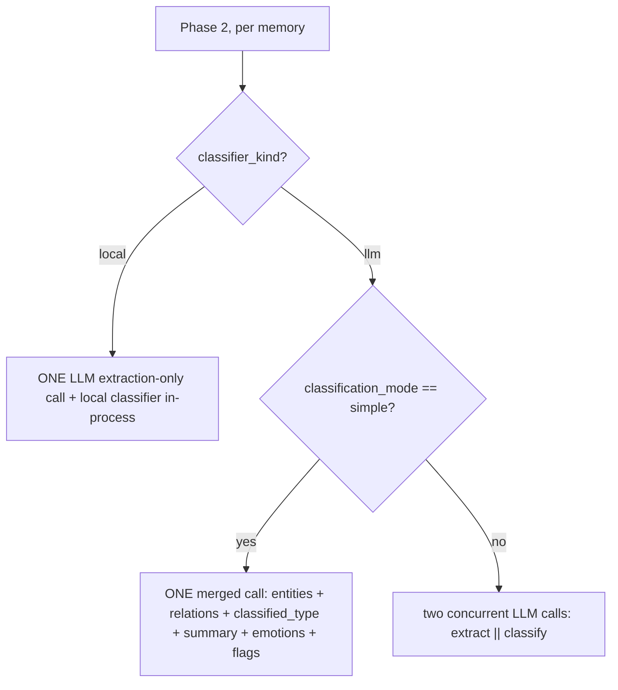
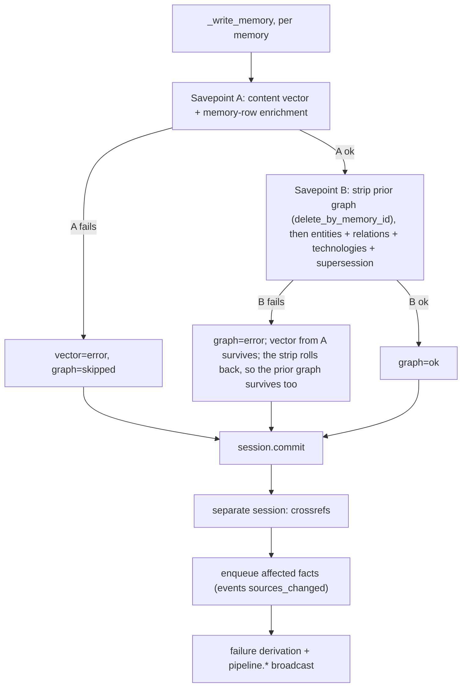
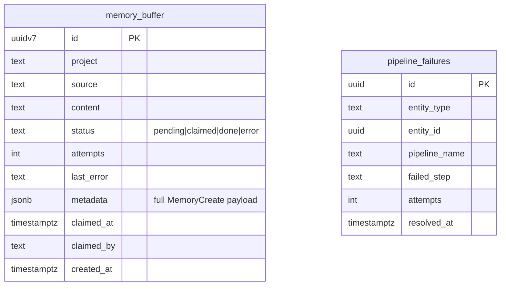

# 05 — Ingestion Pipeline

**Status:** subsystem doc; conforms to foundation 00–04 and the 2026-07-24 knowledge-reshape spec. Draft 2026-07-24.
Wave-1 engine mechanics (with docs 06, 10, 11). Part of the unified target design — see `docs/design/README.md` for the frame and document map.

---

## 1. Purpose & scope

**This doc fixes the full capture-to-graph mechanics: how a statement enters through any front door, how it is buffered durably, how the five-phase pipeline turns it into a Layer-0 memory row and a Layer-1 candidate graph, and how it fails honestly.** It owns the Tier-A capture path (front-door validation, the `source` / `origin_key` / `project` resolution, the `202`-style accept), the durable `memory_buffer` and its `FOR UPDATE SKIP LOCKED` claim and flush scheduling, and the five-phase `ProcessingPipeline.process_batch` — content embed, the merged extraction+classification call, the cached entity embed, the dedup handoff, and the two-savepoint Phase-5 write with its supersession trigger, technologies recompute, crossrefs, and the enqueue-for-verification hook. It settles idempotent re-extraction, per-memory failure derivation, and the segmentation policy for what becomes a memory.

**What the neighbouring docs fix instead.** The deterministic extraction post-processor — the ~40 cleanup passes, the relation-rescue layer, dedup discriminators, canonicalisation, and the closed vocabularies — is doc 06; this doc calls that machinery a black box that takes raw LLM output and returns a cleaned candidate graph. The LLM call *construction* (prompt assembly, the canonical schema, structured-output enforcement, the shared HTTP client, `classifier_kind`) is doc 11; this doc fixes only *where in the phase topology* each call sits and *which* call fires under which gate. The fact-layer lifecycle the pipeline merely enqueues into — verification recomputation, bi-temporal passes, consolidation, article synthesis — is docs 08/09. The retrieval path that reads what this pipeline writes is doc 07. The physical tables (`memory_buffer`, `memories`, the per-fingerprint partitions, `events`) are doc 04; this doc names the object and the invariant and points, and never re-derives a table shape.

**Audience & authority.** An engineer implementing capture, the buffer worker, or a pipeline phase reads this to learn the tier boundaries, the checkpoint discipline, and the exact honesty guarantees. Where this doc and the as-is baseline (`CLAUDE.md`, `pipeline.py`) agree, that behaviour is contract; where the target extends the baseline it is labelled per doc 04 §1's convention — **(exists today)**, **(target-new)**, **(rebuild)**, **(activation)**, or **(horizon)**. The pipeline produces **candidate signal, not knowledge**: it writes Layer-0 memory rows and the Layer-1 entity/relation graph, and it never mints a Layer-2 verified fact or a Layer-3 article — those live behind the Tier-C boundary invariant 15 protects. Claiming otherwise conflates the layers doc 01 §3.4 separates.

## 2. Capture — front doors, validation, resolution, the ack contract

**Decision. Capture is a Tier-A synchronous accept that resolves identity, validates against one `MemoryCreate` schema, writes a durable buffer row, commits, and returns a `202`-style acknowledgement — one service path behind every front door (invariant 17).** Today capture commits the `memories` row and then *awaits* the pipeline inline (`MemoryService.create_memory`, `batch_create_memories`) — "async" currently means asyncio-phased fan-out inside the request, not deferral (doc 02 §5.2's honesty note). The target moves ingest fully off Tier A by writing to the buffer (§3) instead of awaiting `process_batch`; capture then returns without waiting on extraction. The accept path is otherwise unchanged: the same `MemoryService` serves REST and MCP, differing only in transport, auth posture, and how `source` resolves.

**The front doors and their ack shapes.** Every path produces the same buffered capture; F1's "one vault, many front doors" is structural, not aspirational.

| Front door | Mechanism | Ack | Status |
|---|---|---|---|
| `POST /memories` | REST single capture | `202` accept (was `201`+inline pipeline) | exists today; ack becomes `202` (target-new) |
| `POST /memories/batch` | REST bulk, 1–100 | `202` accept, per-entry buffered | exists today; `202` (target-new) |
| MCP `memory_add` | FastMCP tool | JSON ack (buffered handle) | exists today |
| MCP `memory_batch_add` | FastMCP tool, 1–100 | JSON ack; cap mirrors HTTP | exists today |
| Browser capture | new ingestion source → buffer | `202` accept | target-new (doc 15) |
| Filed document | parse → blocks → propositions | deferred | horizon (doc 16) |

The `202` is the REST-conventions "async-accepted" verb (doc 12 owns the wire contract); with the buffer in place capture is *genuinely* 202, not a synchronous call wearing an async label. The MCP batch cap stays 1–100, mirrored on the raw entry dicts before validation so `memory_batch_add` and `POST /memories/batch` never diverge (invariant 17).

The capture-to-graph path — Tier-A commits and acks fast; the flush job runs the five phases and the vault enqueue later, off the hot path:

```mermaid
sequenceDiagram
    actor Client as "MCP / REST caller"
    participant API as "Front door"
    participant SVC as "MemoryService"
    participant BUF as "memory_buffer"
    participant JOB as "buffer_flush job (Tier C)"
    participant PIPE as "ProcessingPipeline"
    participant VAULT as "Tier-C verification (doc 08)"
    Client->>API: capture(content, source?, project?, origin_key?)
    API->>SVC: resolve source / origin_key / project; validate
    SVC->>BUF: INSERT row status=pending; COMMIT
    SVC-->>Client: 202 accept + pre-minted memory id
    Note over JOB,BUF: later, on a cron tick
    JOB->>BUF: SELECT ... FOR UPDATE SKIP LOCKED; mark claimed
    JOB->>PIPE: process_batch(claimed entries)
    PIPE->>PIPE: five phases (embed, extract+classify, entity embed, dedup, write)
    PIPE->>VAULT: enqueue affected facts (never recompute inline)
    PIPE->>BUF: mark done, or error and attempts++
```

**Validation is the `MemoryCreate` schema, and the buffer must carry every field it accepts.** `content` is required; `project` defaults to `default`; `memory_type`, `tags`, `importance`, `expires_at`, `source_agent`, and `metadata` (including the optional repository hint, §2.4) are optional. Fields beyond the buffer's own columns ride the buffer's `metadata` jsonb and are replayed verbatim at flush (doc 04 §8.6) — **the buffer may never silently drop a captured field**, or the flush would reconstruct a memory the caller never sent (invariant 14, no silent degradation).

**`source` resolution is a fixed precedence chain, and it is the one place the two front doors legitimately differ.** The order (CLAUDE.md, `resolve_client_source`): explicit `source` argument (the literal `mcp` counts as *unspecified*) > the `X-Darkmem-Client` header > a User-Agent product map > `mcp`. `memory_batch_add` resolves on the **raw entry dicts** before `MemoryCreate` validation, because the schema would stamp its `api` default and erase the absent-vs-explicit distinction the precedence relies on. `source_agent` defaults to the caller's raw User-Agent. REST's `source` defaults to `api` when unspecified. This is (exists today) and unchanged.

**`project` resolution lazily registers the namespace.** The resolved `project` (explicit argument, else `default`) is written on the buffer row and, at flush, on the `memories` row; capture also performs a lazy `INSERT … ON CONFLICT (name) DO NOTHING` into the `projects` registry (doc 04 §7, target-new). The registry carries no FK enforcement yet, but registering the name now is what stops a typo'd project from later splitting fact identity across two `triple_key`s (doc 04 §8.3) — the reshape's reason for landing the registry in the baseline. Registration is idempotent and off the isolation-critical path; the bare `project text` column stays the scope value.

### 2.1 `origin_key` — the corroboration-independence key, captured at ingest

**Decision. Capture stamps a per-memory `origin_key` — the capture-session / agent-run identity — because `source` and `source_agent` are too coarse to tell independent corroboration from an echo, and when identity is genuinely unknown capture merges to ONE origin per `(source, project)` rather than minting distinct ones (undercount, never manufacture agreement).** This is spec §2.1's truth-critical requirement, doc 04 §3.1's `origin_key` column (target-new). The downstream fact layer counts `COUNT(DISTINCT origin_key)`, never rows (doc 04 §8.3): two agents re-saving the same claim under the same origin count once, so promotion cannot be inflated by repetition. The asymmetry is deliberate — undercounting only *delays* a promotion (a label served above nothing), overcounting *manufactures* one (the worst failure, since every article citing the fact inherits the lie). Capture is where this key is set, so this doc owns its derivation.

**Derivation per front door — a caller-supplied identity when present, a coarse-but-stable fallback when not.** The precedence, mirroring the `source` chain and the target `X-Darkmem-Context` header (doc 12):

| Front door | `origin_key` when identity is declared | Fallback when unknown |
|---|---|---|
| MCP (`memory_add` / batch) | a new `X-Darkmem-Origin` header carrying the caller's capture-session / per-boot agent-run id → `origin_key = source ‖ ':' ‖ origin_id` | `'unknown:' ‖ source ‖ ':' ‖ project` (one origin) |
| REST | same header, or an explicit `origin_key` body field | same one-origin fallback |
| Browser capture (target) | the extension's per-install / per-session id | one origin per install |
| Code deriver (doc 10) | `repo_id` — one origin per repo regardless of commit count | n/a (always known) |

The stateless streamable-HTTP MCP server holds no server-side session (invariant 20), so the identity **must** be carried by the client — a header the agent SDK sets from a uuid minted at process boot (the "per-boot agent-run id"), not a per-request random (which would counterfeit N independent origins from one agent). The fallback is deliberately coarse: an untagged flood of captures from one tool collapses to a single origin, so it can never self-corroborate. `origin_key` is stamped at Tier A, rides the buffer row through flush, and lands on `memories.origin_key`; the buffer carries it like any other captured field. This is (target-new); the badge-honesty and counting rules are doc 08's.

`origin_key` derivation — a declared identity wins; genuinely-unknown identity merges to one origin, never mints distinct ones:



### 2.2 The ack contract and `wait_process`

**Decision. Capture pre-mints the memory's UUIDv7 id at Tier A, returns it in the `202` accept, and defers row creation to flush — so the caller gets a stable handle immediately while extraction runs off the hot path; an interactive caller that needs the memory queryable *now* sets `wait_process`, which runs the flush inline under a bounded timeout.** The memory id is application-generated UUIDv7 (doc 04 §2), so capture can assign it before the row exists; it rides the buffer `metadata` so flush creates the `memories` row with that exact id (making a re-claimed buffer row an upsert on a known id, not a duplicate). The buffer row's own id is the buffer tracking handle; the pre-minted memory id is the caller's durable reference. This **refines** doc 02 §5.2/§7's shorthand "commit the memory row before dispatch": at capture darkmem commits the *buffer* row (matching doc 04 §8.6) and creates the `memories` row at flush from the pre-minted id — and it is that pre-minted id that lets a capture-time `created` event carry the real `object_id` even though the row itself lands at flush.

**`wait_process` bounds how long an interactive caller may hold Tier A.** When set, capture writes the buffer row and then drives the flush for that row synchronously, returning once Phase 5 completes so an immediate `memory_search` sees the new memory (the interactive-agent case the buffer would otherwise defer). It is bounded by a `buffer_wait_timeout_seconds` config row (recommended default 10s): on timeout the call **degrades to the plain `202` accept** — the row is already durably buffered, so nothing is lost; the caller is told "still processing" rather than the request hanging (invariant 14, honest partial results). `wait_process` is the sanctioned Tier-A exception to "no pipeline on the sync path"; it is opt-in, bounded, and never the default. This is (target-new); today every capture is effectively `wait_process=true` (the pipeline is awaited inline).

### 2.3 Journaling

**Capture and extraction outcomes emit `events` rows.** A capture writes an `events` row (`object_type='memory'`, `event_type='created'`), and the flush writes the extraction outcome (`extracted` / `consolidated` per the per-step status). This replaces today's coarse `audit_log` writes (`audit_repo.log("create"…)`, `audit_repo.log("pipeline"…)`) with the durable, append-only substrate (doc 04 §8.1, target-new) so the timeline and contribution calendar have a home for every ingest signal (doc 02 §10, principle 10). The transient `/ws` broadcasts (§10) stay; `events` is their durable twin.

### 2.4 The repository-hint auto-provision handoff

**Decision. When a captured memory carries a repository hint the project does not yet track, capture validates it against the allowlist, auto-registers it, and queues F11 in Tier C — never cloning or indexing on the capture path.** The hint rides `memories.metadata_` jsonb (no new column, doc 04 §8.7). Auto-cloning an arbitrary remote from caller-supplied metadata is an SSRF/abuse vector, so the remote is checked against an **allowlist `config` row** (not a table); the allowlist gate itself is doc 18's security concern. On a validated hint, capture upserts the shared `repositories` row and the `project_repositories` M2M association (two projects referencing one remote own the same repo and its one code graph), then enqueues the clone/pull/index as a Tier-C job (doc 10's F11). The default-options set for auto-registered repos (enrich? wiki? sync cadence) and the push-trigger are doc 10/15's shared contract. Capture owns only the validate-and-enqueue hook; everything after is off the hot path (invariant 15). This is (target-new).

## 3. The ingest buffer — `memory_buffer`, the SKIP-LOCKED claim, flush scheduling

**Decision. The buffer-flush transport is the Postgres-backed `memory_buffer` table claimed via `SELECT … FOR UPDATE SKIP LOCKED` — confirmed here as the single-store, durable transport, never a broker (invariant 1).** This is the one confirm doc 02 §11 assigned this doc, and doc 04 §8.6's recommended shape. Of the three candidates doc 02 §11 named — an in-process asyncio queue, a Postgres `memory_buffer` claimed with SKIP LOCKED, or LISTEN/NOTIFY over such a table — the asyncio queue loses buffered captures on restart (unacceptable: a `202` promised durability) and LISTEN/NOTIFY adds a signalling layer the claim query does not need. The Postgres buffer keeps the single-store moat, survives restart, and gives the `FOR UPDATE SKIP LOCKED` claim that fixes memobase's double-flush FIXME (two claimers never grab the same row). The table's columns, CHECK, indexes, and retention shape are doc 04 §8.6; this doc owns the claim/flush behaviour over them.

**Flush is a `buffer_flush` JobRegistry job that claims a batch per tick, not a bespoke always-on loop.** Doc 02 §5.3 listed both shapes; the pick is the JobRegistry job because it inherits the whole Tier-C discipline already built and tested — the per-job `asyncio.Lock` (a scheduled tick and a manual `trigger` can never race, doc 02 §5.3), the `min_interval_seconds` floor against runaway cadence, the `max_run_seconds` ceiling against a hung LLM holding the lock, and the `config`-row state — rather than re-implementing lifecycle, cancellation, and observability in a hand-rolled loop. It is valid under the single-worker assumption (invariant 13): one worker means one claimer, so SKIP LOCKED contends only with a concurrent `wait_process` inline flush, which the row-level lock already serialises. The claim batch size and cadence are config rows with a measured tuning path (principle 2):

| Tunable | Config | Recommended default | Note |
|---|---|---|---|
| Claim batch size | `buffer_claim_batch` | 32 | one `process_batch` call; near the embed chunk size so Phase-1 chunking stays efficient |
| Flush cadence | `buffer_flush` job cron | `*/5 * * * * *` (every 5s) | six-field seconds-first; the floor caps it |
| Claim floor | job `min_interval_seconds` | 1s | runaway guard |
| Runner ceiling | job `max_run_seconds` | bounded (e.g. 300s) | a hung LLM can't hold the lock forever |

A 5-second worst-case queueing latency is acceptable because Tier B is explicitly *not* the p95-sensitive surface (Tier A is, doc 02 §5.1); an interactive caller that cannot tolerate the wait uses `wait_process` (§2.2) to bypass the buffer entirely. The claim reads only `status='pending'` rows ordered by `created_at`, served by the partial `(created_at) WHERE status='pending'` index (doc 04 §8.6) so the hot index stays small; every raw-SQL param in the claim carries its CAST (invariant 10). This is (target-new) — the buffer, the job, and the claim are all net-new; today capture drives `process_batch` directly.

**The flush replays a buffer row into a memory and its pipeline pass.** For each claimed row the job: creates the `memories` row with the pre-minted id and the replayed `MemoryCreate` fields (content, project, source, source_agent, memory_type, tags, importance, expires_at, origin_key, metadata), commits it (invariant 11 — the memory row commits before the pipeline's fresh sessions read it), runs `process_batch` over the batch, then marks the buffer rows `done`. Because the memory row commits before dispatch, the flush obeys the same async-session-lifetime rule capture obeys today (`MemoryService` commits before `process_memory`).

### 3.1 Poison rows, retry, stale-claim recovery, and retention

**Decision. A buffer row is bounded against poisoning, a crashed flush is recoverable, and `done` rows do not accumulate — three rules that keep the buffer honest and finite (invariant 14).** The mechanics over doc 04 §8.6's columns (`status`, `attempts`, `last_error`, `claimed_at`, `claimed_by`):

- **Poison bounding.** Each claim increments `attempts`. A flush failure returns the row to `pending` (retriable) until `attempts` reaches `buffer_max_attempts` (config, recommended default 5), at which point it flips to `error` with `last_error` set and surfaces in the failure-triage queue (doc 13) instead of looping forever. The flush cadence itself paces the retries (a coarse backoff); a finer per-row `next_attempt_at` backoff is deferred as it needs a schema column (§12).
- **Stale-claim recovery.** A row left `claimed` past `buffer_claim_visibility_seconds` (config, recommended default 300s) — a worker that crashed mid-flush — is reclaimable: the `buffer_flush` job returns such rows to `pending` before the SKIP-LOCKED scan, so a crash never strands a capture. Under one worker this is a crash-recovery path, not a contention path (invariant 13).
- **Retention.** The `buffer_flush` job's cleanup arm deletes `done` rows past `buffer_done_retention_hours` (config, recommended default 24h) — a day of replay/triage history — so the table never grows unboundedly. `error` rows are retained until resolved or explicitly forgotten from triage.

All four thresholds are `config` rows tuned from measured flush-failure and latency rates, not hard-coded constants (principle 2).

The `memory_buffer` row lifecycle — poison-bounded, stale-claim recoverable, retention-swept:



## 4. Segmentation — what becomes a memory

**Decision. One capture becomes exactly one memory in v1; darkmem does not auto-split captured prose into multiple memories, because the atomic-unit rule (doc 01 §3.1) makes the caller the authority on the atomic statement.** A memory is "the smallest durable, independently-recallable statement," deliberately keeping the retrievable unit, the supersession unit, and the provenance unit the *same* object so lifecycle and lineage never straddle a boundary. Auto-segmenting a capture into several memories at ingest would fracture that identity — which memory does a `superseded_by` pointer target, which one an `origin_key` counts — for a guess about sentence boundaries the caller could state directly. So the segmentation policy is: **the caller pre-segments.** The only "one request → several memories" path is an explicitly batched call (`memory_batch_add` / `POST /memories/batch`, 1–100 entries), where each entry is one memory by the caller's own decision.

**The content-length guard is a truncation for the LLM call, not a segmentation.** Extraction operates on a capped window (`_MAX_CONTENT_CHARS`, 6000 today — a config-worthy tunable), and the embedder chunks content per its own token limit; but the **stored `memories.content` keeps the full text**, and the memory stays one row. An over-length capture is accepted and flagged (its extraction runs on the capped window, an honest partial the failure derivation records if the tail carried extractable signal), never silently split or silently dropped. This is (exists today) for the extraction cap; the flag surface is (target-new).

**Where multi-unit decomposition legitimately lives is elsewhere, and this doc points at it.** A document filed through the horizon pipeline (doc 16) *is* decomposed — into blocks — because there the source and the retrievable unit are genuinely different objects; that is the deliberate contrast with a memory. And near-identical or compound memories are reshaped **off the hot path** by consolidation's dedup/refine passes (doc 08, F6), where a rewrite carries an audit trail and an undo — not on the append-only capture path (invariant 15). Capture stays fast and append-only; segmentation intelligence is a Tier-C or horizon concern.

Segmentation policy — one capture is one memory; multi-unit decomposition lives on the batch, consolidation, or horizon paths:



## 5. The five phases — checkpoints, concurrency, fingerprint discipline

**Decision. The flush runs a batch through `ProcessingPipeline.process_batch` as five hard-checkpoint phases, fan-out bounded by `pipeline_concurrency`, with the fingerprint registered before any partition write and re-registered on mid-batch rotation (invariant 2).** The five phases (exists today, `pipeline.py`):



Each phase is a **hard checkpoint**: a phase's failure has a defined downstream state, never a silent skip. Phase-1 failure marks every memory's embed step `error` and skips the writes that depend on a vector. Per-phase fan-out is bounded by the `pipeline_concurrency` feature flag (default 5) via an `asyncio.Semaphore`; embedding fans out separately under `embedding_batch_size` / `embedding_concurrency`. These are (exists today).

**Fingerprint discipline is load-bearing and spans three phases (invariant 2).** Phase 1 embeds all contents in one chunked call, which *returns* the producing fingerprint; `_register_fingerprint` registers it **before any partition write** (a partition insert against an unregistered fingerprint is the register-before-insert violation invariant 2 forbids). Phase 3 embeds entity names and, if the active embedder rotated mid-batch (`new_fp != entity_fingerprint`), registers the new fingerprint and switches the entity-cache key to it. Phase 5 then keeps the **content fingerprint and the entity fingerprint distinct** when they differ: the content vector lands in `memory_embeddings__<content_slug>` and entity vectors in `entity_embeddings__<entity_slug>`, because writing a content vector into a rotated entity partition would mix dimensions across fingerprints and break the no-cross-fingerprint-join rule. No query in any phase joins two `__<slug>` tables. This is (exists today) and the pipeline is where the discipline is enforced.

**The pipeline emits Layer-1 candidate signal, and that boundary is a checkpoint too.** What the five phases write is a memory row (L0) and a deduped entity/relation graph (L1) — *candidate* assertions that feed dedup, the `technologies` denorm, topics, and (target) graph-augmented retrieval, but that are **explicitly not verified facts** (doc 01 §3.2, invariant 23). No phase promotes a relation to a Layer-2 fact, computes a `verification_status`, or writes a `knowledge_triples` row; the graph is built on every ingest but not yet spent on retrieval, and the vault is filled off the hot path (invariant 15). Phase 5's only contact with the vault is to *enqueue* affected facts for the Tier-C recompute (§8.4).

## 6. Phase 2 — the merged extraction+classification call

**Decision. Phase 2 is one LLM touch per memory: the merged extraction+classification call is the default and only ingest LLM path, and the local-classifier configuration narrows the LLM call to extraction-only — never two LLM round-trips (spec §5, doc 03 §5.6).** Extraction builds the entity/relation graph (always on); classification/enrichment populates the source-neutral `classified_type` / `summary` / `emotions` / `flags` columns (also always on — there is no classification on/off gate). The question is only how many model calls serve them, decided per batch by two gates: whether the classifier is the LLM-backed one or the local one (`classifier_kind`), and the `classification_mode`.

| `classifier_kind` | `classification_mode` | LLM calls / memory | Classification source | Status |
|---|---|---|---|---|
| `llm` | `simple` | **1 (merged)** | extraction's `memory_type` (simple-7) + `summary`/`emotions`/`flags` folded onto the one call | exists today (`can_merge`) |
| `llm` | area-grained (non-simple) | 2 concurrent | a separate classification call (the larger label space the extraction schema does not carry) | exists today |
| `local` | any | **1 (extraction-only)** | the in-process local classifier, out-of-band | rebuild (re-homed from `ml_profile_ref`) |

The Phase-2 gate — one LLM touch per memory; a second concurrent call fires only for area-grained LLM classification:



**The merge folds classification into extraction only when the schemas coincide.** When the classifier is LLM-backed and the mode is `simple`, extraction's `memory_type` already carries the classification label (both draw the simple-7 vocabulary), so the standalone classification call would only re-predict the same type plus `summary`/`emotions`/`flags`; the merged schema adds exactly those three fields and saves a round-trip (`_build_extraction_schema(with_classification=True)`). Any other configuration — an area-grained mode whose larger label space the extraction schema cannot represent, or the local classifier which cannot extract — keeps two concurrent calls. Because the gate changes the extraction prompt, **re-extracting the same content under a different gate state (mode flip, `classifier_kind` change) is not bit-identical** even with the same content seed; widening a vocabulary changes the prompt, so it must land taxonomy-first (invariant 5, doc 04 §12). This is (exists today) for the LLM paths.

**`classifier_kind = local` re-homes the local classifier inline, and it executes in-process in Tier B.** The reshape drops the `ml_profiles` indirection and the `ml_profile_ref` lookup (`_resolve_classifier` today); the classification purpose carries an inline `classifier_kind = llm | local` (doc 03 §5.6, doc 11), and when `[ml]` is absent it falls back to the LLM-backed classifier. The local classifier is a CPU-bound HuggingFace inference that runs **in-process, in a bounded thread-pool executor**, concurrent with (not serialised after) the extraction-only LLM call — bounded by `pipeline_concurrency` and valid under the single-worker assumption (invariant 13). It never adds an LLM round-trip. doc 11 owns the classifier's construction and the `[ml]`-absent fallback; this doc fixes that it runs in Tier B, in-process, off-band from the one LLM call. This is (rebuild).

**The prompt is one canonical schema + content + a reproducibility seed + minimal rules — the cleanup passes stay post-processing.** The merged call forwards `seed = sha256(content)[:8]` as a 32-bit int (invariant 18, `_content_seed`) so honouring vendors return stable output (Anthropic ignores it harmlessly). The ~40 deterministic cleanup passes are **not** in the prompt — they are the moat and stay downstream in doc 06's post-processor; the prompt carries only the schema, the content (capped, §4), the seed, and minimal rules. This leaves a clean seam for a later area-detection pre-pass (doc 06's dynamic-taxonomy note) to inject a domain vocabulary **without changing the call topology** — the seam must not turn one LLM touch into two. The call construction, structured-output enforcement, and prompt assembly are doc 11; Phase 2 owns only the placement and the gate. This is (exists today) for the seed and the merge; the prompt-rule stripping is (rebuild).

## 7. Phases 3–4 — entity embedding cache and the dedup handoff

**Decision. Phase 3 embeds the batch's unique entity names through a two-tier cache, and Phase 4 fans out one type-constrained ANN dedup probe per unique `(name, entity_type)` pair — but the discriminator, canonicalisation, and rescue *mechanics* are doc 06's; this doc fixes only the phase placement and the fingerprint/concurrency discipline (invariant 2, invariant 13).** Phase 3 looks up each lowercased name in the in-process LRU cache keyed `(name_lower, fingerprint)`, falls back to the DB cache (`entity_embedding_cache__<slug>`), and embeds only the misses; newly produced embeddings are written to both caches. The LRU is bounded (10k entries, a per-process singleton), the DB cache backstops eviction, and the cache key carries the fingerprint so an embedder flip does not poison it. If the embedder rotated between Phase 1 and Phase 3, Phase 3 registers the new fingerprint and re-keys (§5). This is (exists today).

**Phase 4 hands the deduped entities to Phase 5 through a `canonical_map`, and the merge rule lives in doc 06.** One ANN probe per unique `(name, entity_type)` runs against `entity_embeddings__<slug>` at threshold 0.85, type-constrained so same-named entities of different types dedup separately; a match only canonicalizes when the names are not distinguished by a discriminating token (versions, dates, months — "february outage" and "march outage" never merge). Probes fan out bounded by `pipeline_concurrency`. The result is `canonical_map: (name_lower, entity_type) → canonical_name`, which Phase 5 applies to entity names and relation endpoints (resolving each endpoint's type from the extraction's own entities). The discriminator (`names_distinct`), the 0.85 threshold, the canonicalisation, and the cleanup/rescue passes that ran before Phase 3 are all doc 06's contract — this doc treats them as the black box between raw LLM output and the write. This is (exists today).

## 8. Phase 5 — the write

**Decision. Phase 5 writes per memory in two nested savepoints — A: vector upsert + memory-row enrichment; B: entity/relation graph + technologies + supersession — so a graph failure never rolls back a successful embedding, and it strips this memory's prior graph contributions before writing the new set (invariants 8, 11).** The two-savepoint split is load-bearing: savepoint A lands the content vector (into `memory_embeddings__<content_slug>`) and the memory-row enrichment; savepoint B lands the entity/relation graph; a failure in B rolls back only B, leaving the embedded memory searchable and attributing the failure to the graph step rather than the vector step. Crossrefs are computed in a **separate session after the main commit** (async-session-lifetime rule, invariant 11). This is (exists today).

**The strip runs as savepoint B's first statement, not ahead of the savepoints.** An earlier revision of the flowchart put `delete_by_memory_id` in the outer transaction, before savepoint A. That is the one part of the write a failed write cannot undo: the outer commit makes the deletion durable, so a savepoint-B failure left the memory with **no graph at all** and a `technologies` denorm matching nothing on disk, and an ordinary extraction failure — which never enters savepoint B — silently emptied a perfectly good graph on a routine path. Inside B, strip-and-write is one **atomic replace**: the graph for a memory is always exactly one extraction's output, and a failure leaves the previous extraction's output standing. A **failed strip fails savepoint B** (`graph=error`) rather than being logged and written over, because a new graph written on top of an un-stripped old one is precisely the duplicate-by-type accumulation the strip exists to prevent (§9, invariant 8).

The Phase-5 write — two independent savepoints, then the separate-session crossrefs and the vault enqueue:



### 8.1 Savepoint A — vector and memory-row enrichment

Savepoint A upserts the content vector under the content fingerprint and writes the enrichment onto the memory row: `classified_type`, `summary`, `emotions`, `flags` (the `llm_`-prefix drop is source-neutral since the classifier may be the local model — doc 04 §3.1; these are **(exists today)** columns renamed, write path unchanged, not a rebuild), the resolved `memory_type` (normalised through the closed vocabulary, invariant 5), `confidence` (computed by `estimate_confidence`; the spec's replacement of the regex-placeholder value with a real number is an activation), and `importance` (populated from extraction but **still unread by ranking** — dormant scaffolding, doc 04 §3.1, invariant 23). This doc must not claim `importance` is spent on retrieval.

### 8.2 Savepoint B — graph, technologies, supersession

Savepoint B first strips this memory's prior graph contributions (§8, §9), then writes entities and relations with the canonical names from Phase 4, **lowercase on disk with original casing stashed in `properties.display_name`** (invariant 7), appending this `memory_id` to each row's `memory_ids` rather than inserting a duplicate (invariant 4). It then recomputes `memories.technologies` from the entities whose type is in `TECH_TYPES` — **lowercase, denormalised, GIN-indexed, all three load-bearing** (invariant 6). Finally it runs supersession.

**Supersession fires inside savepoint B when the new memory carries a `REPLACES`-family relation, and it obeys the atomic-set and demote-first contract (invariants 3, 12).** `detect_supersessions` triggers on a `REPLACES` relation (not on the new memory's own technologies — the detector keys off the REPLACES *target* overlapping a candidate's technologies), flips each qualifying candidate to `superseded` with its `superseded_by` set **atomically** (`chk_superseded_has_pointer`), and stays within the project scope. The full six-rule gate — same project, candidate active, lowercased technology overlap on the GIN, the 90-day window, the strict `(created_at, id)` ordering that lets one direction of a same-batch REPLACES fire while blocking the mutual flip, and the per-target speculative gate — is doc 08's mechanics; Phase 5 owns only that supersession runs *here*, at write time, synchronously (the one graph mutation that is not deferred, because correction must be immediate). `REPLACES`, `IMPROVES_ON`, and legacy `BUILDS_ON` collapse via `REPLACES_FAMILY` (invariant 12). This is (exists today).

### 8.3 Crossrefs

After the main commit, a separate session computes the top-5 similar memories (min score 0.4) and writes `memory_crossrefs` (DELETE+INSERT), the symmetric similarity-edge table distinct from the target typed `memory_relations` associative layer (doc 04 §3.3/§8.2). The separate session is required because the main transaction still holds locks on the just-written rows (invariant 11). Any `memory_id` crossing the fusion or crossref boundary is normalised str↔UUID (invariant 9). This is (exists today).

### 8.4 The vault enqueue hook — Phase 5 only enqueues, never reconciles

**Decision. Phase 5 (and the deletion/re-extraction sweep) never touch the vault's verification; when a memory's Layer-1 contributions change they only *enqueue* the affected Layer-2 facts for the Tier-C recompute, and an identical re-write is a provenance no-op that enqueues nothing (invariant 15, spec §2.5).** This is the emit side of the cross-doc enqueue-for-verification contract (Part B contract 5; the recompute is doc 08's). The rule is absolute: no LLM contradiction/consolidation/verification call sits on Tier B, and `delete_by_memory_id` and re-extraction "merely enqueue" (doc 04 §8.3). Two facts about the steady state keep this honest:

- **On first ingest the hook is usually a no-op.** The pipeline produces candidate signal, not facts; facts are lifted from corroborated Layer-1 relations *by* Tier-C consolidation (F6). A brand-new memory has no `fact_sources` rows referencing it yet, so there is nothing to enqueue. The hook's real work is on **re-extraction and deletion** of a memory Tier-C had already lifted facts from: the sweep withdraws that memory's `fact_sources` rows, **expires inline any live triple thereby left with no surviving source** (`expired_at := now()` — a deterministic belief-lifecycle action, which invariant 15 permits on Tier B, so a fact whose last source was just deleted stops being served immediately rather than lingering as `corroborated` until the next Tier-C tick; doc 04 §8.3), and enqueues only the verification-status recompute for the facts left affected.
- **What carries "affected facts" is the durable `events` substrate, not a churning queue table.** When Phase 5 or the sweep changes a memory's `fact_sources` contributions, it emits an `events` row (`object_type='fact'`, a `sources_changed` event, payload `{fact_id, memory_id}`) — `sources_changed` is a new value that must first land in doc 04 §8.1's closed `event_type` vocabulary (the events-vocab analog of taxonomy-first, convention 9); the Tier-C verification job drains `sources_changed` events since its watermark and recomputes those facts. This reuses the substrate everything already journals to (convention 8), needs no new table or column, and **the provenance-no-op rule is the emit guard**: if the strip-and-rewrite lands the identical source set, no event is emitted, so a re-extraction that changes nothing about a fact's sources causes no verified↔candidate thrash (spec §2.5). The exact drain protocol, the demotion hysteresis, and any finer queue shape are doc 08's; this doc fixes doc 05's side of the contract — the emit trigger, the payload, and the no-op guard. This is (target-new).

## 9. Idempotent re-extraction

**Decision. Every ingest mutation is safely repeatable because Phase 5 strips this memory's prior graph contributions before writing the new set, and the strip self-heals shared rows (invariant 8).** As savepoint B's first statement, `delete_by_memory_id` removes this `memory_id` from each entity's and relation's `memory_ids`, deleting a relation only when no live memory still asserts it and an entity only when no live memory asserts it **and** no surviving relation references it (the FK cascade means deleting a referenced entity would destroy another memory's edge). Entities and relations shared with other live memories survive; the strip is what makes re-running extraction under a different model accumulate no duplicate-by-type rows. The hourly `graph_orphan_cleanup` job runs the unscoped `prune_orphan_entities` sweep as a backstop so Phase-4 dedup never merges a fresh entity onto a stale ghost. This is (exists today).

**Re-extraction is idempotent at the graph, but not bit-identical across gate states, and supersession is monotonic under it.** Because the Phase-2 gate changes the prompt (§6), the same content re-extracted under a flipped `classification_mode` or `classifier_kind` is not byte-identical — the strip-before-rewrite makes that safe (the old set is gone, the new set is clean), not silently additive. And supersession is **monotonic, not stripped**: a `SUPERSEDES` relationship is the `superseded_by` pointer under another name (doc 04 §8.2), so reprocessing *re-fires* the flip via the `(created_at, id)` tie-break rather than reverting it — a re-extraction that no longer emits `REPLACES` leaves the prior supersession standing (doc 01 §6, F4). The target `repo_ids[]` amendment generalises the strip to code assertions (`strip_repo_assertions`) and lands **inert** in the baseline (empty arrays → byte-identical sweeps) until doc 10's deriver ships (doc 04 §4.2, invariant 8) — this pipeline is not its writer. This is (exists today) for memory strip; (target-new, inert) for the repo amendment.

## 10. Failure handling, broadcasting & observability

**Decision. Outcomes are recorded and surfaced per memory, never collapsed to a batch pass/fail — a per-memory `pipeline_failures` row plus a `pipeline.completed | partial | failed` broadcast, so a failure surfaces to triage rather than degrading silently (invariant 14).** After Phase 5, `derive_memory_failed_step` inspects each memory's per-step status (`embed` / `extract` / `vector` / `graph`) and either `record`s a `pipeline_failures` row (the polymorphic retry tracker, one open failure per `(entity_type, entity_id, pipeline_name)` via the unique partial index) or `resolve`s the prior one. The broadcast classifies from the active (non-skipped) steps: all `ok` → `completed`, some `ok` → `partial`, none → `failed`. A batch write that itself raises is normalised into an error status dict rather than lost. This is the substrate under "honest partial results," and it is (exists today).

**Every signal is transient over `/ws` and durable in `events`, and the buffer's own states surface too.** The `pipeline.completed | partial | failed` and `memory.deleted` broadcasts drive the live Activity stepper (doc 13); their durable twins are `events` rows (§2.3), so a signal is never emitted without a place the human can later see it (principle 10). The buffer adds its own observable states — `pending` / `claimed` / `done` / `error` — which the failure-triage and Activity surfaces render (a stuck `error` buffer row is a first-class triage item, doc 13); the flush cadence, claim depth, and poison count are the operational signals of the ingest tier. A retry handler re-runs a failed memory on demand (re-buffering it), and a re-run's strip-before-rewrite (§9) makes that safe. The filter-pushdown gap of invariant 14 is a *retrieval*-path concern (doc 07/18), not an ingest one; the pipeline's honesty obligation is the per-memory failure record and the no-silent-drop of a captured field (§2, §3). This is (exists today) for the broadcasts and failures; the durable `events` twin and the buffer-state surfaces are (target-new).

The two operational tables the ingest tier drives (a focused subset — the full schema lives in `erd.md`):



## 11. Invariants restated

The invariants this layer binds, by the 1–23 catalogue (`gt-invariants.md`, doc 04 §11), restated as they constrain ingestion:

- **Single Postgres, no broker (1).** The buffer is `memory_buffer` claimed via `FOR UPDATE SKIP LOCKED` (§3), never Redis or an external queue.
- **Per-fingerprint isolation, register-before-insert (2).** Phase 1 registers the content fingerprint before any partition write; Phase 3 re-registers on mid-batch rotation; Phase 5 keeps content and entity fingerprints distinct; no phase joins two `__<slug>` tables (§5).
- **Atomic supersession + demote-before-delete (3).** Phase-5 supersession sets `status` and `superseded_by` together under `chk_superseded_has_pointer` (§8.2).
- **Entities/relations non-memory-scoped, append (4).** Phase 5 appends `memory_id` to `memory_ids`, never inserts a duplicate (§8.2).
- **Closed taxonomy, taxonomy-first (5).** Every emitted type is normalised before write; widening a vocabulary changes the Phase-2 prompt, so it lands taxonomy-first and re-extraction is not bit-identical (§6, §9).
- **`technologies` lowercase + denormalised + GIN (6).** Recomputed in savepoint B; all three properties kept (§8.2).
- **Lowercase entity names + `display_name` (7).** Written lowercase in savepoint B with display casing in the jsonb (§8.2).
- **Idempotent strip-before-rewrite (8).** `delete_by_memory_id` self-heals before every graph write (§9); the inert `repo_ids[]` amendment generalises it.
- **`memory_id` str/UUID drift (9).** Normalised at the crossref and failure-derivation boundaries (§8.3, §10).
- **asyncpg CAST (10).** The SKIP-LOCKED claim and every raw-SQL param carry explicit CASTs (§3).
- **Async session lifetime (11).** Capture and flush commit the memory row before dispatch; Phase 5's two savepoints and separate-session crossrefs preserve the split (§2, §3, §8).
- **REPLACES family (12).** Supersession keys off the REPLACES-family bucket (§8.2).
- **Single worker (13).** The `buffer_flush` claim, the in-process caches, the LRU, and the local classifier all assume one worker (§3, §6, §7).
- **Honest partial results (14).** Per-memory `pipeline_failures` + broadcast + surfaced buffer states; no captured field silently dropped (§2, §3, §10).
- **Reconciliation off the hot path (15).** The merged extraction+classification call is the *only* LLM touch on Tier B; verification and consolidation are Tier C; Phase 5 only enqueues (§6, §8.4).
- **Two front doors (17).** REST and MCP capture converge on one `MemoryService` and one pipeline (§2).
- **Single LLM boundary + seed (18).** Phase 2 forwards `sha256(content)[:8]` through the one orchestrator (§6).
- **Scaffolding not substrate (23).** The pipeline writes L0/L1 candidate signal only; `importance` stays dormant; no phase mints a verified fact (§5, §8.1, §8.4).

## 12. Open questions & deferred decisions

Each carries a recommended stance, so downstream inherits a default rather than a blank.

- **Buffer transport & flush shape — resolved (§3).** *Postgres `memory_buffer` claimed via `FOR UPDATE SKIP LOCKED`; flush is a `buffer_flush` JobRegistry job claiming `buffer_claim_batch` (default 32) rows per tick on a ~5-second cron with a `min_interval_seconds` floor.* Confirms doc 02 §11's recommendation and reuses the Tier-C lock/floor/state discipline; `wait_process` bypasses for interactive latency.
- **Segmentation — resolved (§4).** *One capture → one memory in v1; the caller is the atomic-unit authority; batched calls (1–100) are the only many-memories-per-request path; over-length content is truncated for extraction only, with the full text stored and flagged.* Proposition-splitting is a Tier-C (refine) and horizon (blocks) concern, never the append-only capture path.
- **`origin_key` derivation — resolved (§2.1).** *A caller-supplied `X-Darkmem-Origin` header (a per-boot agent-run / capture-session id) yields `source ‖ ':' ‖ origin_id`; when absent, merge to one origin per `(source, project)` (undercount).* The stateless MCP server holds no session, so identity must be client-carried; a per-request random is forbidden (it counterfeits independence).
- **`wait_process`, retry/backoff, retention — resolved (§2.2, §3.1).** *`wait_process` runs the flush inline bounded by `buffer_wait_timeout_seconds` (default 10s), degrading to the 202 on timeout; failed rows retry to `buffer_max_attempts` (default 5) then flip to `error`; stale `claimed` rows past `buffer_claim_visibility_seconds` (default 300s) are reclaimed; `done` rows are purged past `buffer_done_retention_hours` (default 24h).* All are config rows tuned from measured rates.
- **Local-classifier execution bounds — resolved (§6).** *`classifier_kind = local` runs the in-process HF classifier in a bounded thread-pool executor during Phase 2, concurrent with the extraction-only LLM call and bounded by `pipeline_concurrency`; `[ml]` absent falls back to the LLM-backed classifier.* Valid under the single-worker assumption; doc 11 owns the construction.
- **The enqueue-for-verification queue shape — recommended, doc 08 confirms (§8.4).** *Emit a `sources_changed` `events` row (`{fact_id, memory_id}`) when a memory's `fact_sources` change, suppressed by the provenance-no-op guard; the Tier-C job drains it — no new queue table.* If the events scan proves too coarse at scale, the fallback is a `verification_dirty_at` marker column on `knowledge_triples` (a doc 04 amendment); doc 08 owns the drain protocol and hysteresis.
- **Pre-minting the memory id at capture — recommended, maintainer confirms (§2.2).** *Capture mints the UUIDv7 memory id at Tier A (carried in the buffer `metadata`) so the 202 returns a stable handle and flush is an upsert on a known id.* The alternative — minting the id at flush and returning only the buffer handle — is simpler but denies interactive callers an immediate memory reference; the pre-mint is preferred and low-risk.
- **Per-row flush backoff — deferred.** *Coarse cadence-paced retry for v1; a finer `next_attempt_at` exponential backoff is deferred behind a measured need, as it requires a buffer schema column (doc 04 §8.6 amendment).*

---

*Downstream: this pipeline hands doc 06 its raw extraction output (the black box between Phase 2 and Phase 5's canonical-map application), doc 08 the enqueue-for-verification `events` hook and the write-time supersession trigger, doc 07 the Layer-0/Layer-1 rows it ranks over, doc 10 the capture handoff that auto-provisions repos and the strip-before-rewrite the code deriver generalises (inert here), doc 11 the merged-call topology and gate whose construction it owns, doc 12 the capture contract and `source`/`origin_key` resolution surface, doc 13 the Activity stepper, buffer states, and failure triage, and doc 16 the pipeline this document's five phases are the memory-side special case of. The capture, buffer, five-phase, and Phase-5 mechanics fixed here are binding for all of them.*
