# 06 — Knowledge Graph & Taxonomy

**Status:** subsystem doc; conforms to foundation docs 00–04 and the 2026-07-24 knowledge-reshape spec. Draft 2026-07-24. Wave-1 engine mechanics (with docs 05, 10, 11).

---

## 1. Purpose & scope

**This doc fixes the mechanics of the Layer-1 candidate graph — how raw extraction output becomes a clean, deduplicated, provenance-bearing entity/relation graph, and how that graph is clustered into topics — but it fixes no verification semantics, no retrieval, and no schema.** It owns five things end to end: the deterministic extraction post-processor (the ~40 cleanup passes and the relation-rescue layer that are darkmem's extraction moat), the five closed vocabularies and their normalisers and legacy maps, dedup and canonicalisation (the type-constrained ANN probe, the `names_distinct` discriminators, the `canonical_map` handoff), entity/relation write semantics (append-on-conflict, strip-before-rewrite, self-heal, the inert `repo_ids[]` amendment and its primitives, the orphan sweeps), and topics as materialised Leiden communities over a project-scoped projection. It also hosts the **dynamic-area-taxonomy seam** — the injection point where an area-detection pre-pass could steer extraction — without deciding anything the separate spike has not settled.

**What the neighbouring docs fix instead.** Doc 05 owns the five-phase pipeline that *calls* this machinery — Phase 2 constructs the merged extraction call, Phase 3 runs the entity-embedding cache, Phase 4 orchestrates the dedup probe, and Phase 5 does the two-savepoint write; this doc owns the *internals* of the cleanup passes, the dedup discriminator, the `canonical_map`, and the write's self-healing delete. Doc 11 owns the LLM call construction, the canonical extraction schema, and the reproducibility seed; the prompt is its object, and the ~40 cleanup passes deliberately stay *out* of the prompt and in this post-processor (spec §5). Doc 07 spends the graph on retrieval — PPR over the cached snapshot, the `relation_embeddings` dual-level channel, community-report injection — and this doc only produces the artefacts it consumes. Doc 08 lifts corroborated Layer-1 relations into Layer-2 verified facts and owns the verification ladder; this doc's edges are the *candidate signal* it reads. Doc 09 synthesises Layer-3 articles and consumes the pin-suggestion diffs this doc's topics produce. Doc 10's code deriver writes through the `assert_from_repo` / `strip_repo_assertions` primitives this doc defines, and doc 04 owns every table shape this doc's mechanics land on.

**Audience & authority.** This binds anyone working on extraction quality, the taxonomy, dedup, the graph write path, or topics. Where it and the as-is baseline (`CLAUDE.md`) agree, the behaviour is contract; where the target extends the baseline, the extension is labelled per doc 04 §1's honesty convention — **(exists today)**, **(target-new)**, **(rebuild)**, **(activation)**, **(horizon)** — and this doc never presents scaffolding as substrate (invariant 23). It authors on the retained Python/FastAPI + async SQLAlchemy + Postgres/pgvector stack (the 2026-07-24 Option A decision); every design here is SQL-first and expressible without ORM-only constructs.

**The one sentence to hold in mind:** the Layer-1 graph is **candidate signal, explicitly not knowledge** (doc 01 §3.2). No verification, no valid-time, and no "truth" lives on a raw edge — those ride the Layer-2 fact (doc 08). Everything in this doc is about making the candidate signal *clean, canonical, and provenance-bearing* so the layers above it can trust what they lift.

---

## 2. The Layer-1 graph and its role

**Decision. The entities-and-relations graph is Layer-1 candidate signal — built on every ingest, shared across all memories, and spent by four downstream consumers — but a raw edge is never a verified fact, so no verification status and no validity window ever attaches to it here.** The graph exists because a graph is only worth building on every ingest if it *accumulates* across memories into a substrate you can traverse (doc 00 principle 3, "spend the graph"): two memories that both mention "postgres" assert *one* entity row, each carrying its provenance in a `memory_ids` array. That accumulation is what makes the graph a reasoning surface rather than a per-memory decoration. But accumulation is not verification — the same wrong claim asserted by two agents reading the same wrong README is two `memory_ids`, not two independent origins — so the promotion-to-fact logic that counts *distinct origins* lives one layer up (doc 08, per spec §2.1), and this doc's job ends at producing a faithful, deduplicated candidate graph.

**Why valid-time rides the fact, not the edge.** The bi-temporal dimension — the window over which a claim holds in the world — belongs to the Layer-2 fact (doc 01 §3.2, §3.4, resolved in doc 01 §9). A contradiction *invalidates* a fact by closing its window (invalidate-not-delete); it never touches the raw `entity_relations` row, which has no temporal columns at all. Keeping valid-time off the edge is what lets re-extraction freely strip-and-rewrite Layer-1 (invariant 8) without destroying history: the durable "what did we believe as of X" answer lives in the fact table's retained rows, not in the churning graph.

The Layer-1 candidate graph and its four consumers, and the one-directional promotion into the vault above it:

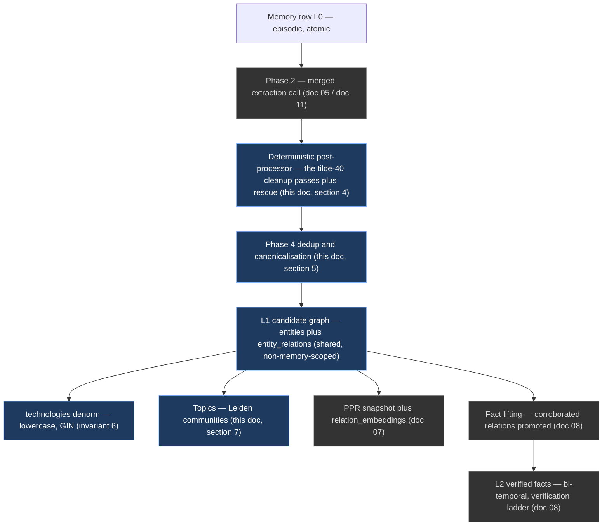

**Scaffolding honesty (invariant 23).** The entity graph is *built* on every ingest but is **not yet spent on retrieval** — search and `reason()` are vector + FTS + LLM today; "spend the graph" (PPR, dual-level, community injection) is target-new and doc 07's. This doc describes what the graph *is* and how it is *maintained*, and is careful never to claim graph-augmented retrieval as shipped. Likewise the dormant `knowledge_triples` demo scaffolding (free-text slugs, zero callers) is **not** a Layer-1 asset — it is the Layer-2 rebuild (doc 08), and this doc's endpoints resolve to real `entities` ids, never to slugs.

---

## 3. The five closed vocabularies

**Decision. Five closed vocabularies govern the model — `ENTITY_TYPES` (15), `RELATIONSHIP_TYPES` (16), `TECH_TYPES` (5), `MEMORY_TYPES` (7 → target 9), and a target-new memory-relation set — and every value the LLM emits passes through a pure normaliser before it is ever stored, with unknowns falling to a safe default and legacy names rewritten at runtime (invariant 5).** A fixed vocabulary is what keeps retrieval filters, supersession, the `technologies` denorm, the UI legends, and the graph traversals coherent; a free-form type column silently gets rewritten by a downstream normaliser and breaks matching, which is exactly why doc 02 §9 flags the free-form-predicate `knowledge_triples` demo as scaffolding rather than substrate. The normalisers (`normalize_entity_type`, `normalize_relation_type`, `normalize_memory_type` in `app/taxonomy.py`) are **pure functions of a single raw string** — this purity is load-bearing for idempotent re-extraction (invariant 8): the same content must normalise the same way on every reprocess, so a normaliser must never take a classifier verdict, an area, or any context as a parameter (a constraint the area seam of §8 respects by construction).

| Vocabulary | Source | Count | Values (or shape) | Unknown falls to | Status |
|---|---|---|---|---|---|
| `ENTITY_TYPES` | `taxonomy.py` | 15 | tool, service, database, language, protocol, project, algorithm, artifact, concept, entity, person, organization, event, place, paper | `concept` | exists today |
| `RELATIONSHIP_TYPES` | `taxonomy.py` | 16 | USES, DEPENDS_ON, HAS_PART, IMPLEMENTS, EXTENDS, REPLACES, IMPROVES_ON, IS_A, DEPLOYED_ON, CAUSES, AUTHORED_BY, HAPPENED_ON, MENTIONS, CITES, INSPIRED_BY, RELATED_TO | `RELATED_TO` | exists today |
| `TECH_TYPES` | `relations.py` | 5 | tool, service, database, language, protocol (the subset feeding `technologies`) | — | exists today |
| `MEMORY_TYPES` | `taxonomy.py` | 7 → **9** | fact, decision, preference, problem, reference, architecture, milestone **+ episodic, procedural** | `fact` | target-new adds two |
| memory-relation types | `taxonomy.py` | **5 stored + 1 projected** | CONTRADICTS, ELABORATES, DEPENDS_ON, FOLLOWS, RELATES_TO stored; SUPERSEDES projected | `RELATES_TO` | target-new (§3.1) |

**The normalise gate is a three-step fallthrough, plus one name-aware nudge.** For a raw type: an exact match against the closed set wins; else a `LEGACY_*_TYPE_MAP` rewrite wins (`framework → tool`, `RUNS_ON → DEPLOYED_ON`, `debug → problem`); else the safe default (`concept` / `RELATED_TO` / `fact`). After entity-type normalisation, `refine_entity_type` re-types a `project`-named entity whose name ends in a library/SDK suffix (`-ui`, `-kit`, `-sdk`, `.js`, `-js`) to `tool`, so first-party UI kits like "darkraise-ui" flow into the `TECH_TYPES`-based `technologies` denorm that supersession and retrieval read — a nudge, not a new vocabulary. The gate for entity types:

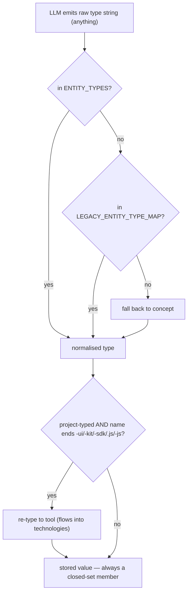

**Taxonomy-first sequencing is a hard ordering rule (invariant 5, doc 04 §12).** Because widening a closed vocabulary changes the extraction schema string (and therefore the prompt, and therefore makes re-extraction non-bit-identical), **no feature may emit a new value before that value lands in `taxonomy.py` and every hard-coded vocabulary is swept.** The known hard-coded vocabularies that must be swept in lock-step are the `reason()` `KNOWN_TYPES` list, the `extraction_clean.py` simple-7 `memory_type` gate baked into `_build_extraction_schema`, and the UI type filters (doc 13). Concretely for the target: `episodic` and `procedural` land in `MEMORY_TYPES` (`insight`/`profile` do **not** join — knowledge moved to the vault, so they are no longer memory types, doc 01 §3.4); the five stored memory-relation types land as their own set (§3.1). A sequencing gotcha to watch: `SUPPORTS` is currently a legacy alias of `RELATED_TO` in the entity-relation `LEGACY_RELATION_TYPE_MAP` — promoting such a name to a first-class type means removing its legacy alias *in the same vocabulary* first, or that vocabulary's normaliser will keep rewriting the new type away. (Note this is per-vocabulary: `CONTRADICTS` is promoted as a *memory-relation* type, which flows through the separate `normalize_memory_relation_type` + `LEGACY_MEMORY_RELATION_TYPE_MAP` (§3.1), so any `RELATED_TO` alias it carries in the entity-relation map does not interfere — `SUPPORTS` is the cleaner illustration because it stays an entity-relation concern.)

**The `REPLACES_FAMILY` collapse is a coherence rule the taxonomy owns (invariant 12).** `REPLACES`, `IMPROVES_ON`, and the legacy `BUILDS_ON` collapse to one bucket via `family_key` so the rescue layer's dedup and the supersession detector (doc 08) treat replacement-family relations as one thing — a rescued `IMPROVES_ON` must not double-count against an LLM `REPLACES` for the same pair. Adding a replacement-family relation means editing `REPLACES_FAMILY` in `relations.py` too; this coupling is contract.

### 3.1 The memory-relation vocabulary — a separate closed set (target-new)

**Decision. The associative memory-to-memory edge types are a distinct closed vocabulary with their own normaliser and legacy map, kept out of `RELATIONSHIP_TYPES` — five stored types (`CONTRADICTS`, `ELABORATES`, `DEPENDS_ON`, `FOLLOWS`, `RELATES_TO`), plus `SUPERSEDES` projected from `superseded_by` and never stored, with `DERIVED_FROM` cut for v1.** The vocabulary is owned here (it is a taxonomy concern); the *writers* are doc 08's consolidation passes (the associative types are derived off the hot path from entity overlap, embedding proximity, and contradiction checks) and the *table* is doc 04's (`memory_relations`, composite `(id, project)` FKs, §8.2). This doc's contribution is the closed set and the normaliser contract that keeps it honest.

**Why the separation is structural, not cosmetic.** Entity relations connect *concepts* (`postgres → DEPLOYED_ON → linux`); memory relations connect *statements* (this decision → `CONTRADICTS` → that earlier decision). If a memory-level type like `ELABORATES` entered `RELATIONSHIP_TYPES`, `normalize_relation_type` would accept it on an entity-to-entity edge, and an `entity_relations` row could claim one concept "elaborates" another — meaningless, and a blur of the layer boundary invariant 4 protects. So there are three normalise gates, not one, each guarding a different vocabulary:

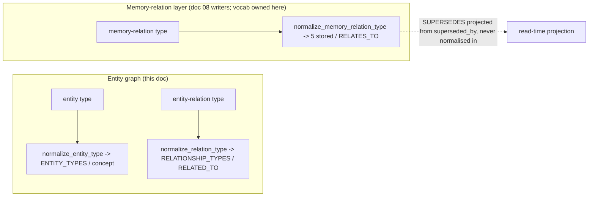

`SUPERSEDES` is never a normaliser output — it is a read-time projection of the `memories.superseded_by` pointer (doc 04 §8.2), so the write-side vocabulary the normaliser validates is exactly the **five** stored types. `DERIVED_FROM` is cut for v1: the reshape removed its only writer (knowledge left the memory table), and one provenance mechanism per layer is the rule (`fact_sources` for L2, `article_citations` for L3, the projected pointer for supersession). Shipping a zero-writer edge type would violate invariant 23, so `DERIVED_FROM` is reintroduced only if consolidation later grows a real derived-memory writer — taxonomy-first, at that time.

---

## 4. The deterministic post-processor

**Decision. Raw LLM extraction output is cleaned by an ordered pipeline of roughly forty deterministic, non-mutating passes plus a pattern-based relation-rescue layer — and this post-processor, not the prompt, is where extraction quality is won (spec §5).** The passes live in `clean_extraction` (`extraction_clean.py`); each is a pure function `list[dict] → list[dict]` (or a small tuple), so the pipeline is a fixed, testable, reorderable sequence with no hidden state. The design principle is division of labour: the LLM does the *semantic* work (which spans are entities, what relates to what) under a minimal prompt; the deterministic passes do the *precision* work (drop values-not-entities, snap well-known names to canonical types, fix relation directions, gate speculative REPLACES) that an LLM does inconsistently across runs. Keeping the precision work deterministic is what makes extraction reproducible and cheap to iterate — the passes run in-process with zero model calls, and the F1 harness (`backend/scripts/extraction_bench/`) can replay them against cached LLM output to measure a change instantly.

**Why the passes stay out of the prompt.** Spec §5 strips from the prompt every rule the cleanup passes already enforce — the prompt becomes one canonical schema + content + reproducibility seed + minimal rules. The reasons are three: a shorter prompt is cheaper and prompt-cacheable; a deterministic pass is reproducible where a prompt rule is probabilistic (six rounds of prompt patches failed to make one extraction model reliably emit file-path relocation edges — the rescue layer's Pattern D captures them deterministically); and moving the moat into the prompt would couple it to the vendor and the model version. The area seam (§8) must respect this: it varies *which* minimal prompt variant runs, never which cleanup passes run (they stay area-blind in v1).

The post-processor as ordered stages — entity shaping, entity rescue, relation synthesis, relation gating and direction, then cross-source dedup and fan-out. Each box names representative passes; the full inventory is the ordered `clean_extraction` body:

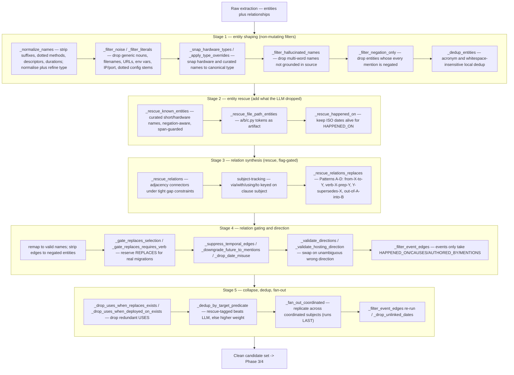

**Three ordering constraints are load-bearing and must survive the rebuild.** First, **entity rescue runs after entity dedup** so canonical short names (`cpu`, `rg`) are not dropped as substrings of longer model proposals, and the rescue is span-guarded so `darkraise` is not re-added inside `darkraise-ui` nor `github` inside `GitHub Actions`. Second, **`_fan_out_coordinated` runs last**, after `_dedup_by_target_predicate`, because fan-out deliberately mints a multi-source set ("A, B, and C all use X" → three edges) that the target-predicate dedup would otherwise collapse back to one. Third, **`_filter_event_edges` runs twice** — once in the gating stage and again after fan-out — because fan-out can mint a fresh edge with an event-typed endpoint that the first pass never saw. These are not incidental; they are why the inventory must be treated as an *ordered* contract, not a bag of filters (see the open-question stance on freezing the inventory, §10).

**The rescue layer is the only surviving ingestion-side behavioural flag (`relation_rescue`).** When on (default), the three synthesis passes run; when off, the model's raw triples still go through the gating/direction/collapse stages. Every rescue-emitted triple carries `properties.rescue = True`, which the cross-source dedup (`_dedup_by_target_predicate`) uses as the top tie-break: a regex-grounded rescue triple beats the LLM's free-form interpretation on a direction-sensitive predicate, because the rescue's directional claim is structurally anchored to the source text. This is the mechanism behind the "wrong-direction REPLACES" fix — `pgvector REPLACES qdrant` from the literal "from X to Y" phrasing wins over a mis-anchored LLM `darkmem REPLACES qdrant`.

---

## 5. Dedup & canonicalisation

**Decision. Phase 4 runs exactly one type-constrained ANN probe per unique `(name, entity_type)` pair at cosine threshold 0.85 against `entity_embeddings__<slug>`, canonicalises a fresh entity onto its near neighbour only when the lexical discriminator `names_distinct` returns False, and records the survivor in a `canonical_map` that Phase 5 uses to resolve every relation endpoint by the same key.** The probe is type-constrained because a name embedding alone cannot tell a `tool` named "react" from a `concept` named "react" — canonicalising one onto the other corrupts the `(name, entity_type)` binding — which is exactly why `find_similar_entity` filters on `entity_type` and same-named entities of different types dedup separately (invariant 4, doc 04 §5.2). The probe reads the per-fingerprint child table only via `child_table("entity_embeddings", fingerprint)` and never joins across fingerprints, because cosine distance between two embedding spaces is undefined (invariant 2).

**Why a lexical discriminator gates an embedding match.** Cosine recall at 0.85 is right for surface variants — "postgres"/"postgresql" (≈0.974), typos, casing — but *wrong* for names that differ only by a discriminating token yet embed almost identically: "february outage" vs "march outage" (≈0.885), two ISO dates (≈0.889), "v2" vs "v3", "us-east-1" vs "us-west-2". `names_distinct` is the precision gate the embedding recall lacks: it returns False (mergeable) when the two names are equal modulo punctuation and case, and True (keep distinct) when they differ by a numeric/date/version token or by a month (with `jan`/`january` canonicalised so an abbreviation is not a false discriminator). A merge fires only when the ANN neighbour is within threshold **and** `names_distinct` is False.

The dedup handoff — probe, discriminate, canonicalise, and hand `canonical_map` to Phase 5:

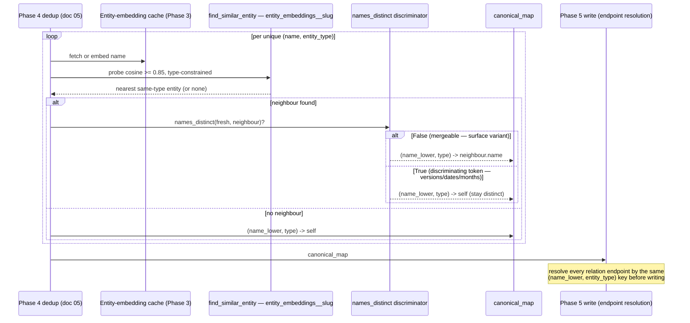

The `names_distinct` decision, stated as its own branch logic because it is the single most consequential precision gate in the graph:

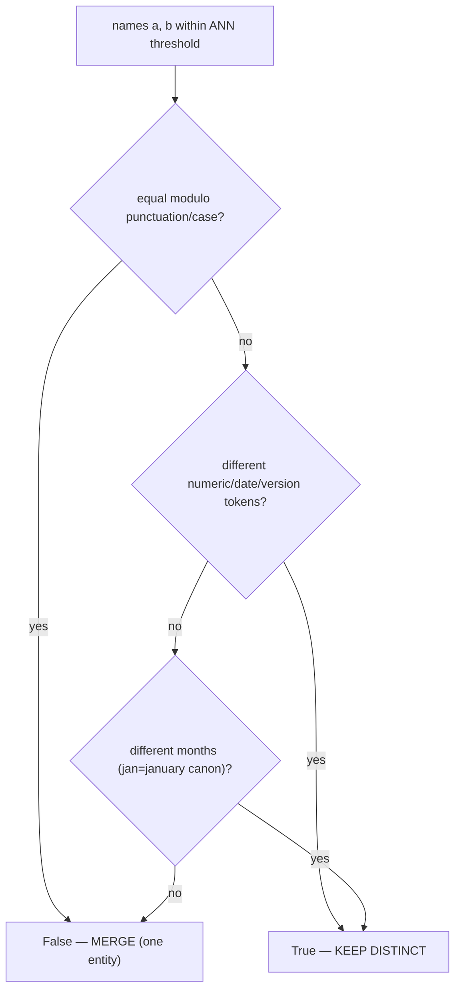

**Lowercase-on-disk with display casing preserved (invariant 7).** Entity names are lowercased on write because both the supersession detector and the `technologies` denorm assume lowercase for matching; the original casing is stashed in `properties.display_name` so the UI can render it back. The dedup keys, the `canonical_map`, and the uniqueness constraint all operate on the lowercase form; only rendering reads `display_name`.

**The orphan sweep is the dedup safety net (invariant 8, §6).** Phase-4 dedup can only be trusted if it never snaps a fresh entity onto a stale ghost — an entity kept alive by `memory_ids` that point at already-deleted memories. The hourly `graph_orphan_cleanup` job runs the unscoped `prune_orphan_entities` sweep precisely so those ghosts (and their embeddings, which CASCADE with the row) are gone before the next dedup probe can match them.

**Tuning is measured, not magical (convention 9).** The 0.85 threshold and the `names_distinct` discriminator token classes are the two dedup tunables; the stance (§10) is to make the threshold a `config` row and evolve the discriminator only against the F1 harness, never by intuition.

---

## 6. Write semantics & provenance

**Decision. Entities and relations are written append-on-conflict, and re-extraction strips a memory's prior contributions before writing the new set, with a self-healing delete that removes a shared row only when no live memory (target: and no live repo) still asserts it (invariants 4, 8).** Asserting an entity that already exists (`UNIQUE (name, entity_type)`) or a relation that already exists (`UNIQUE (source_entity_id, target_entity_id, rel_type)`) appends the new `memory_id` to `memory_ids[]` rather than inserting a duplicate row — the graph is a shared substrate, so one "postgres" node accumulates the provenance of every memory that asserts it. Re-extraction is made idempotent by `delete_by_memory_id`, which strips this memory's id from both tables first, then deletes only the rows no live memory still asserts.

**Why the delete is self-healing and ordered.** `delete_by_memory_id` removes a relation only when `NOT EXISTS (a live memory in its memory_ids)`, and an entity only when `NOT EXISTS (a live memory)` **and** `NOT EXISTS (a surviving relation referencing it)` — in that order, relations first, so the entity guard sees only relations that will survive. The "no live memory" predicate (rather than "array empty") is what self-heals dangling `memory_ids`: an id left pointing at a deleted memory is treated as absent. The entity's second guard is essential because the endpoint FK is `ON DELETE CASCADE` — deleting an entity a relation still points at would silently destroy another memory's edge. Entities shared with other live memories therefore survive a re-extraction untouched.

The entity/relation lifecycle these rules produce:

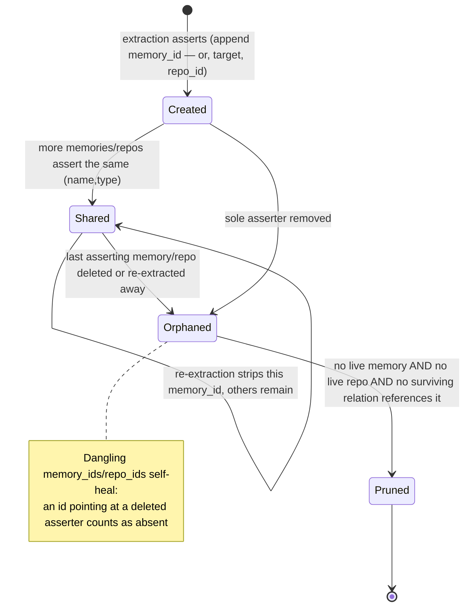

The write path's strip-before-rewrite and its two-tier orphan reclamation — the write-scoped self-heal plus the hourly unscoped backstop:

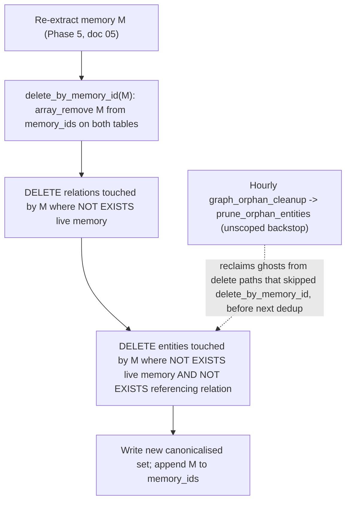

**Provenance always (doc 01 §8).** Nothing exists in the graph without a trail: every entity and relation carries `memory_ids` (and, target, `repo_ids`); every mutation emits an `events` row (doc 04 §8.1) with `event_type = extracted` and `object_type = entity | relation`, so the timeline and calendar can reconstruct the graph's history. The anti-schema rules bind here too (doc 04 §4.2): entity-KNN synonymy edges (cosine ≥ 0.8) are **ephemeral, built inside the cached igraph snapshot at read time, and never `entity_relations` rows** — a `SYNONYM` type would be rewritten to `RELATED_TO` by the closed taxonomy and pollute the graph — and **topics are never entities** (§7). And the never-join rule holds, reworded not weakened (spec §3.3): no *query* joins the memory and code graphs; the only sanctioned crossings are two application-level, one-direction components (the code deriver and the citation re-verifier). **A symbol is not an entity.**

### 6.1 The inert `repo_ids[]` amendment (target-new)

**Decision. `entities.repo_ids uuid[]` and `entity_relations.repo_ids uuid[]` are added as the code-side analog of `memory_ids[]`, both orphan sweeps gain one `NOT EXISTS (live repo)` predicate, and two new primitives (`assert_from_repo`, `strip_repo_assertions`) do strip-before-rewrite per repo — and the whole amendment lands INERT in the v1 baseline (spec §3.3, doc 04 §4.2).** A repo id in `repo_ids[]` lets a repository assert a graph row without a memory, which is what the code deriver (doc 10) needs to make "postgres from code" the same node as "postgres from a memory". The amended sweeps survive a row while *any* live memory **or** any live repo still asserts it; dangling `repo_ids` self-heal exactly like dangling `memory_ids`.

**Why inert-in-baseline is the right sequencing.** With every `repo_ids` array empty, the amended `NOT EXISTS (live repo)` clauses are always vacuously true, so the sweeps are byte-identical to today — the load-bearing deletion-logic change is reviewed, tested, and frozen *while it is riskless* (blast radius: 2 columns + 2 methods + tests), and its only writer, the deriver, ships later once Layer 2 is proven live (spec §8). This doc owns the amended sweep and the primitive *semantics*; doc 10 owns the writer.

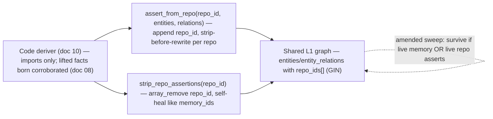

The focused table subset this doc owns — the shared graph plus the topic tables (the whole-schema ERD is in `erd.md`, not duplicated here):

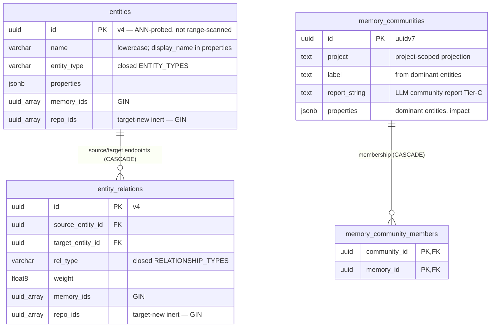

---

## 7. Topics as memory communities

**Decision. Topics are materialised as Leiden communities over a project-scoped projection of the memory graph, stored in `memory_communities` + `memory_community_members`, re-derived delete-and-rewrite per project, labelled from dominant entities, and enriched with an LLM `report_string` off the hot path; topics are never entities and never manually curated (doc 04 §8.4, resolved: materialise).** A topic is a cluster darkmem *discovers*, not a folder the human maintains — hand-managed folders rot the moment the corpus grows, whereas a clustering pass re-derives grouping for free as memories arrive and supersede (doc 01 §3.3). The mechanics generalise the code side's `CommunityDetector` (leidenalg + igraph, seeded, timeout-bounded, single-community fallback) onto the memory graph. Materialisation (durable rows) rather than compute-on-read is chosen because Leiden is an off-path job and recomputing per read is wasteful — and, critically, durable rows are what let pin-suggestions be *diffed across runs* for doc 09.

**Why project-scoped and why delete-and-rewrite.** Clustering runs over a **project-scoped projection** of the memory graph so a topic's membership never crosses projects, even though the underlying entity graph is global today (doc 01 §5) — this is a partial down-payment on the cross-project isolation invariant (14) for the topic surface. Re-derivation is **delete-and-rewrite per project**: a run deletes the project's community rows (membership cascades away) before inserting the new result — the strip-before-rewrite discipline generalised (invariant 8). The consequence is that **community ids churn on every run**: nothing durable may FK a community id, and `events` rows about topics reference them by label and payload snapshot, never by id (doc 04 §8.4). This is the accepted cost of emergent, recomputed topics.

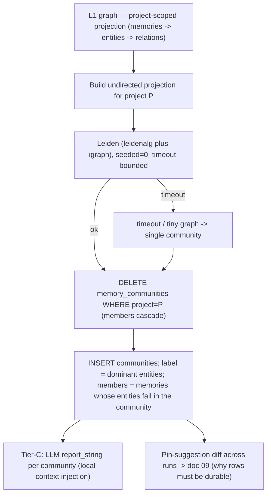

Topic lifecycle is re-derivation, not edited transitions:

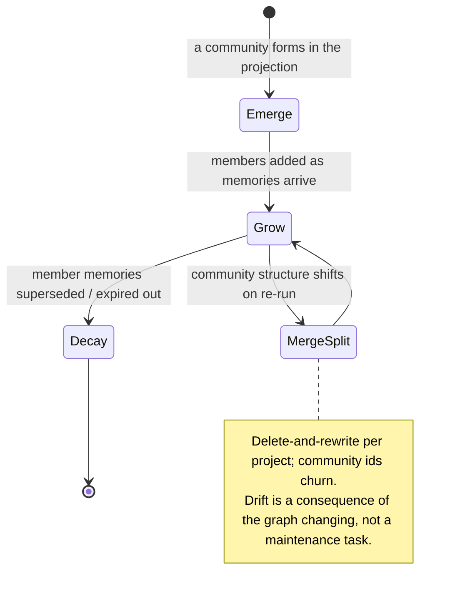

**Why topics must not be entities (invariant 5).** A topic stored as an `entities` row would fall through the closed `ENTITY_TYPES` fallback to `concept` and collide with `UNIQUE(name, entity_type)`, polluting the graph — so topics get their own table. Two query shapes must never be conflated: the **local** shape injects a community's `report_string` as context alongside RRF (doc 07), while the **global** map-reduce shape is a separate MCP tool (`memory_overview`, doc 12), never per-memory RRF.

**Signals ship with surfaces and journal (convention 8).** Topic labels and reports surface in vault/topic browsing (doc 13); each detection run and each report emits an `events` row (`event_type = consolidated`, `object_type = topic`) referencing communities by label + payload. The `report_string` LLM call is a Tier-C consolidation consumer (invariant 15) — never on ingest or retrieval — and doc 11 owns which purpose serves it.

---

## 8. The dynamic-area-taxonomy seam (spike-gated)

**Decision. This doc designs only the *seam* — a prompt-injection point and the normaliser contract around it — and adopts the separate spike's recommendation as the seam's default stance: area-awareness is prompt-STEERING over the unchanged, frozen closed taxonomy, gated by a free deterministic classifier, with everything beyond the seam spike-gated (`scratchpad/spike-dynamic-taxonomy.md`).** The stored vocabulary stays frozen (option a — a per-area *stored* vocabulary — is rejected outright); a per-area *priority hint* over the always-complete closed set (option b's safe sub-variant) rides inside prompt-steering (option c). The load-bearing constraint the seam must never break: **the schema string always lists the full closed sets, `normalize_*` remains the hard gate on anything emitted, and nothing area-dependent is ever stored as a type.** Subset-as-restriction — pruning the schema string to only an area's types — is explicitly **forbidden**, because a business note that mentions "our Django backend" or a coding note that names a person would then have no valid type to emit, and recall on off-emphasis types craters.

**Why a stored per-area vocabulary breaks the system.** It fails at four joints: it violates the closed-taxonomy invariant (5) every consumer assumes; it forks the global `(name, entity_type)` node — "postgres" in a coding note and a business note must land on *one* node, and area-dependent types would split it and destroy the cross-memory accumulation the graph exists for (invariant 4); it breaks the `TECH_TYPES`/`technologies` denorm that supersession and retrieval read a fixed type set from (invariant 6); and it makes `normalize_*` depend on a classifier verdict, so re-extraction is no longer idempotent (invariant 8). None of "better extraction per area" requires new stored types.

**The seam's two concrete injection points.** First, `_build_extraction_schema` gains an `area` parameter that **reorders (never filters)** the type unions so the area's most-likely types lead, and prepends a one-line hint ("This content is `<area>`-flavoured; the most likely entity types are X, Y, Z and relations A, B, C. All fifteen/sixteen types remain valid."). Second, `prompt.get("extraction")` gains per-area variant lookup with `general` as the fallback, so the prompt-override table extends naturally (`extraction`, `extraction:coding`, `extraction:business`, …) with per-area few-shot examples. Five areas, each a maintained static (prompt-cacheable) variant, with `general` as the ambiguity sink and the today-equivalent no-op: **coding, business, science, personal, general**.

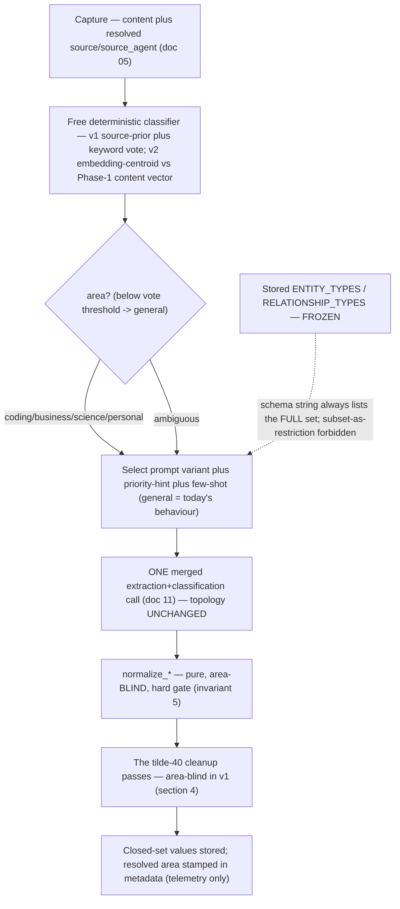

**The classifier must be free and deterministic — never an LLM round-trip.** Spec §5's "one LLM touch per memory" stays intact by never spending the touch on area detection: v1 is a source-prior + keyword vote (an MCP call from a Claude-Code User-Agent is a strong `coding` prior; a keyword vote table breaks ties; below threshold ⇒ `general`) — a pure function of `(content, source)`, zero latency, reproducible, offline-capable. The v2 upgrade is an embedding-centroid classifier against the **Phase-1 content vector that already exists** before Phase 2 builds the prompt (cosine to five per-area centroid seed-vectors cached per fingerprint), still zero extra model calls. An area **may additionally be *emitted*** by the merged call as an output field for telemetry, but an emitted area **cannot steer its own call** — it arrives with the answer — which is exactly why steering needs the free pre-pass.

**The normaliser contract, stated precisely.** Area affects the **prompt only**. `normalize_entity_type`, `normalize_relation_type`, and every one of the ~40 cleanup passes stay **area-blind in v1** — they are the moat and must remain pure functions so re-extraction stays reproducible. The reproducibility statement gains one clause: *same content + same classifier version + same prompt variant ⇒ same output*; re-extracting after an area-classifier change is not bit-identical, the same already-accepted class of caveat as re-extracting under a different classification-gate state (`CLAUDE.md`). The resolved area is stamped into the memory's metadata/properties for observability and later retrieval biasing — **not** a taxonomy value, **not** a new required column for v1, **not** user-facing vocabulary.

**What stays spike-gated (do not pre-empt).** The empirical case for an F1 gain cannot be made today — the only gold set (`extraction_bench/gold.json`, 26 memories) is mono-domain darkmem tech. So: whether each area variant *ships* (per-area, only where it beats the single prompt by a meaningful margin) and whether any individual cleanup pass is later *area-gated* (e.g. suppressing tech-rescue on `personal`) are **deferred behind multi-domain gold + a forced-misclassification A/B** (§10). The seam and the free classifier are built now; the variants and any pass-level tuning wait for the data. The closed-invariant trap re-opens only if someone later "optimises" the schema string to the subset — so subset-as-restriction is recorded here as forbidden.

**This seam is also where the `applies_when` context vocabularies are governed (cross-doc contract 3).** Doc 07 owns `applies_when` matching and doc 12 the wire format, but the `env` / `situation` axes are **closed vocabularies under this doc's taxonomy discipline** (invariant 5) — matching rots on drift (`prod`/`production`/`prd`) unless those axes normalise before store exactly as entity types do. Version comparison is app-side post-scoring, never a jsonb type. The area seam and the `applies_when` axes share one principle: closed vocabularies, normalise-before-store, never a free-form type.

---

## 9. Invariants restated

The invariants that bind this layer, restated in this doc's own terms so the design is checkable against the 1–23 catalog:

- **Per-fingerprint isolation (inv. 2).** The dedup probe reads `entity_embeddings__<slug>` only through `child_table("entity_embeddings", fingerprint)`; a fingerprint is registered before any insert; no probe or query joins two `__<slug>` tables. Cross-fingerprint cosine is undefined.
- **Entities/relations non-memory-scoped, append + uniqueness (inv. 4).** `UNIQUE (name, entity_type)` and `UNIQUE (source_entity_id, target_entity_id, rel_type)` stay; a duplicate appends to `memory_ids[]` (target: or `repo_ids[]`), never inserts a row. The memory-relation layer (§3.1) is a *separate* set, not a merge into this graph.
- **Closed taxonomy, normalise-before-store, taxonomy-first (inv. 5).** The five vocabularies are the only stored values; `normalize_*` are pure functions with `concept`/`RELATED_TO`/`fact` fallbacks and `LEGACY_*` runtime rewrites; a new value lands in `taxonomy.py` and every hard-coded vocabulary is swept *before* any feature emits it. The area seam (§8) never violates this — it steers the prompt, never the stored vocabulary.
- **`technologies` lowercase + denormalised + GIN (inv. 6).** The Phase-5 recompute reads entities whose type is in `TECH_TYPES`, lowercased; `refine_entity_type` is what routes first-party UI kits into it. All three properties stay.
- **Lowercase entity names + `display_name` (inv. 7).** Names are lowercase on disk; dedup, `canonical_map`, and the uniqueness key operate on the lowercase form; display casing lives in `properties.display_name`.
- **Idempotent re-extraction / strip-before-rewrite (inv. 8).** `delete_by_memory_id` strips this memory's contributions and self-heals (no-live-asserter, not array-empty); the entity guard's ON-DELETE-CASCADE-aware second predicate protects other memories' edges; the hourly `prune_orphan_entities` backstop reclaims ghosts before the next dedup. The topic re-derivation (delete-and-rewrite per project) is the same discipline generalised.
- **REPLACES family collapse (inv. 12).** `REPLACES`/`IMPROVES_ON`/`BUILDS_ON` collapse via `family_key`; the rescue dedup and supersession treat them as one bucket; adding a replacement-family relation edits `REPLACES_FAMILY` too.
- **Single-worker snapshot assumption (inv. 13).** Materialised topics are an off-path job under one worker; synonymy KNN edges live in the single cached in-process snapshot, never as rows. A multi-replica deployment would break the snapshot — a flagged Phase-4 decision, not v1.
- **Reconciliation off the hot path (inv. 15).** Community detection and the `report_string` LLM call are Tier-C consumers; no LLM reconciliation touches ingest or retrieval. The area classifier is deterministic and free by design.
- **Scaffolding-not-substrate (inv. 23).** The entity graph is built but **not yet spent on retrieval** (that is doc 07, target); `memory_communities` is target-new; the `repo_ids[]` amendment lands **inert**; the dormant `knowledge_triples` demo is the Layer-2 rebuild (doc 08), never a Layer-1 asset. Nothing here is claimed as shipped that is not.

---

## 10. Open questions & deferred decisions

Each carries a recommended stance, so downstream inherits a default rather than a blank.

- **The dynamic-area-taxonomy question (spiked).** *Stance: adopt the spike's recommendation as the seam's default — prompt-STEERING only over the frozen closed taxonomy (option c with option b's priority hint), five areas with `general` as sink and no-op, a free deterministic classifier (v1 source-prior + keyword; v2 embedding-centroid vs the Phase-1 content vector), area emitted for telemetry but never steering its own call, and area stamped into metadata.* Build the seam and the classifier now (§8); leave whether each variant *ships* and whether any cleanup pass is *area-gated* spike-gated behind multi-domain gold + a forced-misclassification A/B, with an acceptance bar of ≥ +0.03 F1 on relations or entity name+type where the on-area gain exceeds the forced-misclassification penalty. Record subset-as-restriction of the schema string as **forbidden**.
- **Topic labelling/report mechanics — LLM purpose, cadence, and the pin-suggestion diff contract to doc 09.** *Stance: run community detection and the `report_string` synthesis as a Tier-C consolidation job (doc 08's schedule umbrella, this doc owning the detection mechanics), cadence a `config` cron defaulting conservative (e.g. daily per active project); the report uses the purpose doc 11 assigns for community reports (recommend reusing `summarization` unless doc 11 widens the purpose set). The pin-suggestion contract handed to doc 09 is a per-run diff of durable `memory_communities` rows keyed on stable dominant-entity labels — new/grown/decayed communities, not churning ids.*
- **The cleanup-pass inventory as a documented, harness-measured contract.** *Stance: freeze `clean_extraction` as a named, **ordered** contract grouped into the five stages of §4 (the three ordering constraints — rescue-after-dedup, fan-out-last, event-filter-twice — are part of the contract, not incidental), and gate any change behind the `extraction_bench` F1 harness with doc 17 as the regression owner; a pass may be reordered or removed only against a measured F1 delta, never on intuition.*
- **Dedup threshold / discriminator evolution policy.** *Stance: make the 0.85 ANN threshold a `config` row and treat the `names_distinct` discriminator token classes (numeric/date/version/month) as a versioned, harness-measured contract; loosen or tighten only against measured merge precision/recall on the F1 harness, and never change the lowercasing on `technologies` vs REPLACES targets on only one side (invariant 6).*
- **The memory-relation normaliser mechanics (vocabulary here; writers doc 08's).** *Stance: ship a `normalize_memory_relation_type` mirroring the entity/relation normalisers — pure function, exact-match then legacy-map then `RELATES_TO` fallback — over the five stored types, with its own `LEGACY_MEMORY_RELATION_TYPE_MAP`, landed taxonomy-first and swept through every hard-coded list before doc 08's consolidation passes emit any edge; `SUPERSEDES` is never a normaliser output (projected from `superseded_by`), and `DERIVED_FROM` stays cut until a real derived-memory writer exists.*

---

*Downstream: doc 07 consumes this doc's graph artefacts — the cached-snapshot PPR inputs, the `relation_embeddings` content, and the community `report_string` for local-context injection — and spends the graph on retrieval (which this doc is careful to label as not-yet-shipped). Docs 08 and 09 read the Layer-1 candidate graph: doc 08 lifts corroborated relations into Layer-2 facts and owns the verification ladder, and consumes this doc's memory-relation vocabulary as the closed set its consolidation passes write; doc 09 consumes the topic pin-suggestion diffs. Doc 10's code deriver writes through the `assert_from_repo` / `strip_repo_assertions` primitives and the inert `repo_ids[]` amendment defined here, born `corroborated` with `origin_key = repo_id`. Doc 11 owns the extraction prompt and the merged-call schema this doc's post-processor cleans, and the LLM purpose serving the community reports. Doc 12 surfaces the topic and graph read tools; doc 13 renders topic browsing and the graph views. The closed vocabularies, the normalisers, the ~40-pass post-processor, the dedup discriminator, the write semantics, and the topic materialisation fixed here are binding for all of them.*
