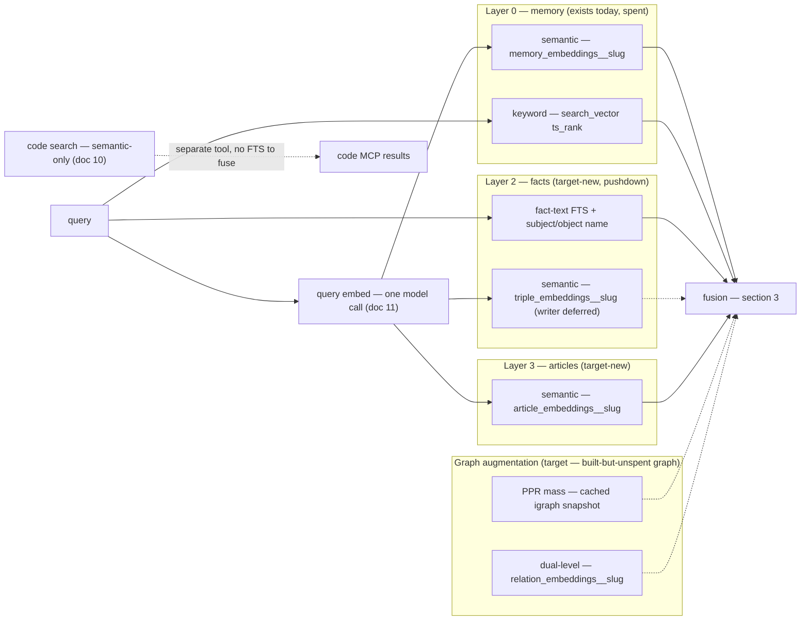
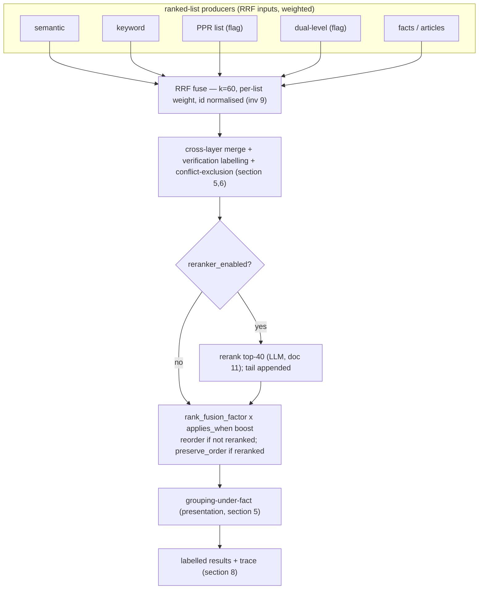
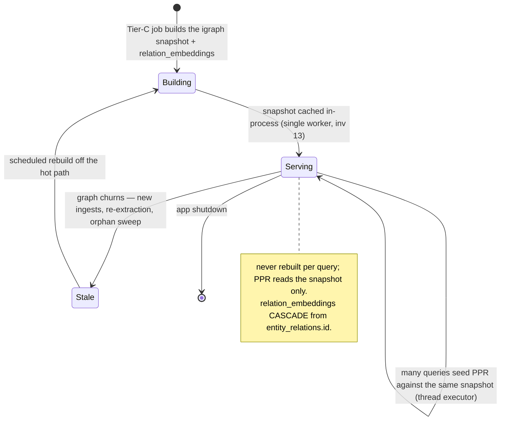
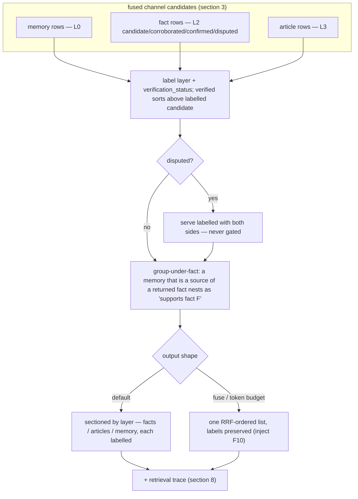
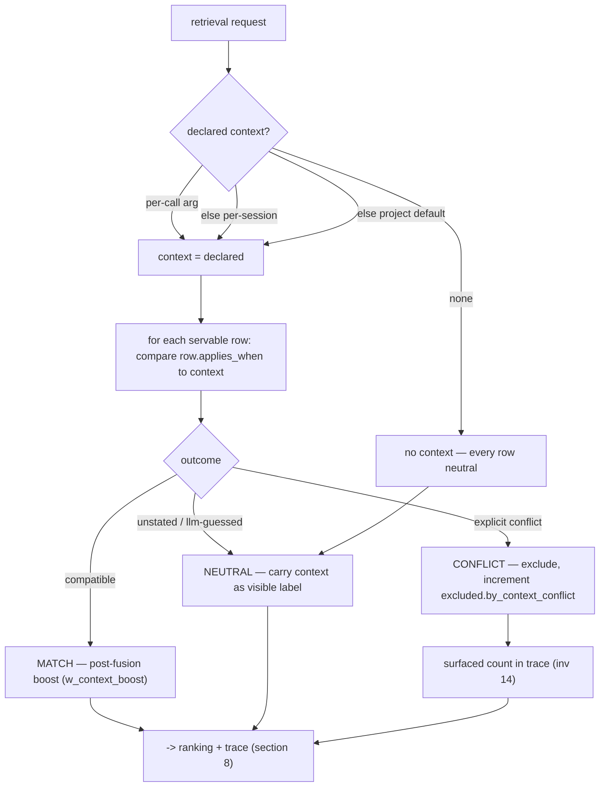
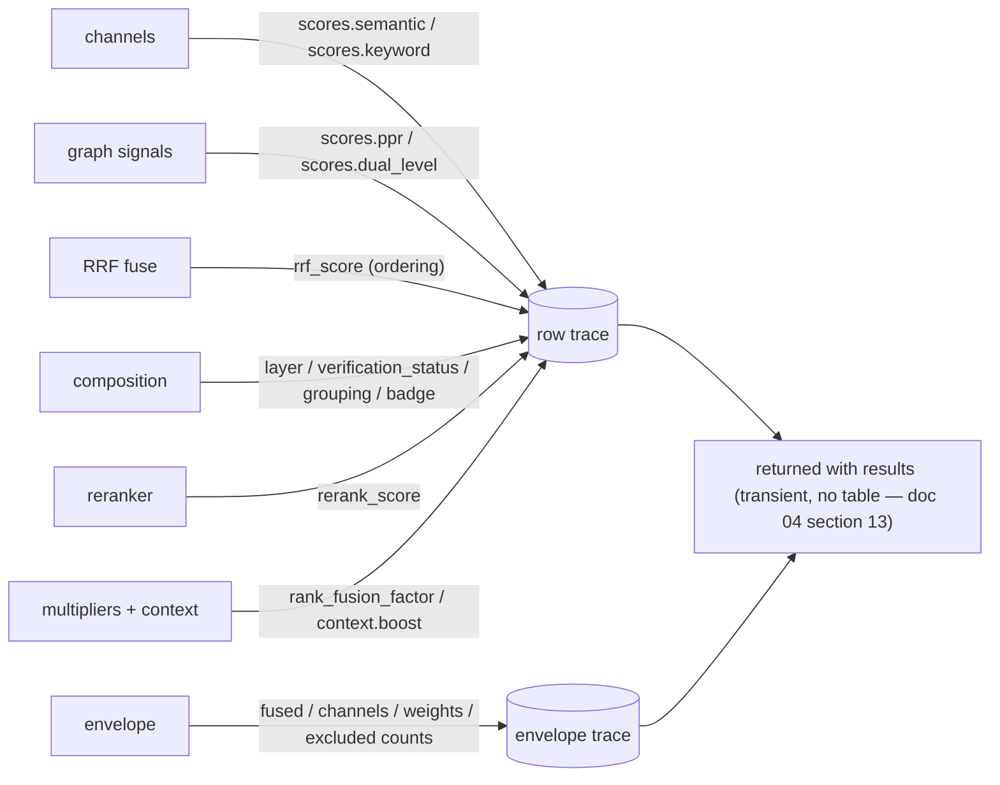
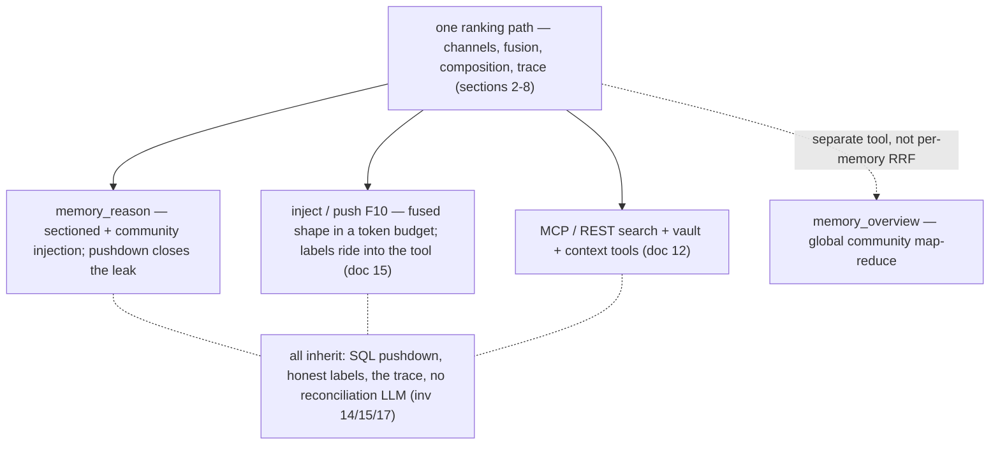

# 07 — Retrieval & Ranking

**Status:** subsystem design doc; conforms to foundation docs 00–04 and the 2026-07-24 knowledge-reshape spec (`docs/superpowers/specs/2026-07-24-knowledge-reshape-design.md`). Wave-2 truth-and-read-layer doc (with docs 08, 09). Authored on the retained Python/FastAPI + async SQLAlchemy + Postgres/pgvector stack (doc 03 §4, Option A); .NET appears only as a considered-and-deferred alternative.

Every mechanism below is tagged **(exists today)**, **(rebuild)**, **(target-new)**, **(activation)**, or **(horizon)** per doc 04 §1's convention. A mechanism claimed as shipped that is only scaffolding fails review (invariant 23).

---

## 1. Purpose & scope

**This doc fixes the whole read path: how a query becomes ranked, labelled, explainable results drawn from four layers, and how every ranking signal composes into one deterministic order with at most one optional model call.** It owns the retrieval channels (the memory semantic/keyword hybrid, the new facts and articles channels, with code search noted as a separate semantic-only sibling), the fusion currency (reciprocal rank fusion and the reranker), the unified `rank_fusion_factor` ranking priors (confidence/importance/heat/recency behind `w_*` flags), the graph-augmented signals (cached-snapshot personalized PageRank, dual-level retrieval over `relation_embeddings`, and community-report injection), the **four-layer composition** with its verification labelling, `applies_when` context matching, the SQL project/status filter pushdown, the **retrieval trace** payload, and the consumers that spend all of it — `memory_reason`, inject (F10), and the MCP/REST read surface. Push/inject is a *delivery* of this one path, never a second ranking path (doc 01 F10).

**What the neighbouring docs fix instead.** Doc 06 builds and maintains the Layer-1 candidate graph, the `relation_embeddings` *content*, and the community `report_string`; this doc spends those artefacts on retrieval but never asserts a graph row. Docs 08 and 09 own *which* vault rows are servable and *what* their labels mean — doc 08 the verification ladder over `fact_sources`, doc 09 the article lifecycle and grounding; this doc reads the row, its `verification_status`, and its `applies_when`, and never recomputes any of them (invariant 15). Doc 11 owns the `embedding` and `reranker` *calls* and the fingerprint contract; this doc owns the fusion and rerank *policy* those calls feed. Doc 04 owns every table, index, and per-fingerprint partition this doc reads; doc 12 serialises the payload and trace this doc defines; doc 13 renders the explainability surface; doc 15 carries the ranked selection into a tool's context. Code-search *mechanics* are doc 10's.

**Audience & authority.** This binds anyone working on search, ranking, graph augmentation, context matching, or the "why retrieved" explainability. Where it and the as-is baseline (`CLAUDE.md`) agree, the behaviour is contract; where the target extends the baseline, the extension is labelled per doc 04 §1's honesty convention. Every design here is SQL-first and expressible without ORM-only constructs.

**The one sentence to hold in mind:** retrieval spends signals it never mutates. Fusion, weighting, filtering, boosting, and labelling are all **deterministic** — the only model calls on the read path are the query embed and the optional reranker score (invariant 15) — and every row leaves carrying an honest `layer` + `verification_status` label and a trace of why it ranked where it did.

**Scaffolding honesty up front (invariant 23).** Today the read path is a single spent channel: `HybridSearchService.search` fuses the memory semantic side (pgvector) with the keyword side (FTS) by RRF, with an optional flag-gated reranker and confidence weighting **(exists today)**. Everything else this doc designs is target work honestly labelled: the **facts and articles channels are target-new**; the **entity graph is built on every ingest but not yet spent on retrieval** — PPR, dual-level, and community injection are the "spend the graph" target (doc 00 principle 3), not a shipped feature; `importance` is populated but **dormant** (unread by ranking); the **retrieval trace** is target-new; `memory_reason`'s cross-project leak is real today and closes with the pushdown work (doc 02 §9). This doc describes the target read path and never presents its graph augmentation as existing.

---

## 2. The retrieval channels

**Decision. Retrieval draws from four channels — the memory hybrid (semantic + keyword), the facts channel, and the articles channel, all keyed to a layer, plus graph augmentation that contributes candidates and scores across them — while code search stays a separate semantic-only sibling that never fuses with the memory/vault composition.** Each channel is a producer of ranked candidate rows over one of the four epistemic layers (doc 01 §2); the composition (§5) merges and labels them. Keeping the channels explicit is what lets every returned row carry an honest `layer` label and lets a token-budgeted consumer ask for one layer or all four.

The channels and what each reads, with today's single spent channel and the target-new channels distinguished:

| Channel | Layer | Reads (doc 04) | Modalities | Status |
|---|---|---|---|---|
| Memory hybrid | L0 memory | `memory_embeddings__<slug>`; `memories.search_vector` | semantic + keyword (RRF) | exists today, spent |
| Facts | L2 verified facts | `knowledge_triples` (`fact` FTS + `subject_name`/`object_name`); `triple_embeddings__<slug>` | keyword now; semantic when the writer ships | target-new, born with pushdown |
| Articles | L3 subject articles | `article_embeddings__<slug>`; `knowledge_articles` | semantic (chunked at embed time) | target-new |
| Graph augmentation | spans L0/L1 | cached igraph snapshot (PPR); `relation_embeddings__<slug>` (dual-level); `memory_communities.report_string` (injection) | ranked lists + context | target (built-but-unspent graph) |
| Code search | code graph | `code_chunk_embeddings__<slug>` | semantic-only | exists today, separate tool |

**The memory hybrid is the one channel spent today, and its shape is the template every other channel follows (exists today).** The semantic side scores `1 - (embedding <=> :vec)` against the per-fingerprint `memory_embeddings__<slug>` table reached only through `child_table("memory_embeddings", fingerprint)` (invariant 2); the keyword side scores `ts_rank(search_vector, plainto_tsquery('english', :q))` against `memories.search_vector` (the trigger-maintained tsvector, doc 04 §3.1). A one-sided failure degrades gracefully to the other modality, but a *both-sided* failure raises rather than returning an empty list indistinguishable from a genuine no-match — the honest-partial-results contract at the channel level (invariant 14), surfaced in the trace (§8).

**The facts channel is target-new and born with SQL project/status pushdown (spec §2.7, doc 04 §8.3).** A verified fact is a `knowledge_triples` row carrying a `fact` text, `subject_name`/`object_name` (lowercase, denormalised), `verification_status`, `applies_when`, and a validity window. V1 fact retrieval is **keyword-and-name**: FTS over the `fact` text plus subject/object name match, filtered by the **currently-open-belief** partial index (`WHERE expired_at IS NULL AND invalid_at IS NULL`, doc 04 §8.3 — "live" is reserved by doc 08 §3.1 for `expired_at IS NULL`, which still counts window-closed rows as live history) so the default fact channel scopes to currently-valid facts and window-closed history never surfaces as if current. The **semantic** arm over `triple_embeddings__<slug>` is honestly deferred: doc 04 §5.3 ships the `triple_embeddings` *template* now but defers its *writer* behind a measured `pg_trgm`-on-`fact` undercount, so this channel gains a semantic modality only when that writer ships — until then the trace reports the fact channel as keyword-only, never a silent gap.

**The articles channel is target-new and semantic over `article_embeddings__<slug>` (doc 04 §8.8).** One live article per `(project, subject_key)` is chunked at embed time via payload spans (not block rows), so a query matches a chunk and resolves to the article. The channel reads only **servable** articles — those `corroborated`/`confirmed` (and once-corroborated-now-`disputed`, served with both sides), with a `stale` label riding through (§5) rather than suppressing the row; a never-grounded `candidate` / `review_state='open'` article is **withheld** (doc 09 §4.3), never served. The exact servable predicate is doc 09's — this doc reads the status and never recomputes it (invariant 15). Both new vault channels inherit the pushdown from birth, so neither carries the retrofit gap the memory channel is closing (§7).

**Code search is a separate, semantic-only tool that never joins the memory/vault composition (exists today; mechanics doc 10).** The `code_chunk_embeddings__<slug>` partitions carry no FTS column, so there is nothing to fuse with — `search_code` is semantic-only, filtered by `repo_id`/`language`, and gated by repository not project (doc 01 §8's deliberate exception). It surfaces through the code MCP tool family, not the memory read surface, and the never-join rule holds: no query joins the two graphs (spec §3.3). This doc notes it and points to doc 10.

The channels feeding one fusion, with the query embedded once and code search kept aside as a semantic-only sibling:


*Caption: five candidate producers plus graph augmentation feed one fusion; the fact semantic arm and all graph signals are dashed because they are target/deferred, and code search is a sibling that never enters the memory/vault fusion.*

---

## 3. Hybrid fusion & ranking priors

**Decision. Every signal that produces a *ranked list* joins one reciprocal-rank fusion as a weighted input; every signal that produces a *per-row scalar* is a deterministic post-fusion multiplier behind a `w_*` flag; and the reranker is the one optional model refinement between them. This two-class model is the spine of the whole read path.** RRF (`k=60`) is the fusion currency because it is scale-free — it fuses lists whose raw scores live in incomparable spaces (cosine similarity, `ts_rank`, PPR mass) by rank alone, so adding a new candidate producer never requires re-normalising anyone else's magnitudes. The alternative — folding raw magnitudes into one weighted sum — was rejected because it forces a min-max normalisation per modality that is brittle to outliers and re-tunes every time a channel is added; RRF sidesteps it entirely (this is why PPR joins as a *list*, not a raw-mass add, §4).

A retrieval request end to end, across actors — one query embed, parallel channel reads with SQL pushdown, RRF fusion, the optional reranker, deterministic weighting, and a trace returned with the results:

```mermaid
sequenceDiagram
    participant C as Client (MCP / REST)
    participant R as Retrieval service
    participant O as LLM orchestrator (doc 11)
    participant DB as Postgres (per-fingerprint + pushdown)
    participant K as Reranker (flag-gated)

    C->>R: search(query, project?, context?)
    R->>O: embed query (one model call)
    O-->>R: (vector, fingerprint)
    par channels, project/status pushed into SQL
        R->>DB: semantic — memory_embeddings__slug
        R->>DB: keyword — search_vector ts_rank
        R->>DB: facts / articles (born with pushdown)
    end
    DB-->>R: ranked candidate lists
    R->>R: RRF fuse (k=60, id normalised) + PPR/dual-level lists if enabled
    R->>R: compose — layer + verification labels, conflict-exclude (counted)
    opt reranker_enabled
        R->>K: score top-40 (LLM, doc 11)
        K-->>R: rerank scores; tail appended
    end
    R->>R: rank_fusion_factor x applies_when boost; group-under-fact
    R-->>C: labelled results + retrieval trace (section 8)
```
*Caption: the read path across actors — the only model calls are the query embed and the optional reranker; everything else is deterministic (invariant 15).*

**RRF fuses the input lists into one `rrf_score`, which is the ordering signal; the per-modality raw `score` survives on the row for the trace (exists today).** For each input list, a row at rank *r* contributes `weight / (k + r)` with `k = 60`; a row appearing in several lists sums its contributions. `semantic_weight` (default 0.7) splits weight between the semantic and keyword sides of the memory channel; each additional list (PPR, dual-level, fact, article) carries its own config-row weight (§4, §11). The fused row keeps `rrf_score` as the sole ordering key, while the first-seen side's raw `score` survives under a per-modality key so consumers can see *which* modality found the row — but consumers must prefer `rrf_score` for order (CLAUDE.md). **The `memory_id` type boundary is normalised at the fusion point (invariant 9):** the semantic side and the vector repo emit UUIDs, the keyword side and hybrid path emit strings, and every new list producer (PPR memory ids, the dual-level relation channel's asserting-memory ids, and the separate `fact_id`/`article_id` spaces) must normalise its id where the lists meet, or matches drop silently.

**The unified `rank_fusion_factor` folds confidence, importance, heat, and recency into one post-fusion multiplier, each arm behind a `w_*` flag defaulting to 0 (doc 04 §9).** The multiplier generalises today's confidence weighting: where `_apply_confidence_weighting` today multiplies `rrf_score` by `(1 + γ·(confidence − 0.75))` when `confidence_rank_gamma > 0` **(exists today)**, the target composes four arms into one factor, each a no-op at its default weight so the baseline order is unchanged until an arm is deliberately turned on (honest activation):

| Arm | Source | Query-time computation | Flag (config row) | Status |
|---|---|---|---|---|
| confidence | `memories.confidence` (real, 0.75 default) | `1 + w_conf·(confidence − 0.75)` | `confidence_rank_gamma` → `w_conf` | exists today (read now) |
| importance | `memories.importance` (float8, 0.5 default) | `1 + w_imp·(importance − 0.5)` | `w_importance` | activation (populated, unread today) |
| heat | `memory_access_stats.access_count` | `1 + w_heat·heat_norm`, heat computed in SQL | `w_heat` | target-new (side table, doc 04 §9) |
| recency | `memory_access_stats.last_accessed` / `created_at` | `1 + w_recency·recency_norm` | `w_recency` | target-new |

**Heat and recency are computed at query time in SQL from the `memory_access_stats` side table, never stored, so there is no heat column to go stale (doc 04 §9).** The side table exists precisely so a per-read access bump never rewrites the widest, most-read row in the system (`memories` with its content and tsvector) — bumps run off the hot path as batched raw-SQL upserts after a read, and heat is a query-time expression over `access_count`/`last_accessed`. The final row score is `rrf_score × rank_fusion_factor`; the factor's arm breakdown rides into the trace (§8). Every threshold and weight is a config row with a harness-measured tuning path (convention 9; §11), never a hard-coded magic number.

**The reranker is the one optional model call, bounded and flag-gated, and it runs on the merged candidate set before the presentation collapse (exists today / activation).** `RerankerService` LLM-scores the top-40 RRF-ranked rows 0–10 through the `reranker` purpose under a semaphore, normalises to `[0,1]`, appends the unscored tail in incoming order, and falls back to the original order if scoring fails (invariant 14) **(exists today)**; it runs only when `reranker_enabled`, which defaults **off** — wired but dormant until turned on. The interaction with the deterministic multipliers is the rule CLAUDE.md already fixes and this doc generalises: **when the reranker is off, `rank_fusion_factor` and the `applies_when` boost reorder; when the reranker is on, they run with `preserve_order=True`, rescaling scores without reordering** the rerank verdict. Doc 11 owns the `reranker` *call*; this doc owns the *policy* — where it sits in the pipeline (§5) and that its verdict is preserved through weighting.

The fusion pipeline: ranked lists RRF-fuse, an optional reranker refines the top-40, deterministic multipliers weight (preserving the rerank order when it ran), and grouping is the final presentation pass:


*Caption: the two-class model made concrete — lists fuse by RRF, scalars multiply post-fusion, and the reranker is the single hinge whose order the multipliers preserve.*

---

## 4. Graph-augmented signals

**Decision. The built entity graph is spent on retrieval through three signals — a cached-snapshot personalized PageRank list, a dual-level relation channel over `relation_embeddings`, and community-report injection — each gated by its own flag so the graph is spent only on deliberate activation, and each consuming artefacts doc 06 produces rather than asserting any graph row itself.** This is the "spend the graph" target (doc 00 principle 3): the graph accumulates across memories into a reasoning surface (doc 06 §2), and retrieval is where that surface earns its build cost. Every signal here is **target-new** and honestly labelled as not-yet-shipped; none sits on Tier A as a model call (PPR and the snapshot are pure computation; the community report is written off the hot path, invariant 15).

**PPR joins the fusion as a ranked list, seeded from the query's entities and read from a cached in-process igraph snapshot — never a per-query graph build (doc 02 §4, doc 04 §13, invariant 13).** The snapshot is a converged-PageRank-ready igraph of the (project-scoped) entity graph, built off the hot path by a Tier-C job (below) and held in process; PPR runs in a thread executor against it. Seeding and mass-merge are the two calls this doc settles (§11): **seed** the personalization vector uniformly over the entities the query resolves to (entities matched from the query embedding against `entity_embeddings`, or the entities of the top-K memory-semantic hits); **run** converged PPR over the snapshot; **project** entity mass onto memories by summing each memory's asserting-entity mass; then **rank** memories by that mass and **fuse the ranked list into RRF with weight `w_ppr`** — rank-based, not a raw-magnitude add, so PPR lives in the same scale-free currency as every other list and the brittle min-max normalisation never appears. The single-worker assumption is load-bearing: the cached snapshot is correct *because* there is exactly one uvicorn worker (invariant 13); a multi-replica deployment would force sticky routing or a serialised snapshot table, a flagged Phase-4 decision (doc 02 §11), not v1.

**The snapshot and the `relation_embeddings` vectors are maintained by a Tier-C artefact-refresh job this doc owns the mechanics of, under the one consolidation schedule umbrella (doc 04 §5.3, contract 6).** `relation_embeddings__<slug>` rows key on the real `entity_relations.id` with `ON DELETE CASCADE` — no synthetic ids — so when re-extraction's strip-before-rewrite or the self-healing delete removes a relation (doc 06 §6), its vector dies with it rather than orphaning. The rows embed `"src rel_type tgt"` and are written and refreshed **off the hot path**, never inside Phase 5; likewise the PPR/igraph snapshot is rebuilt periodically off-path. These are Tier-C jobs on the same `JobRegistry` schedule umbrella. Contract 6 fixes the consolidation-pass boundaries as **doc 08** (dedup/refine/facts/edges) / **doc 09** (article synthesis + topic use) / **doc 06** (topic detection); the graph-retrieval artefact refresh (`relation_embeddings` + the PPR/igraph snapshot) is a *separate* Tier-C job **this doc owns the mechanics of**, not one of contract 6's consolidation passes — its scheduling slot must be registered in doc 08's job family (a seam flagged for the final consistency pass). One umbrella, no pass owned twice. The synonymy KNN edges (cosine ≥ 0.8) are built *inside* the snapshot at build time and are never `entity_relations` rows (doc 04 §4.2, doc 06 §6).

**Dual-level retrieval adds a global relation arm to the local memory arm, and the global arm must scope through asserting memories or it re-opens the cross-project leak (doc 04 §5.3).** The *local* arm is the memory-semantic channel already described (entity-level proximity of a memory's content). The *global* arm embeds the query against `relation_embeddings__<slug>`, finds the relations whose `"src rel_type tgt"` text matches, and brings in the memories that assert those relations — another RRF input list, weighted `w_dual`. Because `entity_relations` is **global (no project column)**, this arm has no project predicate of its own: a project-scoped retrieval that consults it **must** resolve candidates through the asserting relations' `memory_ids` and re-apply the project filter on those memories, or label the results as cross-project — otherwise it re-opens exactly the leak the pushdown closes (§7, invariant 14). This is the one place graph augmentation touches the isolation invariant, and it is a hard rule, not a nicety.

**Community-report injection is context augmentation, not a ranking signal — the *local* shape, never the *global* one (doc 04 §8.4, doc 06 §7).** When a query resolves to a memory community, that community's `report_string` (the LLM community report written off the hot path, doc 06 §7) is injected as local context *alongside* the RRF results — it enriches what `memory_reason`/inject see, it does not reorder rows. The *global* map-reduce shape over all communities is a separate `memory_overview` MCP tool (doc 12), never folded into per-memory RRF; conflating the two is the error doc 04 §8.4 forbids.

**Per-signal flag gating rides the same pattern as the ranking priors, and every graph flag defaults to the today-equivalent off (§11 stance).** The ranked-list signals gate on `*_enabled` flags (`hybrid_search_enabled` exists; `ppr_enabled`, `dual_level_enabled` are target-new, default off) with RRF weights as config rows; community injection gates on `community_injection_enabled`. This is what keeps the honesty honest: with every graph flag off, retrieval is byte-equivalent to today's vector+FTS hybrid, and the graph is spent only when an operator turns a flag on — an activation, measured against the harness (doc 17), never a silent default.

The PPR/snapshot artefact lifecycle — built off the hot path, served read-only across many queries, marked stale as the graph churns, and rebuilt — under the single-worker assumption:


*Caption: the graph-retrieval artefacts are Tier-C-maintained and query-read-only, valid only because a single worker holds one snapshot.*

---

## 5. Four-layer composition & verification labelling

**Decision. Composition merges the channel outputs into one result set where every row carries a `layer` + `verification_status` label, `confirmed`/`corroborated` rank above labelled `candidate`, `disputed` is served labelled with both sides, a memory covered by a returned cited fact is grouped under it rather than triple-counted, and cold-start serves labelled candidates — and the default output is sectioned-by-layer with a fused fallback for token-budgeted consumers (spec §2.7; open question resolved, §11).** This is where the epistemic ladder becomes a served order. The rule set is truth-first: a verified fact outranks a raw candidate of equal query-relevance because the maintainer's priority is TRUTH and the design under-claims (spec preamble), but nothing is ever *silently* dropped or included — the label is the honesty mechanism (invariant 14).

**Use the verification vocabulary verbatim; retrieval reads these labels and never computes them (contract 2, invariant 15).** The layers are **L0 memory / L1 candidate graph / L2 verified facts / L3 subject articles**; the ladder is **candidate → corroborated → confirmed** with a **disputed** sub-state, articles adding a terminal **superseded**. Corroboration counts **distinct origins, never rows**; the badge claims exactly **"asserted by K distinct origins of kinds [X, Y], no known contradiction, as of T"** — never "true", never "verified". `SUPERSEDES` is a projection of `superseded_by`; `DERIVED_FROM` is cut. Doc 08 recomputes `verification_status` off the hot path; doc 09 owns the article `status` and the stale label; this doc's job is to *rank and label by* those values, reading each row's status as given.

**The composition order is fixed so labelling and grouping never perturb the reranker's verdict.** After the per-channel RRF fuse (§3), composition runs: (1) **merge** the channel lists into one candidate set, keyed by object id in its own space (`memory_id`, `fact_id`, `article_id`, normalised per invariant 9); (2) **label** each row with its `layer` and `verification_status`, apply the verification-status ordering (verified rows sort above labelled candidates within the same relevance band), and mark `applies_when` conflicts for exclusion with a tallied count (§6); (3) optionally **rerank** the surviving top-40 (§3); (4) apply the deterministic **multipliers** (`rank_fusion_factor` × `applies_when` boost, preserving order if reranked); (5) **group-under-fact** as the final presentation pass. Conflict-exclusion sits at step 2 — before the rerank — so the reranker never spends a call scoring a row that will be excluded, while the excluded count is still surfaced.

**Reranker-before-grouping is the settled order (open question resolved, §11).** The reranker scores *individual rows* for query-relevance; grouping-under-fact is a provenance-presentation collapse that must not hide a highly-relevant supporting memory's score. So the rerank runs on the merged row set (step 3) and grouping is the last pass (step 5): a memory that is a source of a returned fact (via `fact_sources`, doc 04 §8.3) is nested under that fact as **"supports fact F"**, carrying its own rrf/rerank scores in the trace, rather than appearing as a third independent hit alongside the fact and the article that cites it. This is what "never triple-counted" (spec §2.7) means operationally: the same underlying claim reached through a memory, its lifted fact, and an article citing that fact collapses to one grounded unit, not three ranked rows.

**Disputed rows are served labelled with both sides; cold-start serves labelled candidates; nothing is gated on review (spec §2.6/§2.7, doc 01 §3.4).** A `disputed` fact returns with both conflicting sides visible and a review-queue-open label — never suppressed, never silently picked-a-winner. And because a verified-only default is empty for months after a fresh install, **cold-start serves `candidate` rows labelled as candidates** ("above nothing"), so the system is useful from day one while corroboration accumulates. The review queue is an override the human works, never a stage the read path waits on (doc 08's mechanics).

**Channel topology: sectioned-by-layer by default, fused-into-one-list on request (open question resolved, §11).** The default response returns the results **sectioned by layer** — a facts section, an articles section, a memory section — each internally ranked and each row labelled, because a human reading explainability and an agent that can spend the tokens both benefit from seeing the epistemic structure. A `fuse` mode (or a token-budget hint) collapses the sections into **one RRF-ordered list that still carries every row's `layer`/`verification_status` label** — this is the shape inject (F10) and any hard-token-budget consumer takes, where section headers cost tokens the budget cannot spare. Both shapes apply the identical composition rules; only the presentation differs, and the trace records which shape was served (`fused: true|false`, §8). Rejecting a fused-only design keeps the layer structure legible for the explainability surface; rejecting a sectioned-only design keeps inject inside its budget.

The four-layer composition producing labelled output, with grouping-under-fact collapsing the triple-count and both output shapes preserving labels:


*Caption: labels are the honesty mechanism, grouping-under-fact defeats the triple-count, and one composition serves two presentation shapes.*

---

## 6. Context matching — `applies_when` declaration, boost / label / conflict-count

**Declared caller context was removed on 2026-11-23 because nothing ranked by it** (doc 12 §5). No request declares a context, so no row is boosted or excluded by one, `excluded.by_context_conflict` is never counted, and `w_context_boost` reaches nothing; a row's `applies_when` is still served as a visible label. The rest of this section is the design as it stood.

**Decision. The agent's current context arrives only by explicit declaration through a fixed precedence chain, matching is boost-plus-label by default with hard exclusion only on explicit conflict and the excluded count always surfaced, and the boost is a deterministic post-fusion multiplier — never a query-time filter (spec §2.3, doc 01 §3.4, contract 3).** This doc owns the *matching semantics*; doc 12 owns the wire format (the per-call argument, the `X-Darkmem-Context` header, the session declaration); doc 06 owns the closed `env`/`situation` vocabularies these values normalise against. Context is the axis on which a `prod`-scoped agent should not be told a `dev-only` fact — but most callers pass no context at all, so a filter-by-default would turn an over-tagged vault into one that returns nothing. Boost-plus-label is the resolution: matching helps when context is present and costs nothing when it is absent.

**Context arrives by declaration, precedence highest-first: per-call argument, per-session declaration, project-registry default, then nothing (spec §2.3).** Nothing is inferred from the query text — an LLM-guessed `applies_when` on a *fact* is displayed provenance, never a conflict-exclusion basis until a human touches it (doc 01 §3.4). The declared context is a structured value (env / version / situation); the `env` and `situation` axes are **closed vocabularies under doc 06's taxonomy discipline** (invariant 5) — matching rots on drift (`prod`/`production`/`prd`) unless those axes normalise before store exactly as entity types do — and **version comparison is app-side post-scoring, not a jsonb predicate**, so the negated-exists GIN trap a jsonb filter would hit never materialises.

**Three match outcomes, three treatments, and the excluded count is surfaced (spec §2.3, invariant 14).** For each servable row, its `applies_when` is compared to the declared context:

| Outcome | Condition | Treatment | Surfaced |
|---|---|---|---|
| Match | row context is compatible with the declared context | rank **boost** — a deterministic post-fusion multiplier `w_context_boost` | boost value in the trace |
| Neutral | row has unstated (or LLM-guessed, human-untouched) context | no boost; carry its context as a **visible label** | context label in the trace |
| Conflict | row is in *explicit* conflict (caller `env=prod`, fact `dev-only`) | **excluded** from results | counted in `excluded.by_context_conflict` |

**The boost is a deterministic post-fusion multiplier, and conflict-exclusion is counted, never silent.** A matched row's boost multiplies its score exactly as the `rank_fusion_factor` arms do (§3), sharing the same `preserve_order=True`-after-rerank rule. A conflicting row is excluded at composition step 2 (before the rerank, §5), but the count of exclusions is tallied and surfaced as `excluded.by_context_conflict` — "3 facts excluded by context conflict" is invariant 14's no-silent-degradation applied to the new axis. Because boost is a positive multiplier and conflict-exclusion is an explicit, counted set operation, the read path never quietly reshapes results around an inferred context: the human always sees that context influenced the ranking, and how.

The `applies_when` decision — declaration precedence, then the three-way match outcome, with the conflict count surfaced:


*Caption: context helps when declared and costs nothing when absent; the only hard exclusion is an explicit conflict, and even that is counted, never silent.*

---

## 7. Scoping & pushdown — project / status in SQL, honest labelling

**Decision. Project, status, and archived predicates are pushed into SQL on every channel so retrieval scopes in the query rather than over-fetching and re-filtering in Python; this is the named blocking prerequisite that closes both a recall cost and a genuine cross-project/superseded leak, and it must land before the isolation invariant holds on every channel (invariant 14, doc 02 §9, doc 04 §10).** Today `HybridSearchService.search` accepts no project/status/archived arguments; the search services over-fetch and re-apply those predicates in Python, so isolation holds *only* on channels that supply a filter, at a recall cost (foreign rows fetched then dropped) — and the genuine leak is on channels that consume semantic results with **no filter at all**, `memory_reason` chief among them, where cross-project and superseded rows reach the LLM context. Pushing the filters down closes both.

**The schema already carries the columns; what the pushdown needs is the composite support index doc 04 §10 owns.** `project`, `status`, and `is_archived` all exist on `memories`; a pushed-down predicate filters on `project` **and** `status` (often with `is_archived`) together, so the target adds a composite `(project, status[, is_archived])` btree (or a partial index `WHERE status='active' AND is_archived=false` for the common "live rows in this project" scan). One honest caveat this doc restates: the **semantic channel cannot use that btree** — an HNSW scan applies the pushed-down predicate as a post-scan filter over its candidate stream, so the composite serves the keyword and direct-scan sides. The pushdown still closes the leak on every channel; the semantic side's win is **correctness and reduced over-fetch, not an index-scan plan** (doc 04 §10). The fetch multiplier (today `limit × 3`) exists precisely to absorb the semantic side's post-scan drop, and it stays.

**The facts and articles channels are born with pushdown, so they never inherit the retrofit gap (spec §2.7).** Both new vault channels take `project`/`status`/live-window predicates in their generating SQL from day one — the fact channel through the currently-open-belief partial index (doc 04 §8.3), the article channel through the one-live-article partial-unique and a servable-status filter (doc 04 §8.8). They can never leak cross-project or expired rows the way the retrofit memory channel could, because there was never a Python re-filter step to leak past.

**The one graph channel with no project column of its own — the global relation arm — must scope through asserting memories or label its results (doc 04 §5.3, §4 above).** `relation_embeddings` keys on the global `entity_relations`, so the dual-level global arm has no project predicate; it resolves candidates through the asserting relations' `memory_ids` and re-applies the project filter on those memories, or the results are labelled cross-project. This is the single exception the pushdown does not cover with an index, and it is closed by discipline in the channel's SQL, restated here so no implementer re-opens it.

**Honest labelling is the other half of scoping: superseded and deprecated rows are never silently mixed in as active, and partial results are labelled (invariant 14, doc 01 §8).** The pushdown's default excludes non-`active` rows from the default view, but a caller that explicitly asks for lineage gets superseded/deprecated rows **labelled** (amber, reachable through `superseded_by`, doc 04 §3.1), never presented as active. A one-sided channel failure returns the surviving modality **flagged in the trace** (`channels.semantic_failed` / `channels.keyword_failed`), and a both-sided failure raises (§2). Scoping and labelling together are what make "no silent degradation" true on the read path, not just aspirational.

---

## 8. The retrieval trace — the "why retrieved" payload contract

**Decision. The retrieval trace is a transient, assembled-on-the-path payload returned alongside results — no table for v1 — and it is the single source of truth for the "why retrieved" data that doc 12 serialises, doc 13 renders, and doc 15 carries into injected context (contract 1, doc 04 §13).** Every other doc that touches the trace uses *this* schema; two docs paraphrasing it differently is a review-blocking defect (convention 10). It is transient because the audit need is already met by the verification-status transitions journaled to `events` (doc 04 §13); a durable `retrieval_traces` table is added only if the ADE viewer or eval harness later needs one, tying each persisted trace to an `events` read/inject row (§11 stance).

**The trace has two levels: one envelope per request, and one row-trace per returned result.** The envelope carries the request-level facts (what shape was served, which channels ran, what weights were in effect, and the surfaced exclusion counts); the row-trace carries the per-result explanation (which layer, what verification, every score that contributed, the context outcome, and any grouping). The envelope fields:

| Envelope field | Type | Meaning |
|---|---|---|
| `query` | text | the query echoed back |
| `fused` | bool | `false` = sectioned-by-layer, `true` = one fused list (§5) |
| `channels` | object | which channels ran, and `semantic_failed` / `keyword_failed` one-sided-failure flags (§2) |
| `weights` | object | RRF input-list weights and `w_*` multiplier-arm values in effect (config snapshot, §3) |
| `excluded` | object | `{by_project, by_status, by_context_conflict}` counts — surfaced, never silent (invariant 14, §6/§7) |
| `results` / `sections` | array | the ranked row-traces (grouped into layer sections when `fused=false`) |

The per-row trace fields:

| Row-trace field | Type | Meaning |
|---|---|---|
| `id` + `id_kind` | text + enum | the object id (`memory` / `fact` / `article`), normalised at the fusion boundary (invariant 9) |
| `layer` | enum | `L0` / `L2` / `L3` (L1 candidate graph is not directly served) |
| `verification_status` | enum | `candidate` / `corroborated` / `confirmed` / `disputed` for facts/articles; memory rows carry lifecycle `active` / `superseded` / `deprecated` and `verification_status: null` |
| `scores` | object | per-modality raw `score` (`semantic`, `keyword`, `ppr`, `dual_level`), the fused `rrf_score` (ordering signal), the nullable `rerank_score`, and `rank_fusion_factor` with its arm breakdown `{confidence, importance, heat, recency}` (§3) |
| `context` | object | `{match: matched\|neutral\|conflict, boost, applies_when, provenance: human\|llm_guessed}` (§6) |
| `grouping` | object | `{grouped_under: fact_id\|null, relation: "supports fact F"\|null}` (§5) |
| `badge` | text | for facts/articles, the honest claim "asserted by K distinct origins of kinds [X, Y], no known contradiction, as of T"; a **consumed** field — its claim string and field semantics are doc 12's (contract 2), the rendering doc 13's; this doc carries it in the trace, it does not own it |

**The trace is assembled incrementally as the row moves through the pipeline, each stage stamping its contribution — so the trace is exactly the pipeline's own record of what it did.** The channel stamps `scores.semantic`/`scores.keyword`; the fusion stamps `rrf_score`; the graph signals stamp `scores.ppr`/`scores.dual_level`; composition stamps `layer`/`verification_status`/`grouping`; the reranker stamps `rerank_score`; the multipliers stamp `rank_fusion_factor` and `context.boost`; and the envelope accumulates the `excluded` counts. Because it is built *by* the ranking rather than reconstructed *after* it, the trace can never disagree with the order — the "why retrieved" is the pipeline's own working, not a plausible-looking story told afterward (doc 01 F3's explainability requirement).

The trace assembled on the path — each ranking stage stamps its own contribution, so the payload is the pipeline's record of what it did:


*Caption: contract 1 in one picture — each stage stamps the trace it is responsible for, and the whole payload rides back transient for v1.*

---

## 9. Consumers — `memory_reason`, inject (F10), the MCP/REST read surface

**Decision. Every read consumer spends this one ranking path and its honesty guarantees — `memory_reason`, inject/push (F10), and the MCP/REST search surface all call the same composition, differing only in output shape and post-processing, never in a second ranking path (doc 01 F10, invariant 17).** A behaviour must never exist on one front door and not the other (two front doors, one service layer, invariant 17); and push is a *delivery* of retrieval, not a ranking of its own (doc 01 F10). Centralising ranking is what keeps the label honesty, the pushdown, and the trace uniform across every place a result can surface.

**`memory_reason` is the consumer the pushdown fixes, and it takes the sectioned output plus community injection (exists today, leak closes with pushdown).** Today `memory_reason` feeds semantic results straight to the `reasoning` LLM with *no* project/status filter, so it leaks cross-project and superseded rows into the model context — the genuine leak doc 02 §9 names. With the pushdown (§7) it scopes in SQL, and it consumes the composed, labelled results plus any injected community `report_string` (§4) as the context it reasons over. The only model calls it makes are the query embed, the optional reranker, and the reasoning call itself over already-ranked, already-scoped rows — no reconciliation on the read path (invariant 15). The reasoning purpose is doc 11's; the ranking it reasons over is this doc's.

**Inject (F10) takes the *fused* output shape inside a token budget, and carries the same labels into the tool's context (doc 01 F10, doc 15).** Push selects context through this exact retrieval path — same RRF fusion, same `rank_fusion_factor`, same composition — then requests the `fused=true` single-list shape (§5) because a target tool's context file has a hard token budget that section headers cannot afford. The honesty labels survive the injection: verification status and layer labels ride into the tool's context so an agent sees a `corroborated` fact as corroborated and a `superseded` memory as superseded, never a silent context swap (invariant 14, spec §2.7). Doc 15 owns the managed-block transport and the budget mechanics; this doc owns that inject reuses F3's ranking and its guarantees, full stop.

**The MCP/REST read surface exposes the memory search, the vault (fact/article) search, and the context declaration, all over the same composition (doc 12).** The search tools return the sectioned-or-fused results with the trace; the vault tools return fact/article rows with their verification badges; the context-declaration tool/header sets the `applies_when` context (§6). Doc 12 owns the exact tool inventory, the wire envelope, and the badge field serialisation; this doc owns that all of them draw from one ranking with one set of honesty rules. `memory_overview` (the global community map-reduce) is the deliberate exception — a separate tool over the community reports, never per-memory RRF (doc 04 §8.4, §4 above).

The consumers converging on one ranking path, each taking a different output shape but the same honesty guarantees:


*Caption: three consumers, one ranking — the guarantees are enforced once, at the path, not re-implemented per front door.*

---

## 10. Invariants restated

The invariants that bind this layer, restated in this doc's own terms so the design is checkable against the 1–23 catalog (`gt-invariants.md`, mirrored in doc 02 §10 / doc 04 §11):

- **Honest partial results + per-channel project/status isolation + the filter-pushdown prerequisite (inv. 14).** Retrieval never silently mixes in cross-project or superseded rows; the SQL project/status/archived pushdown (§7) closes both the recall cost and the `memory_reason` leak and must land before isolation holds on every channel; a one-sided channel failure is flagged in the trace and a both-sided failure raises; every exclusion (project, status, context conflict) is a **surfaced count**, never a silent drop.
- **Reconciliation off the hot path (inv. 15).** The only model calls on retrieval are the query embed and the optional reranker score; fusion, `rank_fusion_factor`, `applies_when` boost, composition, and labelling are all deterministic. The `relation_embeddings` refresh and the PPR snapshot build are Tier-C jobs, never on the query path.
- **`memory_id` str/UUID drift normalised at every boundary (inv. 9).** Every ranked-list producer — semantic (UUID), keyword (str), PPR, dual-level, and the separate `fact_id`/`article_id` spaces — normalises its id where the lists fuse, or matches drop silently.
- **Per-fingerprint isolation, no cross-fingerprint joins (inv. 2).** Every embedding channel reads its child table only through `child_table(parent, fingerprint)` (`memory_embeddings`, `article_embeddings`, `relation_embeddings`, and the deferred `triple_embeddings`); no query joins two `__<slug>` tables; cosine across fingerprints is undefined.
- **Single-worker in-process snapshot (inv. 13).** The cached PPR/igraph snapshot and the synonymy KNN edges live in one process and are correct only because there is one uvicorn worker; multi-replica is a flagged Phase-4 decision (sticky routing or a serialised snapshot table), not v1.
- **Closed taxonomy for the context axes (inv. 5).** The `applies_when` `env`/`situation` axes are closed vocabularies normalised before store under doc 06's discipline; version comparison is app-side post-scoring, never a jsonb type — matching rots on drift otherwise.
- **`technologies` lowercase + denormalised + GIN (inv. 6).** The technology retrieval filter consults `memories.technologies` (lowercase, GIN) directly instead of joining the graph, as supersession does.
- **Scaffolding-not-substrate (inv. 23).** The entity graph is built but **not yet spent on retrieval** — PPR, dual-level, and community injection are target, each flag-gated off by default; the facts and articles channels are target-new; `importance` is dormant until its `w_*` arm is turned on; the retrieval trace is target-new. Nothing here is claimed as shipped that is not.

---

## 11. Open questions & deferred decisions

Each carries a recommended stance, so downstream inherits a default rather than a blank.

- **Channel topology — fused one list vs sectioned-by-layer.** *Stance: sectioned-by-layer by default (a facts section, an articles section, a memory section, each labelled), with a `fuse` mode collapsing to one RRF-ordered list that still carries every row's `layer`/`verification_status` label for token-budgeted consumers, chiefly inject (§5).* Both shapes apply identical composition rules; only presentation differs, and the trace records which shape was served (`fused`). This settles spec §2.7's list-shape gap in favour of legibility by default and budget-fit on request.
- **Boost magnitudes — `applies_when` match and verification status — as config with a harness protocol.** *Stance: the `applies_when` boost (`w_context_boost`), the RRF input-list weights (`semantic_weight`, `w_ppr`, `w_dual`, fact/article weights), and the `rank_fusion_factor` arms (`w_conf`/`w_importance`/`w_heat`/`w_recency`) are all `config` rows, every ranking multiplier defaulting to the today-equivalent no-op, tuned only against the retrieval harness (doc 17), never by intuition (convention 9).* The verification-status ordering itself is a hard rule (verified above labelled candidate), not a tunable — only the magnitudes of the boosts are config.
- **PPR seeding + mass-merge, and dual-level routing.** *Stance: seed PPR uniformly over the query's resolved entities, run converged PPR against the cached in-process snapshot in a thread executor (never per query, inv 13), project entity mass onto memories, and fuse the PPR-ranked list into RRF as a weighted input list (`w_ppr`) rather than a raw-magnitude add — keeping every signal in the scale-free RRF currency (§4).* For dual-level, run both the local (memory-semantic) and global (`relation_embeddings`) arms as RRF input lists behind flags; leave "when to prefer the global arm" heuristics to the harness — v1 fuses both. The global arm **must** scope through asserting memories' `memory_ids` or label its results (the one channel with no project column, doc 04 §5.3).
- **Reranker interplay with layer composition — rerank before or after grouping.** *Stance: rerank before grouping (§5).* The reranker scores individual rows for query-relevance on the merged set (step 3); grouping-under-fact is a post-rerank presentation collapse (step 5) so a highly-relevant supporting memory keeps its score in the trace and the "supports fact F" nesting never hides it. Conflict-exclusion sits before the rerank (step 2) so no rerank call is spent on an excluded row, while the excluded count is still surfaced.
- **The exact retrieval-trace payload schema (contract 1).** *Stance: the two-level envelope + per-row schema of §8 is the single source — transient, assembled-on-the-path, no table for v1 (doc 04 §13).* Doc 12 serialises it, doc 13 renders it, doc 15 injects it, all from this one definition; a durable `retrieval_traces` table is added only if the ADE viewer or eval harness needs it, each persisted trace tied to an `events` read/inject row.
- **Per-signal flag gating — does graph augmentation ride the `w_*` pattern?** *Stance: yes.* Ranked-list signals gate on `*_enabled` flags (`hybrid_search_enabled` exists; `ppr_enabled`, `dual_level_enabled`, `community_injection_enabled` are target-new, default off); scalar-multiplier arms gate on `w_*` flags defaulting to 0; the reranker on `reranker_enabled` (default off). With every graph flag off, retrieval is byte-equivalent to today's vector+FTS hybrid, so the built-but-unspent graph is spent only on deliberate, measured activation (invariant 23) — never a silent default.

---

*Downstream: doc 12 serialises the payload envelope and the per-row trace of §8 and the badge field semantics into the MCP/REST contract, and owns the vault/context tool inventory this doc's consumers surface through; doc 13 renders the "why retrieved" explainability, the verification badges, and the sectioned-vs-fused shape; doc 15 (inject/push, F10) reuses this ranking path and takes the fused output shape inside a token budget, carrying the honesty labels into the target tool's context; doc 08 provides the servable facts and their `verification_status`, and its Tier-C `JobRegistry` umbrella schedules this doc's *separate* `relation_embeddings`/PPR-snapshot artefact-refresh job (whose mechanics this doc owns; the scheduling registration is a seam for the final consistency pass, not part of contract 6's consolidation-pass boundaries); doc 09 provides the servable articles, their `status`, and the stale label; doc 06 produces the `relation_embeddings` content, the PPR-snapshot graph inputs, and the community `report_string` this doc injects, and owns the closed `applies_when` `env`/`situation` vocabularies; doc 11 owns the `embedding` and `reranker` calls and the fingerprint contract this doc's channels consume; doc 10 owns the separate semantic-only code-search tool this doc notes. The channels, the RRF-plus-multiplier ranking model, the graph-augmentation flags, the four-layer composition, the `applies_when` matching, the SQL pushdown, and the retrieval-trace contract fixed here are binding for all of them.*
