# 08 — Temporal, Lifecycle & Consolidation

**Status:** subsystem doc; conforms to foundation docs 00–04 and the 2026-07-24 knowledge-reshape spec. Draft 2026-07-24. Wave-2 truth-and-read layer (with docs 07 retrieval and 09 knowledge organization). Part of the unified target design — see `docs/design/README.md` for the frame and document map.

---

## 1. Purpose & scope

**This doc fixes everything that keeps the store true over time: memory supersession and expiry, the bi-temporal fact lifecycle, the verification ladder recomputation, and the consolidation ("dreaming") job family that lifts, corroborates, disputes, refines, and re-derives off the hot path.** It owns the write-time supersession detector and the Tier-C `supersede()` primitive; the TTL expiry sweep with its demote-before-delete order; the Layer-2 fact's two belief axes (valid/invalid/expired) and the two deterministic fact-write temporal passes; invalidate-not-delete and the status bridge back to memory supersession; the verification ladder recompute (distinct-origin corroboration, the contradiction veto, hysteresis, journaling); and the several cooperating Tier-C jobs — fact lifting, verification recompute, the contradiction scan, memory dreaming, the associative memory-relation writers, and the topic/article triggers — plus the review and hygiene queues and the dream digest with undo.

**This doc owns the vault's *facts, verification, temporal, and jobs* half; doc 09 owns the *articles, synthesis, and organization* half (Part B contract 6).** The boundary is fixed: this doc lifts corroborated Layer-1 relations into Layer-2 facts, runs their verification and bi-temporal lifecycle, and *schedules* article re-synthesis and topic detection under its one job umbrella — but it never writes an article's prose, defines the entailment pass, or decides subject salience (doc 09), and it never runs Leiden or writes a `report_string` (doc 06 owns topic-detection mechanics; this doc only schedules the job that calls it). It *consumes* doc 05's enqueue-for-verification hook and its write-time supersession trigger, doc 06's Layer-1 candidate graph and its memory-relation vocabulary and normaliser, and it *names* (never constructs) the Tier-C LLM consumers doc 11 wires — the contradiction check and the dream refine call. The physical tables (`knowledge_triples`, `fact_sources`, `memory_relations`, `events`, `memories`) are doc 04's; this doc names the object and the invariant and points, and never re-derives a table shape.

**Audience & authority.** An engineer implementing the supersession detector, a consolidation job, the verification recompute, or the review queue reads this to learn the exact rules, the tier boundaries, and the honesty guarantees. Where this doc and the as-is baseline (`CLAUDE.md`, `supersession.py`, `job_runners.py`, `main.py`) agree, that behaviour is contract; where the target extends the baseline it is labelled per doc 04 §1's convention — **(exists today)**, **(target-new)**, **(rebuild)**, **(activation)**, or **(horizon)**. The load-bearing honesty of this layer is the verification vocabulary used verbatim (Part B contract 2): the four layers are **L0 memory / L1 candidate graph / L2 verified facts / L3 subject articles**; a fact climbs **candidate → corroborated → confirmed** with a **disputed** sub-state; **corroboration counts DISTINCT origins, never rows**; the badge claims exactly **"asserted by K distinct origins of kinds [X, Y], no known contradiction, as of T"** — never "true", never "verified". `SUPERSEDES` is a projection of `superseded_by`, never a stored row; `DERIVED_FROM` is cut for v1. Under-claiming is the design (invariant 23): scaffolding is never presented as substrate.

---

## 2. Memory lifecycle mechanics

### 2.1 The write-time supersession detector

**Decision. Supersession fires synchronously inside Phase 5 when a new memory carries a `REPLACES`-family relation, flipping each qualifying same-project candidate to `superseded` with its `superseded_by` set atomically — the one graph mutation that is *not* deferred, because correction must be immediate (invariants 3, 12).** Retrieval must never serve a stale claim as active for a Tier-C tick's worth of latency, so the detector runs at write time even though everything else in this doc is off the hot path. The mechanics are `detect_supersessions` (exists today, `supersession.py`); doc 05 §8.2 owns *that* it runs in savepoint B, and this doc owns the six-rule gate it applies.

A candidate is flipped only when **all six** hold:

| # | Rule | Why it exists |
|---|---|---|
| 1 | Same `project` as the new memory | Supersession scope is the project (doc 01 §3.5); it never crosses the isolation boundary |
| 2 | Candidate `status = 'active'` | A superseded or deprecated row is not re-superseded |
| 3 | Candidate `technologies` overlaps the **lowercased** `REPLACES` target on the GIN | The cheap, indexed gate (invariant 6); the detector keys off the REPLACES *target*, not the new memory's own technologies |
| 4 | Candidate `created_at >= now − SUPERSESSION_WINDOW_DAYS` (90 days) | Bounds the blast radius to recent, still-relevant claims |
| 5 | Candidate is **strictly older**: `created_at < new.created_at`, or `created_at = new.created_at AND id < new.id` | The `(created_at, id)` tie-break lets one direction of a same-batch REPLACES fire while blocking the mutual flip that would make two same-relation rows supersede each other and both vanish from the `active` view |
| 6 | The **per-target speculative gate** clears | Only the sentences mentioning *that* target are checked for speculative markers ("might", "considering", "planning to switch"), falling back to the whole text only when no sentence mentions the target — an unrelated speculative aside elsewhere never suppresses a definitive replacement |

Rule 6 is the per-relation confidence gate until the extractor emits a numeric one; it is scoped to the replacement clause (`_replacement_is_speculative`) so "we switched to pgvector, and we might also try Kafka" still supersedes qdrant. The detector lowercases REPLACES targets because `memories.technologies` is lowercase — the two lowercasings are one paired contract (invariant 6). `REPLACES`, `IMPROVES_ON`, and legacy `BUILDS_ON` collapse via `REPLACES_FAMILY` (invariant 12), so a rescued `IMPROVES_ON` is not double-counted against a `REPLACES` for the same pair. The flip sets `status` and `superseded_by` in one statement under `chk_superseded_has_pointer` (invariant 3).

The supersession detector's six-rule gate — every rule must clear before a candidate is flipped, and the per-target speculative gate is checked first per REPLACES target:

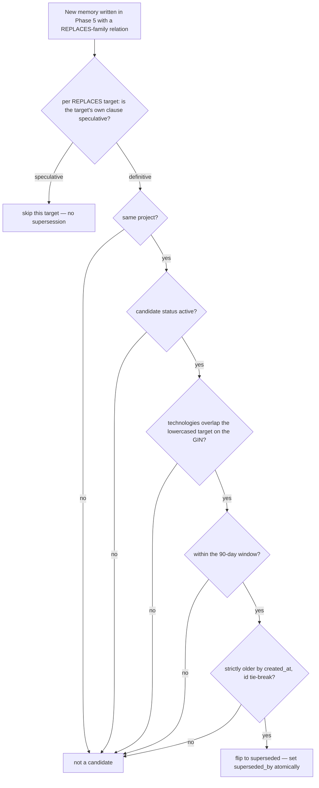

**Supersession is monotonic under reprocess, never stripped-and-rewritten.** A `SUPERSEDES` relationship is the `superseded_by` pointer under another name (doc 04 §8.2), not an associative edge a re-derivation pass owns. Reprocessing *re-fires* the flip through the `(created_at, id)` tie-break rather than reverting it, and a re-extraction that no longer emits `REPLACES` leaves the prior supersession standing (doc 01 §6, F4). This is the deliberate contrast with the five associative memory-relation types (§5.5), which *do* strip-and-rewrite: supersession is a lifecycle fact on the memory's own state machine, and the pointer plus the CHECK is its single source of truth. Because `SUPERSEDES` is a read-time projection and never a stored row, there is no second copy to drift out of sync with the column — undo (§7) and demote-first (§2.2) can never leave a stored edge disagreeing with the pointer.

### 2.2 The `supersede()` consolidation primitive

**Decision. Consolidation gets a direct `supersede()` primitive that flips a memory under the *same* atomic-set and demote-first contract as the write-time detector, so a correction the write-time REPLACES gate missed — a wider-window match, or a supersession implied by a Tier-C fact invalidation (§3.4) — can still land, off the hot path (invariant 3, doc 02 §6.2).** The write-time detector only fires on a REPLACES relation inside the 90-day window during Phase 5; a correction discovered later by dreaming (dedup finds a near-identical newer memory that strictly subsumes an older one, or the status bridge decides a memory's every live fact is now invalidated) needs a caller that is not the extraction path. `supersede()` is that caller — a **new caller of an unchanged contract, not a new lifecycle** (doc 04 §3.1): it sets `status='superseded'` and `superseded_by` atomically, obeys `chk_superseded_has_pointer`, and demotes any dependents before it would ever delete a referenced memory. It is target-new; the write-time detector (§2.1) stays the fast path and the primitive stays the slow path, and the two never disagree because both write the one pointer under the one CHECK.

### 2.3 The TTL expiry sweep — demote-before-delete

**Decision. `expired_memory_cleanup` deletes memories past their `expires_at`, but it first demotes every dependent that points at an expiring row via `superseded_by` to `status='deprecated'` with `superseded_by=NULL`, because the self-FK is `ON DELETE SET NULL` and skipping the demotion violates `chk_superseded_has_pointer` and aborts the whole batch (invariant 3).** This is the safe delete order the SET-NULL FK forces (exists today, `job_runners.py`): deleting a superseder while a dependent still reads `status='superseded'` would null that dependent's pointer and trip the CHECK, so no TTL'd row would ever be reclaimed. The sweep demotes first, then deletes; embedding-partition rows CASCADE with the memory, and any now-orphaned entities, relations, and tags are reclaimed by `graph_orphan_cleanup` and `tag_orphan_cleanup`. The interactive delete path (`MemoryService.delete_memory`) runs the same demotion.

The expiry sweep — dependents are demoted before the expired rows are deleted, so the SET-NULL FK never leaves a superseded row without a pointer:

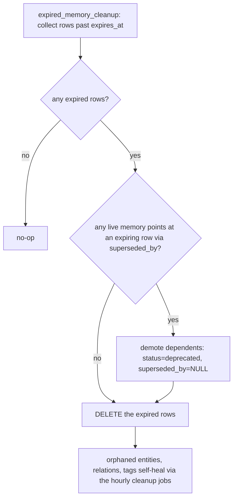

**`expires_at` gains one activation: self-expiring dated facts.** Today `expires_at` is a caller-set TTL the sweep honours. The target additionally *populates* it at extraction from a memory's own stated expiry date ("valid until end of Q3") so a dated fact self-expires without the human setting a TTL (doc 04 §3.1, §9 — an activation, not a schema change; the value-population is doc 05's write path, the sweep that spends it is this doc's). A superseded or deprecated memory is never silently dropped from results — it is retained, labelled, and reachable through its lineage (doc 01 §8); only the TTL sweep removes a row, and only after the demotion.

---

## 3. Bi-temporal facts

**Decision. A Layer-2 fact runs on two orthogonal axes — a *belief* axis `(open → window-closed → expired)` and a *verification* axis `(candidate → corroborated → confirmed, + disputed)` — and invalidation on the belief axis is a re-save, never a delete, so darkmem can always answer "what did we believe as of date X" (doc 01 §3.2/§3.4, doc 04 §8.3).** The belief axis is the bi-temporal machinery (this section); the verification axis is the ladder (§4); they are independent — a fact can be `expired` yet `confirmed`. Keeping them orthogonal is what lets a contradiction close a fact's window without touching its verification, and lets a human ratify a fact whose validity has since lapsed. The fact layer is the **rebuild** of the dormant `knowledge_triples` scaffolding, extended (invariant 23) — the name survives, every column and semantic is new; this doc never claims the demo table was "activated".

The two tables this subsystem's lifecycle drives — the fact and its DISTINCT-origin-counted provenance (full column/constraint detail is doc 04 §8.3 and `erd.md`, not duplicated here):

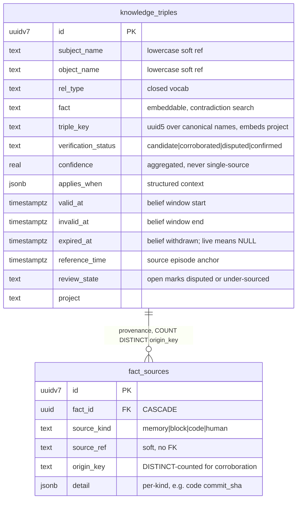

### 3.1 The belief axis and invalidate-not-delete

**Decision. Invalidation closes a fact's validity window (`invalid_at`) and/or withdraws belief (`expired_at`) on the *same retained row*, never a delete — "live" is exactly `expired_at IS NULL`, and disjoint validity windows legitimately leave several live rows on one subject–predicate–object (invariant 8's temporal analogue).** A row is never physically removed once written, because the durable "what did we believe as of X" answer lives in the retained rows — a delete would destroy history. Two employment stints at the same company are two believed facts with disjoint windows, both live, which is why the S/P/O index is *non-unique* while a separate partial-unique on `triple_key WHERE expired_at IS NULL AND invalid_at IS NULL` still guarantees at most one *currently-open* belief per fact (doc 04 §8.3/§10). `reference_time` (the source memory's `created_at`) anchors relative dates; `valid_at NULL` reads as unbounded-past, `invalid_at NULL` as open-ended.

**A *stated* expiry closes the window; it does not withdraw belief (amended 2026-08-06, T2.85).** A fact whose own text carries an expiry date records it in `stated_expiry` at lift, and the `verification_recompute` arm writes `invalid_at := stated_expiry` once that date passes, leaving `expired_at` NULL. Routing a stated expiry to `expired_at` — the reading this section previously invited — answers the historical question wrongly: `as_of` deliberately ignores `expired_at`, so the fact reads as believed at every instant past its own stated date. `expired_at` means *the sources went away*; a stated expiry means *this belief's window ended*, and those are different claims about a row that outlives both. See §9's entry for why a future `invalid_at` written at lift is equally wrong.

The belief axis — a fact opens, its window can close as a newer belief arrives or as its stated expiry passes, and belief is withdrawn when its sources go, all on the retained row:

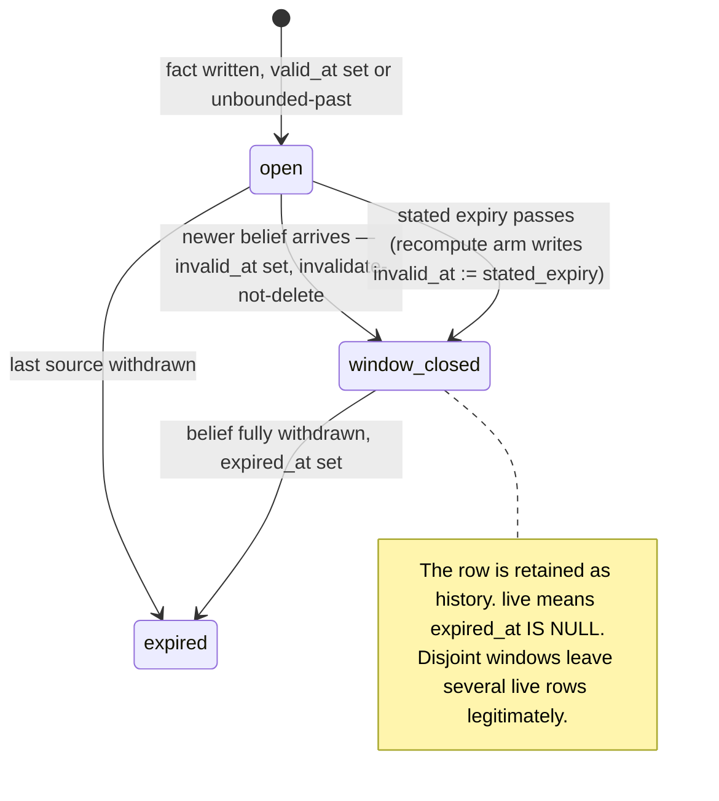

### 3.2 The two deterministic fact-write temporal passes

**Decision. When a fact is written into the layer, only two deterministic passes run — *stale-on-arrival* and *disjoint-window* — with no LLM; the LLM contradiction check is a separate slower consolidation consumer (§5.3), never part of a fact write (invariant 15).** Fact rows are minted only in Tier-C (fact lifting, §5.2, and the code deriver, doc 10) — never on the Tier-B ingest path — so "fact-write" here means the moment a fact enters the layer, and the two passes are what keep the temporal invariants satisfiable without a model call. **Stale-on-arrival**: when a newer belief lands on an existing open row of the same `triple_key`, the older row's `invalid_at` is closed *before* the new open-ended row inserts, so the partial-unique on `triple_key` is never violated by a legitimate update. **Disjoint-window**: when the new fact's validity window does not overlap the existing rows, both stay live — the non-unique S/P/O partial index permits several. These are target-new (the fact layer is a rebuild), deterministic, and reproducible; every raw-SQL param carries its CAST (invariant 10).

The two fact-write temporal passes — deterministic, no LLM; stale-on-arrival closes the older window, disjoint windows coexist:

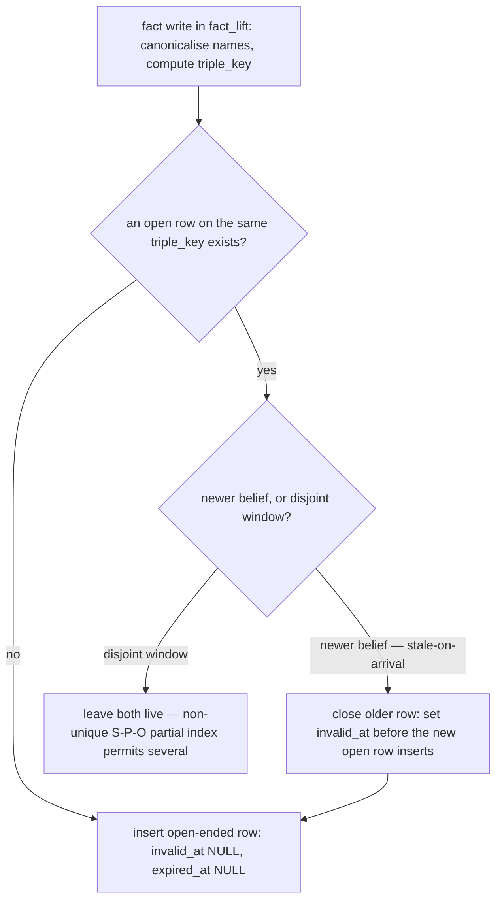

### 3.3 Source withdrawal — the deterministic Tier-B exception

**Decision. The re-extraction/deletion sweep is allowed one deterministic belief-lifecycle action on Tier B: when a memory is re-extracted or deleted, doc 05's sweep withdraws that memory's `fact_sources` rows and *expires inline* any live triple thereby left with no surviving source (`expired_at := now()`), then enqueues — never recomputes — verification (invariant 15, doc 04 §8.3, doc 05 §8.4).** A fact whose last source was just deleted must stop being served immediately rather than lingering as `corroborated` until the next Tier-C tick, and expiring it is a deterministic action (no judgment, no model), so invariant 15 permits it at Tier B. Verification-status *recompute*, by contrast, is never inline — the affected facts are enqueued (§4.3). Doc 05 owns the emit side of this hook (the source withdrawal and the inline expiry); this doc owns the drain side (the recompute). A strip-and-rewrite that lands the identical source set is a **provenance no-op** and enqueues nothing (§4.3), so a re-extraction that changes nothing about a fact's sources causes no verified↔candidate thrash.

### 3.4 The status bridge — how invalidation composes with supersession

**Decision. Fact invalidation and memory supersession are distinct axes on distinct objects that meet at one bridge: a Tier-C fact invalidation may flip the *memory* that asserted the now-invalid fact to `superseded` — but only under two guards, which fail differently: guard 1 falls back to `deprecated`, guard 2 to no change at all (doc 01 §9 assigns this confirmation here; doc 04 §8.3).** Memory supersession (L0, the `superseded_by` pointer) and fact invalidation (L2, invalidate-not-delete) answer different questions — "was this memory replaced by a newer memory" versus "did this fact's world-truth window close" — and must not be conflated. The bridge is the one sanctioned crossing, and it fires only when:

1. **The invalidating triple has exactly one live source memory** — so the `superseded_by` pointer is well-defined (which memory replaced it); and
2. **Every live triple the candidate memory asserts has been expired or invalidated** — a memory whose other facts remain live is never superseded wholesale over one invalidated fact.

When both hold, the primitive flips the memory to `superseded` with the pointer to the successor (via `supersede()`, §2.2, under the atomic-set contract). **The two guards fail differently, and collapsing them into one outcome would retire live knowledge.** Guard 1 failing means the successor is not well-defined: the memory is spent but has no single live replacement to point at, so it goes to `deprecated` with `superseded_by=NULL` (retired without a single live successor). Guard 2 failing means the bridge does not apply at all: the memory still asserts live facts, so its status is **unchanged** — deprecating it would drop a memory that still carries live knowledge out of the active view over one invalidated fact, which is exactly what guard 2 exists to prevent.

**Guard 2 is absolute and is evaluated first (ruled by the owner, 2026-08-02).** The two guards are not a chain in which guard 1's failure short-circuits the decision — they answer different questions, and guard 2's answer dominates. *May this memory's status change at all?* is guard 2; *which change* is guard 1. Where both fail — a memory asserting one invalidated fact whose replacement has several live sources, plus one fact still open — the earlier presentation of this section chained guard 1 first and routed its failure straight to `deprecated`, which retired a memory still carrying live knowledge and contradicted the sentence immediately above. That cell is ordinary, not a corner case. The evaluation order is therefore: **if the memory still asserts any live fact, nothing happens, whatever guard 1 says**; only once guard 2 holds does guard 1 select between `superseded` (exactly one live source, pointer set) and `deprecated` (otherwise, pointer NULL). This is the reversible reading — it can only ever decline to act, and its cost is a spent memory lingering as active until a later pass retires it, whereas the rejected reading drops live knowledge out of the active view with nothing to put it back. Full adjudication and the rejected alternative at `.superpowers/sdd/rulings/2026-08-02-t2.45-status-bridge-guard-order.md`.

The composition rules that keep the two axes from fighting: the pointer plus `chk_superseded_has_pointer` is the single source of truth; the bridge only ever *adds* a supersession, never reverts one (monotonicity, §2.1); and a memory-level `CONTRADICTS` edge is only ever a **signal into** the fact-level dispute (§4.2), never itself a verdict that supersedes a memory (doc 01 §3.9). Two entry points can flip a memory's status — the write-time REPLACES detector (§2.1, fast) and this bridge (Tier-C, slow) — and because both write the one pointer under the one CHECK, they never disagree.

The status bridge — guard 2 is absolute and gates any change at all; guard 1 then selects which change:

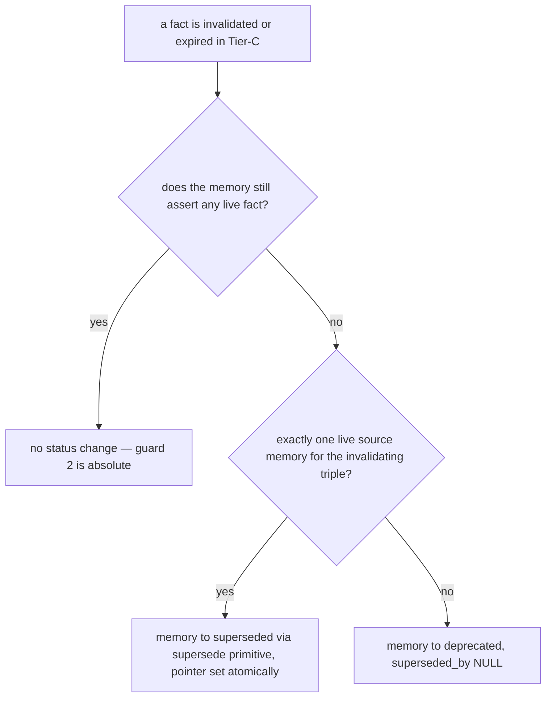

---

## 4. The verification ladder

**Decision. `verification_status` climbs `candidate → corroborated → confirmed` with a `disputed` sub-state; promotion counts `COUNT(DISTINCT origin_key)` never rows, a single non-echo contradiction is an absolute veto, a newer REPLACES-family / supersession signal over the fact's live memory sources is a deterministic promotion **hold** (never itself a dispute, never a demotion — T2.60), the machine never reaches `confirmed` on its own, and the status is recomputed *only* by a Tier-C job — never inline in Phase 5 or `delete_by_memory_id` (spec §2.1/§2.5, doc 04 §8.3, invariant 15).** This is the operational core of the maintainer's truth-over-everything priority: a delayed promotion costs a label (candidates are served, labelled, above nothing), a wrong promotion costs every article that cites the fact and every agent that propagates it, so the ladder is built to under-claim. The vocabulary and the badge claim are used verbatim (Part B contract 2); the recompute is journaled to `events` so "what did we believe as of X" answers the verification dimension too.

The verification ladder — the machine promotes at most to `corroborated`; only a human ratifies `confirmed`. `under-sourced` (shown below) is a `review_state`/label overlay on a still-`corroborated` (demoting) fact, **not** a fifth `verification_status` value — the CHECK is `candidate | corroborated | disputed | confirmed` (doc 04 §8.3):

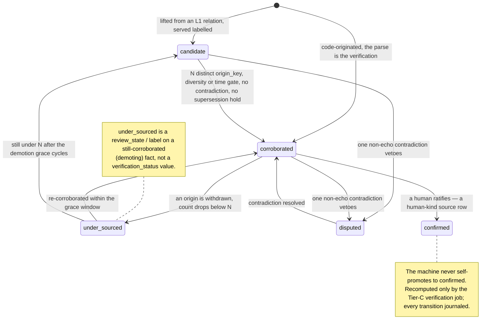

### 4.1 Corroboration counts distinct origins, never rows

**Decision. Promotion to `corroborated` requires ≥ N distinct `origin_key`s over the fact's `fact_sources`, where N = 2 when the origins differ in source-kind or are ≥ 7 days apart across distinct sessions, else 3; derived rows never count as a source; and when origin identity is unknown the count merges to one origin (undercount, never manufacture agreement) (spec §2.1).** Echo is not evidence: two agents re-saving the same claim under the same `origin_key`, or one repository re-derived across many commits, are *one* origin (doc 06 §2). Origin key by source kind: memory → the capturing session / agent-run (`memories.origin_key`, set at capture, doc 05 §2.1); document → `document_id`; code → `repo_id` (one origin per repo regardless of commit count); human review → a `human`-kind row (one origin, dominant). **Source-kind diversity outweighs raw count** — memory + document + code beats three memories — which is why N drops to 2 when the origins are diverse. **Derived rows are a structural exclusion**: a Layer-2 fact or Layer-3 article is never a `fact_sources` origin, so an agent re-saving an article can never inflate the count of the fact that article cites. Deterministic **code-originated facts are born `corroborated`** — the parse *is* the verification — carrying the distinct `code@commit` badge (doc 10's deriver ships after Layer 2 is proven live, spec §8; the born-corroborated entry is contract 4).

**The badge's honest claim is a field this doc's recompute populates; the rendering is 12/13's.** Machine `corroborated` means exactly **"asserted by K distinct origins of kinds [X, Y], no known contradiction, as of T"** — the independence heuristic has a known ceiling (two agents reading the same wrong README is not detectable from provenance), so the design states what the badge cannot claim and never uses "true" or "verified" in copy. `confidence` on the fact is an *aggregated* support/quality estimate recomputed alongside `verification_status`, never a single-source guess (doc 04 §8.3).

### 4.2 The contradiction veto

**Decision. A single non-echo contradiction over an overlapping validity window is an absolute veto — not a vote — flipping the fact to `disputed`; a memory-level `CONTRADICTS` edge and the LLM contradiction scan are *inputs into* this fact-level dispute, never the verdict themselves (spec §2.1, doc 01 §3.9).** Consensus is not truth: however many origins corroborate a fact, one genuine contradiction blocks promotion and demotes a corroborated fact to `disputed`, because a confidently-wrong "corroborated" is the worst failure. "Overlapping validity window" is load-bearing — two facts with disjoint windows (postgres in 2024, mysql in 2025) are not a contradiction, they are a succession the belief axis already models (§3.1). "Non-echo" means the contradicting source is a distinct origin, not the same one re-stating itself. The veto's inputs are the deterministic same-endpoint scan and the Tier-C LLM contradiction scan (§5.3); a memory-level `CONTRADICTS` associative edge (§5.5) can *flag* a candidate fact for the scan, but truth is adjudicated at the fact layer where the multi-source provenance and the veto live, not at the episodic memory layer. A disputed fact is **served labelled with both sides**, never dropped and never gated on review (§6, invariant 14).

**AMENDED 2026-08-08 (Tier-3, owner-ratified) — the LLM scan is no longer a veto input; it opens review.** The sentence above names "the deterministic same-endpoint scan and the Tier-C LLM contradiction scan" as the veto's two inputs. Three measured G-D runs across two vendors put the LLM arm's contradiction-precision at 0.7937 / 0.8814 / 0.9020 against a 0.95 bar, and the two vendors' false positives overlap on three pairs — all reversals of non-exclusive relations, on one of which *both* blind human passes made the same error. So the exclusion-vs-absence distinction sits at or past the human ceiling, and no ensemble of the judges measured can exceed 0.9483 at any recall. Wiring an instrument of that precision into an unappealable veto converts each false positive into a near-permanent manufactured dispute — the exact failure §5.3's asymmetry forbids. **The absolute veto therefore stands on the deterministic arm alone**, whose precision is by construction; the LLM scan's journalled finding becomes a fourth review opener (§6, contradiction-suspected), leaving the fact its rung and its badge while a human confirms. A confirmed flag disputes through the already-live human door. This is a *delayed* dispute — §5.3's sanctioned direction of error — where the prior wiring produced a manufactured one. No migration burden: the LLM arm never fired in production, dark behind the unqualified judge. Full evidence and the rejected alternatives: `docs/planning/gate-ledger.md`, "G-D resolution".

### 4.3 The recompute — drain, count, veto, hysteresis, journal

**Decision. Verification is recomputed by a Tier-C `verification_recompute` job that drains `sources_changed` events since its watermark, dedups the affected `fact_id`s, and for each recomputes the count-veto-N ladder with demotion hysteresis, journaling every transition to `events` — reusing the durable substrate rather than a churning queue table (Part B contract 5, spec §2.5).** This is the drain side of the enqueue-for-verification hook: doc 05 (Phase 5, the deletion sweep) and doc 08's `fact_lift` (§5.2) both emit a `sources_changed` event (`object_type='fact'`, payload `{fact_id, memory_id}`) when a memory's `fact_sources` contributions change; `sources_changed` is a new value that must land in `events`' closed `event_type` vocabulary first (the events-vocab analogue of taxonomy-first, convention 9). The recompute job drains those events past a `job:verification_recompute` watermark config row, so no new table or column is needed, and the **provenance-no-op guard on the emit side** (identical source set → no event) is what prevents thrash: a re-extraction that lands the same sources emits nothing, so the recompute never runs on an unchanged fact.

The recompute algorithm — drain the hook, count distinct origins, apply the veto and the N gate, hold demotions with hysteresis, journal every transition:

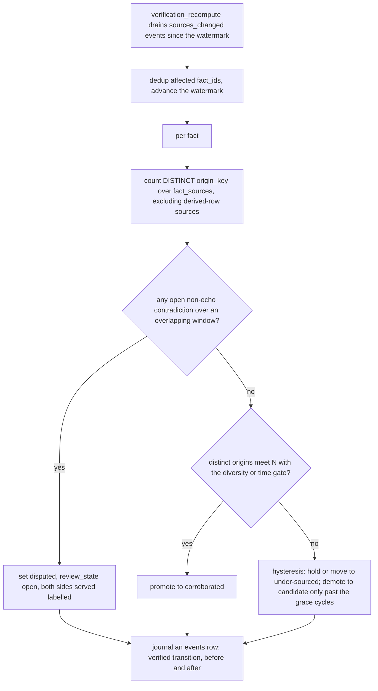

**Demotion carries hysteresis, and the labelled sub-state is the honest surface.** A corroborated fact that loses an origin (a source memory deleted, dropping the distinct count below N) is not demoted straight to bare `candidate` — that would thrash the badge on a transient re-extraction. Instead it moves to a labelled **`under-sourced`** state (surfaced through `review_state`/verification label, served labelled so retrieval still shows it honestly, §6), and only drops to `candidate` if it is *still* under N after `verification_demote_grace_cycles` consecutive recompute cycles. This combines the two options doc 01 §9 flagged — a labelled sub-state *and* full-cycle persistence — because each covers a different failure: the label keeps retrieval honest immediately, the grace period absorbs transient churn. The grace bookkeeping (a `demotion_pending_since` marker) is the one small schema amendment this needs (§9). Every transition — promotion, demotion, dispute, ratification — writes an `events` row so the timeline can reconstruct "what did we believe as of X" on the verification dimension (doc 04 §8.1, convention 8). Verification is orthogonal to the belief axis: the recompute reads current sources and contradictions but never touches `valid_at`/`invalid_at`/`expired_at`.

### 4.4 Confirmation is human-only

**Decision. Only a human ratifying a fact reaches `confirmed`, and the ratification is itself a `human`-kind `fact_sources` row (who / when / what-was-shown), so the source-emptying sweep can never silently discard a confirmed fact (spec §2.1/§2.2).** The machine's ceiling is `corroborated`; `confirmed` is the human's floor above it, which operationalises the under-claiming preference structurally rather than by policy. Recording the ratification as a source row (an origin, dominant) means a later re-extraction that withdraws every *memory* source still leaves the human source, so a confirmed fact survives. The ratify action is authenticated (REST/UI); the framing stance is that no MCP tool may reach `confirmed` (doc 12 owns the surface); since 2026-08-26 `ratify` is a forbidden API-key scope, so this holds by construction rather than by convention. Ratification journals to `events` like every other transition.

---

## 5. The consolidation job family — "dreaming"

**Decision. Consolidation is *several* cooperating Tier-C `JobRegistry` jobs under one logical schedule umbrella — not one monolithic "dream" job — each with its own cron, floor, ceiling, and per-job `asyncio.Lock`, coordinated by dependency order and by the single-worker discipline (doc 02 §11, this doc confirms the split; invariants 13, 15).** A monolith would couple cadences that genuinely differ (verification should reflect current sourcing continuously; article re-synthesis is a daily debounce), share one failure blast radius, and hold one lock across a long LLM fan-out. Splitting them lets each job inherit the whole Tier-C discipline already built and tested — the per-job lock (a scheduled tick and a manual `trigger` can never race), the `min_interval_seconds` floor against runaway cadence, the `max_run_seconds` ceiling against a hung LLM, and the `config`-row state — while a light dependency order keeps them cooperating. **No LLM call ever sits on Tier A or Tier B** (invariant 15): every job here is background.

| Job (all target-new unless noted) | Cadence (config cron, tuned) | LLM? | What it does | Owner of mechanics |
|---|---|---|---|---|
| `verification_recompute` | frequent, e.g. `*/2 * * * *`, floor 30s | no | drain `sources_changed`, count origins, veto, hysteresis (§4.3) | this doc |
| `fact_lift` | moderate, e.g. `*/15 * * * *`, floor 60s | no | derive candidate facts + `fact_sources` from L1 relations; run the two temporal passes (§5.2) | this doc |
| `contradiction_scan` | slow, e.g. `0 */6 * * *`, floor 300s | yes | LLM contradiction check over same-endpoint + `pg_trgm` candidates; feed disputes (§5.3) | this doc; call is doc 11's |
| `memory_dream` | slow / "Dream now", e.g. `0 3 * * *`, floor 300s | yes | dedup via `supersede()`, refine enrichment, derive associative edges (§5.4/§5.5) | this doc; refine call is doc 11's |
| `topic_detection` | daily per active project | yes (report) | Leiden communities + `report_string` | **doc 06** (scheduled here) |
| `article_synthesis` | daily, debounced | yes | re-synthesise stale articles on `fact_set_hash` change | **doc 09** (triggered here) |

The **existing** lifecycle jobs stay registered and unchanged — `expired_memory_cleanup` (§2.3), `graph_orphan_cleanup`, `tag_orphan_cleanup`, `pipeline_failure_cleanup`, `token_blocklist_cleanup`, `repo_sync`, `code_enrichment` (the seven registered today, `main.py`) — they are housekeeping, not consolidation, and the facts table needs no delete job at all (invalidate-not-delete). The umbrella is *logical*: the jobs are distinct `JobRegistry` registrations, staggered so they do not stampede a single worker, and "Dream now" triggers them in dependency order (`fact_lift → verification_recompute → contradiction_scan → memory_dream → topic_detection → article_synthesis`). Because contract 6 fixes the boundaries — 08 owns dedup/refine/facts/edges, 09 owns article synthesis and topic use, 06 owns topic detection — `topic_detection` and `article_synthesis` are *scheduled* under this umbrella but their internals belong to docs 06 and 09; no pass is owned twice.

The consolidation family — several Tier-C jobs under one umbrella, with the cross-doc boundaries and the enqueue edges that couple them:

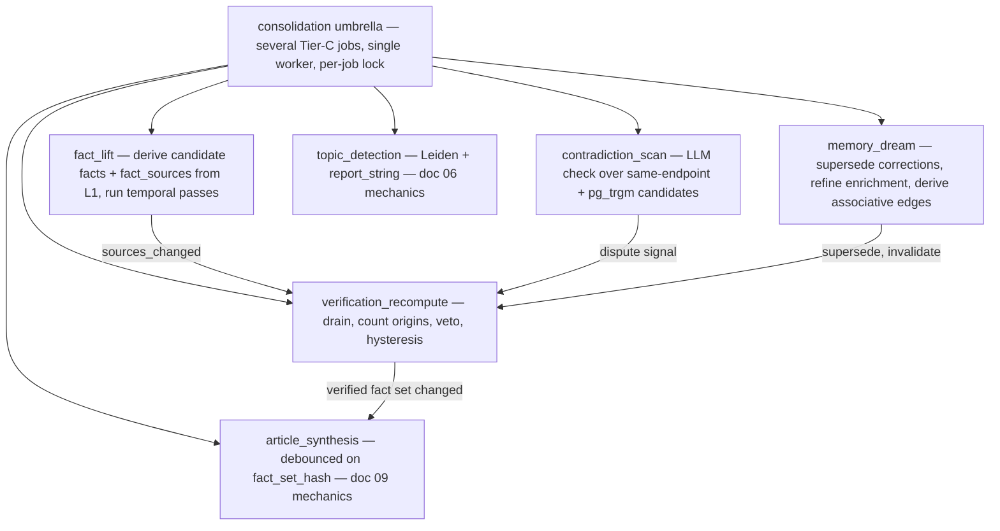

A dreaming cycle as a sequence — the scheduler (or "Dream now") runs the jobs in dependency order, and every change is journaled for the digest and undo:

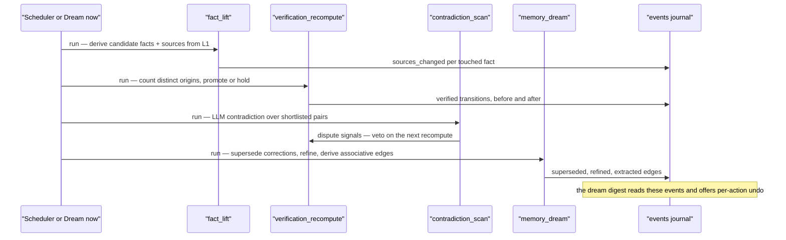

### 5.1 Why the split is safe under one worker

**Decision. The several-job split is valid precisely because there is one uvicorn worker: the jobs serialise through the `JobRegistry` loop, each holds its own lock, and the in-process state (the feature-flag TTL cache, the entity-embedding LRU, the cached igraph snapshot the topic job reads) is single-process by assumption (invariant 13).** A multi-replica deployment would break the snapshot and let two workers claim overlapping consolidation work — a flagged Phase-4 decision (sticky routing or a serialised snapshot table), never a v1 requirement. Under one worker, the dependency order is enforced simply by staggered crons plus the sequential "Dream now" trigger; there is no distributed coordination to design.

### 5.2 Fact lifting

**Decision. `fact_lift` derives Layer-2 *candidate* facts and their `fact_sources` from the Layer-1 candidate graph — resolving each relation's endpoints to real `entities` ids and denormalised lowercase names, computing `triple_key` post-canonicalisation, and writing one `fact_source` per asserting memory carrying that memory's `origin_key` — then leaves promotion to `verification_recompute` (spec §2, doc 04 §8.3).** Lifting and verifying are split cleanly: the lift *creates* the candidate fact and its provenance rows; the recompute *counts and promotes* (§4.3). This is why "lifting a corroborated relation" (doc 01 §3.4) resolves to: lift produces the candidate fact plus one `fact_source` per asserting memory, and corroboration is computed in the recompute from `COUNT(DISTINCT origin_key)` over those sources. Endpoints resolve to real `entities` ids (never `_slugify` ghosts) but are held as **soft references** with denormalised lowercase names, because the graph deletes entities aggressively while the fact table is invalidate-not-delete — a hard FK would break one side or the other (doc 04 §8.3). The two temporal passes (§3.2) run on each lifted row. `fact_lift` emits a `sources_changed` event per touched fact, feeding the recompute; it lifts a relation to a candidate fact when it clears a minimal salience bar (a `config` row — start with "asserted by at least one memory", tune against candidate-fact volume) so the layer is not flooded with singleton noise. This job **ships after Layer 2 is proven live** in the sequencing (spec §8); until then the fact layer is target-new scaffolding under construction, not shipped behaviour (invariant 23).

### 5.3 The contradiction scan and its candidate selection

**Decision. `contradiction_scan` is the LLM contradiction check (a Tier-C consumer doc 11 wires), and it selects candidates cheaply — same-endpoint facts plus a `pg_trgm`-on-`fact` similarity shortlist — bounded by a per-cycle fan-out cap and a per-fact top-K, scoring only overlapping-validity-window pairs; the `triple_embeddings` writer stays deferred until a *measured* undercount of that candidate set justifies it (spec §8, doc 04 §5.3/§13).** The LLM is expensive, so the scan never checks every fact against every other. For each fact needing a check (drained from the same `sources_changed`/newly-lifted set, restricted to servable facts not already disputed), the generator gathers: (1) **same-endpoint** candidates — facts sharing `subject_name` and/or `object_name` in the same project (an index lookup); and (2) a **`pg_trgm`-on-`fact`** shortlist — the top-K by trigram similarity over the `fact` text. Both are cheap SQL on the single Postgres (invariant 1), no embedding. The LLM scores only pairs whose validity windows overlap (disjoint windows are legitimate succession, §3.1), and a confirmed non-echo contradiction feeds the veto (§4.2). Cost is bounded by `contradiction_scan_batch` (facts per cycle) and `contradiction_candidate_top_k` (candidates per fact), both `config` rows.

Candidate selection for the contradiction scan — two cheap generators, an overlap filter, then the bounded LLM call:

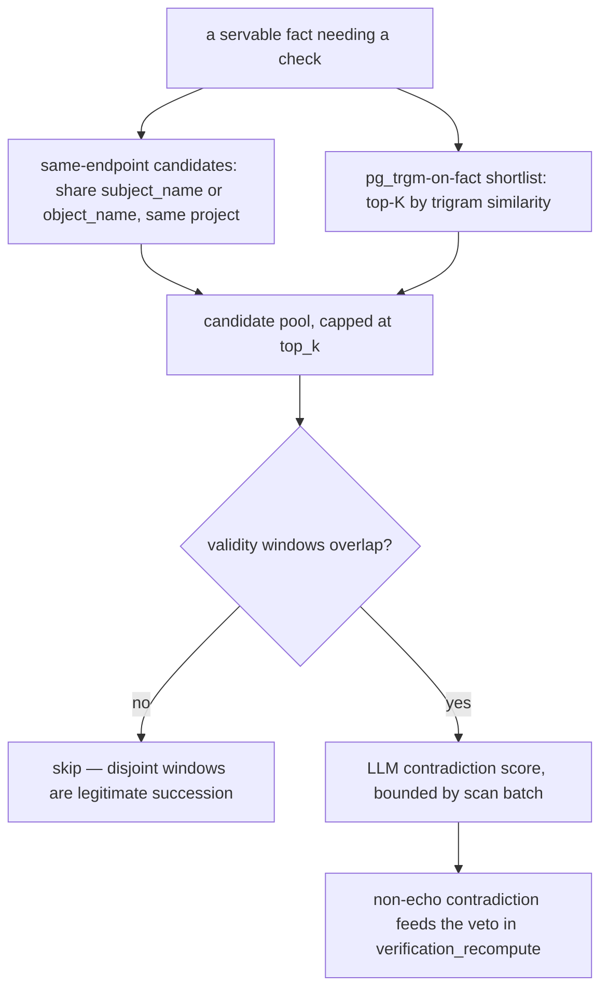

**The `triple_embeddings` writer trigger is a measurement this doc owns.** The template ships up front (near-free under boot-time reconciliation, doc 04 §5.3), but its writer is deferred behind a measured undercount. The measurement: instrument the same-endpoint + `pg_trgm` generator's **recall** against a gold set of known contradictions (doc 17) — pairs that genuinely contradict but share no lexical tokens ("uses postgres 14" vs "migrated the datastore off relational") are what the trigram shortlist misses. When the measured miss rate on that gold set exceeds a stated bar, the vector-ANN candidate generator (over `triple_embeddings__<slug>`) is justified and ships; until then the trigram shortlist is the whole generator, and when the writer does ship it **groups facts for counting only, never merges rows or rewrites `triple_key`**, carrying the `names_distinct` guard (invariant, doc 06 §5). Undercounting the candidate set only *delays* catching a contradiction (the preferred failure); it never manufactures one.

### 5.4 Memory dedup and refine

**Decision. Dreaming never hard-merges or deletes a memory — memory is L0 append-only episodic recall — so near-identical memories are reconciled through supersession or association plus the hygiene queue, and "refine" rewrites only the *derived enrichment* fields (`summary`, tags), never `content`, with every rewrite journaled for audit and undo (doc 01 §3.1/F6).** `content` is the durable capture and is never overwritten; a memory is retained through its lineage, never destroyed by a housekeeping pass. So dedup expresses itself two ways: when a newer near-identical memory *strictly subsumes or corrects* an older one, `memory_dream` calls the `supersede()` primitive (§2.2) — atomic pointer, monotonic, auditable; when two memories are merely near-duplicates without a correction relationship, the pass asserts a `RELATES_TO` or `ELABORATES` associative edge (§5.5) and surfaces the pair in the **hygiene queue** (§6) for the human to bulk-act, rather than auto-collapsing them (a wrong auto-merge is unrecoverable). **Refine** touches only the derived fields — a rewritten `summary`, cleaned tags — and writes an `events` row with the before value so the change is auditable and reversible (§7). This honours "deletes are off by default; every change routes through supersession or invalidation and is auditable — lineage, not deletion" (doc 01 F6). The refine LLM call is a Tier-C consumer doc 11 wires.

### 5.5 Associative-edge derivation

**Decision. `memory_dream` derives the five stored associative memory-relation types (`CONTRADICTS`, `ELABORATES`, `DEPENDS_ON`, `FOLLOWS`, `RELATES_TO`) from entity overlap, embedding proximity, and contradiction checks — writing through doc 06's `normalize_memory_relation_type` into `memory_relations`, strip-before-rewrite and self-healing, project-scoped by construction (doc 01 §3.9, doc 04 §8.2, invariants 5, 8).** These edges are memory-to-memory, a separate closed vocabulary from `RELATIONSHIP_TYPES` (doc 06 §3.1 owns it; this doc's passes are the writers). The pass re-derives idempotently: it strips its prior edges before writing the new set, and each edge self-heals when either endpoint memory is deleted (the composite `(memory_id, project)` FKs are `ON DELETE CASCADE`, doc 04 §8.2). `SUPERSEDES` is **never written here** — it is the projected `superseded_by` pointer, on the memory's own monotonic state machine (§2.1), not an association a re-derivation strips. `DERIVED_FROM` is **cut for v1** — the reshape removed its only writer and one provenance mechanism per layer is the rule (`fact_sources` for L2, `article_citations` for L3, the projected pointer for supersession); if consolidation later grows a real derived-memory writer it is reintroduced then, taxonomy-first (doc 06 §3.1). The same-project rule is *declarative* — the composite FKs make a cross-project edge unrepresentable (invariant 14, doc 04 §8.2) — so the associative layer stays inside the isolation boundary supersession already respects. A derived `CONTRADICTS` edge is a signal into fact-level dispute (§4.2), never a verdict.

### 5.6 The topic and article triggers

**Decision. This doc *schedules* `topic_detection` and *triggers* `article_synthesis` under its umbrella but owns neither's internals: topic detection is doc 06's Leiden mechanics, and article re-synthesis is doc 09's, gated by the `fact_set_hash` materiality check this doc's fact writes make possible (contract 6, doc 04 §8.4/§8.8).** Topic detection runs as a Tier-C job on this schedule (doc 06 §7 owns the delete-and-rewrite-per-project detection and the `report_string` call; this doc owns only that it runs here, staggered, under the lock discipline). Article re-synthesis is **debounced on a materiality gate**: an article carries a `fact_set_hash` of its supporting *verified* fact set, and this doc's verification recompute is what changes that set — so when a promotion/demotion/dispute alters which facts back a subject, the article is *labelled stale* (retrieval surfaces the label, honest partial results) and enqueued for doc 09's synthesis, debounced so candidate churn does not trigger a re-synthesis (only a change in the *verified* set does). This doc emits the "verified set changed for subject S" signal; doc 09 consumes it, re-synthesises strip-before-rewrite by `article_id`, and supersedes the prior article. The one-active-article-per-`(project, subject_key)` rule and the claim-level grounding are doc 09's; this doc guarantees only that the *inputs* it feeds (which facts are `corroborated`/`confirmed` and non-disputed) are correct.

---

## 6. Review & hygiene queues

**Decision. Two distinct surfaces — a *review* queue for truth adjudication and a *hygiene* queue for housekeeping — are each a `status + partial index` (the `pipeline_failures` pattern), consequence-ranked and never FIFO, never a gate on the read path; disputed and under-sourced knowledge is served *labelled with both sides*, and stale disputes auto-expire to a labelled state so a solo maintainer's backlog can never wedge the truth system (spec §2.6, doc 01 §3.4/F9, invariant 14).** A churning queue *table* would grow unboundedly and force the human to be the throughput bottleneck of the system; a status flag with a partial index is cheap, self-pruning, and lets retrieval serve the labelled item regardless of review state.

- **The review queue** is `WHERE review_state='open'` on facts and articles — disputed facts (§4.2), under-sourced facts held in hysteresis (§4.3), and low-confidence/ungrounded articles (doc 09). It is ranked by **consequence** — retrieval frequency and subject salience — not arrival order, so the fact an agent hits every day is triaged before a dormant one. Disputed knowledge is **served labelled with both sides** and never gated on review; the human ratifies (`confirmed`, §4.4), re-grounds, or edits, clearing `review_state`.
- **The hygiene queue** is the housekeeping surface (F6/F9): candidate duplicates (from §5.4), low-confidence memories, expiring-soon rows (`expires_at` approaching), and superseded lineage — presented with **bulk actions** (set/extend a TTL, prune, supersede, confirm a dedup). It is distinct from review because its items are not truth disputes; it is where the human curates without reading the database.

**Stale disputes auto-expire to a labelled state, not to silence.** A disputed fact left unreviewed past `dispute_stale_days` (a `config` row) drops off the *active* review queue — its priority decays so it no longer dominates the human's attention — but it stays `disputed` and is still **served labelled with both sides**; the auto-expiry changes only its review priority/label, never its verification status, so nothing is silently resolved or promoted (invariant 14). The two queues can share one triage shell in the UI (doc 13's call) but are distinct backend states; both journal their transitions to `events`.

A review-queue entry's lifecycle — consequence-ranked, served labelled, auto-decaying off the active queue but never silenced:

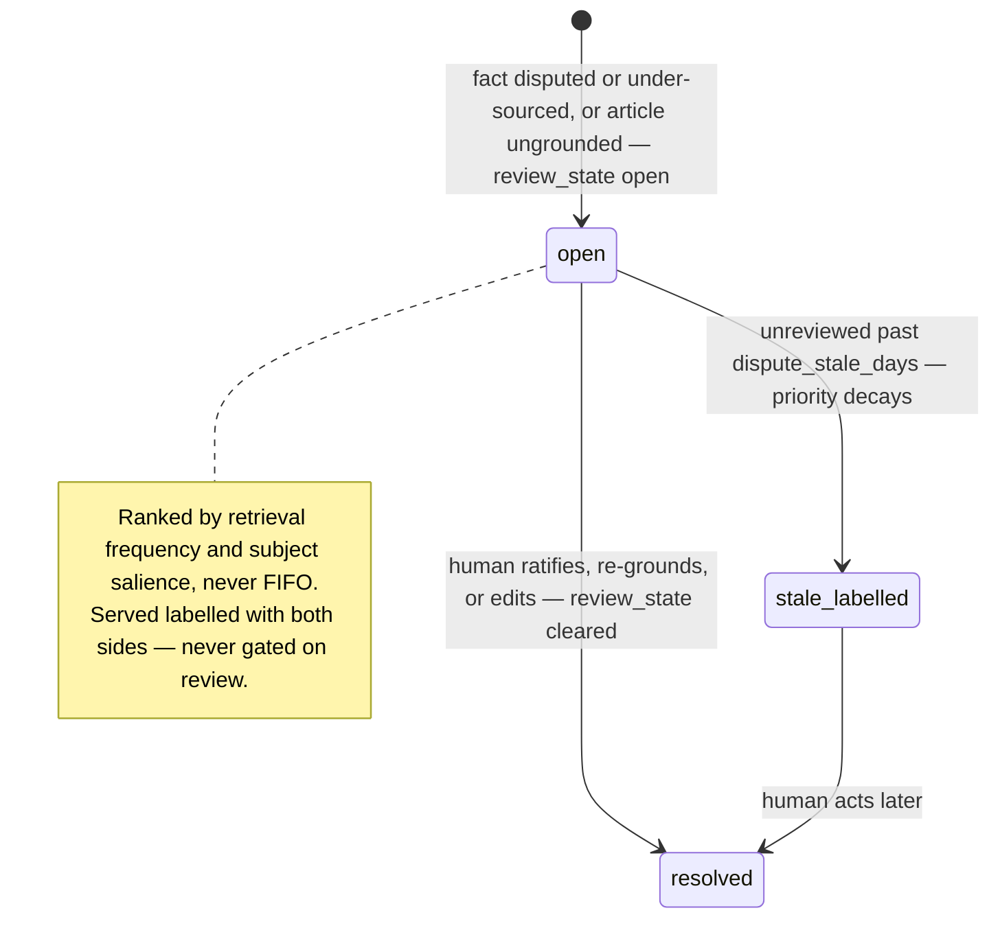

---

## 7. The dream digest & undo

**Decision. Every consolidation action journals to `events` with a before/after payload sufficient to invert it, the dream digest reads a cycle's events grouped by object and action, and undo applies the journaled inverse per-action or per-batch — tractable precisely because invalidate-not-delete and append-only `events` mean every inverse is a status/pointer/timestamp restore, never a resurrection (doc 01 F6, doc 04 §8.1).** The maintainer must be able to see and reverse what dreaming did, so consolidation is designed so that *nothing it does is destructive*: a supersession sets a pointer, an invalidation closes a window on a retained row, a refine rewrites a derived field over a journaled prior value, an edge derivation strips-and-rewrites a self-healing set. Undo therefore never has to recreate a deleted row — it restores state from the `events` before-payload and journals an `undone` event.

| Dream action | Reversible? | Inverse (from the journaled before-state) |
|---|---|---|
| Supersession (`supersede()`) | yes | restore prior `status` + `superseded_by` atomically under the CHECK |
| Refine (`summary`/tags) | yes | restore the before value |
| Associative-edge derivation | yes | delete the specific derived edges — they self-heal |
| Fact promotion/demotion | yes | restore prior `verification_status` |
| Human ratification (`confirmed`) | yes | withdraw the `human`-kind `fact_source`, re-run recompute |
| Fact invalidation | yes | clear `invalid_at`/`expired_at` to reopen the window — no resurrection needed |
| Article re-synthesis (doc 09) | yes | re-activate the superseded article row, re-point `superseded_by` |

The dream digest and undo — the cycle's events feed the digest, and undo replays the journaled inverse, itself journaled:

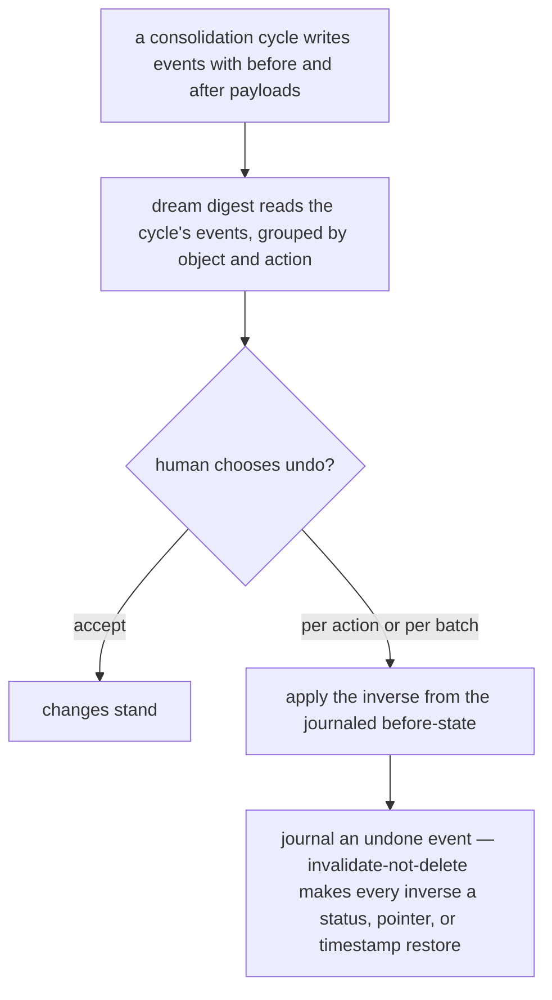

**The undo window is bounded and honest.** An action stays undoable until a *newer* consolidation change rewrites the same object (the before-state the undo would restore is then no longer current), tracked via the `events` watermark, or until a `dream_undo_retention` config window elapses — whichever comes first. Undo is authenticated (it is a curation action, doc 12); the digest and its controls are doc 13's surface, and this doc owns only the journaling contract that makes them possible — every action's `events` row carries the inverse payload (convention 8).

---

## 8. Invariants restated

The invariants that bind this layer, by the 1–23 catalogue (`gt-invariants.md`, doc 04 §11), restated as they constrain temporal reasoning, verification, and consolidation:

- **Single Postgres, no broker (1).** The `sources_changed` queue is `events` rows drained by watermark, not Redis; the contradiction candidate generator is same-endpoint SQL + `pg_trgm`, not an external index (§4.3, §5.3).
- **Per-fingerprint isolation (2).** The deferred `triple_embeddings` writer, if it ships, reads `triple_embeddings__<slug>` only via `child_table` and never joins across fingerprints (§5.3).
- **Atomic supersession + demote-before-delete (3).** The write-time detector, the `supersede()` primitive, and the status bridge all set `status` + `superseded_by` in one statement under `chk_superseded_has_pointer`; the expiry sweep demotes dependents to `deprecated`/`NULL` before deleting a referenced memory (§2).
- **Closed taxonomy, taxonomy-first (5).** The associative writers go through `normalize_memory_relation_type`; `sources_changed` lands in the `events` `event_type` vocabulary before it is emitted; `applies_when` axes are closed vocabularies (§4.2 inputs, §5.5, §4.3).
- **Idempotent strip-before-rewrite (8).** Associative-edge derivation strips its prior edges and self-heals; source withdrawal is the temporal analogue; the provenance-no-op guard makes recompute idempotent (§3.3, §4.3, §5.5).
- **`memory_id` str/UUID drift (9).** The recompute and the source-withdrawal sweep normalise `memory_id` where `fact_sources` and `events` payloads cross the boundary (§3.3, §4.3).
- **asyncpg CAST (10).** The temporal passes, the trigram candidate query, and the recompute's array/uuid params all carry explicit CASTs (§3.2, §4.3, §5.3).
- **Async session lifetime (11).** `supersede()` and the sweeps commit before opening a fresh session over the same rows (§2.2).
- **REPLACES family (12).** The detector keys off the `REPLACES_FAMILY` bucket so `IMPROVES_ON`/`BUILDS_ON` are not double-counted (§2.1).
- **Single worker (13).** The job family, the per-job locks, and the in-process caches all assume one worker; multi-replica is a flagged Phase-4 decision (§5.1).
- **Honest partial results (14).** Disputed and under-sourced facts are served labelled with both sides, never dropped and never gated on review; stale disputes decay to a label, not to silence (§4, §6).
- **Reconciliation off the hot path (15).** Verification recompute, fact lifting, the contradiction scan, and dreaming are all Tier-C; the only Tier-B fact action is the deterministic source-withdrawal expiry (§3.3, §5).
- **Scaffolding not substrate (23).** The fact layer is the `knowledge_triples` *rebuild* extended, not an activation; `fact_lift` ships after Layer 2 is proven live; the `triple_embeddings` writer is deferred behind a measured undercount; the badge under-claims by design (§3, §4.1, §5.2/§5.3).

---

## 9. Open questions & deferred decisions

Each carries a recommended stance, so downstream inherits a default rather than a blank.

- **Job decomposition and cadences — resolved (§5).** *Several cooperating Tier-C `JobRegistry` jobs under one logical umbrella — `verification_recompute` (frequent), `fact_lift` (moderate), `contradiction_scan` and `memory_dream` (slow), plus the scheduled `topic_detection` (doc 06) and `article_synthesis` (doc 09) — each with its own cron/floor/ceiling config row and per-job lock, staggered under one worker, dependency-ordered on "Dream now".* The split confirms doc 02 §11's recommendation; the existing lifecycle jobs stay unchanged and the fact table needs no delete job (invalidate-not-delete).
- **How invalidation composes with supersession — resolved (§3.4).** *Two distinct axes meeting at one status bridge: a Tier-C fact invalidation flips the asserting memory to `superseded` only under both guards (exactly one live source memory; every live triple of the candidate memory expired/invalidated), else `deprecated`; the pointer plus the CHECK is the single source of truth, and a memory-level `CONTRADICTS` is only a signal into fact-level dispute.* This closes doc 01 §9's explicit deferral to doc 08.
- **Promotion-rate measurement + hysteresis params — resolved with a tuning path (§4.1/§4.3).** *N, the diversity/time gate, and the demotion grace are `config` rows tuned from measured rates via doc 17: the promotion-rate metric is (facts promoted) / (eligible candidates) sliced by source-kind diversity and by which N fired, and the false-promotion audit is corroborated facts later disputed or human-rejected — start conservative (N=2 diverse/≥7-day else 3) and loosen only when measured false-promotion stays under bar. Hysteresis combines both flagged options: an immediate labelled `under-sourced` sub-state (honest to retrieval) and full-cycle persistence (`verification_demote_grace_cycles`, default 1) before a drop to `candidate`.* Needs one small schema amendment — a `demotion_pending_since` marker on `knowledge_triples` for the grace bookkeeping (flag back to doc 04); until it lands, demotion is single-cycle with the label as the only hysteresis.
- **Contradiction-check candidate selection + the `triple_embeddings` trigger — resolved with a deferred writer (§5.3).** *Candidates are same-endpoint facts + a `pg_trgm`-on-`fact` top-K, bounded by `contradiction_scan_batch` and `contradiction_candidate_top_k`, scoring only overlapping-window pairs. The `triple_embeddings` writer stays deferred until the same-endpoint + trigram generator's measured recall against a doc-17 contradiction gold set falls below a stated bar (semantically-contradictory pairs with no shared lexical tokens); when it ships it groups facts for counting only, never merging rows or rewriting `triple_key`, carrying `names_distinct`.* This doc owns the measurement.
- **Memory dedup/refine dreaming policy — resolved (§5.4).** *Never hard-merge or delete a memory: subsumption/correction routes through the `supersede()` primitive; near-duplicates without a correction get an associative edge plus a hygiene-queue item for the human to bulk-act; refine rewrites only the derived enrichment (`summary`, tags), never `content`, with an `events` before/after audit trail.* Content is the immutable capture; deletes are off by default.
- **Undo semantics — resolved (§7).** *Every dream action journals a before/after `events` payload; undo applies the inverse per-action or per-batch and is tractable because invalidate-not-delete + append-only events make every inverse a status/pointer/timestamp restore, never a resurrection; undo itself journals an `undone` event and is available until a newer change rewrites the same object or `dream_undo_retention` elapses.* Article re-synthesis undo (re-activating the superseded row) is doc 09's mechanic; this doc owns the digest/undo journaling contract.
- **Self-expiring dated facts — RULED 2026-08-06 (T2.85), amending both §3.1 and this entry.** *A fact carrying a stated future expiry records it in a nullable `knowledge_triples.stated_expiry` at lift time, and a lightweight arm of `verification_recompute` writes `invalid_at := stated_expiry` once that date has passed — invalidate-not-delete, so the row survives as history. No LLM, no separate job.* The population is doc 05's write path; the sweep that spends it is this doc's.

  **Neither literal reading this doc previously carried is correct, and both fail silently.** "Pre-closed at that date" read as writing a *future* `invalid_at` at lift: but `OPEN_BELIEF_PREDICATE` is `expired_at IS NULL AND invalid_at IS NULL` with no time comparison, so a future `invalid_at` drops the fact out of the retrieval channel on the day it is written rather than the day it expires. §3.1's routing of a stated expiry to `expired_at` fails the other way: `as_of` deliberately ignores `expired_at`, so the historical question answers "believed" for every instant past the stated date. `stated_expiry` is the third position — recorded at write, spent at the date, written to the column that actually means "this belief's window closed".

  Chosen over three alternatives because it is the only one leaving `OPEN_BELIEF_PREDICATE`, all four partial indexes and the one-open-belief-per-key invariant byte-identical at zero read cost (`docs/planning/analyses/2026-08-05-t2.85-belief-window.md`).

---

*Downstream: this doc hands doc 07 the servability rules and the `layer` + `verification_status` labels every retrieval row carries (`confirmed`/`corroborated` above labelled `candidate`, `disputed` served with both sides, `expired` filtered or labelled), and the badge field semantics doc 12 serialises and doc 13 renders; doc 09 the scheduled `article_synthesis` slot, the `fact_set_hash`-materiality trigger, and the verified, non-disputed fact set it synthesises from, plus the associative `memory_relations` layer it co-owns the surface of; doc 11 the Tier-C LLM consumers it must wire (the contradiction check and the dream refine call) with the purpose→consumer matrix that is doc 11's to own; doc 13 the dream digest with undo and the consequence-ranked review and hygiene queues; doc 10 the ladder its deriver's facts enter born-`corroborated` with `origin_key = repo_id`; and doc 06 is consumed for the memory-relation vocabulary its consolidation passes write through and the topic detection its umbrella schedules. The supersession detector, the bi-temporal fact lifecycle, the verification ladder, the consolidation job family, the queues, and the digest-and-undo contract fixed here are binding for all of them.*
