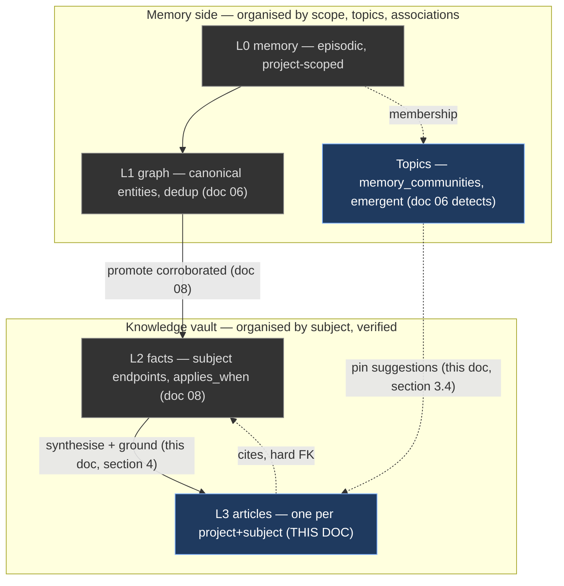
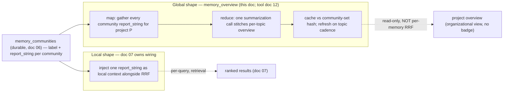
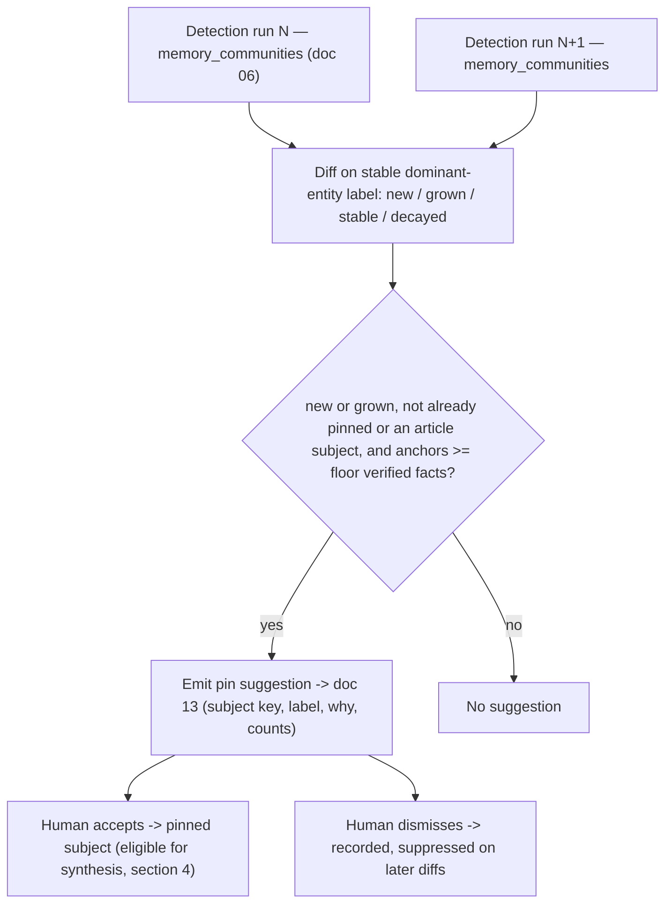
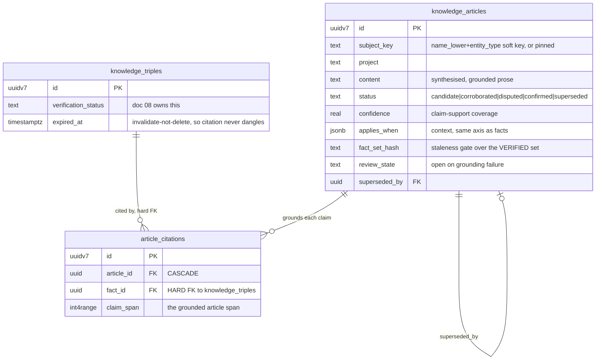
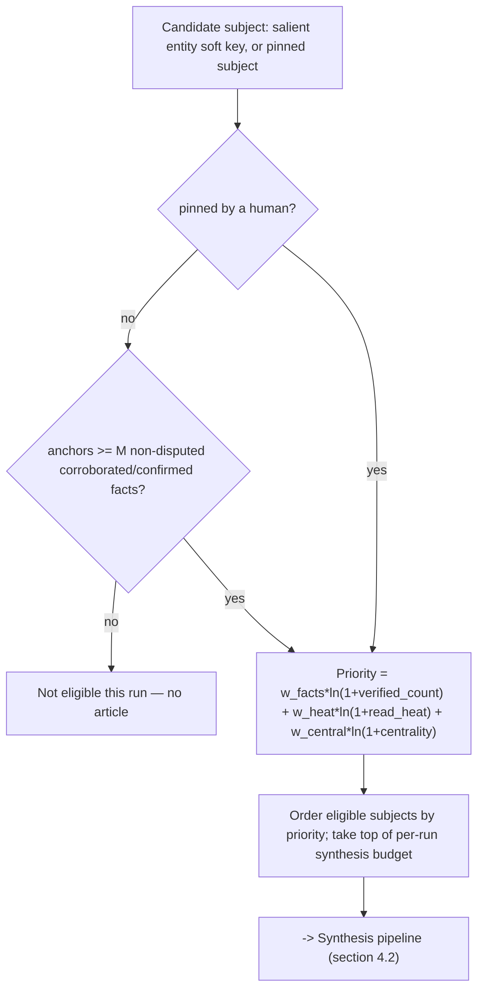
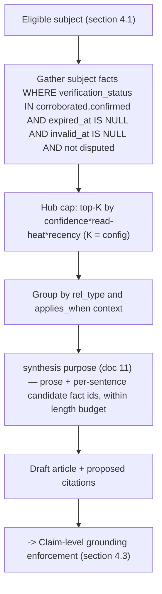
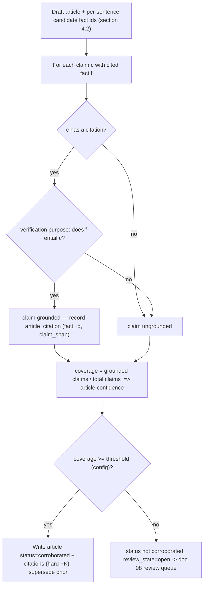
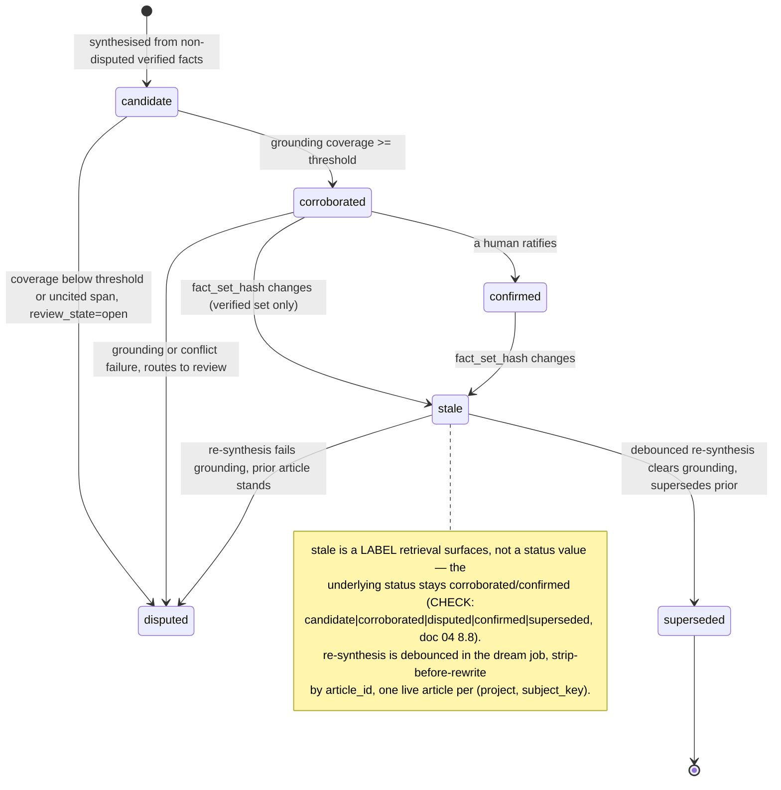
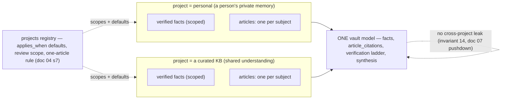

# 09 — Knowledge Organization

**Status:** subsystem doc; conforms to foundation docs 00–04 and the 2026-07-24 knowledge-reshape spec. Draft 2026-07-24. Wave-2 truth-and-read layer (with docs 07 retrieval and 08 temporal/verification).

---

## 1. Purpose & scope

**This doc fixes how verified knowledge is *organised and synthesised* above the fact layer — topics as an organizing surface, the Layer-3 subject-article pipeline with enforced claim-level grounding, the personal-versus-knowledge-base project convention, and auto-research filing cited knowledge into the vault — but it fixes no verification semantics, no temporal lifecycle, and no schema.** It owns the top half of the vault: everything that turns a pile of verified facts into something a human or agent can *read* as knowledge. Concretely it settles six things the foundation left open: what makes a subject *salient* enough to earn an article, how the claim-level entailment pass enforces grounding and how its groundedness metric doubles as the Layer-3 ship gate, an article's shape and length budget and the top-K fact cap for hub subjects, the `memory_overview` global map-reduce shape, the pin-suggestion surfacing contract, and auto-research (F7) orchestration and its committed-versus-stretch phase.

**What the neighbouring docs fix instead, and the vault boundary this doc sits on.** The vault has two co-owners along a fixed boundary (cross-doc contract 6): **doc 08 owns facts, the verification ladder, the bi-temporal lifecycle, and the consolidation job family; this doc owns articles, synthesis, and organization.** So doc 08 decides when a fact is `candidate`/`corroborated`/`confirmed`/`disputed`, counts distinct origins, runs the contradiction veto, and hosts the one dream-job schedule under which everything below runs — and this doc merely *consumes* those verified facts and their labels, never redefining them. Doc 06 owns topic *detection and materialisation* — the Leiden community mechanics over a project-scoped projection, the delete-and-rewrite per project, the `memory_communities` table and its labels and `report_string`; this doc consumes those durable rows as an organizing *surface* (browsing, report injection, pin suggestions) and never re-runs detection. Doc 07 owns the retrieval path that *serves* articles (the article channel, four-layer composition, verification labelling); this doc only produces the article rows and their staleness labels it consumes. Doc 11 owns the LLM boundary — this doc names the `synthesis` and `verification` purposes it needs and dispatches through the orchestrator, never constructing a call itself. Doc 04 owns every table shape (`knowledge_articles`, `article_citations`, and the `article_embeddings__<slug>` partition) this doc's mechanics land on. And the human-editable document/PKM surface stays firewalled to doc 16: **an article synthesises from verified facts and never reads a block directly** (doc 01 §3.4), so the vault never depends on the unshipped horizon.

**Audience & authority.** This binds anyone working on the article vault, topic-driven organization, pin suggestions, or auto-research. Where it and the as-is baseline (`CLAUDE.md`) agree, that behaviour is contract; where the target extends the baseline, the extension is labelled per doc 04 §1's honesty convention — **(exists today)**, **(target-new)**, **(rebuild)**, **(activation)**, **(horizon)** — and this doc never presents scaffolding as substrate (invariant 23). Everything in this doc is **target-new**, sequenced last, behind a groundedness gate; nothing here is claimed as shipped. It authors on the retained Python/FastAPI + async SQLAlchemy + Postgres/pgvector stack (the 2026-07-24 Option A decision); every design here is SQL-first and expressible without ORM-only constructs.

**The one sentence to hold in mind:** organization is under-claimed by construction — an article is only ever synthesised from **non-disputed corroborated/confirmed facts**, every sentence is grounded to a cited fact or the article fails, its badge claims exactly *"asserted by K distinct origins … as of T"* and never *"true"* or *"verified"*, and a change in the *verified* fact set only ever **labels** an article stale, never silently rewrites or hides it.

---

## 2. The organizational model — what organises what

**Decision. Organization in darkmem is layered and emergent, never a folder tree the human maintains: the four epistemic layers each carry their own organizing key, topics are a cross-cutting emergent surface over the memory side, and one synthesised article per subject is the top-level organizing unit for verified knowledge — this doc owns only the two organizing structures *above* the fact layer (topics-as-surface and articles) plus the project convention that scopes them.** The reason to make organization emergent is doc 00's whole thesis: hand-managed folders rot the moment the corpus grows and force the human back into the librarian role darkmem exists to remove (doc 01 §3.3). Every organizing structure here is *re-derived* from the graph and the verified facts as they change — topics by clustering, articles by synthesis — so organization is a free consequence of ingest and consolidation, not a maintenance task.

Each layer's organizing key, and where ownership sits, is worth stating flatly because a subsystem doc must know which structure it is touching:

| Layer | Organizing key | Owner |
|---|---|---|
| L0 memory | `project` scope; topic membership; associative `memory_relations` | scope doc 04 §7; topics doc 06; edges doc 08 |
| L1 candidate graph | canonical `(name, entity_type)` entities; dedup | doc 06 |
| L2 verified facts | subject entity endpoints; `project`; `applies_when` context | doc 08 |
| L3 subject articles | one live article per `(project, subject_key)` | **this doc (§4)** |
| Topics (cross-cutting) | Leiden `memory_communities` over a project-scoped projection | detection doc 06; **surface this doc (§3)** |

**Why topics and articles are the two organizing structures above the graph, and why they are distinct.** A **topic** is an emergent grouping of *memories* (via their entities) — coarse, cheap, recomputed, and useful for browsing and for *suggesting* what deserves deeper treatment. An **article** is a synthesised, grounded write-up of *one subject* built from *verified facts* — expensive, truth-critical, and the thing an agent reads when it wants darkmem's settled understanding. Topics answer "what clusters exist"; articles answer "what do we actually know about X, and can you prove it." They compose: topics feed **pin suggestions** that nominate subjects for articles (§3.4), which is the one place the two structures touch, and precisely why doc 06's `memory_communities` rows must be *durable* — so successive runs can be diffed. Neither is stored as an entity (that would pollute the closed `ENTITY_TYPES` fallback and collide with `UNIQUE(name, entity_type)` — invariant 5, doc 01 §3.3); topics live in their own table (doc 06) and articles in theirs (doc 04 §8.8).

The organizational model — the four epistemic layers, the cross-cutting topic surface, and the one-article-per-subject vault this doc owns above the fact layer:



**Provenance discipline: one mechanism per layer (spec §2.8).** Organization does not invent a new provenance channel. L2 facts carry provenance through `fact_sources` (doc 08); L3 articles carry it through `article_citations` (this doc, §4); supersession rides the projected `superseded_by` pointer. `DERIVED_FROM` is cut for v1 — its only writer (knowledge as a derived memory row) is gone under the reshape, and shipping a zero-writer edge type would violate invariant 23. So an article's grounding is expressed *only* by claim-level citations to facts, never by a `DERIVED_FROM` edge back to memories.

---

## 3. Topics as an organizing surface

**Decision. This doc treats topics purely as a *surface* — three read/derive operations over doc 06's durable `memory_communities` rows: browsing membership, injecting/aggregating community reports, and diffing communities across runs into pin suggestions — and owns none of the detection mechanics.** Doc 06 §7 runs the Leiden clustering over a project-scoped projection, materialises `memory_communities` + `memory_community_members` delete-and-rewrite per project, generates the `label` from dominant entities, and enriches each community with an LLM `report_string` off the hot path. This doc consumes that output. The split matters because detection is a *graph* concern (which memories cluster together) whereas the surface is an *organization* concern (how a human reads and acts on those clusters), and conflating them would put article-pin logic inside the community detector.

**Two query shapes over topics must never be conflated (doc 04 §8.4, doc 06 §7).** The **local** shape injects a single community's `report_string` as local context alongside RRF results — that belongs to retrieval and is doc 07's to wire; this doc only notes that the report a community carries is the injectable unit. The **global** shape is `memory_overview`: a project-wide map-reduce that answers "what does this project's memory contain, organized by topic," exposed as its own MCP tool (doc 12) and **never per-memory RRF**. This doc owns the global shape's mechanics (§3.3).

### 3.1 Browsing — membership as a clean query

**Decision. Topic browsing reads membership straight from the `memory_community_members` join, never by recomputing clustering at read time.** "Which topics is this memory in" is a btree lookup on `(memory_id)` and "which memories are in this topic" cascades from `(community_id)` — both index lookups, because doc 04 §8.4 chose the join table over a `memory_ids uuid[]` on the community row precisely so these reads stay cheap. Browsing surfaces the community `label`, its dominant entities and impact rating (from `properties`), its member count, and its `report_string` if generated; the rendering is doc 13's. The one honest caveat browsing must carry is that **community ids churn on every run** (delete-and-rewrite, doc 06), so a browsing UI must key on the stable dominant-entity label, never on a community id it cached from a prior load — the same rule pin suggestions live by (§3.4).

### 3.2 Reports — consumed, not produced here

**Decision. The community `report_string` is produced by doc 06's Tier-C detection job through doc 11's `summarization` purpose; this doc consumes it in two ways — as the injectable local-context unit (handed to doc 07) and as the *map* input to `memory_overview` (§3.3) — and adds no second report generator.** Keeping report generation single-sourced avoids two reports drifting for one community. The `report_string` is a short subject summary of the community's memories; it is a Tier-C consumer (invariant 15), never on ingest or retrieval, and its cadence is doc 06's `config` cron. This doc's only contribution is to say *where the report is spent*: locally by retrieval, globally by the overview reduce.

### 3.3 The `memory_overview` global map-reduce

**Decision. `memory_overview` is a project-scoped map-reduce over the durable community rows — map = each community's precomputed `report_string`, reduce = one bounded `summarization`-purpose call that stitches the per-community reports into a single project overview — computed off the hot path, cached, and refreshed on the topic cadence, exposed as a read-only MCP tool whose contract is doc 12's.** The map step is *free* because the reports already exist (doc 06 generated them at detection time), so `memory_overview` never fans out an LLM call per community at request time; it only runs the single reduce call, and even that is cached against the project's community-set hash so a repeated overview request is a **`config`-row read** — the cache lives in a `config` row `overview:<project>` holding `{community_set_hash, text}` (doc 04 §7), not a new table. The reduce is a *summary of summaries* — a report, not a grounded article — so it reuses `summarization` rather than the truth-critical `synthesis` purpose (doc 11 §6 keeps the widening minimal), and its output carries no verification badge: it is an *organizational* view of what memory contains, explicitly labelled as such, never a verified claim.

**Why map-reduce and not per-memory RRF.** A global "what's in here" answer over hundreds of memories cannot be a ranked retrieval list — that answers "what's most relevant to a query," a different question. Map-reduce over topic reports gives a *structured* overview (a section per topic) that degrades gracefully as the corpus grows, because the number of communities grows far slower than the number of memories. Conflating the two shapes is the exact error doc 04 §8.4 forbids; keeping them separate is why `memory_overview` is its own tool and not a mode of search.

The two topic query shapes — local report injection into retrieval versus the global map-reduce overview, kept strictly separate:



### 3.4 Pin suggestions — the contract from topics to articles

**Decision. Pin suggestions are derived by diffing durable `memory_communities` rows across consecutive detection runs, keyed on stable dominant-entity labels, and surfaced to the human as *nominations only* — a new or materially-grown community whose dominant entity is article-worthy but not yet an article subject becomes a "pin this subject?" suggestion; the human accepts (creating a pinned subject, eligible for synthesis) or dismisses (recorded so it is not re-suggested); a suggestion never auto-creates an article.** This is the one place topics touch articles, and it is deliberately human-in-the-loop: subjects earn articles either by *salience* (§4.1, automatic) or by *pinning* (this suggestion flow, human-ratified), and pinning is how a human steers synthesis toward a cluster the salience heuristic has not yet caught. The reason `memory_communities` must be durable (doc 06 §7, doc 04 §8.4) is exactly this diff — a computed-on-read topic cannot be compared against its previous state.

**The diff and the surfacing contract (with doc 13).** Because community ids churn, the diff matches communities across runs on their **stable dominant-entity label**, classifying each as *new*, *grown* (member count up past a `config` growth threshold), *stable*, or *decayed*. A pin suggestion is emitted for a *new* or *grown* community when its dominant entity's soft key `(name_lower, entity_type)` is neither already a pinned subject nor an existing live article subject, **and** that subject already anchors at least a small floor of non-disputed corroborated/confirmed facts (so the human is never asked to pin a subject that could not yet be grounded into an article — a truth-first filter, not a nag). The payload handed to doc 13 per suggestion is: the subject soft key, the supporting community label, the *why* (new or grown), the community's member count, and the count of verified facts the subject already anchors. The human's accept writes a pinned subject; the dismiss is recorded against the subject so the diff suppresses it on later runs. Both persist as per-project lists in the `projects` registry `properties` jsonb (doc 04 §7) — this doc names the requirement (the salience scan in §4.1 must enumerate pinned subjects, and the diff must read dismissals); if either set grows large, doc 04 promotes it to a small dedicated `pinned_subjects` store, and owns the physical shape either way. Every suggestion, accept, and dismiss journals an `events` row (`object_type = topic`, referencing the community by label + payload snapshot, never by id — doc 06's rule).

The pin-suggestion lifecycle — durable communities diffed across runs into nominations the human ratifies, the only bridge from the topic surface to the article vault:



---

## 4. Article synthesis — subjects, salience, grounding, lifecycle

**Decision. A Layer-3 article is one verified, synthesised write-up per `(project, subject_key)`, built off the hot path in the dream job *only* from the subject's non-disputed corroborated/confirmed facts, with every sentence forced to cite a supporting fact through a claim-level entailment pass — an article whose grounding coverage falls below threshold does not ship as knowledge, it routes to review — and it is superseded, never overwritten, when its verified fact set changes.** This is the truth core of organization and it operationalises the maintainer's under-claiming preference at the article layer: the machine can synthesise and it can prove grounding, but it can never assert an ungrounded claim under a corroborated badge, and it can never reach `confirmed` on its own (only a human ratifies). Every one of the four sub-decisions below — subject salience, synthesis inputs, enforced grounding, and the staleness lifecycle — serves that core.

The tables this doc owns and the one hard FK that makes grounding non-negotiable (the whole-schema ERD is `erd.md`; only the article half is shown here — facts are doc 08's):



### 4.1 Subjects & salience — what earns an article

**Decision. A subject is a salient entity soft-keyed `(name_lower, entity_type)` or a human-pinned subject; salience is a two-part rule — a hard *eligibility gate* (the subject must anchor at least M non-disputed corroborated/confirmed facts) followed by a *priority score* (a config-weighted composite of verified-fact count, retrieval read-heat, and community centrality) that orders eligible subjects under a per-run synthesis budget — and pinned subjects are always eligible.** This resolves the foundation's central algorithmic call (doc 04 open question, framing Doc-09): salience is neither pure fact count, nor pure retrieval frequency, nor pure community centrality, but a *gated composite* where fact count is the gate (truth-first) and the other two only decide ordering.

**Why a gate before a score, and why fact count is the gate.** An article that cannot be grounded is worse than no article, so a subject with fewer than M verified facts is *ineligible regardless of how central or how frequently retrieved it is* — you cannot synthesise a grounded write-up from one fact, and a hub entity that is retrieved constantly but has no *verified* facts yet has nothing to ground against. The eligibility gate is therefore counted only over **non-disputed corroborated/confirmed** facts (doc 08's labels), never over raw L1 edges or candidate facts — cold-start honesty means a subject earns an article only when the vault actually holds settled knowledge about it. This is the direct downstream consequence of "corroboration counts distinct origins, never rows": M verified facts already means M facts that each cleared the distinct-origin bar, so the gate inherits that rigour for free.

**Why the priority score composes three signals, each behind a weight.** Among *eligible* subjects, the ones worth synthesising *first* under a bounded per-run budget are those that are simultaneously fact-rich (more to say, better grounded), read-hot (agents actually retrieve them, so an article pays off), and structurally central (a hub in their topic, so the article organizes a lot). No single signal is sufficient: fact count alone over-favours mechanically verbose subjects; read-heat alone chases popularity and misses newly-verified subjects nobody has queried yet; centrality alone favours graph hubs that may be shallow. So salience-for-ordering is `w_facts·ln(1+verified_fact_count) + w_heat·ln(1+read_heat) + w_central·ln(1+community_centrality)`, each `w_*` a `config` row defaulting conservative and tuned from measured synthesis value via doc 17 (convention 9) — the same `w_*` discipline doc 04 §9 gives the ranking priors.

**The `ln(1+x)` damping is part of the stance, and was added 2026-08-10 (Tier-3 amendment, ruling R-D) to match what `article_eligibility` had shipped.** This section originally stated the linear composite and attached no reason to linearity, while T3.01 applied `ln(1+x)` per signal and its docstring presented that as *implementing* §4.1 rather than deviating from it. Adopting rather than reverting, on three grounds: `review_ranking` already compresses identically, and two ranking surfaces on different curves is a defect waiting for someone to compare them; the undamped form defeats its own rationale, since a 400-neighbour hub or a mechanically verbose subject out-scores the weights by arithmetic rather than by intent; and nothing measured is being fitted, because the weights are untuned and the consumer (T3.02) sits behind G-D, so this is a curve chosen *before* data, which is the only honest time to choose one. **The curve is part of what any future weight-tune is measured against**: a retune moves the `w_*` rows, never the damping, or it is silently re-litigating this decision under cover of a measurement. The three signals are sourced honestly: verified-fact count from `knowledge_triples` filtered to non-disputed corroborated/confirmed and non-expired; read-heat as the aggregated read signal of the subject's facts and any existing article (from `events` read rows and `memory_access_stats`, computed at job time, never a stored heat column that would go stale — doc 04 §9); community centrality as the subject entity's degree/centrality in the cached graph snapshot (or the community's `properties` dominant-entity/impact data) — not a stored field on `memory_communities`, which carries only `label`/`report_string`/`properties` plus the membership join (doc 04 §8.4).

The salience decision — a hard verified-fact eligibility gate, then a weighted priority score orders eligible subjects under the per-run budget:



### 4.2 Synthesis inputs & article shape

**Decision. Synthesis input is *only* the subject's non-disputed corroborated/confirmed facts *whose belief window is still open* (`expired_at IS NULL AND invalid_at IS NULL`, the belief clause added by §4.4's 2026-08-11 ruling), capped for hub subjects to the top-K facts by fact-salience, rendered into a bounded article — a short definitional lead plus the subject's key verified facts organized by relation and by `applies_when` context, every sentence carrying candidate citations — through doc 11's `synthesis` purpose off the hot path.** Two exclusions are load-bearing: **disputed facts are never a synthesis input** (they are served labelled with both sides by retrieval, doc 08, but an article states settled understanding, so a disputed claim has no place in it), and **candidate facts are never a synthesis input** (an article is Layer-3 verified knowledge; synthesising from unverified signal would launder candidates into apparent knowledge — exactly the confident-but-wrong failure the design most fears). The article also never reads a block (the doc-16 firewall) — its only inputs are verified facts.

**The hub-subject top-K cap, and why it bounds cost as well as length.** Spec §2.4 caps a hub subject to "top-K facts by salience" without fixing K; this doc sets **K a `config` row** (defaulting modest, e.g. 40) and ranks the candidate facts by a fact-salience of `confidence × read-heat × recency`, non-disputed only. The cap does three jobs: it keeps a hub like "postgres" — which may anchor hundreds of verified facts — from producing an unreadable essay; it keeps the article *focused* on the subject's most load-bearing knowledge; and, because the number of claims an article makes is bounded by the number of facts it synthesises from, it directly bounds the cost of the entailment pass (§4.3), which is per-claim. K and the article length budget are two knobs on the same lever.

**Article shape.** An article is a bounded write-up, not an unbounded document: a target length budget (a `config` word/token cap, defaulting to a few hundred words) with a hard ceiling so `article_embeddings__<slug>` chunks cleanly at embed time via payload spans, not block rows (doc 04 §5.3/§8.8). Its structure is a short definitional lead sentence for the subject, followed by its key verified facts organized by relation type and, where facts carry it, grouped by `applies_when` context (so a fact that holds only in `env=prod` reads as a scoped claim, not a universal one). The `synthesis` call is instructed to emit prose *with per-sentence candidate fact ids attached* — the model proposes which fact(s) it believes ground each sentence — because the downstream entailment pass (§4.3) verifies those proposed citations rather than having to search for them. The article's `applies_when` and `learned_in` are aggregated from its supporting facts (doc 04 §8.8); its subject `learned_in` is trustworthy (project + source), its `applies_when` is displayed provenance.

The synthesis pipeline — eligible subject through verified-only inputs, the hub cap, the synthesis call, and into grounding enforcement:



### 4.3 Enforced grounding — the entailment pass, the groundedness metric, and the ship gate

**Decision. Grounding is *enforced, not asserted*: a claim-level entailment pass (doc 11's `verification` purpose) checks every article sentence against its cited fact — does the cited fact entail the claim? — an uncited or unentailed sentence fails; the article's `confidence` is its *groundedness metric* = claim-support coverage (entailed claims / total claims); an article below a `config` coverage threshold does not ship as `corroborated`, it sets `review_state='open'` and routes to doc 08's review queue; and the *same* metric, measured on a gold set through doc 17, is the gate that decides whether Layer 3 ships at all.** This is the single most important mechanism in the doc: it is what makes an article's badge honest. Without it, synthesis would be a fluent paraphrase that *looks* grounded; with it, every shipped sentence is provably backed by a verified fact.

**The per-claim protocol and its cost bound.** The draft from §4.2 arrives with per-sentence candidate fact ids. The entailment pass evaluates each claim independently: for claim *c* with cited fact *f*, it asks the `verification`-purpose model whether *f* entails *c* (the same purpose doc 11 gives the fact-level contradiction veto — one truth-critical judge, two consumers). A claim with no citation fails outright (no search-for-support fallback — an uncited span is by definition ungrounded). Cost is bounded because the number of claims is bounded by the top-K fact cap (§4.2): an article of C claims costs C entailment checks (batchable), and C is small by construction, which is why the hub cap and the length budget are grounding-cost knobs as much as readability knobs. Entailment runs in the dream job under doc 08's schedule umbrella with doc 11 §6's Tier-C concurrency bounds; it never touches ingest or retrieval (invariant 15).

**The groundedness metric as both per-article confidence and the layer ship gate.** Coverage = entailed claims / total claims *is* the article's stored `confidence` (doc 04 §8.8), so an article's confidence means exactly "the fraction of my sentences a verified fact entails" — an honest, computable number, not a heuristic. Per-article, coverage below the threshold flips the article to `review_state='open'` (candidate/disputed, not corroborated) so an ungrounded write-up is *withheld from knowledge and surfaced for review*, never shipped. Aggregate, the *layer* does not ship until the entailment judge itself is shown reliable on a labelled gold set (doc 17): the harness measures the judge's precision/recall at distinguishing grounded from ungrounded sentences, and Layer 3 stays gated behind that measurement (spec §8 sequences L3 last, "behind the groundedness metric"). The metric therefore does double duty — it gates every individual article at runtime and gates the whole feature at ship time — which is why the framing names it "also the L3 ship gate." Both the per-article threshold and the ship-gate bar are `config`/harness values, tuned conservatively and loosened only with evidence (convention 9).

The grounding enforcement — per-claim entailment, coverage as confidence, and the two gates the one metric drives:



**Citations take the one hard FK — the deliberate contrast with facts' soft refs.** A grounded claim writes an `article_citations` row: `article_id` CASCADE to the article, `fact_id` a **hard FK to `knowledge_triples`**, and `claim_span int4range` marking the article span the fact grounds (doc 04 §8.8). The hard FK is safe *because* facts are invalidate-not-delete — a fact row is never deleted, only window-closed or expired (doc 08) — so a citation can never dangle, and it buys referential integrity at the one place a dangling citation would be a truth catastrophe: a dead citation under a corroborated badge. This is the deliberate inverse of the fact table's own endpoints, which are *soft* refs because the graph deletes entities aggressively (doc 04 §8.3). One provenance mechanism per layer: `article_citations` is L3→L2, and nothing else grounds an article.

### 4.4 The staleness & debounce lifecycle

**Decision. An article's staleness gate is a hash of its supporting *verified*-fact set (`fact_set_hash`) — candidate churn never triggers re-synthesis; only a change to the corroborated/confirmed set does — a change merely *labels* the article stale (retrieval surfaces the label, honest partial results), and re-synthesis runs *debounced* in the dream job, strip-before-rewrite by `article_id` with citations cascading, superseding the prior article via `superseded_by`.** The lifecycle is `candidate → corroborated → confirmed → superseded` with a `disputed` sub-state and exactly one live article per `(project, subject_key)` (the partial-unique `WHERE status <> 'superseded'`, doc 04 §8.8). Three properties make it honest and cheap.

**Why the staleness gate is the verified set, not candidate churn.** If a new *candidate* fact about a subject re-triggered synthesis, a hub subject would re-synthesise on nearly every ingest — expensive, thrashing, and pointless because candidates cannot be synthesis inputs anyway (§4.2). So the gate is `fact_set_hash` over the subject's non-disputed corroborated/confirmed facts only: an article goes stale exactly when the *knowledge* it was built from changed (a fact got corroborated, disputed, invalidated, or a new one crossed the bar), not when raw signal arrived. This is the article-layer analog of doc 08's "provenance no-op" — an identical verified set is a no-op.

**Amended 2026-08-11 (Tier-3, owner-ruled): the supporting set is the verified *and still believed* one.** As first written, the two halves of the paragraph above did not agree. The enumeration names four triggers; the predicate as stated — non-disputed corroborated/confirmed — delivers three. **Invalidation delivers none of it**: closing a belief window writes `invalid_at` alone, touching neither `verification_status` nor `expired_at`, so an invalidated fact stayed in the hashed set, the hash never moved, and the article was never labelled stale. §4.4 named a trigger §4.4's own predicate could not fire. The ruling makes **the enumeration authoritative**: a fact whose belief window has closed is no longer a supporting fact, and the basis is the repo's canonical `OPEN_BELIEF_PREDICATE` (`expired_at IS NULL AND invalid_at IS NULL`) on top of the status filter. The stated cost, accepted: staleness now fires on strictly more changes, so hub subjects re-synthesise more often. The rejected reading was that staleness tracks the *verification* axis only and `invalidated` should come out of the list — defensible, since doc 04 keeps the belief and verification axes apart on purpose, but it leaves an article standing on a claim the vault no longer believes, which invariant 14 does not survive.

**The ruling binds the whole supporting-set definition, not the hash alone.** §4.2's gather predicate was under-specified the same way and moves with it (its flowchart node now reads the belief window), as does §4.1's eligibility count. A staleness basis stricter than the gather basis would be the worst of both: the article goes stale on the invalidation, and the re-synthesis it triggers gathers the disbelieved fact again and writes the same claim back into the prose — a rewrite that clears the label without curing what the label was for.

**Why a label, then a debounce, not an immediate rewrite.** The moment the verified set changes, the article is *labelled* stale and retrieval surfaces that label (invariant 14 — the reader sees "this was synthesised before the latest verified change") rather than the article being hidden or silently rewritten. Re-synthesis is then **debounced** in the Tier-C dream job — a config quiet-period so a burst of corroborations produces one re-synthesis, not one per fact — and materiality-gated on the *verified* set hash so it only fires on real change. Re-synthesis is strip-before-rewrite by `article_id`: the new article is written, its citations recomputed and cascaded, and the prior article set `superseded → superseded_by` the new one (invariant 8 generalised, doc 04 §8.8) so lineage is retained and reachable, never deleted. A re-synthesis that fails the grounding gate (§4.3) does not supersede the standing article, **and the failed draft is not stored** — prose whose own measurement says the verified facts do not entail it has no place in the vault under any status. **What routes to review is the subject** (amended 2026-08-12, Tier-3, owner-ratified — see below): the job writes a held marker on the standing article's own columns (`resynthesis_held_at`, the measured coverage, and the fact-set hash it was measured against), journals a `resynthesis_held` event carrying the measurements, and the review queue's article lane serves the standing article under reason `resynthesis-held`. The marker is doc 08 §4.2's contradiction-suspected shape on the article axis — **attention without withholding**: the article keeps its status, its badge, its stale label and its place in retrieval, because the finding is about the subject's current verified set, not about the prose that is still the best grounded write-up of it. It is a cache the job refreshes, cleared in the same statement as the supersession that resolves it and cleared by the tick when the article ceases to be stale, so it can never outlive the condition it names. `resynthesis_held_at` is when the hold opened, not when it was last confirmed; the coverage and hash refresh on every held attempt. So a subject never loses a good article to a bad re-synthesis — **and a subject whose knowledge can no longer be grounded is a case a human sees, not a counter on a job tick.**

**Why the amendment (Tier-3, 2026-08-12).** The sentence above previously read "it routes to review", and that was unimplementable as written: the review queue's handle on an article is a column on an article *row*, so routing the *draft* means storing it, and `ux_knowledge_articles_live` admits one non-superseded row per `(project, subject_key)` — storing it means superseding the article the same sentence protects. Routing the standing article by setting its `review_state` is worse, because doc 13 §5.2 makes an open article withheld from the corroborated view: that takes a good article away from readers because a *different* draft failed, which is the harm this sentence exists to prevent, reached by obeying it. (The escalation first claimed the index made storing the draft impossible; that was wrong — the index is partial on `status <> 'superseded'`, so a born-superseded draft would fit. What actually bars that path is lineage corruption: the predecessor lookup would then serve a rejected draft as the article's history.) Routing the *finding* rather than the *prose* satisfies both halves, and it is the shape the corpus already uses for the fact axis. **The retry policy it licenses:** with a human now looking, the tick skips re-attempting a subject while the held hash still equals its current verified-set hash — before this, a chronically ungroundable subject paid one draft call plus one entailment call per claim every tick, forever, discarded, with an in-memory counter as its only trace.

**Disputed and confirmed on the article axis.** A live article whose grounding or conflict check fails flips to `disputed` and routes to review (doc 01 §6); a human may ratify a well-grounded article to `confirmed` (the machine never self-promotes past `corroborated`, mirroring the fact ladder — contract 2). `confirmed` is not terminal against change: if the verified set later shifts, even a confirmed article is labelled stale and re-synthesis supersedes it (doc 01's article state machine). Every transition — synthesised, labelled stale, re-synthesised/superseded, disputed, confirmed — journals an `events` row (`object_type = article`), so "what did we believe as of X" answers at the article layer too (convention 8).

The article lifecycle — synthesised and grounded, labelled stale on a verified-set change, re-synthesised debounced and superseding the prior, disputed on grounding failure:



---

## 5. Personal versus knowledge-base — the project convention

**Decision. "Personal memory" and "a shared knowledge base" are *different `project` values*, not different objects or a new storage class — the identical vault model (facts, articles, verification, synthesis) serves both, and the `projects` registry anchors the per-project defaults that make them behave differently.** This resolves the framing's personal-vs-KB call by reusing doc 01 §5's namespace convention verbatim: a person's private memory is one project, a curated knowledge base is another, and both are scoped, verified, and synthesised the same way. The reason to reuse `project` rather than invent a KB entity is that it keeps auto-research (§6) and consolidation uniform — filing cited knowledge "into a knowledge base" is just scoping the vault's facts and articles to a KB-designated `project`, the same registry-and-scope model as a personal project (doc 01 §5).

**What the `projects` registry anchors, and what it does not enforce yet.** The minimal `projects(name PK, display_name, properties, created_at)` registry (doc 04 §7) is what the vault needs precisely because fact identity embeds `project` in `triple_key` — a typo'd project would silently split corroboration across two identities, and, downstream, split the one-live-article scope. So the registry anchors three things for this doc's layer: the per-project `applies_when` context defaults (a KB project can default to broad/unstated context, a personal project to a working context), the review-queue scoping (a KB project's disputed articles are reviewed against that KB, not mixed with personal review), and the one-active-article-per-`(project, subject_key)` rule (so "postgres" gets one article in the personal project and, legitimately, a *different* article in a KB project — different verified fact sets, different scopes, not a conflict). A "knowledge base" role may be marked in `projects.properties` for the UI to badge (doc 13), but it carries **no FK and no ACL enforcement in v1** — that is the later tenancy phase (doc 04 §9, doc 18). The cross-project isolation invariant still binds every channel (no article leaks across projects — doc 01 §5, invariant 14), enforced by the SQL project pushdown the vault channels are born with (doc 07).

**The firewall makes the KB convention safe.** Because an article synthesises only from verified facts and never reads a block directly (doc 01 §3.4), a KB project's articles do not depend on the unshipped documents/PKM horizon — the vault is darkmem's *own* verified understanding, scoped to a project, not a human-edited wiki. This is exactly what lets auto-research file cited results into a KB project without inventing a new artifact table (§6): the KB is a project of verified facts and grounded articles, governed by the same lifecycle as everything else.

Personal and knowledge-base as two projects over one vault model — same tables, same verification, scoped and defaulted by the registry:



---

## 6. Auto-research (F7) — filing cited knowledge into the vault

**Decision. Auto-research is a *thin orchestration over shipped machinery*, not a new pipeline: a research-agent loop gathers evidence, files it back through the ordinary capture front door as memory rows — each genuinely independent source stamped with a distinct `origin_key` — and then the ordinary consolidation lifts corroborated claims to Layer-2 facts and this doc's synthesis writes a cited Layer-3 article into the chosen project; it uses doc 11's `synthesis` purpose for the write-up and introduces no new human-edited KB artifact table.** F7 (doc 01 §7) is the deep-research pattern turned inward — the human requests research on a subject, and darkmem researches it and files organised, cited knowledge back into itself. The design keeps it thin by *reusing* F1 capture, F2 extraction, F6 consolidation, and §4 synthesis, so F7 adds only the research-agent loop and the run scoping/journaling around them.

**The one truth-critical rule: F7 must not manufacture corroboration.** Corroboration counts distinct origins, never rows (contract 2), so the *only* honest way research produces corroborated facts is when *genuinely independent* sources agree — and F7's integrity rests entirely on assigning `origin_key` correctly. Each independent evidence source (a distinct document, page, or dataset the agent actually gathered) is filed as a memory with its own distinct `origin_key`, so two independent sources asserting the same claim give **two distinct origins → real corroboration**. But when the agent fetches the same source twice, paraphrases one source into two notes, or cannot establish source identity, the rule is **merge to one origin (undercount), never mint distinct ones** — the same degradation rule the fact layer lives by (doc 08, spec §2.1). Undercounting only delays promotion; overcounting would let a research agent inflate a single web page into a "corroborated" fact, which is the exact popularity-counter failure the whole design refuses. F7 therefore ships with an explicit origin-identity discipline in its filing step, and its badge stays honest for free because it rides the same ladder as everything else.

**Orchestration and purposes.** The research loop is an agent reusing the deep-research/extraction patterns: it plans, gathers evidence via external tools (web search and fetch live *outside* darkmem's box — the agent's own capability, not a darkmem datastore, invariant 1), and files each finding through the standard capture path with a `source` marking it as research-originated and its distinct `origin_key`. From there nothing is special: F2 extracts the graph, F6 promotes corroborated relations to facts under the veto and distinct-origin count, and §4 synthesis writes the cited article for the subject — grounded by the same claim-level entailment pass, gated the same way, routed to review on failure. The article write-up uses the `synthesis` purpose (doc 11 §6 assigns `synthesis` to "Layer-3 article write-ups; auto-research write-ups (F7)"); the agent's own planning/reasoning uses the `reasoning` purpose or the external agent's model. The output lands in the human's chosen project — a personal project or a KB project (§5) — with no new storage class, because the vault already *is* the knowledge base.

**Committed-versus-stretch phase.** Auto-research is sequenced *last* — after both Layer 2 (the ladder it needs to corroborate) and Layer 3 (the synthesis it needs to write) are proven live — and this doc's stance is to treat it as a **demand-gated stretch for the v1 core, committed on the roadmap but not on the core's critical path, with the phase confirmed in doc 20** (framing Doc-09; doc 01 §9 recommends committed but defers phase confirmation). The reasoning is that the vault model makes F7 cheap once L3 ships — it is orchestration over already-shipped capture, consolidation, and synthesis, not new substrate — so it earns its place as a fast follow rather than a v1 blocker, and shipping the core agent engine (capture, retrieval, the verified vault) does not wait on it. The orchestration layer is tagged **(target-new)**; the external evidence-gathering is an agent capability outside the box.

The auto-research cycle — a multi-actor flow that reuses capture, consolidation, and synthesis, with origin-identity as the truth guard:

```mermaid
sequenceDiagram
    autonumber
    actor Human
    participant Agent as Research agent (target-new orchestration)
    participant Ext as External tools (web search/fetch, outside the box)
    participant Cap as Capture F1/F2 (doc 05)
    participant Cons as Consolidation F6 (doc 08)
    participant Synth as Article synthesis (this doc, section 4)
    participant Vault as Vault (chosen project)

    Human->>Agent: research subject S into project P
    loop gather evidence
        Agent->>Ext: search / fetch a source
        Ext-->>Agent: evidence
        Agent->>Cap: file finding as memory, distinct origin_key per INDEPENDENT source
        Note over Agent,Cap: same source twice or unknown identity, merge to ONE origin (undercount)
    end
    Cap->>Cons: extracted L1 graph enters the ladder
    Cons->>Cons: promote corroborated claims -> L2 facts (distinct origins, veto)
    Cons->>Synth: subject S now anchors verified facts
    Synth->>Synth: synthesise + claim-level grounding gate (section 4.3)
    Synth->>Vault: cited article (corroborated) OR review_state=open
    Vault-->>Human: cited article to review; badge = K distinct origins, never "true"
```

---

## 7. Invariants restated

The invariants that bind this layer, restated in this doc's own terms so the design is checkable against the 1–23 catalog and cross-doc contract 2:

- **The verification vocabulary & badge semantics, verbatim (contract 2).** Articles ride `candidate → corroborated → confirmed` (+ `disputed`) and add the terminal `superseded`; the machine never self-promotes past `corroborated`; an article's badge and its cited facts' badges claim exactly *"asserted by K distinct origins of kinds [X, Y], no known contradiction, as of T"* — never *"true"*, never *"verified"*. Corroboration counts **distinct origins, never rows**, which the eligibility gate (§4.1) and auto-research's origin-identity rule (§6) both inherit.
- **Reconciliation off the hot path (inv. 15).** Every LLM call in this doc — article synthesis (`synthesis`), claim entailment (`verification`), the `memory_overview` reduce (`summarization`), auto-research write-ups (`synthesis`) — is a Tier-C consumer under doc 08's dream-job umbrella. No synthesis, entailment, or report ever touches ingest (Tier A/B) or retrieval; retrieval's only model calls are the query embed and the reranker (doc 07).
- **Honest partial results & no silent degradation (inv. 14).** A verified-set change *labels* an article stale, never hides or silently rewrites it; disputed articles are served labelled with both sides and never gated behind review; an article failing the grounding gate is withheld from knowledge and surfaced (`review_state='open'`), never shipped as corroborated; the badge under-claims by design.
- **Strip-before-rewrite / idempotent re-derivation (inv. 8).** Re-synthesis strips the prior article by `article_id` with citations cascading and supersedes it; the topic pin-diff rides doc 06's delete-and-rewrite-per-project; the `memory_overview` reduce is materiality-gated on the community set. Every re-derivation is safely repeatable.
- **Closed taxonomy, normalise-before-store (inv. 5).** Subject keys use the closed `(name_lower, entity_type)` entity vocabulary; articles emit no new type. The `applies_when` `env`/`situation` axes an article aggregates are closed vocabularies under doc 06's taxonomy discipline — matching rots on drift otherwise.
- **Per-fingerprint isolation (inv. 2).** Article vectors live in `article_embeddings__<slug>` reached only via `child_table("article_embeddings", fingerprint)`, `ON DELETE CASCADE` from the article, chunked at embed time via payload spans and never joined across fingerprints; long articles are chunked by span, not by block rows.
- **Provenance always, one mechanism per layer (doc 01 §8, spec §2.8).** An article grounds every claim through `article_citations` (L3→L2), the hard FK to `knowledge_triples` that never dangles because facts are invalidate-not-delete; `DERIVED_FROM` is cut, so nothing else grounds an article. Every article and topic transition journals an `events` row.
- **The doc-16 firewall (doc 01 §3.4), now absolute.** An article synthesises only from verified facts and **never reads a block directly** — the vault does not depend on the unshipped PKM horizon. This bullet used to say block-sourced facts reach an article only through `fact_sources(kind='block')` (doc 08/16) — that route is retired (doc 16 §5, owner ruling 2026-09-05) and `'block'` is now a **reserved, refused** `fact_sources` kind (`app/repositories/fact_sources.py:126-132`), not a live path with a caveat. An article reaches a document's content **not at all**, neither by reading a block nor by a block-sourced fact.
- **Single Postgres (inv. 1).** Articles, citations, topics, and overviews are all rows on the one pgvector Postgres; auto-research's external search runs outside the box and is never a datastore. No new store, tier, or front door.
- **Scaffolding-not-substrate (inv. 23).** Every mechanism in this doc — articles, the entailment pass, pin suggestions, the `memory_overview` reduce, auto-research — is **target-new**, sequenced after Layer 2 is proven live and gated behind the groundedness metric (spec §8). Nothing here is claimed as shipped; the `synthesis`/`verification` purposes are seeded inert behind their unshipped layers (doc 11).

---

## 8. Open questions & deferred decisions

Each carries a recommended stance, so downstream inherits a default rather than a blank.

- **Subject salience — the central algorithmic call.** *Stance: a two-part rule — a hard eligibility gate (subject anchors ≥ M non-disputed corroborated/confirmed facts, M a `config` row defaulting conservative) followed by a priority score `w_facts·ln(1+verified_count) + w_heat·ln(1+read_heat) + w_central·ln(1+centrality)` (the damping ratified 2026-08-10, ruling R-D) (each `w_*` a `config` row defaulting to a fact-count-dominant blend) that orders eligible subjects under a per-run synthesis budget; pinned subjects are always eligible (§4.1).* Fact count is the gate because an ungroundable article is worse than none; the other two only order. Tune M, the weights, and the budget from measured synthesis value via doc 17.
- **The entailment pass & the groundedness metric (also the L3 ship gate).** *Stance: per-claim entailment through doc 11's `verification` purpose (one judge shared with the fact-level veto), an uncited or unentailed claim fails, `confidence` = claim-support coverage; per-article, coverage below a `config` threshold routes to `review_state='open'` instead of shipping corroborated; the layer does not ship until doc 17 shows the entailment judge's precision/recall clears the ship bar on a labelled gold set (§4.3).* Cost is bounded by the top-K cap; both thresholds are harness-tuned.
- **Article shape & the hub-subject top-K.** *Stance: K a `config` row (default ~40) ranking candidate facts by `confidence × read-heat × recency`, non-disputed only; a `config` length budget (default a few hundred words, hard ceiling for clean embedding chunking); structure = definitional lead + key verified facts organized by relation and `applies_when` context; the cap bounds both readability and entailment cost (§4.2).*
- **Auto-research orchestration & phase.** *Stance: a thin research-agent loop that files evidence through ordinary capture with a distinct `origin_key` per genuinely-independent source (merge-to-one on unknown identity — never manufacture corroboration), reusing consolidation and §4 synthesis (`synthesis` purpose) with no new artifact table; sequenced last, treated as a demand-gated stretch for v1 core, committed on the roadmap with the phase confirmed in doc 20 (§6).*
- **The `memory_overview` global map-reduce shape.** *Stance: map over the durable community `report_string`s (precomputed by doc 06, so no per-community LLM call at request time), one bounded `summarization` reduce, cached against the community-set hash and refreshed on the topic cadence, exposed as a read-only MCP tool (contract doc 12), carrying no verification badge — an organizational view, never per-memory RRF (§3.3).*
- **The pin-suggestion surfacing contract (with doc 13).** *Stance: a per-run diff of durable `memory_communities` keyed on stable dominant-entity labels (new/grown/stable/decayed); a new or grown community whose dominant subject is unpinned, not yet an article subject, and already anchors ≥ a floor of verified facts becomes a nomination — payload {subject soft key, community label, why, member count, verified-fact count} — that the human accepts (→ pinned subject) or dismisses (recorded, suppressed later); suggestions never auto-create articles; all journaled to `events` (§3.4).*

---

*Downstream: doc 07 serves this doc's articles as the Layer-3 retrieval channel — reading the article rows, their `verification_status`/`confidence`, and the stale label this doc sets, and composing them under the four-layer labelling — and wires the local community-report injection whose report this doc consumes; doc 08 co-owns the vault along the fixed boundary (it owns facts, verification, the temporal lifecycle, and the dream-job schedule under which this doc's synthesis, entailment, and pin-diff passes run) and its review queue consumes the `review_state='open'` this doc sets on grounding failure; doc 06 detects and materialises the `memory_communities` this doc diffs into pin suggestions; doc 11 provides the `synthesis` and `verification` purposes and the `summarization` reduce this doc dispatches; docs 12 and 13 surface the vault — the article read tools and the `memory_overview` tool contract (doc 12), and the article browsing, verification badges, staleness labels, and pin-suggestion surface (doc 13); and doc 16 holds the firewall this doc respects — this used to read "block-sourced facts reach an article only through `fact_sources`, never by an article reading a block"; the lift that produced block-sourced facts is retired (doc 16 §5, owner ruling 2026-09-05), so the firewall is now absolute: an article reaches a document's content not at all, in either direction. The salience rule, the enforced-grounding metric, the article lifecycle, the topic surface, and the auto-research model fixed here are binding for all of them.*
