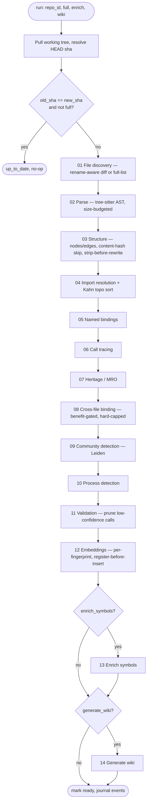
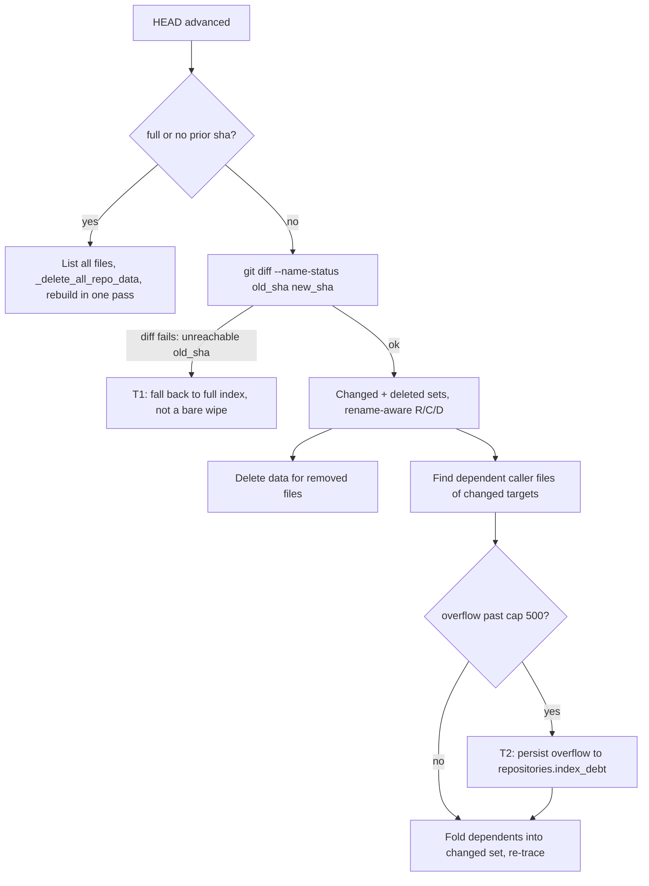
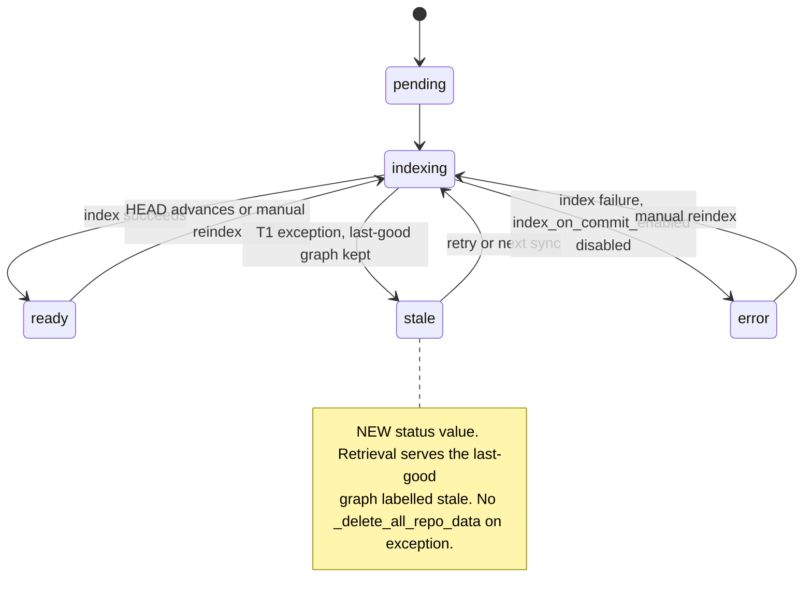
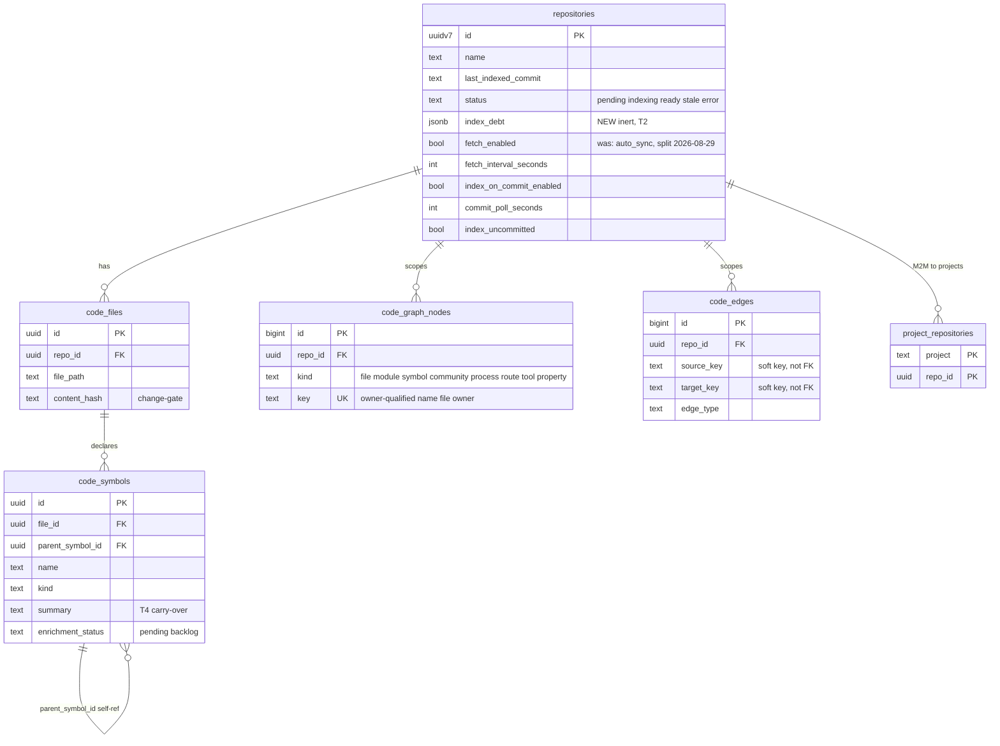
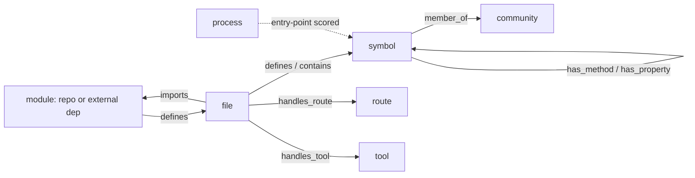
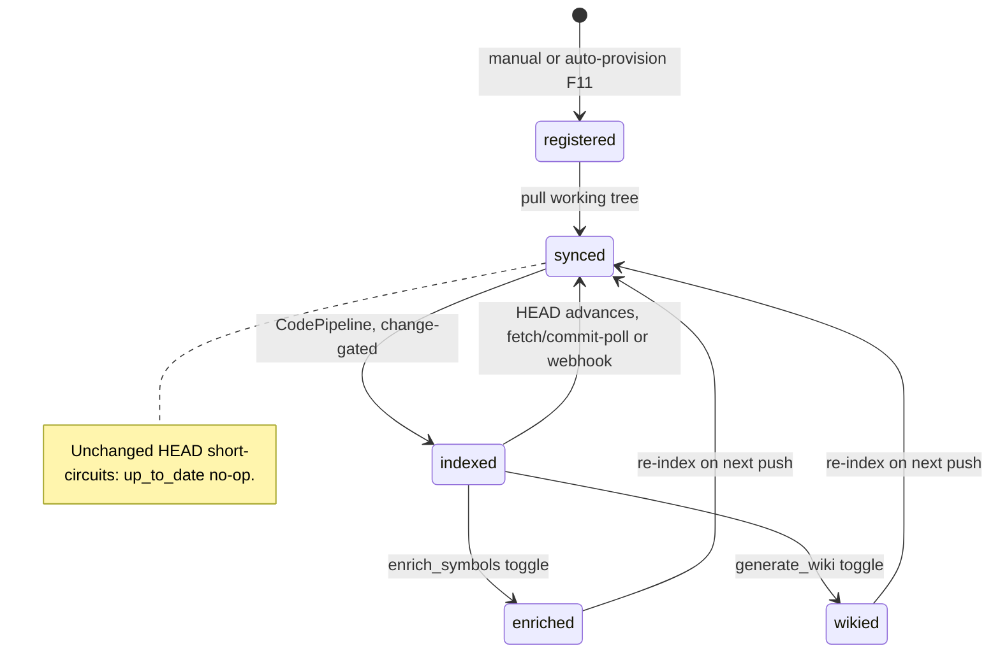
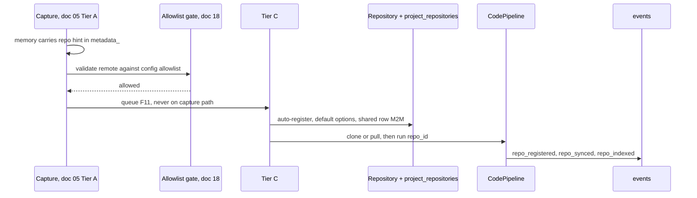
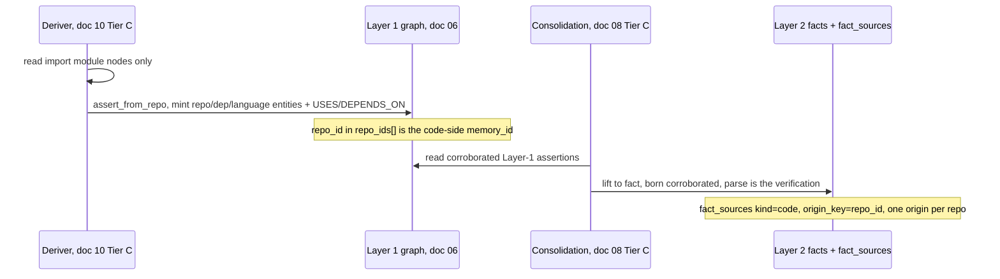
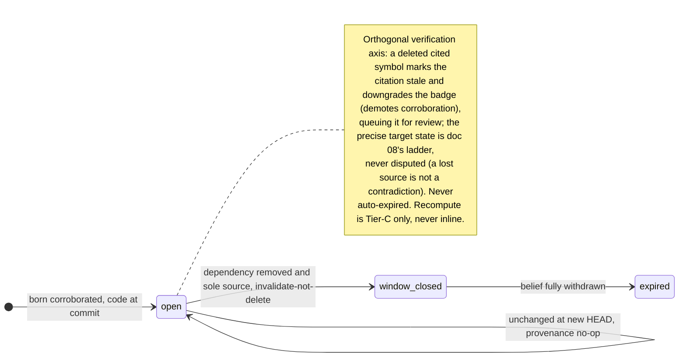
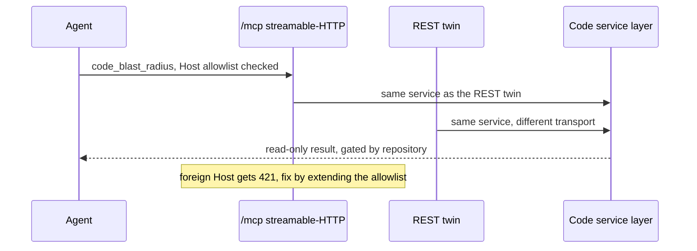

# 10 — Code Indexing

**Status:** subsystem doc; conforms to foundation docs 00–04 and the 2026-07-24 knowledge-reshape spec (`docs/superpowers/specs/2026-07-24-knowledge-reshape-design.md`). Draft 2026-07-24. Part of the unified target design — see `docs/design/README.md` for the frame and the document map.

---

## 1. Purpose & scope

**This doc fixes the mechanics of the tree-sitter code knowledge graph: how a repository becomes a repo-scoped symbol/edge graph, how that graph is kept current incrementally, how its truth is hardened (T1–T4), how a repository is registered and auto-provisioned, how code originates verified facts through a narrow one-direction bridge, and how the graph surfaces over MCP.** It is the mechanism layer under doc 01's F11 (index code) and doc 02 §6.2's code-indexing pipeline, and it gives the code tables of doc 04 §6 their runtime behaviour. The load-bearing correction the reshape makes to this subsystem is small and precise: **the code graph is already incrementally maintained** — `phase_01_file_discovery` diffs `repositories.last_indexed_commit → HEAD`, is rename-aware, strips a file's prior contributions before rewrite, skips unchanged files by content hash, and re-traces dependent callers of changed targets (spike-verified in `code_pipeline.py`, spec §3). So this doc **hardens truth on an existing incremental pipeline; it does not build incremental reindex.** Where the reshape adds new logic — the four truth-holes, the fact-origination deriver, the citation re-verifier, the auto-provision execution, and the M2M project bridge — each is labelled and sequenced.

**What the neighbouring docs fix instead.** The physical tables (`repositories`, `code_files`, `code_symbols`, `code_graph_nodes`, `code_edges`, the `code_chunk_embeddings__<slug>` partitions, `project_repositories`, and the inert `repositories.index_debt` + `entities`/`entity_relations` `repo_ids[]` columns) are doc 04 §6/§8.7. The **graph-assertion primitives** the deriver writes through — `assert_from_repo` / `strip_repo_assertions`, the amended `NOT EXISTS (live repo)` orphan sweeps, and the closed-taxonomy normalisers (`normalize_entity_type` + `_TYPE_OVERRIDES`) — are doc 06's; this doc names them and points, and owns only the sole writer. The **verification ladder** a born-`corroborated` code fact climbs (promotion counting `DISTINCT origin_key`, the contradiction veto, hysteresis) is doc 08's. The **three code-summarization LLM purposes** (symbol / module / overview) the enrichment and wiki paths call are doc 11's. The **tool contracts and payloads** the code MCP family serialises are doc 12's; the **repos / code-graph / wiki UI surfaces** are doc 13's; the **shared repo push-trigger decision** is settled here jointly with doc 15 (Part B contract 7); and the **auto-provision allowlist / SSRF gate** is doc 18's — this doc consumes the gate, it does not design it.

**Audience & authority.** An architect touching the code pipeline, the repo-sync path, the code-graph repositories, or the fact-origination bridge reads this to learn which behaviour is contract-from-baseline and which is target work. Where this doc and `CLAUDE.md` agree, that behaviour is contract. Every mechanism below is tagged **(exists today)**, **(target-new)**, **(activation)**, or **(horizon)** per doc 04 §1's convention, and the doc is honest about the gap: the pipeline, the incremental diff, the graph, the tool family, enrichment, and the wiki all exist today; T1–T4, the deriver, the citation re-verifier, `project_repositories`, and auto-provision execution are target work, and the deriver in particular **ships only after Layer 2 is proven live** (spec §8) while the `repo_ids[]` amendment it writes into **lands inert in the v1 baseline** (byte-identical sweeps until a writer exists — invariant 23).

**The primary reader is a developer who wants to *see* the system.** The prose below carries the reasoning for other stakeholders, but each major flow, lifecycle, and structure this subsystem owns is drawn as a Mermaid diagram next to the prose it illustrates. The whole-schema ERD lives in `erd.md`; the ERD here is a focused subset of only the code tables this doc owns.

## 2. The indexing pipeline

**Decision. The fourteen-phase tree-sitter pipeline ships today and is retained structurally unchanged; this doc modifies only its failure edge (T1), its silent-truncation edge (T2), its drift-detection (T3), its summary re-billing (T4), and adds the fact-origination bridge (§6) — never its phase topology.** The pipeline is `CodePipeline.run(repo_id, full, enrich_symbols, generate_wiki)`, orchestrated as a sequence of hard-checkpointed phases, each committing its own work so a later failure never rolls back an earlier phase's writes. The phases **(exists today):**

| # | Phase | Responsibility |
|---|---|---|
| 01 | File discovery | Diff `last_indexed_commit → HEAD`; full-list on `full`/first index; delete data for removed files; queue dependent-caller re-trace |
| 02 | Parsing | tree-sitter AST per changed file, size-budgeted parallel batches, per-file read+parse timeout |
| 03 | Structure | `CONTAINS`/`DEFINES` nodes & edges; content-hash skip; per-file strip-before-rewrite |
| 04 | Import resolution | Resolve import sources to files; Kahn topological sort |
| 05 | Named bindings | Named/wildcard binding propagation, per-source resolution, binding-chain flattening |
| 06 | Call tracing | Resolve call sites to owner-qualified target symbols using the type env |
| 07 | Heritage / MRO | Inheritance edges, override/implements detection, member-access resolution |
| 08 | Cross-file binding | Second-pass re-resolution, benefit-gated and hard-capped |
| 09 | Community detection | Leiden (`RBConfigurationVertexPartition`) over the symbol call/heritage graph |
| 10 | Process detection | Entry-point scoring → traced execution flows as `process` nodes |
| 11 | Validation | Prune low-confidence `calls` edges (`< 0.3`) |
| 12 | Embeddings | Chunk embeddings into `code_chunk_embeddings__<slug>`, fingerprint-registered before insert |
| 13 | Enrich symbols | Opt-in (`enrich_symbols`); drains the pending-symbol backlog inline |
| 14 | Generate wiki | Opt-in (`generate_wiki`); LLM wiki over the graph |

*Figure 2a — the change-gate and the fourteen phases; an unchanged HEAD short-circuits before any graph write.*

**The pipeline is incremental and change-gated at the front, so an unchanged repository is a near-free no-op (exists today).** `run` first pulls the working tree, resolves the new `HEAD` sha, and short-circuits when `old_sha == new_sha and not full` — returning `{"status": "up_to_date"}` without touching the graph (this is doc 01 F11's "an unchanged `HEAD` sha short-circuits unless a full rebuild is forced"). When the sha advanced, `phase_01_file_discovery` computes the changed/deleted sets from `git diff --name-status`, which makes it **rename-aware**: an `R`-status entry indexes the new path and deletes the old, a `C` copies, a `D` deletes. Only changed files are parsed; `phase_03_structure` additionally skips a file whose stored `code_files.content_hash` still matches, re-using its cached calls/imports without rewriting its structure. This is the strip-before-rewrite invariant (invariant 8) applied per file: `_delete_file_data` removes a file's symbols, its `defines`/`contains`/`calls` edges, its orphaned route/tool nodes, and its chunk embeddings before the fresh set is written, so re-indexing the same file is idempotent, and a full index (`full=True` or no prior sha) is the same discipline applied per repo (`_delete_all_repo_data` then rebuild in one pass).

*Figure 2b — phase-01 change-gating, with the T1 diff-fallback and the T2 debt overflow shown at their decision points.*

**Dependent callers of a changed target are re-traced so an incremental run does not leave a stale edge until the next full rebuild (exists today) — but the re-trace is capped, and that cap is the T2 truth-hole (§3).** When a symbol in a changed file is renamed or moved, an *unchanged* caller in another file loses its resolved `calls` edge (the changed file's re-index dropped it) and would not regain it until a full reindex. `_find_dependent_caller_files` finds those callers by matching `calls` edges whose target resolves into a changed/deleted file (owner-qualified keys are `name::file_path::owner`, so the file is segment 2, matched with `split_part`, not a suffix) and folds them into the changed set for re-tracing. It is bounded by `DEPENDENT_RETRACE_CAP` (500): when the dependent set exceeds the cap, the overflow is logged but **dropped** today — the silent work-loss T2 closes.

**Parsing is bounded so a pathological file cannot hang the pipeline or starve the executor (exists today).** Files over `MAX_FILE_SIZE` (500 KB) and ignored directories/extensions are skipped; each file's read and parse each run under `PARSE_TIMEOUT` (60 s) in the default executor so a stuck grammar frees the coroutine (and the `repo_sync` job lock above it) rather than hanging; parallel parsing kicks in only above `PARALLEL_MIN_FILES`/`PARALLEL_MIN_BYTES`, batched to a `SIZE_BUDGET_BYTES` (20 MB) ceiling; and `phase_08_cross_file_binding` skips entirely above `CROSS_FILE_HARD_CAP` (2000 files) or below a `CROSS_FILE_SKIP_THRESHOLD` (3 %) estimated benefit. These bounds are module constants today; the design position (convention 9) is that the load-bearing ones — `DEPENDENT_RETRACE_CAP` and the cross-file cap and threshold — become `config` rows with a harness-measured tuning path, so they are tuned from measured repo sizes rather than recompiled. (The reconcile cadence this sentence used to name alongside them does not exist as a standalone cadence any more — see §3's T3 correction.)

**Phase 12 obeys the per-fingerprint isolation invariant: it registers the embedder before any insert and never joins across fingerprints (invariant 2).** Chunk vectors land in `code_chunk_embeddings__<slug>`, reached only through `child_table`, and `phase_12_embeddings` registers every distinct fingerprint it observes (via `embedder_registry.register`) before writing any chunk row — the register-before-insert authority for the code side. Phase 03 having already cleared a changed file's chunks, phase 12 re-deletes only for the unchanged files it left untouched, so it does not repeat work per fingerprint. Code search is therefore semantic-only: `code_chunk_embeddings` carries no FTS column, so there is nothing to fuse (the permanence of this is open question 6, §10).

**The one grammar quirk the pipeline special-cases is the multi-entrypoint PHP/TypeScript binding, and failed grammar lookups are cached (exists today; doc 03 §5.11).** The PHP module exposes `language_php()` rather than `language()`, TypeScript mirrors it, and a failed grammar load is cached so a missing-grammar file is not re-probed on every parse. On the retained Python stack the 33 grammars are prebuilt wheels, so this is the whole of the parser-portability surface; the per-RID grammar-pack compilation the deferred .NET port would need is annex 03a's record, not this build's.

## 3. Truth hardening — T1 fail-stale, T2 index debt, T3 reconcile, T4 summary carry-over

**Decision. The code graph's four truth-holes are closed by new logic over the existing tables and the one inert new column (`repositories.index_debt`), and every fix follows the maintainer's under-claiming lens: prefer a stale-but-served graph over an empty one, a persisted debt over silent work-loss, a detected drift over an undetected one, and a carried-over summary over a re-billed one.** All four are **(target-new)** logic; the tables/columns they run over are doc 04 §6. Each is a Tier-C or ingest-side behaviour that must journal its outcome to `events` and surface its state to the repos UI (principle 10, doc 13).

**T1 — fail-stale, not fail-empty (target-new).** *Decision.* A pipeline exception must leave the last-good graph in place, marked stale, and a diff failure must fall back to a full index — never wipe. *Why.* Today `run`'s exception handler calls `_delete_all_repo_data(repo.id)`, which wipes the entire repo graph, and a force-push (or history rewrite, or shallow clone) makes `git diff old_sha..new_sha` fail with an unreachable `old_sha` — so the diff raises, the handler wipes, the repo goes to `status='error'`, and because there is now no `last_indexed_commit` progress the repo is stuck in a wipe-and-error loop, serving an empty graph to every code tool. That is the worst failure under the truth lens: silent, total, and self-perpetuating. *Consequences.* Two edges change. First, `phase_01_file_discovery`'s diff is guarded: an unreachable-`old_sha` diff failure is caught and falls back to the clean full-index path (`_list_all_files` + `_delete_all_repo_data` + rebuild-in-one-pass), which is the *correct* wipe — atomic, immediately followed by a rebuild — not a bare wipe. Second, the `run` exception handler **stops calling `_delete_all_repo_data`** for any other exception: it rolls back the poisoned session (the existing `PendingRollbackError` guard stays), sets `repositories.status='stale'` with a `status_message`, records the failure in `pipeline_failures` (per-repo, as today), and returns — leaving the last-good graph intact. Retrieval then serves the last-good graph **labelled stale** (invariant 14 — honest partial results, no silent degradation), and the stale badge is a repos-surface signal (doc 13). `stale` is a new value in the `repositories.status` vocabulary alongside `pending`/`indexing`/`ready`/`error`; a subsequent successful index clears it. This ties invariant 8 (strip-before-rewrite is the *only* sanctioned wipe, and only when paired with an immediate rebuild) to invariant 14 (a degraded graph is served and labelled, never silently emptied).

*Figure 3 — the `repositories.status` machine; the target adds `stale` so a pipeline exception keeps the last-good graph instead of wiping it.*

**T2 — index-debt drain (target-new; over the inert `repositories.index_debt` column).** *Decision.* The dependent-caller re-trace overflow past `DEPENDENT_RETRACE_CAP` is persisted to `repositories.index_debt` and drained via continuation batches, never dropped. *Why.* The 500-cap exists so a change to a widely-called utility does not balloon an incremental run into a near-full one, but the overflow callers are currently logged and forgotten, so their edges stay stale until someone forces a full reindex — silent, unbounded staleness on exactly the busiest symbols. *Consequences.* `repositories.index_debt jsonb` (doc 04 §6, lands inert in the baseline) accumulates the overflow caller-file set (deduped, with the target sha that made them debt). Each subsequent incremental run folds a bounded batch of debt files into its changed set, re-traces them, and removes them from the debt on success; the batch size is a `config` row (default equal to the re-trace cap) so it is tuned from measured drain rates (convention 9). The outstanding debt count is a repos-surface signal (doc 13) so a human can see and force-drain it, and each drain journals a `repo_indexed`-family `events` row. Debt is bounded work that *converges*, replacing silent, permanent staleness. (This paragraph originally named "a dedicated drain arm on the `code_reconcile` job (T3)" as a second drain path; T3 shipped with no standalone job at all, so the drain runs only where every incremental run already runs — see T3's correction below.)

**T3 — working-tree drift detection (target-new when drafted; shipped 2026-08-29 in a different shape than decided here — see the correction below).** *Decision.* Hash each tracked repo's working tree against `code_files.content_hash` and feed every mismatch through the incremental path. *Why.* The incremental path is only as correct as the events that drive it; a partially-failed sync, a manual edit to a working tree, or an aborted index can leave `code_files` disagreeing with disk with no signal. Reconciliation is the backstop, the code-side analog of the memory graph's hourly `graph_orphan_cleanup` (invariant 8's backstop discipline). The hashing and mismatch-classification mechanics below (hash differs → changed; on disk but absent from `code_files` → added; in `code_files` but gone from disk → deleted, fed into `phase_03` skip/rewrite / `_delete_file_data`, already idempotent) shipped unchanged and live in `app/services/code_reconcile.py`'s `compute_working_tree_drift`.

**Correction (2026-08-29, per-repo indexing modes epic).** What this section decided — a standalone Tier-C `code_reconcile` `JobRegistry` job that swept *every* tracked repo on its own cron regardless of what the operator asked for — is **not what shipped, and was retired rather than built as designed**. `auto_sync` (a single always-on-by-default boolean this doc still describes in §5) was replaced by five per-repo switches, all **defaulting off**: `fetch_enabled`/`fetch_interval_seconds`, `index_on_commit_enabled`/`commit_poll_seconds`, and `index_uncommitted`. `HEAD` is the single indexing trigger; fetching is a separate lane whose only job is to move it. The drift scan this section designed now runs **inside the one `repo_sync` loop**, per repo, and only when that repo's own `index_on_commit_enabled` switch is on, its `index_uncommitted` switch is also on, and `HEAD` has not moved — never as an unconditional sweep of the whole fleet, and never on a schedule of its own: `index_uncommitted` has no lane, it only widens what the commit-poll tick already checks. The standalone `CODE_RECONCILE_JOB_KEY`/cron/floor this section implies do not exist; CLAUDE.md's job roster dropped from twenty-four registered jobs to twenty-three over exactly this retirement. One consequence worth recording here rather than only in code: because a drift-forced run now only ever fires for a repo whose operator explicitly opted into `index_uncommitted`, it carries the active LLM the same as any other index tick, where the retired standalone job — sweeping every repo unconditionally — ran with `llm=None` to bound its unconditional cost. That tradeoff is gone because the unconditional sweep is gone.

**T4 — summary carry-over (target-new; over `code_symbols.summary`).** *Decision.* Before a changed file's symbols are deleted, their LLM summaries are snapshotted keyed on `(name, kind, owner, source-hash)`, and any symbol whose body is unchanged has its summary and enriched status carried onto the freshly-parsed row — so an unchanged symbol in a changed file is never re-summarised. *Why.* `phase_03` deletes a changed file's `code_files` row, cascading its `code_symbols` (and their `summary`) away, then re-creates fresh symbols with `summary=NULL` and `enrichment_status='pending'`. So editing one function in a 40-symbol file wipes and re-bills the other 39 symbols' enrichment on the next enrich pass — pure LLM cost for zero content change, the opposite of the moat staying cheap to maintain. *Consequences.* The deletion path snapshots the old file's `{(name, kind, owner, source-hash) → (summary, enrichment_status)}` before `_delete_file_data`; after `_store_symbol` re-creates the symbols, a carry-over pass copies the summary and sets `enrichment_status='enriched'` for every new symbol whose `(name, kind, owner, source-hash)` matches a snapshot entry — a byte-identical body keeps its summary. Only genuinely new or changed symbols re-enter the enrichment backlog (the `enrichment_status='pending'` partial index, §8). The source-hash in the key is what makes this safe: a symbol renamed or edited misses the match and is correctly re-enriched. This directly feeds doc 11's three code-summarization purposes by not calling them redundantly.

## 4. The code graph — nodes, edges, communities, processes, owner-qualified keys

**Decision. The code graph is a repo-scoped, owner-qualified, polymorphic node/edge graph in the one Postgres, and it never joins the memory-side entity graph — a symbol is not an entity, a call edge is not a relation (exists today, structurally unchanged; invariant 1, doc 01 §3.6).** It lives in `code_files`, `code_symbols`, and the two bigint-keyed graph tables `code_graph_nodes` / `code_edges` (plus the `code_chunk_embeddings__<slug>` partitions of doc 04 §5.2). The bigint keys are deliberate (doc 04 §2): these tables are append-heavy, repo-scoped, and never referenced by a uuid FK, so a narrow key is cheaper and the churning ids never leak into any provenance record (which is why fact provenance in §6 addresses symbols by owner-qualified name + commit sha, never by node id — a doc-local consequence of the bigint-key decision, in the id-normalisation *spirit* of invariant 9).

*Figure 4a — the code tables this doc owns (a focused subset; the whole schema is in `erd.md`). `code_edges` keys are soft string references into `code_graph_nodes`, not FKs.*

**Nodes and edges are polymorphic: communities and processes are node *kinds*, not separate tables (exists today).** `code_graph_nodes.kind` ranges over `file`, `module`, `symbol`, `community`, `process`, `route`, `tool`, and `property`; `code_edges.edge_type` over `defines`, `contains`, `imports`, `calls`, `extends`/`implements` (and other heritage relations), `has_method`, `has_property`, `member_of`, and `handles_route`/`handles_tool`. Uniqueness is `(repo_id, kind, key)` on nodes and `(repo_id, source_kind, source_key, target_kind, target_key, edge_type)` on edges, so every write is an idempotent `ON CONFLICT` upsert. **Symbol keys are owner-qualified** — `compose_key("symbol", name, file_path, owner=enclosing_name)` yields `name::file_path::owner` — so two same-named methods of different classes in one file resolve to distinct nodes; migration `0003` was the data-only reset that rebuilt keys under this scheme, and every caller-file lookup relies on the file being segment 2 of the `::` key.

*Figure 4b — the polymorphic node kinds and edge types; `process` and `community` are node kinds, not tables.*

**Communities are Leiden clusters over the symbol call/heritage graph, delete-and-rewritten per repo each run (exists today; the memory-side analog is doc 06's `memory_communities`).** `phase_09_community_detection` runs `CommunityDetector`: it reads function/method/class-kind symbol nodes and their `calls`/`extends`/`implements` edges (confidence-gated on large graphs), builds an undirected igraph, runs `leidenalg.find_partition` in a thread executor under a 60 s timeout (falling back to a single community on timeout — invariant 13, the single-worker snapshot assumption), then **deletes the repo's prior `community` nodes and `member_of` edges before writing the new partition** (strip-before-rewrite, invariant 8). Community labels are derived from the dominant directory of member files, and the node key carries the numeric community id so two communities sharing a dominant directory do not collide-merge. `phase_10_process_detection` writes traced execution flows as `process` nodes by entry-point scoring, and `phase_11_validation` prunes `calls` edges below 0.3 confidence. Communities and processes surface over MCP (`code_communities`, `code_processes`) and the code-graph UI (doc 13).

**The one target-new addition to these tables is the inert `repositories.index_debt` column; everything else is structurally frozen.** `index_debt jsonb` (T2, §3) lands inert. The `entities`/`entity_relations` `repo_ids[]` amendment the deriver writes into is **not** on these code tables at all — it is on the *memory-side* graph (doc 04 §4.2), because the code→vault bridge asserts memory-graph entities from code, it does not annotate code-graph nodes. The never-join invariant is thereby structural: no query reads a `code_graph_nodes` row and an `entities` row in the same statement; the only crossings are the two application-level, one-direction components of §6.

## 5. Repository lifecycle — registration, auto-provision (F11), sync, default options, the push trigger

**Decision. A repository's lifecycle is `registered → synced → indexed → optionally enriched / wiki'd → re-indexed` (exists today), extended with auto-provision execution (F11) and a many-to-many `project_repositories` bridge (target-new), and kept current by periodic change-gated sync (with a push webhook deferred).** Registration is manual (a REST/MCP call creating a `Repository` row against a local path or remote) or, target, automatic.

**Correction (2026-08-29): the rest of this paragraph describes the single always-on `auto_sync` boolean this doc was drafted against; the per-repo indexing modes epic replaced it before `0001_baseline.py` froze, so there was no migration to layer a correction on top of — the baseline itself changed.** `repositories.auto_sync` and its partial index `ix_repositories_auto_sync WHERE auto_sync = TRUE` do not exist. In their place, five per-repo columns — `fetch_enabled`/`fetch_interval_seconds` (default 300s, floor 30s), `index_on_commit_enabled`/`commit_poll_seconds` (default 60s, floor 15s), and `index_uncommitted` — all **default off**, and the one recurring loop (`app.services.job_runners.make_repo_sync_runner`, registered as `repo_sync`) filters on `WHERE fetch_enabled OR index_on_commit_enabled` (a plain sequential scan — `repositories` holds tens of rows at homelab scale, so no replacement partial index was built; `docs/planning/baseline-schema-inventory.md` §3.1 records this as a decision). `HEAD` is the single indexing trigger, not `auto_sync`: fetching only moves `HEAD` (its own lane, its own interval, its own failure handling that logs and continues without disabling anything); the index lane observes `HEAD` and never fetches (`CodePipeline.run(..., pull=False)` on this path), so it can never fast-forward or reset over the very working-tree drift `index_uncommitted` exists to catch. An index-lane failure disables `index_on_commit_enabled` on the first occurrence (`RepoManager.mark_periodic_sync_failure`) and deliberately leaves `fetch_enabled` alone, because a transient network fault must not silently turn off an unrelated switch the operator chose. Manual reindex, the push webhook, and MCP `code_reindex` bypass all five switches and keep the old fetch-then-index behaviour — they are explicit operator acts, not the unattended loop these switches govern.

*Figure 5a — the repository lifecycle; enrichment and wiki are opt-in side transitions, sync is change-gated so an unchanged HEAD is a no-op.*

**Auto-provision (F11) executes an untracked repository hint entirely in Tier C, never on the capture path (target-new; doc 01 §3.6/F11).** When a captured memory carries a repository hint the project does not yet track, **capture** (doc 05) resolves and validates the hint against the SSRF allowlist gate and queues F11; this doc owns the *execution*. The hint rides the existing `memories.metadata_` jsonb (no new column, doc 04 §9); the allowlist is a `config` row and the gate is **doc 18's**, consumed here, never re-designed. Execution is a Tier-C hand-off: auto-register a `Repository` with default options, then clone/pull and run `CodePipeline` — the clone and first index run off the hot path (invariant 15). The association is a `project_repositories` row (doc 04 §8.7), a **many-to-many over one shared `Repository`**: two projects referencing the same remote own the *same* repo and its one repo-scoped graph, not private copies (correct and cheaper, because the graph is repo-scoped). `project_repositories` is a registry-level association only — it bridges the memory and code worlds at the project boundary without joining the graphs (invariant, doc 01 §5). Registration and each index journal `repo_registered` / `repo_synced` / `repo_indexed` `events` rows (doc 04 §8.1) — the durable substrate under the repos timeline, replacing today's transient `/ws`-only `repo.indexing_*` broadcasts' durability gap (principle 10).

*Figure 5b — auto-provision F11: capture validates and queues, all execution is Tier C, never on the capture path.*

**The default-options set for an auto-registered repo was decided here as `auto_sync=true`, `enrich_symbols=false`, `generate_wiki=false` (open question 1, resolved here jointly with doc 15 — Part B contract 7).** *Why.* Auto-provision should make code knowledge *reachable* without spending LLM budget the human did not ask for. Structural indexing (the symbol/edge graph, communities, processes, chunk embeddings, and — once L2 is live — the deterministic import-derived facts of §6) is the cheap, always-valuable core and runs by default. Symbol enrichment and wiki generation are LLM-cost-heavy and opt-in everywhere else (`reindex` toggles), so an auto-provisioned repo defaults them **off**; enrichment still drains lazily and cheaply through the `enrichment_status='pending'` backlog job (§8) if the human later turns it on, and the wiki stays on-demand (`GET /code/wiki` is read-only, §8). **`auto_sync=true` survived the epic as a translated pair, not as a dropped default**: every *other* registration path now defaults all five recurring-indexing switches off, but the F11 hint-provisioned path (`app/services/repo_provision.py`'s `_resolve_repository`) still sets both `fetch_enabled=True` and `index_on_commit_enabled=True` on creation, because a repo minted from a capture hint with no operator review is exactly the case this section's reasoning was written for — nobody is on hand to flip a switch afterward, so the repo has to keep itself current on its own. Every manually- or dialog-registered repo, by contrast, gets its one initial index (§5's lifecycle) and then sits still until the operator opts it into a recurring switch. These defaults are `config`-adjacent decisions the maintainer can revisit per deployment (convention 9), and `project_repositories.opt_out` gives a per-project auto-provision escape hatch (doc 04 §8.7).

**The repo push trigger is periodic change-gated sync for v1; a push webhook is the deferred enhancement (open question 2, resolved here; Part B contract 7, shared with doc 15).** *Decision.* v1 keeps the current model — the `repo_sync` job periodically pulls repos with `fetch_enabled` on and indexes repos with `index_on_commit_enabled` on only when `HEAD` advanced (change-gated, so an unchanged repo is a no-op; this used to read "re-pulls `auto_sync` repos" before that flag split into the two independent switches) — and treats a push webhook as a Phase-4 enhancement, not a v1 requirement. *Why.* A webhook needs an externally-reachable receiver and its own authenticated endpoint on the streamable-HTTP surface, which is exactly the exposed-deployment hardening doc 18 owns; the LAN-default deployment has no reason to open one, and the change-gate makes periodic sync's only cost a cheap `git fetch` + sha compare on an unchanged repo. *Consequences.* The webhook, when it lands, is purely a *latency* improvement (index-on-push rather than index-on-next-tick) that reuses the identical change-gated `CodePipeline.run` — it is never a second indexing path. Doc 15 inherits this same stance so the two docs do not paraphrase the trigger differently (convention 10). The sync cadence is a `config` cron row.

## 6. Fact origination — the deriver, the code-fact lifecycle, the citation re-verifier

**Decision. A narrow, deterministic, LLM-free deriver mints Layer-1 graph assertions from a repository's *imports only*, tagged with a `repo_ids[]` assertion; consolidation lifts the corroborated ones to Layer-2 facts born `corroborated`; and symbols, calls, communities, and processes never originate facts (target-new; ships after Layer 2 is proven live — spec §3.2/§8).** This is doc 01 §3.6's "code originates verified facts through a narrow one-direction bridge, not a graph join." The deriver reads a repo's import edges — already `module` nodes in the code graph — and mints, through the **existing closed taxonomy** (doc 06's `normalize_entity_type` + `_TYPE_OVERRIDES`, unknown → `concept`): a `repo → project` entity, each external dependency module as a `tool` / `database` / `language` entity, and the relations `repo —USES/DEPENDS_ON→ dep` and `repo —USES→ language` (roughly 10–200 facts per repo). It asserts these at **Layer 1** — `entities` / `entity_relations` rows, exactly like a memory's extractions but tagged with a **repository** assertion rather than a memory assertion — so a `postgres` entity minted from a repo's imports is the *same deduped node* as `postgres` from a memory (the anchoring benefit that makes the bridge worth building). Symbol-level claims are deliberately excluded from origination: a claim *about* a symbol stays **memory-asserted**, carrying a commit-addressed code **citation** as evidence, never promoted structurally (below).

*Figure 6a — the deriver → assert-primitives → consolidation ladder; the two application-level crossings that never join the graphs.*

**The bridge writes through doc 06's `repo_ids[]` primitives and enters doc 08's ladder with a single, fixed provenance shape (Part B contract 4).** The deriver's only write path is `assert_from_repo` (doc 06): a repo id in `entities.repo_ids[]` / `entity_relations.repo_ids[]` is the code-side analog of a `memory_id`, and `strip_repo_assertions` does strip-before-rewrite *per repo* exactly as `delete_by_memory_id` does per memory — so re-deriving a repo's imports is idempotent, and both orphan sweeps' amended `NOT EXISTS (live repo)` predicate keeps a shared entity alive while any live memory *or* live repo asserts it (invariant 8, amended). Consolidation (doc 08, Tier C) lifts a corroborated Layer-1 assertion to a Layer-2 `knowledge_triples` fact, and a code-originated fact is **born `corroborated`** — the parse *is* the verification — carrying a `fact_sources` row of `source_kind='code'`, `origin_key = repo_id` (**one origin per repo regardless of commit count**, so re-derivation refreshes and never multiplies corroboration — the truth-critical rule of spec §2.1), and `detail = {commit_sha, basis, file_path, symbol_key}`. That detail addresses code by **owner-qualified names and commit shas, never the churning bigint node ids** (the id-normalisation spirit of invariant 9, applied to the code keys): a node id is meaningless after a re-index, a `symbol_key` + sha is stable and re-resolvable. This is the one interface three docs share — doc 06 owns the primitives, doc 08 owns the ladder the fact climbs, doc 10 owns the sole writer — and it uses the one definition (convention 10).

**The `repo_ids[]` amendment lands inert in the v1 baseline; the deriver is its lone later writer (invariant 23).** The two columns, the two sweep predicates, and the two primitives ship in the baseline with every `repo_ids` array empty, which makes the amended sweeps byte-identical to today's — so the load-bearing deletion-logic change is reviewed, tested, and frozen while it is riskless (doc 04 §4.2), and the deriver job that first fills those arrays ships **only after Layer 2 is live** (spec §8 sequencing), because its born-`corroborated` facts need a working verification ladder to enter. Presenting the inert columns as a shipped fact-origination capability would claim scaffolding as substrate; they are labelled inert until the writer exists.

**The code-fact lifecycle is invalidate-not-delete on withdrawal, badge-downgrade on a broken citation, and a provenance no-op on an unchanged HEAD (target-new; spec §3.4).** Three transitions, each recomputed **off the hot path** — the re-index enqueues affected facts for the Tier-C verification recompute, it never recomputes inline (invariant 15; the enqueue-not-recompute rule shared with doc 05/08 as Part B contract 5, and a strip-and-rewrite that lands the identical source set is a provenance no-op, never a verified↔candidate thrash):

- **Dependency removed.** A dependency dropped from the imports → the code source for `repo —USES→ dep` is withdrawn (`strip_repo_assertions` removes the repo from the relation's `repo_ids[]`). If that was the fact's **sole** source, consolidation invalidates it — closes `invalid_at`, never deletes the row (invalidate-not-delete, doc 08).
- **Symbol deleted.** A symbol that a memory-asserted fact **cites** (via a `fact_sources(kind='code')` evidence row) is deleted or renamed at the new HEAD → its citation is marked **stale** and the citing fact's badge is **downgraded and queued** for review — **never auto-expired**. A deleted symbol may be a rename the human should confirm, not a retraction of the claim, so the truth lens says label-and-queue, not silently expire.
- **Unchanged at new HEAD.** A dependency (or cited symbol) that still resolves at the new HEAD → a provenance no-op; the `fact_sources` row's identical `{origin_key, symbol_key}` means no verification change.

*Figure 6b — the code fact on its belief axis (invalidate-not-delete); the orthogonal verification axis reacts to broken citations, per spec §2.5.*

**The citation re-verifier is the second sanctioned crossing, and it runs as a Tier-C job scoped to a re-indexed repo's changed files (open question 4, resolved here).** *Decision.* After a repo re-indexes, a Tier-C re-verifier walks the `fact_sources(kind='code', origin_key=repo_id)` evidence rows whose `detail.file_path` falls in the run's changed/deleted file set, re-resolves each `symbol_key` against the new HEAD's `code_graph_nodes` (owner-qualified key lookup), and for any that no longer resolve marks the `fact_sources` row stale (`detail.stale=true`, with the sha at which it broke), downgrades the citing fact's badge, and enqueues the fact for the verification recompute — never auto-expiring it. *Why.* This is the second of doc 01 §3.6's two application-level one-direction crossings (the deriver is the first); it is named as sanctioned everywhere but designed nowhere else. **`detail.file_path`, not `symbol_key`, is what a file set is matched against.** `symbol_key` is basis-dependent — a path for a language-basis citation, a module key (`httpx`) for an import-basis one — so matching a file set against it would skip every import-basis citation and report a clean pass. The re-resolution still keys on `symbol_key`, which is what invariant 9's owner-qualified addressing requires; only the *scoping* predicate changes field. Scoping to the changed-file set (from `phase_01`'s diff) is the cost bound — an unchanged file's citations cannot have broken, so they are not re-resolved — and running it in Tier C keeps it off both capture and retrieval. *Consequences.* A stale citation is a badge signal on the fact (doc 08's downgraded/under-review surface — a demotion of corroboration, not `disputed`, which is reserved for a contradiction; rendered by doc 13), and the re-verify outcome journals to `events`. The re-verifier reads the code graph and writes the memory-side vault, one direction, no join — invariant preserved.

**Deriver v2 (manifest parsing) is flagged, not designed (open question 5).** Parsing `package.json` / `pyproject.toml` / `go.mod` for dependency *versions* and *declared-but-unimported* deps is a v2 increment gated behind measured v1 usefulness; v1 is imports-only, and v2 lands (config-gated) taxonomy-first if it ever ships. It is recorded here so a later contributor does not fold it into v1.

## 7. The code MCP tool family

**Decision. The code graph surfaces over MCP as a tool family of eleven readers, each with a REST twin, whose contracts and payloads are doc 12's (exists today; invariant 17).** The family was read-only until 2026-08-28, when `code_reindex` gave it its first writer — the `admin`-scoped file-scoped reindex door, twinned with `POST /api/v1/repos/{id}/reindex-files`; it triggers indexing and asserts nothing into the graph itself. These are the moat made reachable — blast-radius, communities, processes, and cross-file rename that no memory competitor exposes (doc 00 §6). The family:

| Tool | Purpose |
|---|---|
| `list_repos` | Which repositories are indexed and their status |
| `code_search` | Semantic search over `code_chunk_embeddings` (no FTS — semantic-only) |
| `code_file_symbols` | Symbols declared in a file |
| `code_symbol` | Source, summary, and signature of one symbol |
| `code_context` | 360-degree view: callers, callees, heritage, accesses, processes, community |
| `code_blast_radius` | Transitive dependents of a symbol, risk-bucketed — pre-refactor check |
| `code_rename` | Every reference to a symbol for a cross-file rename |
| `code_dependencies` | Import relationships for a file or repository |
| `code_processes` | Traced execution flows (`process` nodes) |
| `code_communities` | Leiden-clustered communities |
| `code_changes` | Uncommitted git changes mapped to affected symbols and processes |

*Figure 7 — the two front doors converge on one service; the Host allowlist is the sole network gate, and access is repo-gated, not project-gated.*

**The family is read-only, converges on the same code services as its REST twins, and inherits the MCP trust model unchanged (invariant 17, invariant 20).** An MCP tool and its REST route call the same service — a behaviour never exists on one front door and not the other — differing only in transport, auth posture, and `source` resolution (doc 12). The family sits on the `/mcp` streamable-HTTP surface whose sole network defence is the Host allowlist (a foreign Host gets 421, fixed by extending the allowlist, never by disabling it — invariant 20). Access to the code graph is gated by **repository**, not by project: the code tools are the deliberate exception to memory-regime project isolation (doc 01 §8), because the repo-scoped graph is shared across the projects that own a repo (§5).

**Code search stays semantic-only for v1; adding a keyword/identifier arm is flagged, not committed (open question 6, resolved here).** *Decision.* Keep code search semantic-only — `code_chunk_embeddings__<slug>` carries no FTS column, so there is nothing to fuse, and the memory-side RRF fusion (doc 07) does not apply. *Why.* Semantic chunk search covers "find code that does X"; the design does not yet have evidence that exact-identifier recall is poor enough to justify a second index and a fusion path on the code side. *Consequences.* If measured recall on exact-symbol-name queries proves weak, a symbol-name/identifier FTS arm (over `code_symbols.name` and signatures, fused like the memory side) is the later increment — added taxonomy-of-signals-first, behind a flag, tuned by the harness (convention 9). Until then, `code_symbol` / `code_file_symbols` serve exact-name lookups directly.

## 8. Enrichment & the code wiki

**Decision. Symbol enrichment drains the `code_symbols.enrichment_status='pending'` partial index — never the dead `enrichment_queue` table — and the wiki is opt-in and read-only; both call doc 11's three code-summarization purposes, and T4's carry-over keeps them from re-billing unchanged symbols (exists today; invariant 23).** The enrichment backlog is the partial index `ix_code_symbols_enrichment_pending` over `(enrichment_attempts, enrichment_priority DESC) WHERE enrichment_status='pending'` (doc 04 §6); the `enrichment_queue` table from migration `0001` has zero callers and is dormant scaffolding, droppable once confirmed unreferenced — the design must never present it as the live backlog. Draining happens two ways: inline and opt-in during a reindex (`phase_13_enrich_symbols`, capped at a bounded number of batches, scoped to the current repo so it does not spend the inline budget on another repo's backlog and surfacing any residual as work for the background job), and continuously via the `code_enrichment` Tier-C job (one of the seven). `enrichment_attempts` bounds poison symbols, mirroring the buffer's poison-row discipline.

**The wiki is opt-in on reindex and never implicitly generated (exists today).** `POST /repos/{id}/reindex` accepts `{full, enrich_symbols, generate_wiki}` (all default `false`), so wiki generation runs only when its toggle is set (`phase_14_generate_wiki` via `WikiGenerator`); `GET /code/wiki` is **read-only** — it reads or returns empty, never triggering generation, so a browse can never silently spend LLM budget. Enrichment and the wiki both dispatch through doc 11's orchestrator to the three code-summarization purposes (symbol / module / overview buckets); T4 (§3) is what keeps a changed file from re-summarising its unchanged symbols, so the moat stays cheap to maintain.

## 9. Invariants restated

The invariants this layer binds most tightly, restated so the subsystem is checkable against the 1–23 catalogue (`gt-invariants.md`, mirrored in doc 02 §10 / doc 04 §11).

- **Single Postgres, no second datastore (1).** The code graph is rows in the one pgvector Postgres — `code_graph_nodes`/`code_edges` are a view over the same store, communities and processes are node *kinds*, Leiden and PPR run in-process over rows; no external graph or vector engine.
- **Per-fingerprint isolation (2).** `code_chunk_embeddings__<slug>` is reached only via `child_table`; `phase_12` registers every fingerprint before insert and never joins across fingerprints.
- **Idempotent strip-before-rewrite (8), amended.** Per-file (`_delete_file_data`), per-repo (`_delete_all_repo_data`, only paired with an immediate rebuild — T1), and per-repo-assertion (`strip_repo_assertions`) all strip before rewrite; the amended orphan sweeps gain the `NOT EXISTS (live repo)` predicate and land **inert** until the deriver writes `repo_ids[]`.
- **Reconciliation off the hot path (15).** The deriver, the citation re-verifier, working-tree drift detection (folded into `repo_sync`, no longer a standalone job — see §3's T3 correction), community/process detection, and enrichment are all Tier-C; a re-index **enqueues** affected facts for verification recompute, never recomputes inline (Part B contract 5, the provenance no-op rule).
- **Honest partial results / no silent degradation (14).** T1 serves the last-good graph labelled `stale` rather than an empty one; T2 persists debt rather than dropping it; code-index failures are recorded per-repo in `pipeline_failures`; a stale code citation downgrades a badge visibly rather than vanishing.
- **The never-join rule, reworded not weakened (doc 01 §3.6).** No query joins the memory and code graphs; the deriver projection and the citation re-verifier are the only sanctioned crossings, both application-level and one-direction. **A symbol is not an entity; a call edge is not a relation.**
- **Closed taxonomy, taxonomy-first (5).** The deriver maps import modules through `normalize_entity_type` + `_TYPE_OVERRIDES` (unknown → `concept`); it never mints a free-form type.
- **Id-type discipline (9).** Fact provenance addresses code by owner-qualified `symbol_key` + `commit_sha`, never the churning bigint node ids.
- **Single worker (13).** Leiden runs in a thread executor under the single-worker assumption; the code jobs obey the per-job `JobRegistry` lock/floor.
- **Two front doors, one service layer (17).** Every code MCP tool has a REST twin on the same service.
- **Scaffolding-not-substrate (23).** The `repo_ids[]`/`index_debt` columns land inert; the deriver ships after L2 is live; `enrichment_queue` is dead and the partial index is the live backlog — none is claimed as shipped before its writer exists.

## 10. Open questions & deferred decisions

Each carries a recommended stance, so downstream inherits a default rather than a blank.

- **Default options for auto-registered repos.** *Resolved (§5, jointly with doc 15 — Part B contract 7): `enrich_symbols=false`, `generate_wiki=false` always; `fetch_enabled`/`index_on_commit_enabled` on for the F11 hint-provisioned path specifically (no operator on hand to opt in later) and off for every other registration path (shipped 2026-08-29, §5's correction) — structural indexing always runs once at registration either way, LLM-cost enrichment/wiki stay opt-in everywhere, and all are adjustable per deployment.*
- **The repo push trigger — webhook vs periodic sync.** *Resolved (§5, Part B contract 7, shared with doc 15): periodic change-gated sync for v1; a push webhook is a Phase-4 latency enhancement that reuses the same change-gated `run`, gated on doc 18's exposed-endpoint auth. Never a second indexing path.*
- **`code_reconcile` cadence and cost, and index-debt drain batch sizing.** *Superseded, not merely resolved differently (2026-08-29): this recommended a standalone daily Tier-C cron job. It shipped instead as a scan folded into the one `repo_sync` loop, gated per repo on `index_uncommitted` rather than run unconditionally against every tracked repo on its own cadence — see §3's T3 correction for the shape and the reasoning. The index-debt drain batch sizing question is unaffected: it still drains through ordinary incremental runs, defaulting to `DEPENDENT_RETRACE_CAP`.*
- **Citation re-verifier mechanics.** *Resolved (§6): a Tier-C job over `fact_sources(kind='code', origin_key=repo_id)` scoped to the re-indexed repo's changed-file set, re-resolving each `symbol_key` at the new HEAD; a broken resolution marks the citation stale, downgrades the fact's badge, and enqueues for verification recompute — never auto-expires. The one call the maintainer may want to confirm: whether a **renamed** (as opposed to deleted) symbol should attempt an automatic re-resolution to the new name before marking stale — recommended v1 is mark-stale-and-queue (conservative), with auto-rename-follow a measured later refinement.*
- **Deriver v2 — manifest parsing.** *Flagged, not designed (§6): versions and declared-but-unimported deps from `package.json`/`pyproject.toml`/`go.mod` are a config-gated v2 increment, taxonomy-first, gated behind measured v1 usefulness. v1 is imports-only.*
- **Code search — semantic-only permanence.** *Resolved (§7): stay semantic-only for v1 (no FTS column on chunks, nothing to fuse); add a symbol-name/identifier FTS arm later only if the harness measures poor exact-identifier recall, behind a flag. `code_symbol`/`code_file_symbols` cover exact-name lookups meanwhile.*

---

*Downstream: this doc's code graph, its T1–T4 hardening, and the inert `repo_ids[]` fact-origination bridge are given tables and columns by doc 04 §6/§8.7; the deriver and citation re-verifier write through doc 06's `assert_from_repo` / `strip_repo_assertions` primitives and its closed-taxonomy normalisers; the born-`corroborated` code facts enter doc 08's verification ladder with `origin_key = repo_id` and the `{commit_sha, basis, file_path, symbol_key}` provenance shape (Part B contract 4), and the re-index enqueues affected facts for doc 08's Tier-C recompute (Part B contract 5); enrichment and the wiki call doc 11's three code-summarization purposes; the code MCP tool family's contracts and payloads are doc 12's, its repos/code-graph/wiki surfaces and the `stale`/`index_debt` signals are doc 13's, the shared repo push-trigger is settled jointly with doc 15 (Part B contract 7), and the auto-provision allowlist/SSRF gate is doc 18's. The pipeline behaviour fixed here is binding for all of them.*
