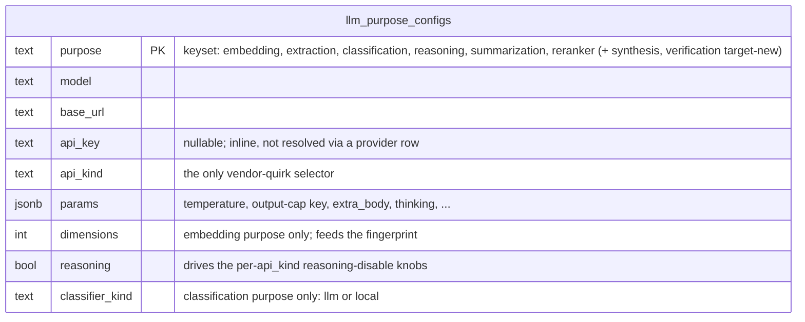
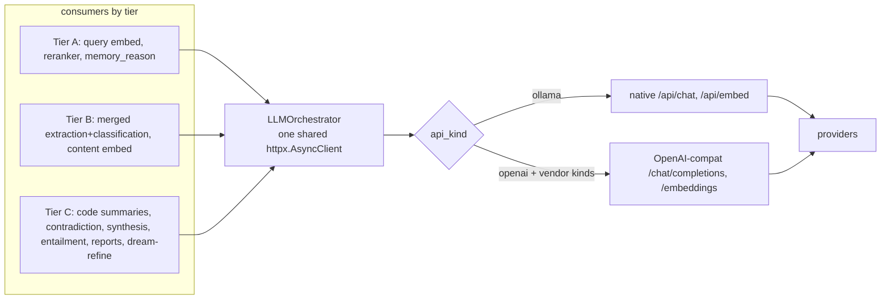
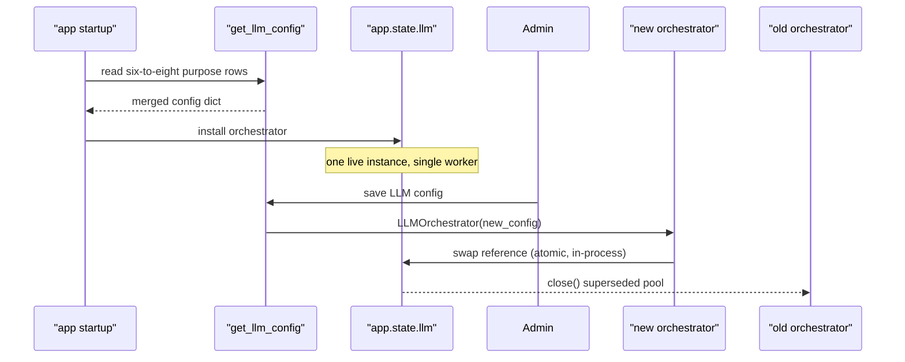
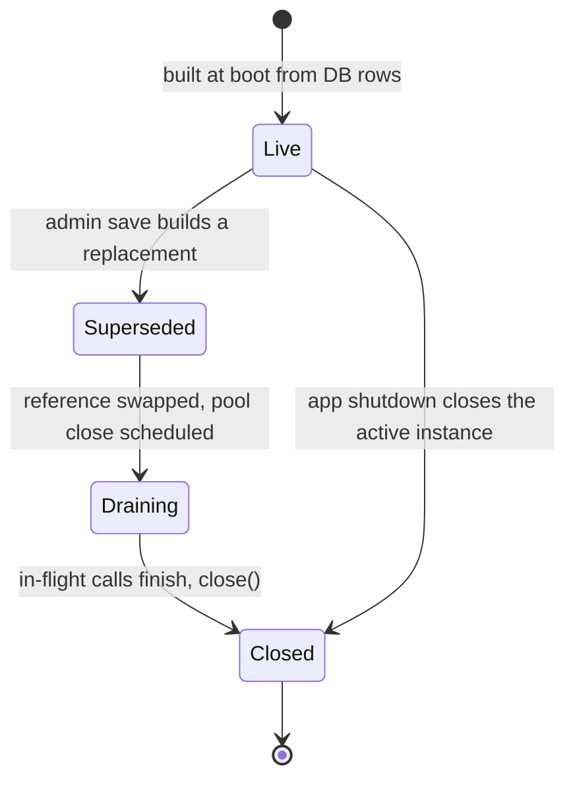
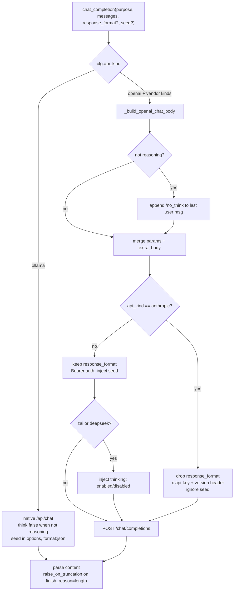
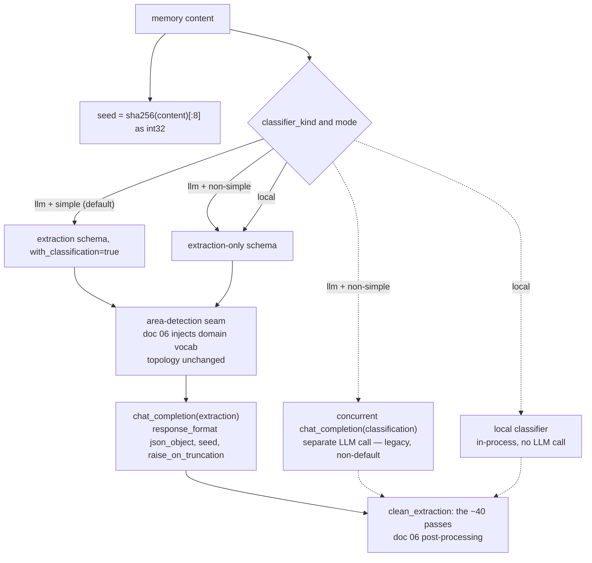
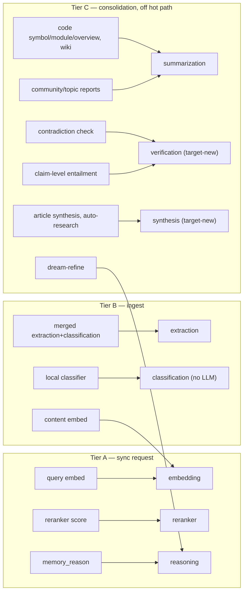

# 11 — LLM Orchestration & Providers

**Status:** subsystem design doc; conforms to foundation docs 00–04 and the 2026-07-24 knowledge-reshape spec (`docs/superpowers/specs/2026-07-24-knowledge-reshape-design.md`). Wave-1 engine-mechanics doc. Authored on the retained Python/FastAPI stack (doc 03 §4, Option A); .NET appears only as a considered-and-deferred alternative.

Every mechanism below is tagged **(exists today)**, **(rebuild)**, **(target-new)**, **(activation)**, or **(horizon)** per doc 04 §1's convention. A mechanism claimed as shipped that is only scaffolding fails review (invariant 23).

---

## 1. Purpose & scope

**This doc fixes the single external-model boundary: how darkmem constructs one orchestrator from database rows, dispatches every embedding, chat, and rerank call through it, isolates every vendor quirk in one place, and maps each configured purpose to the consumers that spend it.** It owns the flattened purpose model (six inline rows plus the code-summarization buckets and the inline `classifier_kind`), the orchestrator's boot / live-reload / shared-client discipline, the `api_kind` vendor-quirk isolation table, the merged ingest call's construction (canonical schema, prompt assembly, reproducibility seed, and the area-detection seam), embedding batching, reranking, and — the call this doc is uniquely asked to settle — **which purpose serves each new Tier-C reconciliation consumer**, and whether that widens the purpose set.

**What the neighbouring docs fix instead.** Doc 05 owns the ingest pipeline that *issues* the merged call (the five phases, buffer, fingerprint discipline, and where the local classifier executes); doc 11 fixes only the call's construction and topology, which doc 05 inherits fully from spec §5. Doc 06 owns the extraction post-processor, the closed taxonomy, and the dynamic-area pre-pass; doc 11 fixes only the *seam* the area pre-pass injects through, never the vocabulary it injects. Doc 07 owns retrieval fusion and reranking policy; doc 11 fixes only the embedding and reranker *calls* fusion consumes. Docs 08/09 own the verification ladder and article synthesis; doc 11 names the Tier-C LLM consumers they dispatch through and fixes no verification or synthesis logic. Doc 04 §7 owns the physical `llm_purpose_configs` table shape; doc 11 fixes how the orchestrator reads it and constructs from it. Doc 12 owns the settings surface contract; doc 11 fixes what that surface now configures (six-to-eight inline rows, no profile management).

**Audience & authority.** This is a binding subsystem contract for the ingest, retrieval, and consolidation authors. Where it needs a mechanism another doc owns (a partition table, a prompt, an extraction algorithm) it names the object and the invariant and points — it never inlines another doc's SQL, prompt, or algorithm (Part C convention 6).

---

## 2. The purpose model — inline rows, code buckets, `classifier_kind`

**Decision. A "purpose" is one self-contained connection binding — `{model, base_url, api_key, api_kind, params jsonb, dimensions?, reasoning?}` — stored one row per purpose in `llm_purpose_configs`, with no provider/profile indirection.** The reshape flattens the config surface: `llm_providers`, `llm_profiles`, and `ml_profiles`, every `*_ref` column, and the profile-management UI are dropped **(rebuild)**; today the codebase still resolves three tables through `provider_ref`/`profile_ref`/`ml_profile_ref` in `get_llm_config` **(exists today)**, so the flat single-table read is target work that keeps the `llm_purpose_configs` name (doc 04 §7, spec §4).

> **AMENDED 2026-08-20 — the storage half of that decision is reversed; the *resolution* half is not.** Owner ruling, spec `docs/superpowers/specs/2026-08-20-llm-providers-design.md`. `llm_providers` is reinstated as a first-class table and a purpose row references it by a NOT NULL `provider_name` instead of carrying `api_kind`/`base_url`/`api_key` inline, so a credential rotation or endpoint move reaches every purpose that uses it with no re-apply step. `llm_profiles`, `ml_profiles` and every `*_ref` column stay dropped, and `classifier_kind` stays inline.
>
> **`LLMPurposeConfig` does not change shape.** `get_llm_config` becomes one `SELECT` with one `JOIN` and still hands the orchestrator the same flat object with `base_url`, `api_key` and `api_kind` as flat fields — so `LLMOrchestrator`, `llm_quirks`, `VerificationJudge`, the health check and every benchlib consumer are untouched. That is deliberate: `benchlib/caching_llm.py`'s cache key and `verification_judge.py`'s identity hash both fold those field *names* off the resolved object, so nesting or renaming one would invalidate every benchlib cache and move the qualified judge identity.
>
> The purposes are **eight**, not six — `synthesis` and `verification` joined at T1.05 (§6). A provider-management REST surface returns under `/api/v1/config/llm-providers` (doc 12), and the provider serving `verification` refuses a `base_url`/`api_kind` change while its **`api_key` still rotates** (spec §9).

**Why flatten.** darkmem is not an LLM proxy. The indirection existed to rotate an API key in one place across purposes and to anchor a UI dropdown; both cost a two-table dereference on every config read and a class of "profile silently unlinked" bugs the maintainer already fixed once. One purpose maps to one row the operator edits directly, and key rotation across purposes is a UI convenience the settings page can offer without a storage-level join.

**Alternatives rejected.** Keeping the provider/profile tables was rejected as the reshape's point (spec §4): the indirection buys reuse darkmem's six-to-eight purposes do not need. The OpenAI SDK's config abstractions were rejected long before, and stay rejected, because they fracture the one uniform code path `api_kind` gives us (doc 03 §5.6, invariant 18).

**The canonical purpose keyset.** The six purposes are the closed vocabulary the orchestrator dispatches on; `PURPOSES` in `app/services/config.py` is their single source of truth **(exists today)**.

| Purpose | Tier | Model shape today (Ollama default seed) | Role |
|---|---|---|---|
| `embedding` | A/B/C | `qwen3-embedding:0.6b`, `dimensions=1024` | every vector: content, entity, code chunk, query, and the target article/block families |
| `extraction` | B | small instruct, `temperature=0` | the merged ingest call (entities + relations + classification fields) |
| `classification` | B | small instruct, `temperature=0` | classification, folded into extraction in simple mode; carries the inline `classifier_kind` |
| `reasoning` | A/C | mid instruct, `temperature≈0.7` | `memory_reason`, conversational chat, and Tier-C dream-refine judgments |
| `summarization` | B/C | small instruct, `temperature≈0.3` | code enrichment + wiki (symbol/module/overview buckets) and Tier-C topic reports |
| `reranker` | A | small instruct, `temperature=0`, tiny cap | retrieval rerank scoring (flag-gated) |

**`summarization` fans out to three code-summarization config buckets — symbol, module, overview — at the config level (doc 03 §5.6).** Each bucket carries its own model and prompt so a per-symbol summary (short, cheap, high-volume) is not billed at the overview model's rate **(exists today)**. A bucket is a config-and-prompt specialisation of the `summarization` purpose, not a new dispatch key: the orchestrator sees one `summarization` connection; the *prompt* is chosen per consumer (`app/services/prompt.py`, keyed by purpose, override-then-default). This distinction — a purpose binds a model/connection, a prompt is per-consumer — is what lets one purpose serve several call sites without proliferating rows, and it is the lever §6 uses to reuse `summarization` for Tier-C topic reports without a code prompt leaking in.

**`classifier_kind = llm | local` is an inline field on the `classification` row (rebuild).** It re-homes the dropped `ml_profile_ref` → `ml_profiles` indirection as a two-value enum (spec §4, doc 03 §3.3/§5.6). `local` selects the lightweight in-process classifier — the optional CPU-only `[ml]` extra, lazily imported behind `try/except`, the sole ML residual doc 03 §3.3 preserves; when `[ml]` is absent the classification purpose **falls back to the LLM-backed classifier** (the corrected `pyproject.toml` comment, doc 03 §3.3). `classifier_kind` changes *call topology*, not model config: `local` runs the classifier out-of-band and narrows the LLM ingest call to extraction-only (§5). The classifier itself and where it executes are doc 05's Tier-B executor concern; this doc fixes only that the flag lives inline and gates the topology.

**The `llm_` column-prefix drop is a naming amendment this doc inherits, not a behaviour change.** `classified_type`, `summary`, `emotions`, `flags` (ex-`llm_*`) are source-neutral because the producing classifier may be the local model, not an LLM (doc 04 §6.4, spec §6.4) **(rebuild)**. The orchestrator does not touch those columns; it returns their values in the merged call's JSON, and Phase 5 writes them (doc 05).

*The one table this doc owns (physical shape is doc 04 §7's) — flat, with no FK to any provider/profile/ml-profile table because those are dropped:*

---

## 3. The orchestrator — boot, live reload, shared client, timeouts & retries

**Decision. `LLMOrchestrator` is a hand-rolled multi-vendor client over one shared `httpx.AsyncClient`, constructed once at boot from the database purpose rows and replaced live, in-process, on an admin save.** No OpenAI SDK; one `AsyncClient` shared across every purpose and reused by the `mcp` package that also pulls httpx (doc 03 §5.6/§5.7) **(exists today)**.

*The boundary is one object: every consumer, on every tier, reaches one orchestrator instance whose only internal branch is `api_kind`.*

**Why one shared client, one process.** A single client amortises TLS handshakes and connection reuse across purposes, and — load-bearing under invariant 13 (single uvicorn worker) — a live-reload that swaps one in-process reference is atomic without cross-worker coordination. The construction reads the merged purpose dict (`get_llm_config`) at startup; on an admin save the app builds a fresh orchestrator, swaps the reference, and closes the superseded client's pool (`close()`). There is no second worker to notify, no shared external cache to invalidate; the whole reload is the redeploy-free config change invariants 18/19 promise (config lives in DB rows, read at boot and on live reload).

*Boot builds the one instance from DB rows; an admin save builds a replacement, swaps the in-process reference atomically, and closes the superseded pool off the request path:*

*The instance therefore has a lifecycle; reads route to whichever instance is live at call time, and a superseded one drains rather than dropping in-flight work:*

**Alternatives rejected.** A per-purpose client was rejected — six-to-eight pools against overlapping hosts waste connections and defeat keep-alive. A process-level env-var config was rejected outright: there are **no `LLM_*` environment variables** (invariant 18); all LLM config is DB rows so the UI can change behaviour without a redeploy (invariant 19).

**The transport posture is a fixed set of numbers, tuned once and carried by the shared client (exists today).**

| Setting | Value | Why |
|---|---|---|
| connect timeout | 10 s | a black-hole endpoint must fail fast, not wedge a caller (and any job lock it holds) |
| read timeout | 300 s | a long completion or a large embedding batch on a slow local model legitimately needs it |
| write timeout | 30 s | bound request upload |
| pool timeout | 10 s | an exhausted pool fails fast rather than hanging |
| `max_connections` | 64 | a high `pipeline_concurrency` cannot fan out unbounded requests at a rate-limited vendor |
| `max_keepalive_connections` | 16 | bound idle reuse |
| transport retries | 2 | connection/DNS/connect flakiness only — **never replays a request the server already accepted** (httpx retries connection errors, not response status) |

The split timeout (a 4-tuple, not a single 300-second scalar) is the deliberate choice that keeps connect/write/pool fast while the read budget stays generous; it is what prevents a slow vendor from holding a Tier-C job lock for five minutes. The connection cap is the global backstop for concurrency; per-consumer bounding rides on top of it (§6, §9).

**Failure surfacing is explicit and vendor-named.** Every call raises a `RuntimeError` carrying the vendor host, status, and a truncated body on HTTP error, and a purpose-plus-base-url message on `ReadTimeout` (the common "reasoning mode overran the trace" case on z.ai/DeepSeek). A completion that stops at its output-token cap raises `LLMTruncationError` when the caller opts in (`raise_on_truncation`) — extraction opts in because a half-written JSON body would otherwise fail later with a misleading parse error. The output-cap key differs by vendor (`max_tokens` / `max_completion_tokens` / `num_predict`), resolved through one ordered lookup so truncation messages and the settings UI agree. These surfaces feed doc 05's per-memory `pipeline_failures` derivation and honest partial-results reporting (invariant 14).

---

## 4. `api_kind` — the vendor-quirk isolation table

**Decision. `api_kind` is the only place a vendor quirk lives; the enum on `LLMPurposeConfig` and the `_QUIRKS` table in `app/services/llm_quirks.py` are its two code mirrors, and this table is its canonical reference (exists today).** The orchestrator, the health check's reachability probe, and the wizard's model probe all read that one table rather than branching on a vendor name; a test parses every module under `app/` and fails on any comparison against a vendor literal outside it. Every auth scheme, reasoning-disable knob, structured-output caveat, and missing-endpoint fact is handled inside the orchestrator, never papered over at a call site — that is what keeps the rest of the codebase provider-agnostic (invariant 18). `openai` is the OpenAI-compatible path (`/chat/completions`, `/embeddings`); `ollama` is native (`/api/chat`, `/api/embed`); `anthropic`, `google`, `deepseek`, and `zai` are declared kinds that **today dispatch through the compat path** with their quirks patched, reserving a slot for a future native adapter (doc 03 §5.6).

| `api_kind` | Auth | Reasoning-disable knob | Structured output | Embeddings | Notes |
|---|---|---|---|---|---|
| `openai` | `Authorization: Bearer` | `reasoning_effort` param (`none…xhigh`) | `response_format: json_object` accepted | yes | `max_completion_tokens` cap key; automatic prompt caching ≥1024-token prompts |
| `ollama` | none / Bearer | `think: false` (native; the `/no_think` soft directive is ignored by some qwen builds) | `format: "json"` | yes | params map into an `options` envelope; `num_predict` cap; `seed` in options |
| `anthropic` | `x-api-key` + `anthropic-version` | seed **ignored** (harmless); no reasoning knob on compat | `response_format` **dropped** (compat shim demands strict `json_schema`); rely on in-prompt schema + markdown-fence stripping | **no** | native `/v1/messages` + `cache_control` needed for prompt caching — does not fire on compat |
| `google` (Gemini) | `Authorization: Bearer` | `reasoning_effort: none` — the only compat knob that disables hidden CoT (`thinking:{type:disabled}` rejected) | `response_format: json_object` accepted | yes | compat under `/v1beta/openai`; reasoning-by-default |
| `deepseek` | `Authorization: Bearer` | `thinking:{type:disabled}` — the only flag that zeroes `reasoning_tokens` on v4 | `response_format: json_object` accepted | **no** | hidden CoT otherwise eats the whole `max_tokens` budget |
| `zai` (GLM) | `Authorization: Bearer` | `thinking:{type:enabled\|disabled}` | `response_format: json_object` accepted | yes | compat at `/api/paas/v4`; `/v1/models` under-reports models (UI uses a free-text combobox) |

*The whole vendor-difference surface resolved on one axis, in three orchestrator methods — a call site sees none of it:*

**Why a table and not a per-vendor SDK.** Each vendor's compat surface is 90% identical and 10% quirk; a table plus a handful of branches captures the 10% in one auditable place, where an SDK would hide it behind an abstraction that breaks the "one uniform code path" property. The reasoning-by-default vendors are the sharp edge: with a small `max_tokens` budget and a long extraction prompt, a hidden chain-of-thought pegs the cap, `finish_reason` comes back `length`, and `content` is empty — so the orchestrator injects the correct per-vendor disable knob for every non-reasoning purpose. `reasoning=True` on the purpose row flips these knobs to their enabled form (the `reasoning` purpose, chat).

**The embeddings-capability guard survives the flattening (rebuild).** Anthropic and DeepSeek expose no embeddings endpoint on their compat layer; an embed call against one 404s on every request. Today two guards exist: a UI-advisory `supports_embedding` flag on the (being-dropped) provider profile, and a runtime `_assert_can_embed` keyed on `api_kind` (`_NO_EMBEDDING_VENDORS = {anthropic, deepseek}`). When the provider table is dropped, the **runtime `api_kind`-keyed assertion is the surviving guard**; the settings UI must re-derive the "cannot embed" hint from `api_kind` directly rather than a provider flag (doc 12).

**How a new `api_kind` lands (the maintenance rule).** Adding a vendor is: (1) extend the `LLMApiKind` `Literal`; (2) add its `VendorQuirks` row — auth scheme, reasoning-disable knob, structured-output and seed acceptance, embeddings capability, output-cap key — which `_headers` / `_build_openai_chat_body` / the dispatch methods and both probe call sites read; (3) add a row to this table; (4) add a seed default (§7). This is code-and-doc, deliberately **not** a database table — quirks are executable behaviour, not data, and a config-row-driven quirk engine would be the over-abstraction the hand-rolled path exists to avoid.

---

## 5. Ingest call construction — the merged call, prompt assembly, the seed, the area seam

**Decision. One LLM touch per memory: the merged extraction-plus-classification call is the default LLM ingest path, with two non-default exceptions — `classifier_kind = local` narrows it to extraction-only (the classifier runs off the model path), and a non-`simple` classification mode keeps a separate concurrent classification call (retained but never the default). "One call" describes the default, not an absolute (spec §5).** One structured `chat_completion("extraction", …)` returns entities, relations, `classified_type`, `summary`, and the enrichment fields together (`extract(..., with_classification=True)`); there is never a second classification round-trip **(exists today** for the simple-mode single-call merge; **target alignment** to make it the *only* default with `local` the sole exception). When `classifier_kind = local`, the classifier runs out-of-band and the LLM call narrows to extraction-only. Embeddings are a separate batched call (§6); reranking is retrieval-side; so the one merged call is the whole per-memory LLM cost on ingest.

*One LLM call on the main path; the local classifier, when selected, produces the enrichment fields off the model path. The area seam injects vocabulary without adding a call:*

**Why one call.** Two LLM round-trips per memory doubled ingest latency and cost for no accuracy gain, because extraction's `memory_type` (already the simple-7 vocabulary) doubles as the classification label in simple mode. The merge folds `summary`/`emotions`/`flags` into the extraction schema and reuses the one inference. The narrowing exception exists because the local classifier is a genuinely cheaper path at volume that a merged LLM call cannot contain.

**Alternatives rejected.** The old two-concurrent-calls topology (a separate LLM classification call alongside extraction) is retained *only* for the configurations the merged schema cannot carry — the `local` classifier (the optional in-process `[ml]` path), or an area-grained non-simple classification mode whose larger label space the extraction schema does not encode (CLAUDE.md). It is never the default. Moving the ~40 deterministic cleanup passes into the prompt was rejected: they are the moat and stay post-processing (spec §5, doc 06).

**Prompt assembly is one canonical schema + content + reproducibility seed + minimal rules.** The inline prompt rules that the cleanup passes already enforce downstream are stripped from the prompt (spec §5); what remains is the JSON schema the parser expects, the content, and the minimal rule set. Structured output is requested as `response_format: json_object` where the vendor accepts it and **dropped for Anthropic** (§4), whose compat shim demands a strict `json_schema` the in-prompt-schema design does not supply; the parser strips the markdown fences Anthropic sometimes wraps JSON in. This prompt-and-parse posture — an in-prompt canonical schema, a soft `json_object` hint, never a dependency on vendor tool-mode or strict-schema enforcement — is the portable default (§9 settles it), because a hard structured-output dependency would fracture the one uniform code path across vendors that do and do not support it.

**The reproducibility seed is `sha256(content)[:8]` as a 32-bit int, forwarded on extraction and classification (exists today).** Vendors that honour it (OpenAI, DeepSeek, z.ai, Google compat, Ollama via `options.seed`) return stable output for the same content; Anthropic ignores it, harmlessly. Combined with `temperature=0` this makes the same content + same prompt reproducible across calls — the single biggest determinism lever for the extraction pipeline and its E2E tests. Re-extracting the same content under a *different gate state* (a `classification_mode` flip, or `classifier_kind` set/cleared) is **not** bit-identical, because the gate changes the extraction prompt — a documented, expected non-identity, not a bug (CLAUDE.md, doc 05).

**The area-detection seam is a prompt-assembly injection point that must not change the call topology (spec §5, doc 06).** doc 06's later area pre-pass selects a domain-appropriate type vocabulary; doc 11 fixes only that the merged call exposes a place to inject that vocabulary into the canonical schema/rules *before* the single call — never as an extra round-trip. The seam is a parameter to prompt assembly, not a second inference; the normaliser contract and the vocabulary itself are doc 06's, spike-gated. Keeping the seam at prompt-assembly (not at the orchestrator dispatch) is what preserves the one-touch topology while doc 06's spike proceeds independently.

---

## 6. Retrieval, embedding batching & the Tier-C consumer matrix

**Decision. On retrieval only two model calls are permitted — the query embed and the optional reranker score — and every reconciliation call is a Tier-C consumer that dispatches through this orchestrator off the hot path (invariant 15).** Fusion, weighting, and filtering are deterministic (doc 07); the LLM never sits on Tier A (sync request) or Tier B beyond the one merged ingest call (spec §5).

**Embedding batching is the orchestrator's job; chunk size and concurrency are the caller's (exists today).** `embed_batch_chunked(texts, chunk_size, concurrency)` fans a large embed set into concurrent `embed_batch` calls under a semaphore, preserves input order, and returns the fingerprint of the embedder that actually produced the vectors — raising if the active embedder rotated mid-batch (an admin saved a new embedding config between chunks) so mixed-embedder vectors are never persisted under one label. Every embed method returns `(vector, fingerprint)` where the fingerprint is `f"{model}|{len(vec)}"`; `_check_dims` rejects a configured-vs-actual dimension mismatch so reads never route to a partition writes never populated. This is the orchestrator's tie to **invariant 2** (per-fingerprint isolation): the orchestrator *emits* the fingerprint that names the partition, and doc 04 §5 owns the child-table shape the fingerprint selects — `child_table(parent, fingerprint)` is the sole namer, and no query joins across fingerprints. The `0` sentinel dimension (when `dimensions` is unset) surfaces the same "register on first real embed" path the empty-batch cases use, so `_register_fingerprint` (doc 05 Phase 1/3) still runs before any partition insert.

**Reranking is retrieval-side, flag-gated, and bounded (exists today / activation).** `RerankerService` LLM-scores the top-40 RRF-ranked rows 0–10 through the `reranker` purpose under a semaphore, appends the unscored tail in incoming order, and falls back to original ordering if scoring fails. It runs only when `reranker_enabled` (default **off** — an activation, wired but dormant until turned on). doc 07 owns the rerank *policy* (before or after layer grouping); doc 11 owns only that the call goes through the `reranker` purpose.

**The purpose→consumer matrix — the call this doc owns.** Every LLM/embedding call in darkmem maps to exactly one purpose. The framing question is whether the new Tier-C consumers (contradiction check, synthesis, entailment, community reports, dream refine) **reuse `reasoning`/`summarization` or widen the purpose set**. This doc settles it: **widen by two — add `synthesis` and `verification` — and reuse existing purposes for the rest.** The widening is the purposes-analog of taxonomy-first (invariant 5): the new purpose rows, their seeds, and the wizard/`PURPOSES`-list sweep land **before** any consumer dispatches on them; a consumer dispatching on an unseeded purpose is the same class of bug as a feature emitting an untabled entity type.

| Purpose | Tier | Consumers | Label |
|---|---|---|---|
| `embedding` | A / B / C | query embed (retrieval); Phase-1 content + Phase-3 entity embed; code-chunk embed; re-embed job; **target, Tier-C off the hot path** — the `article`, `relation`, and template-only `triple` embedding families (the four target-new per-fingerprint parents of doc 04 §5.3; refresh mechanics doc 07) | (exists today); article/relation/triple/block (target-new/horizon) |
| `extraction` | B | the merged ingest call; extraction-only when `classifier_kind=local` | (exists today) |
| `classification` | B | folded into the merged call (simple mode); the separate concurrent call for `llm`+non-simple; `local` runs the in-process classifier out-of-band | (exists today) |
| `reasoning` | A / C | `memory_reason`; conversational chat; **Tier-C dream-refine** merge/rewrite judgments | reasoning/chat (exists today); dream-refine (target-new) |
| `summarization` | B / C | code enrichment (symbol/module/overview buckets); wiki; **Tier-C topic/community reports** | code paths (exists today); community reports (target-new) |
| `reranker` | A | retrieval rerank (top-40) | (exists today, flag-gated) |
| **`synthesis`** (new) | C | **Layer-3 article write-ups**; auto-research write-ups (F7) | (target-new) |
| **`verification`** (new) | C | **fact contradiction check** (the dispute veto); **article claim-level entailment/grounding** | (target-new) |

*The matrix by tier: two truth-critical Tier-C consumers get a dedicated `verification` purpose, article synthesis gets `synthesis`, reports and dream-refine reuse existing purposes, and only the query embed and reranker are model calls on retrieval:*

**Why widen by exactly two.** The two new workloads differ materially from every existing purpose in cost, token budget, and — for the truth-critical one — the required care. *Synthesis* produces long grounded articles; reusing `summarization` would run it on a bucket capped for short code summaries (hundreds of tokens), which is simply broken, and a dedicated purpose lets the operator point synthesis at a capable model with its own budget. *Verification* is the shared NLI judge for both the fact-level contradiction veto (doc 08) and the article claim-level entailment pass (doc 09) — the same task shape ("does premise text entail/contradict hypothesis text," `temperature=0`, structured verdict), so one purpose serves both. Critically, given the maintainer's TRUTH priority and that a single non-echo contradiction is an *absolute veto* (spec §2.1), the contradiction judge must not share config with the `temperature≈0.7` conversational `reasoning` model; a dedicated `verification` purpose is the one place a stronger, deterministic judge model is worth the operator's config surface.

**Why reuse for the other three.** Dream-refine is a short-text merge/rewrite judgment of the lowest stakes (its actions are undoable, doc 08), so it rides `reasoning`. Community/topic reports are short subject summaries — same shape as `summarization`, differing only in prompt (memory-graph vs code), which the per-consumer prompt selection already handles without a new dispatch key. This keeps the widening minimal: two purposes, not one-per-consumer.

**The cost this widening carries.** doc 04 §7 fixes the keyset at **six** inline rows; adding `synthesis` and `verification` makes it **eight** and is a proposed amendment to doc 04 §7 (and the ERD's `llm_purpose_configs` note, and `PURPOSES`). Both are Tier-C-only and land behind their layers (Layer-2 verification, Layer-3 synthesis) per spec §8 sequencing, so the baseline seeds them but no consumer spends them until those layers ship — consistent with landing scaffolding inert and honestly (invariant 23). This is the one judgment call in the doc the maintainer should confirm (§9, return summary).

**Tier-C concurrency posture.** The orchestrator stays a thin transport; its only global bound is the connection-pool ceiling (§3). Per-purpose fan-out is bounded at the *consumer/job* layer with an `asyncio.Semaphore` sized by a `config` row per Tier-C job (the existing pattern — enrichment `sem=5`, reranker `sem=8`), never by relying on the pool cap alone. Consolidation can fan out wide, so each Tier-C job carries its own measured concurrency knob (§9); the pool cap of 64 is the backstop that keeps any single job from swamping a rate-limited vendor.

---

## 7. Configuration surface — the setup wizard, seeds, no env vars

**Decision. The six-to-eight purpose rows are written by the setup wizard's finalize step from `app/services/llm_seed.py`, never by a migration; there are no `LLM_*` env vars (invariants 18/19).** Seeds are pure Python dataclasses the wizard reads, overlays with the operator's chosen `api_kind`/key/model, and bulk-inserts **(exists today** for the seed-plus-overlay mechanism; **rebuild** for the flattened seed shape).

**Why seeds in code, not a migration.** Seeding from a migration forced every fresh install to ship rows the operator might never use, and — worse — shipped `api_key=NULL` for cloud vendors so the orchestrator resolved with no Authorization header and 401'd on the first request. Seeds are operational config: reviewed, diffed, and tested like source, and *modifiable* by the wizard before insert (a SQL-only seed cannot be partially overridden). Migrations stay immutable history; a default-model change is a source edit, not a new migration.

**The seed shape flattens with the config (rebuild).** Today `llm_seed.py` carries `DEFAULT_PROVIDERS` + `DEFAULT_PROFILES` + `DEFAULT_PURPOSE_CONFIGS` with `provider_name` back-references. After the flattening the provider/profile seed layers are dropped; what remains is one inline `PurposeConfigSeed` per purpose (`{purpose, model, base_url, api_key, api_kind, params, dimensions?, reasoning?}`, plus `classifier_kind` on classification), all defaulting to the local Ollama install so a no-credentials fresh install runs end-to-end. The two new Tier-C purposes (`synthesis`, `verification`) seed here too, defaulting to a capable local model, so they exist before their consumers.

**Consequences / invariant ties.** The settings surface (doc 12) configures exactly these rows — six-to-eight purpose cards, `classifier_kind` on classification, and (**amended 2026-08-20**, §2's amendment box) a Providers sub-tab over the reinstated `llm_providers` connection rows. Profile and ml-profile management stays deleted. Prompt overrides ride a parallel `config`-backed override table (`prompt.set_overrides`), so operators tune prompts without a redeploy; this is orthogonal to the purpose rows. All of it is DB-driven config the live-reload picks up (§3), keeping runtime behaviour redeploy-free (invariant 19).

---

## 8. Invariants restated

The invariants binding this layer, in the 1–23 catalog numbering (`gt-invariants.md`, mirrored in doc 02 §10 / doc 04 §11):

- **Invariant 18 — single external-LLM boundary, DB-driven config, no `LLM_*` env vars, `api_kind` the sole quirk home, content-derived reproducibility seed.** Every call funnels through one orchestrator constructed from DB rows and replaced live on save; `api_kind` isolates every vendor auth/reasoning quirk (§4); `sha256(content)[:8]` seeds extraction/classification (§5). The flattening does not move this boundary — it reads one inline row per purpose instead of dereferencing provider/profile tables.
- **Invariant 19 — config as rows (flags, job state, LLM config).** LLM config is DB rows read at boot and on live reload; per-Tier-C-job concurrency and cost knobs are `config` rows (§6). This is what lets the UI change runtime behaviour without a redeploy.
- **Invariant 15 — reconciliation off the hot path.** The only model calls on retrieval are the query embed and the optional reranker score; every contradiction check, synthesis, entailment, community report, and dream refine is a Tier-C consumer (§6). The merged extraction call is the one Tier-B LLM step.
- **Invariant 5 — closed taxonomy, taxonomy-first — applied to purposes.** Widening the purpose set lands the row + seed + wizard/`PURPOSES` sweep before any consumer dispatches on the new purpose (§6).
- **Invariant 2 — per-fingerprint isolation.** The orchestrator emits `f"{model}|{len(vec)}"` as the fingerprint that names the partition; `_check_dims` guards the configured-vs-actual mismatch; `embed_batch_chunked` refuses mixed-fingerprint results; no cross-fingerprint comparison is meaningful. The partition tables themselves are doc 04 §5.
- **Invariant 13 — single worker.** The shared client, the in-process live-reload swap, and the atomic reference replacement are correct only because there is exactly one uvicorn worker (doc 03 §3.2). A `--workers N` bump silently breaks the reload atomicity assumption.
- **Invariant 14 — honest partial results.** Vendor-named errors and `LLMTruncationError` feed doc 05's per-memory `pipeline_failures` derivation; a truncated or failed call surfaces per memory, never swallowed.
- **Invariant 23 — scaffolding is not substrate.** The `synthesis` and `verification` purposes, and the Tier-C consumers of `reasoning`/`summarization`, are seeded inert behind their unshipped layers; this doc labels them (target-new), never as shipped.

---

## 9. Open questions & deferred decisions

Every entry carries a recommended stance; downstream inherits the stance as the default.

1. **Which purpose serves each new Tier-C call — reuse or widen?** *Stance: widen by two (`synthesis`, `verification`), reuse the rest (§6).* `synthesis` for Layer-3 articles + auto-research; `verification` as the shared NLI judge for fact contradiction and article entailment; `reasoning` for dream-refine; `summarization` for community reports. This amends doc 04 §7's six-row keyset to eight and requires the taxonomy-first sweep (row + seed + wizard + `PURPOSES`) before any consumer dispatches. **This is the doc's one maintainer-confirm item** — if the maintainer prefers a single combined `reconcile` purpose or a strict six-row keyset, verification must still be split off `reasoning` (the truth-critical veto must not share the chat model's config).

2. **Structured-output enforcement per vendor (JSON schema/tool-mode vs prompt-and-parse) for the merged call.** *Stance: keep prompt-and-parse with an in-prompt canonical schema as the single portable path; `response_format: json_object` as a soft hint where accepted; drop it for Anthropic; never depend on vendor JSON-schema/tool-mode.* A hard structured-output dependency would fracture the one uniform code path (invariant 18) across vendors that do and do not support it. If a specific vendor's strict-schema mode later proves materially more reliable, it lands behind `api_kind` as a per-vendor quirk, not as a cross-cutting requirement.

3. **Cost/rate bounds for Tier-C batch work; the orchestrator's concurrency posture per purpose.** *Stance: bound concurrency at the consumer/job layer with a per-job `asyncio.Semaphore` sized by a `config` row, with the shared client's `max_connections=64` as the global backstop.* The orchestrator stays a thin transport; a new orchestrator-global per-purpose throttle is rejected as premature — the two-layer bound (per-job semaphore + pool cap) already exists and is measurable. Cadences and floors are the consuming jobs' (doc 08), tuned from measured vendor rate limits (doc 17 harness).

4. **The flattened-config migration shape at the homelab cutover (greenfield baseline vs transform).** *Stance: greenfield baseline — the single baseline migration ships `llm_purpose_configs` flat; providers/profiles/ml_profiles never exist in it; the wizard finalize writes the seeds.* At the homelab cutover the clean path is drop/recreate + re-run the wizard (freeze-by-event, spec §6.6); a one-time transform collapsing old resolved purpose rows into flat rows is a convenience taken only if the mapping is trivial. The data-carry mechanics are doc 19's.

5. **The vendor reasoning-control matrix as a maintained table — where it lives, how a new `api_kind` lands.** *Stance: the matrix lives here in §4 as the canonical reference, mirrored by the `LLMApiKind` enum and the `_QUIRKS` table the orchestrator reads; it is code-and-doc, not a DB table.* A new `api_kind` lands by the four-step rule in §4 (enum + branches + this table + seed). Vendor quirks are executable behaviour; a config-row-driven quirk engine would be the over-abstraction the hand-rolled orchestrator exists to avoid.

---

*Downstream:* doc 05 inherits the merged-call topology, the seed, and the `classifier_kind` gate for its Phase-2 construction, and the vendor-named failure surfaces for its per-memory `pipeline_failures` derivation. doc 06 inherits the prompt-assembly area seam (its vocabulary and normaliser are its own) and the `summarization` purpose for topic/community reports. doc 07 inherits the `embedding` and `reranker` calls and the fingerprint contract; it owns the fusion and rerank policy. docs 08/09 inherit the `verification` and `synthesis` purposes and the `reasoning`/`summarization` reuse for their Tier-C consumers, plus the per-job concurrency posture. doc 10 inherits the three `summarization` code buckets (symbol/module/overview) and the `embedding` purpose for code chunks. doc 12 inherits the flattened settings surface — six-to-eight inline purpose rows, `classifier_kind`, the `api_kind`-derived embeddings-capability hint, and no profile-management UI; doc 13 renders that settings IA through doc 12's contract. doc 19 owns the flattened-config cutover mechanics.
