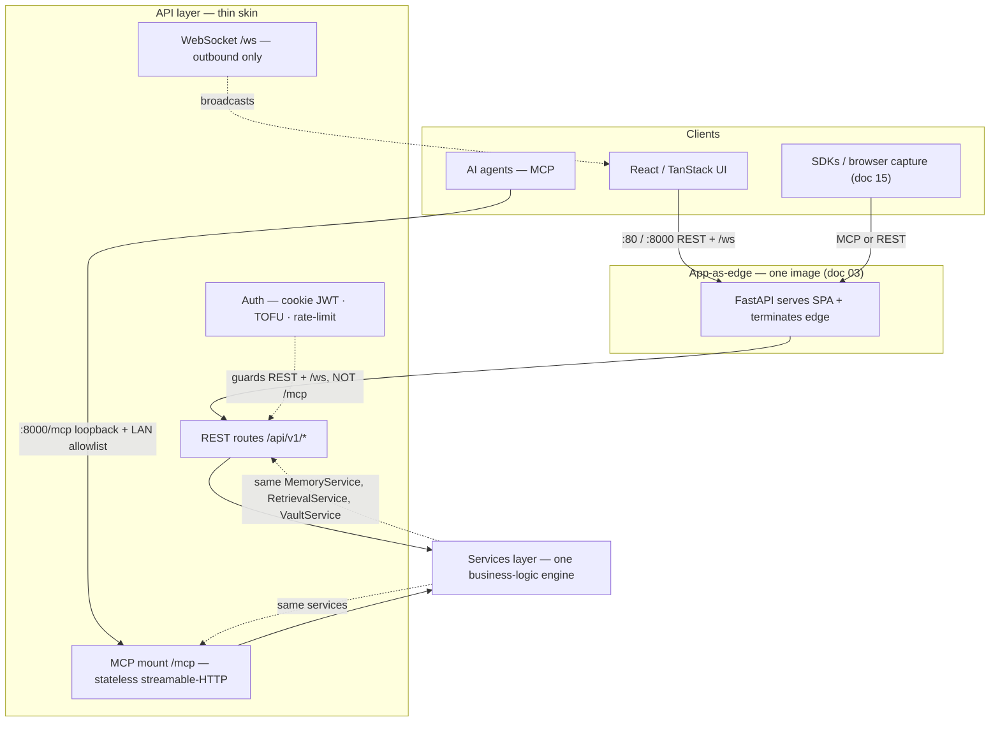
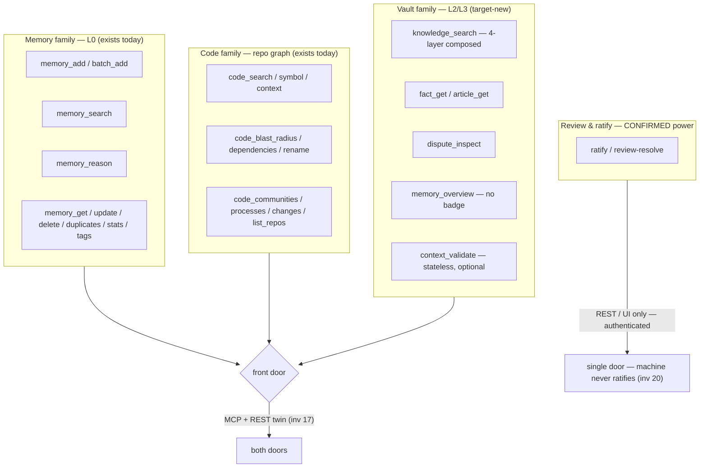
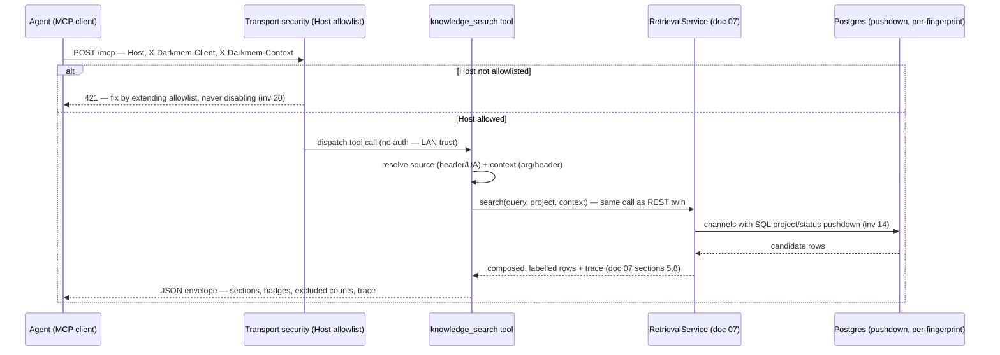
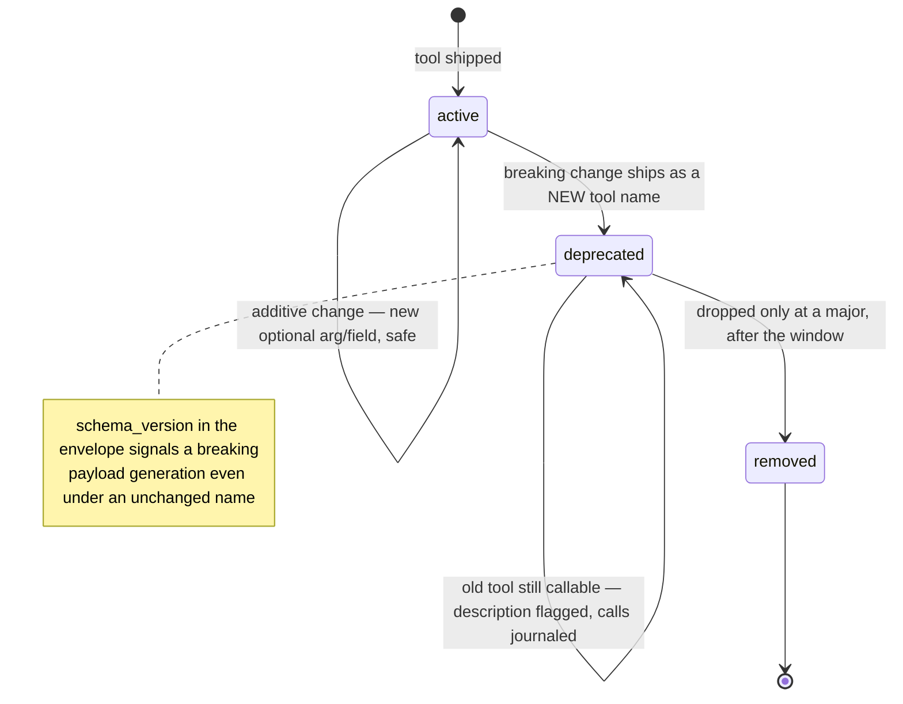
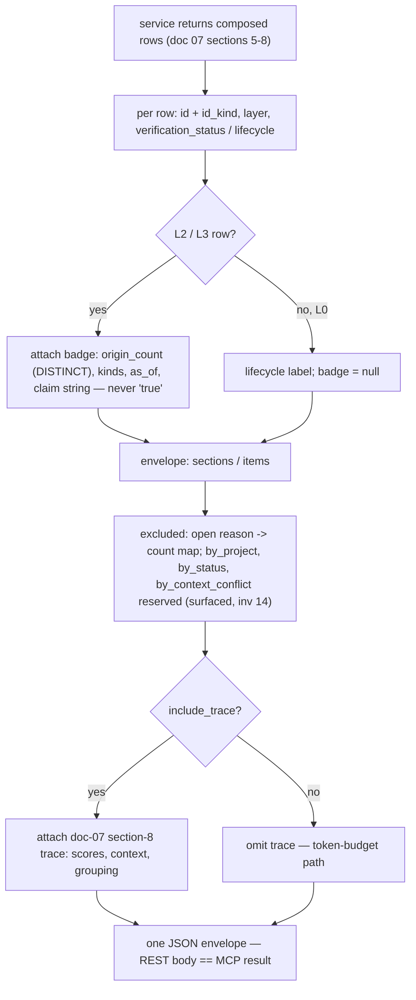
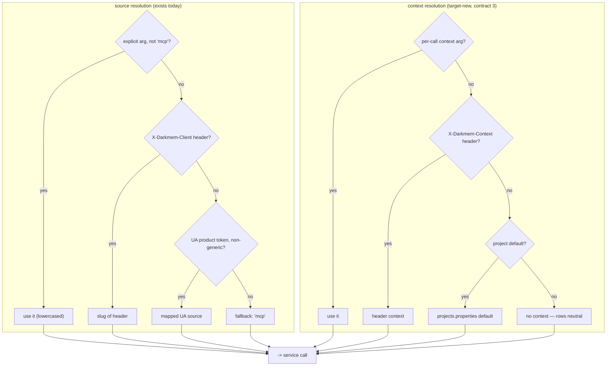
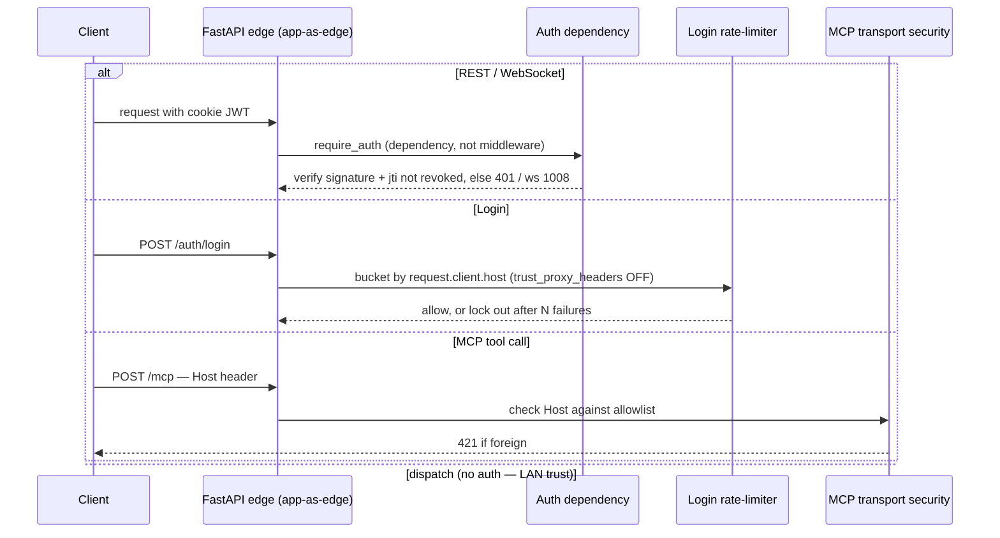
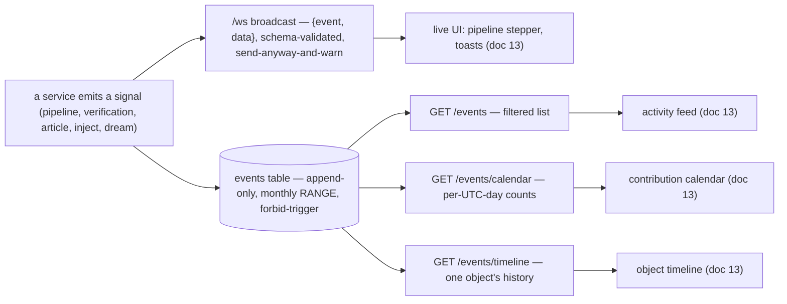

# 12 — API & MCP Contract

**Status:** subsystem design doc; conforms to foundation docs 00–04 and the 2026-07-24 knowledge-reshape spec (`docs/superpowers/specs/2026-07-24-knowledge-reshape-design.md`). Wave-3 product-and-reach doc (with docs 13, 15, 16). Authored on the retained Python/FastAPI + async SQLAlchemy + Postgres/pgvector + React/TanStack stack (doc 03 §4, Option A); .NET appears only as a considered-and-deferred alternative.

Every mechanism below is tagged **(exists today)**, **(target-new)**, **(activation)**, or **(horizon)** per doc 04 §1's honesty convention (a **target-new** that replaces a coarser existing surface is additionally called out as a *rebuild*); a mechanism claimed as shipped that is only scaffolding fails review (invariant 23).

---

## 1. Purpose & scope

**This doc fixes the complete external contract — every REST route and MCP tool, the wire shape of every payload that leaves the box, how `source` and context are resolved on the way in, the auth-and-trust posture the two front doors carry, and the WebSocket-and-events read surface the human's timeline and calendar consume.** It is the convergence layer: doc 07 defines what retrieval *computes*, docs 08/09 define what the vault *means* and *serves*, doc 10 defines the code graph, doc 11 defines the model boundary — and this doc is where all of it becomes a callable surface an agent or a browser can speak to. It owns three of the seven Part-B cross-doc contracts outright: the **retrieval-trace serialisation** (contract 1 — doc 07 §8 defines the payload, this doc puts it on the wire), the **verification badge field semantics** (contract 2 — the exact honest claim a fact/article row carries), and the **context-declaration wire format** (contract 3 — the arg, the header, and the precedence, with doc 07 owning the *matching* those values feed).

**What the neighbouring docs fix instead.** Doc 07 owns the ranking, the composition rules, and the trace *definition* this doc serialises verbatim; it also owns the `applies_when` *matching* semantics behind the context values this doc's wire format carries. Docs 08 and 09 own the vault lifecycle, the servable-row predicates, the review-queue mechanics, and *what* a `verification_status` means — this doc serialises those states and their badge, and never recomputes them (invariant 15). Doc 10 owns the code graph and its tool family's *mechanics*; this doc fixes the family's contract. Doc 11 owns the flattened LLM/settings shape the config routes expose. Doc 13 renders every payload this doc defines — the badge colour, the trace panel, the calendar cell — while this doc fixes *what information the payload carries*. Doc 15's SDKs and browser extension speak exactly this contract. Doc 18 owns auth *hardening* (the `ApiKey` wiring, exposed-deployment bearer) that this doc names as the deferred path but does not design. Doc 04 owns every table these routes read and write.

**Audience & authority.** This binds anyone building a route, a tool, an SDK, or a client against darkmem, and anyone rendering a payload it returns. Where it and the as-is baseline (`CLAUDE.md`, `docs/api-rest-conventions.md`) agree, the behaviour is contract; where the target extends the baseline, the extension is labelled. The load-bearing rule over the whole surface is **two front doors, one service layer (invariant 17)**: an MCP tool and its REST twin call the *same* service and must never drift into two engines — every new capability lands on both doors, or is *explicitly single-door with a stated reason*. The reshape adds deliberate single-door surfaces of two kinds, each with a stated reason — the confirmed-power writes (§3) and the human-observability reads (the review queue, §3, and the events stream, §7).

**The one sentence to hold in mind:** the API is a thin, honest skin over one service layer — it resolves who is calling and in what context, serialises the layer/verification labels and the trace without inventing any of them, surfaces every exclusion as a count rather than a silent drop (invariant 14), and never lets the unauthenticated LAN MCP surface carry a power the REST/UI door reserves for an authenticated human.

**Scaffolding honesty up front (invariant 23).** Today the surface is the memory + code MCP tool families and the REST routes behind the bundled nginx, with cookie-JWT auth, TOFU setup, the Host allowlist, and the `/ws` broadcast — all **(exists today)**. Everything the reshape adds is target work honestly labelled: the **vault and review tools** (`knowledge_search`, `fact_get`, `article_get`, `dispute_inspect`, `memory_overview`) and their REST twins are **target-new**; the **retrieval trace**, the **badge field**, the **excluded-by-conflict counts**, and the **layer/verification labels** on every row are **target-new** payload extensions; the **events read API** (timeline + calendar over the `events` table) is a **target-new** rebuild of today's coarse `AuditLog`-backed `/analytics/pipeline-logs`; the **app-as-edge trust flip** (`trust_proxy_headers` off, the rate-limiter reading the transport peer) is a **target-new** posture change; and programmatic **`ApiKey` bearer auth** is a dormant **(activation)** deferred to doc 18. Nothing here presents scaffolding as shipped.

---

## 2. REST conventions & route inventory

**Decision. The REST surface keeps the established contract verbatim — 201 create, 204 delete, 202 async-accepted, 409 conflicting-state, `POST .../search` for complex bodies, kebab-case plural collections, safe/idempotent GET — and the target adds one new route group (`/knowledge/*`) plus the `/events/*` read surface, drops the LLM profile/provider registry routes, retires `GET /analytics/pipeline-logs` (rebuilt onto `GET /events`; `GET /analytics/overview` survives as a stats surface distinct from the raw event stream), and leaves the documented deviations as-is.** The conventions are already audited and stable (`docs/api-rest-conventions.md`, doc 02 §6.1); re-litigating them would break every frontend client for no benefit. What the reshape changes is *additive* — new nouns for the vault and the event stream — and *subtractive* — the `llm-providers`/`llm-profiles`/`ml-profiles` registry routes go with the LLM-config flattening (doc 04 §7, doc 11 §2). The target's honesty obligations (surfaced counts, labelled rows, the trace) ride *inside* the response bodies, not as new status codes.

The status-code and pattern contract, unchanged from the audit baseline (exists today):

| Situation | Verb & path | Status |
|---|---|---|
| Create a resource | `POST /collection` | 201 |
| Read one / list | `GET /collection/{id}` · `GET /collection` | 200 |
| Full / partial update | `PUT /collection/{id}` · `PATCH /collection/{id}` | 200 |
| Delete | `DELETE /collection/{id}` | 204, no body |
| Async work queued not finished | `POST .../reindex`, `.../retry`, capture | 202 Accepted |
| Conflicting resource state | e.g. repo already indexing | 409 Conflict |
| Complex query with a rich body | `POST .../search` | 200 |
| Bulk create / delete | `POST /collection/batch` · `POST /collection/delete` | 201 / 200, per-id results |

**Capture is now a genuine 202, because the reshape moves ingest off the request path (target-new, doc 02 §5.1, doc 05).** Today `POST /api/v1/memories` commits the row and awaits `process_batch` inline (`201`); the target buffers into `memory_buffer` and returns a `202`-style accept, the extraction running in Tier B off the hot path (doc 05 §3). The route shape is unchanged; the *semantics* of the ack change, and a caller that needs the memory immediately queryable passes `wait_process` (doc 05's buffer contract) rather than blocking every caller. The MCP `memory_add` mirrors this.

The current route groups, by router prefix, all under `/api/v1` except `/health` and the MCP mount (exists today):

| Group | Prefix | Representative routes |
|---|---|---|
| Auth | `/auth` | `POST /login`, `/logout`, `/refresh`, `/change-password`, `GET /me`, `GET /audit`, `GET /security-posture` |
| Setup (TOFU) | `/setup` | the wizard steps, gated by `require_uninitialized` |
| Memories | `/memories` | `POST ""`, `/search`, `/search/paginated`, `/batch`, `/delete`, `/reason`, `/{id}/merge`, `GET /{id}`, `/{id}/duplicates`, `PUT`/`DELETE /{id}` |
| Tags | `/tags` | `GET ""` |
| Repos & code | `/repos`, `/code` | `POST /repos/{id}/reindex` (202/409), `GET /code/wiki/{id}` (read-only), `/code/search`, `/code/blast-radius`, `/code/symbols/lookup` |
| Jobs | `/jobs` | `GET ""`, `POST /{key}/trigger`, `PUT /{key}/config` |
| Pipeline & failures | `/pipeline`, `/pipeline-failures` | failure list, `/{id}/retry`, `/retry-all` |
| Vectors & reembed | `/vectors`, `/reembed` | projection, reembed batches |
| Config | `/config` | `PUT /feature-flags`, `POST /config/llm`, `/system-prompts`, `/theme` (GET unauth); **added 2026-08-20:** the `/config/llm-providers` collection (§ the row below) |
| Analytics | `/analytics` | `/stats`, `/overview`, `/pipeline-logs`, `/reprocess` |
| Graph, chat, system | `/graph`, `/chat`, `/system` | graph read, chat conversations, `/system/fs/list` |
| Checkpoints | `/checkpoints` | `POST ""`, `GET /latest` |
| Memory-buffer triage | `/memory-buffer` | `GET ""`, `/stats`, `DELETE /{id}`, `POST /{id}/requeue` |
| Distribution | `/distribution` | `GET ""`, `PUT /policy` |
| Review queue | `/review-queue` | `GET /facts`, `/articles`, `/counts`, `POST /facts/{id}/reject`, `/facts/{id}/dismiss-suspicion` |
| Hygiene queue | `/hygiene-queue` | `GET /duplicates`, `/low-confidence`, `/expiring-soon`, `/superseded`, `/counts`, `POST /bulk/supersede`, `/bulk/prune`, `/bulk/confirm-dedup` |
| Dream digest | `/dream-digest` | `GET /cycles`, `/cycles/{cycle_id}`, `POST /actions/{event_id}/undo`, `/cycles/{cycle_id}/undo` |
| Knowledge topics | `/knowledge/topics` | `GET ""`, `/{label}`, `/pin-suggestions`, `POST /pin-suggestions/accept`, `/pin-suggestions/dismiss` |
| Health | `/health` | unauthenticated liveness |

*(The Checkpoints through Knowledge-topics rows, and the Auth row's `GET /audit` / `GET /security-posture`, were added by the 2026-08-11 amendment below — all shipped surfaces this table predated.)*

The target's additions and one subtraction (target-new / target-dropped):

| Change | Routes | Note |
|---|---|---|
| **Add** knowledge vault | `POST /knowledge/search`, `GET /knowledge/facts`, `GET /knowledge/facts/{id}`, `GET /knowledge/articles`, `GET /knowledge/articles/{id}`, `GET /knowledge/facts/{id}/dispute`, `GET /knowledge/overview`, `POST /knowledge/context/validate` | the composed four-layer read + fact/article list and read + dispute inspect + project overview + stateless context validation (§3, §4, §5); the two list doors added 2026-08-11, see the amendment below |
| **Add** review & ratify (authenticated, no MCP twin) | `GET /knowledge/review`, `POST /knowledge/facts/{id}/ratify`, `POST /knowledge/articles/{id}/ratify`, `PATCH /knowledge/facts/{id}/review` | the consequence-ranked review queue and human ratification — the single-door asymmetry (§3, §6); **amended 2026-08-11: the queue and its resolution shipped at `/review-queue/*` instead, see the note below** |
| **Add** events read | `GET /events`, `GET /events/calendar`, `GET /events/timeline` | the timeline + contribution calendar over the `events` table (§7) |
| **Drop** LLM indirection | `PUT /config/llm-providers`, `/llm-profiles`, `/ml-profiles` | removed with the flattening to six inline purpose rows (doc 04 §7, doc 11 §2); `POST /config/llm` stays. **Amended 2026-08-20 (owner ruling, spec `docs/superpowers/specs/2026-08-20-llm-providers-design.md`):** the `/llm-profiles` and `/ml-profiles` drops stand, but a provider surface returns as a REST-single-door collection — `GET`/`POST /config/llm-providers`, `PUT`/`DELETE /config/llm-providers/{name}`, and `POST /config/llm-providers/probe-models` + `/{name}/probe-models`. It manages `llm_providers` connection rows a purpose names by `provider_name`, not the deleted profile indirection. `PUT` returns 409 on a `base_url`/`api_kind` change to the provider serving the `verification` purpose (the judge's identity); its `api_key` still rotates. `DELETE` returns 409 while any purpose still references the row. Operator configuration, so there is no MCP twin — an unauthenticated `/mcp` must not write vendor credentials |

**Amendment, 2026-08-11 (Tier-3, resolved on measurement).** §1 declares this doc fixes *every* REST
route and MCP tool, and the tables above no longer did. The live surface was derived from the app
itself — `app.main:app`'s router flattened to its `APIRoute` leaves exactly as
`backend/tests/test_door_parity.py` enumerates it (HEAD excluded), plus the FastMCP registry via
`mcp.list_tools()`; never `rg` over route files — giving **135 method-path routes and 27 tools**,
then diffed against every route this doc names, in both directions. Raised when T3.06 found the
vault row above named neither `GET /knowledge/facts` (shipped by T2.36a) nor
`GET /knowledge/articles` (shipped by T3.06); the sweep found the drift systematic, not local:

- **Thirty-four shipped, tested routes appeared nowhere in this doc** (2 checkpoints +
  4 memory-buffer + 2 distribution + 5 review-queue + 8 hygiene-queue + 4 dream-digest +
  5 knowledge-topics + 2 auth reads + the 2 vault list doors = 34). The group table above has
  gained a row per missing group and the vault row its two list doors; each surface's door-count
  classification and single-door reason live in `docs/two-door-parity.md`, which is generated from
  the enforced table in `test_door_parity.py` and is where that truth is pinned.
- **Two of the four routes the review-and-ratify row names are phantoms a client would 404 on**,
  which is the dangerous direction — an omission costs a reader completeness, a phantom costs a
  client correctness. `GET /knowledge/review` shipped as the three `/review-queue` reads
  (facts, articles, counts). `PATCH /knowledge/facts/{id}/review` was never built, and its stated
  semantics — "clear or set `review_state`" — contradict the settled design: `review_state` is
  **derived, never written** (`derive_review_state` over the openers, docs 08/09; adding an opener
  is appending a predicate, never adding a writer), and the shipped human actions are
  `POST /review-queue/facts/{id}/reject` and `/dismiss-suspicion`, which adjudicate the fact and
  the finding rather than setting the derived bit. §3's sentence carrying the same claim is
  amended there. (Doc 13's `/knowledge/review` is a *frontend* route and is not this claim.)
- **Three named routes remain honest targets, now explicitly so**: `GET /knowledge/facts/{id}/dispute`
  (with `dispute_inspect`), `POST /knowledge/context/validate` (with `context_validate`), and
  `POST /knowledge/articles/{id}/ratify` are target-new and still unshipped — said here so the
  additions table cannot be read as uniformly shipped now that its other rows are.
- **The rest of the additions table has shipped and reads exists-today**: `POST /knowledge/search`,
  `GET /knowledge/facts/{id}`, `GET /knowledge/articles/{id}`, `GET /knowledge/overview`,
  `POST /knowledge/facts/{id}/ratify`, both list doors, and all three `/events` reads are live;
  the three dropped LLM-indirection routes are measured gone.
- Arithmetic for the tool surface, so the next reader rechecks instead of trusting: §3's families
  count 10 memory + 11 code + 4 shipped vault tools = 25 of the 27 live; the two this doc never
  named are `checkpoint_save` / `checkpoint_latest`, corrected in §3's 2026-08-11 amendment.

**The three documented deviations stay as-is, because fixing them is breaking for marginal benefit.** `POST /config/llm` should be `PUT` for symmetry (it is an idempotent full replace); `DELETE /repos/{id}/tasks/{task_id}` is a cancel that a `POST .../cancel` would model better; `PUT /repos/{id}` is a partial update that `PATCH` fits. All three are used by the frontend and are left until a coordinated client update (`docs/api-rest-conventions.md`). The audit posture — a `GET` never mutates (wiki generation is an explicit `POST /repos/{id}/reindex?generate_wiki=true`, not a `GET` side effect) — is preserved by every new route: `GET /knowledge/*` and `GET /events/*` are strictly read-only.

The whole external surface at a glance — two front doors converging on one service layer, with the WebSocket outbound and the MCP mount reached directly on the app port:


*Caption: invariant 17 made structural — REST and MCP are two entry surfaces onto one service layer; auth guards REST and `/ws` but `/mcp` rides the Host allowlist instead (§6).*

---

## 3. The MCP tool surface — memory, code, vault & review, context

**Decision. The MCP surface keeps the ten memory tools and eleven code tools it ships today, adds a small vault tool set plus `memory_overview`, carries context as a per-call argument and a header rather than a stateful tool, and deliberately keeps every *confirmed-power* write (ratification, review resolution) off MCP entirely — those live only on the authenticated REST/UI door.** The tool families mirror the epistemic layers: memory tools read and write L0, code tools read the repo-scoped graph, and the new vault tools read L2/L3 and the disputes over them. Naming stays consistent with the two live families — `noun_verb` for the memory family (`memory_add`, `memory_search`), `code_*` for the code family — so the vault tools follow suit: the composed cross-layer read is `knowledge_search`, and the single-object reads are `noun_verb` (`fact_get`, `article_get`, `dispute_inspect`, `memory_overview`), each reading like the ones already in muscle memory. There is no literal `knowledge_*` prefix family — only `knowledge_search` carries the prefix, and the noun-first reads deliberately match the memory family's idiom. Every read tool has a REST twin (invariant 17); the ratify/review *writes* are the one sanctioned single-door exception, and the reason is trust: **the unauthenticated LAN MCP surface must never carry `confirmed` power** (invariant 20, spec §2.1) — a machine reaching `confirmed` is exactly what the under-claiming design forbids.

The memory family, unchanged in shape (exists today; some gain honest labels as an activation):

| Tool | Purpose | REST twin | Status |
|---|---|---|---|
| `memory_add` | store one memory; resolves `source`/`source_agent`/`project` | `POST /memories` | exists |
| `memory_batch_add` | store 1–100, resolved on raw dicts | `POST /memories/batch` | exists |
| `memory_search` | L0 hybrid search (the L0 view of the doc-07 composition) | `POST /memories/search` | exists; gains labels + optional trace (activation) |
| `memory_get` | read one memory by UUID | `GET /memories/{id}` | exists |
| `memory_update` / `memory_delete` | edit / delete one memory | `PUT` / `DELETE /memories/{id}` | exists |
| `memory_reason` | RAG answer over retrieved memories | `POST /memories/reason` | exists; leak closes with pushdown (doc 07 §9) |
| `memory_find_duplicates` | near-duplicate probe | `GET /memories/{id}/duplicates` | exists |
| `memory_stats` / `memory_tags` | counts; tag histogram | `GET /analytics/stats`, `GET /tags` | exists |

The code family, unchanged (exists today; mechanics doc 10):

`list_repos`, `code_search`, `code_symbol`, `code_file_symbols`, `code_context`, `code_blast_radius`, `code_dependencies`, `code_changes`, `code_communities`, `code_processes`, `code_rename` — gated by **repository, not project** (doc 01 §8's deliberate exception to the project-isolation invariant). This doc fixes the family's contract shape; doc 10 owns the traversal mechanics.

**Amendment, 2026-07-28 (T1.42d Tier-3, decided on measurement).** This sentence read "each
with a REST twin under `/code` or `/repos`" and was tagged *(exists today)*. **Six of the
eleven have no such route** — `code_context`, `code_dependencies`, `code_communities`,
`code_processes`, `code_rename` and `code_changes`. Verified twice: by T1.42d's audit of all
101 REST routes and all 21 MCP tools, and independently by the controller against
`app/api/routes/code.py` (which exposes `POST /search`, `GET /symbols`, `/symbols/lookup`,
`/symbols/{id}`, `/files/{repo_id}`, `/graph/{repo_id}`, `/wiki/{repo_id}`, `POST
/blast-radius`) and `repos.py`.

They are recorded as **MCP single-door with a stated reason** in `docs/two-door-parity.md`,
which invariant 17 permits, and the distinction that makes it defensible is between a
*capability* and a *query*: five of the six are server-side projections of rows the REST door
already serves whole through `GET /code/graph/{repo_id}`, so nothing is REST-unreachable —
what is single-door is the filtered question. The UI's consumer is a canvas that wants the
graph; the agent's is a prompt that wants the answer.

**`code_changes` is the one genuine capability asymmetry.** It shells out to git and reports
the uncommitted working tree against the indexed symbols. Every REST read and the whole
indexed graph are commit-based, so that state is not REST-reachable at all and the UI has no
working-tree view.

**This is a controller decision, not an owner ratification, and it is reversible.** The
alternative — building six REST routes so the original sentence becomes true — is new scope
no task calls for. If the owner wants the twins built instead, this amendment is what to
revert.

The new vault & review tools (target-new):

| Tool | Purpose | REST twin | Confirmed-power? |
|---|---|---|---|
| `knowledge_search` | the composed **four-layer** read — memory + facts + articles, sectioned-by-layer or fused, every row labelled + badged, the trace attached | `POST /knowledge/search` | no — read only |
| `fact_get` | read one fact: triple, `verification_status`, badge, distinct-origin summary, `applies_when`, validity window, `review_state` | `GET /knowledge/facts/{id}` | no |
| `article_get` | read one article: grounded content, `status`, claim-support `confidence`, citations, stale label | `GET /knowledge/articles/{id}` | no |
| `dispute_inspect` | read a disputed fact/article **with both sides**, the contradiction, each side's origins, consequence rank | `GET /knowledge/facts/{id}/dispute` | no |
| `memory_overview` | project-scoped map-reduce **organizational** overview, no badge (doc 09 §3.3) | `GET /knowledge/overview` | no |
| `context_validate` *(optional)* | stateless: echo the normalised `applies_when`, warn on unknown axes | `POST /knowledge/context/validate` | no |

**The ratify and review-resolution writes are REST/UI-only, single-door with a stated reason (invariant 17's sanctioned exception).** `POST /knowledge/facts/{id}/ratify` (promote to `confirmed` by writing a `human`-kind `fact_source`, doc 08 §4.4), `PATCH /knowledge/facts/{id}/review` (clear or set `review_state`), and the article equivalents **have no MCP twin**. The reason is the trust model: `/mcp` is unauthenticated on the LAN behind only the Host allowlist (invariant 20), and `confirmed` is the one rung the machine can never reach on its own (spec §2.1) — exposing ratification over the unauthenticated door would let any LAN agent forge the human's imprimatur. This is not an accidental gap; it is the design, and it is recorded here so no future contributor "completes the symmetry" and re-opens it. The review-queue *read* (`GET /knowledge/review`) is authenticated REST too — it is a curation surface (doc 13), not an agent capability — and it likewise has no MCP twin, for the same reason plus the observation that an agent triaging its own truth backlog is a conflict of interest the design declines.

**Amendment, 2026-08-11 (Tier-3, resolved on measurement — the same sweep as §2's).** Two
corrections to this section's inventory, both verified against the live FastMCP registry and
router rather than argued. (1) The opening sentence counts ten memory and eleven code tools;
the live registry serves **27**, and the two this section never named are `checkpoint_save` and
`checkpoint_latest` — the session-checkpoint pair, two-door with `POST /checkpoints` /
`GET /checkpoints/latest` (likewise absent from §2's table until its 2026-08-11 amendment).
(2) The paragraph above names `PATCH /knowledge/facts/{id}/review` ("clear or set
`review_state`") as the review-resolution write. No such route shipped, and the settled design
forbids its semantics: `review_state` is derived by `derive_review_state` over the openers and
has no manual writer — the shipped human actions are `POST /review-queue/facts/{id}/reject` and
`/dismiss-suspicion` (and `ratify` for the promotion), and this paragraph's single-door
reasoning carries over to them unchanged: they remain authenticated REST with no MCP twin.

The tool families as a structure, with the epistemic layer each reads, the two-door status, and the one single-door asymmetry:


*Caption: most reads land on both doors; the confirmed-power writes are a deliberate single-door surface (the unauthenticated MCP surface must not carry ratification), and the human-observability reads (review queue, events) are the other.*

**An MCP tool call runs end to end without ever touching auth — its only network defence is the Host allowlist, and its identity comes from headers, not a handshake (exists today, extended for the vault).** The server is `stateless_http=True`, so the initialize handshake's `clientInfo` is gone by the time a tool runs; identity is resolved per call from the tool argument and the request headers (§5). A `knowledge_search` call therefore flows: the transport-security layer checks the `Host` against the allowlist (foreign Host → `421`), the tool resolves `source` and the `applies_when` context from args + headers, it calls the *same* retrieval composition the REST twin calls, and it returns the labelled sectioned-or-fused envelope with the trace. The result is JSON (`json_response=True`), so every id is a string on the wire — the `memory_id` UUID/str boundary is normalised to a string with an `id_kind` discriminator at serialisation (invariant 9, §4).

A vault read end to end across actors — the Host gate, header-based identity, the shared composition, and the labelled envelope returned:


*Caption: the MCP path is auth-free by design; the Host allowlist is the sole gate, and the tool spends the same ranking path as its REST twin (invariant 17).*

**MCP tools return a typed degradation envelope for recoverable unavailability and raise only on caller error — a pattern already live in `code_search` and generalised here.** When the embedder is unconfigured, `code_search` returns `{"status": "unavailable", "reason": "embedder not configured", "results": []}` rather than raising, so the client degrades gracefully instead of treating a config gap as a crash. The vault tools adopt the same rule: a bad UUID or a not-found id *raises* (a caller error the client must fix), but a channel that cannot run — the fact channel before its writer ships, an overview before topics are detected — returns a typed `{"status": "unavailable", "reason": …}` so the agent can fall back. This is invariant 14's honest-partial-results applied at the tool boundary: never an empty list indistinguishable from a genuine no-match.

**MCP tool versioning is additive-by-default, with a description-flagged deprecation window and a payload `schema_version`, and the whole surface is pinned to one protocol generation (settle: framing open question).** MCP has no per-tool version field, so the policy is procedural, not protocol-level. Three rules: (1) **additions never break** — a new tool or a new *optional* argument/output field is always safe, and clients already tolerate extra fields; (2) **a breaking change mints a new name**, never a silent mutation of an existing tool's argument or output shape — the old tool stays callable through a deprecation window, its `description` prefixed `"[deprecated: use <new>]"`, and every call to it journals a `tool.deprecated_call` event so the maintainer can see who still depends on it before removal at a major; (3) **the response envelope carries a `schema_version` integer** (§4) so a client can detect a breaking payload generation even on a tool whose name is unchanged. The MCP server's `instructions` (the live-editable agent prompt, `refresh_mcp_instructions`) name the current surface generation. This keeps the darkfoto-proven "clients outside the box speak a stable contract" property (doc 02 §8) without a heavyweight version-negotiation dance the stateless server cannot hold anyway.

An MCP tool's deprecation lifecycle — additive by default, deprecation flagged and journaled, removal only at a major:



---

## 4. Payload contracts — retrieval rows, labels & badges, the trace, surfaced counts

**Decision. Every list-returning read (search, vault, events) speaks one partial-result envelope — an `items`/`sections` array of labelled rows, an `excluded` counts object, a `channels`/`partial` degradation flag, pagination, and an optional `trace` — and every fact/article row carries the badge field this doc owns verbatim; this one envelope is identical across REST and MCP, so the two doors can never paraphrase the same result differently (convention 10, contract 1/2).** A per-tool bespoke shape is exactly the drift invariant 17 forbids at the payload layer: if `knowledge_search` over MCP and `POST /knowledge/search` over REST returned different envelopes, doc 13's renderer and doc 15's SDK would each need two code paths and the honesty guarantees would fork. One envelope, serialised once in the service boundary, defeats that.

**The envelope carries the request-level honesty facts; it is doc 07 §8's envelope put on the wire, extended with pagination, a `schema_version`, a derived top-level `partial` flag, and a restructure that promotes the layer/verification labels and counts to the top level while nesting doc 07's full per-row trace under a `trace` object (target-new).** Doc 07 defines the fields; this doc serialises them and adds only the transport concerns (versioning, paging):

| Envelope field | Type | Meaning |
|---|---|---|
| `schema_version` | int | payload generation, for breaking-change detection (§3) |
| `query` | text | the query echoed back (search reads) |
| `fused` | bool | `false` = sectioned-by-layer, `true` = one fused list (doc 07 §5) |
| `sections` / `items` | array | `sections` when `fused=false` (a facts / articles / memory section, each labelled); a flat `items` list when `fused=true` |
| `channels` | object | which channels ran, with `semantic_failed` / `keyword_failed` one-sided-failure flags (doc 07 §2) |
| `partial` | bool | true if any channel degraded — the client must render the result as partial, never as complete |
| `weights` | object | the RRF input-list weights and `w_*` arm values in effect — a config snapshot (doc 07 §3) |
| `excluded` | object | an **open map of reason name → count**, carrying only reasons that actually fired — **surfaced, never silent** (invariant 14). `by_project`, `by_status` and `by_context_conflict` are **reserved names**: when a reason becomes constructible it must use the reserved name, so an SDK can rely on the name where it appears. Amended 2026-07-28, see the note below. |
| `trace` | object \| null | the row-trace array when the caller requests it (`include_trace=true`); null otherwise |
| `page` | object | `{limit, offset, total?, next_offset?}` — REST paginated reads and MCP `limit`/`offset` share it |

**Amendment, 2026-07-28 (T1.42a Tier-3, resolved on measurement).** This table originally
fixed `excluded` as exactly `{by_project, by_status, by_context_conflict}`. The
implementation ships an open reason-keyed map instead, and the divergence was verified in
the tree before the doc was changed rather than the code:

- **`by_project` and `by_status` are not constructible at this layer, by design.** Doc 07 §7's
  pushdown renders both into every channel's SQL — measured on the keyword channel, whose
  statement carries `AND m.is_archived = FALSE AND m.project = … AND m.status::text = ANY(…)`.
  A control run of the same statement *without* the filter returns the foreign-project and
  superseded rows that the scoped run does not, which is the point: those rows are never
  fetched, so counting them would mean re-fetching exactly what the pushdown exists to avoid.
- **`by_context_conflict` has a counting primitive that nothing calls yet.**
  `rank_fusion.partition_by_context` computes it and is tested, but a grep of `app/` finds
  **zero production call sites** — the four-layer composition that would wire it is E2's.
- **An always-zero honesty counter is worse than an absent one**, because it reads as evidence
  that a check ran. That is invariant 14 applied to the counter itself.

The reserved-name rule is what preserves this table's real intent: the *names* are contract,
the *presence* of a key is evidence that its reason fired.

**Every returned row carries `layer` + `verification_status` and, for L2/L3, the badge; a memory row carries its lifecycle label and a null verification (contract 2, doc 07 §5).** The row shape is the doc-07 §8 per-row trace fields promoted to first-class result fields (so a caller that does *not* request the full trace still gets the honest labels):

| Row field | Type | Meaning |
|---|---|---|
| `id` + `id_kind` | text + enum | the object id stringified, `id_kind ∈ memory\|fact\|article` — the invariant-9 normalisation point (§3) |
| `layer` | enum | `L0` / `L2` / `L3` (L1 candidate graph is never directly served) |
| `verification_status` | enum \| null | `candidate\|corroborated\|confirmed\|disputed` for facts/articles (articles add terminal `superseded`); **null** for memory rows, which instead carry `lifecycle` |
| `lifecycle` | enum \| null | `active\|superseded\|deprecated` for memory rows; null for vault rows |
| `badge` | object \| null | the honest-claim field below — present on L2/L3, null on L0 |
| `applies_when` | object \| null | the row's structured context (env / version / situation), carried as a **visible label** even when neutral (doc 07 §6) |
| `content` / `summary` / `title` | text | the servable text (a fact's `fact`, an article's grounded prose, a memory's content) |
| `grouping` | object \| null | `{grouped_under: fact_id\|null, relation: "supports fact F"\|null}` — the group-under-fact collapse (doc 07 §5) |
| `scores` | object \| null | present only when `include_trace=true`: per-modality raw score, `rrf_score`, `rerank_score`, `rank_fusion_factor` with its arm breakdown (doc 07 §8) |

**The badge is a structured field carrying an exact, honest claim string — this doc owns the field semantics, and the string never contains "true" or "verified" (contract 2, spec §2.1, invariant 14).** The badge is *presentation-neutral data*: doc 07 carries it in the trace, doc 13 renders its colour and icon, doc 15 injects it into a tool's context — and all three speak the identical claim because this doc fixes the field, not the rendering. The field:

```
"badge": {
  "verification_status": "corroborated",
  "origin_count": 3,               // COUNT(DISTINCT origin_key), NEVER a row count
  "origin_kinds": ["code", "memory"],  // distinct source_kind set, sorted
  "as_of": "2026-07-20T09:14:00Z", // when verification was last recomputed (the events transition)
  "contradiction": false,
  "human_ratified": false,         // true iff a human-kind fact_source exists (confirmed)
  "stale": false,                  // articles only: fact_set_hash changed since synthesis
  "claim": "asserted by 3 distinct origins of kinds [code, memory], no known contradiction, as of 2026-07-20"
}
```

The `claim` string is the canonical honest sentence every consumer must show verbatim or not at all: **"asserted by K distinct origins of kinds [X, Y], no known contradiction, as of T"**. Its rules are contract:

- **`origin_count` is `COUNT(DISTINCT origin_key)` from `fact_sources`, never a row count** — echo is not evidence (spec §2.1, doc 04 §8.3). Two agents re-saving the same claim, or one repo re-derived across many commits, are *one* origin; when origin identity is unknown the count *undercounts* (merges to one), never manufactures agreement.
- **`disputed` swaps the claim for a two-sided form** and the row is served with both sides: `"disputed: 2 origins assert X, 1 origin asserts not-X, as of T"` — never a picked winner (doc 07 §5, doc 08 §6). `dispute_inspect` returns the full both-sides detail.
- **`confirmed` sets `human_ratified: true`** and the claim gains a trailing `", human-ratified"` — the only rung a human reaches, and never the machine (spec §2.1).
- **Code-originated born-`corroborated` facts** carry `origin_kinds` including `code` and the `code@commit` provenance in `dispute_inspect`/`fact_get` detail (doc 10, doc 08 §5.2).
- **A stale article** (`stale: true`) still serves, badge intact, with the stale flag riding through — a label, never a suppression (doc 09 §2.4, doc 07 §5).
- **Memory rows carry no badge** (`badge: null`, `verification_status: null`) — L0 is episodic recall, not a verified claim; it carries `lifecycle` instead, and a `superseded`/`deprecated` memory is labelled and reachable through `superseded_by`, never silently mixed in as active (doc 07 §7).

**The trace is serialised exactly as doc 07 §8 defines it — this doc puts the two-level payload on the wire, transient, no table (contract 1, doc 04 §13).** When a caller passes `include_trace=true`, the envelope's `trace` carries the doc-07 §8 envelope (`fused`, `channels`, `weights`, `excluded`, and the per-row `scores`/`context`/`grouping`/`badge`); the trace is *assembled on the retrieval path* and returned, never persisted for v1 (the verification transitions journaled to `events` already meet the audit need). This doc adds nothing to the trace's *meaning* — it only fixes that the wire form is doc 07 §8 verbatim, that it is opt-in (so a token-budgeted inject consumer, doc 15, can omit it), and that a durable `retrieval_traces` table is added only if the ADE viewer or eval harness later needs one, each row tied to an `events` read/inject row (doc 07 §11 stance).

The one envelope assembled at the service boundary — labels and badge on every row, counts surfaced, the trace attached on request, identical across both doors:


*Caption: one envelope, one badge field, one trace — serialised once so the two front doors can never paraphrase the same result differently (convention 10).*

**`fact_get`, `article_get`, and `dispute_inspect` return the single-row detail the badge summarises.** `fact_get` returns the triple (`subject_name`, `rel_type`, `object_name`, `fact`), the badge, a `sources` array summarising `fact_sources` (per-kind counts, distinct-origin count, and — for code — the `{commit_sha, file_path, symbol_key}` detail), the `applies_when`, the validity window (`valid_at`/`invalid_at`/`expired_at`), and `review_state`. `article_get` returns the grounded content, the `status`, the claim-support `confidence`, the `citations` array (each `{fact_id, claim_span}`, the hard-FK grounding of doc 04 §8.8), and the stale label. `dispute_inspect` returns both conflicting facts with each side's origins and the consequence rank — the read that lets a human (or an agent, read-only) see *why* a fact is disputed before anyone ratifies. None of these recompute anything (invariant 15); they read the rows docs 08/09 wrote.

---

## 5. Source & context resolution

**Decision. `source` resolution keeps the live precedence — explicit arg (the door's *own* literal counts as unspecified) > `X-Darkmem-Client` header > User-Agent product map > the door's own literal (`api` on REST, `mcp` on MCP; amended 2026-07-28, below) — and context resolution mirrors it exactly with a new `X-Darkmem-Context` header: per-call `context` arg > `X-Darkmem-Context` header > project-registry default > nothing; there is no stateful session tool, because the MCP server is stateless by design (settle: framing open question).** Reusing the `source` precedence's shape for context is deliberate — it is already understood, already header-driven, and already survives the stateless server. The one genuinely new decision is *where* per-session context lives on a server that holds no session, and the honest answer is: **in a header the client sends on every call**, exactly as `X-Darkmem-Client` already carries the client identity. A stateful `context_declare` tool would be a lie on a `stateless_http=True` server — there is no session to store it in — so it is rejected, and the header is the "declare once, configured at the transport" mechanism.

**Source resolution is verbatim the live `client_identity` logic, and it never fails a write (exists today).** The rules: an explicit `source` argument wins as-is (lowercased; **the door's own literal is treated as *unspecified*** so an agent copying that door's default cannot mask detection); else the `X-Darkmem-Client` header (sanitised to a slug); else the first User-Agent product token, dropping generic runtime tokens (`node`, `python-httpx`, `curl`, …) and mapping known ones (`claude-code`); else **the door's own literal** — `api` on REST, `mcp` on MCP. `source_agent` is the explicit arg or the raw User-Agent. Both batch doors resolve on the **raw entry dicts** before `MemoryCreate` validation, and every entry in a batch resolves from the *same* request context, so a batch of 100 from one undeclared agent is one origin rather than 100 (doc 05 §2.1). Resolution never raises — attribution must not fail a capture.

**Amendment, 2026-07-28 (T1.42a Tier-3, resolved on measurement).** This section originally
described one chain terminating in `mcp` for **every** door, and stated that `MemoryCreate`
"stamps its `api` default during validation". Both were checked against the tree before the
doc was changed rather than the code:

- **`MemoryCreate.source` has no default at all** — it was removed by T1.42a, so the erasure
  the old sentence described is no longer representable.
- **A single `mcp` terminal would mislabel every REST capture.** With the per-door fallback,
  an absent `source` resolves to `api` on REST and `mcp` on MCP, which is what actually
  happened. Under the doc's original wording a browser write would be attributed to MCP.
- **The sentinel must be per-door for the same reason the fallback is.** The rule masks *the
  door's own default*, so on REST an explicit `api` falls through to the header (measured:
  `api` + `X-Darkmem-Client: cursor` → `cursor`) while on MCP that same explicit `api` is a
  foreign, deliberate value and wins over the header. The asymmetry is the rule working, not
  a leak: `source` is self-declared attribution, never an authorisation input.
- **The raw-dict discipline has a live justification on the MCP door**, not merely a
  historical one. Simulating a reintroduced `api` default resolved after validation still
  yields `codex` on REST — where `api` is REST's own sentinel — and yields `api` on MCP,
  losing the caller's real identity. Do not "simplify" it away on the strength of the REST
  case alone.

**Context resolution is the new wire format this doc owns (contract 3, target-new); doc 07 owns the matching those values feed.** The declared caller context is a structured value `{env, version, situation}`; `env` and `situation` are **closed vocabularies normalised before store under doc 06's taxonomy discipline** (invariant 5 — matching rots on `prod`/`production`/`prd` drift otherwise), and `version` is a free string compared app-side (doc 07 §6, never a jsonb predicate). The precedence:

| Rank | Source of context | Wire form |
|---|---|---|
| 1 | per-call `context` argument | a `context` object on the search/vault tool (or the REST body) |
| 2 | per-session declaration | the `X-Darkmem-Context` header, sent on every call (mirrors `X-Darkmem-Client`) |
| 3 | per-project default | `projects.properties.applies_when_default` for the call's `project` (doc 04 §7) |
| 4 | nothing | every row treated as context-neutral — the common case |

The crucial honesty rule (doc 07 §6, doc 01 §3.4): the **declared caller context is trusted** (a human or a client configured it), but an **LLM-guessed `applies_when` on a *fact* is displayed provenance, never a conflict-exclusion basis** until a human touches it — the wire carries a `provenance: human|llm_guessed` marker on each row's `applies_when` so doc 07's matching knows which values may drive a hard exclusion. And because most callers pass no context, matching is **boost-plus-label by default with hard exclusion only on explicit conflict**, the excluded count surfaced (§4's `excluded.by_context_conflict`) — this doc's wire format carries the declaration and the surfaced count; doc 07 turns them into a boost, a label, or a counted exclusion.

**The optional `context_validate` tool is stateless and returns the normalised context, so a client can verify its declaration parses before relying on it.** It takes a `context` object, runs the same `env`/`situation` normalisers doc 06 owns, and returns `{normalized, unknown_axes: [...]}` — a warning surface, not a store. It is the honest substitute for the rejected stateful `context_declare`: it lets a client confirm its per-call arg or `X-Darkmem-Context` header will match as intended, without pretending the server remembers it.

Source and context resolution, two mirrored precedence chains that both survive the stateless server:


*Caption: context reuses source's header-driven shape; there is no stateful session tool because the server holds no session (invariant 20).*

---

## 6. Auth & trust posture — TOFU, JWT, the Host allowlist, transport-peer rate limiting

**Decision. The trust posture is unchanged in principle and adjusted in one mechanic for the one-image edge: cookie-session JWT enforced as a FastAPI dependency guards REST and `/ws`; the MCP surface stays unauthenticated behind the Host allowlist alone; setup is trust-on-first-use with no pre-shared secret; and under app-as-edge the login rate-limiter reads the *transport peer* because `trust_proxy_headers` flips off (invariants 20, 21; doc 03 §3.2).** The LAN-trust model is a foundation decision this doc mechanises, not re-opens: darkmem runs on one self-hosted box, agents on the LAN reach `/mcp` directly, and the only network defence `/mcp` needs is DNS-rebinding protection. The single *change* the reshape forces is the rate-limiter's IP source, because the one-image edge (doc 03) removes the nginx hop that set `X-Real-IP`.

**REST and `/ws` are guarded by a cookie JWT enforced as a dependency, never as middleware (exists today).** `require_auth` is a FastAPI dependency on every mutating and reading route (the sole app middleware is CORS); the token is an HttpOnly cookie, HS256-signed, carrying a `jti` checked against the `token_blocklist` revocation store; refresh and change-password *rotate* (blocklist the presented token), and a password change revokes all pre-change tokens via the `iat` check (CLAUDE.md). `/ws` authenticates the same cookie: it decodes the JWT, rejects a missing/invalid token or a revoked `jti` with close code `1008`, and only then joins the broadcast set (`websocket.py`). `GET /config/theme` and `GET /health` are the deliberate unauthenticated reads — theme loads before login and is pure cosmetics; health is liveness.

**`/mcp` is unauthenticated by design, and its Host allowlist is the sole gate — a LAN `421` is fixed by extending the allowlist, never by disabling protection (invariant 20, exists today).** The FastMCP server is `stateless_http=True`, `json_response=True`, mounted at `/mcp`; localhost is always allowed, `MCP_ALLOWED_HOSTS` (comma-separated, `host:port` or `host:*`) adds LAN hosts, and `*` disables the check entirely for a fully-trusted isolated network. A foreign `Host` header gets `421`; browser `Origin`s are allowlisted to the same hosts (agents send none). The bundled-nginx era deliberately did **not** re-expose `/mcp` on the `:80` UI origin — that keeps the tool surface off the browser-facing origin while leaving it LAN-reachable on the app port. Under the one-image edge the app *is* the edge, so `/mcp` is served on the app port directly, and the Host allowlist remains the one gate. The `ApiKey` bearer path for *exposed* (non-LAN) deployments is dormant (`api_keys` unwired, every write passes `api_key_id=None`) and is an **(activation)** owned by doc 18 — named here, not designed.

**Setup is trust-on-first-use, gated only by `require_uninitialized`, with no pre-shared secret (invariant 21, exists today).** `/api/v1/setup/*` is open until the `admin_password_hash` config row exists, then `403`s; `SETUP_SECRET` was removed and must not return. This is what makes one-command onboarding (doc 15) possible without provisioning a secret out of band.

**Under app-as-edge the login rate-limiter reads the transport peer, because there is no trusted proxy to set `X-Real-IP` (target-new mechanic).** Today the limiter is per-IP with lockout, and when `trust_proxy_headers` is on it reads the client IP from the `X-Real-IP` the bundled nginx sets (never the spoofable leftmost `X-Forwarded-For`; it falls back to the *rightmost* XFF hop the trusted proxy appended). The one-image edge removes nginx, so `trust_proxy_headers` flips **off** (doc 02 §8, doc 03 §3.2) and the limiter reads `request.client.host` — the actual transport peer — directly. The security property is *preserved*: with the app as the edge, the transport peer is the real client (or the LAN NAT), and there is no proxy header to spoof; the change is that the trusted source of the peer moves from a header to the socket. If a future exposed deployment re-introduces a proxy (doc 18), `trust_proxy_headers` goes back on and the header source returns — the design records both states rather than assuming one.

The trust posture across the two doors and the one-image edge — REST/`/ws` guarded by JWT, `/mcp` guarded by the Host allowlist, the rate-limiter reading the transport peer:


*Caption: three entry shapes, three postures — JWT for REST/`/ws`, transport-peer buckets for login, the Host allowlist for `/mcp` — and the app-as-edge flip that moves the rate-limiter's IP source from a header to the socket.*

---

## 7. WebSocket & the events query surface

**Decision. The `/ws` broadcast keeps its live shape — a schema-validated `{event, data}` fan-out that sends-anyway-and-warns on drift — and gains the target's new event types (verification, article, inject, dream) as additive entries; the durable `events` table (doc 04 §8.1) gets a target-new read API of three shapes — a filtered list, a per-day calendar, and a per-object timeline — replacing today's coarse `AuditLog`-backed reads; and WS schema versioning is additive-within-a-type, new-type-for-a-breaking-change, mirroring the MCP tool policy (settle: framing open question).** The WebSocket is the *live* signal for the human watching the pipeline; the `events` read API is the *durable* substrate under the timeline and the contribution calendar (doc 01 §3.8). They are two surfaces over the same signals — the transient broadcast and the persisted journal — and the design keeps them in lockstep: every important broadcast has a durable `events` home (doc 02 §10, "every backend signal ships with its UI").

**The `/ws` surface is outbound-only, schema-validated, and resilient to a slow consumer (exists today).** A single `EventManager` fans each event to all sockets under one send-lock (Starlette sends are not concurrency-safe on one socket), with a 5-second per-send timeout so a frozen browser tab cannot backpressure the pipeline, evicting dead sockets so the list self-heals (`websocket.py`). Each event is validated against `EVENT_SCHEMAS` and, on a validation failure, **sent anyway with a loud warning** — clients tolerate extra/missing fields, but a producer that drifted from `schemas/events.py` is made visible. The live event types today: `pipeline.completed|partial|failed` (the `PipelineStatus` per-memory five-phase progress), `pipeline.failure.updated`, `pipeline.retry_batch.progress`, `pipeline.reembed_batch.progress`, `memory.deleted`, `memory.bulk_deleted`, and the `repo.*` / `enrichment.*` indexing signals.

The target's new broadcast event types, added to `EVENT_SCHEMAS` (target-new), each mirroring a durable `events` row:

| Event type | Payload gist | Durable `events` `object_type` |
|---|---|---|
| `fact.verification_changed` | `{fact_id, from, to, origin_count, contradiction}` | fact |
| `fact.disputed` | `{fact_id, both_sides, review_state}` | fact |
| `article.synthesized` \| `article.stale` \| `article.superseded` | `{article_id, subject_key, status}` | article |
| `review.opened` \| `review.resolved` | `{object_type, object_id, review_state}` | fact / article |
| `inject.delivered` | `{target_tool, count, project}` (doc 15) | memory |
| `dream.completed` | `{cycle_id, counts, undoable_until}` (doc 08 §7) | memory / fact / article |

**WS schema versioning is additive-within-a-type and new-type-for-a-breaking-change (settle).** A new *optional* field on an existing event type is safe — the broadcast already sends-anyway and clients tolerate extra fields — so it needs no version bump. A *breaking* payload change to an event type ships as a **new event type** (e.g. `pipeline.completed.v2`), never a silent mutation, so a client subscribed to the old type keeps working through a deprecation window; the top-level message gains a `v` field so a client can detect the envelope generation. This is the exact mirror of the MCP tool policy (§3), for the same reason: clients live outside the box (doc 02 §8) and must not break on a server change they did not ask for.

**The `events` read API is three shapes over one append-only, monthly-partitioned table, and it replaces today's `AuditLog`-backed reads (target-new rebuild, doc 04 §8.1).** Today the only event read is `GET /analytics/pipeline-logs` over the coarse `AuditLog` (memory-level, no FKs, `api_key_id` always null) and `GET /analytics/overview`; the reshape drops `audit_log` outright for the universal `events` table, so the read surface is rebuilt against it. Three read shapes, each backed by a specific index (doc 04 §8.1, §10):

| Route | Shape | Index it rides |
|---|---|---|
| `GET /events` | filtered, paginated list — by `object_type`, `object_id`, `project`, `event_type`, date range | the composite / partition scan |
| `GET /events/calendar` | per-day counts for the contribution heatmap, one bucket per UTC day | `(project, ((created_at AT TIME ZONE 'UTC')::date))` |
| `GET /events/timeline` | one object's full history, oldest-to-newest | `(object_type, object_id, created_at)` |

Two contract points bind these reads. **A calendar day is a UTC bucket**, because the date-bucket index must use the IMMUTABLE `AT TIME ZONE 'UTC'` cast (the bare `created_at::date` is only STABLE, doc 04 §8.1) — so a calendar-day click drills into that UTC day's activity, and the frontend renders in the viewer's zone knowing the bucket boundary. **`events` is append-only and never written through the API** — rows are emitted by services (the forbid-trigger blocks UPDATE/DELETE/TRUNCATE, doc 04 §8.1), so there is no `POST /events`; the read API is strictly `GET`. One accepted limitation carries onto the wire: bigint-keyed code-graph objects carry their key in `payload`, so *their* timelines are payload-filtered and cannot use the `(object_type, object_id, …)` index (doc 04 §8.1) — the `GET /events/timeline` contract documents this as a deliberate trade for code objects.

**The events read surface is REST/UI single-door, and that is the sanctioned exception here — it is an observability and curation surface, not an agent capability.** Per invariant 17, a single-door surface needs a stated reason; the timeline and calendar are what a *human* consumes to reconstruct history and audit the box (doc 01 §3.8, doc 13), not a tool an agent needs to be productive. Exposing the raw event stream over the unauthenticated MCP door would also leak cross-project operational detail with no isolation benefit. So the events read is authenticated REST, consumed by the React UI, with no MCP twin — the reason recorded so it is not "symmetrised" later.

The live broadcast and the durable read, two surfaces over one set of signals:


*Caption: every signal is both a transient `/ws` broadcast for live UI and a durable `events` row queryable three ways — so nothing the backend emits lacks a place the human can later see it (doc 02 §10).*

---

## 8. Invariants restated

The invariants that bind this layer, restated in this doc's own terms against the 1–23 catalogue (`gt-invariants.md`, doc 04 §11):

- **Two front doors, one service layer (inv. 17).** Every read tool has a REST twin calling the same service; the deliberate single-door surfaces are of two kinds — the confirmed-power writes (ratify, review-resolve) and the human-observability reads (review queue, events) — each recorded with its reason (§3, §7). A behaviour never exists on one door and not the other by accident.
- **MCP Host-allowlist trust model (inv. 20).** `/mcp` is stateless, unauthenticated, and gated only by the Host allowlist; a foreign Host is `421`, fixed by extending the allowlist, never by disabling protection; browser Origins are allowlisted to the same hosts; the batch cap is mirrored 1–100 (§3, §6). The confirmed-power writes are kept off this door precisely because it is unauthenticated (§3).
- **Trust-on-first-use, no pre-shared secret (inv. 21).** Setup is gated only by `require_uninitialized`; `SETUP_SECRET` is gone; the login rate-limiter reads `X-Real-IP` under a trusted proxy and the transport peer under app-as-edge (§6).
- **Honest partial results, surfaced counts, filter-pushdown prerequisite (inv. 14).** Every list envelope surfaces an `excluded` map naming every reason that fired — with `by_project`, `by_status` and `by_context_conflict` reserved names rather than mandatory keys (§4's 2026-07-28 amendment) — and a `partial` flag; a degraded channel is flagged, never silently dropped; the badge under-claims and never says "true"/"verified" (§4). The pushdown (doc 07 §7) is what lets the search reads scope in SQL rather than leak.
- **`memory_id` str/UUID drift normalised at the boundary (inv. 9).** Every id is serialised as a string with an `id_kind` discriminator (`memory`/`fact`/`article`) at the JSON boundary, so a consumer round-tripping ids never drops a match on a type mismatch (§3, §4).
- **Reconciliation off the hot path (inv. 15).** The API serialises the labels, badge, and trace that docs 07/08/09 computed; it recomputes no `verification_status`, no ranking, no grounding — the read surface never triggers an LLM reconciliation (§4).
- **Closed taxonomy for the context axes (inv. 5).** The `env`/`situation` axes of the `applies_when` wire format are closed vocabularies normalised under doc 06's discipline; `version` is app-side compared; `context_validate` surfaces unknown axes (§5).
- **Scaffolding-not-substrate (inv. 23).** The vault tools, the trace, the badge, the excluded counts, the events read API, and the app-as-edge trust flip are all target-new and labelled as such; `ApiKey` bearer is a dormant activation deferred to doc 18; nothing here is claimed as shipped that is only scaffolding (§1).

---

## 9. Open questions & deferred decisions

Each carries a recommended stance, so downstream inherits a default rather than a blank.

- **The new tool inventory, naming, and the MCP versioning/deprecation policy — resolved (§3).** *Stance: a vault tool set — the composed `knowledge_search` plus the `noun_verb` single-object reads `fact_get`, `article_get`, `dispute_inspect` — plus `memory_overview` and an optional stateless `context_validate`, each named in the two live families' idiom and each with a REST twin. Versioning is procedural: additive-by-default, a breaking change mints a new tool name through a description-flagged, event-journaled deprecation window removed only at a major, and the response envelope carries a `schema_version` integer.* MCP has no protocol-level per-tool version, so the discipline is the contract.
- **Whether ratification is exposed over MCP — resolved: no (§3).** *Stance: ratification and review-resolution (`confirmed` power) are authenticated REST/UI only, with no MCP twin — the one sanctioned single-door asymmetry (invariant 17), because the unauthenticated LAN MCP surface must never carry the one rung the machine cannot reach on its own (invariant 20, spec §2.1).* `dispute_inspect` and the vault *reads* are on both doors; only the writes that change verification are single-door.
- **Per-session context on a stateless MCP server — resolved: header-per-call (§5).** *Stance: context arrives as a per-call `context` argument or the `X-Darkmem-Context` header (configured at the client transport, mirroring `X-Darkmem-Client`), with project-registry defaults beneath; there is no stateful `context_declare` tool because `stateless_http=True` gives the server no session to hold it in. An optional stateless `context_validate` returns the normalised context so a client can confirm its declaration parses.* This closes the framing's stateless-context question in favour of the header the server can actually honour.
- **The standard partial-result envelope — resolved (§4).** *Stance: one envelope for every list-returning read across both doors — `sections`/`items` of labelled, badged rows, an `excluded` counts object, a `channels`/`partial` degradation flag, pagination, and an opt-in `trace` (doc 07 §8 verbatim) — serialised once at the service boundary so REST and MCP can never paraphrase the same result differently (convention 10).* A per-tool bespoke shape is a review-blocking defect.
- **The events read API shape and WS schema versioning — resolved (§7).** *Stance: three `GET` shapes over the append-only `events` table — `GET /events` (filtered list), `GET /events/calendar` (per-UTC-day counts), `GET /events/timeline` (one object's history) — each riding its doc-04 §8.1 index, authenticated REST/UI single-door (an observability surface, not an agent capability). WS versioning is additive-within-an-event-type and a new event type for any breaking payload change, with a top-level `v` field, mirroring the tool policy.* Events are never written through the API (the forbid-trigger owns write-blocking); there is no `POST /events`.
- **The `ApiKey` bearer path for exposed deployments — deferred to doc 18.** *Stance: keep the LAN default (unauthenticated MCP behind the Host allowlist) for v1; the programmatic-key + optional MCP-bearer hardening is an activation of the dormant `api_keys` table, owned by doc 18, at which point `events.api_key_id`/`actor` finally carry a value.* Named here as the deferred path, not designed.
- **The legacy `audit_log` → `events` transform at cutover — deferred to doc 18/19.** *Stance: the greenfield baseline has no `audit_log`, so the events read API is born on `events`; an optional one-time transform of any legacy `AuditLog` rows into `events` at the homelab cutover is a migration convenience only, taken only if the mapping is trivial (doc 04 §12).*

---

*Downstream: doc 13 renders every payload this doc fixes — the badge colour and icon over the `claim` string, the trace panel from the §8/§4 fields, the review queue from `GET /knowledge/review`, the contribution calendar and object timeline from `GET /events/calendar`/`/timeline`, the pipeline stepper from the `/ws` `PipelineStatus` — and it must not invent a label this doc does not carry. Doc 15's SDKs, browser capture, and auto-inject speak exactly this contract: the source/context headers of §5, the `knowledge_search` fused envelope with the trace omitted for token budget (§4), and the `inject.delivered` event of §7. Doc 07 owns the trace *definition* and the ranking this doc serialises, and the `applies_when` matching this doc's context wire format feeds. Docs 08/09 own the vault lifecycle, the review-queue mechanics, and the `verification_status`/`status` this doc's badge and dispute reads serialise. Doc 10 owns the code tool family's mechanics. Doc 11 owns the flattened config surface the `POST /config/llm` route exposes. Doc 18 owns the `ApiKey` bearer hardening and the exposed-deployment posture this doc names as deferred. The route inventory, the tool surface, the one partial-result envelope, the badge field semantics, the retrieval-trace serialisation, the source/context wire format, the auth-and-trust posture, and the WebSocket/events read contract fixed here are binding for all of them.*
