# 13 — Frontend Architecture & Information Architecture

**Status:** subsystem design doc; conforms to foundation docs 00–04 and the 2026-07-24 knowledge-reshape spec (`docs/superpowers/specs/2026-07-24-knowledge-reshape-design.md`). Wave-3 product-&-reach doc (with docs 12 API/MCP, 15 distribution, 16 documents/PKM). Authored on the retained React + TanStack Router + darkraise-ui + Vite frontend stack (doc 03 §5.14); it is stack-independent of the backend and consumes the backend only through the doc-12 contract.

Every mechanism below is tagged **(exists today)**, **(target-new)**, **(rebuild)**, **(activation)**, or **(horizon)** per doc 04 §1's honesty convention. A surface claimed as shipped that is only backend scaffolding fails review (invariant 23).

**The 13 → 12 dependency, stated up front.** This doc consumes doc 12's API/MCP contract, and doc 12 is written in parallel in the same wave (Part B). So wherever this doc needs a payload shape it does **not** quote doc-12 prose: it relies on the **framing brief's Doc-12 contract definitions**, on **doc 07 §8's already-written retrieval-trace payload**, and on the **Part B cross-doc contracts** (the verification vocabulary and the exact badge string, the `applies_when` wire format, two front doors / one service layer). The badge *field semantics* are doc 12's; this doc fixes only *what appears where and in what state*, and doc 14 fixes how it looks.

---

## 1. Purpose & scope

**This doc fixes the *structure* of the product surface — the routing and state architecture, the live-update data flow, the screen/route map and navigation, and the full feature inventory in which every screen names its modules, its backend signals, and its four render states (empty, loading, error, populated).** It is the layer between the backend that emits signals and the visual design that dresses them: it decides that a signal *has* a home, which screen that home is, what information appears there, and what honest words label it — and it hands that inventory, complete, to doc 14 and the UI Mockups sub-phase.

**What the neighbouring docs fix instead.** Doc 14 (UI/UX design language) and the UI Mockups deliverable own look and feel — typography, colour, spacing, component styling, motion; this doc names the components and states they dress but never their appearance. Doc 12 owns the API/MCP contract the UI calls, the payload envelope, the WebSocket event schema, and the badge field semantics; this doc renders that contract and never redefines it. Doc 07 §8 owns the retrieval-trace payload this doc's "why retrieved" surface renders. Docs 08 and 09 own what a fact/article/topic/queue-entry *means* and *when it transitions*; this doc renders those objects and their labels and never recomputes a verification status (invariant 15, invariant 23). Doc 10 owns the code-graph/wiki mechanics behind the code surfaces. Doc 11 owns the flattened LLM configuration shape the Settings LLM page edits. Doc 15 owns the inject/browser-capture/onboarding *mechanics* this doc surfaces as controls and records. Doc 04 owns every table and index the read surfaces query.

**Audience & authority.** This binds anyone building a route, a view component, a query hook, or a live-update subscription in the frontend, and it is the direct input to doc 14 and the UI Mockups. Where it and the as-is codebase (`frontend/src`) agree, that structure is contract; where the target extends it, the extension is labelled. It resolves every open question the framing assigned it (§9): vault IA placement, one-versus-two queue surfaces, the project switcher as global context, the live-update WebSocket-to-query-invalidation mapping, which Activity modules are v1 versus staged, and where distribution controls live.

**The one sentence to hold in mind:** every backend signal ships with the surface that makes it visible (principle 10), and no surface ever renders the word "true" or "verified" — a verified fact's badge claims exactly *"asserted by K distinct origins of kinds [X, Y], no known contradiction, as of T"* (Part B contract 2, invariant 14), and under-claiming is the copy, not a caveat.

---

## 2. Frontend architecture — routing, state, data flow, live updates

**Decision. The frontend is one React single-page application with four cleanly separated runtime concerns: TanStack file-based Router owns navigation and route guards, TanStack Query owns all server state, a handful of Zustand stores own the little client state (auth, layout, and the target-new project and context), and one WebSocket connection drives live updates by invalidating query caches — all rendered through the one darkraise-ui component system (exists today, extended for the target surfaces).** This is the shape the codebase already runs (`main.tsx`, `routeTree.gen.ts`, `hooks/api/*`, `lib/websocket.ts`, `features/auth`); the target adds routes, query hooks, and WebSocket-event mappings against the *same* four concerns rather than introducing a fifth. Keeping server state (Query) strictly separate from client state (Zustand) is what lets a WebSocket broadcast invalidate a cache without a component ever holding a stale copy, and what keeps the project switcher a pure filter rather than a prop threaded through the tree.

The four runtime concerns and the one downward data flow — route components read server state from the Query cache and client state from Zustand stores, the API client is the only path to REST, and the single WebSocket invalidates Query keys rather than pushing state into components:

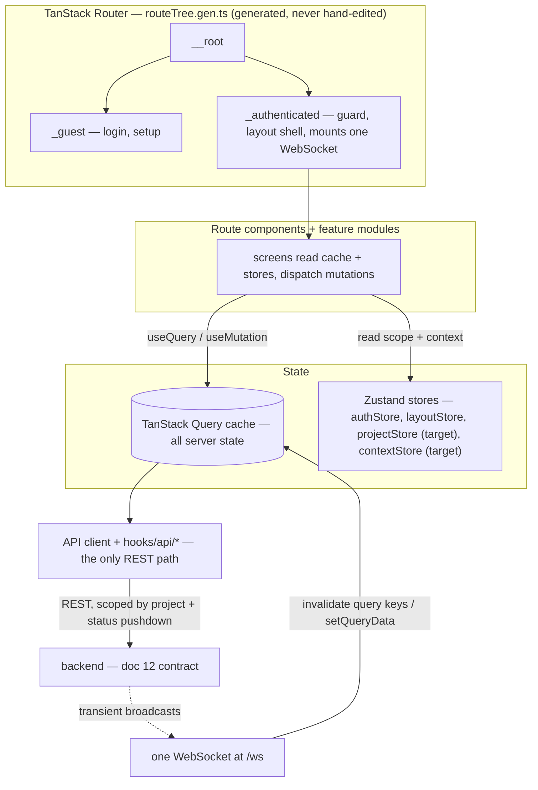

**Routing is TanStack file-based, and `routeTree.gen.ts` is generated — never hand-edited (doc 03 §5.14).** Routes live under `frontend/src/routes` as files; the generated tree is the source of navigation truth. Two layout routes gate everything: `_guest` hosts the unauthenticated login and setup flows, and `_authenticated` runs the auth guard in `beforeLoad` (a cached `checkAuth` with a 60-second TTL, redirecting to `/login` on failure) and renders the layout shell that mounts the one WebSocket. The shell itself is swappable at runtime — `useLayoutStore` selects `SidebarLayout`, `TopNavLayout`, or `StackedLayout` from darkraise-ui — so the navigation *information* architecture (§3) is independent of the chosen chrome. A new screen is a new route file plus a nav entry; it never edits the generated tree.

**Server state is TanStack Query, addressed by explicit query keys, and the project/status filters are part of the key so a scope change refetches (exists today, extended).** Every read goes through a typed hook in `hooks/api/*` (`use-memory-api`, `use-code-api`, `use-jobs-api`, `use-config-api`, `use-pipeline-api`, and the target-new `use-vault-api`, `use-review-api`, `use-events-api`, `use-distribution-api`). The composite `(project, status[, is_archived])` filter doc 04 §10 and doc 07 §7 push into SQL rides into the query key, so switching the project switcher (§3) or a status filter changes the key and TanStack Query refetches the correctly-scoped, pushdown-filtered result — the UI never re-filters an over-fetched set in the browser, mirroring the backend's move of the same filter out of Python and into SQL. This is the client-side half of the invariant-14 pushdown: the UI asks for one project's rows and the backend returns exactly those.

**Client state is a few small Zustand stores, and the target adds exactly two.** `authStore` holds the cookie-JWT session flag; `layoutStore` holds the chrome choice. The target adds `projectStore` (the active project — the global scope, §3) and `contextStore` (the optional session `applies_when` declaration, §3) — both deliberately tiny, both feeding query keys, neither duplicating server data. Route-level data that must exist before a screen renders (the auth check, a specific object load) rides TanStack Router's `beforeLoad`/loaders; everything else is a `useQuery` inside the component.

### 2.1 The live-update architecture — two channels, one mapping

**Decision. Live updates run on two distinct channels that must not be conflated: transient WebSocket broadcasts drive toasts and targeted Query-cache invalidation for *live* views, while the durable `events` substrate is REST-queried for the timeline and the contribution calendar — the WebSocket is a signal that "something changed, refetch," never the store of record (exists today for the transient channel; the durable events channel is target-new, doc 04 §8.1).** The distinction is load-bearing: a WebSocket message is lost on a disconnect, so it may never be the *only* record of a lifecycle transition — that is exactly why doc 04 §8.1 makes `events` a durable, append-only, forbid-trigger-protected table, so the timeline and calendar reconstruct history from a queryable substrate rather than from a stream the browser might have missed. The transient channel keeps the *open* screen fresh; the durable channel answers "what happened, and when" for any screen, at any later time.

A live-update cycle across actors — a captured memory finishes its pipeline, the backend broadcasts a transient signal and journals a durable event, the WebSocket invalidates the affected query keys, and the open view refetches the scoped, labelled result:

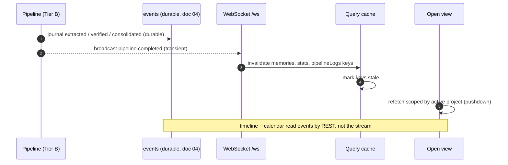

**The WebSocket-to-invalidation mapping is a maintained contract, extended additively as the vault and consolidation surfaces land.** Today `lib/websocket.ts` maps pipeline, memory, and repo events onto specific query-key invalidations and `setQueryData` calls for progress batches (`retryBatchProgress`, `reembedBatchProgress`), with a sonner toast per meaningful event and an exponential-backoff reconnect. The target adds the vault, verification, and consolidation signals against the same mechanism. The mapping (existing rows verbatim, target rows additive — the exact WebSocket *event schema* and its versioning are doc 12's, §7):

| WebSocket event | Toast? | Invalidates / sets | Status |
|---|---|---|---|
| `pipeline.completed` / `partial` / `failed` | yes | `memories`, `memory`, `memoriesPaginated`, `stats`, `overview`, `tags`, `pipelineLogs` | exists today |
| `pipeline.failure.updated` | on resolve | `pipelineFailures`, `pipelineFailureCounts` | exists today |
| `pipeline.retry_batch.progress` | on done | `setQueryData(["retryBatchProgress", id])`; on done `pipelineFailures`, `stats` | exists today |
| `memory.deleted` / `memory.bulk_deleted` | — | `memories`, `memory`, `stats`, `overview`, `tags` | exists today |
| `repo.clone_*` / `repo.indexing_*` | on terminal | `repos`; on terminal `repoTasks`, `repoStats` | exists today |
| `buffer.claimed` / `buffer.done` / `buffer.error` | on error | `bufferDepth`, `activity` | target-new (doc 04 §8.6) |
| `fact.verified` (promotion / demotion / dispute / ratify) | on dispute | `vaultFacts`, `fact`, `reviewQueue`, `reviewCounts` | target-new (doc 08 §4.3) |
| `article.synthesized` / `article.stale` / `article.superseded` | — | `vaultArticles`, `article`, `reviewQueue` | target-new (doc 09 §4.4) |
| `consolidation.completed` (a dream cycle) | yes | `dreamDigest`, `stats`, `hygieneQueue`, `activity` | target-new (doc 08 §7) |
| `topic.detected` | — | `topics`, `pinSuggestions` | target-new (doc 06/09 §3.4) |
| `event.appended` (optional live-tail) | — | `activityFeed` for the open Activity view only | target-new (doc 04 §8.1) |

**Which views subscribe versus poll versus query on demand is a deliberate split.** The Activity screen, the live pipeline stepper, and the dashboard live feed **subscribe** (they need sub-second freshness while open). The Memories list, the vault browsers, and the review/hygiene queues rely on **WebSocket-triggered invalidation** — they are always fresh while open because the relevant events invalidate their keys, but they hold no persistent socket state of their own. The timeline and contribution calendar **query the durable `events` substrate by REST** (a day-bucket or by-object query, doc 04 §8.1), optionally live-tailed by `event.appended` on the open day. Static-ish configuration (Settings, LLM config) is **query-on-demand** with normal cache staleness. This split honours the single-worker assumption (invariant 13): there is one uvicorn worker broadcasting one event stream, so the one WebSocket per client is the whole live-update fabric — no second source, no cross-replica fan-out to reconcile.

---

## 3. Information architecture — the route map, navigation, the project switcher

**Decision. The vault (Knowledge) is promoted to a top-level navigation destination, the code surfaces consolidate into one Code section, and Activity becomes a top-level operational destination — a measured growth from today's seven sidebar items to eight in three groups, because the reshape's whole thesis is that verified knowledge is a first-class surface, not a memory sub-tab (settle: vault top-level; §9).** The tension the framing names is real: the four-layer epistemic model argues Knowledge deserves the top level, while the prior sidebar slim-down (fifteen items down to seven) argues restraint. The resolution keeps restraint where it costs nothing — Facts, Articles, Topics, and Review are *tabs within one Knowledge section*, not four nav items; Repositories, the Code Graph, and the Code Wiki collapse into one Code section — and spends the one new top-level slot where the reshape earns it, on Knowledge. Burying the vault under Memories would tell the user that verified knowledge is a kind of memory, the exact confusion doc 01 §3.4 exists to prevent.

The target navigation map — three groups, eight destinations, with the vault, its review queue, and the code surfaces consolidated, and the timeline/calendar living inside Dashboard and a memory's detail rather than as their own nav items:

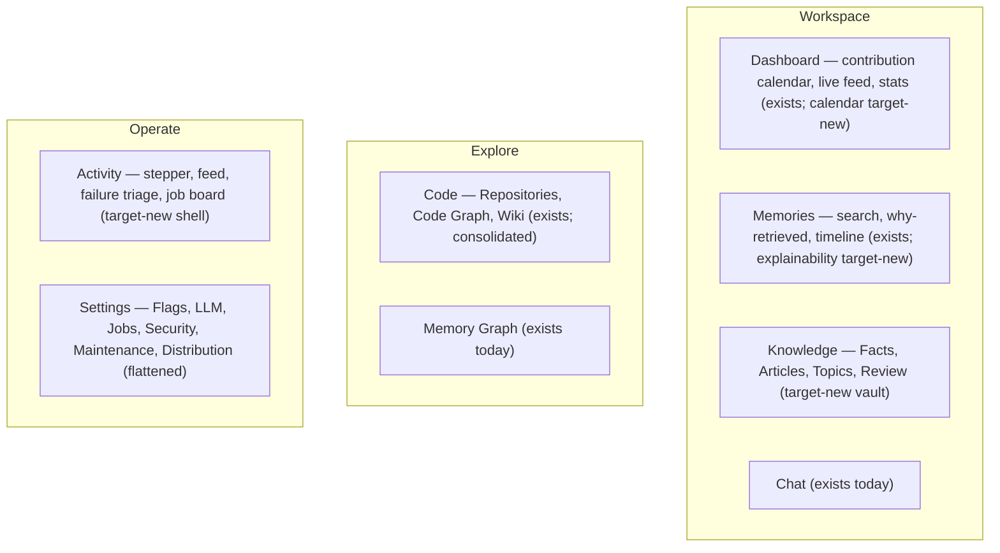

**The route map ties each destination to a route, honestly labelled by what exists in `frontend/src/routes` today versus what the target adds.** The reshape adds vault, review, activity, and calendar-drill routes; it removes the LLM provider/profile management routes when the LLM config flattens (§7).

| Route | Screen | Status |
|---|---|---|
| `/` (`_authenticated/index`) | Dashboard + contribution calendar + live feed | exists; calendar/feed target-new |
| `/memories` | Memories list, search, why-retrieved trace, per-memory timeline | exists; explainability + timeline target-new |
| `/knowledge` | Vault shell — Facts / Articles / Topics / Review tabs | target-new |
| `/knowledge/facts/$factId` | Fact detail — sources, badge, bi-temporal windows | target-new |
| `/knowledge/articles/$articleId` | Article detail — grounded prose, inline citations, stale label | target-new |
| `/knowledge/review` | Review + hygiene triage shell (§6) | target-new |
| `/chat` | Chat over memory | exists today |
| `/repos`, `/code-graph` → `/code` | Code section — repositories, code graph, wiki | exists; consolidated |
| `/unified-graph` → `/memory-graph` | Memory entity graph | exists today |
| `/activity` | Activity shell — stepper, feed, failure triage, job board | target-new (assembles existing panels) |
| `/activity/day/$date` | Calendar-day drill-down (§6) | target-new |
| `/settings` | Settings tabs (LLM flattened, providers/profiles removed) | exists; reshaped |
| `/login`, `/setup` (`_guest`) | Auth + trust-on-first-use setup | exists today |

**The project switcher is the global scope context, and it sets the `project` filter for every scoped surface — but it deliberately does *not* double as the `applies_when` session context (settle; §9).** The switcher lives in the layout chrome (top bar or sidebar header), writes the active project into `projectStore`, and that value rides into every scoped query key (§2), so switching project refetches Memories, the vault, Review, the timeline, the calendar, and the dashboard against the new scope — the client-side face of the isolation invariant (invariant 14, doc 01 §5). What it must *not* do is silently become the agent's declared `applies_when` context. The reason is that `project` and `applies_when` are different axes with different failure modes: `project` is the isolation/scope boundary and the fact's trustworthy `learned_in` provenance, whereas `applies_when` is the closed `env`/`situation`/`version` axis on which a `prod`-scoped read *excludes* `dev-only` facts (doc 07 §6). If switching to a project named "production" silently declared `env=prod`, the UI would start hard-excluding dev-only facts and surfacing an exclusion count the user never asked for — a surprising, quietly-lossy behaviour. So the two are separate controls: the **project switcher** sets scope, and a **separate, optional context chip** declares the session `applies_when` (the UI's equivalent of the `X-Darkmem-Context` header, doc 12 owns the wire format). The selected project's registry `applies_when` default (doc 04 §7, spec §2.3 clause 3) remains the *lowest-precedence* context the backend applies when neither a per-call nor a session context is declared — so the project still contributes a default, but through the backend's precedence chain, not through the switcher masquerading as a context declaration.

The two scoping controls, kept distinct — the project switcher drives the pushdown scope on every query key, while the optional context chip declares the session `applies_when` that boosts, labels, or conflict-excludes rows with a surfaced count:

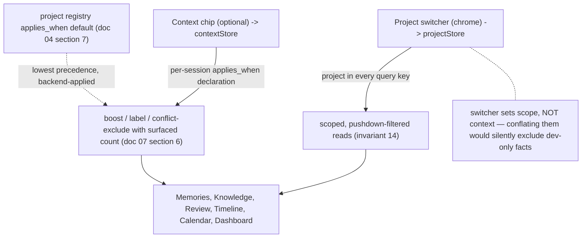

---

## 4. The product-surface inventory — per screen: purpose, modules, signals, states

**Decision. Every screen is specified as a tuple of purpose, modules, the named backend signals it renders, and its four render states — empty, loading, error, populated — so doc 14 and the UI Mockups inherit a complete, unambiguous inventory rather than a sketch (principle 10).** The four-state discipline is what makes "every signal ships with a surface" checkable: a signal with no populated-state home is a gap, and a screen with no honest empty state (the cold-start vault is empty for months, spec §2.7) would read as broken rather than as young. The master inventory below covers the primary surfaces; the trust surfaces (§5) and operational surfaces (§6) get deeper treatment because they carry the reshape's hardest honesty requirements.

| Screen | Purpose | Key modules | Backend signals rendered | Notable states |
|---|---|---|---|---|
| Dashboard | at-a-glance health + activity | contribution calendar, live feed, stat tiles, cold-start hints | `events` day buckets, `/ws` broadcasts, `memory_stats`, buffer depth | empty = fresh install with onboarding CTA; populated = calendar + feed |
| Memories | capture, search, curate L0 | search box, result list, why-retrieved trace, create dialog, command palette | hybrid search rows, retrieval trace (doc 07 §8), layer/verification labels | empty = no matches vs no memories (distinguished); error = both channels failed (doc 07 §2) |
| Memory detail | one memory, its lineage | content, enrichment, `technologies`, supersession lineage, per-memory timeline | `memories` row, `superseded_by`, `events` by object, memory-relations | superseded = amber badge + link to successor; loading = skeleton |
| Knowledge (§5) | browse the verified vault | Facts / Articles / Topics / Review tabs | facts, articles, topics, badges, staleness labels | empty = labelled cold-start ("candidates served below") |
| Chat | converse over memory | thread list, message pane, context panel | `conversations`, `messages`, retrieval context | empty = new-conversation prompt |
| Code (§4.3) | code knowledge | Repositories, Code Graph, Wiki tabs | repo status, code graph nodes/edges, wiki, index debt | indexing = live phase label; error = fail-stale banner |
| Memory Graph | explore the entity graph | force/tree/community layouts, search, navigator | entities, relations, communities | empty = no graph yet |
| Activity (§6) | operational live view | five-phase stepper, feed, failure triage, job board | pipeline `/ws`, buffer states, `pipeline_failures`, jobs | poison rows surfaced; failed = triage with retry |
| Settings (§7) | runtime config | Flags, LLM, Jobs, Security, Maintenance, Distribution | config rows, six LLM purposes, job config, flags | save = live-reload confirmation |

**The Dashboard is the daily home, and its contribution calendar and live feed both read the event substrate — one durable, one transient (target-new).** *Purpose:* let the human see the brain's health and recent activity without opening the database (doc 01 F9). *Modules:* the **contribution calendar** (a GitHub-style heatmap of activity per UTC day, reading the `events` date-bucket index `(project, ((created_at AT TIME ZONE 'UTC')::date))`, doc 04 §8.1 — a day click routes to `/activity/day/$date`), the **live feed** (the transient `/ws` stream while the dashboard is open), **stat tiles** (memory count, verified-fact count, open-review count, buffer depth), and **cold-start hints**. *Signals:* the durable `events` buckets, the transient broadcasts, and `memory_stats`. *States:* **empty** is a fresh install — the calendar is blank and a first-capture / onboarding call-to-action shows, not a broken grid; **loading** skeletons the tiles and calendar; **error** shows a retry with the last-known counts if cached; **populated** is the heatmap plus the feed. The calendar's day buckets are UTC by fixed definition (the `AT TIME ZONE 'UTC'` cast is what makes the index expression immutable, doc 04 §8.1), so a day means the same thing to every viewer regardless of browser timezone — a rendering constraint doc 14 must honour.

**Memories is the L0 capture-and-search surface, and its results carry the honest labels and the explainability trace (exists today for search; labels + trace target-new).** *Purpose:* capture memories and retrieve them explainably (doc 01 F1/F3). *Modules:* the search box (with the project scope and optional context chip, §3), the result list, the **why-retrieved trace** panel (§5.4), the create-memory dialog, and the command palette (both exist today). *Signals:* hybrid search rows carrying `rrf_score` and per-modality scores, each row's `layer` and `verification_status` label, and the excluded counts. *States:* the **empty** state must distinguish "no memories match this query" from "no memories exist yet" (different copy, different call to action); **loading** streams a skeleton list; **error** is the honest both-channel-failure case (doc 07 §2 — a one-sided failure degrades to the surviving modality with a flag, only a both-sided failure surfaces as an error, never an empty list masquerading as no-match); **populated** is the ranked, labelled list. Every result carries its layer label so a memory, a fact that a memory supports, and an article citing that fact never read as three unrelated hits — the grouping-under-fact collapse (doc 07 §5) renders as a nested "supports fact F" affordance, not three rows.

**Memory detail renders one memory's lineage honestly, never dropping a superseded row (exists today; timeline + lineage extended).** *Modules:* content, the enrichment fields (`classified_type`, `summary`, `emotions`, `flags` — the `llm_` prefix dropped, doc 04 §3.1), the `technologies` chips, the **supersession lineage** (a superseded memory shows an amber badge and a link to the memory that replaced it, reachable through `superseded_by`, doc 07 §7), the associative **memory-relations** (`CONTRADICTS`/`ELABORATES`/`DEPENDS_ON`/`FOLLOWS`/`RELATES_TO`, doc 08 §5.5), and the **per-memory timeline** (its `events` history by object). *States:* a **superseded** or **deprecated** memory is labelled and retained, never hidden (doc 01 §8, invariant 14); **loading** skeletons; **error** offers retry.

### 4.1 Chat, Memory Graph, and the code surfaces

**Chat stays a conversational surface over memory retrieval, unchanged in structure (exists today).** *Modules:* thread list, message pane, and a context panel that shows the retrieval context a turn used. *Signals:* `conversations`/`messages` (doc 04 §7) and the retrieval context the reasoning path composed. Chat's reads ride the same one ranking path as Memories (doc 07 §9, invariant 17), so its context panel can render the same labels and trace — a behaviour that exists once on the service layer and surfaces on both front doors.

**The Memory Graph is the entity-graph explorer (exists today as `/unified-graph`).** *Modules:* the force/tree/community layout switcher, search, and the community navigator. *Signals:* entities, relations, and topic communities. It renders the L1 candidate graph and the emergent topics; it never renders a topic as an entity (invariant 5). The PPR/community augmentation it can visualise is the built-but-unspent graph (invariant 23) — the graph view exists, but "spend the graph on retrieval" is target (doc 07 §4), so the graph explorer must not imply that browsing the graph is what ranks search results today.

### 4.2 The code surfaces — Repositories, Code Graph, Wiki

**Decision. The three code surfaces consolidate under one Code section with tabs, preserving today's code-graph revamp features and adding the fail-stale and index-debt signals the T1–T4 hardening produces (exists today; hardening signals target-new, doc 10).** *Repositories:* the repo list with live indexing status (the `repo.indexing_*` phase label rewritten per tick, `lib/websocket.ts`), a reindex dialog (`{full, enrich_symbols, generate_wiki}`, doc 10), and the auto-provision registration state (a memory's repo hint that auto-registered a repo, F11). *Code Graph:* the force/tree/circles layout switcher, camera controls, command-palette search, the Processes panel with Mermaid export, community colouring, the symbol browser, and blast-radius risk buckets (all from the code-graph revamp, kept). *Wiki:* read-only wiki view with an empty state that points at the reindex dialog (`GET /code/wiki` never implicitly generates, doc 10). *Target-new signals:* the **fail-stale banner** (a repo whose last index failed shows the last-good graph marked stale, never wiped — T1, doc 10), and the **index-debt indicator** (outstanding re-trace work draining via continuation batches — T2). *States:* **indexing** shows the live phase; **stale** shows the fail-stale banner with a re-run affordance; **error** on a clone/index failure surfaces the message (`repo.*_failed` toast). The code section is gated by repository, not project (doc 01 §8's deliberate exception) — the project switcher does not scope it — a distinction the UI must make visible so a user does not expect switching projects to filter the code graph.

---

## 5. Knowledge & trust surfaces — vault browsing, badges, explainability

**Decision. The vault is one Knowledge shell with four tabs — Facts, Articles, Topics, and Review — where every fact and article carries the honest verification badge verbatim, disputed items show both sides, stale articles are labelled not hidden, and the "why retrieved" trace is a first-class explainability panel; this is where the reshape's truth-over-everything priority becomes pixels (invariant 14, Part B contract 2).** These are the surfaces most able to lie by omission — a fact rendered without its origin count, an article rendered without its stale label, a disputed claim rendered as settled — so each one renders exactly the label the backend computed and never a stronger word. The UI reads `verification_status`, `layer`, `confidence`, and the staleness label as *given* and never recomputes them (invariant 15, invariant 23): doc 08 owns the ladder, doc 09 owns the article status and stale label, and this surface renders them.

The Knowledge shell and what each tab reads, with the Review tab consuming the same `review_state='open'` set both the fact and article layers set:

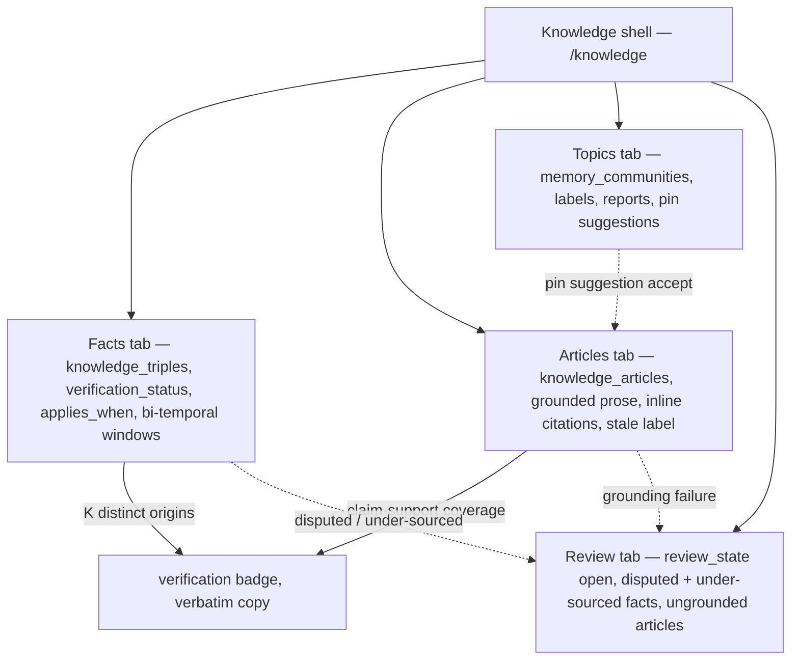

### 5.1 Facts browsing — the bi-temporal, multi-origin surface

**The Facts tab renders a verified fact with its verification status, its origin count, its bi-temporal belief windows, and its structured context — every signal the fact layer produces gets a visible home (target-new, doc 08 §3/§4).** *Modules:* a filterable fact list (by subject, relation, status, project scope), and a fact detail (`/knowledge/facts/$factId`) showing the `fact` text, `subject_name`/`object_name`, `rel_type`, the **verification badge** (§5.3), the **sources module** (the `fact_sources` rows grouped by `origin_key` so the count the badge claims — `COUNT(DISTINCT origin_key)`, never rows — is visible and auditable, with each source's kind: memory / block / code / human), the **belief-window module** (`valid_at`/`invalid_at`/`expired_at` rendered as a timeline so "what did we believe as of X" is legible — a window-closed fact reads as retained history, not a live claim), and the **`applies_when` context** shown as labels. *Signals:* `verification_status`, aggregated `confidence`, the distinct-origin count, the belief axis, and `applies_when`. *States:* **cold-start** is the honest labelled-candidate case — the vault is empty of corroborated facts for months after a fresh install (spec §2.7), so the Facts tab's empty state says "no corroborated facts yet; candidates are served labelled in search" rather than reading as broken; **loading** skeletons; **populated** is the list. A **code-originated fact** born `corroborated` shows its distinct `code@commit` badge and its `{commit_sha, basis, file_path, symbol_key}` provenance (doc 08 §4.1) — the parse is the verification, and the surface says so.

### 5.2 Articles browsing — grounded prose with inline citations

**The Articles tab renders a Layer-3 subject article as grounded prose whose every claim links to its cited fact, with `confidence` shown as claim-support coverage and staleness shown as a label, never a silent rewrite (target-new, doc 09 §4).** *Modules:* the article list (one live article per `(project, subject_key)`, so a subject shows exactly one current article with its lineage reachable), and the article detail (`/knowledge/articles/$articleId`) rendering the synthesised `content` with **inline claim citations** (each `article_citations.claim_span` links its span to the `fact_id` that grounds it — a hard FK that never dangles, doc 09 §4.3, doc 04 §8.8), the **confidence-as-coverage** readout (the `confidence` value *is* the fraction of sentences a verified fact entails, so the surface labels it "claim-support coverage," not a vague score), the **verification badge**, and the **stale label**. *Signals:* article `status`, `confidence`, `fact_set_hash`-driven staleness, `applies_when`. *States:* a **stale** article (its supporting *verified* fact set changed) shows a stale label with copy like "synthesised before the latest verified change" and remains fully readable — retrieval surfaces the same label (doc 07 §5, doc 09 §4.4); a **disputed** or **ungrounded** article (`review_state='open'`) is withheld from the corroborated view and routed to Review, not shipped as knowledge; a **superseded** article is reachable through its `superseded_by` lineage. The article never reads a document block (the doc-16 firewall, doc 01 §3.4) — its provenance is only its cited facts, and the UI reflects that by grounding every claim in a fact, never in a raw source.

### 5.3 Verification badges — the honest copy, rendered verbatim

**Decision. The verification badge renders the exact claim doc 12 defines and this design restates verbatim — *"asserted by K distinct origins of kinds [X, Y], no known contradiction, as of T"* — and never the words "true" or "verified"; the four ladder rungs and the two overlay labels each get a visually distinct, honestly-worded treatment (Part B contract 2, invariant 14).** The badge is the single most repeated honesty surface in the product, so its copy is fixed here and its rendering is doc 14's — the field *semantics* are doc 12's, the *string* is the contract, and no screen paraphrases it. The distinct-origin count `K` and the kind list `[X, Y]` come straight from the fact's `fact_sources`; a rendering that showed a row count instead of a distinct-origin count would silently manufacture agreement (spec §2.1), so the badge binds to `COUNT(DISTINCT origin_key)` and the sources module (§5.1) lets the user verify the count.

How the ladder and its overlays render — `candidate` served labelled and below verified, machine-`corroborated` under-claiming with the verbatim badge, human-only `confirmed`, `disputed` shown with both sides, and the two label overlays (`under-sourced`, `stale`) that ride on a still-corroborated row without being ladder values:

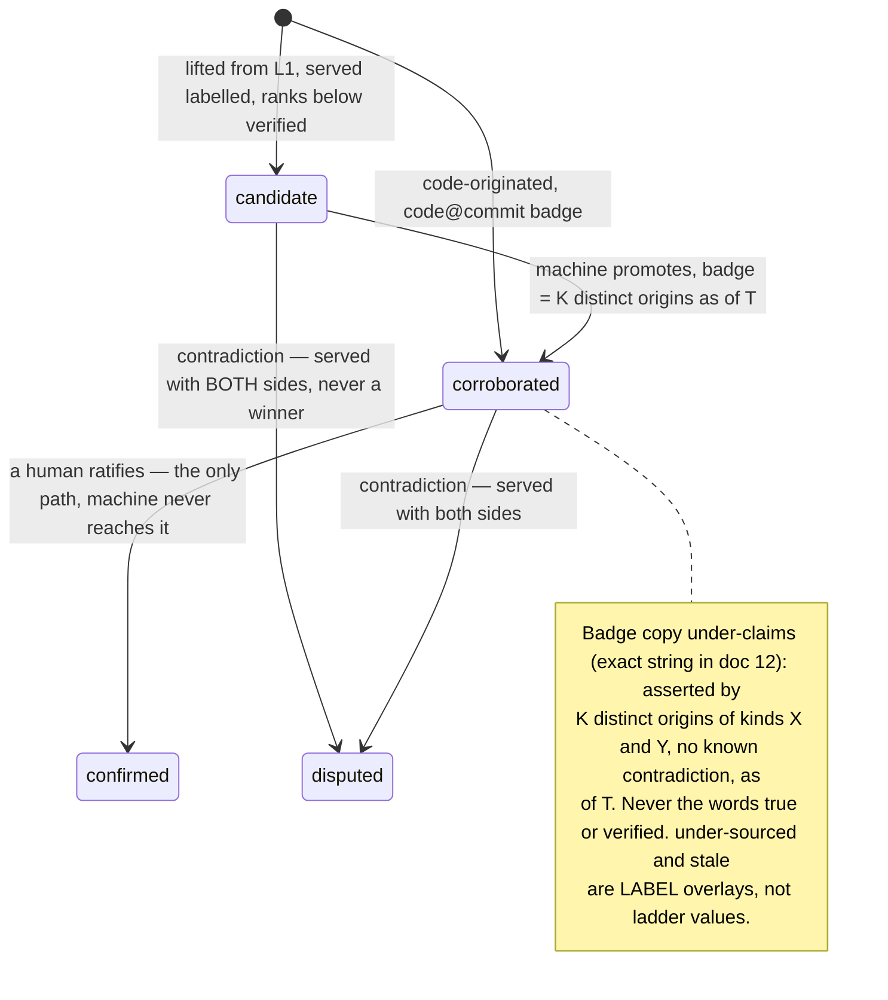

**The two overlay labels — `under-sourced` and `stale` — render as badges on top of the ladder status, not as ladder values, because that is exactly what the backend models (doc 08 §4.3, doc 09 §4.4).** An `under-sourced` fact is a still-`corroborated` fact whose distinct-origin count dropped below N and is in demotion hysteresis; the UI shows it corroborated with an "under-sourced" caution overlay, so retrieval stays honest immediately while the grace period absorbs transient churn. A `stale` article is a still-`corroborated`/`confirmed` article whose verified fact set changed; the UI shows it with a "stale" overlay. Neither overlay is a `verification_status` value (the CHECK is `candidate | corroborated | disputed | confirmed`, doc 08), so the UI must not render them as a fifth rung — a rendering distinction doc 14 must preserve.

### 5.4 Explainability — the "why retrieved" trace, rendered from doc 07 §8

**Decision. The "why retrieved" surface renders exactly the retrieval-trace payload doc 07 §8 defines — the request envelope and the per-row trace — as a legible panel, so a human can trust or challenge any result by seeing the pipeline's own record of how it ranked (contract 1, doc 01 F3).** The trace is the pipeline's working, not a plausible story told afterward (doc 07 §8), so the panel renders the payload field-for-field rather than inventing a narrative. It reads the payload; it never recomputes a score.

The trace payload mapped to UI modules — the envelope drives the request-level header and the surfaced exclusion counts, and each row-trace drives one expandable result explanation:

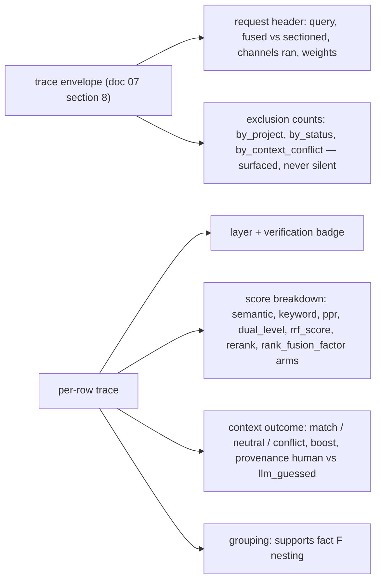

**The envelope surfaces the exclusion counts prominently, because a silent drop is the failure the design most fears (invariant 14, doc 07 §6/§7).** The panel header renders `excluded.by_context_conflict` as human copy — "3 facts excluded by context conflict" — alongside `by_project` and `by_status`, so the user always sees that context or scope influenced the result set and by how much; the counts are never buried. The per-row score breakdown renders the per-modality raw scores, the fused `rrf_score` (the ordering signal), the nullable rerank score, and the `rank_fusion_factor` arm breakdown (`confidence`/`importance`/`heat`/`recency`), so the explanation is complete. The `context.provenance` field distinguishes a human-touched `applies_when` from an `llm_guessed` one (doc 07 §6), and the UI labels the latter as unverified provenance — an LLM-guessed context tag is displayed, never presented as an exclusion basis until a human touches it. The `fused` envelope flag tells the panel whether to render sectioned-by-layer (a Facts section, an Articles section, a Memory section — the default) or one fused list (the token-budgeted inject shape, doc 07 §5); the explainability surface prefers the sectioned shape because the layer structure is the point of the explanation.

---

## 6. Operational surfaces — activity, jobs, hygiene, the dream digest, timeline & calendar

**Decision. Operations get four surfaces: an Activity shell (the five-phase pipeline stepper, the live feed, failure triage, and the job board), the review-and-hygiene triage shell (one surface, two distinct backend states), the dream digest with per-action undo, and the timeline/calendar reading the durable event substrate — because a solo maintainer curating a truth system needs to see and reverse what the machine did without reading the database (doc 01 F6/F9, invariant 14).** These surfaces render the transient live signals and the durable events together — the stepper is live, the digest and timeline are durable — so the human sees both "what is happening now" and "what happened, and can I undo it."

### 6.1 Activity — stepper, feed, failure triage, job board

**Decision. Activity assembles four modules, and its v1 ships the three whose backend signals exist today plus the job board, while the buffer-depth monitor and the dream-run monitor stage in with their target-new backends (settle Activity v1-vs-staged; §9).** *Modules and their v1/staged split:* the **five-phase pipeline stepper** (v1 — the per-memory pipeline states already broadcast over `/ws`), the **live feed** (v1 — the transient stream), the **failure triage** (v1 — `pipeline_failures` with retry, exists today), the **job board** (v1 — the jobs panel with per-job config, exists today, doc 02 §5.3), the **buffer-depth monitor** (staged — needs `memory_buffer`, doc 04 §8.6), and the **consolidation/dream-run monitor** (staged — needs the consolidation job family, doc 08 §5). Staging the two buffer/dream modules behind their backends is invariant 23 in the UI: a monitor for a table that does not yet write would render an empty panel that reads as either broken or as claiming a shipped capability, so it lands when its signal does.

The Activity shell's four v1 modules and the two staged ones, each bound to its signal source:

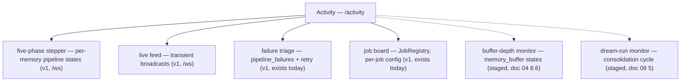

**The five-phase stepper renders each memory's pipeline progress and its honest terminal state, and the buffer monitor renders the ingest buffer's own state machine (v1 stepper; staged buffer).** The stepper maps the conceptual five phases (content embed → extract-and-classify → entity embed → dedup → write, doc 02 §5.2) onto the per-memory `/ws` progress, ending in `completed`, `partial`, or `failed` — a **partial** memory shows exactly which step failed (the WebSocket payload names embed/extract/vector/graph), never a collapsed batch pass/fail (invariant 14). The buffer monitor (staged) renders the `memory_buffer` states so poison rows are visible rather than looping silently.

The per-memory pipeline stepper terminal states, and the ingest-buffer state machine the staged monitor renders — a partial memory names its failed step, and a poison buffer row surfaces in triage rather than looping:

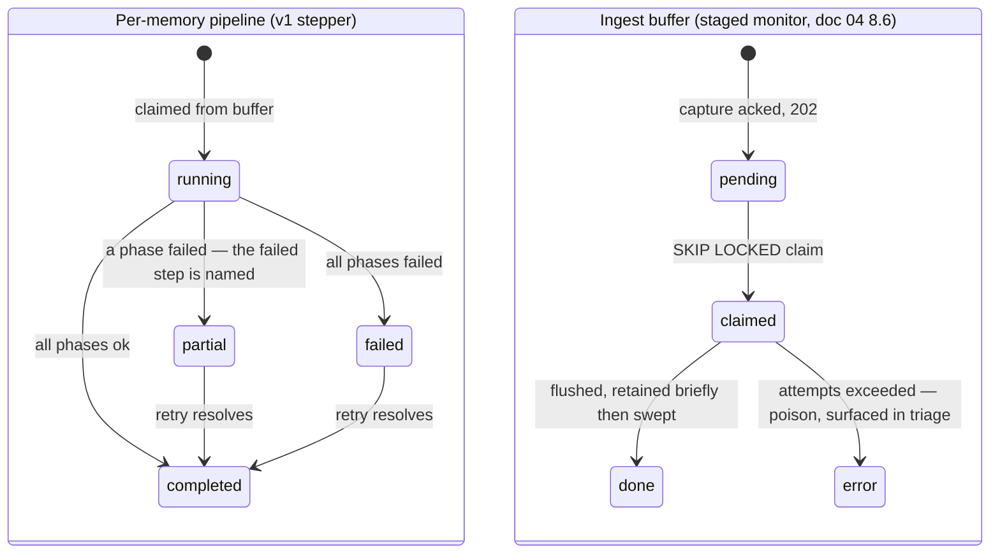

### 6.2 The review-and-hygiene triage shell — one surface, two states

**Decision. Review and hygiene share one triage shell in the UI but stay two distinct backend states, because their semantics differ — review adjudicates truth, hygiene curates housekeeping — and neither is ever a gate on the read path (settle one-surface-two-states; §9; doc 08 §6).** Doc 08 §6 explicitly leaves the surface decision to this doc while fixing that the two are distinct `review_state`/status sets; one shell with two modes (a Review mode and a Hygiene mode) is the right call because they are the same *activity* for the human — triage a queue with actions — even though they read different backend states. The shell is **consequence-ranked, never FIFO** (retrieval frequency and subject salience order it, doc 08 §6), and the item stays served-labelled in retrieval regardless of its queue state, so the queue is an override the human works, never a bottleneck the system waits on.

A review-queue entry's lifecycle as the triage shell renders it — consequence-ranked, served-labelled with both sides, decaying off the active queue but never silenced:

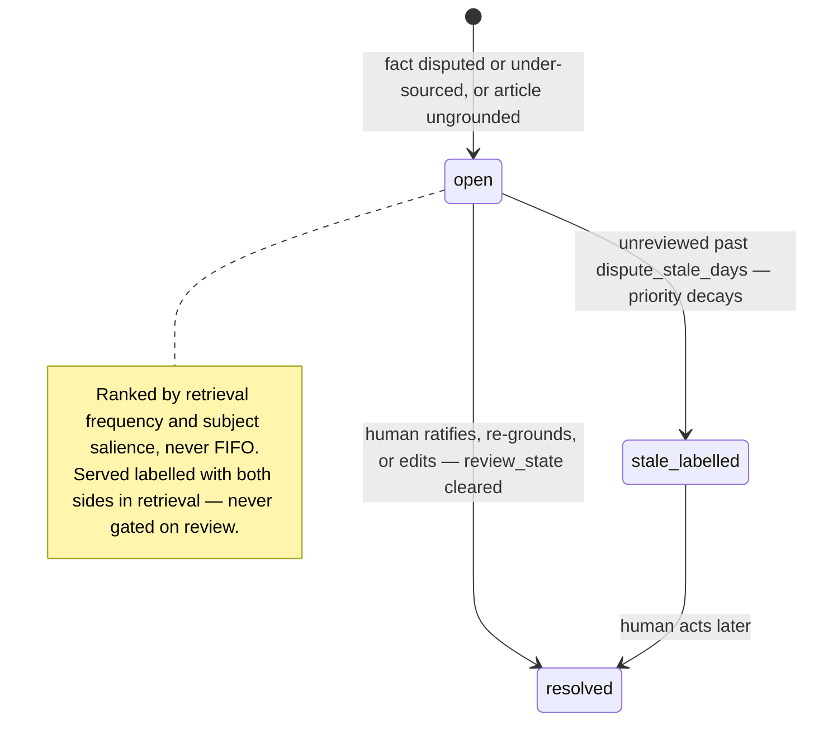

**The Review mode adjudicates truth; the Hygiene mode curates housekeeping with bulk actions (doc 08 §6).** *Review mode* renders `review_state='open'` facts and articles — disputed facts (shown with **both conflicting sides**, never a picked winner), under-sourced facts held in hysteresis, and ungrounded/low-confidence articles — with per-item actions: **ratify to `confirmed`** (a human-only action that writes a `human`-kind `fact_source`, doc 08 §4.4 — authenticated, and never exposed over the unauthenticated MCP surface, doc 12), re-ground, edit, or clear. *Hygiene mode* renders the housekeeping set — candidate duplicates from dreaming, low-confidence memories, expiring-soon rows (`expires_at` approaching), and superseded lineage — with **bulk actions** (set/extend a TTL, prune, supersede, confirm a dedup, doc 08 §6, F6/F9). *States:* **empty** in Review is the healthy state ("no disputes to adjudicate"), rendered as reassurance not absence; **populated** is the consequence-ranked list; a **stale-labelled** dispute has decayed off the active queue but is still reachable and still served-labelled — the surface must show that decay is a priority change, not a resolution (nothing is silently resolved, invariant 14).

### 6.3 The dream digest with undo

**Decision. The dream digest renders a consolidation cycle's journaled `events` grouped by object and action, and offers per-action and per-batch undo, tractable because every consolidation action is non-destructive and its inverse is a status/pointer/timestamp restore from the journaled before-state (target-new, doc 08 §7).** This is the human-in-the-loop centre of consolidation (doc 01 F6): the machine dreams off the hot path, and the digest is where the human sees what it changed and reverses anything it got wrong. The undo is possible only because invalidate-not-delete and append-only `events` mean no inverse ever has to resurrect a deleted row (doc 08 §7) — the UI renders the reversibility the backend guarantees.

The dream digest and undo flow — a cycle's journaled events feed the grouped digest, and undo replays the inverse from the before-state, itself journaled:

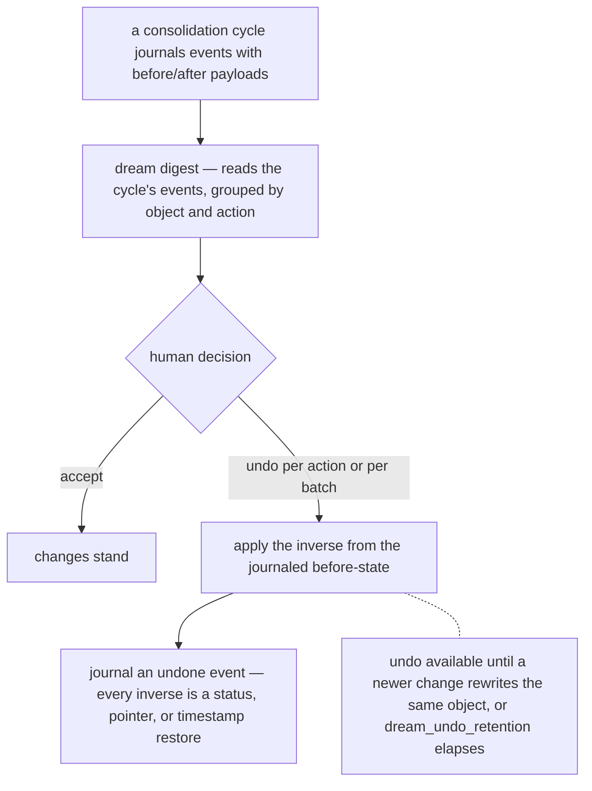

**The digest lists each dream action with its reversibility, and the undo affordance is present only while the action is still undoable (doc 08 §7).** *Modules:* the cycle summary (counts of superseded, refined, promoted/demoted, disputed, edges derived), the grouped action list (supersession, refine, associative-edge derivation, fact promotion/demotion, ratification, fact invalidation, article re-synthesis), and per-action / per-batch undo. *States:* **empty** is "no dream cycles yet"; **populated** is the grouped digest; an action past its undo window (a newer change rewrote the same object, or `dream_undo_retention` elapsed) renders its undo affordance disabled with an honest reason, never a broken button. Undo is an authenticated curation action (doc 08 §7, doc 12).

### 6.4 Timeline & calendar — reading the durable event substrate

**Decision. The memory timeline and the contribution calendar both read the durable, append-only `events` substrate, and a calendar-day click drills into that day's activity at `/activity/day/$date` — the events table is what makes the timeline trustworthy and the calendar honest (target-new, doc 04 §8.1, doc 01 §3.8).** These are the two surfaces doc 01 §3.8 names as the reason `events` is a first-class durable substrate rather than a transient stream: a timeline reconstructs one object's history (the `(object_type, object_id, created_at)` index), and a calendar day drills into that UTC day's activity (the `(project, ((created_at AT TIME ZONE 'UTC')::date))` date-bucket index). Both are REST queries over the durable substrate, optionally live-tailed on the open view; neither depends on a WebSocket message it might have missed.

The events substrate feeding both surfaces — the by-object index reconstructs a memory's timeline, and the UTC day-bucket index drives the calendar heatmap and the day drill-down:

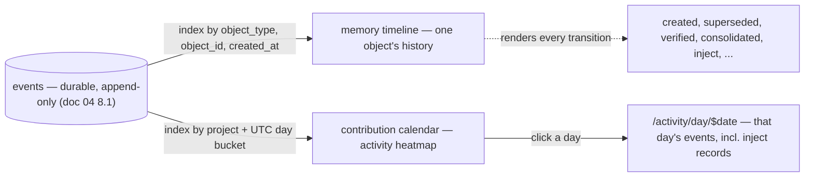

**Every backend transition that gains a durable home in `events` gains a rendering here — including the verification transitions that answer 'what did we believe as of X' on the verification dimension (doc 04 §8.1, doc 08 §4.3).** The timeline renders the closed `event_type` vocabulary (created / superseded / deprecated / expired / extracted / consolidated / **verified** / document_filed / repo_registered / repo_synced / repo_indexed / **inject** / …), so a fact's verification promotions, demotions, disputes, and ratifications appear in its history, and a memory's supersession lineage appears in its. *States:* **empty** is a young install (an honest blank calendar with an onboarding hint, matching the dashboard); **loading** skeletons the grid/list; **populated** is the heatmap or the ordered event list. One rendering limitation is inherited honestly: bigint-keyed code-graph objects carry their key in the event payload, so *their* timelines are payload-queried and cannot use the by-object index (doc 04 §8.1) — a deliberate trade the code surfaces reflect rather than paper over.

### 6.5 Distribution controls & inject records

**Decision. Distribution controls live as a Settings tab for configuration while inject *records* surface in the timeline/calendar as `inject` events — a config-shaped surface for v1 that graduates to a first-class Connect destination when browser-capture and one-command onboarding land (settle distribution location; §9; doc 15).** The framing leaves the location open between Settings and a first-class surface; the resolution is that v1 distribution is mostly *configuration* (what auto-injects, per-target managed-block settings, the inject content policy and token budget, curbs) which belongs in Settings, while the *observable* half — which inject happened where — belongs in the durable event stream and therefore surfaces in the timeline/calendar, where inject is a journaled `event_type` (doc 04 §8.1). *Modules (Settings → Distribution):* onboarding/connect status per client (Claude Code, Cursor, Codex, Cline, …), per-target managed-block configuration, the inject content policy (what gets injected, the token budget), and the curb control (the human can see and curb push — never a silent context swap, doc 01 F10). *Signals:* inject events, connection status, and the render watermark (a `config` row, not a table, doc 04 §7). *States:* **empty** is "no clients connected" with the onboarding call-to-action; **populated** is the client list plus the inject log. Injected context carries the same honesty labels into the tool (verification status and layer survive the injection, doc 07 §9, invariant 14), and the Distribution surface makes that visible: a user can see that a `corroborated` fact was injected as corroborated and a `superseded` memory as superseded. When browser-capture (a new ingestion source, doc 15) and one-command onboarding grow, this graduates to a first-class Connect destination; until then, keeping it in Settings honours the slim navigation.

---

## 7. Settings & configuration IA

**Decision. Settings flattens to six tabs — Flags, LLM, Jobs, Security, Maintenance, and Distribution — and the LLM tab is six inline purpose cards plus the classifier-kind toggle; the provider, profile, and ML-profile management surfaces are deleted outright with the LLM-config flattening (target; doc 04 §7, doc 11, spec §4).** The current Settings carries `llm-pipeline`, `llm-providers`, `llm-profiles`, and `ml-profiles` tabs (`lib/settings-tab.ts`); the reshape removes the last three when `llm_providers`/`llm_profiles`/`ml_profiles` and every `*_ref` are dropped (doc 04 §7). darkmem is not an LLM proxy, so there is no provider/profile indirection to manage — each purpose is one inline row, and the UI edits it directly. Removing the profile UI is not a cleanup deferred to later; it is a target requirement, because a profile picker over a schema with no profiles table would be scaffolding rendered as a feature (invariant 23).

The target Settings tabs, and the current tabs each replaces or drops — the LLM tab is the flattened six-purpose surface, and three profile-management tabs are removed:

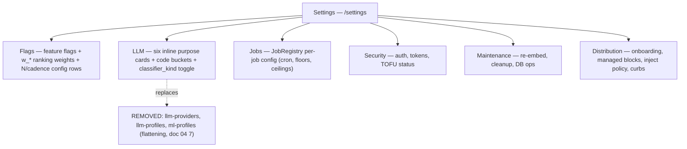

**The LLM tab renders the six purposes as inline cards, with the code-summarization buckets and the classifier-kind toggle, and no provider/profile chrome (doc 11, doc 04 §7).** *Modules:* one card per purpose — `embedding`, `extraction`, `classification`, `reasoning`, `summarization`, `reranker` — each editing `{model, base_url, api_key, api_kind, params, dimensions?, reasoning?}` inline; the code-summarization sub-buckets (symbol/module/overview); and the **classifier-kind toggle** on the classification card (`llm | local` — the local classifier re-homed inline, not via a deleted `ml_profiles`, doc 11). *Signals:* the six `llm_purpose_configs` rows and the live-reload confirmation (the orchestrator is reconstructed on save, doc 02 §7). *States:* **loading** skeletons the cards; **error** on a failed save keeps the draft and surfaces the reason; **populated** is the six cards; a **save** shows the live-reload confirmation, because there are no `LLM_*` env vars and the change takes effect without a redeploy (invariants 18/19). The vendor-quirk handling (Anthropic `x-api-key`, DeepSeek `thinking:{type:disabled}`, Gemini `reasoning_effort=none`, Ollama `think:false`) lives behind `api_kind` in the backend (invariant 18); the UI exposes `api_kind` as a selector and never re-implements a quirk client-side.

**The Flags tab is where the new tunables surface as config rows, honestly labelled by whether their arm is active (doc 04 §9, doc 07 §11, convention 9).** The `w_*` ranking-arm weights (`w_conf`, `w_importance`, `w_heat`, `w_recency`, `w_ppr`, `w_dual`, `w_context_boost`), the graph-augmentation `*_enabled` flags (`ppr_enabled`, `dual_level_enabled`, `community_injection_enabled`), the corroboration `N` and diversity/time gate, and the job cadences all land as config rows or feature flags, not new tables. The UI labels each honestly: a `w_*` arm defaulting to 0 is shown as **inactive** (the built-but-unspent signal, invariant 23), and turning it on is a deliberate, measured activation, never a silent default — so an operator sees which ranking signals are actually spent versus which are dormant. Jobs, Security, and Maintenance keep their existing surfaces (the per-job config pattern, doc 02 §5.3; the token/TOFU security state; the re-embed and cleanup operations).

**A closed-taxonomy discipline binds the UI's own type filters (invariant 5).** The Memories and vault filters render `MEMORY_TYPES`, `ENTITY_TYPES`, and the memory-relation vocabulary; when the backend widens a vocabulary (adding `episodic`/`procedural` to `MEMORY_TYPES`, or the five memory-relation types), the UI type filters are one of the hard-coded vocabularies that must be swept *before* the feature emits the new value (doc 04 §4.3, §12) — a stale UI filter would silently hide rows of a new type. So the filter option lists are generated from a single shared vocabulary source, not hard-coded per component.

---

## 8. Invariants restated

The invariants that bind the frontend layer, restated in this doc's terms so the design is checkable against the 1–23 catalogue (`gt-invariants.md`, doc 02 §10 / doc 04 §11):

- **Every backend signal ships with its surface (principle 10, doc 02 §10).** Verification transitions, layer labels, stale-article labels, conflict-excluded counts, buffer/pipeline states, the events timeline/calendar, and inject records each have a named home in §4–§7; a signal with no populated-state surface is a gap that fails review.
- **Honest partial results & no silent degradation (inv. 14).** The badge renders the verbatim honest claim and never "true"/"verified"; disputed items show both sides; superseded rows are amber-labelled and reachable through lineage; stale articles are labelled, not hidden; the exclusion counts (`by_project`, `by_status`, `by_context_conflict`) are surfaced in the trace, never dropped; a partial pipeline names its failed step; a both-channel search failure is an error state, not an empty list.
- **Two front doors, one service layer (inv. 17).** The UI is a REST consumer of the doc-12 contract; it renders only behaviour the service layer owns and never invents one absent from that contract. Where a capability is intentionally single-door, the UI is the door that carries it: ratification (`confirmed`) is an authenticated REST/UI action, deliberately *not* an unauthenticated MCP power (doc 08 §4.4, doc 12) — the invariant-17 rule is "same service behind both doors," not "every behaviour on both doors."
- **Reconciliation off the hot path (inv. 15), rendered not recomputed.** The UI reads `verification_status`, `layer`, `confidence`, and staleness as given from docs 08/09 and never recomputes a verdict client-side; the retrieval trace is read from doc 07 §8, never reassembled.
- **Scaffolding-not-substrate (inv. 23).** Target surfaces are labelled: the vault's cold-start is an honest labelled-empty state, the graph explorer does not imply the graph is spent on ranking today, dormant ranking arms render as inactive, and the buffer/dream monitors stage in with their backends rather than rendering empty panels that overclaim.
- **Single worker (inv. 13).** One WebSocket per client is the whole live-update fabric because there is one uvicorn worker broadcasting one stream; the UI assumes no cross-replica fan-out, and the timeline/calendar fall back to the durable substrate rather than to a second stream.
- **Closed taxonomy, taxonomy-first (inv. 5).** UI type filters are generated from the shared vocabulary source and swept when a vocabulary widens, before the feature emits the new value.

---

## 9. Open questions & deferred decisions

Each carries a recommended stance, so downstream inherits a default rather than a blank.

- **Vault IA — top-level versus nested (resolved: top-level).** *Stance: Knowledge is a top-level nav destination with Facts/Articles/Topics/Review as tabs, growing the sidebar from seven to eight items by also consolidating the three code surfaces into one Code section (§3).* The four-layer model makes the vault a first-class surface, not a memory sub-tab; restraint is preserved by tabbing the four vault views and the three code views rather than adding seven nav items. Doc 14 owns whether the eighth item warrants a visual grouping change.
- **One queue surface or two (resolved: one shell, two states).** *Stance: a single triage shell with a Review mode and a Hygiene mode, backed by the two distinct backend states doc 08 §6 defines — Review adjudicates truth (disputed/under-sourced facts, ungrounded articles), Hygiene curates housekeeping (duplicates, low-confidence, expiring-soon, superseded lineage) with bulk actions (§6.2).* Same activity for the human, different backend states, so one surface with two modes, never two nav items.
- **The project switcher as global context (resolved: scope only, separate context chip).** *Stance: the project switcher sets the `project` scope on every query key and does NOT double as the `applies_when` session context; a separate optional context chip declares the session `applies_when`, and the selected project's registry default is the lowest-precedence context the backend applies (§3).* Conflating them would make switching to a "prod"-named project silently exclude dev-only facts with a surfaced count the user never requested — a quietly-lossy surprise the two-control split avoids.
- **Live-update WS-to-query-invalidation mapping (resolved: the §2.1 mapping table).** *Stance: extend today's `lib/websocket.ts` mapping additively — the existing pipeline/memory/repo rows verbatim, plus the target-new buffer, fact-verified, article, consolidation, and topic rows — with the transient/durable two-channel split, subscribe-versus-invalidate-versus-poll per view (§2.1).* The exact WebSocket *event schema* and its versioning are doc 12's; this doc fixes only which events invalidate which keys and which views subscribe.
- **Activity v1 versus staged modules (resolved).** *Stance: v1 ships the five-phase stepper, the live feed, the failure triage, and the job board (their signals exist today); the buffer-depth monitor and the dream-run monitor stage in with their target-new backends (`memory_buffer`, the consolidation family) rather than rendering empty panels (§6.1, invariant 23).*
- **Distribution controls location (resolved: Settings now, first-class later).** *Stance: distribution configuration is a Settings tab for v1 (onboarding, managed-block config, inject policy, curbs), while inject records surface in the durable timeline/calendar as `inject` events; it graduates to a first-class Connect destination when browser-capture and one-command onboarding land (§6.5, doc 15).*
- **Calendar drill-down route design (resolved).** *Stance: a calendar-day click routes to `/activity/day/$date`, querying the events UTC day-bucket index for that day's activity, live-tailable while open (§6.4).* The UTC day-bucket definition is fixed by the immutable index expression (doc 04 §8.1), so the drill-down day means the same to every viewer regardless of timezone.
- **Pin-suggestion surfacing (resolved, from doc 09 §3.4).** *Stance: pin suggestions surface on the Topics tab as nominations — each carrying the subject soft key, the supporting community label, the "new or grown" reason, the member count, and the count of verified facts the subject already anchors — with accept (creates a pinned subject) and dismiss (recorded, suppressed later) actions, never auto-creating an article (§5, doc 09 §3.4).* Every accept/dismiss journals an `events` row referencing the community by label, never by its churning id.

---

*Downstream: this doc's complete screen / module / signal / state inventory is the direct input to **doc 14 (UI/UX design language)** and the **UI Mockups sub-phase**, which dress every surface named here without redefining its structure — the vault badges and copy, the review triage shell, the activity stepper, the dream digest, the timeline and calendar, the flattened LLM page, and the distribution controls. It consumes **doc 12**'s API/MCP contract, payload envelope, WebSocket event schema, and badge field semantics (relying, until doc 12 is written, on the framing brief's Doc-12 contract and the Part B contracts); **doc 07 §8**'s retrieval-trace payload for the "why retrieved" surface; **docs 08 and 09**'s verification ladder, review/hygiene queues, dream digest, and vault objects for the trust surfaces; **doc 10**'s code-graph/wiki mechanics for the Code section; **doc 11**'s flattened LLM configuration for the Settings LLM page; and **doc 15**'s inject/browser-capture/onboarding mechanics for the Distribution controls. The routing and state architecture, the navigation IA, the project-switcher-as-scope decision, the live-update mapping, the four-state screen inventory, and the honest-labelling copy fixed here are binding for doc 14 and the mockups.*
