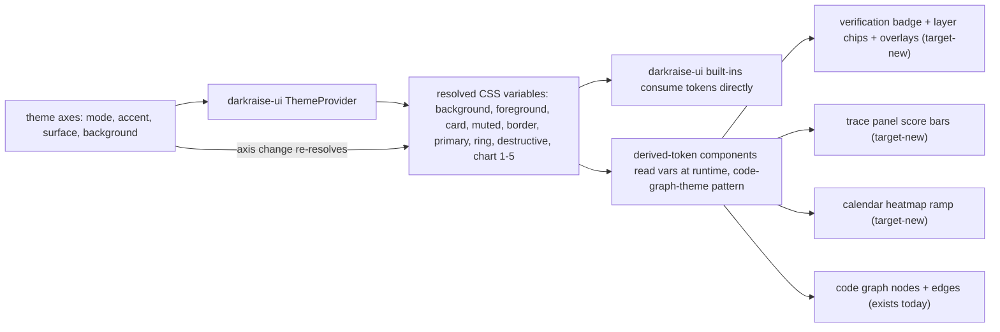
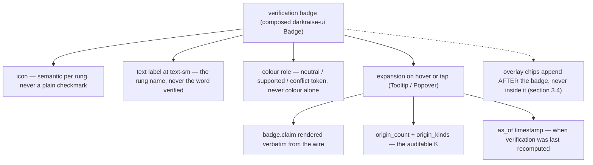
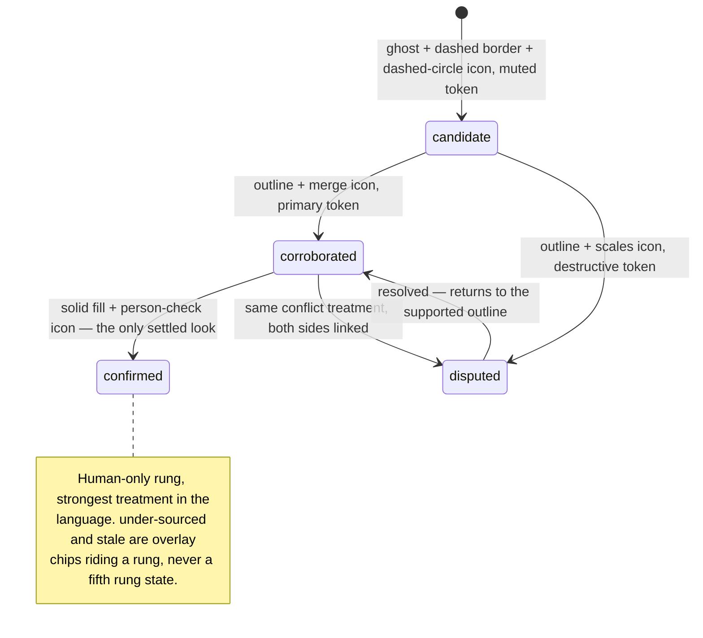
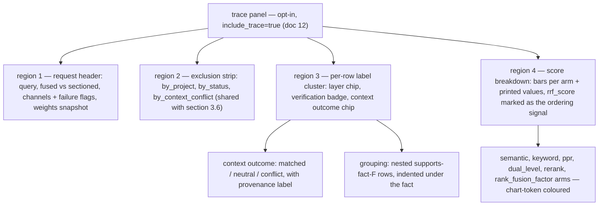
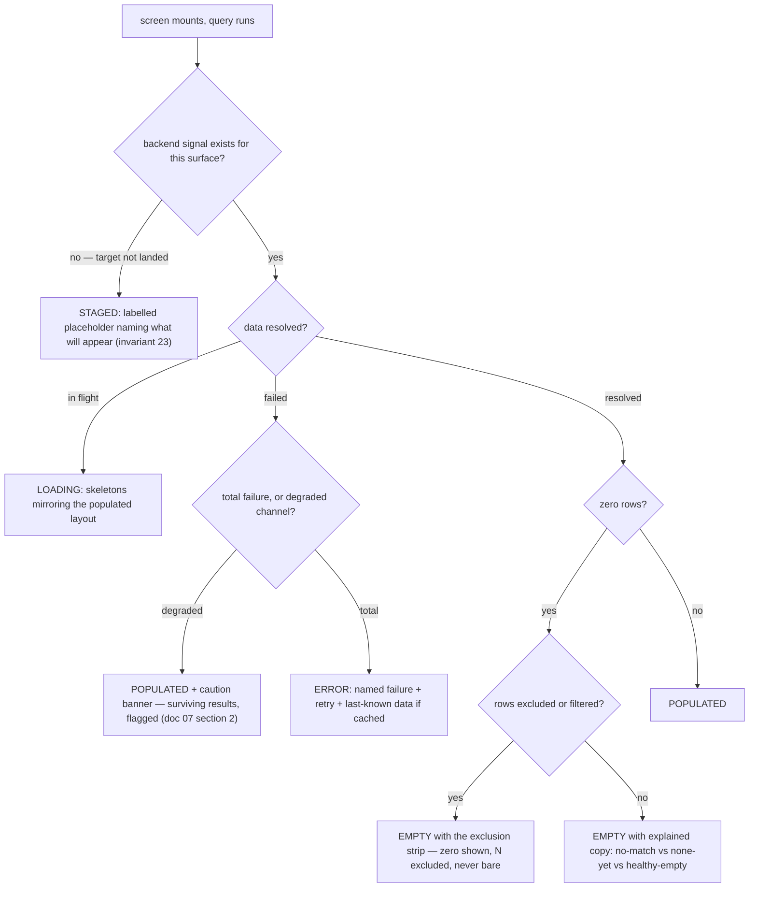

# 14 — UI/UX Design Language

**Status:** subsystem design doc; conforms to foundation docs 00–04 and the 2026-07-24 knowledge-reshape spec. Companion to doc 13 (frontend architecture & IA) and the direct input to the **UI Mockups sub-phase**. Authored on the retained React + TanStack Router + **darkraise-ui@3.1.1** + Vite frontend stack (doc 03 §5.14).

Every mechanism below is tagged **(exists today)**, **(target-new)**, **(activation)**, or **(horizon)** per doc 04 §1's honesty convention. A visual treatment claimed as shipped that exists only in this document fails review (invariant 23).

---

## 1. Purpose & scope

**This doc fixes the *visual language* of the product — the fixed theme substrate every surface is built on, the honesty-label component vocabulary that makes the reshape's epistemics visible, the explainability and four-state screen treatments, and the typography, colour, and copy-tone rules that bind them — so that the UI Mockups sub-phase inherits a complete language rather than a mood board.** Doc 13 decided that every backend signal has a screen and a state; this doc decides how those screens and states look, read, and feel — and above all how a system whose core promise is *under-claiming* dresses that promise in pixels without ever over-claiming.

**What the neighbouring docs fix instead.** Doc 13 owns the routing and state architecture, the navigation IA, the screen/module/signal/four-state inventory, and *which* labels appear *where* — this doc dresses that inventory and never re-derives it. Doc 12 owns the payload envelope, the `badge` field semantics, the exact claim string, the WebSocket event schema, and the events read shapes — this doc renders those fields and never redefines or paraphrases them. Doc 07 §8 owns the retrieval-trace payload the trace panel visualises. Doc 08 owns the verification ladder (`candidate → corroborated → confirmed`, plus `disputed`) and the review/hygiene queues; doc 09 owns articles, citations, the overview, and the `under_sourced`/`stale` label overlays — this doc renders their labels as given and never recomputes a verdict (invariant 15). The UI Mockups sub-phase owns the pixel-level realisation — actual screens, spacing decisions per layout, final iconography sizing — inside the language fixed here.

**Audience & authority.** This binds anyone styling a component, choosing a colour, writing UI copy, or building the mockups. Where it and the as-is codebase (`frontend/src`) agree, that styling is contract; where the target extends it, the extension is labelled. It resolves the design-language questions doc 13 §9 delegated to it (§9 below).

**The one sentence to hold in mind:** the design language's job is to make honesty *legible* — a candidate looks provisional, a corroborated fact looks exactly as strong as "K distinct origins, no known contradiction" and no stronger, only a human's mark looks settled, a dispute shows both sides at equal weight, and an absence always says why — all of it in the theme's own tokens, in both modes, with colour never carrying meaning alone.

---

## 2. The theme substrate — fixed, documented, not relitigated (exists today)

**Decision. The design system is darkraise-ui@3.1.1's token-driven component library under its 11-axis `ThemeProvider`, with the defaults and switcher exposure exactly as `frontend/src/theme.config.ts` sets them — this substrate is *fixed input* to the design language, and every new component in this doc derives its appearance from the theme's CSS-variable tokens rather than introducing colours, sizes, or radii of its own (exists today).** The alternative — a bespoke visual identity for the honesty system, with its own palette — was rejected because it would break the one property the substrate already guarantees: that the entire app re-themes coherently when the user flips an axis. A badge that stayed indigo when the user chose an emerald accent would be the only dead pixel in a living theme.

The configuration, restated as contract:

- **Defaults:** accent `indigo`, surface `slate`, mode `dark`, density `cozy`, elevation `medium`, button-elevation `flat`, radius `rounded`, background `solid` / intensity `balanced` / gradient `blobs`, preset `default`.
- **Switcher-exposed axes:** `mode`, `accentColor`, `surfaceColor`, `backgroundStyle`, `backgroundIntensity`, `gradientPattern`, `presetAxes`.
- **Locked axes (pinned to defaults, no UI):** `preset`, `density`, `elevation`, `buttonElevation`, `radius` — and every persistence channel (localStorage and the DB theme settings) scrubs them, so a value persisted before an axis was hidden cannot stick with no UI to change it back (`LOCKED_AXES` in `theme.config.ts`).

**All colour is CSS-variable / token driven — no hardcoded hex in app components, ever.** The proven pattern is `frontend/src/features/graph/lib/code-graph-theme.ts`: it reads the resolved theme tokens (`background`, `foreground`, `card`, `muted`, `border`, `primary`, `ring`, `destructive`, the `chart[]` ramp) from CSS variables at runtime, derives every node and edge colour from them, and re-derives on a theme change — which is why the code-graph revamp passed review as accent-aware and theme-reactive in both modes. Every new component this doc introduces (badges, layer chips, overlays, the trace panel, the calendar heatmap) follows that exact pattern: it names a **token role**, never a colour value, and the role resolves through the theme.

The token flow every component rides — one theme resolution, many derived component colours, re-derived on any axis change:

**Theme-aware in both modes is a hard requirement, dark is only the default.** The switcher offers light; every treatment in this doc is specified as a token role precisely so it holds in both modes without a per-mode override. Where a derived component needs mode awareness (the calendar ramp's lightness direction inverts between modes), it reads the resolved mode the way `code-graph-theme.ts` already does, never a hardcoded pair.

**The type scale (settled 2026-06-10, exists today): body baseline is `text-sm` (14px) — darkraise-ui's default and the sidebar's — headings and titles keep their larger sizes, and there is no `text-xs`, no arbitrary `text-[..]`, and no custom `--text-*` token override anywhere in app code.** The user explicitly rejected custom text-token overrides; the convention was migrated across the app (362 usages) and is contract. The consequence this doc must absorb: **badges, chips, and overlays render at `text-sm` too** — the honesty labels are deliberately *not* miniaturised, because a label carrying the system's central truth claim must not be the smallest text on the screen. Density comes from padding and weight, never from dropping below the floor.

**darkraise-ui built-ins first; the irreducible-custom set is closed and named.** The app already migrated every raw-HTML control to built-ins (Button, Select, Dialog, Popover, ScrollArea, Combobox, AlertDialog, Stat, Skeleton, ToggleGroup, Avatar, Label, …), and every new component in this doc composes built-ins (Badge, Tooltip, Popover, Collapsible, Skeleton, Stat, Alert) rather than reinventing them. The documented exceptions — custom because no built-in can express them — are: the chat-prose styles, the code-graph cyberpunk panels and canvas, the pulse-glow keyframe, the particle/aurora backdrop, native form elements where a library wrapper cannot apply, and dynamic inline styles driven by runtime data (graph colours, heatmap cells). The honesty-label vocabulary (§3) is *not* an exception: it is composed from Badge/Tooltip/Popover with derived token colours.

**The existing atmospheric surfaces are placed in the language, not redesigned (exists today).** The login/setup flow's glass card over the interactive particle/aurora backdrop (`src/components/particle-background.tsx`) is the language's *ceremonial register* — reserved for the unauthenticated threshold surfaces where atmosphere earns its cost. Inside the app, the register is *instrumental*: calm surfaces, information-dense, motion only where it carries a signal (§7). The sidebar (doc 13 grows it from seven to eight destinations in three groups) keeps its existing visual treatment; §9 resolves that the eighth item needs no grouping redesign.

---

## 3. The honesty-label visual system — the centrepiece (target-new)

**Decision. The reshape's epistemics become visible through a small, fixed component vocabulary — the verification badge, the layer chip, the overlay labels, the both-sides dispute treatment, and the surfaced-exclusion strip — governed by three non-negotiable rules: (1) colour never carries meaning alone — every state pairs a token colour with an icon and a text label, colourblind-safe and WCAG-AA in both modes; (2) the badge copy is doc 12's claim string verbatim — the words "true" and "verified" never appear in any label, tooltip, or state copy; (3) visual emphasis is proportional to epistemic standing — a candidate *looks* provisional, and only the human-ratified rung gets the language's strongest treatment (target-new; invariant 14, Part B contract 2).** The rejected alternative was the industry default — a green-check "verified" badge — which is precisely the over-claim the whole reshape exists to avoid: a checkmark asserts settledness the machine cannot have, and green-as-good excludes colourblind users the moment copy is trimmed. Here the machine's ceiling (`corroborated`) is styled as *supported*, not *settled*, and settledness is reserved for the human's mark.

### 3.1 Status colour roles — four token roles, no new palette

**Decision. The honesty system uses exactly four status colour roles, each mapped onto an existing theme token, never onto literal colours: `neutral` → the `muted` tokens, `supported` → the `primary` (accent) token, `caution` → the theme's amber chart token (`--chart-4`, the amber member of the resolved ramp), and `conflict` → the `destructive` token (target-new).** Mapping `supported` to the accent is deliberate: corroboration is the system's signature signal, so it wears the user's chosen accent and stays theme-reactive. Mapping `caution` and `conflict` to the amber chart token and `destructive` keeps them recognisable across accents — a user who picks a red accent must still be able to tell "accented" from "in trouble," which is why `conflict` is always the destructive token, never the accent. This also folds in the app's existing convention (a `superseded` memory already renders an amber badge — doc 13 §4): today that badge is a hardcoded `amber-500` literal (`memories.tsx`), and the reshape migrates it onto this caution token role (target work, per the no-hardcoded-hex rule), so lifecycle caution and overlay caution read as one family. A fifth "success green" role was considered and **rejected**: green-as-good is the visual synonym of "true," and no rung earns it.

### 3.2 The verification badge

**Decision. The verification badge is one composed component (darkraise-ui Badge + icon + Tooltip/Popover) with four rung treatments — `candidate` low-emphasis neutral with a dashed-circle icon, `corroborated` accent-outlined with a converging-merge icon, `confirmed` accent-filled with a person-check icon, `disputed` conflict-outlined with a scales icon — whose visible text is the rung name (with `confirmed` shown as "human-ratified", matching the expansion, never the word "verified") and whose expansion shows doc 12's `claim` string verbatim, with the origin count and kinds always reachable in one interaction (target-new).** The icon choices are semantic, not decorative: the dashed circle *is* incompleteness; the merge glyph *is* "multiple distinct origins converging" (corroboration's actual mechanism, doc 08 §4.1); the person-check *is* "a human ratified this" (the only rung a human can mint — doc 08 §4.4 — so the human figure, not a padlock or plain check, is the icon); the scales *are* "two sides held in balance, no winner picked." A plain checkmark appears nowhere in the ladder.

Per-rung encoding, fixed:

| Rung | Colour role | Fill | Icon | Visible label | Expansion (tooltip/popover) |
|---|---|---|---|---|---|
| `candidate` | neutral (`muted`) | ghost, dashed border | dashed circle | "candidate" | "extracted signal, not yet corroborated — served labelled" |
| `corroborated` | supported (`primary`) | outline | merge / converging arrows | "corroborated" | the verbatim claim string + per-kind origin list |
| `confirmed` | supported (`primary`) | solid fill | person-check | "human-ratified" | claim string with its `", human-ratified"` suffix + who/when |
| `disputed` | conflict (`destructive`) | outline | scales | "disputed" | the two-sided claim string + link to both sides (§3.5) |

**The badge copy is the contract string, shown verbatim or not at all.** Machine corroboration expands to exactly **"asserted by K distinct origins of kinds [X, Y], no known contradiction, as of T"** — rendered from doc 12's `badge.claim` field, never re-assembled client-side, so the UI cannot drift from the wire. `disputed` swaps in the two-sided form (`"disputed: 2 origins assert X, 1 origin asserts not-X, as of T"`); `confirmed` appends `", human-ratified"`. `K` is `origin_count` — `COUNT(DISTINCT origin_key)`, never a row count — and the expansion's per-kind origin list is what lets a user audit the count the badge claims (doc 13 §5.1's sources module is the full audit surface). A **code-originated** fact whose `origin_kinds` include `code` shows the distinct `code@commit` mark inside the expansion. Memory (L0) rows carry **no verification badge** (`badge: null`) — they carry their lifecycle label instead (`active` unlabelled, `superseded`/`deprecated` as caution-role amber badges with a lineage link), because episodic recall is not a claim. An **L3 article's terminal `superseded` verification_status** (doc 12 §4, doc 09 §4.4) renders the same way rather than as a fifth rung: a caution-role amber `superseded` badge that *replaces* the rung badge (the article is no longer the servable statement of record) and carries a lineage link to the superseding article — so the ladder's four rungs stay clean while the terminal state stays visible.

The badge anatomy — one compact chip, one honest expansion, every part bound to a doc-12 field:

How the ladder maps to visual treatment — emphasis climbs with standing, and the machine's ceiling is styled as supported, not settled:

**Accessibility is part of the encoding, not a pass afterwards.** Every rung is distinguishable with colour removed (fill style + border style + icon differ pairwise); the icon carries an accessible name; contrast of label text against its chip background meets WCAG AA at `text-sm` in both modes — which the token mapping makes checkable once per theme rather than per screen. The badge is focusable, and the expansion opens on focus as well as hover (Popover for the full origin list, since a tooltip cannot hold interactive content).

### 3.3 The layer chip — an orthogonal axis, styled orthogonally

**Decision. The layer label (`L0 memory` / `L2 fact` / `L3 article`; L1 is never directly served, doc 12 §4) renders as a compact *surface-toned* chip — `card`/`border` tokens with a monospace layer key, no accent, no status colour — visually disjoint from the verification badge so the two orthogonal axes never read as one (target-new).** A fact is L2 *and* corroborated; if both were coloured chips of the same family, users would read "L2" as a trust level. So the layer chip is deliberately quiet — classification, not judgement — styled like metadata (the app's existing `technologies` chips are the register), and it always precedes the verification badge in a row's label cluster so the reading order is "what kind of thing → how well supported." The layer chip's expansion names the layer in words ("fact — Layer 2 of the vault") for users who have not memorised the model — it *classifies* the row (rule 2 forbids "verified" even here, and an L2 fact may still be a `candidate`, so the chip never asserts standing).

### 3.4 Overlay labels — riding a rung without becoming one

**Decision. `under-sourced` and `stale` render as *appended caution chips* — amber caution role, dashed border, distinct icons (a draining-source glyph for `under-sourced`, a clock-back glyph for `stale`) — that sit after the verification badge and never replace, recolour, or restyle it (target-new; doc 08 §4.3, doc 09 §4.4).** The backend models these as labels on a still-corroborated row, not as ladder values (the CHECK is `candidate | corroborated | disputed | confirmed`), and the rendering must preserve exactly that: an under-sourced fact still shows its corroborated badge — claim string intact — with the caution chip beside it, so retrieval stays honest immediately while the demotion hysteresis runs. The dashed border is the shared visual marker for "provisional/overlay" across the language (candidate and the overlays share it), a redundant non-colour channel for the same idea. Overlay expansions carry honest copy: `under-sourced` → "origin count dropped below N; will demote if not re-corroborated"; `stale` → "synthesised before the latest verified change" (doc 09's exact framing). The rejected alternative — tinting the whole badge amber — would visually demote the rung the backend has deliberately *not* demoted yet.

### 3.5 The disputed both-sides treatment

**Decision. A disputed fact is rendered as a *split panel*: the two conflicting assertions side by side (stacking on narrow viewports) with strictly equal visual weight — same card treatment, same type, each side showing its own origin count and kinds — under a shared conflict-role header carrying the two-sided claim string; nothing in the layout, order, or emphasis picks a winner (target-new; invariant 14, doc 08 §4.2).** Order is deterministic and epistemically neutral: the earlier-asserted side renders first (stable across reloads), and the rule is documented so recency is never mistaken for endorsement. Origin counts are shown on both sides *without* a comparative treatment — no bar, no "2 vs 1" scoreboard — because corroboration count does not adjudicate a dispute (one non-echo contradiction vetoes regardless of count, doc 08). In list contexts the disputed row collapses to its badge plus a one-line both-sides summary; the split panel is the detail/inspect view (`dispute_inspect`'s payload, doc 12 §4). The human's resolve/ratify actions live in the Review shell (doc 13 §6.2); the split panel links there rather than embedding adjudication in every read surface.

### 3.6 The partial-result and surfaced-exclusion treatment

**Decision. Every list surface renders doc 12's envelope honesty fields as a persistent *results-status strip* between the query controls and the rows: the `excluded` counts as plain-language chips ("3 excluded by context conflict"), and the `partial` flag as a caution-role banner naming the degraded channel — and the empty state is computed *after* this strip, so "0 shown, 3 excluded" can never render as "nothing found" (target-new; invariant 14, doc 12 §4).** The strip is not a toast (it must persist as long as the result it describes) and not buried in the trace (it must be visible without opting in). Each exclusion chip expands to its reason and, where the cause is a user-held control, points at it — a context-conflict exclusion names the active context chip, so the user sees that their own declaration shaped the result. A one-sided channel failure (`semantic_failed` / `keyword_failed`) renders the caution banner "showing keyword-only results — semantic search unavailable" over the *surviving* results; only a both-channel failure renders the error state (doc 07 §2, doc 13 §4). The strip renders nothing when there is nothing to disclose — a clean result has a clean surface; the strip is a disclosure mechanism, not a decoration.

---

## 4. The retrieval-trace panel — "why retrieved" as a surface (target-new)

**Decision. The trace panel is a per-result expandable region plus a per-request header, laid out in four fixed regions — (1) the request header rendering the envelope (query echo, fused/sectioned shape, channels ran, weights snapshot), (2) the exclusion strip (§3.6, shared component), (3) per-row label cluster (layer chip + verification badge + context outcome), and (4) the score breakdown rendering every arm doc 07 §8 stamps as token-coloured horizontal bars with their raw values beside them — and it renders the payload field-for-field, never recomputing or re-narrating a score (target-new; doc 07 §8, contract 1).** The trace is the pipeline's own working; the panel's design principle is *ledger, not story* — a table-like breakdown a user can check against the ordering, not a generated sentence like "this matched because…" that could drift from the numbers. Score bars assign each arm a fixed token drawn from the **four non-caution chart members** (`--chart-1/2/3/5`), with lightness-shifted variants (the `code-graph-theme` derivation pattern) where the arm count exceeds four — semantic, keyword, ppr, dual-level, rerank, and the fusion factor (whose sub-arms, doc 07 §8, share the fusion token at stepped lightness) — and **never the caution `--chart-4`**, so an arm bar can never be misread as a caution signal; the assignment is consistent across the app so a given arm is always the same colour, values are always printed beside the bar (colour never alone), and `rrf_score` is visually marked as the ordering signal so users don't misread a raw modality score as the rank.

The panel's regions, each bound to its payload level:

**Two honesty details are fixed here because they are easy to get wrong visually.** First, the `context.provenance` field: an `llm_guessed` `applies_when` renders with an explicit "LLM-guessed, not human-checked" qualifier chip (neutral role, dashed border — the shared provisional marker; the copy avoids "unverified" to honour rule 2's absolute ban on verdict-claiming words), because a guessed context is displayed provenance, never an exclusion basis until a human touches it (doc 07 §6, doc 12 §5). Second, **dormant arms render as dormant (activation):** a `w_*` arm whose weight is 0 in the envelope's `weights` snapshot shows as an inactive, muted bar labelled "inactive" — never omitted (which would hide that the arm exists) and never rendered as a zero score (which would imply it ran and found nothing). This is invariant 23 in the trace: built-but-unspent signals look built-but-unspent. The sectioned (`fused=false`) shape is the panel's default rendering — a Facts section, an Articles section, a Memory section — because the layer structure is the point of the explanation (doc 13 §5.4); grouped rows ("supports fact F") indent under their fact rather than repeating as siblings.

---

## 5. The four-state screen treatment (target-new pattern; states exist per doc 13)

**Decision. Every screen renders its doc-13 four states through one shared pattern — loading = darkraise-ui Skeletons mirroring the populated layout (never a spinner replacing the page), error = an Alert naming the failure with a retry and the last-known data where cached, empty = an *explained* empty state whose copy always answers "why is this empty and what happens next," populated = the content — plus a fifth **staged** variant for surfaces whose backend signal does not yet write: a labelled "staged" panel stating what will appear and what it is waiting on, never a fake-populated mock and never a broken-looking blank (target-new; invariant 23, doc 13 §4).** The staged variant is the doc's direct answer to invariant 23 at the visual layer: doc 13 stages the buffer-depth and dream-run monitors behind their backends, and this pattern is what "staged" looks like — a quiet card, neutral role, stating "consolidation monitoring appears here once dream cycles run" — a promise labelled as a promise.

The decision every screen runs, with the honesty checks that keep an absence from lying:

**Empty-state copy is a fixed voice with three registers, chosen by cause.** *None-yet* (young install): forward-looking and honest about timescale — the vault's cold-start empty state reads "no corroborated facts yet — candidates are served labelled in search; corroboration takes multiple distinct origins" (doc 13 §5.1), and the fresh dashboard shows the blank calendar with a first-capture call-to-action, never a broken grid. *No-match* (query returned nothing): names the query and scope and offers the loosening moves ("no matches in project X — clear filters / search all projects"). *Healthy-empty* (a queue at zero): rendered as reassurance, not absence — the Review queue's empty state is "no disputes to adjudicate," a positive statement (doc 13 §6.2). The three registers exist because one generic "nothing here" string cannot be honest in all three situations — the same pixels would mean "wait," "rephrase," and "all is well."

---

## 6. Surface-specific treatments — calendar, timeline, dream digest (target-new)

**Decision. The contribution calendar renders the events UTC-day buckets as a heatmap whose intensity ramp is *derived from the accent token* (a lightness/alpha ramp off `primary`, computed at runtime per the code-graph-theme pattern, direction mode-aware), with a printed count in each cell's accessible label and on hover — so intensity is never the only carrier of the number — and a visible "days are UTC" note, because the bucket boundary is fixed by the immutable index expression and must not be re-derived in the viewer's zone (target-new; doc 04 §8.1, doc 12 §7, doc 13 §6.4).** A GitHub-green fixed ramp was rejected for the same reason as every hardcoded colour: it dies on theme change; deriving from the accent keeps the dashboard's signature visual in the user's chosen hue. A day click routes to `/activity/day/$date` (doc 13's route); the drill-down and the per-object timeline share one event-row component: timestamp, event-type chip (neutral role), object link, and — for verification transitions — the from→to rung pair rendered as two small badges with an arrow, so "what did we believe as of X" is readable directly off the timeline (doc 08 §4.3).

**The dream digest renders a consolidation cycle as grouped, reversible ledger entries — each action row carrying its action-type chip, its object link, a compact before→after rendering for status/pointer changes, and its undo affordance; an action past its undo window shows a *disabled* undo with the honest reason inline ("a newer change rewrote this object" / "undo retention elapsed"), never a hidden or broken button (target-new; doc 08 §7, doc 13 §6.3).** The digest's visual register is deliberately calm — neutral chips, no alarm colour for normal dream actions — because dreaming is routine maintenance; the caution role appears only on actions that touched a disputed object or demoted a rung. Undo is destructive-adjacent but not destructive (every inverse is a journaled restore), so the undo button is a standard outline button, not a destructive-red one; the per-batch undo confirms through AlertDialog since it spans many objects.

**The review/hygiene triage shell shares the language's list treatment with one addition: consequence-rank is shown, not implied (target-new; doc 08 §6, doc 13 §6.2).** Queue rows carry a muted "why ranked here" line (retrieval frequency, subject salience) so the human sees the queue is consequence-ordered, not FIFO; a `stale_labelled` dispute that decayed off the active queue renders in a collapsed "decayed — still served labelled" section, visibly a priority change and not a resolution (invariant 14). Ratify-to-confirmed — the single most consequential button in the product — gets the language's strongest confirmation treatment: solid accent button, person-check icon, and an AlertDialog restating what ratification means ("records you as a human origin; the fact will render as human-ratified") before it commits.

---

## 7. Typography, spacing, motion, iconography, copy voice

**Decision. The instrumental register is the app's default: `text-sm` body on the darkraise-ui scale, cozy density (locked), medium elevation (locked), rounded radius (locked), monospace (the theme's `fontMono` token) reserved for identifiers — layer keys, commit SHAs, entity names, config values — and motion used only as signal, always honouring `prefers-reduced-motion` (exists today as convention; restated here as contract).** Because density, elevation, and radius are locked axes, this doc does not specify per-component spacing beyond the built-ins' defaults — the mockup sub-phase places components on the grid the theme already fixes. Motion's signal uses are enumerated and closed: the live-feed row entrance, the pipeline stepper's phase advance, the badge's rung-change transition (a single subtle emphasis pulse when a fact's rung changes under a live update — the pulse-glow keyframe register), and the existing particle backdrop on the threshold surfaces. Decorative motion elsewhere is rejected: a truth system that shimmers reads as marketing.

**Iconography is one library (lucide, exists today), stroke-consistent, and the honesty glyphs are reserved words.** The five semantic glyphs — dashed circle, merge, person-check, scales, clock-back — plus the draining-source glyph may not be reused for unrelated meanings anywhere in the app, or the encoding decays. No emoji in UI copy.

**The copy voice is the under-claiming voice, and it is a design material, not an afterthought (target-new as a written convention).** Rules, fixed: labels state *evidence*, never *verdict* ("asserted by…", "no known contradiction", never "true"/"verified"/"fact-checked"); absences are explained (§5's three registers); system actions are attributed ("the verification job demoted…", "you ratified…") so machine and human agency never blur; timestamps in copy are absolute-with-relative ("2026-07-20 — 4 days ago") wherever a claim's `as_of` matters, because "recently" is not an honest as-of; and error copy names the failing thing, not the user. Title case is not used; sentence case everywhere, matching darkraise-ui's own copy.

---

## 8. Invariants restated

The invariants that bind the visual language, in this doc's terms:

- **No silent degradation, visually enforced (inv. 14).** The badge under-claims verbatim; disputes render both sides at equal weight; overlays ride rungs without demoting them; exclusion counts render in a persistent strip computed before the empty state; a degraded channel is a caution banner over surviving results, never an empty list; superseded rows wear the caution amber and their lineage link.
- **Scaffolding never dressed as shipped (inv. 23).** The staged screen variant is the only rendering for a surface whose signal does not write; dormant ranking arms render as inactive, not as zero; nothing in this doc's target-new vocabulary is claimed to exist in `frontend/src` today.
- **Render, never recompute (inv. 15).** Every label, badge string, score, and count is a wire field rendered as given — the claim string from `badge.claim`, the trace from doc 07 §8, the rungs from doc 08 — and no component assembles a verdict client-side.
- **Token-driven, both modes (the theme contract).** No hardcoded hex; the four status roles map to theme tokens; derived components re-derive on theme change; every treatment holds in light and dark at WCAG AA.
- **Colour never alone (accessibility as encoding).** Every state differs by icon + text + fill/border style with colour removed; counts are printed, not only shaded; interactive expansions open on focus.
- **The type floor (settled convention).** `text-sm` is the floor for all app text including badges and chips; no `text-xs`, no arbitrary sizes, no custom text tokens.
- **One vocabulary, closed (inv. 5's visual analogue).** The rung treatments, status roles, and semantic glyphs are closed sets; a new rung, overlay, or role is a design change to this doc, never an ad-hoc addition in a component.

---

## 9. Open questions & design-language decisions resolved

Each carries the stance downstream inherits.

- **The eighth sidebar item — visual grouping change? (delegated by doc 13 §9; resolved: no redesign).** *Stance: the existing three-group sidebar treatment absorbs the eighth destination unchanged — group headers as today, no new visual hierarchy.* Eight items in three labelled groups is within the treatment's comfortable range; a grouping redesign would spend change budget where nothing is broken.
- **Status colours: accent-relative or fixed? (resolved: split by role, §3.1).** *Stance: `supported` follows the accent; `caution` and `conflict` are pinned to the amber chart token and `destructive` so they survive any accent choice; `neutral` is `muted`.* All four are theme tokens; none is a literal.
- **Do the honesty labels get their own theme axis or preset? (resolved: no).** *Stance: the badge system derives from the existing tokens and adds no theme axis, no preset, and no unlockable axis; the locked axes stay locked.* A "badge style" knob would let a user restyle the truth surface into ambiguity — the honesty encoding is contract, not preference.
- **Badge text size versus the no-`text-xs` rule (resolved: badges are `text-sm`).** *Stance: the type floor wins; badge compactness comes from padding and the collapsed-by-default expansion, not from sub-floor type.* The system's central claim must not be its smallest text.
- **Trace panel: narrative or ledger? (resolved: ledger).** *Stance: field-for-field rendering of the doc 07 §8 payload with token-coloured bars and printed values; no generated prose explanation.* A narrated "because" invites drift from the numbers the pipeline actually recorded.
- **Disputed side ordering (resolved: assertion order).** *Stance: earlier-asserted side first, stable and documented; no ordering by origin count or recency.* Any salience-based order would visually pick the winner the backend refuses to pick.
- **Calendar ramp (resolved: accent-derived).** *Stance: a runtime lightness/alpha ramp off `primary`, mode-aware, per the code-graph-theme derivation pattern; counts always in the accessible label.* A fixed green ramp dies on theme change and re-encodes green-as-good.
- **Where the mockups may still choose (deliberately left open to the sub-phase).** Exact icon sizing and chip padding on the theme grid; the per-screen placement and collapse behaviour of the results-status strip within each doc-13 layout; the split-panel versus stacked breakpoint for disputes; the calendar's cell size and legend; and every whole-screen composition. The mockups realise the language; they may not alter an encoding fixed here.

---

*Downstream: the **UI Mockups sub-phase** realises this language across doc 13's complete screen inventory — the badge, layer-chip, and overlay vocabulary (§3), the trace panel (§4), the four-plus-staged states (§5), the calendar/timeline/digest treatments (§6), and the voice (§7) are its binding input, and a mockup that renders "verified," a green check, a bare empty list over excluded rows, or a hardcoded colour fails review against this doc. **Doc 13** owns the structure these treatments dress; **doc 12** owns every field the components render (`badge.claim` verbatim, the envelope's `excluded`/`partial`, the events read shapes); **docs 07/08/09** own the semantics the labels display and this doc never recomputes. The theme substrate (§2) is the as-is `darkraise-ui@3.1.1` configuration; a change to `theme.config.ts`'s defaults, switcher exposure, or locked axes is a change to this doc.*
