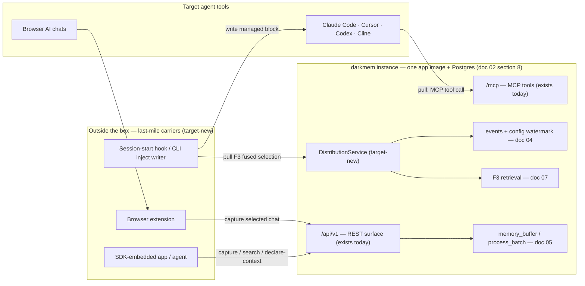
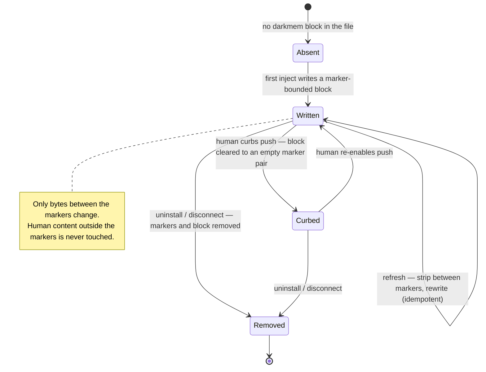
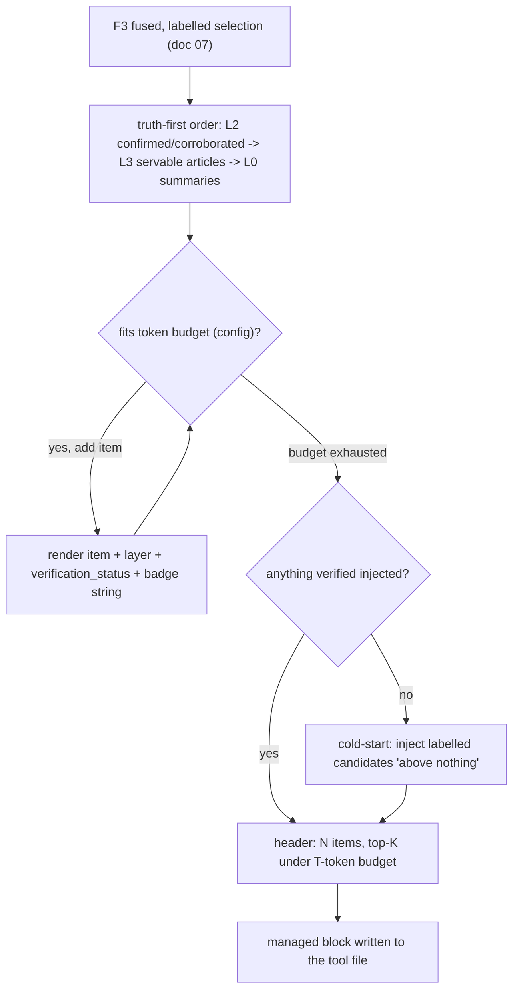
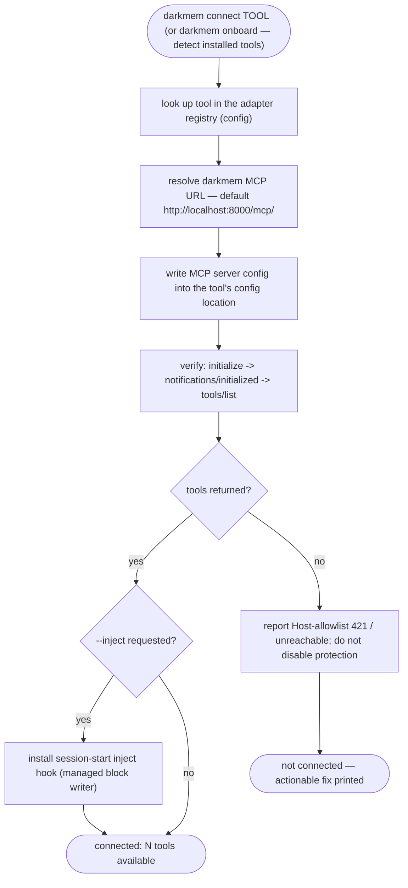
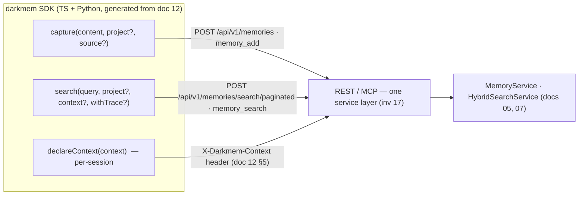
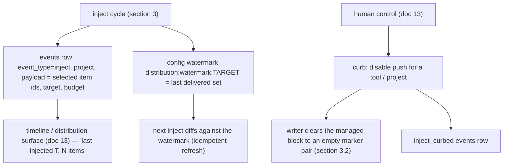

# 15 — Distribution & Integration

**Status:** subsystem design doc; conforms to foundation docs 00–04 and the 2026-07-24 knowledge-reshape spec (`docs/superpowers/specs/2026-07-24-knowledge-reshape-design.md`). Wave-3 product-and-reach doc (with docs 12, 13, 16). Authored on the retained Python/FastAPI + async SQLAlchemy + Postgres/pgvector + React stack (doc 03 §4, Option A); .NET appears only as a considered-and-deferred alternative.

Every mechanism below is tagged **(exists today)**, **(target-new)**, **(rebuild)**, **(activation)**, or **(horizon)** per doc 04 §1's convention. A mechanism claimed as shipped that is only scaffolding fails review (invariant 23).

**The primary reader is a developer who wants to *see* the system.** The prose carries the reasoning for other stakeholders, but every major flow, lifecycle, and structure this subsystem owns is drawn as a Mermaid diagram next to the prose it illustrates. Distribution owns no database tables — its state is `events` rows plus a `config` render-watermark (doc 04 §7/§8.1) — so there is no ERD here; the schema lives in `erd.md`.

---

## 1. Purpose & scope

**This doc fixes the last mile that makes darkmem reach every tool: how retrieved context is pushed into a tool's session (auto-inject), how a browser AI-chat becomes a captured memory, how one command connects a client, and what minimal SDK a client speaks.** It owns the **auto-inject** path (pull *and* push — context selection through the F3 retrieval path, the marker-bounded idempotent managed block, the delivery transport per target tool, the token budget, the refresh cadence, and the honesty labels that survive into a tool's context), **browser capture** as a new ingestion source feeding the buffer, **one-command onboarding** (per-client MCP config writing and connection verification), and the minimal **client SDKs**. It settles the transport-matrix deferral doc 02 §11 handed here, and it shares the repo push-trigger decision with doc 10 under one definition (Part B contract 7).

**What the neighbouring docs fix instead.** The **ranking** that selects what to inject is doc 07's — inject is a *delivery* of the F3 read path, never a second ranking path (doc 01 F10 and invariant 17, two front doors one service layer). The **capture pipeline** browser capture feeds — the `memory_buffer`, the five phases, `source`/`origin_key`/`project` resolution — is doc 05's; this doc adds a front door, not a pipeline. The **contract** the SDKs and the extension speak — the REST route inventory, the MCP tool surface, the payload envelope, the badge field semantics, and the `applies_when` wire format — is doc 12's; this doc consumes that contract, it never redefines a payload (contracts 1, 2, 3; convention 10). The **repo indexing** an auto-provisioned or pushed repository runs is doc 10's; this doc shares only the *trigger* decision. **Exposed-deployment auth** for remote clients, and the auto-provision SSRF allowlist, are doc 18's — this doc consumes the gate and points, it does not design it. The **physical tables** (`memory_buffer`, `events`, `projects`, `config`) are doc 04's; this doc names the object and the invariant and points.

**Audience & authority.** An engineer building the inject writer, the browser extension, the onboarding CLI, or an SDK reads this to learn which behaviour is contract and which is target work. Where this doc and the as-is baseline (`CLAUDE.md`, doc 02 §6.2's DistributionService) agree, that behaviour is contract; otherwise it is labelled per the honesty convention. **Almost everything here is target-new:** the pull door (MCP tools and the REST search surface) exists today, but the DistributionService, auto-inject, browser capture, the onboarding CLI, and the SDKs are all target work honestly labelled (doc 02 §6.2, §9). The clients are last-mile carriers that sit **outside the box** and speak MCP or REST into the one instance (doc 02 §8) — adding them changes nothing about the four layers.

**The one sentence to hold in mind:** distribution never invents truth or ranking — it *carries* what F3 already ranked and labelled into a tool's context, and *carries* what a tool's user captured back into the buffer, and every carried item keeps its honesty labels intact.

**Scaffolding honesty up front (invariant 23).** Today darkmem's reach is the pull door only: an agent that speaks MCP calls `memory_search`/`memory_add` against `:8000/mcp` and a REST client calls `/api/v1/*` **(exists today)**. There is no auto-inject, no browser extension, no onboarding CLI, and no published SDK — the `DistributionService` is a doc 02 §6.2 **(target-new)** component that "attaches as a new service plus jobs, riding the existing retrieval and ingest paths." This doc designs that target and never presents the push half of principle 9 as shipped.

---

## 2. The distribution model — pull and push, clients outside the box

**Decision. Distribution has two directions over one service layer — *pull* (a tool asks darkmem for context through MCP/REST) and *push* (a client-side writer proactively injects F3-ranked context into a tool's session before the first prompt) — and every client lives outside the box, so distribution adds a service and out-of-box carriers, never a new tier or front door (principle 9, doc 02 §8/§9, invariant 17).** Pull is what exists today and needs no new machinery: the MCP tool family and the REST search surface *are* the pull door (doc 12). Push is the target half — and the load-bearing constraint is that **the server cannot write to a developer's filesystem**: the clients are outside the box (doc 02 §8), so "push" is really *pull-then-write* — a thin client-side agent pulls the F3 selection from the server and writes it into the tool's local context file. Modelling push as a client-side carrier over the existing read path is what keeps invariant 17 (two front doors, one service layer) and invariant 1 (no broker) intact: there is no server-initiated channel to the client, only the client reading and the client writing.

**Why not a server-initiated push.** A design where the server holds open connections to every client and streams context to them would need a broker or a long-lived per-client channel (invariant 1 forbids the broker; the stateless MCP server holds no session, invariant 20), and it would put the server on the hook for a filesystem it does not control. Rejected. The pull-then-write model puts the one thing the server owns — ranking and honesty labels (doc 07) — behind the read path every consumer already spends, and leaves the write where it must be, on the machine that owns the file.

The distribution model — the pull door exists today, the push carriers are client-side and target-new, and both converge on one service layer over one Postgres:


*Caption: push is pull-then-write — the client reads the F3 selection and writes the managed block locally; the server never reaches out to a client.*

**Four carriers, one rule: each speaks MCP or REST and adds nothing to the four layers (doc 02 §8/§9).** The carriers are the **inject writer** (a CLI/hook that writes managed blocks), the **browser extension** (a capture source), the **SDK** (a library apps embed), and the **onboarding CLI** (which writes client config). Every one is a distribution *client* outside the box; the only server-side addition is the `DistributionService` that serves the inject selection and journals inject events (doc 02 §6.2). This is why the distribution layer is additive: it rides the retrieval path (doc 07) and the ingest path (doc 05) that already exist, and it stores nothing but `events` rows and a `config` watermark (§7).

---

## 3. Auto-inject — selection via F3, managed blocks, transports, budgets, labels

### 3.1 The inject cycle — pull the F3 selection, write the managed block

**Decision. Auto-inject is a client-side pull-then-write cycle: at session start the inject writer requests the F3 fused, labelled selection scoped to the session's project and declared context, the server ranks and labels it (doc 07) and journals an `inject` event, and the writer rewrites a marker-bounded managed block in the tool's native context file — a strip-before-rewrite that never touches human content (doc 01 F10, doc 02 §6.2, invariant 8 analog).** The selection is a *delivery* of retrieval, full stop: it calls the same `HybridSearchService` composition every read consumer spends, requests the `fused=true` single-list shape doc 07 §5 defines for token-budgeted consumers, and inherits F3's honesty guarantees — no cross-project rows, superseded/deprecated rows labelled and never mixed in as active, the `applies_when` boost/label/conflict rules, and the verification labels (doc 07 §5–§7). Inject adds no ranking of its own; it adds a *transport* and a *budget*.

The inject cycle across actors — the writer pulls the fused F3 selection, the server ranks/labels and journals, the writer rewrites the managed block; the server never writes the file:

```mermaid
sequenceDiagram
    autonumber
    participant Hook as "Session-start hook / CLI (client-side)"
    participant Dist as "DistributionService (target-new)"
    participant Retr as "F3 retrieval — doc 07"
    participant Evt as "events + config watermark — doc 04"
    participant File as "Tool context file (local)"

    Hook->>Dist: inject-select(project, declared context, budget, target tool)
    Dist->>Retr: F3 read, fused=true shape (doc 07 section 5)
    Retr-->>Dist: ranked, labelled rows + trace (layer, verification_status, badge)
    Dist->>Evt: journal event_type=inject; update watermark config row
    Dist-->>Hook: budget-fitted items, each carrying its honesty labels
    Hook->>File: read file; strip between darkmem markers; write new block
    Note over File: human content outside the markers is never touched
    Hook-->>Hook: block is now current for this session
```

**The selection *input* is the session's context, not a free-text query, unless the tool supplies a task string.** doc 07's F3 takes a query; for inject the "query" is the **session's declared context** — the project the session runs in plus the `applies_when` context the SDK/hook declared (contract 3, doc 12's wire format) — optionally augmented by a task description if the tool exposes one at session start. So v1 inject is a *context-seeded* retrieval: the top servable, verified rows for this project under this context, ordered truth-first by doc 07's composition, not a keyword search the human types. This keeps the push "already-informed before the first prompt" (doc 01 F10) without asking the human to phrase a query.

### 3.2 The managed block — marker-bounded, idempotent, strip-before-rewrite

**Decision. The injected context is a single marker-bounded block the writer owns entirely; every refresh strips the region between the markers and rewrites it, so re-injection is idempotent and the human's own content is inviolable — the pipeline's strip-before-rewrite discipline applied to a text file (doc 02 §6.2, invariant 8 analog).** The block is delimited by fixed sentinel comments — `<!-- darkmem:begin -->` … `<!-- darkmem:end -->` (or the tool's comment syntax) — carrying a small header (`generated <T>, project <P>, <N> items, <budget> tokens`). The writer's contract is exact: it may read the whole file, but it may only *replace the bytes between the two markers*; if the markers are absent it appends a fresh block; if present it overwrites in place. This makes the write safely repeatable under any cadence (session start, re-run, watch) the way `delete_by_memory_id` makes re-extraction safe (invariant 8) — no duplicate blocks accumulate, and a hand-edited note above or below the block survives every refresh.

The managed-block lifecycle — absent until first inject, refreshed idempotently each cycle, curbed or removed on human control, never leaving stray content:



**Why one managed block rather than a whole generated file.** A generated standalone file (a `darkmem.md` the tool must be told to read) would need per-tool wiring to *make* the tool read it, and it could not coexist with the human's own rules in the same file. The managed block lands inside the file the tool **already reads at session start** (§3.3), so it needs no extra wiring and it composes with human-authored rules. That is why the block, not a file, is the unit — and why the marker discipline is load-bearing: it is the only thing separating darkmem's region from the human's.

### 3.3 The transport matrix — a managed file block per tool, MCP the universal pull door

**Decision. The v1 push transport is a *managed file block* written into each target tool's native session-context file, chosen per tool from a maintained adapter registry; the MCP resource and a tool-side shim are deferred fallbacks; and the MCP tool call is the universal pull door on every tool (settles the doc 02 §11 deferral, per tool).** The reason the managed file block wins for v1 is uniformity of a capability every one of these tools already has: **each reads a project-root context/rules file at session start**, and none of them reliably consumes an MCP *resource* as proactive pre-prompt context (MCP resources are agent-*chosen* reads, not a push the tool auto-applies). So the file block is the one transport that delivers "context before the first prompt" (doc 01 F10) across the whole target set without per-tool push machinery. The pull door is the inverse and needs no choice: every listed tool speaks MCP, so `memory_search` and the vault tools are reachable identically everywhere (doc 12).

The v1 transport matrix — one adapter per tool, all sharing the MCP pull door; the file paths are a maintained config-driven registry, not hard-coded:

| Target tool | Pull (retrieve) | Push transport (v1) | Native session-context file | MCP config location |
|---|---|---|---|---|
| Claude Code | MCP tools | managed file block | `CLAUDE.md` | `.mcp.json` / `claude mcp add` |
| Cursor | MCP tools | managed file block | `.cursor/rules/darkmem.mdc` (legacy `.cursorrules`) | `.cursor/mcp.json` |
| Codex CLI | MCP tools | managed file block | `AGENTS.md` | `~/.codex/config.toml` `[mcp_servers]` |
| Cline | MCP tools | managed file block | `.clinerules/darkmem.md` | Cline MCP settings JSON |
| *(unlisted tool)* | MCP tools | shim fallback (§ below) | — | per-tool |

**The per-tool file paths are a maintained adapter registry, not code constants (convention 9).** Each tool's context-file convention and MCP-config location can change with the tool's own releases, so the tool→file mapping lives as a **`config` row** (a small adapter table the onboarding CLI and the inject writer both read), verified against each tool's current docs at implementation time. Treating the mapping as configuration rather than hard-coded paths is what keeps a tool's convention change a config edit, not a code release — the same "tunables are config rows" discipline the rest of the design uses.

**The MCP resource and the tool-side shim are the two deferred transports, and the doc says why (invariant 23).** An **MCP resource** — exposing the inject selection as a readable resource the tool subscribes to — is the cleaner target *once* a tool proactively surfaces resources as session context; today that is not the reliable behaviour across the set, so it is **(horizon)**, not v1. A **tool-side shim** — a wrapper CLI or a session-start hook that fetches and prepends context for a tool with *no* context-file convention — is the **fallback** for anything off the matrix; it is how the "unlisted tool" row is served. Neither is presented as shipped: v1 is the managed file block, and the two alternatives are labelled deferred/fallback so the matrix does not over-claim.

### 3.4 Inject content policy, token budget, and labels carried

**Decision. Inject content is truth-first and budget-bounded: the block carries L2 verified facts and L3 servable articles for the in-scope subjects ahead of L0 memory summaries, each item rendered with its layer + verification_status + the badge string, candidates served only labelled when nothing verified fits (cold-start), all under a `config` token budget — and being below the budget cut is a transparent top-K, never the silent degradation invariant 14 forbids.** This doc owns the **truth-first layer-priority fill** (facts and articles ahead of memory summaries under the budget); it borrows from doc 07 §5 only the *label semantics* and the *verified-above-labelled-candidate* rule, delivered in the `fused=true` shape — a memory that is a source of a returned fact is grouped under it ("supports fact F") rather than triple-counted, and disputed rows carry both sides. What this doc fixes is the *content selection under a hard budget* and the *rendering* of the labels into text.

The inject content policy — truth-first fill under a token budget, each item carrying its honesty labels, the block header stating the top-K nature:



**What each layer contributes to the block, and what field carries the text.** An L2 **fact** injects its `fact` text plus its badge — the honest claim "asserted by K distinct origins of kinds [X, Y], no known contradiction, as of T" (doc 12 owns the field; this doc carries it verbatim, never paraphrasing it to "true"/"verified"). An L3 **article** injects a short synthesised snippet with its citation count and stale label if set (doc 09). An L0 **memory** injects its **`summary`** (the ex-`llm_summary` column, doc 04 §3.1 / spec §6.4) — the digest, not the full `content`, because the budget cannot afford full prose — with its lifecycle label (a `superseded` memory that a caller explicitly asked for lineage on is injected amber-labelled, never as active). This is the policy behind doc 01 F10's "the `summary` feeds the injected digest."

**The token budget is a `config` row with a measured tuning path, and dropping below the cut is transparent, not a silent leak (convention 9, invariant 14).** `inject_token_budget` (recommended default ~2000 tokens, tunable per target tool) bounds the block; the writer fills truth-first until the budget is spent, then stops. Being below the cut is a **top-K**, which is expected of any budgeted digest — it is *not* the silent-degradation invariant 14 forbids, because that invariant is about *mislabelling or leaking* (injecting a cross-project or superseded row as if active), which the F3 delivery already prevents. Transparency is preserved by the block header stating "N items, top-ranked under a T-token budget," so the human sees the block is a digest, not the whole vault. The full retrieval trace (contract 1, doc 07 §8) rides the *pull* path for explainability; the budget-bounded push block carries the honesty-critical *labels* inline (layer, verification, badge) but not the full per-row trace — a judgment call flagged in §9.

### 3.5 Refresh cadence

**Decision. The v1 refresh cadence is session-start: the inject writer runs once when a session or task begins (via the tool's session-start hook or the CLI), rewriting the managed block idempotently; a `watch` mode that re-injects as the working context shifts is a Phase-4 enhancement (config-gated, deferred).** Session-start is the cadence doc 01 F10 names ("an agent begins a task, or a supported tool opens a session") and it is the cheapest correct default — one F3 read and one idempotent file write per session. A continuous `watch` (re-injecting when the project switches, a new file opens, or the declared context changes) is genuinely useful but adds a client-side loop and more inject events; it is deferred behind a measured need, gated by a `config` flag, and — because the block write is strip-before-rewrite idempotent (§3.2) — it is safe to add later without changing the block contract. Every refresh, at whatever cadence, journals an `inject` event (§7).

---

## 4. Browser capture

**Decision. Browser capture is a new ingestion *source*, not a new pipeline: a browser extension lets the human capture a selected AI-chat exchange, which is filed through the ordinary REST/MCP capture front door into the `memory_buffer` and the five phases, with `source` carrying the browser provenance through the existing resolution chain and no new schema (doc 02 §9, doc 05 §2, invariant 17).** The whole point is reuse: a captured chat exchange is just a memory, so it must produce the *same* `Memory` object every other front door produces (F1's "one vault, many front doors"). The extension therefore does not parse, extract, or rank — it packages the selected text and posts it to capture (doc 05); the buffer, the merged extraction+classification call, dedup, and the Phase-5 write all run unchanged. Browser capture is listed as a front door in doc 05 §2's table precisely so it inherits that path rather than forking one.

The browser-capture flow across actors — the human selects an exchange, the extension posts it to the capture front door, and it enters the ordinary buffer/pipeline as one memory:

```mermaid
sequenceDiagram
    autonumber
    actor Human as "Human"
    participant Chat as "Browser AI chat (ChatGPT / Claude.ai / Gemini)"
    participant Ext as "darkmem extension (target-new)"
    participant API as "REST capture — doc 05 Tier A"
    participant Buf as "memory_buffer"
    participant Pipe as "process_batch — five phases"

    Human->>Chat: select an exchange, click "capture to darkmem"
    Ext->>Ext: package selected text; set source, X-Darkmem-Client, per-install origin id
    Ext->>API: POST /memories (or memory_add) with project + declared context
    API->>API: resolve source / origin_key / project; validate (doc 05 section 2)
    API->>Buf: INSERT status=pending; COMMIT
    API-->>Ext: 202 accept + pre-minted memory id
    Buf->>Pipe: buffer_flush claims and runs the five phases
    Note over Pipe: identical to every other capture — no browser-specific pipeline
```

**Browser-capture v1 scope is deliberately narrow: human-triggered capture of a selected exchange, from a small set of chat surfaces, deduped against re-capture by content fingerprint and a per-install origin.** Three decisions bound v1:

- **Human-triggered, not auto-scraped.** v1 captures only what the human explicitly selects and clicks to capture — never a background scrape of every message. Auto-scraping an entire chat surface is a privacy and noise problem (most chat turns are not durable facts; darkmem stores verified, durable statements, doc 01 §3.1), so the human stays the authority on what becomes a memory, exactly as segmentation makes the caller the atomic-unit authority (doc 05 §4). Automatic conversation capture is a Phase-4 opt-in, deferred.
- **A small surface set for v1.** The extension targets the chat UIs most agents actually use — ChatGPT, Claude.ai, and Gemini web — via per-site content adapters that know where the message text lives. The adapter set is a maintained registry (like the transport matrix, §3.3), extended per demand; unsupported surfaces fall back to plain-selection capture (the human selects text anywhere and captures it).
- **Dedup against re-capture rides the existing machinery.** Re-capturing the same exchange must not manufacture a second independent origin. Two guards already exist: the pipeline's content **fingerprint** dedups identical content (doc 05 §5), and the **`origin_key`** for browser capture is the extension's per-install/per-session id (doc 05 §2.1's table row — "one origin per install"), so repeated captures from one install collapse to one origin and can never self-corroborate (spec §2.1's undercount-not-overcount rule). The extension may additionally skip an exchange whose fingerprint it already sent in the session, a client-side courtesy that does not replace the server-side guarantee.

**`source` provenance flows through the resolution chain unchanged (doc 05 §2, CLAUDE.md).** The extension sets `source` (e.g. `browser`, or a per-surface value like `chatgpt-web`) and the `X-Darkmem-Client` header, which the capture front door resolves by the fixed precedence (explicit `source` > `X-Darkmem-Client` > User-Agent map > `mcp`), and `source_agent` defaults to the extension's User-Agent. So a browser-captured memory is distinguishable in the timeline and provenance without any new column — the honesty substrate (`events` `created` row, doc 05 §2.3) records it like any capture.

---

## 5. One-command onboarding & client configuration

**Decision. Onboarding is a single CLI command per client that writes the tool's MCP server config, optionally installs the session-start inject hook, and verifies connectivity by driving the stateless MCP handshake against `:8000/mcp` — so an agent is productive in one command per client (doc 00 §8's success criterion, invariant 20).** The success criterion is explicit ("an agent is productive against darkmem in one command per client"), and the friction it removes is real: today a human hand-edits `.mcp.json`, `~/.codex/config.toml`, or a Cline settings JSON, guesses the URL, and has no confirmation it worked. The onboarding CLI collapses that to `darkmem connect <tool>` — it writes the correct MCP config into the tool's config location (§3.3's adapter registry), and then *proves* the connection by running the MCP `initialize` → `notifications/initialized` → `tools/list` handshake and reporting the tool list, so the human sees a green connection rather than trusting a config edit.

The onboarding command flow — detect or name the tool, write its MCP config from the adapter registry, verify the handshake, optionally install the inject hook:



**The command shape is `darkmem connect <tool>` (with a detect-all `darkmem onboard`), and it writes exactly the MCP config, nothing more privileged.** `darkmem connect claude-code` writes the darkmem MCP server entry into `.mcp.json`; `darkmem connect cursor` into `.cursor/mcp.json`; and so on per §3.3's registry. A bare `darkmem onboard` detects which of the listed tools are installed and connects each. The CLI writes **only** the MCP server config (and, with `--inject`, the session-start hook) — it never writes secrets into a repo (the LAN default is unauthenticated behind the Host allowlist, doc 02 §8) and never touches anything outside the tool's own config file. The default URL is `http://localhost:8000/mcp/` (loopback, always allowed by the Host allowlist, invariant 20); a non-loopback host is passed explicitly (`--host`) and the human is reminded that a LAN host must be in `MCP_ALLOWED_HOSTS` on the server.

**Connectivity verification is honest about the trust model: a foreign-Host `421` is reported as "extend the allowlist," never worked around (invariant 20).** The verify step drives the real handshake, so it surfaces the actual failure modes: an unreachable port, or a **`421`** when the client's Host is not on the server's allowlist. The CLI's job is to report the `421` with the correct fix — add the host to `MCP_ALLOWED_HOSTS` on the server — and it must **never** suggest disabling the Host allowlist to make a LAN block go away (the anti-pattern invariant 20 explicitly forbids). Exposed-deployment auth (an API key/bearer over the streamable-HTTP surface for a client reaching darkmem across the public internet) is doc 18's; the onboarding CLI consumes whatever credential doc 18 defines and writes it into the client config, but it does not design that path.

---

## 6. Client SDKs

**Decision. The SDK surface is minimal and generated from the doc 12 contract — three verbs, `capture` / `search` / `declareContext`, in TypeScript and Python — a thin typed wrapper over REST (and the MCP JSON-RPC for tool calls), not a framework (doc 00 §8, invariant 17, contract 3).** darkmem is not building a client platform; the success criterion is "a minimal SDK exists" (doc 00 §8), so the SDK is deliberately small: enough to capture a memory, run a search, and declare a session context without hand-rolling HTTP. Keeping it thin and **generated** from doc 12's contract (the OpenAPI/route inventory plus the MCP tool schemas) is what guarantees the SDK never drifts from the two front doors — regenerating it when the contract changes is cheaper and safer than a hand-maintained client, and it enforces invariant 17 (the SDK cannot expose a behaviour the contract does not).

The minimal SDK surface — three verbs over the existing contract, the context pass-through wired to doc 12's wire format:



**Amendment, 2026-08-10 (T3.14, Tier-1 — the diagram was checked against the contract and three of its labels were wrong).** The signatures above are the ones the generator emits; what they replaced, and why:

- **`capture` lost its `context?` argument.** `MemoryCreate` has no `context` field and `POST /api/v1/memories` reads no header, so on that door a declaration is discarded in silence. This section defers the wire shape to doc 12 ("doc 12 owns the wire shape"), and doc 12 §5's rank-1 form is "a `context` object on the **search/vault** tool (or the REST body)" — capture is not in that chain. The contract wins over this diagram.
- **`search` lost `fused?` and gained `withTrace?`, and its arrow now names a specific door.** The old label said `POST .../search · memory_search`, which is the memories twin, while `fused?` exists only on the composed read `POST /api/v1/knowledge/search`. The two halves named different doors. Resolved in favour of the arrow and of doc 01 F3 — the memory retrieval flow returning "ranked results with a 'why retrieved' trace" — because the composed read serves **neither** rank of doc 12 §5's context chain, so binding there made `declareContext` a no-op measured against the live app. `fused` is therefore not expressible in the SDK today; that is a real cost of the choice, recorded rather than hidden.
- **`declareContext` dropped "session tool".** Doc 12 §5 rejects a stateful `context_declare` outright ("would be a lie on a `stateless_http=True` server"). The header is the whole mechanism.

The first version of T3.14 read this section's prose over its diagram and bound the composed read; the header then reached nothing on either bound door, and a review found it by driving the app. Both the diagram and the prose are now aligned with what the contract serves, and the generator refuses to emit a context-carrying verb bound to a door outside the chain.

**The three verbs, and why exactly these three.** `capture` files a memory (the write half of reach); `search` runs the F3 read and returns the labelled results with their trace (the pull half); `declareContext` sets the session's `applies_when` context so subsequent `search`/`capture` calls carry it (contract 3). These are the three surfaces every distribution client needs — the browser extension captures, an embedded agent searches, and both declare context — and nothing more belongs in a *minimal* SDK. Ratification, review, and vault administration are **not** in the SDK: those are human-authenticated REST/UI actions (doc 12's stance that no unauthenticated MCP surface may ratify), and putting them in a LAN client SDK would hand `confirmed`-power to an unauthenticated caller. The SDK stays on the safe, un-privileged verbs.

**Context declaration passes through verbatim to doc 12's wire format — the SDK owns no matching semantics (contract 3).** `declareContext` and the `context` argument on `capture`/`search` serialise to exactly doc 12's forms — the per-call `context` argument, the `X-Darkmem-Context` header (mirroring `X-Darkmem-Client`), or a per-session declaration — and the values normalise against doc 06's closed `env`/`situation` vocabularies. The SDK is a pass-through: doc 07 owns whether a declared context boosts, labels, or conflict-excludes a row (§ its matching semantics); doc 12 owns the wire shape; the SDK merely carries the value. This keeps the one context definition singular across the SDK pass-through, the header, and the matching (convention 10).

---

## 7. Observability & control — inject events, curbs, the render watermark

**Decision. Distribution's only durable state is `events` rows plus a `config` render-watermark — no heavy table — so every inject is journaled and auditable, the human can see and curb what pushes, and a re-inject diffs against the last delivered set (doc 02 §6.2, doc 04 §7/§8.1, invariant 1, invariant 14).** The rule doc 02 §6.2 fixes is exact: "any server-side 'what was injected where' state is an `events` row plus at most a render-watermark `config` row — no heavy table." This doc honours it literally. An inject journals an `events` row (`event_type='inject'`, already in doc 04 §8.1's closed vocabulary) and a curb journals an `event_type='inject_curbed'` row (a target-new addition to that vocabulary, §7), and the server keeps a per-target **render watermark** as a `config` row (e.g. `distribution:watermark:<target>`) recording the last delivered selection's identity — enough to diff a re-inject and to render "last injected T, N items" on the distribution surface. No queue, no broker, no per-client table (invariant 1).

The observability-and-control surface — inject journals an event and updates the watermark, the human sees and curbs push, and the block reflects the curb:



**Push is transparent and curbable — never a silent context swap (doc 01 F10, invariant 14).** The human configures what auto-injects and can turn it off per tool or per project; the F10 requirement is that push is "transparent, never a silent context swap." Two mechanisms make that true: the **`inject` event** gives the timeline and the distribution surface (doc 13) a durable record of every push — what was selected, to which tool, under what budget — so the human can always see what darkmem put in front of an agent; and the **curb** clears the managed block to an empty marker pair (§3.2's lifecycle), which stops injection without uninstalling, and journals the curb as an `inject_curbed` `events` row. Because `inject_curbed` is a new `event_type`, it must be added to doc 04 §8.1's closed vocabulary before any code writes it — the taxonomy-first discipline the whole system follows: the closed vocabulary is edited, never bypassed with a free-form value. Because the injected block carries its honesty labels inline (§3.4), an agent reading a `corroborated` fact sees it as corroborated and a `superseded` memory as superseded — the labels survive the push, so even an un-watched inject is honest.

**The `inject` event records delivery intent, not a guarantee the file was written — an honest limitation stated, not hidden (invariant 14).** The actual write happens client-side on a filesystem the server does not control, so the `inject` event records that the server *selected and returned* N items for target T; it cannot certify the local file was updated. The render watermark is the server's best knowledge of the last delivered set, used for idempotent diffing, not a proof-of-render. This is the honest framing of a pull-then-write model (§2): the server owns and journals the selection; the client owns the write, and a client that failed to write simply gets the same selection next cycle. Stating this keeps the observability claim accurate rather than implying a delivery receipt the architecture cannot provide.

---

## 8. Invariants restated

The invariants that bind this layer, by the 1–23 catalogue (`gt-invariants.md`, mirrored in doc 02 §10 / doc 04 §11), plus the domain invariants doc 01 fixes, restated as they constrain distribution:

- **Push is a delivery of F3, never a second ranking path (doc 01 F10, doc 02 §5.1/§6.2).** Inject calls the same `HybridSearchService` composition, takes doc 07 §5's `fused=true` shape, and inherits every F3 honesty guarantee; distribution adds a transport and a budget, never a ranking rule (§3).
- **Honest partial results + no silent degradation (inv. 14).** Injected context carries each item's `layer` + `verification_status` + badge; superseded/deprecated rows are labelled, never injected as active; the block header states its top-K/budget nature; the `inject` event records delivery intent honestly (§3.4, §7).
- **Idempotent strip-before-rewrite (inv. 8, analog).** The managed block is marker-bounded and rewritten between markers every cycle, so re-injection never duplicates and never touches human content — the pipeline's strip-before-rewrite applied to a text file (§3.2).
- **Two front doors, one service layer (inv. 17).** The SDK, the extension, and the inject writer all speak MCP or REST that converge on the same `MemoryService`/`HybridSearchService`; browser capture reuses the doc 05 capture path; the SDK is generated from the one contract (§4, §6).
- **MCP trust model — Host allowlist, never disabled (inv. 20).** Onboarding writes the client MCP config pointing at the allowlisted host, verifies via the stateless handshake, and reports a `421` as "extend the allowlist," never as "disable the protection"; exposed-deployment auth is doc 18's (§5).
- **Single Postgres, no broker (inv. 1).** Distribution's only state is `events` rows plus a `config` render-watermark; there is no queue, no external channel, no per-client table (§7).
- **Reconciliation off the hot path (inv. 15).** Inject selection is a Tier-A read (query embed + optional reranker only); browser capture enters the Tier-B buffer/pipeline; distribution adds no LLM reconciliation anywhere (§3, §4).
- **Everything journals (convention 8).** Every inject emits an `inject` event and every browser capture a `created` event, so no distribution signal is emitted without a durable home the human can see (doc 13) (§4, §7).
- **Tunables are config rows with a measurement path (convention 9).** The token budget, the refresh cadence, the transport adapter registry, and the browser-surface adapter set are all `config` rows, tuned against the harness, never hard-coded (§3, §4).
- **Scaffolding not substrate (inv. 23).** The pull door exists today; the DistributionService, auto-inject, the managed-block writer, browser capture, the onboarding CLI, and the SDKs are all target-new and labelled so; nothing here is claimed as shipped that is not (§1).
- **Repo push trigger (Part B contract 7, shared with doc 10).** Periodic change-gated sync for v1; a push webhook is a deferred Phase-4 latency enhancement reusing the same change-gated `CodePipeline.run`, gated on doc 18's exposed-endpoint auth — never a second indexing path. This doc uses doc 10 §5's exact stance (§9).

---

## 9. Open questions & deferred decisions

Each carries a recommended stance, so downstream inherits a default rather than a blank.

- **The transport matrix per target tool — resolved (§3.3).** *Stance: a managed file block written into each tool's native session-context file is the v1 push transport (Claude Code → `CLAUDE.md`, Cursor → `.cursor/rules/*.mdc`, Codex → `AGENTS.md`, Cline → `.clinerules/`), chosen from a maintained `config` adapter registry; the MCP resource is a `(horizon)` transport for tools that proactively surface resources, and a tool-side shim is the fallback for tools with no context-file convention. The MCP tool call is the universal pull door on every tool.* This settles the doc 02 §11 deferral per tool; the per-tool file paths are config, verified against each tool's current docs at build time, so a tool's convention change is a config edit.
- **Inject content policy, token budget, and refresh cadence — resolved (§3.4, §3.5).** *Stance: truth-first content — L2 verified facts and L3 servable articles for the in-scope subjects ahead of L0 memory `summary` digests, each carrying layer + verification + badge, candidates only labelled at cold-start — under an `inject_token_budget` `config` row (recommended ~2000 tokens, per-tool tunable); v1 refresh cadence is session-start, with a `watch` mode deferred to Phase 4.* Being below the budget cut is a transparent top-K stated in the block header, not the silent degradation invariant 14 forbids (which is about mislabelling/leaking, prevented by the F3 delivery).
- **Does the injected block carry the full retrieval trace or only the labels? — recommended, maintainer to confirm (§3.4).** *Stance: the budget-bounded push block carries the honesty-critical labels inline (layer, verification_status, badge) but **not** the full per-row trace of doc 07 §8 — the full trace rides the pull path for the explainability surface (doc 13), where the tokens are available.* Inlining the whole trace in every injected item would blow the token budget for no agent benefit; the labels are the part that must survive the push (invariant 14). If a consumer later needs the trace inline, it is added behind a flag. This is the one judgment call worth the maintainer's explicit sign-off.
- **Browser-capture v1 scope — resolved (§4).** *Stance: human-triggered capture of a selected exchange (never background auto-scrape), from a small maintained set of chat surfaces (ChatGPT, Claude.ai, Gemini web) with plain-selection fallback, deduped against re-capture by the pipeline's content fingerprint and the extension's per-install `origin_key` (one origin per install).* Automatic full-conversation capture is a Phase-4 opt-in; the human stays the atomic-unit authority (doc 05 §4).
- **SDK surface and languages — resolved (§6).** *Stance: three verbs — `capture` / `search` / `declareContext` — generated from the doc 12 contract, shipped in TypeScript and Python; ratification/review/vault-admin are excluded (human-authenticated REST/UI only), and context declaration is a verbatim pass-through to doc 12's wire format (contract 3).* Generated-not-hand-rolled keeps the SDK from drifting from the two front doors (invariant 17).
- **The onboarding command shape — resolved (§5).** *Stance: `darkmem connect <tool>` writes the tool's MCP config from the adapter registry and verifies via the stateless `initialize` → `tools/list` handshake; `darkmem onboard` detects and connects all installed tools; `--inject` also installs the session-start managed-block hook. The CLI reports a `421` as "extend `MCP_ALLOWED_HOSTS`," never as "disable the allowlist" (invariant 20).* It writes only MCP config (and the optional hook), never secrets into a repo on the LAN default; exposed-deployment credentials come from doc 18.
- **The repo push trigger — resolved jointly with doc 10 (§8; Part B contract 7).** *Stance: periodic change-gated sync for v1; a push webhook is a deferred Phase-4 latency enhancement that reuses the identical change-gated `CodePipeline.run` and is gated on doc 18's exposed-endpoint auth — never a second indexing path. Default options for an auto-provisioned repo are `auto_sync=true`, `enrich_symbols=false`, `generate_wiki=false`.* This doc adopts doc 10 §5's exact definition so the two docs do not paraphrase the trigger differently (convention 10).

---

*Downstream: doc 12 owns the MCP/REST contract the SDKs are generated from, the payload envelope and badge field semantics inject carries, and the `applies_when` wire format `declareContext` passes through; doc 13 renders the distribution control surface (inject history from the `events` stream, the render watermark, per-tool/per-project curbs, connection status) and the browser-capture provenance in the timeline; doc 07 owns the F3 ranking, the `fused=true` output shape, and the retrieval trace this doc's inject delivers; doc 05 owns the capture path and buffer browser capture feeds and the `origin_key`/`source` resolution the extension carries; doc 10 shares the repo push-trigger and auto-provision-defaults decision under one definition; doc 18 owns exposed-deployment auth for remote clients and the auto-provision SSRF allowlist gate this doc consumes. The transport matrix, the managed-block discipline, the inject content policy and budget, the browser-capture scope, the onboarding command, and the SDK surface fixed here are binding for all of them.*
