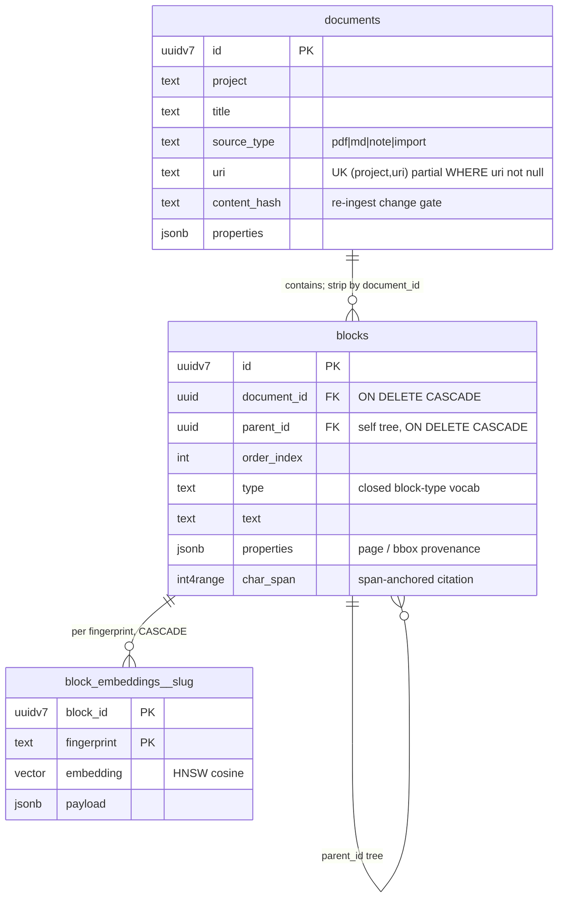
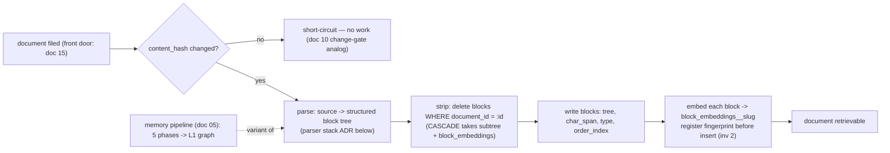
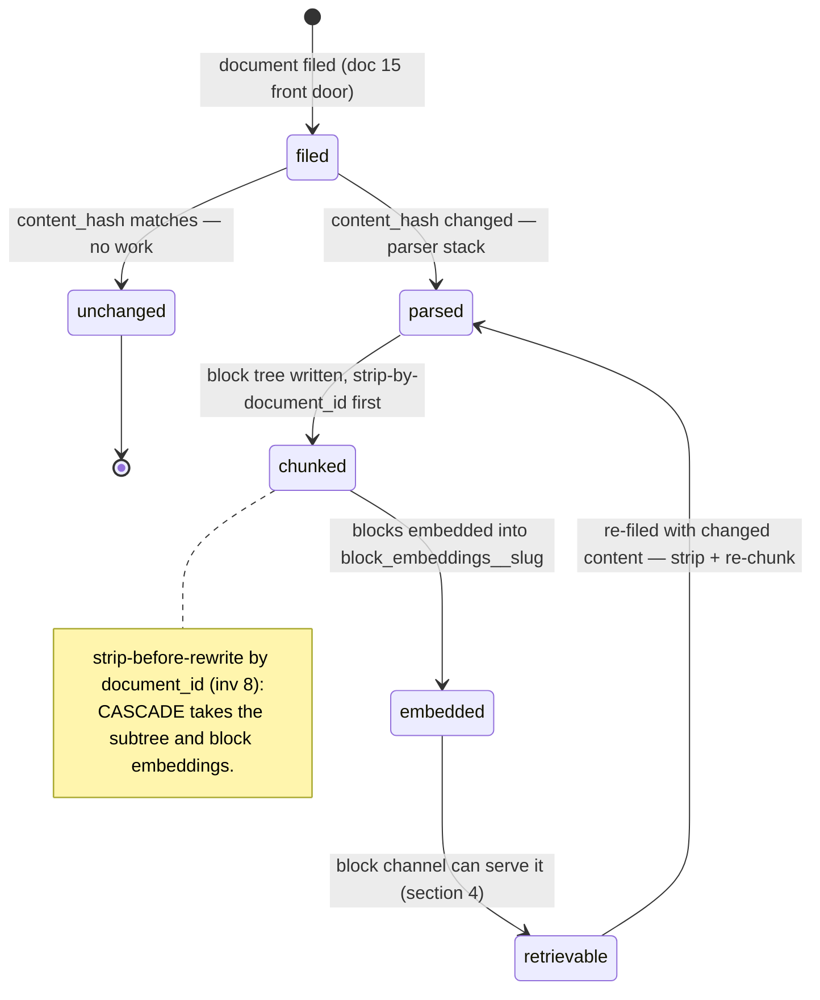
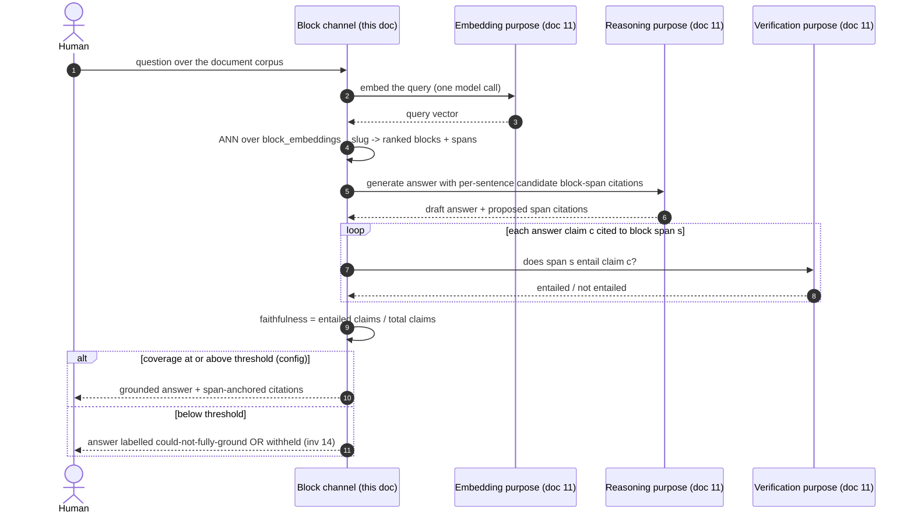
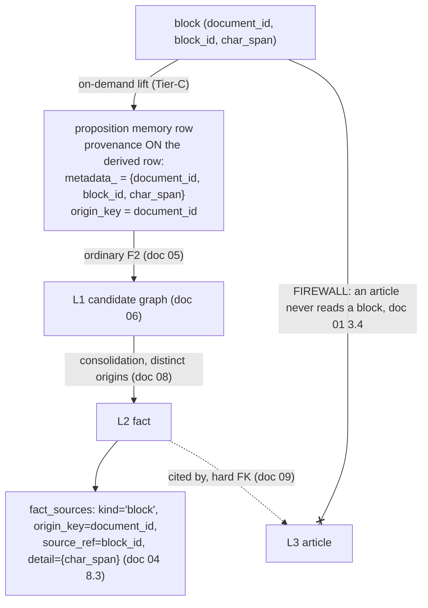

# 16 — Documents / PKM Surface

**Status:** subsystem doc; conforms to foundation docs 00–04 and the 2026-07-24 knowledge-reshape spec. Draft 2026-07-24. Wave-3 product-and-reach layer (with docs 12 API/MCP, 13 frontend IA, 15 distribution). **This whole doc is the expansion HORIZON — designed now, shipped later; every mechanism here is tagged (horizon) unless it is the inert schema that lands early.**

**Amendment, owner ruling 2026-09-05: proposition lifting is retired, not deferred (§5).** A sample lift on the live corpus minted 2,058 memories from 7 documents against a corpus of 50 **memories** (the corpus holds 475 documents; the unit here read ambiguously and is named as of 2026-09-05), and extrapolated on the real cost driver (47,811 non-empty blocks, not 475 documents) the full run would have produced ~104,000 machine-extracted memories and ~152,000 LLM calls — a two-thousand-fold expansion of the vault the spend never signalled. Documents are parsed into blocks and embedded; that is the whole pipeline, and it never reaches extraction. The block-to-fact bridge (§5) is deleted, so the firewall this doc argues for below is now absolute rather than having one sanctioned crossing: there is no route from a block to a fact at all. Every mention of proposition lifting, lifted facts, or the vault bridge elsewhere in this document (§1–§3, §7, §9) describes the horizon design as it stood before this ruling — historical record of what was designed and then retired before shipping, not a live or planned feature. §4, §5, §6 and §8 carry the rewritten decisions; `related-memories` and `document-connections` are re-based on cosine similarity over block vectors instead (§6).

---

## 1. Purpose & scope

**This doc fixes how darkmem grows a *personal memory engine* over the same store the agent engine already runs on — documents decomposed into blocks, retrieved with grounded span-anchored citations, and lifted into the vault as block-sourced facts — but it commits *none* of it to v1 and fixes no verification semantics, no ranking algorithm, and no table shape.** It owns the design of a surface the roadmap ships *after* the core earns its keep: the document/block model (doc 01 §3.7), the ingestion pipeline variant that parses a source into blocks (a variant of doc 05's five-phase memory pipeline), block retrieval with a faithfulness gate (F8), proposition lifting into memories and — through consolidation — into vault facts, and the corpus-analysis surface. It settles six things the foundation left open to this doc: the **block↔memory provenance direction**, the **parser-stack ADR**, the **proposition-lifting trigger and its idempotency key**, whether **block retrieval fuses with memory or stays a separate channel**, the **faithfulness-gate metric**, and the **v1 analysis scope** — and it fixes what is deliberately *not* committed (editor, canvas, CRDT, connectors).

**What the neighbouring docs fix instead.** Doc 04 §8.5 owns the physical `documents`/`blocks` table shapes and §5.3 the `block_embeddings__<slug>` per-fingerprint partition; this doc gives those tables their pipeline, retrieval, and lifting mechanics but never re-specifies a column. Doc 05 owns the memory-capture pipeline this doc *varies* — the five phases, the buffer, segmentation (doc 05 §4 already points here for the multi-unit-decomposition case). Doc 07 owns the retrieval composition *pattern* this doc extends — the channel model, the RRF fusion, the four-layer composition, and the trace payload (contract 1, doc 07 §8); this doc adds a block channel that follows that pattern, it does not redefine fusion. Doc 08 owns the verification ladder and the consolidation job family; block-sourced facts enter *that* ladder unchanged, and proposition lifting runs under *that* schedule. Doc 09 owns article synthesis, and its firewall is load-bearing for this doc (below). Doc 11 owns the LLM boundary; this doc names the `reasoning` and `verification` purposes its answering and faithfulness paths dispatch through, never constructing a call. Doc 15 owns the document *front door* (file capture as an ingestion source); this doc owns what happens once a document is filed. Doc 17 co-owns the faithfulness metric as a measured ship gate.

**The horizon is a two-speed thing, and the honesty convention (doc 04 §1) draws the line precisely.** The *schema* lands early and inert: the empty `documents`/`blocks` tables and the `block_embeddings` per-fingerprint template ship in the v1 baseline **(target-new, inert)**, because doc 04 §5.3 adds all four target-new partition templates up front under the boot-time reconciliation, and `block_embeddings__<slug>`'s `REFERENCES blocks(id) ON DELETE CASCADE` FK cannot be created unless `blocks` exists. So the tables and the embedding template land like the `repo_ids[]` amendment lands — reviewed, tested, and frozen while riskless, with nothing writing to them. Everything *above* the schema — the document pipeline, block retrieval, the faithfulness gate, proposition lifting, and the analysis surface — is **(horizon)**: designed here, gated behind the core's eval gate, and never claimed as shipped (invariant 23). A reader must not mistake the inert tables for a working PKM product; the tables are substrate the horizon will spend, not the horizon itself.

**The firewall holds both ways, and it is the reason this surface can be deferred safely (doc 01 §3.4).** Article synthesis (doc 09) synthesises *only* from verified facts and **never reads a block directly**, so the verified vault does not depend on this unshipped horizon — the core ships without documents. Conversely this PKM surface is *this doc's product*, gated behind the core's eval gate, so it does not ship until the core is proven. The one sanctioned path from a document into the vault is **not** an article reading a block; it is a *fact* carrying `fact_sources(kind='block')` provenance (§5), which reaches an article only through the ordinary `article_citations → knowledge_triples` grounding. The firewall is what makes "designed in now, shipped later" a true statement rather than a coupling risk.

**Audience & authority.** This binds anyone building the documents/PKM surface, and anyone in docs 04/05/07/08 who must leave room for it. It authors on the retained Python/FastAPI + async SQLAlchemy + Postgres/pgvector stack (the 2026-07-24 Option A decision); every design here is SQL-first and expressible without ORM-only constructs (doc 04 §12). Where it and the as-is baseline agree, that is contract; every extension is labelled per doc 04 §1.

---

## 2. The document & block model — tree, spans, identity, change gating

**Decision. A document is a filed source and a block is its single retrievable unit — simultaneously the chunk unit, the embedding unit, the citation anchor, the link endpoint, and the transclusion target — and the one-block abstraction is the design's whole leverage: it keeps retrieval, citation, and linking pointing at the *same* object so a grounded answer can cite an exact span.** The alternative — parallel chunk types, one for RAG and another for citation and another for linking — was rejected because the moment those units diverge, a retrieved chunk cannot cite itself and a link cannot land on what was retrieved; the single unit is what makes span-anchored grounding (F8) mechanical rather than a best-effort mapping. This is doc 01 §3.7's decision; this doc gives it its physical consequences over doc 04 §8.5's tables.

The tables this doc owns (the whole-schema ERD is `erd.md`; doc 04 §8.5 owns the column detail — only the document half is shown here):

**Document identity is the partial `UNIQUE (project, uri)` with `content_hash` as the change gate, so re-filing a source finds and re-ingests the existing row rather than minting a duplicate (doc 04 §8.5).** A document filed from a path or URL is identified by its `(project, uri)`; re-filing the same `uri` resolves to the existing `documents` row, and its `content_hash` decides whether any work runs at all — an unchanged hash short-circuits the whole pipeline, exactly the way an unchanged `HEAD` sha short-circuits a code reindex (doc 10, doc 01 §6). Uri-less sources — an ad-hoc note typed into the UI — carry no `uri` and are identified by their UUIDv7 `id`; the partial `WHERE uri IS NOT NULL` on the unique index is what lets many uri-less notes coexist without colliding on a null. This is the document-level analog of a memory's identity, and it is why the change gate lives on the document and the strip discipline (below) lives on the block.

**A block tree is `parent_id`-linked with `char_span int4range`, and both are load-bearing for citation.** `parent_id` gives the document its structure — a heading owns its paragraphs, a list owns its items — with `ON DELETE CASCADE` so deleting a block takes its subtree (doc 04 §8.5); `order_index` preserves reading order within a parent. `char_span` is a native Postgres `int4range` over the source's character offsets, chosen over a pair of `start`/`end` integer columns because it is one column with native containment and overlap operators — a grounded citation asks "does this cited span contain the answer's supporting text" as a range containment, not a hand-rolled comparison. The range type takes the asyncpg `CAST` discipline in raw SQL (`CAST(:span AS int4range)`, invariant 10); the repository layer carries it. `blocks.type` is a **closed block-type vocabulary** normalised in code (paragraph / heading / list / … — doc 04 §2 convention, invariant 5), not a free-form string, so retrieval and rendering can reason about block kind without drift — the same taxonomy-first discipline the entity graph lives by. Block-level provenance for PDFs (page number, bounding box) rides `blocks.properties` jsonb, so a citation can resolve not just to a character span but to a page and a region for the reader.

**Everything here is one store — no document database, no external index (invariant 1).** Documents, blocks, and their per-fingerprint block embeddings are all rows on the one pgvector Postgres. A document is *not* siloed in a separate store the way a naive PKM product would file it; it shares the substrate so that a proposition lifted from a document participates in the *same* graph, supersession, and topic machinery a memory does (doc 01 §3.7, §4). The block-embedding vectors live in `block_embeddings__<slug>` reached only through `child_table("block_embeddings", fingerprint)`, registered before any insert, never joined across fingerprints (invariant 2) — identical to every other embedding family (doc 04 §5.3).

---

## 3. The ingestion pipeline variant — parse, chunk, embed, idempotent re-ingest

**Decision. Filing a document runs a Tier-B pipeline *variant* — parse the source into a block tree, write the blocks strip-before-rewrite by `document_id`, embed each block into the per-fingerprint partition — and it deliberately does NOT run the five-phase memory pipeline on the document itself; entity extraction over document content happens only later, and only for the propositions a human opts to lift (§5).** The reason to make document ingest a *lean* pipeline rather than a second copy of `process_batch` is the firewall and the cost model together: a raw document is *candidate signal at best*, and running extraction over every filed PDF would flood the L1 graph (and, downstream, the vault) with unverified assertions from text nobody has vouched for. So the document pipeline stops at retrievable blocks; the graph and the vault are reached deliberately, through lifting, never automatically. This is the document-side reading of doc 05 §4's segmentation policy: a document *is* decomposed (into blocks) because there the source and the retrievable unit are genuinely different objects — the deliberate contrast doc 05 §4 already draws with a memory, which stays one row.

The pipeline variant, next to the memory pipeline it varies (doc 05 §5) — a document flows to blocks and block embeddings, not through the five phases:

**Amended 2026-09-05: the diagram above dropped its `DONE -.->|"on demand,
Tier-C (section 5)"| LIFT["proposition lifting -> memories -> F2 -> vault"]`
edge.** The on-demand proposition lift it depicted is retired along with the
block-to-fact bridge; `document retrievable` is the terminal state and no
edge leaves it.

**The parser stack is a genuine ADR-shaped technology choice, and it must respect doc 03 §3.3's no-heavy-ML floor — so it is recorded ADR-style here and flagged back to doc 03 as an amendment when the horizon is scheduled.** The forces are three: the parse must produce a *structured* block tree with character offsets (for `char_span`) and, for PDFs, page/bbox provenance (for `blocks.properties`); it must not reintroduce the native ML stack the 2026-05-01 consolidation removed (`torch`/`transformers` are an optional classification-only extra, and the reshape does not widen that — doc 03 §3.3); and it must stay inside the one-image, permissively-licensed deployment. The recommendation:

| Source type | Recommended library | Why | Rejected alternative |
|---|---|---|---|
| Markdown / notes | `markdown-it-py` (or `mistune`) | pure-Python, gives a token/AST stream that maps cleanly to the block tree with offsets; permissive licence | a bespoke line-splitter — loses nested structure and offsets |
| Plain text | native segmentation (paragraph/heading heuristics) | no dependency; the block-type vocab is small | — |
| PDF | `pdfplumber` (over `pdfminer.six`) | pure-Python, character-level text with bounding boxes → feeds both `char_span` and `blocks.properties` page/bbox; permissive licence | **`PyMuPDF`** — faster but AGPL, a licence friction for permissive OSS single-image deploy; **`unstructured` / `marker` / Docling** — pull heavy ML layout models (torch), a direct violation of doc 03 §3.3 and the one-image, no-heavy-ML posture |

The load-bearing rejection is the ML-based PDF layout parsers: they give the best structure but reintroduce exactly the multi-gigabyte native-ML dependency doc 03 §3.3 spent a consolidation removing, so they are out on principle, not on quality. `pdfplumber`'s character-level extraction is enough to segment blocks and record spans; richer layout is a later, demand-gated concern. **This ADR is flagged to doc 03 as a new layer entry ("document parsing") to be folded in when the horizon is scheduled** — it is not in doc 03 today because the horizon is not committed, and adding a dependency floor for an unshipped feature would itself be over-claiming.

**Re-ingest is strip-before-rewrite by `document_id` — invariant 8 generalised, exactly as doc 05 §4 and doc 04 §8.5 fix it.** When a changed document is re-filed, the pipeline deletes *all* of the document's blocks by `document_id` before re-chunking; the block `ON DELETE CASCADE` on `parent_id` collapses the subtree and the `block_embeddings__<slug>` FK CASCADE takes the vectors, so no stale block or orphaned vector survives a re-ingest. This is the block-analog of `delete_by_memory_id` stripping a memory's prior graph contributions (invariant 8), and it is what makes re-filing an edited document idempotent: the second ingest of the same content is a `content_hash` no-op, and the ingest of edited content produces exactly the new tree with nothing left over. Because block ids are freshly minted on each re-ingest, nothing durable may FK a block id across ingests — the same churn rule communities live by (doc 04 §8.4); the durable anchor a citation keys on is `document_id` plus the within-document `char_span`, not the block id (§5). **Amended 2026-09-05: this sentence used to name "a citation or a lifted proposition" as the thing keying on that anchor — the lift is retired, so a citation is the only thing that does today.**

**The block-embedding write obeys fingerprint discipline identically to every other family (invariant 2).** Each block's text is embedded and written to `block_embeddings__<slug>` through `child_table`, with `_register_fingerprint` called before the first partition insert and the partition self-healing under the boot-time reconciliation if the active embedder rotated (doc 04 §5.3/§12). Long blocks that exceed the embedder's token window are chunked at embed time via payload spans — the same technique articles use (doc 04 §8.8) — rather than by splitting a block into sub-blocks, because a block is the citation unit and must stay one object. No phase of this pipeline joins two `__<slug>` tables.

The document lifecycle as a state machine — filed, parsed, embedded, retrievable; re-ingest re-enters on a content-hash change:

**Amended 2026-09-05: the diagram below dropped the `lifted` state and its
two transitions (`retrievable --> lifted` and `lifted --> parsed`).** The
on-demand proposition lift they depicted is retired; `retrievable` is now
the terminal state past which only re-filing moves a document.

---

## 4. Retrieval & grounded citations — the block channel and the faithfulness gate

**Decision. Block retrieval is a *separate channel and tool* — a document-RAG sibling that follows doc 07's channel pattern but never fuses into the four-layer memory/vault composition — and document content reaches the core composition not at all.** This resolves the framing's open question (fuse-or-separate) in favour of *separate*, on three grounds. First, the firewall: mixing block rows into the four-layer composition would make the core read path depend on the unshipped horizon and blur the layer model that carries the honest labels (doc 07 §5). Second, the product boundary: block search answers "what does *my document corpus* say," a personal-RAG question distinct from "what has darkmem *verified*" — the same reason code search is a separate semantic-only sibling that never joins the memory/vault composition (doc 07 §2, doc 01 §8's deliberate exception). Third, the eval gate: keeping the block channel a separate tool means the horizon can ship (and be gated) without touching the core ranking path at all. The block channel is therefore the document-side twin of code search — its own tool, its own trace, no fusion with memory or the vault.

**Amendment, owner ruling 2026-09-05.** This decision said document content reaches the composition "only as *lifted facts* through the ordinary facts channel (§5)" — that clause is retired along with §5's lift. There is no route from a block to a fact any more, so the sentence above now reads "not at all" rather than naming a bridge that no longer exists; the firewall this section already argued for is now absolute, not merely the one the lift would have crossed deliberately. Nothing else in this section's reasoning changes.

**The block channel is semantic-first over `block_embeddings__<slug>`, and it emits the doc 07 §8 trace with a `block` id-kind.** A query embeds once (doc 11's `embedding` purpose), scores `1 - (embedding <=> :vec)` against the per-fingerprint block partition, and returns ranked blocks resolved to their document and span. It follows doc 07's channel shape — a one-sided failure degrades honestly and a both-sided failure raises rather than returning an empty list indistinguishable from a no-match (invariant 14) — and it stamps the transient retrieval trace (contract 1, doc 07 §8) with `id_kind: block`, the `block_id` (normalised at the boundary, invariant 9), the document and `char_span`, and a `layer` of `document` distinct from the L0–L3 layers the composition serves. Because blocks are horizon and the channel is separate, this trace variant is additive: the core trace schema of doc 07 §8 is unchanged, and a consumer that does not speak the block channel simply never sees a `block` row. The `block` id-kind and the `document` layer are therefore a **horizon addendum to contract 1** — they extend the shared trace enum only when the block channel ships, never in the v1 baseline, and until then no consumer may assume they exist (invariant 23). A keyword arm over block text is a later refinement — v1 of the horizon is semantic-only, and the trace says so rather than implying a keyword gap.

**Grounded answering (F8) is an interactive `reasoning`-purpose flow gated by a faithfulness check — the document-RAG analog of `memory_reason`, not a store-reconciliation call.** The human asks a question over their corpus; the flow retrieves the relevant blocks (deterministic), generates an answer with per-sentence candidate block-span citations through doc 11's `reasoning` purpose (the same purpose and tier `memory_reason` already occupies — an interactive generative read, permitted on Tier A because it answers an explicit question rather than reconciling the store, invariant 15), and then a **faithfulness gate** checks each answer sentence against its cited block span. An answer that clears the gate is served with its span-anchored citations; an answer below the bar is not served as grounded — it is returned labelled ("could not fully ground this answer") or withheld, never presented as if grounded (invariant 14). This is the exact shape of doc 09's enforced-grounding pass, retargeted from facts to block spans.

A grounded answer end to end — retrieve blocks, generate a cited answer, gate it on faithfulness, serve or label:

**The faithfulness-gate metric is span-support coverage, defined with doc 17 as both a per-answer gate and a layer ship gate — the block-analog of doc 09's groundedness metric, reusing the one `verification` judge.** Faithfulness = entailed answer-claims / total answer-claims, where entailment asks the `verification`-purpose model (doc 11 §6 — the same truth-critical judge that serves the fact-level contradiction veto and the article entailment pass, one judge, now three consumers) whether a claim's cited block span entails it. A claim with no citation fails outright (an uncited span is by definition ungrounded — no search-for-support fallback). Two uses, one number, exactly as doc 09 §4.3 structures it: **per-answer**, coverage below a `config` threshold means the answer is withheld or labelled, never served as grounded; **at the layer**, F8 grounded answering does not ship until doc 17 shows the entailment judge reliable at distinguishing grounded from ungrounded answer sentences on a labelled gold set. The metric therefore does double duty — it gates every answer at runtime and gates the whole feature at ship time — and both bars are `config`/harness values tuned conservatively and loosened only with evidence (convention 9). Cost is bounded because the number of answer claims is small; the check is batchable, and its latency is the price of the product's whole value (a grounded, cited answer over the human's own documents).

**Faithfulness (block-grounded answers) and groundedness (article synthesis) are the same metric shape against different grounding targets, and keeping them distinct is what preserves the firewall.** Doc 09's groundedness pass grounds an *article claim* to a *verified fact*; this doc's faithfulness pass grounds an *answer claim* to a *block span*. They share the `verification` purpose and the coverage formula, but they never cross: an article is never grounded to a block (the firewall), and a block answer is never grounded to a fact-of-record (it answers over the corpus, not the vault). Two consumers of one judge, two grounding targets, one honest metric. They also differ in *when* they run, and that difference is what keeps faithfulness inside invariant 15: doc 09's groundedness runs inside the Tier-C consolidation job, off the hot path, while faithfulness is a **read-time output gate** on the interactive answer path — the same shape as the reranker gating a retrieval response before it is served (doc 07), a sanctioned Tier-A exception. Invariant 15 forbids reconciling the *store* on the hot path, not answering an explicit question on it; the faithfulness gate reconciles nothing and writes nothing, it only decides whether an already-generated answer is served as grounded, labelled, or withheld.

---

## 5. Proposition lifting & the vault bridge — retired, never shipped

**Amendment, owner ruling 2026-09-05: proposition lifting is retired, and the block-to-fact bridge described below no longer exists.** A priced sample lift ran on the live corpus and settled the question after 7 of 20 documents: it minted 2,058 memories against a starting corpus of 50 **memories** (the document corpus is 475), and the real cost driver is block count, not document count — recomputed on the corpus's 47,811 non-empty blocks (not its 475 documents), the full run would have produced roughly 104,000 machine-extracted memories and roughly 152,000 LLM calls, a two-thousand-fold expansion in which every hand-captured memory would be outnumbered by propositions extracted from the project's own documentation. The spend was $0.72 and was never the problem; the corpus was. Retirement, not deferral, is the right shape because the defect is structural — one block is too small a unit to reliably hold zero or one claims, so the lift was always going to over-mint, and no threshold or opt-in scope tames a two-thousand-fold ratio. Documents are parsed into blocks, embedded, and that is the whole pipeline (§3); they never reach extraction. Retiring the bridge makes the firewall this doc argues for absolute rather than conditional: there was one sanctioned crossing from a block to a fact, and it is deleted, so there is now no route from a block to a fact at all.

**The decision this section used to make, kept for the reasoning it still explains.** Below is the original design: propositions were to be lifted from a document into the vault *on demand and off the hot path*, never automatically on ingest, because auto-lifting every filed document would flood the vault with candidate signal from unvouched text and corroboration must be *earned*, not manufactured by the act of filing. That "on demand, never automatic" argument was correct as far as it went — it is why the mechanism below carried an explicit trigger rather than running inline with ingest — but the measurement showed the argument needed to generalise one step further: the failure mode was not *automatic* triggering, it was that lifting existed as a *reachable* mechanism at all, on-demand or not. The corrected generalisation is **not extracted at all** — a document's blocks are retrievable signal, never a source of candidate graph assertions, regardless of who or what triggers the attempt.

**Decision (retired). Propositions were lifted from a document into the vault *on demand and off the hot path*, never automatically on ingest: a human (or an explicit per-document/per-project opt-in) would trigger a Tier-C lift that minted memory rows from a document's blocks — each carrying its `(document_id, block_id, char_span)` provenance *on the derived row* — which then flowed through the ordinary F2 pipeline into the L1 graph, and ordinary consolidation lifted the corroborated relations to Layer-2 facts whose `fact_sources` carried `kind='block'` with `origin_key = document_id`.** The trigger was on-demand, not automatic, for the same reason the document pipeline stops at blocks (§3): auto-lifting every filed document would flood the vault with candidate signal from unvouched text, and corroboration must be *earned*, not manufactured by the act of filing. Lifting was meant as a deliberate act that says "treat this document's claims as capturable knowledge," and from there nothing was to be special — the lifted memories would be ordinary memories, the graph the ordinary graph, and the ladder doc 08's ladder. None of this shipped as a live feature; the design below is retained as the record of what was designed and then retired before it reached production.

The vault bridge — a block becomes a proposition memory (provenance on the derived row), enters the ordinary pipeline, and its corroborated relations lift to a fact whose source is the block's document; the firewall keeps articles off blocks:

**The block↔memory provenance direction is settled: it rides *on the derived memory row*, not as a reverse FK from `blocks` — inheriting doc 04 §13's on-the-derived-row default.** A lifted proposition memory carries `{document_id, block_id, char_span}` in its `metadata_` jsonb (or dedicated columns if the horizon's query patterns later justify promoting them, doc 04 §9's activation discipline), so retrieval can render a memory's document provenance and cite the exact span *without a join*, and so a block's deletion does not have to cascade into memory rows through a hard FK. The reverse-FK alternative (a `blocks.memory_id` or a `block_memories` join) was rejected because the block side churns — re-ingest deletes and re-mints blocks by `document_id` (§3), so a hard block→memory FK would either dangle or force lifted memories to be destroyed on every re-ingest, neither acceptable. On-the-derived-row provenance keyed on the durable `(document_id, char_span)` survives the block churn: a re-ingest re-derives the lifted contributions by `document_id`, matching on the durable span rather than a dead block id. This is the exact soft-reference doctrine the fact layer's endpoints already follow (doc 04 §8.3).

**The fact side is already fixed by the reshape and needs no new mechanism (spec §2.2, doc 04 §8.3).** A fact lifted (via the memory it was lifted into) from a document gets a `fact_sources` row of `kind='block'`, `origin_key = document_id`, `source_ref = block_id`, and `detail = {char_span}` — a *soft* reference (no FK), consistent with `fact_sources`'s doctrine and required because block ids churn. **The document is one origin: `origin_key = document_id`, counted once regardless of how many blocks assert the same claim** — the document analog of "a repo is one origin regardless of commit count" (doc 08, spec §2.1). This is the truth-critical rule: two independent *documents* asserting a claim are two distinct origins and real corroboration; the same claim echoed across many blocks of one document is *one* origin, never inflated. When block identity is unknown or a claim spans an ambiguous set of blocks, the degradation rule is the vault's own — **merge to one origin (undercount), never mint distinct ones** (spec §2.1) — so document lifting can never manufacture corroboration by paraphrasing one source into many blocks.

**Proposition lifting is idempotent, keyed on `document_id`, and self-heals under re-ingest — invariant 8 generalised a second time.** Re-lifting a document strips the document's prior lifted contributions before writing the new set, exactly as `delete_by_memory_id` strips a memory's graph contributions and as the document pipeline strips blocks by `document_id` (§3). The idempotency key for the *lift* is `document_id`: a re-ingest that changes the document re-runs the lift, stripping the old proposition memories (identified by their `metadata_.document_id`) and re-deriving from the new blocks; a re-ingest that does not change the document (`content_hash` no-op) never re-lifts. When a proposition memory is stripped, its downstream fact contributions self-heal through the ordinary sweep: the memory's `fact_sources` rows are withdrawn and any fact left with no surviving source is expired invalidate-not-delete, and — critically — **verification is *enqueued*, never recomputed inline** (doc 08's re-extraction/deletion sweep, invariant 15). A strip-and-re-lift that lands the identical source set is a *provenance no-op* — no verified↔candidate thrash — the document-side reading of doc 08's provenance-no-op rule. Because lifting opens a fresh Tier-C session over rows the ingest may still touch, it commits before re-touching them (invariant 11).

**Lifting is a Tier-C consolidation consumer, so it never sits on capture or retrieval (invariant 15).** The lift itself — turning blocks into proposition memories — is a background pass under doc 08's dream-job schedule umbrella; the subsequent extraction (F2) and consolidation (F6) are the ordinary pipelines. No LLM reconciliation runs on the document-filing path; filing produces retrievable blocks and stops (§3). The one interactive LLM path in this whole doc is the grounded-answer flow (§4), which answers an explicit human question and is the document analog of `memory_reason`.

---

## 6. The analysis surface — v1 horizon scope

**Amendment, owner ruling 2026-09-05.** This section committed cross-document connections to an *entity-derived* surface — "emergent from the shared graph" reached by first lifting a document's propositions into memories. §5's retirement removes that path: nothing is lifted, so an entity-graph walk from a document has nothing to walk. `related-memories` and `document-connections` are re-based on cosine similarity over block vectors instead — the first scores a document's blocks against the project's memory vectors, the second scores a document's blocks against other documents' block vectors, both max-aggregated and both outside the four-layer composition (§4). The table row and paragraph below are corrected to that basis; the rest of the section's scope decision (grounded Q&A, single-document summary, deferred trend analytics and multi-document synthesis) is unaffected.

**Decision. The v1 analysis scope of the horizon is deliberately thin and reuses shipped machinery: grounded question-answering over the corpus (F8, §4), single-document summarisation (reusing doc 11's `summarization` purpose), and cross-document *connections scored by cosine similarity over block vectors* — while bespoke trend analytics and multi-document synthesis dashboards are deferred as later, demand-gated work.** The reason to keep analysis thin is that darkmem already owns the machinery that makes a corpus analysable: a document's blocks are already embedded (§3), so cross-document and document-to-memory relatedness are answered by a cosine comparison over vectors that already exist — no new analysis engine, no entity graph, no lift, needed for the connection case. Building a separate analytics stack would duplicate that and re-open the two-drifting-stores disease the single-Postgres moat exists to avoid (invariant 1).

| Analysis capability | v1 horizon | Mechanism / reuse |
|---|---|---|
| Grounded Q&A over the corpus | committed to the horizon | the block channel + faithfulness gate (§4); `reasoning` + `verification` purposes |
| Single-document summary | committed to the horizon | doc 11's `summarization` purpose over a document's blocks — a report, not a verified claim, carrying no verification badge |
| Cross-document connections | committed to the horizon | cosine similarity over block vectors — `related-memories` against the project's memory vectors, `document-connections` against other documents' block vectors; max-aggregated, no new engine, no entity graph |
| Corpus trends / analytics dashboards | **deferred** | demand-gated; no bespoke analytics store — revisit on measured demand |
| Multi-document synthesis write-ups | **deferred / firewalled** | a *verified* multi-source write-up is an *article* (doc 09), grounded to verified facts, never an article reading blocks |

**The connection between documents and the vault is retired (§5), and analysis honours the same labels the rest of darkmem does.** A single-document summary is explicitly a *report* (like `memory_overview`, doc 09 §3.3) — an organisational view of what a document says, carrying *no* verification badge, never a verified claim. A verified, cross-document write-up is not an "analysis feature" at all; it is a Layer-3 article synthesised from verified facts (doc 09), grounded to those facts by `article_citations`, and it never reaches a document's content because nothing bridges a block to a fact any more. So the analysis surface splits cleanly along the firewall: *reports and cosine connections over blocks* (unbadged, organisational, score-and-passage only, no prose about what is shared) live here; *verified synthesis* lives in the vault and obeys the vault's grounding, sourced from `fact_sources`'s three live kinds — memory, code (the deriver's import-based facts, doc 01 §3.6), and human (ratification) — but never from a document (`backend/app/repositories/fact_sources.py:124-132` closes `SOURCE_KINDS` to those three and reserves `'block'` as an explicitly refused kind, not a silently accepted one). This keeps the horizon's analysis honest by construction — it can summarise and rank passages by similarity, but it can only *assert verified knowledge* through the same ladder everything else does, and a document's blocks are never that source.

---

## 7. Deliberately not committed — editor, canvas, CRDT, connectors

**Decision. The committed horizon scope is parse, chunk, blocks, block retrieval, grounded span-anchored citations, and proposition lifting — and the editor, canvas, real-time CRDT collaboration, and third-party connectors are a *separate, demand-gated product*, not committed to v1 and not designed here beyond naming why they are out (doc 01 §3.7).** The block model deliberately *leaves room* for them — a block is already the link endpoint and the transclusion target, so an editor or a bidirectional-link canvas could be built on the same rows later — but leaving room is not committing. Each deferred piece is out for a stated reason, not an oversight:

| Deferred surface | Why out of the committed horizon | What the model already leaves room for |
|---|---|---|
| Block editor | darkmem's vault is its *own* verified understanding, not a human-edited wiki (doc 01 §3.4); an editor is a different product with a different trust model | blocks are the edit unit; `char_span` and the tree survive an editor |
| Canvas / bidirectional links | a graph-of-notes UI is demand-gated and orthogonal to the agent memory engine | a block is already the link endpoint and transclusion target |
| Real-time CRDT collaboration | multi-user concurrent editing contradicts the single-worker, single-box assumption (invariant 13) and is a Phase-4-scale concern | none needed for single-user filing; a CRDT layer would sit above blocks |
| Third-party connectors (Notion, Drive, …) | each connector is an ingestion *front door* (doc 15's concern) and an ongoing maintenance surface, gated on demand | `documents.source_type='import'` and the `uri` identity already accommodate an imported source |

**Naming these keeps the horizon honest (invariant 23).** A reader must not infer from "documents/PKM surface" that darkmem is becoming Obsidian or Notion; the committed horizon is a *grounded document-RAG surface over the one store*, and the editor/canvas/CRDT/connector product is a separate, demand-gated thing that the block model is *compatible with* but does not promise. The line is drawn here so no downstream doc, mockup, or roadmap entry claims the editor as designed.

---

## 8. Invariants restated

**Amendment, owner ruling 2026-09-05.** This section's bullets were written against the pre-retirement design and several asserted the lift, or a block-to-fact route, in the present tense — bare claims a reader could take as live. Each affected bullet is corrected in place below; the ones naming per-fingerprint isolation, honest partial results, and the two-front-doors invariant are unaffected and unchanged.

The invariants that bind this layer, restated in this doc's own terms so the design is checkable against the 1–23 catalog and the firewall:

- **Scaffolding-not-substrate — the whole doc is horizon (inv. 23).** Every mechanism here — the document pipeline, block retrieval, the faithfulness gate, the cosine-based analysis surface — is **(horizon)**, gated behind the core's eval gate and never claimed as shipped; proposition lifting, formerly listed alongside them, is retired rather than horizon (§5). The only thing that lands early is the *inert schema*: the empty `documents`/`blocks` tables and the `block_embeddings` template (target-new, inert), landing like the `repo_ids[]` amendment so the per-fingerprint template is creatable and self-heals. The tables are not the product.
- **The doc-16 firewall, both directions (doc 01 §3.4), now absolute.** Article synthesis never reads a block (the vault does not depend on this unshipped horizon), and this surface is gated behind the core's eval gate. This bullet used to say a document reaches the vault "only as a *fact* carrying `fact_sources(kind='block')`" — that route is retired (§5) and `'block'` is now a reserved, refused `fact_sources` kind (`backend/app/repositories/fact_sources.py:126-132`): a caller supplying it is told explicitly that a document's blocks corroborate no fact, rather than being silently accepted. A document reaches the vault **not at all**, in either direction.
- **Idempotent re-ingest / strip-before-rewrite (inv. 8).** Re-ingesting a document deletes its blocks by `document_id` before re-chunking (the block-analog of `delete_by_memory_id`). This bullet used to say the rule was "generalised twice" and describe re-lifting a document stripping its prior proposition contributions by `document_id` — that second generalisation is retired along with the lift (§5); there is now one generalisation, not two. Block ids still churn on re-ingest, so the durable citation anchor stays `(document_id, char_span)`, never a block id.
- **Per-fingerprint isolation (inv. 2).** Block vectors live in `block_embeddings__<slug>` reached only via `child_table("block_embeddings", fingerprint)`, registered before any insert, `ON DELETE CASCADE` from `blocks`, and never joined across fingerprints; long blocks are chunked at embed time by payload span, not by splitting the block.
- **Single Postgres (inv. 1).** Documents, blocks, block embeddings, and every analysis output are rows on the one pgvector Postgres — no document store, no external index. This bullet used to say cross-document connections "are emergent from the shared graph, not a second analytics store" — that contradicts §6 as amended 2026-09-05, and is corrected here to match it: connections are cosine similarity over block vectors in `block_embeddings__<slug>` (§6), still no second analytics store, but not an entity-graph walk.
- **Closed taxonomy, normalise-before-store (inv. 5).** `blocks.type` is a closed block-type vocabulary normalised in code. This bullet used to add that "lifted propositions carry no new type" — there are no lifted propositions any more (§5), so that clause is dropped; the entity/relationship taxonomy discipline it referenced (doc 06) is unaffected for memories captured through the ordinary doors.
- **Reconciliation off the hot path (inv. 15).** Document filing produces retrievable blocks and stops — no LLM on the filing path, and there is no later on-demand extraction either: proposition lifting, formerly described here as "a Tier-C consumer under doc 08's schedule", is retired (§5), so there is nothing for this invariant to bound on the lift side any more. The one interactive LLM path is the grounded-answer flow (`reasoning` + `verification`), which answers an explicit question, the document analog of `memory_reason`.
- **Honest partial results & no silent degradation (inv. 14).** The faithfulness gate withholds or labels an ungrounded answer, never serves it as grounded; the block channel's one-sided failure is surfaced in the trace and a both-sided failure raises rather than returning a false empty result; a keyword gap in the v1 block channel is reported, never implied.
- **Two front doors, one service layer (inv. 17).** The block-search and grounded-answer tools land on both REST and MCP (or are explicitly single-door with a reason — file *upload* is naturally REST-multipart, with a text-document filing tool on MCP; the front-door transport is doc 15's, §9). Neither door carries a behaviour the other lacks.
- **Provenance always, one mechanism per layer (doc 01 §8, spec §2.8) — retired for documents.** This bullet used to say a lifted proposition carries `(document_id, block_id, char_span)` on the derived row, and a block-sourced fact carries `fact_sources(kind='block', origin_key=document_id)`, grounding through `article_citations`. None of that exists any more (§5): there is no lifted proposition, no block-sourced fact, and no document-originated row for an article to ground through. `DERIVED_FROM` stays cut for an unrelated reason that survives this retirement — a memory never grounds an article through anything but a fact.
- **Every lifecycle transition journals to `events` (convention 8).** Document and block state changes — `filed`, `parsed`, `embedded`, `retrievable`, and re-ingest — emit `events` rows keyed by `object_type` `document`/`block`, exactly as memory and vault transitions journal (doc 04 §8.1). This bullet used to add an on-demand `lifted` transition and its downstream vault journalling; both are retired with the lift (§5) and there is no `lifted` event to add to doc 04 §8.1's vocabulary. These remaining event types are still target-new, added before any code writes them (taxonomy-first), and land only when the horizon ships (invariant 23).
- **id/type drift normalised at the boundary (inv. 9); asyncpg CAST discipline (inv. 10); async session lifetime (inv. 11).** The block channel normalises `block_id` at the fusion/trace boundary; `char_span int4range` takes explicit `CAST` in raw SQL. This bullet used to close with "the Tier-C lift commits before opening a session that re-touches ingest rows" — there is no Tier-C lift any more (§5); the cosine-based connections and relatedness surfaces (§6) issue read-only queries and open no session that re-touches ingest rows in the first place, so invariant 11 binds nothing new here.

---

## 9. Open questions & deferred decisions

Each carries a recommended stance, so downstream inherits a default rather than a blank.

- **Block↔memory provenance direction — moot, owner ruling 2026-09-05 (§5).** *Stance (historical, no longer live): provenance rides `(document_id, block_id, char_span)` on the derived memory/knowledge row (in `metadata_` jsonb, or dedicated columns if query patterns later justify it), not a reverse FK from `blocks` — inheriting doc 04 §13's on-the-derived-row default (§5). The fact side was `fact_sources(kind='block', origin_key=document_id)`, fixed by spec §2.2. There is no derived row and no block-sourced fact any more: nothing is lifted, `block` is a refused `fact_sources` kind, and the question this bullet resolved no longer arises. The direction it chose is recorded because the reasoning still binds any future derived row, not because one exists.*
- **Parser stack — ADR recorded, flagged to doc 03.** *Stance: `pdfplumber` (pure-Python, pdfminer.six-based, character-level text + page/bbox) for PDF, `markdown-it-py`/`mistune` for markdown, native segmentation for notes; reject `PyMuPDF` (AGPL licence friction) and all ML-layout parsers (`unstructured`/`marker`/Docling — heavy ML, violates doc 03 §3.3). Record this ADR-style (§3) and fold it into doc 03 as a "document parsing" layer entry when the horizon is scheduled — not before, since a dependency floor for an unshipped feature would over-claim. The exact PDF-library pin is confirmable at schedule time against the then-current permissive-licence landscape.*
- **Proposition-lifting trigger & idempotency key — retired, owner ruling 2026-09-05 (§5).** *Stance (historical, no longer live): on-demand / opt-in per document (never automatic on filing), run as a Tier-C consolidation pass; idempotency keyed on `document_id`. Retired because a priced sample lift minted 2,058 memories from 7 documents against a 50-memory corpus, extrapolating to ~104,000 memories and ~152,000 calls corpus-wide — no trigger scope or opt-in tames that ratio, so the mechanism is deleted rather than gated tighter.*
- **Block retrieval — separate channel, not fused — resolved.** *Stance: a separate channel and tool (the document-RAG twin of code search, doc 07 §2), never fused into the four-layer memory/vault composition; document content enters the core composition not at all (§4, amended 2026-09-05 — the lifted-facts bridge is retired). The block channel emits the doc 07 §8 trace with a `block` id-kind and a `document` layer, additive to the core schema.*
- **Faithfulness-gate metric — resolved with doc 17.** *Stance: span-support coverage (answer claims entailed by their cited block span / total claims) through doc 11's `verification` purpose — the same judge as the fact veto and article entailment; a per-answer `config` threshold gates serve-vs-withhold/label, and a doc-17-measured judge-reliability bar on a gold set gates whether F8 ships at all (§4). The same shape as doc 09's groundedness metric, retargeted to block spans. Open sub-decision: whether the answer-time faithfulness check runs inline (a second interactive call, chosen for v1 because grounding is the product's value) or is deferred with a provisional label — recommend inline, revisit if latency measures poorly.*
- **v1 analysis scope — resolved, amended 2026-09-05.** *Stance: grounded Q&A (§4), single-document summary (reusing `summarization`, unbadged report), and cross-document connections *scored by cosine similarity over block vectors* — all committed to the horizon; bespoke trend analytics and multi-document synthesis dashboards deferred as demand-gated, with verified multi-source write-ups being *articles* (doc 09), not an analysis feature (§6). The prior stance ("emergent from the shared graph after lifting") is retired along with proposition lifting (§5).*
- **Document front-door transport — deferred to doc 15.** *Stance: file *upload* is REST-multipart (binary does not fit MCP's text-JSON surface cleanly), with an MCP text-document filing tool for notes/markdown; the block-search and grounded-answer tools land on both doors (invariant 17). The precise front-door shape — and browser/file capture feeding the buffer — is doc 15's; this doc fixes only what happens after a document is filed.*
- **Dedicated document-answer LLM purpose — not now.** *Stance: reuse `reasoning` for grounded-answer generation and `verification` for the faithfulness check; do not widen the purpose set for the horizon. If a distinct document-answer purpose is ever wanted, it lands taxonomy-first in doc 11's matrix (row + seed + `PURPOSES` sweep) before any consumer dispatches — the same discipline doc 11 §6 applies to `synthesis`/`verification`.*
- **Block-type vocabulary & link/transclusion activation — deferred to schedule time.** *Stance: `blocks.type` starts with a minimal closed set (paragraph / heading / list / code / quote / table / table_row / divider / html — widened 2026-08-31, spec §4.1, when the markdown parser began emitting tables structurally, again 2026-09-02 for `divider`, when a thematic break minting no block was measured to refuse 201 of 475 corpus documents from block-first conversion, and again 2026-09-07 for `html`, notes spec §12, when raw HTML minting no block was measured to make any document containing it permanently unconvertible to block-first); the link-endpoint and transclusion roles the block model already carries stay inert until the editor/canvas product is demand-gated in (§7) — designed-for, not built.*

---

*Downstream: doc 04 §8.5/§5.3 owns the `documents`/`blocks`/`block_embeddings` schema this doc's pipeline and retrieval spend (its §13 on-the-derived-row provenance default described the now-retired lift's direction, §5); doc 05 §4 already points here for document decomposition, and this pipeline is the variant of its five phases; doc 07 §2/§8 owns the channel pattern and the trace this doc's block channel follows and extends with a `block` id-kind, never fusing into the four-layer composition; doc 08 owns the verification ladder and the consolidation job family — block-sourced facts no longer enter it, since proposition lifting is retired (§5, owner ruling 2026-09-05); doc 09 owns article synthesis and the firewall this doc respects, now absolute rather than having a sanctioned crossing — an article is grounded only to verified facts, never to a block; doc 11 provides the `reasoning`/`verification`/`summarization`/`embedding` purposes this doc dispatches and the taxonomy-first discipline any new purpose would follow; doc 12 serialises the block-search and grounded-answer tool contracts on both front doors; doc 13 surfaces the documents view (labelled horizon) and the grounded-answer explainability; doc 15 owns the document front door (file/browser capture) that feeds this pipeline; and doc 17 co-owns the faithfulness metric as the measured L-horizon ship gate. Everything here is the horizon — designed now, shipped later, gated behind the core's eval gate.*
