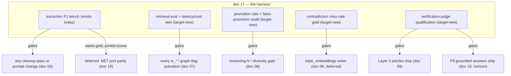
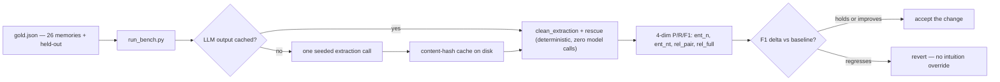
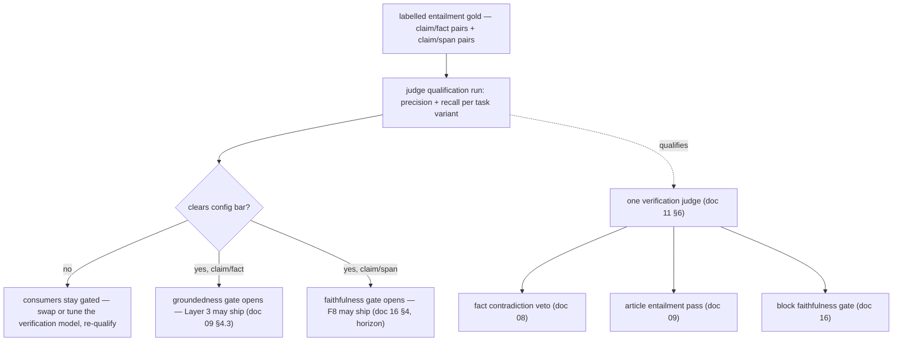

# 17 — Test & Evaluation Harness

**Status:** subsystem doc; conforms to foundation 00–04, the 2026-07-24 reshape spec, and subsystem docs 05–16. Authored 2026-07-24 on the retained Python/FastAPI stack (Option A, doc 03 §4). Honesty tags per doc 04 §1: **(exists today)** / **(target-new)** / **(rebuild)** / **(activation)** / **(horizon)**.

---

## 1. Purpose & scope

**This doc fixes the measurement discipline the whole system is gated on: the harness is a first-class deliverable, not tooling.** Doc 00 §7 principle 2 forbids shipping anything without a before/after number, and doc 00 §8's success criteria are all measured statements; this doc is where every such number is *defined* (which metric, on which gold set, against which baseline), *produced* (the bench mechanics, caching, and reproducibility rules that make a run cheap and deterministic), and *enforced* (the gate registry that says which measurement blocks which ship decision). It owns: the extraction F1 bench and its regression-owner role; the retrieval eval with its mandatory latency/cost twin; the verification-tuning metrics (promotion rate, false-promotion audit, contradiction miss rate); the qualification of the one `verification` judge whose reliability gates Layer 3 and the document horizon; the reproducibility contract; the general tuning protocol for every `config`-row tunable in the corpus (convention 9); and the test infrastructure plus the gate posture that decides when a change may merge.

**What the neighbouring docs own instead.** Doc 06 owns the cleanup-pass inventory and the dedup discriminators this doc's F1 bench measures — the passes are its contract, the *gate* is this doc's. Doc 07 owns fusion and ranking policy and every `w_*` arm; this doc owns the eval those activations must clear. Doc 08 owns the verification ladder, the veto, and hysteresis semantics; this doc owns the promotion-rate and miss-rate measurements that tune them (doc 08 §5.3/§9 explicitly assigns both measurement protocols here jointly). Doc 09 §4.3 owns the entailment pass and its per-article runtime gate; doc 16 §4 owns the faithfulness pass; this doc owns the *gold-set qualification of the judge* that decides whether either layer ships at all. Doc 11 §6 owns the `verification` and `synthesis` purposes and their call construction. Doc 19 owns carrying the gold data and the harness-first discipline across the deferred .NET port; annex 03a and `spikes/` are that port's standing de-risking record. Doc 20 sequences every layer behind the gates registered here. Doc 13 owns any eval-viewer surface if one is ever built.

**Audience & authority.** This binds anyone changing extraction, ranking, verification, synthesis, or any tunable — and anyone tempted to ship a change "because it looks better." Where it and the as-is baseline (`CLAUDE.md`) agree, the behaviour is contract; target work is labelled honestly (invariant 23). Every design here is SQL-first, stack-neutral where it can be (gold data is JSON), and expressible without ORM-only constructs.

**The one sentence to hold in mind:** a change without a number is an opinion, and darkmem does not ship opinions.

---

## 2. The measurement doctrine and the gate registry

**Decision. Every layer, feature, and flag activation in the corpus names exactly one gating metric owned by this doc, and no layer advances on intuition (doc 00 §7.2, convention 9).** The registry below is the single map from "thing that wants to ship" to "number that must clear its bar first." Doc 20 sequences the roadmap directly off this table; a roadmap phase without a registered gate is a planning defect.

| Ship decision | Gating metric (this doc) | Gold set | Status |
|---|---|---|---|
| Any extraction/cleanup-pass change | entity + relation F1 delta (§3) | `extraction_bench/gold.json` + held-out | (exists today) |
| Any retrieval flag/boost activation that reorders rows (`w_*`, `ppr_enabled`, `dual_level_enabled`, reranker) | sliced MRR/hit@K **with** p95 latency + token cost, vs baselines (§4) | retrieval gold pairs | (target-new) |
| Community-report injection (`community_injection_enabled`) — context augmentation, **not** a ranking signal (doc 07 §4), so it cannot move MRR | answer-quality/groundedness delta on `memory_reason` over the capability slices **with** its p95 latency + token-cost twin (injection's real cost) | reasoning gold set | (target-new) |
| Loosening the corroboration gate (N, diversity/time rule) | promotion rate + false-promotion audit under bar (§5.1) | events journal + review verdicts | (target-new) |
| The `triple_embeddings` ANN candidate writer | contradiction miss rate above bar (§5.2) | contradiction-pair gold | (target-new) |
| Layer 3 (article synthesis) ships | `verification` judge precision/recall on labelled entailment gold (§6) | claim/fact entailment gold | (target-new) |
| F8 grounded answering (document horizon) ships | same judge, block-span entailment gold (§6) | claim/span entailment gold | (horizon) |
| Area-taxonomy prompt variants ship (doc 06 §8) | ≥ +0.03 F1 on multi-domain gold, on-area gain > forced-misclassification penalty | multi-domain extraction gold | (target-new, spike-gated) |
| .NET port claims parity (doc 19) | same gold, same cached outputs, scorer already proven identical | all of the above, carried as JSON | (horizon) |

**Accuracy never ships without its cost twin.** Every accuracy claim out of this harness is reported *with* p95 latency and token cost, against a full-context baseline (doc 00 §7.2). A retrieval arm that buys +2 points of MRR for 3× the latency budget did not clear its gate; the twin is part of the metric, not an appendix. Extraction is the one surface where the twin is trivially satisfied — the cleanup passes are deterministic in-process code with zero model calls, which is precisely why the F1 bench can iterate freely (§3).

The gate graph — which measurement blocks which ship decision:

*Caption: the gate registry as a graph — every ship arrow originates at a measurement; nothing advances on intuition.*

**Alternatives rejected.** A per-doc, informal "measure it somehow" stance was rejected — that is how tunables rot into magic numbers and how a confidently-wrong activation ships. A heavyweight experiment-tracking service (MLflow-class) was rejected under invariant 1 and the one-box ethos: the harness is scripts, JSON gold, a bench database, and dated report files, not a second system to operate.

---

## 3. The extraction F1 bench — the regression owner (exists today)

**Decision. The extraction F1 bench at `backend/scripts/extraction_bench/` is the regression owner for the entire extraction surface: every change to `clean_extraction`, the rescue layer, the type-override maps, the prompt, or the dedup discriminators is accepted or reverted against its measured F1 delta — a pass may be reordered or removed only against a number, never on intuition (doc 06 §10's stance, made binding here).** This is the harness's crown jewel because the ~40 deterministic cleanup passes are the extraction moat (doc 00 §6), and a moat you cannot measure is a moat you will erode by accident.

**Mechanics (exists today).** `gold.json` holds 26 gold-labelled memories (entities with types, relations with types); a `gold_heldout.json` sits beside it for overfit checks. `run_bench.py` calls extraction, applies `clean_extraction` with the rescue layer, and scores four dimensions — entity name-only (`ent_n`), entity name+type (`ent_nt`), relation pair-only (`rel_pair`), and relation full-triple (`rel_full`) — each as precision/recall/F1 with per-memory diffs on demand (`--diffs`). The `benchlib` package supplies the two mechanisms that make iteration cheap: `bench_db` gives the run a *separate* `darkmem_bench` database with the same drop-and-migrate reset discipline as tests (never the real or test DB), and `caching_llm` memoises every embed and chat call to disk keyed by content hash, so a second run replays entirely from cache with zero live calls. `--algo-only` hard-fails if any output is uncached — the mode used when iterating the deterministic passes, where a model call would mean the run is not measuring what you think it is.

**The bench has already earned its keep.** The 2026-06-04 algorithm passes were driven entirely through this loop: relations F1 0.64 → 0.96 and entity name+type F1 0.68 → 0.93, iterated against cached LLM output without a single re-extraction call per iteration. That history is the existence proof for the doctrine: the wins came from measured deterministic passes, not prompt intuition.

The bench loop — one live pass populates the cache, then the deterministic passes iterate free:

*Caption: the regression loop. `--algo-only` pins the left branch shut so a pass change is measured against identical raw model output.*

**Gold is stack-neutral and carries across a port unchanged (doc 19).** The gold sets are plain JSON with no Python in them; annex 03a proved the rest of the machinery portable — the .NET benchlib spike reused the Python-built LLM cache 26/26 via byte-identical sha256 keys, and its F1 scorer matched `run_bench.py` exactly (1e-12) on real cached outputs. The binding rule inherited from doc 03 §5.16: **the harness must exist in any new stack before parity with today can be claimed** — ported cleanup passes are never trusted on faith, they are scored against the same gold and the same cached raw outputs so any delta is attributable purely to the port.

**Growth path (target-new).** The gold set is mono-domain darkmem tech today; the dynamic-area spike (doc 06 §8) is gated behind *multi-domain* gold plus a forced-misclassification A/B with an acceptance bar of ≥ +0.03 F1. Growing the gold set is harness work owned here: new gold memories are added per area with the same schema, the held-out split is maintained, and the 26-memory core is never rewritten retroactively (a moving gold set cannot anchor a regression).

**Alternatives rejected.** Scoring against live LLM output every run was rejected — non-determinism across vendor-side changes would drown a one-pass delta in noise, and the cache is what makes a bench run take seconds. An LLM-judged extraction score was rejected for the regression role: the judge would itself drift; exact-match F1 over normalised keys is crude but stable, and stability is the regression owner's first duty.

---

## 4. The retrieval eval — accuracy with its latency and cost twin (target-new)

**Decision. The retrieval eval reports MRR and hit@K sliced by query type, and no accuracy number ships without its p95-latency and token-cost twin, measured against two baselines: the full-context baseline (the honesty anchor) and the current-configuration baseline (the activation gate).** Doc 07 §11 hands every ranking tunable here — `semantic_weight`, `w_ppr`, `w_dual`, the `rank_fusion_factor` arms, the `applies_when` boost, the reranker — with the explicit rule that activations are measured, never silent defaults. This section fixes what "measured" means.

**The slices are fixed, and the weak ones are already known.** Two slice families:

- **Query-type slices** — *paraphrase, typo, fact, exact*. The 2026-04 retrieval measurements established both the slicing and the standing weakness: paraphrase, typo, and fact were the weak slices on the then-current retriever (≈0.74–0.76 MRR vs ≈0.86 overall). Those runs predate the LLM-only consolidation and their absolute numbers do not carry, but the *slicing* does: an aggregate MRR hides exactly the failure modes an agent hits in practice, so per-slice reporting is mandatory.
- **Capability slices** — *multi-hop, temporal, knowledge-update* (doc 00 §8). These are the slices the graph arms and the vault channels exist to win: doc 00's success criterion is that retrieval "measurably beats a hybrid-only baseline on the multi-hop, temporal, and knowledge-update slices … within a stated latency and token budget." A PPR or dual-level activation that does not move these slices did not earn its flag.

**The two baselines, and why both.** The **full-context baseline** stuffs the eligible corpus (bounded) into the model's context and asks directly — the zero-retrieval upper bound on accuracy and the worst case on token cost. It anchors honesty: retrieval's whole pitch is approaching that accuracy at a fraction of the cost, so the eval must show both axes. The **current-configuration baseline** is the system with the candidate flag off — the activation gate proper: with every graph flag off, retrieval is byte-equivalent to today's vector+FTS hybrid (doc 07 §4), so the before/after pair is exact.

**Gold and mechanics.** Retrieval gold is a JSON set of labelled `(query, relevant_memory_ids, slice_tags)` pairs built over a seeded bench corpus in `darkmem_bench` (the same benchlib lifecycle as §3 — the bench DB is dropped, migrated, and seeded deterministically so ranks are comparable across runs). Latency is measured at the service boundary (the composition entry doc 07 §9 fixes as the one ranking path) and reported as p50/p95; token cost is the sum of query-embed plus optional reranker tokens per query (invariant 15 guarantees those are the only model calls to count). Runs are pinned to a named embedder fingerprint — comparing runs across fingerprints is the eval-level echo of the no-cross-fingerprint-join rule (invariant 2) and is forbidden.

**Consequences.** Doc 07's stance that every boost magnitude is a `config` row "tuned only against the retrieval harness" becomes operational: an activation PR carries the eval report (per-slice before/after, latency twin, cost twin) or it does not merge. The hard ordering rules — verified-above-labelled-candidate, the contradiction veto's precedence, honest exclusion counts — are *not* tunable and are asserted by tests, not tuned by evals (§8).

---

## 5. Verification-tuning metrics (target-new; doc 08)

Doc 08 owns the ladder's semantics; this doc owns the two measurements doc 08 §5.3/§9 explicitly defers here. Both are SQL over substrate that already journals — no new measurement tables.

### 5.1 The promotion-rate metric and the false-promotion audit

**Decision. The promotion-rate metric is `(facts promoted) / (eligible candidate facts)` per recompute window, sliced by source-kind diversity and by which N fired; the false-promotion audit is the count of corroborated facts later disputed or human-rejected; and the corroboration gate starts conservative — N=2 with the source-kind-diversity or ≥7-day-gap rule, else 3 — and is loosened only while the measured false-promotion rate stays under a stated bar.** Both metrics are computed from rows the system already writes: every verification transition is journaled to `events` (doc 08 §4.3, convention 8), and dispute/rejection verdicts live on `knowledge_triples` and the review queue — so the measurement is a query, not an instrument. This is the payoff of the events-journaling convention: the journal *is* the experiment log.

**Why this shape.** The ladder is built to under-claim (doc 08 §4.1): a delayed promotion costs a label, a wrong promotion poisons every article citing the fact. So the tuning direction is one-way — start strict, loosen with evidence — and the evidence has two sides: promotion rate too low (facts starving at `candidate` despite genuinely diverse corroboration — visible in the by-which-N-fired slice) argues for loosening; any false-promotion above bar vetoes loosening regardless of how starved the rate looks. The recommended starting bar: **false-promotion rate < 1% of promotions per audit window**, itself a `config` row (`verification_false_promotion_bar`) so the bar is stated, not folklore. The hysteresis parameters (`verification_demote_grace_cycles`, the `under-sourced` label) are tuned by the same protocol against measured demotion-thrash counts from the same journal.

### 5.2 The contradiction-detection miss-rate gold set

**Decision. A contradiction-pair gold set — pairs of facts that genuinely contradict over an overlapping validity window but share few or no lexical tokens — measures the recall of doc 08's same-endpoint + `pg_trgm` candidate generator; the vector-ANN candidate generator over `triple_embeddings__<slug>` ships only when the measured miss rate on this gold set exceeds a stated bar — and when it ships, it groups facts for counting only, never merges rows or rewrites `triple_key`, carrying the `names_distinct` guard (doc 08 §5.3, doc 04 §5.3/§13).** The lexically-disjoint pair is the designed blind spot of the trigram shortlist ("uses postgres 14" vs "migrated the datastore off relational"); the gold set exists to make that blind spot a *measured* number instead of a suspicion. The failure asymmetry keeps the deferral honest: an undercounted candidate set only *delays* catching a contradiction (the preferred failure) — it never manufactures one — so the writer stays deferred until the miss rate proves the delay material. Recommended starting shape: ≥ 50 labelled pairs, at least half lexically disjoint, grown from real disputes as they occur (each adjudicated dispute is a free gold candidate); the bar (`contradiction_missrate_bar`) is a `config` row with a conservative default (recommended: writer justified at miss rate > 20% on the disjoint slice).

---

## 6. One judge, three consumers, two ship gates (target-new / horizon)

**Decision. There is exactly one `verification` judge (doc 11 §6's `verification` purpose) serving three consumers — the fact-level contradiction veto (doc 08 §4.2), the article claim-level entailment pass (doc 09 §4.3), and block-answer faithfulness (doc 16 §4) — and this doc qualifies that judge on labelled gold before any consumer's layer ships: Layer 3 does not ship until the judge's precision/recall on grounded-vs-ungrounded claims clears the bar (the groundedness gate, target-new), and F8 grounded answering does not ship until the same holds for block-span entailment (the faithfulness gate, horizon).** All three consumers are the same task shape — "does premise text entail/contradict hypothesis text," temperature 0, structured verdict — which is exactly why doc 11 gave them one dedicated purpose rather than the conversational `reasoning` model. One judge means one qualification: the harness measures the judge once per task variant, not once per consumer. **One *measurement*, and since 2026-08-12 one record per consumer role — see the second amendment below; the sentence stands for the instrument and no longer for the admission.**

*Caption: one judge, three consumers. The qualification gold splits by grounding target — fact text vs block span — because the premise distributions differ; the judge and its bars are shared.*

**What the qualification measures, precisely.** The gold is human-labelled `(premise, hypothesis, verdict)` triples in two variants: *claim/fact* (an article-style sentence against a verified-fact text) and *claim/span* (an answer sentence against a block span). The judge's **precision on "entailed"** is the truth-critical number — a judge that calls an ungrounded claim grounded lets a fluent hallucination ship under a corroborated badge, the worst failure in the maintainer's truth-over-everything ordering — so the recommended bars weight it: precision ≥ 0.95 on entailed verdicts, recall ≥ 0.90, both `config` rows (`groundedness_gate_precision_bar` etc.), starting sizes ≥ 200 labelled pairs per variant seeded from real synthesis drafts once Layer 2 is live. The veto consumer inherits the same qualification on the contradiction verdict (precision on "contradicts" protects against manufactured disputes; §5.2's asymmetry protects the other side). **This one sentence is the whole of the contradiction pair's entry into G-D — it was never a derivation, and it was amended twice: 2026-08-08 inverted its metric pair, and 2026-08-12 ended the inheritance itself. The veto consumer now holds its own qualification record and inherits nothing.**

**AMENDED 2026-08-08 (Tier-3, owner-ratified) — the contradiction consumer's metric pair inverts, because its consumer changed.** "Inherits the same qualification" was the whole derivation: 0.95 is derived here for *entailed* precision, where a false accept ships a hallucination under a badge, and the contradiction bar was taken over from it rather than derived from the veto's own cost. Doc 08 §4.2's amendment moves the LLM scan from disputing to opening review, and a **surfacing** instrument has the opposite truth-critical metric from a **deciding** one: a missed contradiction never reaches a reviewer at all, so **contradiction-recall is the truth-critical bar**, while contradiction-precision becomes a **review-load floor** — at the measured 0.88, roughly one flag in eight is noise, which is queue economics rather than truth. The single-metric gate was measured incoherent for the deciding consumer: replayed through the shipped scorer, a judge emitting `contradicted` on exactly one correct pair passes all three gated bars at contradiction-recall 0.0182, qualifying a near-mute judge to hold an absolute veto. `BAR_METRICS` gains a recall key.

**The bars, stated 2026-08-08 — by derivation, which is the only lawful way to state them now.** The rule above predates every judge run: the truth-critical metric is barred at 0.95, the other at 0.90. The amendment makes **contradiction-recall** truth-critical, so it takes **0.95** by that same rule — a contradiction the arm misses reaches no reviewer, and the fact stays corroborated and citable. Nothing observed enters the derivation, and the check on that is direct: **the measured judge does not clear it.** gpt-5.5 scored contradiction-recall 0.945 on the now-retired gold; a bar chosen to launder that number would sit at 0.90.

**Contradiction-precision moves 0.95 → 0.70, because its consumer changed and not because it was missed.** It is now a review-load floor: a false flag costs a reviewer a minute rather than a wrong belief, so the only property it must guarantee is a queue a human will actually work — noise a clear minority, under one flag in three. Holding it at 0.95 would keep pricing precision as truth after this section stopped treating it that way, and would block the gate for a reason unrelated to being right. That the honest consequence of the redesign is a *lower* bar on this axis is the point, not an embarrassment.

**Granularity binds the recall bar.** At the retired gold's 55 contradicted pairs, recall resolves in steps of 1/55 ≈ 0.018, so 0.95 and 0.945 are the same measurement. T2.110's grown gold must carry a contradicted census large enough for 0.95 to be a distinguishable bar rather than a rounding artefact — otherwise the number is stated but not measurable.

**Both are the owner's to move with a recorded argument, and neither may be moved to make a run pass.** Stated by the controller under delegated authority (2026-08-08) with the derivation written out precisely because the controller had already seen the measured results; a reader who wants to discount them knows exactly what to discount.

**Why the gate is on the judge, not the articles.** Doc 09's per-article coverage threshold gates each article at runtime; but that gate is only as good as the judge computing it. Qualifying the judge on labelled gold is what turns "the article passed entailment" from circular self-assessment into a calibrated claim — the double duty doc 09 §4.3 names ("gates every individual article at runtime and gates the whole feature at ship time") is only honest if the runtime gate's instrument was itself measured here first.

**Alternatives rejected.** Per-consumer judges (three purposes, three models) — rejected by doc 11 §6 and inherited: one truth-critical judge, qualified once, is auditable; three drift independently. Skipping qualification and trusting a frontier model's NLI ability — rejected: the judge may be a local model on a homelab box, and the gate must hold regardless of which model the operator configures; re-qualification after a `verification`-purpose model swap is mandatory (the qualification result is recorded against the model identity).

### AMENDED 2026-08-12 (Tier-3, owner-ratified) — the qualification **record** splits by consumer role; the judge does not

**Decision. There is still exactly one `verification` judge, one prompt, one identity hash and one qualification sitting — but the qualification *record* is per consumer role, and a consumer is admitted only for the discrimination it actually makes.** The **entailment role** gates on `entailed_precision` / `entailed_recall` and serves the article claim pass (doc 09 §4.3); the **contradiction role** gates on `contradiction_precision` / `contradiction_recall` and serves the Tier-C scan (doc 08 §5.3). Each role holds its own record, minted only by a run whose *own* bars cleared. `contradiction_recall_bar` stays **0.95** and `contradiction_precision_bar` stays **0.70**; the contradiction role is **NOT QUALIFIED** and stays so, and the Tier-C scan keeps dead-ending exactly as it did the day before this amendment.

**What was wrong, in one sentence.** `VerificationJudge.judge()` was one gate over all four barred metrics, so each consumer's admission depended on a discrimination it never makes — the article pass branches on `entailed` alone (`contradicted` and `unsupported` are one bucket to it), the Tier-C scan branches on `contradicted` alone — **in both directions**: the article pass was blocked by a contradiction bar it cannot express, and a qualified contradiction scan would have been licensed in part by an entailment measurement it never consults.

**The grounds, and none of them is a measured contradiction number.** The amendment is derivable from three inputs that all predate the failed run, and is written from them:

1. **Doc 20 §4's ratified registry already defines G-D as the entailment discrimination** — *"the groundedness judge's precision/recall at distinguishing grounded from ungrounded sentences, on a labelled gold set"*. That is the charter.
2. **The contradiction pair entered G-D through one inheritance sentence in this section** — *"The veto consumer inherits the same qualification on the contradiction verdict"* — never a derivation. "Inherits the same qualification" was the whole argument, and the 2026-08-08 amendment had already found the *metric pair* it inherited to be wrong for its consumer. This amendment finishes that finding: what was inherited was not only the wrong pair but the wrong coupling.
3. **The pairing is code-forced in both directions**, which is a fact about doc 09 §4.3's coverage design and doc 08 §4.2's post-amendment surfacing consumer, not about any run.

So the split does not re-cut G-D — it restores G-D to its ratified charter and gives the rider its own gate. **The premise in ground 3 is machine-checked, not asserted**: an AST scan over `claim_entailment.py` and `contradiction_scan.py` fails the build if either module names a judge verdict outside its own role's discrimination, or calls the gated door as the other role, or without naming a role at all. A prose premise about two source files rots the first time a consumer grows a second branch, and the amendment would silently stop being true while every test stayed green.

**§6's rejected-alternatives clause, named and distinguished — and the part of it that now bites.** The clause above rejects *per-consumer judges*: "three purposes, three models … one truth-critical judge, qualified once, is auditable; three drift independently." **This is not that.** One purpose, one model, one prompt, one identity hash, one gold, one sitting; nothing about the *instrument* is per-consumer, so there is nothing to drift. What splits is the record — the bookkeeping of which measured number admits which consumer. **But the clause's concern is not fully absent, and an amendment that claimed otherwise would be dishonest**: roles now hold qualification state *independently*, so the system can stand in a state the pre-amendment design could not represent — one consumer shipping on a qualified judge while the other's capability is unqualified. That is a strictly larger state space than "qualified" / "not qualified", and it is the rejected alternative's nearest neighbour. What keeps it on the lawful side of the clause is that the *drift* the clause names is model drift between separately-qualified instruments, and there is still exactly one instrument, re-measured as a whole every sitting.

**Two costs, stated plainly, because both are real weakenings and neither is bought back elsewhere.**

- **The split severs the implication "articles may ship ⟹ a qualified contradiction judge exists."** Under one bundled record those two rode the same artifact: nothing could open Layer 3 without the LLM contradiction surveillance also being qualified. After the split, articles can go live while the vault's only contradiction detection is the deterministic arm — corpus-vacuous today (it needs a stored REPLACES-family edge, and `SINGLE_VALUED_RELATIONS` is empty) — plus humans. This is defensible on doc 08 §5.3's asymmetry: a delayed dispute is the sanctioned error direction, and since the 2026-08-08 amendment the LLM scan only opens a review item anyway, so it was never a gate on belief. It is defensible; it is not free, and the coupling is not recoverable by accident once severed.
- **The split removes the only bar that bounded the contradicted→entailed leak into article coverage.** Contradiction-recall ≥ 0.95 bounded *every* contradicted miss at 5%, including the ones judged `entailed` — which are exactly the ones that ship contradicted material under a grounded badge. After the split that leak is priced only by entailed precision at the pooled base rate: 0.95 over ~182 accepts tolerates ~9 false accepts, and if all nine were contradicted pairs, ~11% of contradicted material could ship as grounded under a passing gate. **Condition, binding on every future mint: an entailment-role record must disclose the contradicted→entailed confusion cell** (`metrics.contradicted_judged_entailed`), and a record that does not fails the role closed. Disclosure is not a bound — nothing bounds this cell now — but an undisclosed leak is one a reader cannot even price.

**The lineage, owned rather than left to be found. R1 is the second post-failure re-cut of G-D.** The 2026-08-08 redesign followed the precision failures; this one follows the recall failure. That pattern is exactly what a gate corpus should be suspicious of, and it is survivable here for one reason: **in both cases the failed bar never moved and the failed capability never became qualified.** Re-cutting *to pass* unlocks what the failed bar protected; re-cutting *to scope* does not. The owner ruled on that distinction knowing the selection effect — had the contradiction pair passed on 2026-08-12, this amendment would not exist — which is what makes it a holding rather than an inference (gate ledger, "G-D ruling (2026-08-12)", Q3).

**The composed mint was refused (Q4).** The run recorded NOT CLEARED is not the run whose verdicts mint the redefined gate's record. The entailment role's record comes from a **fresh gold** or not at all: this gold's false-positive censuses are published, so it is publication-contaminated for all future qualification, and a fresh sitting on it would be served warm-cache verdicts byte-for-byte. The standing rule that came out of it: *a record that needs a paragraph explaining why the NOT CLEARED run minted it is a record this project does not want.*

**Two tripwires, pinned as tests rather than as prose.** Both are post-hoc, and both would retroactively convert this amendment into the third attempt the owner ruled it was not:

- **A relaxation of the contradiction role's bars fails the build.** 0.95 / 0.70 are pinned by test, 0.95 pinned *against* 0.90 — where a bar fitted to the measured judge (contradiction-recall 0.945) would sit. Moving either is still the owner's call with a recorded argument; it now costs a visible test diff. **Stated limit, so nobody mistakes the tripwire's reach:** bars resolve as `config` rows *over* these defaults with DB winning per key and no floor clamp, so a config row can still lower a bar at runtime without any source diff to trip on. That route is pre-existing, applies to all four bars equally, and this amendment neither widens nor closes it — the tripwire covers the source, not the operator surface. Closing it (the ladder's floor-clamp shape, where tightening is free and loosening is honoured only for a named, measured parameter) is the owner's call and is deliberately not taken here. **The owner took it on 2026-08-13 and the limit is closed — see the amendment below.** The sentence above is left standing because it is what this amendment shipped under, and because the half of it that still holds is the operative half: the *tripwire* covers the source and never the operator surface, which is why closing the surface took its own mechanism rather than a wider test.
- **Any qualification contact with pair set `4975c5cc` fails, for every role.** The predicate is role-blind on purpose: "those pairs are spent for the contradiction role, so the entailment role may sit on them once" is the single most available misuse of this amendment. The harness refuses to contact the pairs before any **gold** contact, in gate *and* interim mode (interim's nine fixture calls, which never touch gold, precede it); the writer refuses to mint a record naming them; and the app-side reader refuses to honour one that exists. **The refusal is per pair, not only per set** — corrected 2026-08-12 after T2.117's review demonstrated the bypass live: appending one synthetic pair moves the set hash off `4975c5cc` while leaving all 402 retired pairs contactable, and interim mode enforces no eligibility. The runner now also refuses on **content** overlap with a pinned digest of the retired gold (`entailment/retired_pair_digests.json`, basis premise+hypothesis+verdict, no id), so a retired pair reproduced under a new id is caught too — which this census has already done twice (`eg-0367`, `eg-0404`). Overlap of one refuses: a gold is either fresh or it is not. A record that names no pair set at all fails closed for the same reason.

**The expiry check that rides with the ratification.** If the contradiction role is never re-attempted on either of the stopping rule's two sanctioned moves — a new gold justified independently, or a bar argument likewise independent — within roughly two quarters of 2026-08-12, **the split reads retroactively as burial rather than separation**, and that outcome is to be recorded in the gate ledger as a finding about this ruling rather than quietly tolerated.

**What does not change.** The deterministic contradiction veto (doc 08 §4.2) is untouched and remains judge-free. The bars keep their values and their derivations. Doc 17 §11's composition rule, the eligibility lock and the minting lock all still hold, per role. Re-qualification after a `verification`-purpose model swap is still mandatory and is still recorded against the model identity — one identity, now referenced by two records.

### AMENDED 2026-08-13 (owner-ruled) — the four bars are **floors at runtime**, not only in source

**Decision. The shipped defaults above are floors. A `config` row may tighten a bar freely; a row below a bar's floor is honoured only against a licence naming that parameter, and otherwise clamps back to the floor with a warning rather than raising.** No bar value moves: `groundedness_gate_precision_bar` 0.95, `groundedness_gate_recall_bar` 0.90, `contradiction_precision_bar` 0.70, `contradiction_recall_bar` 0.95 are exactly what they were the day before. This is the ladder's mechanism (doc 08 §4.1's three thresholds, `verification_ladder.LADDER_FLOORS`), reused rather than re-invented, and it closes the limit the 2026-08-12 amendment stated and declined to take.

**The defect it closes, in one sentence.** "Both bars are the owner's to move with a recorded argument, and neither may be moved to make a run pass" was enforced in source and not at runtime: `get_verification_bars` merged per-bar `config` rows over the defaults with the database winning per key and no floor, so lowering `contradiction_recall_bar` took one config write — no diff, no review, no ledger entry, and the source tripwire (which reads the constants and holds no session) sees nothing.

**Why these bars deserve the clamp at least as much as the ladder's thresholds do.** The asymmetry runs *toward* the judge bars, which is what makes the unclamped state the wrong one rather than merely the inconsistent one. A ladder floor protects a promotion threshold, and its failure mode when the floor holds is a **delayed promotion** — doc 08 §5.3's sanctioned error direction, a cost the design explicitly accepts. These four protect the instrument that decides whether a claim ships **grounded**, and their failure mode is a **wrong badge on a fact a person reads**: an entailed-precision bar quietly lowered admits a judge that calls ungrounded claims grounded, which is the top of the maintainer's truth-over-everything ordering and the exact failure §6 exists to price. The weaker number was clamped and the stronger one was not.

**The licence, and what it can and cannot assert.** The row is `verification_bar_licences`, shaped `{"licensed": {"<bar key>": {"value": x, "argument": "<where it is recorded>"}}}` — nothing in the tree writes it, and it is empty by default. The ladder ties a loosening to a recorded G-C *measurement*, which is a number in a config row; a judge bar's licence is the owner's recorded *argument* in the gate ledger, and **code cannot read a paragraph, let alone judge one**. So the row is given no shape that pretends to. It asserts three mechanical things and nothing else: **which** parameter, by name and never blanket; **how far** — the lowest value the argument is claimed to support, so the licence *bounds* the loosening; and **where** the argument is recorded, a citation checked for presence and never for truth. The bound is the part that keeps this from being circular: a licence that unlocked *whatever the bar row says* would be the bar row licensing itself with one extra hop, and a ratchet — written once, it would bless every later loosening. A value below what was licensed clamps to the **floor**, not to the licensed value, because adopting the licensed number would put a value on the gate that the operator never wrote. **The bound is itself bounded** (added 2026-08-13 after review): a licence must state a value in `(0, 1]`, because a licence of zero or below would unlock its parameter outright *and silently* — no candidate could ever fall below it, so the out-of-bound warning that is supposed to catch an over-reach would never fire. A bound that bounds nothing is the one shape this design exists not to be. `1.0` is admitted and inert: the guard refuses incoherence, not values it merely considers pointless.

**The honest limit, stated rather than claimed away.** An operator with config-write access can write both rows, and no in-process mechanism can stop that — the ladder's `ladder_measurements` has exactly the same limit. What the clamp buys is that a loosening is no longer a single number edit that leaves no trace: it takes a second row that names the parameter, bounds the move and cites its argument, and the citation is what a reviewer checks against this document and the ledger. The unbacked case — the typo, the "just lower it so this run passes" reflex — degrades to the shipped bar and says so in the log.

**Degrade, not raise, and only for readable rows.** The pre-existing posture stands where it was right: an **unreadable** bar row still raises, because nothing can be inferred from it, and `qualification_state` catches that and fails the role closed. A **readable row below its floor** is a statement the code can act on, so it clamps with a warning naming the parameter, the floor, and precisely what was missing — the licence row, or the licence's own bound. Taking every recompute down over a badly-chosen number would be the ladder's rejected posture, and the conservative value is available.

**Scope, so nobody over-reads it.** This is the app-side reader (`verification_judge.get_verification_bars`), which is what `qualification_state` enforces on. The qualification runner stamps `VERIFICATION_BAR_DEFAULTS` directly and was never on the config surface at all. **Not closed and out of this ruling's lane:** G-C's `scripts/benchlib/promotion_bars.py` inherited the pre-clamp posture from here verbatim, including the no-floor merge, and still carries it. **T2.127 closed that on 2026-08-13 — see the amendment below.**

### AMENDED 2026-08-13 (owner-ruled, T2.127) — G-C's six bars clamp too, each in **its own** direction

**Decision. `resolve_promotion_bars` clamps the same way, reusing the licence row rather than inventing a third mechanism, with the conservative direction carried per bar.** No bar value moves: 0.01 / 20 / 0.5 / 5 / 1 / 1.0 are exactly what they were the day before. The licence row is `promotion_bar_licences`, shaped exactly like `verification_bar_licences` and read by the same rules — per parameter, bounded, citation checked for presence and never for truth, a bound that bounds nothing licensing nothing, an unreadable *bar* row still raising.

**The argument is weaker here, and is made rather than borrowed.** A judge bar's failure is a wrong badge on a fact a person reads. These six decide whether G-C's verdict is *evaluable* and whether it *cleared* — a number a human writes up, with `promotion_metrics_record.json` minted only from a cleared run. So what a quiet config write buys here is narrower and slower: it turns "under-powered, gate stays open" into "cleared", and the report prints the moved number as though it had always been the bar, with **nobody writing down why** — no source diff, no review, no ledger entry, and the pin test that makes a moved bar a two-file diff reads the constants and holds no session. It is taken anyway for a reason specific to this gate: **G-C has come back under-powered on every probe it has run** (T2.111), and the pressure on these six grows as the corpus fills and the cutover waits behind the gate. The most exposed are the *decidability* thresholds, where lowering `false_promotion_min_corroborations` or `promotion_rate_min_eligible` does not make a failing gate pass — it makes an under-powered window speak, which is the same move one step earlier and reads cleaner in a report than a lowered pass mark.

**The shape could not be copied, and the difference is the whole design.** G-D's four bars are uniformly higher-is-stricter, so a floor plus a clamp upward is that module's entire story. Four of these six are floors — `false_promotion_min_corroborations`, `promotion_rate_floor`, `promotion_rate_min_promotions`, `promotion_journal_completeness_bar` — **`verification_false_promotion_bar` is a ceiling**: it is scored with a strict `<`, so raising it from 0.01 to 0.05 tolerates five times the false-promotion rate. A guard that only refused downward moves would have protected the five and left the most abusable one wide open while reading its abuse as a tightening. So the conservative direction is a per-bar property carried beside the default (`BarSpec.conservative`), the clamp compares in that direction, and the licence's `value` is the furthest the argument reaches *in that bar's own loosening direction* — lowest for a floor, highest for the ceiling. The bound-coherence check generalises the same way: the licence limit is the edge of each bar's domain on its loosening side (0 for the floors, 1.0 for the rate ceiling), because a bound there or past it can never be tripped and would unlock the parameter silently. The directions are **re-derived from the predicates by test**, not asserted in prose, so a mis-stated direction fails the build.

**Two limits stated rather than discovered.** `promotion_journal_completeness_bar` is read by no predicate — `journal_completeness_clears` takes no bars, the 100 % bar being spelled as its only satisfiable form — so its clamp is prophylactic for a future consumer and is not a live protection. And **`promotion_rate_min_eligible` has no conservative direction at all** — corrected 2026-08-13, after T2.127's review found this paragraph's first version claiming a raise was "conservative for the verdict" and the clamp waving it through. It is not. At `slice_powered` higher is stricter, but the bar's *negation* defines the domain of the composed rule "every powered bucket must clear `promotion_rate_floor`", so raising it silences buckets and a silenced bucket cannot fail: axis `[(6, 10), (2, 7)]` with 8 promotions fails at the committed 5 and **clears** at 8, reproduced against these predicates. A config write with no source diff turning a non-clearing gate into a clearing one is the precise threat this clamp exists to close, so that bar is `Conservative.NEITHER` and every move — either way — takes a licence naming the value. Its default is still imported from `UNDER_POWERED_THRESHOLD` so the report's "powered" and the gate's "decidable" stay one number, and a move still belongs in a source diff where the import travels with it. **The general lesson, since it will recur: a bar's direction at its own comparison site is not its direction at the composed verdict, and only the second one is the gate.** The operator who writes both rows is stopped by nothing in-process here either; what the clamp buys is that a loosening leaves a trace.

---

## 7. Reproducibility is a harness property (exists today)

**Decision. Determinism is engineered into the substrate, not hoped for: the content-derived seed `sha256(content)[:8]` forwarded on every extraction/classification call (invariant 18) makes gold runs repeatable on honouring vendors, and the content-hash LLM cache makes them byte-identical — these two mechanisms are what make every measurement in this doc cheap enough to actually run.** Seed-honouring vendors (OpenAI, DeepSeek, z.ai, Google compat, Ollama) return stable output for stable input; Anthropic ignores the seed, which is harmless because the cache replays below it anyway. The cache's byte-compatibility was proven across stacks (annex 03a: 26/26 reuse from .NET via identical sha256 keys), which is what makes it the linchpin of the deferred port's measurability.

**Two honest caveats the harness must carry, not paper over.** First, the gate-state caveat (CLAUDE.md): re-extracting the same content under a different Phase-2 gate state (classification-mode flip, `classifier_kind` change) alters the prompt and is *not* bit-identical even with the same seed — so a bench run pins its gate state, and a cached output is valid only for the prompt it was keyed under (the cache key includes the system prompt for exactly this reason). Second, the Leiden residual (doc 03 §4, annex 03a §10 Q4): community detection is never bit-identical across implementations or RNG states — a measured −0.4% modularity / 98.4% partition agreement residual — so **no test or eval may pin exact community membership**; assertions on communities are structural (counts, quality scores, stability bounds), never member-list equality.

---

## 8. The general tuning protocol (convention 9)

**Decision. Every threshold, N, boost magnitude, `w_*` weight, hysteresis grace-cycle count, bar, cap, and job cadence in the corpus is a `config` row with a named owning metric in this doc's registry, and changes follow one protocol: snapshot the baseline, change one tunable, measure on the owning metric with its cost twin, keep or revert on the number, and record the run — while hard rules are never tunable.** The hard/tunable line is bright: *verified-above-labelled-candidate ordering, the contradiction veto's absoluteness, honest labels and surfaced exclusion counts, demote-before-delete, the badge wording* are contract, asserted by tests (§9); only **magnitudes** — how strong a boost, how many origins, how long a grace period, how often a job — are config, tuned by evals.

| Tunable family | Owning metric | Examples |
|---|---|---|
| Extraction/dedup | F1 bench (§3) | ANN dedup threshold 0.85, discriminator token classes, pass parameters |
| Ranking | retrieval eval (§4) | `semantic_weight`, `w_ppr`, `w_dual`, `w_conf/importance/heat/recency`, `w_context_boost`, RRF k, reranker top-N |
| Verification | promotion rate + false-promotion (§5.1) | `verification_promote_n`, diversity/gap rule, `verification_demote_grace_cycles` |
| Contradiction scan | miss-rate gold (§5.2) + scan cost | `contradiction_scan_batch`, `contradiction_candidate_top_k`, `contradiction_missrate_bar` |
| Grounding | judge qualification (§6) | per-article coverage threshold, per-answer faithfulness threshold, gate bars |
| Synthesis | measured synthesis value (doc 09 §4.1) | salience gate M, `w_facts/heat/central`, hub top-K, length budget |
| Job cadence | job-duration + backlog measurements | cron expressions, `min_interval_seconds` floors, Tier-C semaphore sizes |

**Recording is part of the protocol.** A tuning or activation run produces a dated report file under `docs/` (the corpus's existing audit-report convention) carrying: the tunable, before/after values, the metric with its cost twin, the gold-set version, the embedder fingerprint, and the model identities involved. The config change itself lands through the normal settings surface and is journaled like any config write; no separate experiment-tracking store exists (invariant 1, §2's rejection). A durable in-DB eval-results table is deliberately deferred — see §11.

---

## 9. Test infrastructure and the gate posture (exists today)

**Decision. The correctness floor under every eval is the deterministic test suite, run against isolated databases with a drop-and-migrate reset, and the merge gate is a scripted local pre-merge posture: backend and frontend suites green is the bar for every merge, the F1 bench in `--algo-only` mode is additionally mandatory for any change touching the extraction surface, and Playwright e2e runs on release candidates.** Concretely (all exists today):

- **Backend:** `python -m pytest -q` from `backend/` against the `darkmem_test` database on the dev-compose Postgres (`127.0.0.1:5433`); conftest pins `DATABASE_URL` to the test URL, drops `public` cascade, and runs `alembic upgrade head` — never a real database. Async mode is auto with session-scoped loops.
- **Bench isolation:** benchlib runs use the *separate* `darkmem_bench` database with the same reset discipline, so an eval can seed and destroy corpora without touching tests or real data. Three databases, three purposes, zero overlap.
- **Frontend:** `npm run typecheck` (= `tsc -b`; plain `tsc` misses the project refs), `npm test` (vitest, unit), `npm run build`; `npm run test:e2e` is the Playwright suite, excluded from the unit run.
- **Gate posture.** There is no hosted CI today — the repository is local-first — so the gate is a *discipline, scripted*: the named commands green before merge, e2e before a release, and the §3 bench before any extraction merge. The posture is deliberately command-shaped so that if a remote and hosted CI ever arrive, the pipeline is a transcription of this section, not a design task **(activation)**. Hard rules from §8 (label honesty, veto absoluteness, demote-before-delete, `chk_superseded_has_pointer` ordering) are asserted as tests in this floor — they are cheap to assert and catastrophic to regress.

**Tests must respect the corpus's determinism boundaries.** No test pins exact Leiden membership (§7); no test compares embeddings across fingerprints (invariant 2); pipeline tests tolerate the gate-state caveat by pinning their gate configuration; and every test that spawns processes reaps them (the environment's process-hygiene rule is part of the definition of a finished run).

---

## 10. Invariants recap

- **Honest reporting & no silent degradation (inv. 14).** The harness is *how* "measured" claims stay honest: accuracy ships with its latency/cost twin, per-slice numbers are never collapsed into a flattering aggregate, and a failed gate blocks — it is never argued around. False-promotion audits and miss-rate gold keep the under-claiming ladder honest in both directions.
- **Scaffolding-not-substrate (inv. 23).** The registry tags every gate honestly: only the F1 bench and the test floor exist today; the retrieval eval, verification metrics, and judge qualification are target-new; the faithfulness gate is horizon. This doc never presents a target eval as a shipped one — and the gates are precisely what *prevent* any other doc's target work from being claimed as shipped without a number.
- **Single Postgres (inv. 1).** No experiment-tracking store, no metrics service: measurements are SQL over `events` and the domain tables, gold is JSON on disk, reports are dated files. Bench isolation is a second *database*, never a second *datastore*.
- **Per-fingerprint isolation (inv. 2).** Eval runs pin a fingerprint; cross-fingerprint comparison of retrieval numbers is forbidden for the same reason cross-fingerprint joins are.
- **Reconciliation off the hot path (inv. 15).** The harness measures Tier-C consumers (contradiction scan, synthesis, entailment) as Tier-C — cost bounds and cadences are tuned from measured job durations, never by moving a call onto Tier A/B to make it look faster.
- **Closed taxonomy, taxonomy-first (inv. 5).** Gold labels use the closed vocabularies; a gold file may not carry an untabled entity/relation type, and the scorer normalises exactly as the pipeline does — otherwise the bench measures a different system than the one shipping.
- **Convention 9 (tunables are config rows).** Every bar named in this doc — false-promotion bar, miss-rate bar, judge precision/recall bars, coverage thresholds — is itself a `config` row with a stated default, so even the gates are stated, versioned values rather than folklore.
- **Events journaling (convention 8).** The verification metrics are computed *from* the `events` journal — the journaling convention is what makes measurement a query instead of an instrument.

---

## 11. Open questions & deferred decisions

- **Retrieval gold-set construction and size.** *Stance: build the gold as labelled `(query, relevant_memory_ids, slice_tags)` JSON over a deterministic seeded bench corpus, starting at ≥ 100 pairs covering all seven slices (four query-type, three capability), grown opportunistically from real retrieval traces the maintainer adjudicates; version the gold file and never rewrite past entries.* The eval is target-new; the gold lands with it, before any `w_*` activation is proposed.
- **Who labels the judge-qualification gold.** *Stance: the maintainer adjudicates, seeded from real synthesis drafts and real block answers once Layer 2 is live — synthetic-only entailment gold is rejected as unrepresentative; ≥ 200 pairs per task variant before the corresponding gate can open, re-qualification required after any `verification`-purpose model swap.*

  **What "real" means, ruled 2026-07-31 (owner decision, Tier-3 escalation from T2.54).**
  "Real" governs the **premise distribution, not the authorship or the database of
  origin.** A `claim-fact` premise is real when it was **minted by the production code
  path** — extraction → `fact_lift` → `fact_sentence` — and is byte-anchored to the
  `knowledge_triples` row that produced it, whatever corpus was ingested to produce
  that row. Facts lifted from the harness bench corpus therefore satisfy this clause;
  hand-authored premises do not, however faithfully they imitate the shape.

  The rejected reading was "rows from the production vault". It was rejected on two
  grounds. It is **near-circular**: doc 20 sequences the homelab cutover *after* G-C
  and G-D, so gating the gold on a production deploy gates the deploy on itself. And
  the one route that satisfies it today — snapshotting the live instance's memories
  into the bench database — would commit the maintainer's private memory content into
  a committed `gold.json`, permanently, in a repository whose publication is
  contemplated. The owner weighed that route explicitly and declined it.

  What this clause does **not** license: a hand-authored premise self-declaring
  `provenance: l2-fact`. The anchor is machine-checkable — the premise must be
  byte-equal to the `fact` in a committed, byte-reproducible harvest manifest, with
  the manifest row as the source of truth — and **≥ 50% of live pairs per variant must
  carry such premises** (the `temporal` slice exempt while `fact_lift` renders no
  validity windows; the exemption sunsets the moment it does). Volume alone was never
  sufficient and a `199 synthetic / 1 real` set must not pass.
- **Default bar values.** *Stance: the defaults named in §5–§6 (false-promotion < 1%, miss-rate writer trigger > 20% on the disjoint slice, judge precision ≥ 0.95 / recall ≥ 0.90) are conservative starting `config` values, not measured truths — each is expected to be re-tuned by its own protocol once real data exists, and each change is recorded like any tuning run.*
- **Durable eval-results storage.** *Stance: dated report files under `docs/` remain the record for v1; an in-DB `eval_runs` table (and any doc-13 eval-viewer surface) is added only if the retrieval-trace persistence decision (doc 07 §8, doc 04 §13) lands a durable trace first — the two would share the tie-to-`events` pattern. Until then, no table.*
- **Full-context baseline mechanics.** *Stance: bound the baseline corpus to what fits the configured model's context at the bench fingerprint's chunking, report the bound alongside the number, and treat the baseline as an anchor recomputed per gold-set version — not per run — since it is expensive by construction.*
- **The promotion-metrics dependency on journaling.** *Stance: §5.1's metrics require doc 08's transition journaling to be live before the first tuning window; until Layer 2 ships, the promotion metrics exist as defined-but-unrunnable — a named sequencing fact for doc 20, not a gap.*

---

*Downstream: doc 06 inherits the F1 bench as the regression owner for its cleanup-pass contract and dedup tunables, and the multi-domain gold path for its spike-gated area variants; doc 07 inherits the retrieval eval, its slices, its two baselines, and the rule that every `w_*`/flag activation carries a before/after report with the latency/cost twin; doc 08 inherits the promotion-rate and false-promotion protocol for tuning N and hysteresis, and the contradiction miss-rate gold that alone can trigger its deferred `triple_embeddings` writer; doc 09 inherits the groundedness gate — Layer 3 ships only when the qualified `verification` judge clears its bars; doc 16 inherits the faithfulness gate on the same judge for the document horizon; doc 11 inherits the qualification requirement on its `verification` purpose (re-qualify on model swap) and the measured cost bounds for its Tier-C consumers; doc 19 inherits the stack-neutral gold, the byte-compatible cache, and the harness-before-parity rule for the deferred .NET port; and doc 20 sequences every roadmap phase behind §2's gate registry — no layer advances on intuition.*
