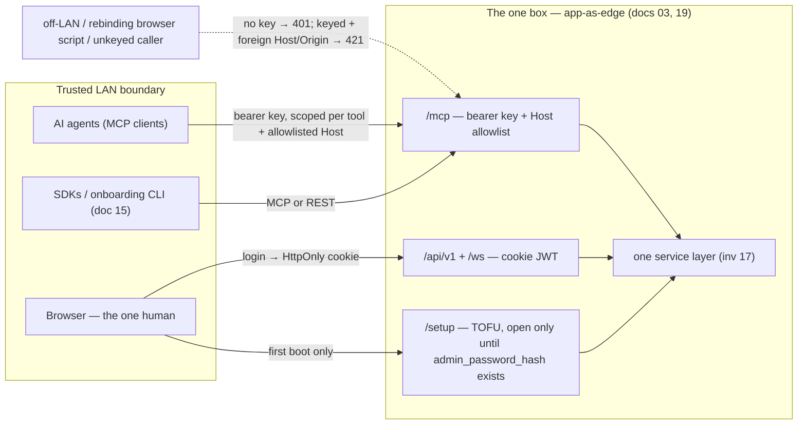
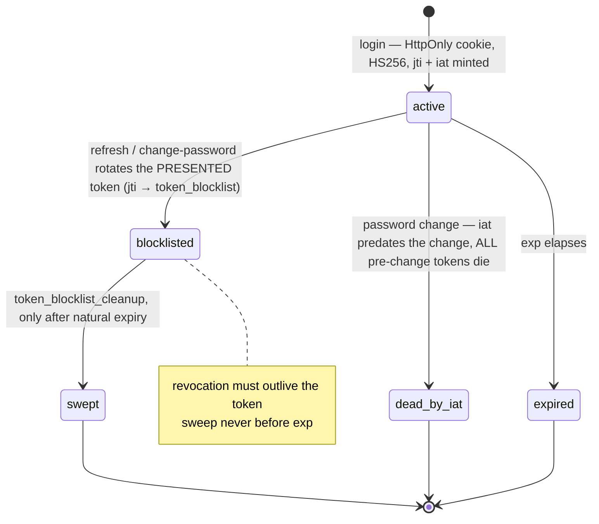
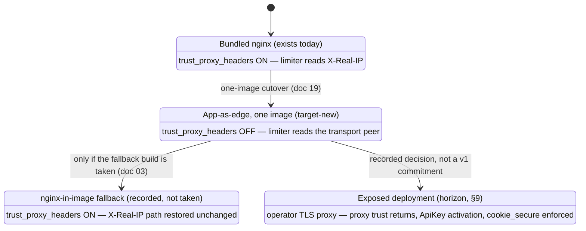
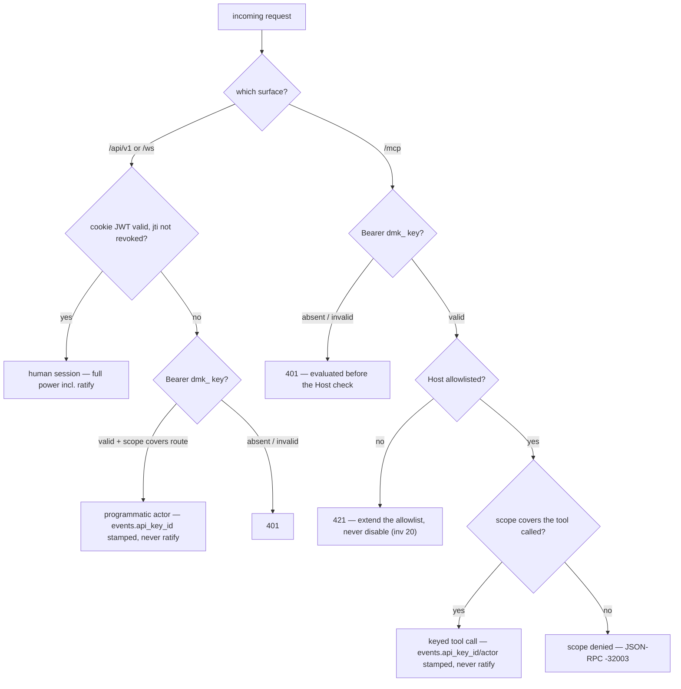
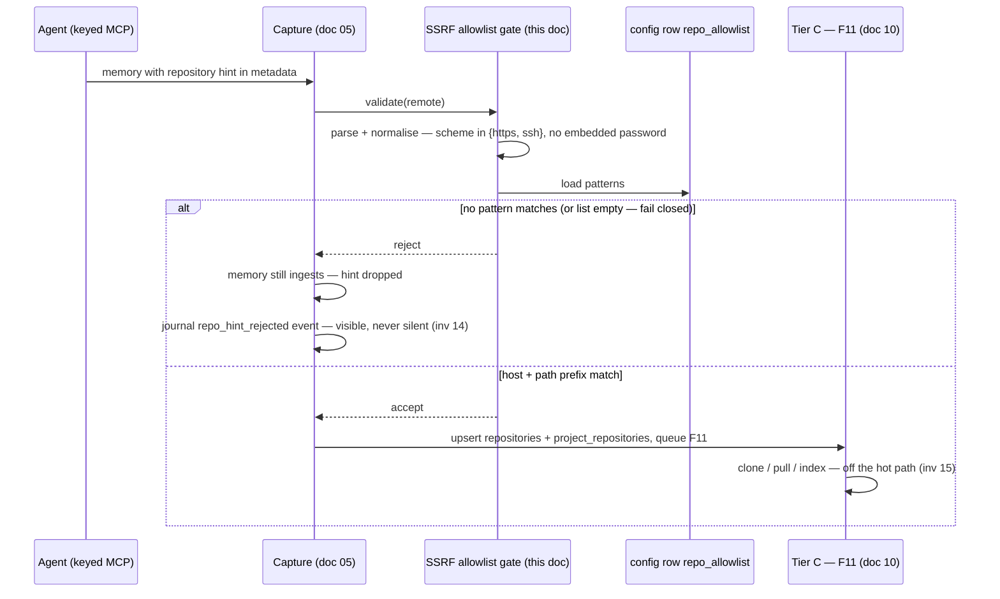
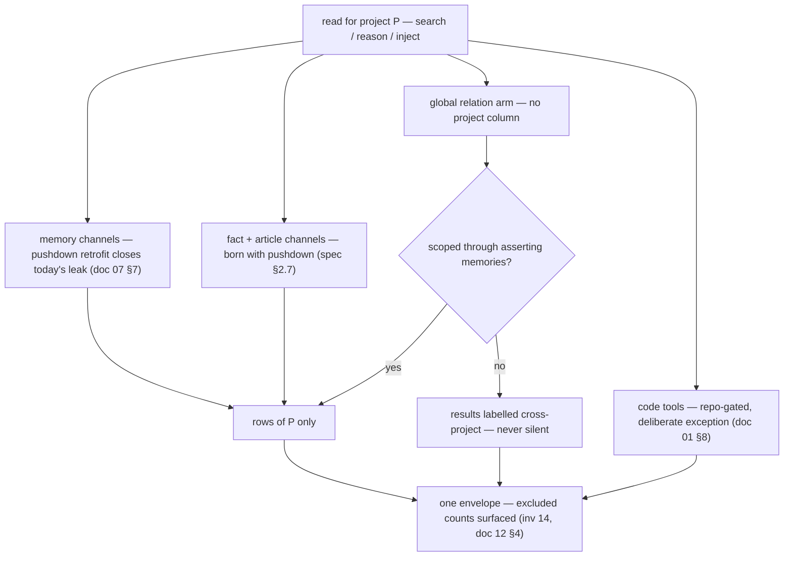

# 18 — Security, Auth & Trust

**Status:** convergence-tier doc (with 17/19/20); conforms to foundation docs 00–04, the 2026-07-24 knowledge-reshape spec (`docs/superpowers/specs/2026-07-24-knowledge-reshape-design.md`), and subsystem docs 05–16. Authored on the retained Python/FastAPI + Postgres/pgvector stack (doc 03 §4, Option A); .NET appears only as a considered-and-deferred alternative.

Every mechanism below is tagged **(exists today)**, **(target-new)**, **(activation)**, or **(horizon)** per doc 04 §1's honesty convention; a mechanism claimed as shipped that is only scaffolding fails review (invariant 23).

---

## 1. Purpose & scope

**This doc owns the trust model every other door consumes: who darkmem trusts, on which surface, with which defence — and where each hardening rung sits on the honesty timeline.** Concretely it fixes: the layered LAN trust model and its three postures (§2); human auth — TOFU setup, the cookie-JWT token lifecycle, and login rate limiting (§3); the app-as-edge trust flip that the one-image deployment forces on the rate-limiter's IP source (§4); the programmatic `ApiKey` path, designed here, gated to an activation, and **activated 2026-08-16** (§5); the auto-provision SSRF allowlist gate — the one enforcement this doc *designs* and every consumer merely points at (§6); repository trust on the local filesystem (§7); cross-project isolation as a security boundary and the enforcement rule behind it (§8); and the exposed-deployment posture, recorded as future decisions rather than v1 commitments (§9).

**What the neighbouring docs fix instead.** Doc 12 owns the *contract* behind this posture — the route inventory, which surfaces are single-door and why, the wire form of every payload, and the serialisation of the auth mechanics into §6 of its contract; this doc is the trust rationale doc 12's §6 mechanises, and the two must never drift. Doc 13 owns the rendering of the authenticated curation surfaces (ratification, review, dream undo) — the single human door through which `confirmed` power flows; this doc fixes *that* it is single-door, doc 12 fixes the routes, doc 13 the screens. Doc 15 consumes whatever credential this doc defines (the onboarding CLI writes it into a client config, never designs it) and inherits the rule that a `421` is fixed by extending the allowlist. Doc 05 owns the capture-side validate-and-enqueue hook that *calls* the §6 gate; doc 10 owns the auto-provision *execution* behind it; both consume the gate and neither designs it. Doc 07 owns the SQL pushdown *query mechanics* under §8's isolation rule — this doc owns the rule, never the query. Doc 04 owns the tables (`api_keys`, `token_blocklist`, `config`, `events`, `projects`, `project_repositories`). Doc 19 owns the deployment mechanics (one image, secrets, entrypoint) this doc sets the trust posture *for*, and doc 20 schedules the `(activation)`/`(horizon)` items named here.

**Audience & authority.** Anyone touching an auth dependency, a rate limiter, the MCP transport security, the repo-provisioning path, or a retrieval channel's scoping reads this to learn which behaviour is contract and which is target work. Where this doc and the as-is baseline (`CLAUDE.md`) agree, the behaviour is contract. The one sentence to hold in mind: **darkmem trusts its LAN, authenticates its human, attributes (but does not authenticate) its agents, and treats every hardening beyond that as a labelled, deliberate activation — never a silent default.**

**Scaffolding honesty up front (invariant 23).** The cookie-JWT door, TOFU setup, the Host allowlist, the token lifecycle, the local-path sandbox, and `git safe.directory` are **(exists today)**. The app-as-edge trust flip and the SSRF allowlist gate are **(target-new)**. Programmatic `ApiKey` bearer auth was a **named gap** and is now **(exists today)**: the activation designed in §5 landed with T4.01–T4.04 and T4.14–T4.21, so the table is wired, keyed calls stamp `events.api_key_id` / `actor`, and `last_used_at` has a writer. The tense moved rather than the design: nothing in §5 was amended, because §5 was written to be a wiring task and it was one. Remote-client auth beyond that, client-side E2EE, and encrypted device transfer are **(horizon)** recorded decisions (§9). Nothing here presents a dormant table as a capability.

---

## 2. The layered trust model — three postures inside one boundary

**Decision. darkmem's trust model is layered by transport surface, not by caller identity: an authenticated human door (REST/UI and `/ws`, cookie JWT), a bearer-keyed machine door (`/mcp`, a per-call API key checked ahead of the Host allowlist, which stays live as a second, independent guard beside it), and a trust-on-first-use bootstrap (`/setup`) — all inside a trusted-LAN boundary on one self-hosted box.** This is a foundation decision (doc 00 §7 principle 8, doc 02 §8) this doc mechanises. The rationale is the product's shape: darkmem is a single-human, many-agent system on a home network. The human owns state-changing curation power and authenticates once with a cookie; the agents need low-friction tool access dozens of times per session, which a per-call bearer key gives without the human door's login flow. **Corrected 2026-08-26 — this paragraph called uniform auth on every surface "Rejected" until doc 18 §5's second activation shipped exactly that for `/mcp`:** the original text read "uniform auth on every surface — it hardens nothing on a trusted LAN (the threat there is the browser, not the peer, and the browser is handled by the allowlist below) while taxing every agent interaction," as a rejected alternative. That stopped being an accurate description of the shipped system on 2026-08-26: every `/mcp` call now requires a bearer key, LAN or not. The distinction the original rejection was reaching for still holds, just not as "no auth at all" — a stateless per-call key check does not carry the onboarding cost a *session* would, which is why the reversal was affordable where the original framing assumed uniform auth could only mean forcing a login onto every agent. **Still rejected, unchanged by this correction:** per-agent identities for v1 — `source` / `X-Darkmem-Client` resolution (doc 12 §5) is **attribution, never authentication**, and pretending otherwise would be a false security claim; a bearer key identifies which *credential* called, never which agent behind a shared key did.

**Decision. The `/mcp` door requires a bearer API key on every call (doc 18 §5's second activation, 2026-08-26), and DNS-rebinding protection via the Host allowlist runs as a second, independent guard beside it, not instead of it — a LAN `421` is still fixed by extending the allowlist, never by disabling the protection (invariant 20).** Auth evaluates first: an unkeyed request gets `401` regardless of `Host`, and only a keyed request that then fails the Host check gets `421`. Localhost is always allowed; `MCP_ALLOWED_HOSTS` (comma-separated, `host:port` or `host:*`) adds LAN hosts; a foreign `Host` header gets `421`; browser `Origin`s are allowlisted to the same hosts (agents send none, browsers cannot forge theirs — which is exactly why Host/Origin checking still defeats the rebinding attack a LAN endpoint would otherwise be open to, independent of whether the caller also holds a bearer key). `*` disables the check entirely and is recorded as an explicit operator decision for a fully isolated network, never a troubleshooting step. The anti-pattern this invariant exists to forbid: an agent on a LAN host gets `421`, and someone "fixes" it by setting `*` instead of adding the host. Every consumer restates this rule (docs 12 §6, 15 §5); this doc owns it.

The trust zones and the three postures, at a glance:

*Caption: three postures, one service layer — the human authenticates with a session, the machine door authenticates with a per-call key while still attributing which agent is calling, the bootstrap is TOFU, and the only things that reach `/mcp` from outside the trust story are a `401` (no key) or a `421` (keyed, foreign Host).*

**The threat map this doc answers, each vector paired with its control and its honesty tag.** This table is the index into the rest of the doc:

| Threat | Vector | Control | Status |
|---|---|---|---|
| DNS rebinding against `/mcp` | hostile web page resolving its domain to the LAN box | Host allowlist + Origin allowlist, `421` (§2) | exists today |
| Login brute force | credential guessing at `/auth/login` | per-IP rate limit with lockout (§3) | exists today |
| Client-IP spoofing | forged leftmost `X-Forwarded-For` | `X-Real-IP` under a trusted proxy; transport peer under app-as-edge (§4) | exists today → flip |
| Token theft / replay | stolen or leaked cookie | HttpOnly cookie, `jti` blocklist rotation, `iat` mass-revocation (§3) | exists today |
| Setup takeover | a foreign party reaching `/setup` first | TOFU — `403` once `admin_password_hash` exists; LAN boundary bounds the window (§3) | exists today |
| SSRF / abuse via repo hint | caller-supplied remote URL cloned by the box | fail-closed allowlist gate (§6) | target-new |
| Local filesystem abuse | registering an arbitrary path as a repo | local-path sandbox + `safe.directory` (§7) | exists today |
| Forged ratification | a machine reaching `confirmed` | ratify/review are authenticated REST/UI single-door, never MCP (doc 12 §3) | target-new with the vault |
| Cross-project leakage | rows silently crossing project scope | SQL pushdown + the scope-or-label rule (§8) | target-new, closes a live gap |
| Exposed-endpoint abuse | darkmem reachable off-LAN | `ApiKey` activation (§5) + operator TLS proxy (§9) | exists today (both doors keyed) / horizon (TLS proxy) |

---

## 3. Human auth — TOFU setup, the token lifecycle, login rate limiting

**Decision. Setup is trust-on-first-use: `/api/v1/setup/*` is gated only by `require_uninitialized`, which `403`s once the `admin_password_hash` config row exists; `SETUP_SECRET` does not exist and must not be reintroduced (invariant 21, exists today).** The first party to complete the wizard on a fresh box owns it; every later attempt is refused. **Rejected:** a pre-shared setup secret — it was removed deliberately, because on a single-human LAN box the secret-distribution problem (where does the secret live before the box has an owner?) is strictly worse than the TOFU race it would close, and the race window is bounded by the LAN boundary plus the minutes between first boot and the wizard. TOFU is also what makes doc 15's one-command onboarding possible without provisioning anything out of band. The wizard's finalize journals a `setup_completed` `events` row (target-new; convention 8) so the box's birth is on the timeline.

**Decision. The token lifecycle keeps its live shape: an HttpOnly HS256 cookie carrying a `jti` and `iat`; refresh and change-password rotate by blocklisting the presented token; a password change revokes every pre-change token via the `iat` check; and `cookie_secure` is tri-state (exists today).** The blocklist (`token_blocklist`, doc 04 §7) is checked on every authenticated request and swept by the `token_blocklist_cleanup` job once rows pass their natural expiry — revocation must outlive the token, never the reverse. The `iat` check is the mass-revocation lever: rather than enumerating a user's tokens (the server never stores them), a password change records its timestamp and any token minted before it is dead on arrival. `cookie_secure` unset means Secure-only when `environment=production`; explicit `false` permits login over plain-HTTP LAN — an honest accommodation of the no-TLS home deployment, recorded rather than hidden, and it flips back to enforced-Secure the moment an exposed deployment puts TLS in front (§9). `/ws` authenticates the same cookie and rejects a missing/invalid/revoked token with close code `1008` before joining the broadcast set (doc 12 §6).

One token's life, from mint to one of three deaths:

*Caption: three exits — rotation (blocklist), mass revocation (`iat`), and expiry — with the cleanup job reaping blocklist rows only after they could no longer matter.*

**Decision. Login rate limiting is per-IP with lockout, and its client-IP source is a posture-dependent strategy — never the spoofable leftmost `X-Forwarded-For` (exists today; the source flips in §4).** Under the bundled-nginx posture the limiter reads `X-Real-IP`, which nginx sets to the direct transport peer; a forged `X-Forwarded-For` from the client is ignored because the trusted proxy's own header wins. The thresholds (attempt count, lockout window) land as `config` rows rather than constants (**target-new**; convention 9); their tuning path is observational, not harness-scored — lockout events journal to `events` (`auth_lockout`, target-new), and the operator loosens or tightens against the observed false-lockout rate on doc 13's activity surface. Failed logins and lockouts journaling to `events` also gives the timeline an answer to "who hammered the door and when" that today's transient logs lose.

---

## 4. The app-as-edge trust flip — transport-peer rate limiting, both states recorded

**Decision. In the target one-image build the app is the edge, `trust_proxy_headers` flips off, and the login rate-limiter reads the transport peer (`request.client.host`) directly; the requirement this doc fixes is a no-proxy rate-limiter code path — the IP source is a strategy selected by `trust_proxy_headers`, and both strategies are kept, tested, and honest (target-new; doc 02 §8, doc 03 §3.2).** The one-image deployment (invariant 22, doc 19) removes the nginx hop that set `X-Real-IP`; with no trusted proxy in front, *any* proxy header is attacker-writable, so trusting one would turn the rate limiter into an attacker-keyed bucket (spoof a new "IP" per attempt and the lockout never fires). Reading the socket peer restores the property: with the app as the edge, the transport peer *is* the client (or the LAN NAT), and there is nothing upstream to spoof. The change is where the truth comes from — a header under a trusted proxy, the socket under app-as-edge — not what the limiter does.

**Both states are recorded honestly, because the fallback build restores the old one unchanged.** If the nginx-in-image fallback (doc 03's sub-decision (b)) is ever taken, `trust_proxy_headers` returns **on** and the `X-Real-IP` path is restored exactly as it runs today — which is why the header path is kept as live, tested code rather than deleted at the flip. And in the exposed-deployment horizon (§9), an operator TLS proxy in front again means the header path returns with `trust_proxy_headers` on. The rule that survives every posture: **the leftmost `X-Forwarded-For` is never read** — under a trusted proxy the proxy's own header (`X-Real-IP`, or the rightmost XFF hop the trusted proxy appended) wins; with no proxy the socket wins; the client-writable end of XFF never does.

The deployment postures and the rate-limiter's IP source in each — a state machine, not a one-way door:

*Caption: `trust_proxy_headers` selects the IP-source strategy per posture; both code paths stay live so a posture change is a config flip, never a rewrite — and the leftmost XFF is trusted in none of them.*

---

## 5. Programmatic auth — the `ApiKey` activation, in two steps

**Decision. Programmatic bearer auth is designed here and shipped in two activations, not one. The first fired on 2026-08-16: the `api_keys` table came up wired, gating the push-webhook receiver (doc 10 §5) and REST's three memory doors, with every keyed call stamping `events.api_key_id` and `events.actor` (invariant 23; doc 02 §11, doc 04 §9, doc 12 §9). The second fired on 2026-08-26 (this epic): every `/mcp` tool call now requires the same bearer credential, scoped per tool rather than per door — `capture` on the 13 memory/document writer tools, `read` on 25 readers, and, since the file-scoped reindex door landed on 2026-08-28, `admin` on `code_reindex` (doc 12 §6).** Both were wiring tasks against a design fixed before either landed, which is why neither invented a second credential shape. **`ratify` is untouched by both activations and stays outside the scope vocabulary** — a key is a machine credential on either door, and the machine never ratifies, keyed or not.

The hardening path, as designed and now shipped on both doors:

- **Credential shape.** A key is `dmk_<key_id>_<secret>`; the server stores the `key_id`, a hash of the secret (bcrypt, same primitive as the password path), a **scope set**, an optional expiry, and `last_used_at`. The raw secret is shown once at creation and never stored. The schema change at activation is at most adding columns to the existing `api_keys` table, never a new table (doc 04 §9).
- **Wire form.** `Authorization: Bearer dmk_…` on REST, and — since the second activation, unconditionally — on `/mcp` (the streamable-HTTP transport carries headers per call, so the bearer requirement composes with the stateless server exactly as `X-Darkmem-Client` does). There is no flag that turns the `/mcp` requirement back off. **The Host allowlist stays on beside bearer auth, not instead of it** — defence in depth, and the `421` rule of §2 is unchanged, except that auth now evaluates first: an unkeyed request gets `401` regardless of `Host`, and only a keyed request that also fails the Host check gets `421`.
- **Scopes are a closed vocabulary, taxonomy-first (invariant 5's discipline applied to auth):** `capture` (write memories), `read` (search/vault/code reads), `admin` (config, jobs, repos). **`ratify` is deliberately not a scope and never becomes one:** `confirmed` power remains a human cookie session on the REST/UI door only (doc 12 §3, doc 13 §5). On `/mcp`, scopes do not imply one another — of the 47 tools, 15 require `capture`, 29 require `read`, and three require `admin`: `code_reindex`, the file-scoped reindex door added 2026-08-28, which is grouped with the webhook because triggering an index spends the embedder and runs `reset --hard` on a clone; and `document_delete_subtree`, the subtree delete added 2026-09-07, which erases every document under a named `(project, uri_prefix)` and is the first `admin` tool that destroys **database rows** rather than rebuilding a derived artefact; and `worklog_purge`, the work log's purge added 2026-09-23, which erases one workstream with all its entries, journals `workstream_purged` first, and has no undo. (`code_reindex` is not harmless — its `reset --hard` discards uncommitted work in the clone directory, per `docs/runbook-exposed-deployment.md` — but it writes no row away.) It is a separate tool rather than a mode on the capture-scoped `document_delete` **because scope is per tool** — a mode would have inherited `capture` and put a whole-corpus erase behind every capture key. This paragraph read "a key holding only `admin` reaches no MCP tool at all" until the first of those doors landed, and "exactly one requires `admin`" until the second did; `docs/runbook-exposed-deployment.md` carries the rotation posture the three now warrant. **What the `admin` grouping does not change is the mint boundary**: no MCP tool creates or lists a credential, so an `admin` key still cannot mint its own successor and outlive its revocation. `tools/list` is deliberately **not** scope-filtered: any authenticated key sees the full tool catalogue, including tools it cannot invoke.
- **Journaling (convention 8).** Every keyed call stamps `events.api_key_id` and `events.actor` on both doors — the moment each activation landed is the moment those two dormant columns (doc 04 §8.1) started carrying a value for that door. Key creation, revocation, and expiry journal as their own `events` rows; doc 13's settings surface lists keys with `last_used_at` so a stale key is visible before it is a liability.
- **Management surface.** Key CRUD is an authenticated REST/UI surface (single-door, same reasoning as ratification: a credential mint is confirmed-grade power).

**What triggered the first activation:** the repo push-webhook receiver (docs 10/15) needed exactly this auth to land, and the three memory doors rode the same wiring pass. **Rejected then and still rejected:** OAuth/OIDC — a single-human self-hosted box has no delegation problem and no identity provider, and the machinery would dwarf the asset; mTLS — real security, unreasonable operational burden for the audience.

Auth resolution across the two doors, both activations live:

*Caption: no rung on either door reaches ratification except the human cookie session; `/mcp`'s bearer check now runs ahead of its Host check, so an unkeyed foreign-Host caller sees `401`, not `421`.*

---

## 6. The auto-provision SSRF allowlist gate — the enforcement this doc designs

**Decision. A repository hint from captured memory metadata is validated against a fail-closed allowlist `config` row before anything is registered, cloned, or indexed: the allowlist is a list of scheme-and-host(-and-path-prefix) patterns, an empty or absent list rejects every hint (auto-provision is inert until the operator opts in), and a rejected hint never blocks the memory — it is dropped with a journaled event, never silently (target-new; doc 01 F11/§9, doc 04 §7, doc 05 §2.4, doc 10 §5).** This is the one enforcement mechanism this doc designs rather than merely postures: docs 05 (capture calls the gate), 10 (Tier C executes past it), and 15 (points at it) all consume it, and none may re-implement or relax it. The threat is concrete: a hint is caller-supplied text arriving over the machine-facing MCP door (unauthenticated until 2026-08-26; a bearer key now authenticates the *caller* but says nothing about the *hint*, so the allowlist is unchanged and still the only enforcement), and `git clone` of an arbitrary URL makes the box issue requests wherever the caller says — internal HTTP services, cloud metadata endpoints, or simply unbounded clones of hostile repos. Auto-provision is a convenience feature; a convenience feature never gets default-open network reach.

The gate's rules, in evaluation order:

1. **Parse and normalise.** The hint must parse as a remote URL. Accepted schemes: `https` and `ssh` (including the scp-like `git@host:path` form, normalised to `ssh://`). `http`, `git://`, `file://`, and anything else are rejected outright — cleartext and local-file schemes have no legitimate auto-provision use. A URL embedding a password is rejected (credentials never ride memory metadata).
2. **Match the allowlist.** The `config` row (key `repo_allowlist`, jsonb list — doc 04 §7 already homes it) holds patterns of the form `host` or `*.host`, optionally with a path prefix (`github.com/darkraise/*` allowlists an org, not a forge). The normalised hint must match at least one pattern on host *and* prefix.
3. **Fail closed.** No match — including the empty/absent list — rejects. **Rejected alternative:** default-open with a blocklist of private address ranges. Blocklists rot, and an IP-range check at validation time is defeated by DNS rebinding at *clone* time (validate `evil.example` while it resolves publicly, clone while it resolves to `169.254.169.254`). A hostname allowlist sidesteps the resolution game entirely: the operator names the hosts they trust, and no DNS answer changes what was named. For the same reason the gate does **no DNS-based checking at all** — a literal-IP host is simply a pattern the operator may (but should not) list.
4. **Reject visibly, never fatally.** A rejected hint does not fail the capture — the memory ingests normally (attribution and recall must not hinge on a provisioning convenience) — but the rejection journals a `repo_hint_rejected` `events` row carrying the offending remote and the matched-nothing verdict, and surfaces on doc 13's activity feed (invariant 14: nothing is silently dropped, including a refusal).
5. **Scope of the gate.** The gate binds the *unauthenticated auto-provision path only*. An authenticated human registering a repository through REST/UI is exercising owner authority: a remote-URL registration skips the allowlist entirely, and a local-path registration still passes the local-path sandbox (§7) — either way it lands in the same `repositories`/`project_repositories` rows. The per-project escape hatch is `project_repositories.opt_out` (doc 04 §8.7); the global kill is clearing the allowlist, which is also the shipped default — no separate feature flag, one authority (convention: one gate, one config row).

The gate in sequence — capture validates, Tier C executes, and the reject path is loud:

*Caption: the clone never happens on the capture path, and it never happens at all unless the operator named the host — the default posture is inert.*

---

## 7. Repository trust on the local filesystem — sandbox + `safe.directory`

**Decision. Local-path repository registration is sandboxed to configured roots, and registration runs `git config --global --add safe.directory <path>` so the first periodic fetch does not die on git's dubious-ownership check (exists today).** The sandbox rejects paths outside the allowed registration roots (and the traversal tricks that would escape them) — without it, "register a repo" is "make the box read an arbitrary directory," which is the filesystem sibling of §6's network problem. The `safe.directory` addition exists because inside the container the repo volume's owner rarely matches the process user, and git ≥2.35 refuses to operate on such a tree; adding the specific registered path (never `*`) at registration time keeps the periodic `repo_sync` job working while conceding nothing broader. The sandbox binds the *local-path* registration path specifically — §6 rule 1 rejects `file://` and every non-remote scheme, so no caller-supplied local path ever reaches auto-provision (its clone destination is system-chosen) — while `safe.directory` is the mechanism shared by both the human-registration and the auto-provision paths. The sandbox is about what the box may touch, not who asked.

---

## 8. Cross-project isolation as a security boundary

**Decision. No retrieval, reasoning, or inject channel crosses a project boundary silently: every channel either scopes by project in its generating SQL or labels its results as cross-project with the exclusion surfaced as a count — and every *new* channel is born with the pushdown, so the rule is structural, not reviewed-in (exists today in intent, target-new in enforcement; invariant 14, doc 02 §9, doc 07 §7).** This doc owns the enforcement rule; doc 07 owns the queries under it. The honest state today: isolation holds only on channels that supply a project filter (over-fetch-and-drop in Python, at a recall cost), and the genuine leak is the unfiltered channels — `memory_reason` chief among them — where cross-project and superseded rows reach the LLM context. The SQL filter pushdown (doc 07 §7) is the named blocking prerequisite that closes both, and the vault channels (facts, articles) are **born with pushdown** so they never inherit the retrofit gap (spec §2.7). The rule this doc adds on top, binding every future channel: **a channel that cannot push a project predicate into its SQL must scope through the objects that can, or label its output — a silent cross-project row is a review-blocking defect, not a tuning issue.** The one live instance of the scope-or-label branch is doc 07's global relation arm (`entity_relations` has no project column; candidates resolve through asserting memories' project or the results carry the label).

**Two deliberate, recorded exceptions bound the rule rather than weaken it.** The **code tool family is repo-gated, not project-gated** (doc 01 §8): the code graph is repo-scoped and shared across the projects that own a repo, so project isolation deliberately does not partition it — recorded so nobody "fixes" it into a leak report. And **isolation today is a correctness-and-hygiene boundary within one trusted human's box, not a tenancy ACL**: every project belongs to the same owner, and any keyed MCP caller can name any project — the 2026-08-26 bearer requirement authenticates the caller, it does not partition projects. Making `project` a *tenancy* unit — per-tenant ACLs on every channel, the `UNIQUE(name, entity_type, project)` entity rewrite, per-tenant dedup and delete — is the staged later phase doc 04 §13 records, and this doc confirms the staging: **(horizon)**, entered only if darkmem ever serves more than one principal, with the pushdown machinery of this section as its prerequisite substrate.

The boundary per channel — pushed down, born scoped, scope-or-label, or a recorded exception:

*Caption: every path to the response envelope is scoped, labelled, or a recorded exception — the forbidden fourth state, a silent cross-project row, has no edge into the diagram.*

---

## 9. Exposed-deployment posture — recorded decisions, not commitments

**Decision. Everything beyond the LAN is a recorded future posture, not a v1 commitment: an exposed deployment layers an operator TLS proxy (proxy trust returns per §4, `cookie_secure` enforced), requires the §5 `ApiKey` activation for programmatic callers, and keeps every LAN rule (Host allowlist, TOFU-then-403, single-door ratification) unchanged underneath (horizon; doc 01 §9, doc 02 §11).** Recording the posture now costs nothing and prevents the failure mode where exposure is improvised: the pieces are already positional — the header-trust code path is kept live (§4), the key design is fixed (§5), and the tri-state `cookie_secure` collapses to enforced the moment TLS exists. Three further items are **recorded decisions, explicitly not commitments**, and doc 20 does not schedule them: **remote-client auth beyond the API key** (per-user identity — meaningless until darkmem has more than one principal, see §8's tenancy horizon); **client-side E2EE** (server-side search over encrypted content is a product-redefining constraint, not a hardening step — deciding it casually would be dishonest); and **encrypted device transfer** (backup/restore mechanics are doc 19's; encrypting them in motion is deferred with it). Naming these as horizon items is the honesty convention applied to security: an unbuilt defence claimed early is worse than a named gap.

---

## 10. Invariants restated

The catalogue invariants (`gt-invariants.md`, doc 04 §11) that bind this layer, in this doc's own terms:

- **MCP Host-allowlist trust model (inv. 20).** `/mcp` requires a bearer API key on every call (§5's second activation, 2026-08-26); the Host allowlist (plus mirrored browser-Origin allowlisting) runs beside it as a second, independent network defence, not the sole one — a foreign Host is `421`, fixed by extending the allowlist, never by disabling protection; `*` is an explicit operator decision, not a fix (§2). The allowlist was designed from the start to *stay on* under the bearer (§5), and now does.
- **Trust-on-first-use, no pre-shared secret (inv. 21).** Setup is gated only by `require_uninitialized`; `SETUP_SECRET` is gone and must not return; the first owner claims the box, everyone later gets `403` (§3).
- **Honest partial results / no silent degradation (inv. 14).** A rejected repo hint journals and surfaces, never silently vanishes (§6); no channel crosses a project boundary silently — scope, or label with a surfaced count (§8); the rate-limiter's lockouts journal to `events` (§3).
- **Scaffolding-not-substrate (inv. 23).** `api_keys` was a named gap with a fixed design and an activation gate, and is now wired (§5) — the invariant's discipline held in **both** directions here, which is the part worth recording: when the activation landed, the settings card went on claiming the path was dormant for three landings, and an honesty surface that has gone stale under-claims a shipped capability exactly as a premature one over-claims an unshipped one (T4.04); the SSRF gate and the trust flip are target-new and labelled; E2EE and remote-client auth are horizon recordings (§9).
- **Two front doors, one service layer (inv. 17).** The trust posture differs per door, the service layer does not; the sanctioned single-door surfaces (ratify/review writes, key management, events reads) each carry a recorded trust reason, fixed jointly with doc 12 (§2, §5).
- **Config-as-rows (inv. 19).** The repo allowlist, the rate-limit thresholds, and any future auth knob land as `config` rows changeable from the UI without redeploy — never env-var security policy — with the single grandfathered exception of `MCP_ALLOWED_HOSTS`, a deployment-boundary setting like the two secrets rather than a runtime-tunable policy (§2, §3, §6); the two deployment secrets (`DB_PASSWORD`, `JWT_SECRET`) are doc 19's and stay the only env secrets.
- **Reconciliation off the hot path (inv. 15).** The gate validates on capture; the clone, pull, and index it admits run only in Tier C (§6).
- **Closed vocabularies, taxonomy-first (inv. 5, applied to auth).** Key scopes and the security `event_type`s (`setup_completed`, `auth_lockout`, `repo_hint_rejected`, key lifecycle) are closed sets extended taxonomy-first, before any emitter ships (§3, §5, §6) — each added to doc 04 §8.1's `event_type` vocabulary, with `repo_hint_rejected` carrying `object_type='repository'` and `setup_completed`/`auth_lockout` a target-new `object_type='system'` for box-level and session events that name no domain object.
- **Single worker (inv. 13).** The rate-limiter's in-process buckets and lockout state are valid because there is exactly one app process; a multi-replica future would have to serialise them, recorded not assumed.

---

## 11. Open questions & deferred decisions

Each carries a recommended stance, so downstream inherits a default rather than a blank.

- **The `ApiKey` activation trigger and scope granularity.** *Stance: activate on the first genuine off-LAN need — an exposed deployment or the push-webhook receiver (docs 10/15) — whichever comes first, and start with the three coarse scopes (`capture`, `read`, `admin`); finer per-project key scoping joins the §8 tenancy horizon, not v1 of the activation. `ratify` never becomes a scope under any refinement.* Doc 20 places the activation on the roadmap; doc 12 §9 already defers to this stance.
- **Whether MCP-bearer rides the first activation or a later flip.** *Stance: ship the REST bearer first (the webhook and SDK cases need only REST); the MCP-bearer option is a second, independent config flip for deployments whose MCP surface itself leaves the LAN — rare, and the Host allowlist plus network boundary covers the common case.* Two flips keep the LAN default untouched by the first activation.
- **Allowlist pattern expressiveness.** *Stance: hosts with optional `*.` subdomain wildcard and optional path prefix, nothing more — no regex (unauditable), no IP-range syntax (invites the blocklist anti-pattern §6 rejected). If a deployment genuinely needs a private forge, the operator lists its hostname explicitly.*
- **Rate-limit threshold tuning.** *Stance: keep today's defaults as the seeded `config` rows and tune observationally against journaled `auth_lockout` events (§3); this is the one tunable family in the corpus whose measurement protocol is operational telemetry rather than doc 17's scored harness — recorded here so convention 9's "stated tuning path" is satisfied honestly rather than by inventing a fake benchmark.*
- **The legacy `audit_log` → `events` transform at the homelab cutover — shared with doc 19.** *Stance: the greenfield baseline has no `audit_log`; security events are born on `events`. A one-time transform of legacy rows is a migration convenience taken only if the mapping is trivial (doc 04 §12, doc 12 §9); doc 19 owns the cutover mechanics.*
- **Multi-principal tenancy (per-tenant ACLs, the entities tenancy-key rewrite).** *Stance: horizon, explicitly re-deferred (§8, doc 04 §13). The pushdown enforcement of §8 is the prerequisite substrate; no ACL work starts before darkmem has a second principal to isolate.*
- **Exposed-deployment extras (per-user auth, E2EE, encrypted transfer).** *Stance: recorded decisions, not commitments (§9); none scheduled by doc 20. E2EE in particular must be decided as a product question (it constrains server-side search), never slipped in as hardening.*

---

*Downstream: doc 12 mechanises this posture as contract — its §6 auth mechanics, its §3 single-door ratification, and its §9 `ApiKey` deferral must match this doc word for word, and its payload envelope carries §8's surfaced exclusion counts. Doc 13 renders the authenticated curation surfaces (ratify, review, key management at activation) and the security events (`auth_lockout`, `repo_hint_rejected`, `setup_completed`) on the activity/timeline surfaces. Doc 15's onboarding CLI reports a `421` as "extend the allowlist" and writes whatever credential §5's activation defines, designing none of it. Doc 05 calls the §6 gate at capture; doc 10 executes auto-provision only past it and inherits §7's sandbox and `safe.directory`; their shared push-webhook stays gated on §5's activation. Doc 07 implements the pushdown queries under §8's scope-or-label rule. Doc 04 holds the tables (`api_keys`, `token_blocklist`, `config`, `events`) whose dormant columns §5's activation finally populates. Doc 19 realises the deployment postures of §4 and carries the cutover conveniences of §11; doc 20 schedules the `(activation)` and `(horizon)` items on the honesty-tag timeline. The trust model, the flip, the gate, the isolation rule, and the activation design fixed here are binding for all of them.*
