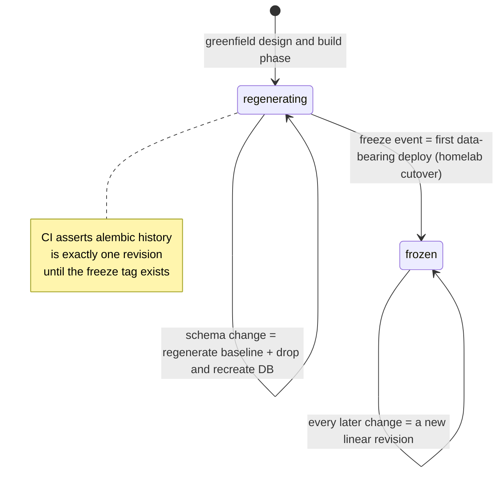
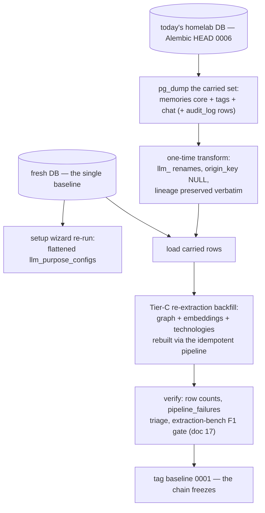
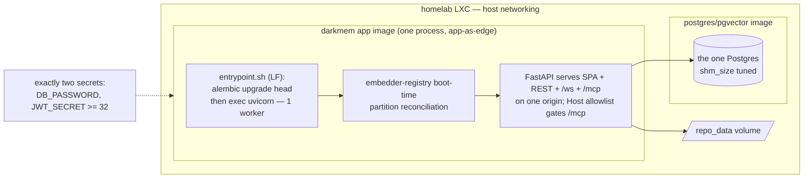
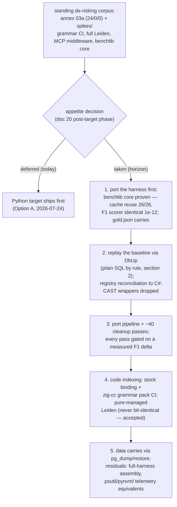

# 19 — Migration, Deployment & Ops

**Status:** convergence-tier doc (with docs 17, 18, 20); conforms to foundation docs 00–04, the 2026-07-24 knowledge-reshape spec, and the wave-1–3 subsystem docs. Draft 2026-07-24. This doc owns **how the greenfield schema is born, how the one artifact is deployed and operated, and how a future stack replays all of it** — it honours the promises docs 03/03a, 04, 11, 17, and 18 made to it and re-opens none of them.

---

## 1. Purpose & scope

**This doc fixes the birth, deployment, and operation of the target system: the single-baseline migration discipline and its freeze event, the permanent boot-time partition reconciliation, the SQL-first replayability rule, the disposition of every dormant and dropped object, the homelab cutover (what data carries, what is rebuilt, what is simply re-run), the one-image deployment artifact and its exactly-two-secrets contract, the ops surface (health, jobs, backup/restore), and the deferred .NET migration as a recorded horizon with its standing de-risking corpus.** It is the doc that makes doc 04's schema *land* and keeps it landable twice — once now on the retained Python stack, and once, mechanically, in the deferred port.

**What the neighbouring docs own instead — point, never re-spec.** Doc 04 owns every table, column, constraint, and index this doc's baseline creates, and §12 there already fixes the sequencing rules (taxonomy-first, freeze-by-event, boot-time reconciliation) that this doc operationalises. Doc 11 owns the flattened LLM purpose model (`llm_purpose_configs` inline rows, `classifier_kind`, no `*_ref` indirection); this doc owns only the *cutover mechanics* doc 11 §9.4 hands here. Doc 18 owns the auth and trust posture — TOFU setup, the Host allowlist, the app-as-edge `trust_proxy_headers` flip, the dormant `ApiKey` activation; this doc deploys that posture and never redefines it. Doc 03 §3.2 settled the edge-absorption sub-decision (app-as-edge, nginx-in-image as a labelled fallback); this doc inherits the settlement. Doc 17 owns the harness and its gold data; this doc's job is to guarantee the gold carries across a stack port unchanged. Doc 20 sequences everything here as roadmap phases — including the deferred .NET migration as a post-target phase — and this doc hands it the phase boundaries, not the order. Annex 03a and the `spikes/` directory are the standing record of the .NET de-risking; this doc cites them and does not re-litigate the 2026-07-24 Option A decision.

**Audience and authority.** Written for the maintainer-operator of a single self-hosted homelab instance and for the future engineer executing the deferred port. Where this doc and doc 04 §12 overlap, they agree; where they would conflict, doc 04's table shapes win and this doc's operational sequencing wins.

## 2. Schema birth — the single baseline, the boot-time reconciliation, and the SQL-first rule

**Decision. The greenfield schema ships as ONE Alembic migration file — a single baseline revision — regenerated freely (paired with drop/recreate) until the first deploy whose data must survive, at which event it is tagged `0001` and frozen; every change after the freeze is a new linear revision forever (target-new; doc 04 §12).** The freeze trigger is an *event*, not a date: the homelab production cutover (§4) is the first deploy where data outlives the schema, so it is the freeze. Until then, a schema change means regenerating the baseline and dropping/recreating the database — cheap, honest, and it keeps the migration history meaningful instead of accreting design-phase churn. A CI assertion holds `alembic history` at exactly one revision until the freeze tag exists, so nobody can quietly start a chain early. This replaces the brownfield HEAD-`0006` linear chain the reference implementation carries today (exists today); the brownfield chain collapses into the baseline and does not carry forward. **Rejected:** carrying the existing `0001–0006` chain into the greenfield — it would preserve six revisions of brownfield history (including the regex-classifier columns added and dropped again) that no greenfield deploy will ever traverse, for zero benefit; and freezing by calendar date — a date invites freezing a baseline nothing has validated against real data.

*The baseline lifecycle: one revision until the freeze event, a linear chain forever after.*

**Decision. The per-fingerprint partition DDL is a permanent boot-time reconciliation in the embedder registry, not a migration and not a one-time sweep (target-new; doc 04 §5.3/§12).** At every startup the registry iterates the live `embedders` rows and runs each `_TABLE_TEMPLATES` entry's `CREATE TABLE IF NOT EXISTS` plus each `_AUX_INDEXES` entry's `CREATE INDEX IF NOT EXISTS`, idempotently, for every registered fingerprint. This is what dissolves the sweep-versus-baseline coexistence problem: adding a new partition family (the four target parents of doc 04 §5.3 — `block_embeddings`, `relation_embeddings`, `article_embeddings`, and the template-only `triple_embeddings`) is a template edit, and every existing deployment gains the new parent for its current fingerprint at next boot with no re-register and no migration. It also self-heals drift — a restored dump missing a child table regrows it at boot (§6) — and it replays mechanically in the deferred .NET port, because the reconciliation is a loop over rows running parameterised plain-SQL DDL (§7). The registry remains the register-before-insert authority and the sole namer via `child_table(parent, fingerprint)`; nothing here weakens invariant 2. **Rejected:** expressing the child tables as static migrations — the DDL is runtime-parameterised by fingerprint, which no static migration can express (doc 03 §5.4 records the same rejection for EF Migrations on the .NET side).

**Decision. Every table, constraint, index, trigger, and the reconciliation's own DDL stays expressible as plain SQL — no ORM-only construct is load-bearing anywhere in the schema (target-new rule, enforced from the baseline onward).** This is a *sequencing constraint, not a preference* (doc 04 §12): the deferred .NET migration replays this exact baseline through **DbUp**, the SQL-first analogue of Alembic (annex 03a matrix rows 5/9), and the reconciliation moves into the registry's C# equivalent — so a replay is a mechanical transcription of SQL files, never a re-derivation of behaviour from ORM metadata. Concretely: the FTS trigger, the `touch_updated_at` bump trigger, the `events` forbid-triggers (three — doc 04 §8.1) and its monthly `RANGE(created_at)` partitioning, the partial and composite indexes, the `chk_superseded_has_pointer` CHECK, and the one native enum are all authored as SQL in the baseline; SQLAlchemy models mirror the SQL, not the reverse. **Three trigger kinds, not two.** `touch_updated_at` is the direct consequence of this rule rather than an exception to it: SQLAlchemy's `onupdate` is client-side, so a raw-SQL `UPDATE` left `updated_at` stale and the bump was a load-bearing ORM-only construct until the baseline gave it a SQL home (a `BEFORE UPDATE` trigger on every table carrying the column — `memories`, `conversations`, `repositories`, `documents`). A schema change that only an ORM construct can express is rejected at review as a portability regression. The asyncpg `CAST` discipline (invariant 10) stays in the repository layer and is explicitly *not* enshrined in the schema — 03a §3 records it as a driver quirk that Npgsql eliminates, so the SQL itself must not depend on it.

## 3. Dormant-object disposition — reviewed, frozen, inert

**Decision. Every dormant, inert, or dropped object has an explicit disposition in the baseline, stated here once so no reader mistakes scaffolding for substrate (invariant 23).** The baseline is honest by construction: what lands inert lands *reviewed and frozen* with nothing writing to it, so the risky logic is tested while it is riskless and its writer ships later against an unchanged contract.

| Object | Disposition in the baseline | Tag | Writer / activator |
|---|---|---|---|
| `entities.repo_ids[]` + `entity_relations.repo_ids[]` | land **inert** (empty arrays); both orphan sweeps carry the amended `NOT EXISTS (live repo)` predicate, vacuously true, byte-identical behaviour (doc 04 §4.2) | (target-new, inert) | the code deriver, doc 10 — ships after Layer 2 is live |
| `documents`, `blocks`, `block_embeddings__<slug>` template | land in the baseline reviewed-and-frozen; nothing writes them (doc 04 §8.5, doc 16 §1) | (target-new, inert / horizon) | the PKM pipeline, doc 16 (horizon) |
| `triple_embeddings__<slug>` | **template ships, writer deferred** behind a measured `pg_trgm`-on-`fact` undercount; when it ships it groups facts for counting only — never merges rows or rewrites `triple_key`, and carries the `names_distinct` guard (doc 04 §5.3, doc 17) | (target-new, template only) | doc 08's contradiction candidate generator, gated by doc 17's miss-rate bar |
| `api_keys` | exists, **unwired** — a named gap, not a shipped feature; wiring is a doc 18 activation, at most adding columns; at activation, key use journals to `events` | (activation) | doc 18 |
| `memories.importance` | exists, populated, unread — activated **by read** behind a `w_*` flag defaulting to 0 (doc 04 §9, doc 07) | (activation) | doc 07 ranking arms |
| `enrichment_queue` | **dormant, droppable** — zero code references; the live backlog is the `code_symbols.enrichment_status` partial index; dropped from the baseline — doc 04 §12 calls it "droppable once confirmed unreferenced", zero references is confirmed and doc 04 §7's operations-table set already omits it, so the greenfield resolves "droppable" to "never created" | (dropped) | — |
| `audit_log` | **dropped outright** — `events` is the sole audit substrate from day one (doc 04 §7/§8.1); an optional legacy-row transform at cutover, §4 | (dropped) | — |
| `llm_profiles`, `ml_profiles` + every `*_ref` | **never exist** in the baseline — the flattening (doc 04 §7, doc 11) is greenfield, not a transform | (dropped) | — |
| `llm_providers` | **AMENDED 2026-08-20 — reinstated.** This row read "never exist ... the flattening is greenfield" alongside the other two, and that half is now false. The owner reinstated a first-class `llm_providers` (`name` PK, `api_kind`, `base_url`, `api_key`), and `llm_purpose_configs.provider_name` NOT NULL references it; spec `docs/superpowers/specs/2026-08-20-llm-providers-design.md`, doc 04 §7's amendment box. The 0006 table shares only the name — different columns, different key — so it is still **not a transform**: the source's rows (zero of them) are not carried, and the target's rows come from the setup wizard's seed. | (target-new, seeded) | the setup wizard's finalize step, `app/services/llm_seed.py` |
| `knowledge_triples` | **rebuild that keeps a name** — the baseline ships the doc 04 §8.3 shape; nothing "activates" the old demo scaffolding, which is empty everywhere | (rebuild) | docs 08/09 services |

**Why inert-in-baseline instead of column-with-writer.** Landing `repo_ids[]` and the empty document tables early front-loads the *schema review* — the deletion-logic amendment, the FK web, the templates — into the phase where a mistake costs a regenerated baseline, not a data migration. The alternative (add each object in the revision that ships its writer) was rejected because the objects touch shared, load-bearing code paths (the orphan sweeps, the registry templates) whose change is safest while provably inert.

## 4. The homelab cutover — carry the source of truth, rebuild the derived state

**Decision. At the homelab cutover, the `memories` rows (and their human-authored satellites) carry across via a one-time transform; every derived artefact — the entity graph, embeddings, `technologies`, crossrefs, communities — is REBUILT by re-running the idempotent pipeline, not migrated (target-new).** The line between the two is principled: a memory row is unrecoverable user data; the graph and the vectors are deterministic-plus-LLM *derivations* of it that the target pipeline regenerates under its own taxonomy, prompts, and embedder — and a migrated copy of the old derivations would be *wrong* under the target (new memory-relation vocabulary, widened `MEMORY_TYPES`, the merged extraction call, possibly a different fingerprint). Re-extraction is safe by construction (strip-before-rewrite, invariant 8) and Tier-C by placement (invariant 15). Concretely, the transform:

- **carries** `memories` core columns with the column mapping the baseline defines — the `llm_` prefix renames (`llm_summary → summary` etc., doc 04 §3.1), `origin_key` set NULL (unknown identity merges to one origin — undercount, never manufacture agreement; doc 04 §8.3), `created_at`/`status`/`superseded_by`/`project` preserved **verbatim** because the supersession window, the `(created_at, id)` tie-break, and the lineage pointers are load-bearing history a re-capture would destroy;
- **carries** `tags`/`memory_tags`, and `conversations`/`messages` (chat is user data, shape-unchanged);
- **rebuilds** `entities`, `entity_relations`, all `*_embeddings__<slug>` partitions, `memories.technologies`, `search_vector` (trigger re-fires on insert), and `memory_crossrefs` by enqueueing every carried memory for re-extraction through the target pipeline — a Tier-C backfill drained at `pipeline_concurrency`, with per-memory failures recorded in `pipeline_failures` (invariant 14), never a silent bulk job;
- **re-runs** the setup wizard for LLM config — the flattened `llm_purpose_configs` rows are written by the wizard finalize from `llm_seed.py`, and the old `*_ref`-resolved rows are *not* transformed unless the mapping is trivial (doc 11 §9.4's stance, inherited: drop-and-re-wizard is the clean path; a one-time collapse of resolved purpose rows into flat rows is a convenience only);
- **optionally transforms** legacy `audit_log` rows into `events` — a convenience taken only if the mapping is trivial (it plausibly is: action → `event_type`, memory_id → `object_id`, details → `payload`), and skipped without loss otherwise, because `events` is authoritative only from the cutover forward either way (shared stance with doc 18's events-born-on-`events` posture).

**The cutover is validated by numbers, not vibes.** Before the freeze tag is applied, the backfill's outcome is checked against doc 17's harness discipline: carried-row counts match the dump, the re-extraction completes with a bounded `pipeline_failures` residue (triaged, not ignored), and an extraction-bench run on the target confirms the F1 gate still holds. **Rejected:** full `pg_dump`/restore of every table with in-place `ALTER`s — it would carry stale derivations and the dropped indirection tables into a schema designed not to contain them, converting a clean baseline into a brownfield chain on day one; and full re-capture of memory content through the front door — it resets `created_at` and severs supersession lineage, silently breaking invariant 3's history.

*The cutover: memories carry, derivations rebuild, config re-wizards — then and only then does the baseline freeze.*

## 5. Deployment — one image, one process, one Postgres, two secrets

**Decision. The deployment artifact is ONE Docker image containing the FastAPI backend and the built React SPA, with Postgres/pgvector as the only other image; the app process is the network edge (app-as-edge, doc 03 §3.2), runs exactly one uvicorn worker, and the compose surface carries exactly two secrets (target-new: one image, app-as-edge, `trust_proxy_headers` off — doc 03 §3.2; exists today: two secrets, host networking, single worker; invariants 22 and 13).** The prod compose runs on host networking; the app image mounts a `repo_data` volume for cloned repositories, and the Postgres service carries `shm_size` for its work memory. The two secrets are `DB_PASSWORD` and `JWT_SECRET` (≥ 32 chars, production-validated); `COOKIE_SECURE=false` permits plain-HTTP LAN login (the tri-state default is Secure-in-production), and `MCP_ALLOWED_HOSTS` opens the `/mcp` Host allowlist to named LAN agents — posture semantics are doc 18's, this doc only names the env surface the compose file exposes. Under app-as-edge, `trust_proxy_headers` is **off** and the login rate-limiter reads the transport peer (doc 18's requirement; doc 03 §3.2's settlement); if the labelled nginx-in-image fallback is ever taken, it flips back on with the `X-Real-IP` path restored unchanged. **Rejected** (recorded in doc 03 §3.2, not re-argued here): nginx co-packaged as the default — two processes per container for duties one ASGI app performs natively; and any multi-worker or multi-replica shape — a second worker silently invalidates the in-process snapshot, the per-job locks, and the flag cache (invariant 13; multi-replica stays a flagged Phase-4 decision).

*The deployed shape: one app image (edge, single worker, startup migration + reconciliation), one Postgres image, one repo volume, two secrets.*

**Decision. Startup order and build discipline are contract, not folklore (exists today).** `entrypoint.sh` runs `alembic upgrade head` and then `exec uvicorn …`; the boot-time reconciliation (§2) runs inside app startup after migration. `entrypoint.sh` must stay **LF** — `.gitattributes` enforces it, because a CRLF ending crashes the container at boot. The dev compose overrides the command to skip the startup migration (dev migrates host-side, with `DATABASE_URL` set explicitly because the dev Postgres sits on 5433). The image is rebuilt (`./scripts/build-push.sh`) **before** any new compose is deployed — deploying a new compose against a stale image is the known footgun. The backend lock is regenerated **only** with `uv pip compile --universal pyproject.toml -o requirements.lock`: a non-universal Windows resolve leaks `pywin32` (pulled by `mcp` on win32) and drops `uvloop` (gated `platform != win32`), producing an image that is silently slower and dirtier. These are all (exists today) mechanisms the target keeps verbatim.

## 6. Operations — health, jobs, backup & restore

**Decision. `/health` is the liveness and dependency surface, and the LLM is not a hard dependency of it (exists today).** The endpoint reports app, database, and LLM reachability without letting an unreachable cloud LLM 503 the box (the 2026-05-02 fix is contract). System telemetry (CPU/memory via psutil, GPU via pynvml) rides the health/system routes; these two libraries are also the one named residual in the .NET matrix (§7).

**Decision. The `JobRegistry` is the whole periodic-ops surface: cron-dispatched, per-job locked, floor-bounded, config-row-stated — and the target's new maintenance arms join the SAME registry rather than growing a second scheduler (exists today + target additions; invariant 19).** Seven jobs are registered today — `repo_sync`, `code_enrichment`, `token_blocklist_cleanup`, `pipeline_failure_cleanup`, `graph_orphan_cleanup`, `tag_orphan_cleanup`, `expired_memory_cleanup` — each with a cron expression (5-field minute-precision or 6-field seconds-first), a `min_interval_seconds` floor against runaway expressions, per-job state in `config` rows keyed `job:<key>`, and a manual `trigger` that shares the scheduled tick's `asyncio.Lock` (busy returns 409, never queues). The target adds, to the same registry: `buffer_flush` (doc 05), the consolidation family under one umbrella schedule (doc 08 — verification recompute, fact lift, dedup/refine, article synthesis, topic detection), the `relation_embeddings` refresh (doc 07), `code_reconcile` (doc 10), and a small **partition-maintenance arm** that pre-creates next month's `events` child — which doc 04 §8.1 already fixes as an arm on a cleanup job rather than a new registered job; only *which* cleanup job hosts it is open (§9). Every cadence and floor is a `config` row with doc 17's harness-measured tuning path (convention 9); job outcomes journal to `events` so the Activity surface (doc 13) reads one substrate.

**Decision. Backup is `pg_dump` of the one Postgres plus the `repo_data` volume — and single-store means single-backup is the moat, exercised, not assumed (exists today, tightened).** Because every capability rides one Postgres (invariant 1), one dump captures *everything*: memories, the graph, all embedding partitions, the vault, `events`, feature flags, job state, LLM config, and the admin hash. `repo_data` is deliberately excluded from criticality — cloned repos are re-cloneable, so its backup is an optimisation, not a requirement. Restore is: restore the dump, start the image — the startup migration no-ops at head, and the **boot-time reconciliation self-heals any partition drift** (a dump restored onto a newer image regrows missing child tables and indexes at boot, §2). The tightening over today is procedural: a restore drill belongs to the cutover rehearsal (§4's verification step doubles as the first one), and backup cadence is host-side cron (a plain nightly `pg_dump` is the recommended homelab default — §9). **Rejected:** a heavier PITR/pgBackRest posture as the v1 default — a single-operator homelab with nightly dumps and an append-only `events` table does not carry the operational budget for WAL archiving; it is the recorded upgrade path if RPO ever tightens.

## 7. The deferred .NET replay (horizon) — recorded, de-risked, not re-litigated

**Decision. The .NET migration is a HORIZON item: Python ships first (doc 03 decision 4 / Option A, 2026-07-24), and the port is a post-target phase whose feasibility is settled — annex 03a's matrix closed at 24 green / 0 yellow / 0 red — so this doc records the replay path and its standing evidence, and does not re-open the appetite call (horizon).** The decision was appetite, not feasibility; doc 20 sequences the phase, and this section fixes *how* the replay works when taken:

- **The schema replays through DbUp.** The single baseline (§2) — kept plain-SQL by rule — becomes the first script of a DbUp chain baselined from a schema snapshot (the `alembic_version` table dropped); the homelab's data carries via `pg_dump`/restore, and the asyncpg `CAST` wrappers are *dropped, not copied* (Npgsql resolves types client-side — the bug class disappears, 03a §3).
- **The runtime partition DDL moves into the registry's C# equivalent.** The boot-time reconciliation (§2) is a loop over `embedders` rows running parameterised SQL — spike-proven live (`spikes/dotnet-data/`: runtime child-table DDL, sanitised slug, no-CAST vector insert, `<=>` round-trip). Register-before-insert, `child_table`-only naming, and no cross-fingerprint joins (invariant 2) carry as invariants, not as Python code.
- **The harness ports FIRST, and the gold data carries unchanged.** Doc 00 §7.2 forbids shipping without a before/after number, so the harness must exist in the new stack *before* parity can be claimed (doc 17; 03a §5.3). The linchpin is already proven (`spikes/dotnet-benchlib/`): the .NET harness core reuses the Python-built LLM cache **26/26 via byte-identical sha256 keys**, and its F1 scorer matches `run_bench.py` **exactly (1e-12)** on real cached outputs — so a ported cleanup pass's F1 delta is attributable purely to the pass, never to model drift or metric skew. `gold.json` is stack-neutral JSON and carries verbatim.
- **The known mechanical residuals, named honestly.** (1) The grammar-pack CI: all 12 unbundled tree-sitter grammars compile with a single `zig cc` toolchain, cross-compile to all 5 RIDs from one box, and load through the stock binding (`spikes/dotnet-grammar-ci/`, including the single-DLL pack) — the residual is *wiring the one-runner CI workflow and packaging*, a build task, not a feasibility red (03a §5.1.1). (2) Full-harness assembly around the proven benchlib core. (3) **The one matrix coverage gap: psutil/pynvml** — the system/GPU telemetry behind the health/system routes has no 03a matrix row; the port needs equivalents (`System.Diagnostics` plus a GPU-vendor library) and this is the sole named unexamined dependency. (4) The **permanent, measured** Leiden residual: pure-managed full Leiden matches leidenalg at −0.4% quality / 98.4% partition agreement and is never bit-identical (`spikes/dotnet-leiden-quality/`); any test pinning exact community membership must tolerate it.
- **The magnitude anchor stands as recorded:** ~19–38 weeks (≈ 5–9 months) single-engineer sequential (03a §9) — an anchor for doc 20's phase sizing, not a commitment.

*The replay path, if and when taken: harness first so every step is measured; the corpus keeps it mechanical rather than faith-based.*

## 8. Invariants restated

The invariants (gt-invariants catalog numbering) this doc binds and operationalises:

- **Invariant 1 — single Postgres.** One store is one backup, one restore, one transform at cutover (§4, §6); the buffer, jobs, and caches introduce no broker or second store.
- **Invariant 2 — per-fingerprint isolation.** The boot-time reconciliation (§2) is the registry mechanism that keeps register-before-insert and `child_table`-only naming true across template additions, restores, and the stack replay; no migration ever names a child table.
- **Invariant 3 — atomic supersession + demote-before-delete.** The cutover carries `status`/`superseded_by` verbatim (§4) precisely so `chk_superseded_has_pointer` and the lineage survive; re-capture was rejected for breaking exactly this.
- **Invariant 8 — strip-before-rewrite.** The cutover's rebuild-the-derived-state posture (§4) *is* idempotent re-extraction applied at fleet scale.
- **Invariant 13 — single worker.** App-as-edge keeps one uvicorn worker (§5); static serving never justifies `--workers N`; multi-replica stays a flagged Phase-4 decision.
- **Invariant 14 — honest partial results.** The cutover backfill records per-memory `pipeline_failures` and is verified by counts and the F1 gate (§4), never bulk-passed.
- **Invariant 15 — reconciliation off the hot path.** The backfill and every new maintenance arm are Tier-C jobs under the one registry (§4, §6).
- **Invariants 18/19 — DB-driven config, no `LLM_*` env vars.** The compose surface carries two secrets and posture toggles only (§5); LLM config arrives via the wizard, flags and job state stay `config` rows.
- **Invariants 20/21/22 — Host allowlist, TOFU, one image + Postgres separate.** Deployed as doc 18 and doc 03 §3.2 fixed them (§5); this doc changes none of their semantics.
- **Invariant 23 — scaffolding-not-substrate.** The disposition table (§3) is this invariant made operational: every dormant object is tagged, its writer named, and nothing inert is presented as shipped — including the .NET migration itself, which is a horizon with evidence, not a plan in flight.

## 9. Open questions & deferred decisions

Each entry carries a recommended stance; downstream inherits the stance as the default.

1. **Exact carried-satellite set at cutover.** *Stance: carry `memories` core + `tags`/`memory_tags` + `conversations`/`messages`; rebuild `memory_crossrefs` (derived); do not carry `pipeline_failures`, `token_blocklist`, or job-state rows (operational residue with no post-cutover meaning).* The `audit_log → events` transform stays optional-if-trivial (§4). Confirm the final list when the transform script is written, against the frozen baseline's column map.
2. **Backup cadence and tooling.** *Stance: nightly host-side `pg_dump` cron plus the pre-upgrade manual dump; `repo_data` excluded from criticality.* PITR/pgBackRest is the recorded upgrade path if a tighter RPO is ever wanted; not v1.
3. **Which existing cleanup job hosts the `events` partition-maintenance arm.** Doc 04 §8.1 already fixes that the arm rides a cleanup job, not a new registered job; what is open is only *which* one. *Stance: `pipeline_failure_cleanup`'s schedule pre-creates next month's child and, later, detaches expired ones.* Registering an eighth standalone job for one `CREATE TABLE` a month is registry noise.
4. **Cutover rehearsal.** *Stance: rehearse once against a copy of the homelab dump on the dev Postgres before the real cutover — the rehearsal doubles as the first restore drill (§6) and produces the counts the verification step (§4) compares against.*
5. **The .NET replay's parity bar (03a §10 Q3, re-deferred with a stance).** *Stance: when the port is taken, the bar is parity-with-the-target measured by doc 17's harness (F1 against the same gold via the byte-compatible cache), not parity-with-today's-Python-internals — behavioural equivalence on measured outputs, with the Leiden non-bit-identity accepted as the one known divergence.* The decision is doc 20's to schedule and the future maintainer's to confirm; the framing is recorded here so it is inherited, not rediscovered.
6. **psutil/pynvml equivalents in the port.** *Stance: close the 03a matrix gap at port time with `System.Diagnostics`-based host telemetry plus a GPU-vendor library, or degrade the GPU panel gracefully — a small scoped task, listed so it cannot be forgotten (it is the only dependency the matrix never rated).*

---

*Downstream: doc 20 consumes the phase boundaries fixed here — the freeze event (§2), the cutover as a discrete phase with a verification gate (§4), and the deferred .NET replay as a post-target phase with its §7 magnitude anchor — and sequences them; it re-opens none. Doc 17 inherits the guarantee that its gold data and LLM cache carry across the stack port byte-compatibly (§7) and supplies the F1 gate the cutover verification (§4) runs. Doc 18 inherits the deployed posture surface (§5: two secrets, `trust_proxy_headers` off under app-as-edge, `MCP_ALLOWED_HOSTS`, `COOKIE_SECURE`) for the trust model it owns, and the `ApiKey` disposition row (§3) for its activation. Doc 04 is realised by §2–§3 exactly as its §12 sequencing prescribes — single baseline, boot-time reconciliation, SQL-first, dormant dispositions — and doc 11 by the §4 config-cutover mechanics its §9.4 handed here. Docs 05/07/08/10 inherit the rule that their new maintenance arms register on the one `JobRegistry` (§6). The single baseline, the reconciliation, the carry-vs-rebuild cutover line, the two-secret one-image artifact, and the harness-first replay discipline fixed here are binding for all of them.*
