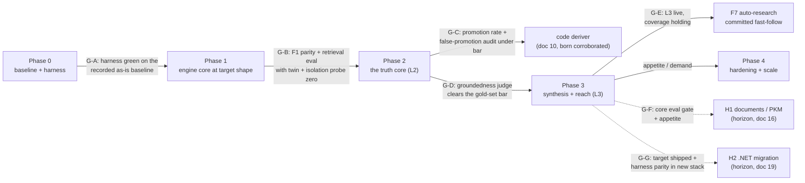
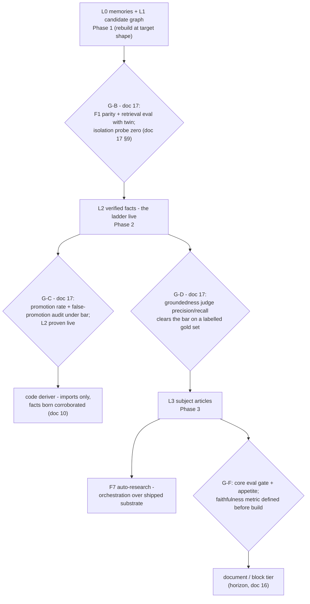
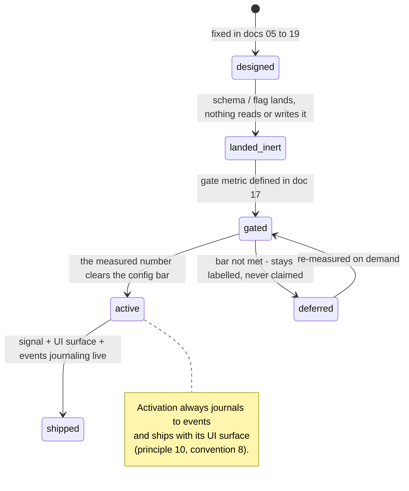
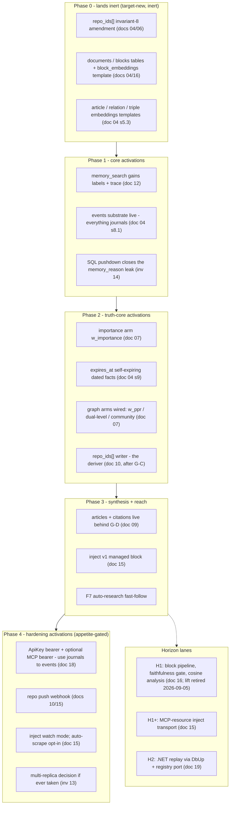
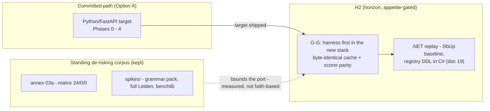

# 20 — Roadmap & Sequencing

**Status:** capstone doc; conforms to foundation 00–04, the 2026-07-24 knowledge-reshape spec, and subsystem docs 05–19. This is the last document in the set: it introduces **no new mechanism**, only order.
Every mechanism referenced below carries its owning doc's tag — **(exists today)**, **(target-new)**, **(rebuild)**, **(activation)**, or **(horizon)** per doc 04 §1's honesty convention; this doc's job is to say **when each tag is allowed to change**, never to change one by assertion (invariant 23).

---

## 1. Purpose & scope

**This doc fixes the order everything ships in: the ordinal phase sequence, the measured gate on every advance, the layer ladder's ship order (facts before articles, PKM after the core earns its keep), the committed/stretch/horizon disposition of every business flow F1–F11 and every ranking arm and flag, the schedule on which the corpus's activation and horizon tags flip, and the stack sequencing (Python target first, .NET replay post-target).** It sequences; it designs nothing. A reader who wants a mechanism follows the pointer to the doc that owns it.

**What the neighbouring docs own instead.** Doc 17 owns every metric named here — the extraction F1 bench, the retrieval eval with its latency/cost twin, the promotion-rate and false-promotion audit, the contradiction miss-rate gold set, the groundedness judge, the faithfulness metric, and the general tuning protocol; this doc only *orders phases behind those gates*. Doc 19 owns how the greenfield baseline is born and run (single baseline migration, boot-time reconciliation, dormant-object disposition, the flattened-config cutover, deployment/ops) and the mechanics of the deferred .NET replay; this doc only places them on the sequence. Doc 18 owns the trust model and the `ApiKey` activation this doc schedules. Docs 05–16 own the subsystems whose ship order is fixed here; the reshape spec §8 fixed the truth-core ordering this doc elaborates, and doc 03 decision 4 (Option A) fixed the stack decision this doc does not re-open. Doc 00 §7.2 is the ancestor of everything below: nothing ships without a before/after number.

**Audience & authority.** This binds whoever writes the implementation plans: a plan that ships a layer ahead of its gate, or flips a tag without its measured number, is out of order even if the code is ready. It authors on the retained Python/FastAPI + Postgres/pgvector stack (the 2026-07-24 Option A decision, §7).

---

## 2. The phase sequence — ordinal phases, measured gates, no dates

**Decision. The roadmap is five ordinal phases (0–4) plus two horizon lanes (H1 documents/PKM, H2 .NET migration), and every advance between them is guarded by a measured gate from doc 17 — the roadmap carries no calendar dates at all.** A solo-maintainer project gains nothing from a date it will miss and loses honesty the day it does; what actually sequences this system is *evidence* — a layer advances when its gating number clears a stated bar, and not before (doc 00 §7.2, convention 9). The alternative — a conventional quarter-by-quarter calendar roadmap — was rejected because it inverts the discipline the whole corpus is built on: a date-driven plan pressures gates into becoming formalities, and the measurement-first principle exists precisely to prevent that. Durations belong to implementation plans, not to this design (§10).

**The phase numbering is not free — Phase 4 is already a name the corpus uses.** Docs 01, 02, 03, 06, 07, 08, 15, and 16 all refer to a "flagged Phase-4 decision" or "Phase-4 enhancement" for the same family of items: multi-replica deployment (invariant 13), the repo push webhook (docs 10/15), inject `watch` mode and auto-scrape opt-in (doc 15), and the exposed-deployment/`ApiKey` hardening path (docs 01 §9, 18). This doc ratifies that implicit numbering rather than inventing a new one: **Phase 4 is the hardening-and-scale phase**, and every standing "Phase-4" reference in the corpus resolves to it unchanged.

| Phase | Name | What ships | Owning docs |
|---|---|---|---|
| 0 | Baseline & harness | The single baseline migration with its dormant objects landed inert; the eval harness stood up as a first-class deliverable; CI gate posture | 19, 17 |
| 1 | Engine core at target shape | Capture + `memory_buffer`, the five-phase pipeline, L1 graph & taxonomy, retrieval with SQL pushdown + labels + trace, code truth hardening T1–T4, the flattened LLM orchestrator, `events`, the contract + core UI surfaces | 05, 06, 07, 10, 11, 12, 13 |
| 2 | The truth core (L2) | Verified facts + `fact_sources` + the verification ladder, review/hygiene queues, `projects` registry, `fact_sources` origin-diversity counting (over the `origin_key` born at capture in Phase 1, doc 05 §2.1), the consolidation ("dreaming") job family, memory relations, topics; then the code deriver once L2 is proven live | 08, 06, 09 (topics), 10 (deriver) |
| 3 | Synthesis & reach (L3) | Subject articles behind the groundedness gate; auto-research (F7) as a committed fast-follow; distribution — inject v1, onboarding, SDKs, browser capture | 09, 15 |
| 4 | Hardening & scale | `ApiKey` activation + exposed-deployment posture, repo push webhook, inject `watch`, auto-scrape opt-in, the multi-replica decision if ever taken | 18, 10, 15, 02 |
| H1 | Documents / PKM (horizon lane) | The block pipeline, block retrieval, faithfulness gate, cosine-based analysis surface | 16 |
| H2 | .NET migration (horizon lane) | The SQL-first baseline replay + harness-paritied port, on appetite | 19, 03a |

**Amendment, owner ruling 2026-09-05.** H1's row above used to list "proposition lifting" as horizon work still to be built. It is retired, not horizon: a priced sample lift minted 2,058 memories from 7 documents and extrapolated to ~104,000 across the corpus, so it will not ship in any form (doc 16 §5). H1's analysis surface (cross-document and document-to-memory connections) is re-based on cosine similarity over block vectors instead (doc 16 §6).

The phase sequence with its gates — solid edges are the committed path, dashed edges are appetite-gated horizon lanes; every *gate* edge is a measured number defined in doc 17 (§4), except the Phase-4 edge, which is demand-gated rather than scheduled (§10):

*Caption: the roadmap as a gate graph — phases advance on doc 17's numbers, horizon lanes open on gate-plus-appetite, and no edge carries a date.*

**Phase 0 is deliberately thin, because half of it already exists.** The extraction F1 bench **(exists today)** — `backend/scripts/extraction_bench/` with its 26-memory `gold.json` and the LLM-output cache that makes cleanup-pass iteration cheap — is the regression owner doc 17 fixes; Phase 0 adds the retrieval eval (**target-new**: accuracy sliced by query type, always paired with p95 latency and token cost against a full-context baseline) and stands the whole harness behind a CI gate. On the schema side, Phase 0 is doc 19's single baseline migration: the greenfield schema born in one file, with the dormant objects — the inert `repo_ids[]` invariant-8 amendment, the empty `documents`/`blocks` tables, and all four target-new partition templates including `triple_embeddings` — landed reviewed-and-frozen with nothing writing to them (spec §8 step 2, doc 04 §5.3). Inert is not shipped: those objects stay tagged **(target-new, inert)** until their writers arrive in later phases.

**There is no UI phase.** Every backend signal ships with its surface in the *same* phase (principle 10, doc 13's inventory): the pipeline stepper and failure triage ride Phase 1, the verification badges, review queue, and dream digest ride Phase 2, the article and distribution surfaces ride Phase 3. A separate "UI phase" was rejected because it institutionalises exactly the unshipped-signal debt principle 10 forbids.

---

## 3. Layer sequencing — facts before articles, and the gate graph

**Decision. The four-layer ladder ships bottom-up in the reshape spec §8 order, verbatim: code truth hardening T1–T4 first, the invariant-8 amendment inert in the baseline, Layer 2 (verified facts + the ladder) next, the code deriver only after L2 is proven live, and Layer 3 (articles) last — gated behind doc 17's groundedness metric; the document/block PKM tier (doc 16) is horizon, gated behind the core's eval gate.** The order is forced by dependency, not preference: the deriver's born-`corroborated` facts need a working ladder to land on (spec §8 step 4); articles synthesise *only* from non-disputed `corroborated`/`confirmed` facts (doc 09 §4.2), so L3 without a live L2 has nothing lawful to say; and the PKM tier is firewalled *both ways* from the vault (doc 16 §1 — articles never read blocks, and the PKM surface ships only after the core is proven), which is exactly what makes "designed now, shipped later" a true statement rather than a coupling risk. The rejected alternative — shipping L3 alongside L2 because synthesis is the visible, demo-friendly feature — is rejected in doc 00's own terms: a fluent but ungrounded article is the confident-but-wrong failure the whole verification ladder exists to prevent, and the groundedness gate (doc 09 §4.3) cannot even be *evaluated* until the `verification` judge and a labelled gold set exist.

The layer ladder as a gate graph — each layer's advance is a doc 17 measurement, and the two sanctioned consumers that follow L3 (auto-research) and the core (PKM) hang off their own gates:

*Caption: facts before articles, deriver after the ladder, PKM after the core — every arrow is earned by a number, and the spec §8 order is reproduced exactly.*

**G-C and G-D are a partial order with one cross-edge, not a sequence (ratified 2026-08-07 from T2.40's evidence run).** The graph above already draws them as parallel edges off L2, and the prose should be read the same way: what the spec §8 order forces is *ladder before both*, not deriver before L3. There is exactly one edge between them, and it runs the direction the phase labels do not suggest — **G-C's false-promotion audit cannot be evaluated in full until G-D has *passed* at the currently configured judge identity.** The audit's numerator counts corroborated facts later disputed or human-rejected; the disputed arm is written only by the ladder applier from a standing contradiction verdict, contradiction verdicts come only from `VerificationJudge.judge()`, and that call raises unconditionally without a qualification record — which `run_judge_qualification.py --gate` mints only when every metric clears its bar. The human-rejection arm is live with no judge on its path, so the dependency binds one arm, not the probe. Nothing else consumes G-C's clearance except the promotion record, so this is a recorded precondition rather than a reordering: both gates keep their full claims, and neither clears before its evidence exists. Read "Phase 2 exit" in §4's registry as the ladder's exit, not as a claim that G-C precedes G-D.

**One judge, three consumers — and that is why the gate order composes cheaply.** Doc 17 fixes that a single `verification`-purpose judge (doc 11) serves the fact-level contradiction veto (Phase 2), the article entailment pass (Phase 3), and block faithfulness (H1). The roadmap consequence: the judge is *built once* in Phase 2 for the veto, and the L3 gate then measures a judge that already exists in production rather than commissioning new machinery — the groundedness gate is a gold-set labelling exercise on top of shipped code, not a new subsystem. The same reuse carries into H1's faithfulness gate.

---

## 4. Ship gates — every advance is a measured number

**Decision. Every gate in §2's graph names its metric, its owner, and where its bar lives; no layer, arm, or activation advances on intuition (convention 9, doc 17).** Bars are `config`/harness values tuned by doc 17's protocol; the *hard rules* — verified-above-labelled ordering, the contradiction veto, honest labelling, human-only `confirmed` — are never gates to tune, only magnitudes are.

| Gate | Guards | Measured number (doc 17 owns the metrics; its §9 test floor + doc 19 own the pass/fail probes) | Bar lives in |
|---|---|---|---|
| G-A | Phase 0 → 1 | Extraction F1 bench green, reproducing the recorded as-is baseline (entity name+type F1 and relations F1); retrieval eval running with accuracy + p95 latency + token cost columns; baseline migration boots clean and boot-time reconciliation is idempotent | harness CI |
| G-B | Phase 1 → 2 | Extraction F1 parity with the recorded baseline within a stated tolerance (the rebuild's regression contract); retrieval eval vs the full-context baseline reported *with its latency/cost twin*; isolation probes count **zero** unlabelled cross-project or superseded rows on every channel (invariant 14 — pushdown verified, not assumed) | harness CI + `config` |
| G-C | L2 → deriver; Phase 2 exit | Promotion rate `(facts promoted) / (eligible candidates)` sliced by source-kind diversity and by which N fired; false-promotion audit (corroborated facts later disputed or human-rejected) under the stated bar; every ladder transition journaled to `events` | `config` rows |
| G-D | L2 → L3 | The groundedness judge's precision/recall at distinguishing grounded from ungrounded sentences, on a labelled gold set (doc 09 §4.3; spec §8 step 5). **Since 2026-08-12 this row is the gate's whole content: it clears on the *entailment* role, one of two per-role qualification records over one judge identity (doc 17 §6's second amendment). The contradiction pair is no longer part of G-D — it is the separate contradiction role, NOT CLEARED, gating the Tier-C scan alone** | `config` + gold set |
| G-E | L3 → F7 | L3 shipped and the per-article coverage distribution holding above the runtime threshold in production | `config` |
| G-F | core → H1 | The core eval gate (doc 16 §1): retrieval eval and promotion metrics stable, plus maintainer appetite; the faithfulness metric (span-support coverage) is *defined* before H1 build starts and *gates* before H1 ships | doc 17 + appetite |
| G-G | target → H2 | Python target shipped; the harness exists in the new stack **before** any parity claim (annex 03a §5.3 discipline): byte-identical LLM-cache reuse and exact F1-scorer parity, so any F1 delta is attributable purely to ported passes | annex 03a corpus |

**G-D's registry row above was never widened, and 2026-08-12 is when that stopped being an accident (Tier-3, owner-ratified; doc 17 §6's second amendment, gate ledger "G-D ruling (2026-08-12)").** This row has always defined G-D as the entailment discrimination; the contradiction pair rode along through a single inheritance sentence in doc 17 §6 rather than through any decision recorded here. The qualification **record** now splits by consumer role over **one** judge identity — one purpose, one prompt, one gold, one sitting — so the entailment role gates Layer 3 and the contradiction role gates the Tier-C scan separately. Three consequences belong here rather than only in doc 17, because they change what this table's rows mean to each other:

- **G-D as this row states it is the entailment role, and nothing else.** A future reader asking "did G-D clear?" must ask *which role*, and the honest answer today is: neither. The contradiction role is NOT CLEARED with its bars unmoved (0.95 / 0.70), and the entailment role is unqualified pending a fresh gold — the owner refused minting it from the spent run's artifact.
- **The G-C → G-D cross-edge recorded in §3 lengthens rather than vanishes.** That edge already stopped binding G-C's `disputed_after` arm when T2.109 moved the LLM scan off the veto; this amendment does not restore it. The scan reaches the audit only through `rejected_after`, which needs a human to confirm a flag — so it is gated on the contradiction role clearing *and* on the reviewer surface, not on G-D-the-L3-gate.
- **The cost this table has to carry: G-D clearing no longer implies qualified LLM contradiction surveillance exists.** Before the split, "L3 may ship" and "the contradiction judge is qualified" were one artifact. They are now two, and a reader of this registry who assumes the old coupling will over-read a cleared G-D. Doc 17 §6 records the full argument and the two tripwires that would prove the split a fit.

Three standing conditional gates sit *inside* phases rather than between them:

- **Ranking-arm activation (any arm, §5):** a retrieval-eval delta that is positive *with its latency/cost twin* — no accuracy number ships without the twin (doc 17). An arm that cannot show its number stays at weight 0.
- **The `triple_embeddings` writer (doc 08 §5.3, spec §8):** ships only when the measured miss rate of the `pg_trgm` contradiction shortlist exceeds its stated bar — and even then groups facts for counting only, never merges rows or rewrites `triple_key`.
- **Reranker-on (doc 07 §3):** `reranker_enabled` flips on a measured win including its p95 cost; it is wired **(exists today)** and dormant until then.

---

## 5. Committed, stretch, horizon — every flow and every arm

**Decision. Every business flow F1–F11 carries an explicit disposition and phase; auto-research (F7) is a committed fast-follow, not a v1 blocker — the core agent engine (capture, retrieval, the verified vault) never waits on it.** Doc 01 §9 recommended F7 committed and deferred its phase to this doc; the phase is now fixed: F7 lands at the tail of Phase 3, immediately after L3, because by then it is *orchestration over already-shipped substrate* — capture (F1), consolidation and fact-lifting (F6), and cited synthesis (doc 09 §6) all exist, so F7 adds an agent loop and no new tables, no new verification semantics, and no new grounding machinery. The rejected alternative — demoting F7 to a demand-gated stretch — was rejected because its cost collapses once L3 ships while its value (the vault filling itself with cited knowledge) is the vision's stated payoff (doc 00 §4); the *other* rejected alternative — pulling F7 forward as a v1 headline — dies on the same dependency logic as L3 itself (§3).

| Flow | Disposition | Phase | Notes |
|---|---|---|---|
| F1 Capture | committed | 1 | `memory_buffer` **(target-new)**; `origin_key` born at capture (doc 05 §2.1); repo-hint handoff to F11 with doc 18's SSRF allowlist gate **(target-new)** |
| F2 Extract & classify | committed | 1 | Merged one-call topology **(rebuild)**, cleanup-pass moat carried under the G-A/G-B F1 contract |
| F3 Retrieve | committed | 1 | Pushdown + labels + trace ship in the core; graph-augmented arms are conditional activations (below) |
| F4 Supersede | committed | 1 | **(exists today)** — rules 1–6 verbatim (doc 08 §2.1) |
| F5 Expire | committed | 1 | **(exists today)**; `expires_at` **(activation)** for self-expiring dated facts follows in Phase 2 with the temporal passes |
| F6 Consolidate / dream | committed | 2 | The job family, ladder, queues, digest + undo (doc 08) |
| F7 Auto-research | **committed fast-follow** | 3 (tail) | Never a v1 blocker; orchestration over shipped F1/F6/L3 |
| F8 Document RAG | horizon | H1 | Behind G-F and the faithfulness gate (doc 16) |
| F9 Observe & curate | committed | every phase | Signal-ships-with-UI — F9 grows with each phase, it is not a phase (principle 10) |
| F10 Inject (push) | committed | 3 | v1 = managed file block, session-start (doc 15 §3); `watch` mode Phase 4; MCP-resource transport horizon |
| F11 Index code | committed | 1 / 2 / 4 | T1–T4 Phase 1 (spec §8 step 1); deriver Phase 2 after G-C; push webhook Phase 4 |

**The ranking arms and behavioral flags each get the same honesty: a tag, an earliest phase, and an activation bar.** Landing wired-at-zero is a Phase-1/2 deliverable; *activating* is a measurement event, not a phase deliverable (§10).

| Arm / flag | Tag (doc 07 §3–4, doc 04 §9) | Earliest phase | Activation bar |
|---|---|---|---|
| `w_conf` (confidence arm) | exists today (read now) | 1 | Harness-tuned magnitude |
| `w_importance` | **(activation)** — populated, unread today | 2 | Retrieval-eval win with twin |
| `w_heat`, `w_recency` | **(target-new)** — `memory_access_stats` side table | 2 | Retrieval-eval win with twin |
| `w_ppr`, dual-level, community injection | **(target-new)**, flags default 0 | 2 | Retrieval-eval win with twin; snapshot job live first |
| `reranker_enabled` | exists today, dormant | any | Measured win including p95 cost |
| `applies_when` boost magnitude | **(target-new)** | 1 (wiring), 2 (tuning) | Magnitude is `config`; the boost-plus-label and conflict-count rules are hard rules, never tuned |
| `relation_rescue` | exists today, on | 1 | Guarded by the F1 bench — reorder/remove only against a measured delta |
| `triple_embeddings` writer | **(target-new)**, deferred | 2+ | Trigram miss-rate above its stated bar; counting only, `names_distinct` carried |

The lifecycle every gated mechanism moves through — the roadmap's unit of progress is a tag flip earned by a number:

*Caption: designed → landed-inert → gated → active → shipped; the deferred state is honest and reversible, and no transition skips its gate (invariant 23).*

---

## 6. The honesty-tag timeline — when each tag is allowed to flip

**Decision. The corpus's honesty tags map onto phases as follows, and a tag flips only in its scheduled phase and only through its gate — a tag is a promise about the present, and this map is the promise about when the present is allowed to change.** This section exists so a reader of any subsystem doc can answer "when?" for every `(activation)` and `(horizon)` item without re-deriving the dependency graph.

*Caption: the tag timeline — inert objects in Phase 0, core activations in Phase 1, measurement-gated arms in Phase 2, synthesis and reach in Phase 3, the corpus's standing "Phase-4" items in Phase 4, and the two horizon lanes off the core gate.*

Three scheduling calls deserve their sentence:

- **The `ApiKey` activation is a Phase-4 item, full stop (doc 18, invariant 23).** The `api_keys` table exists but is unwired — a named gap, not a shipped feature. Doc 18 fixes the hardening design (programmatic key + optional MCP-bearer, key use journaled to `events`); this doc fixes that nothing before Phase 4 depends on it, because the LAN trust model (invariant 20/21) is the committed v1 posture. Remote-client auth, E2EE, and encrypted device transfer stay *recorded decisions, not commitments* — they carry no phase at all, deliberately.
- **The `w_*` arms land early and activate late.** Wiring-at-zero is cheap and honest (each arm is a no-op at its default, doc 07 §3); activation is a per-arm measurement event inside Phase 2 or later, recorded in `config` and journaled — not a phase deliverable someone can "complete" without a number.
- **The block/PKM horizon has two speeds by design (doc 16 §1).** Its *schema* is a Phase-0 inert object; everything above the schema is H1, behind G-F. A reader must not mistake the inert tables for a PKM product, and this timeline is where that distinction is scheduled rather than merely asserted.

---

## 7. Stack sequencing — decided, not re-opened

**Decision. The Python target ships first; the .NET migration is a post-target horizon lane (H2) entered on appetite, never on schedule pressure — doc 03 decision 4 (Option A, 2026-07-24) stands unamended and this doc does not re-open it.** The rationale is recorded in annex 03a and inherited whole: the matrix is fully green (24/0/0), so the deferral is appetite- and benefit-based, not feasibility-based; a rewrite now would trade months of feature delivery for a case resting on team fit alone. What makes the deferred lane *bounded* rather than faith-based is the standing de-risking corpus doc 19 records: annex 03a plus the `spikes/` directory (the `zig cc` grammar pipeline 12/12, full-Leiden parity at −0.4% modularity / 98.4% agreement, the benchlib core with byte-identical LLM-cache reuse and exact F1-scorer parity), with exactly one named residual — the psutil/pynvml telemetry matrix gap.

*Caption: Python first; the .NET lane opens only behind G-G, and the spike corpus is what keeps it a measured replay rather than a rewrite gamble.*

**The roadmap consequence of Option A that actually binds phase work: keep every design SQL-first.** Doc 19's rule — no ORM-only construct may be load-bearing, so the baseline replays mechanically in any stack — is a *standing constraint on Phases 0–4*, not an H2 task. It is the one place the deferred migration reaches back into the committed path, and it costs nothing to honour now while being expensive to retrofit.

---

## 8. Sequencing risks & mitigations

**Decision. The roadmap names its own failure modes; each has a designed mitigation rather than a hope.**

- **Gate starvation (solo maintainer).** The gold sets behind G-C/G-D/G-F need human labelling, and a solo maintainer is the throughput bottleneck. Mitigation: the sets are deliberately small (the F1 bench is 26 memories and has driven two major quality campaigns); bars start conservative and the system *stays useful while gated* — candidates are served labelled, so a delayed promotion or a delayed layer costs a label, never availability (under-claiming is the design, spec §2.1).
- **Gate theatre (the inverse risk).** Under schedule pressure a gate can degrade into a checkbox. Mitigation: gates are defined as *numbers with stated bars in `config`*, measured by harness runs in CI (G-A/G-B), and the hard rules are structurally non-tunable — there is no knob whose turning waves a layer through.
- **Rebuild regression.** Phase 1 rebuilds a working engine at target shape; the risk is silent behaviour drift. Mitigation: the invariant catalog (1–23) is the behaviour contract, and G-B's F1-parity-within-tolerance plus the isolation probe make the two highest-value regressions (extraction quality, scope leaks) measured rather than reviewed-for.
- **Horizon pull.** The PKM tier and the .NET lane are the two most tempting queue-jumps (visible product, clean-slate appeal). Mitigation: both are firewalled so nothing in Phases 0–4 depends on them (doc 16 §1; §7 above), which makes deferral genuinely free — the committed path cannot be blocked by an unshipped horizon.
- **Fast-follow creep on F7.** "Committed fast-follow" can drift into v1 scope. Mitigation: the disposition is written into §5's table with the dependency argument attached — F7 is cheap *because* it follows L3; pulled earlier it becomes expensive and re-litigates §3.

---

## 9. Invariants restated

The catalog invariants (gt-invariants 1–23) that bind sequencing itself:

- **Single Postgres at every phase (inv. 1).** No phase introduces a second datastore; the horizon lanes inherit the constraint (H2 replays onto one Postgres; H1's blocks live in the same store).
- **Inert lands frozen (inv. 8 amendment; inv. 23).** The Phase-0 dormant objects (`repo_ids[]`, `documents`/`blocks`, the four templates) ship reviewed-and-frozen with nothing writing to them; their writers arrive only in their scheduled phases.
- **Pushdown before isolation claims (inv. 14).** G-B's zero-count isolation probe is the roadmap's enforcement of the named blocking prerequisite: no phase after 1 may describe isolation as holding without it.
- **Reconciliation off the hot path (inv. 15).** The L2 phase ships the ladder as Tier-C jobs; no phase ever moves an LLM reconciliation call onto capture or retrieval to "accelerate" a gate.
- **Single worker (inv. 13).** Multi-replica stays a flagged Phase-4 decision — never a side effect of any earlier phase's deployment work.
- **Trust posture stable (inv. 20, 21).** The LAN trust model and TOFU setup are the committed posture through Phase 3; hardening is additive in Phase 4, and no phase reintroduces a pre-shared secret or fixes a LAN 421 by disabling protection.
- **Scaffolding is not substrate (inv. 23).** The whole of §6 is this invariant made into a schedule: a tag flips through its gate, in its phase, with its number — never by assertion, never by an implementation plan's optimism.
- **Two front doors, one service layer (inv. 17).** Every phase that adds a surface adds it on both doors or explicitly single-door with a reason (doc 12); sequencing never staggers MCP behind REST as a shortcut.

---

## 10. Open questions & deferred decisions

Each with a recommended stance, so the implementation plans inherit a default rather than a blank.

- **Calendar durations.** Deliberately absent here. *Stance: implementation plans attach estimates per phase at write time; the only recorded magnitude anchor is annex 03a's H2 estimate (~19–38 weeks single-engineer), kept as an anchor, not a plan.*
- **Whether the homelab cutover carries brownfield data.** Doc 19 owns the mechanics (greenfield baseline vs one-time transform for the flattened config and `AuditLog` → `events`). *Stance: greenfield baseline is the default; a transform is taken only if the mapping is trivial — doc 19's rule, restated so no plan assumes a data migration that was never committed.*
- **H1 vs H2 order if both ever have appetite.** *Stance: feature-first — H1 before H2. Every shipped horizon does grow H2's port surface, but Option A already knowingly priced paying re-architecture twice (03a §9); reversing to "migrate first, then build PKM in .NET" would re-litigate the decided stack ADR. Never run the two lanes concurrently.*
- **The Phase-4 trigger.** *Stance: demand-gated, never scheduled — an actual exposed deployment (or a concrete second consumer) opens Phase 4; nothing in Phases 0–3 depends on it.*
- **Where arm activations are recorded.** *Stance: activations are measurement events, not phase deliverables — each is recorded as its `config` flip plus an `events` row citing the harness run that justified it, so the activation history is queryable like every other transition (convention 8).*
- **Gate bars' initial values.** The bars (F1 tolerance, promotion-rate bar, false-promotion ceiling, groundedness precision/recall, faithfulness coverage) are doc 17's to seed. *Stance: start conservative per doc 17's protocol and loosen only on measured evidence; this doc fixes only that every bar exists as a `config`/harness value before its gate is first evaluated.*

---

*Downstream: this is the final document of the set — it consumes every doc and feeds only the implementation plans. A plan writer takes §2's phase for their subsystem, §4's gate as their definition of done, §5's disposition as their scope fence, and §6's timeline as the schedule on which their doc's tags may flip. Docs 17 (metrics), 18 (Phase-4 trust items), and 19 (Phase-0 birth, H2 mechanics) are the three siblings whose deliverables this sequencing leans on directly; the final consistency pass over docs 00–20 precedes any implementation plan (README production approach step 5).*
