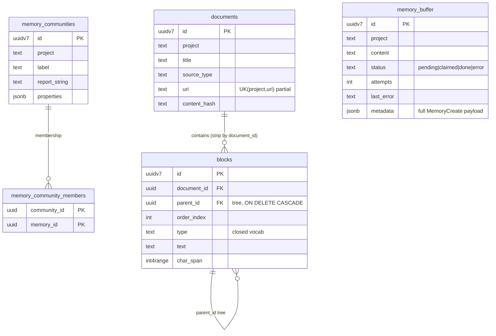
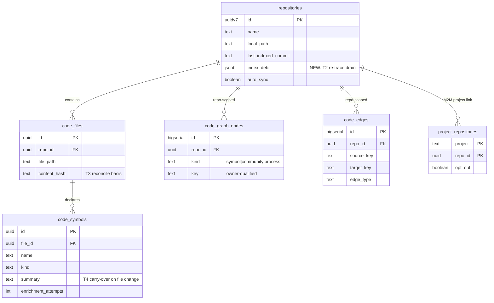
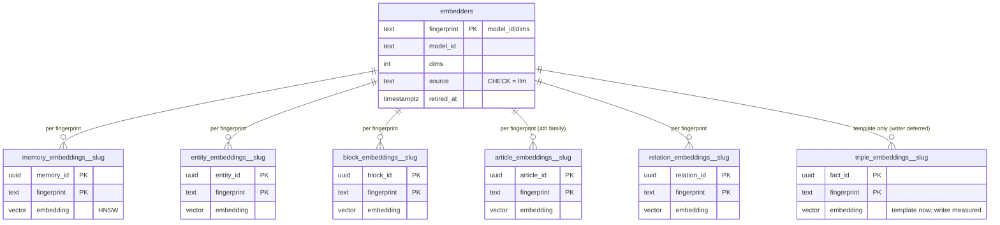
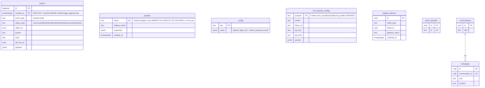

# darkmem — Entity-Relationship Diagram (target schema, post-reshape)

**Status:** the **proposed** target schema after the 2026-07-24 knowledge reshape (spec: `docs/superpowers/specs/2026-07-24-knowledge-reshape-design.md`). Reflects the four-layer knowledge vault, code-as-facts, the LLM-config simplification, and the clear decisions (generic `events`, UUIDv7, dropped `llm_` prefix, single baseline migration). Key columns only — full column/constraint/index detail lives in doc 04. Per-fingerprint embedding tables are shown once as a template (`*__<slug>`).

**Legend:** tables are annotated in the notes as **(today)** kept from the current schema, **(new)** target-new, **(rebuild)** name kept but rebuilt, **(activation)** existing-but-newly-spent. `PK`/`FK`/`UK` mark keys; `uuidv7` marks the time-ordered id adoption.

**Global id + partitioning policy (spec §6.2/§6.3):** every application-generated uuid PK is **UUIDv7** (time-ordered index locality); `entities`/`entity_relations` keep server-side v4 (`gen_random_uuid()`, ANN-probed not range-scanned); `events` and code-graph nodes/edges stay **bigint**. The **only** declaratively partitioned table is `events` (monthly RANGE) — `memories` is deliberately *not* partitioned (a range key would break its FK web), and the per-fingerprint embedding child tables already *are* the embedding partitioning.

---

## 1. Memory core + knowledge graph (Layers 0–1) and the knowledge vault (Layers 2–3)

```mermaid
erDiagram
    memories {
        uuidv7 id PK
        text   content
        text   source
        text   origin_key "NEW: capture session/agent-run"
        text   memory_type
        text   project
        enum   status "active|superseded|deprecated"
        uuid   superseded_by FK
        text_array technologies "lowercase, GIN"
        real   confidence
        text   classified_type "was llm_classified_type"
        text   summary "was llm_summary"
        jsonb  emotions "was llm_emotions"
        jsonb  flags "was llm_flags"
        timestamptz expires_at
    }
    memory_access_stats {
        uuidv7 memory_id PK
        int    access_count
        timestamptz last_accessed
    }
    memory_relations {
        uuidv7 id PK
        uuid   source_memory_id FK
        uuid   target_memory_id FK
        text   rel_type "5 stored: CONTRADICTS/ELABORATES/DEPENDS_ON/FOLLOWS/RELATES_TO; SUPERSEDES projected; DERIVED_FROM cut (v1)"
        text   project
    }
    memory_crossrefs {
        uuid memory_id PK
        uuid related_memory_id PK
        float score
    }
    tags {
        int id PK
        text name UK
    }
    memory_tags {
        uuid memory_id PK
        int  tag_id PK
    }
    entities {
        uuid id PK
        text name "lowercase; display_name in properties"
        text entity_type "closed ENTITY_TYPES"
        uuid_array memory_ids "GIN"
        uuid_array repo_ids "NEW: code assertion source (inv-8 amendment)"
        jsonb properties
    }
    entity_relations {
        uuid id PK
        uuid source_entity_id FK
        uuid target_entity_id FK
        text rel_type "closed RELATIONSHIP_TYPES"
        uuid_array memory_ids "GIN"
        uuid_array repo_ids "NEW"
        float weight
    }
    knowledge_triples {
        uuidv7 id PK
        uuid   subject_id "soft ref"
        text   subject_name "lowercase, denormalised"
        uuid   object_id "soft ref"
        text   object_name
        text   rel_type
        text   fact "embeddable"
        text   triple_key "app-computed uuid5 over names, post-canonicalisation"
        text   verification_status "NEW: candidate|corroborated|disputed|confirmed"
        real   confidence "NEW: aggregated"
        jsonb  applies_when "NEW: structured context"
        text_array learned_in "NEW"
        timestamptz valid_at
        timestamptz invalid_at
        timestamptz expired_at "invalidate-not-delete"
        timestamptz reference_time
        text   project
    }
    fact_sources {
        uuidv7 id PK
        uuid   fact_id FK
        text   source_kind "memory|block|code|human"
        text   source_ref "soft"
        text   origin_key "DISTINCT-counted for corroboration"
        jsonb  detail
    }
    knowledge_articles {
        uuidv7 id PK
        text   subject_key "name+type soft key OR pinned"
        text   project
        text   title
        text   content "synthesized, grounded"
        text   status "candidate|corroborated|disputed|confirmed|superseded"
        real   confidence "claim-support coverage"
        jsonb  applies_when
        text_array learned_in
        timestamptz synthesized_at
        text   fact_set_hash "staleness gate"
        uuid   superseded_by FK
    }
    article_citations {
        uuidv7 id PK
        uuid   article_id FK "CASCADE"
        uuid   fact_id FK "HARD FK -> knowledge_triples (facts never deleted)"
        int4range claim_span "claim-level grounding anchor"
    }

    memories ||--o| memory_access_stats : "1:1 ranking priors"
    memories ||--o{ memory_relations : "source"
    memories ||--o{ memory_relations : "target"
    memories ||--o{ memory_crossrefs : "similarity"
    memories }o--o{ tags : "memory_tags"
    memories ||--o{ memories : "superseded_by"
    entities ||--o{ entity_relations : "source"
    entities ||--o{ entity_relations : "target"
    knowledge_triples ||--o{ fact_sources : "provenance (DISTINCT origin_key)"
    entities ||--o| knowledge_triples : "subject/object soft ref"
    entities ||--o{ knowledge_articles : "subject (salient entity) soft key"
    knowledge_articles ||--o{ article_citations : "grounds each claim"
    knowledge_triples ||--o{ article_citations : "cited by (hard FK)"
```

**Notes.** `memories` **(today, +origin_key new, llm_ prefix dropped)** — `origin_key` is the load-bearing new field: corroboration counts `DISTINCT origin_key`, never rows. `memory_access_stats` **(new, 1:1)** keeps read-churn off the hot row. `entities`/`entity_relations` **(today, +repo_ids new)** — `repo_ids[]` is the invariant-8 amendment letting code assert graph rows without a memory. `memory_relations` **(new)** stores five associative types; `SUPERSEDES` is a read-time projection over `memories.superseded_by` (never stored), and `DERIVED_FROM` is cut for v1 (its only writer moved into the vault). `knowledge_triples` **(rebuild + verification/context extensions)** = Layer 2 verified facts, promoted on `COUNT(DISTINCT fact_sources.origin_key)`. `fact_sources` **(new)**, `knowledge_articles` **(new)**, and `article_citations` **(new, hard FK to facts)** = the vault's provenance, Layer 3, and claim-level grounding.

## 2. Topics, documents/blocks, buffer

**Notes.** All **(new)**. `memory_communities` topics = Leiden over a project-scoped memory-graph projection; communities feed article **pin suggestions**, never a durable `subject_ref`. `documents`/`blocks` = the PKM horizon; a block is the chunk + citation + link + transclusion unit. `memory_buffer` = Tier-B durable ingest, claimed via `FOR UPDATE SKIP LOCKED`.

## 3. Code knowledge base (reuse + harden; fact-origination bridge)

**Notes.** `repositories`/`code_*` **(today, hardened)** — the parsed graph **is** the code KB; no mirror table. Truth fixes T1–T4 (fail-stale, index-debt drain, `code_reconcile` job, summary carry-over). **The code→vault bridge is not a table FK** — a deriver mints `entities`/`entity_relations` tagged with `repo_ids[]` (§1) from imports; the never-join invariant holds (no query joins the two graphs; only app-level one-direction deriver + citation re-verifier cross). `code_graph_nodes`/`code_edges` stay bigint-keyed and repo-scoped. `project_repositories` **(new)** is the only registry bridge, M2M over one shared repo.

## 4. Per-fingerprint embedding partitions + registry

**Notes.** `embedders` **(today)** is the registry; each fingerprint owns child tables reached only via `child_table(parent, fingerprint)` — **no cross-fingerprint joins**. Parents: the four existing (`memory`/`entity`/`code_chunk`/`entity_embedding_cache`) + `block_embeddings`, `relation_embeddings`, and now **`article_embeddings` — a fourth target-new family** (doc 04 §5.3 now enumerates four families). `triple_embeddings` (fact-similarity for corroboration's fuzzy fact-merge) is added as a **template now** but its writer is deferred behind a measured `pg_trgm` undercount (spec §8) — and when it ships it groups facts for counting only, never merges rows. Each new parent gets a `_TABLE_TEMPLATES`/`_AUX_INDEXES` entry; the old one-time creation sweep is **replaced by a permanent boot-time reconciliation** in `embedder_registry` (spec §6.6).

## 5. Operations, audit, config, LLM

**Notes.** `events` **(new, replaces `audit_log`)** — one universal append-only audit/event substrate for **every** entity, **monthly RANGE-partitioned by `created_at`** (the only partitioned table), append-only enforced by a BEFORE UPDATE/DELETE/TRUNCATE **forbid-trigger** (REVOKE role-split is the multi-user upgrade path); `audit_log` is dropped outright (greenfield). `projects` **(new)** is the minimal namespace registry — lazy auto-registration, no FK enforcement yet — added now because `triple_key` embeds `project` in fact identity (a typo would split corroboration). `llm_purpose_configs` **(today, simplified)** — six inline purpose rows; `llm_providers`/`llm_profiles`/`ml_profiles` and all `*_ref` indirection are dropped; the `classification` purpose carries an inline `classifier_kind = llm | local`. **Amended 2026-08-20:** the purpose rows are **eight** and they are not inline — `llm_providers` **(rebuilt, new shape)** is reinstated as `(name PK, api_kind, base_url, api_key, updated_at)` and `llm_purpose_configs.provider_name` NOT NULL references `llm_providers(name)` `ON UPDATE CASCADE ON DELETE RESTRICT`, replacing the row's `api_kind`/`base_url`/`api_key` columns. `llm_profiles`/`ml_profiles` and every `*_ref` stay dropped and `classifier_kind` stays inline (doc 04 §7's amendment box). `config`, `pipeline_failures`, `token_blocklist`, `conversations`/`messages` **(today)** unchanged.

---

## Cross-subsystem bridges (the only sanctioned crossings)

- **Memory → knowledge:** extraction writes Layer-1 `entities`/`entity_relations`; the Tier-C consolidation lifts corroborated ones to Layer-2 `knowledge_triples`; articles synthesize from verified facts.
- **Code → knowledge:** the deriver projects imports into `entities`/`entity_relations` (tagged `repo_ids[]`) — an application-level, one-direction bridge, **not** a query join; `project_repositories` is the only registry link.
- **Everything → `events`:** every lifecycle transition (including verification-status changes) is journaled, so the timeline/calendar and "what did we believe as of X" both read from one substrate.
