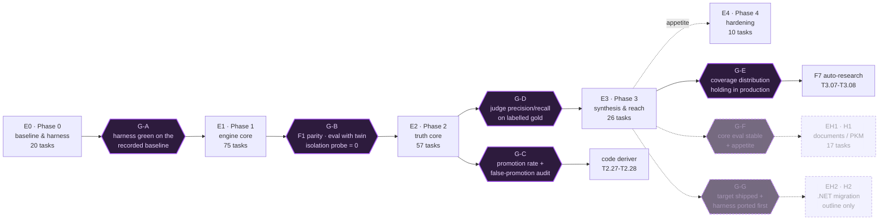
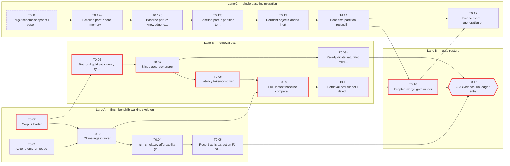
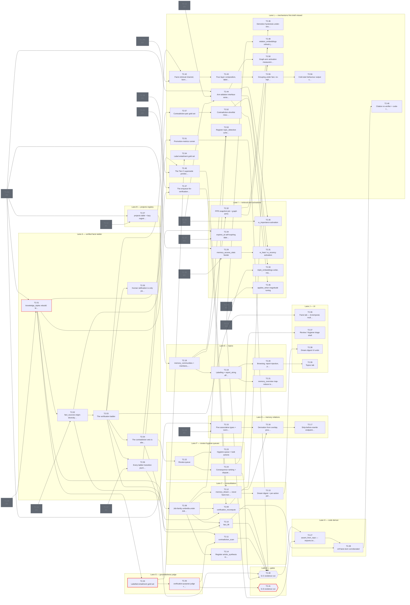
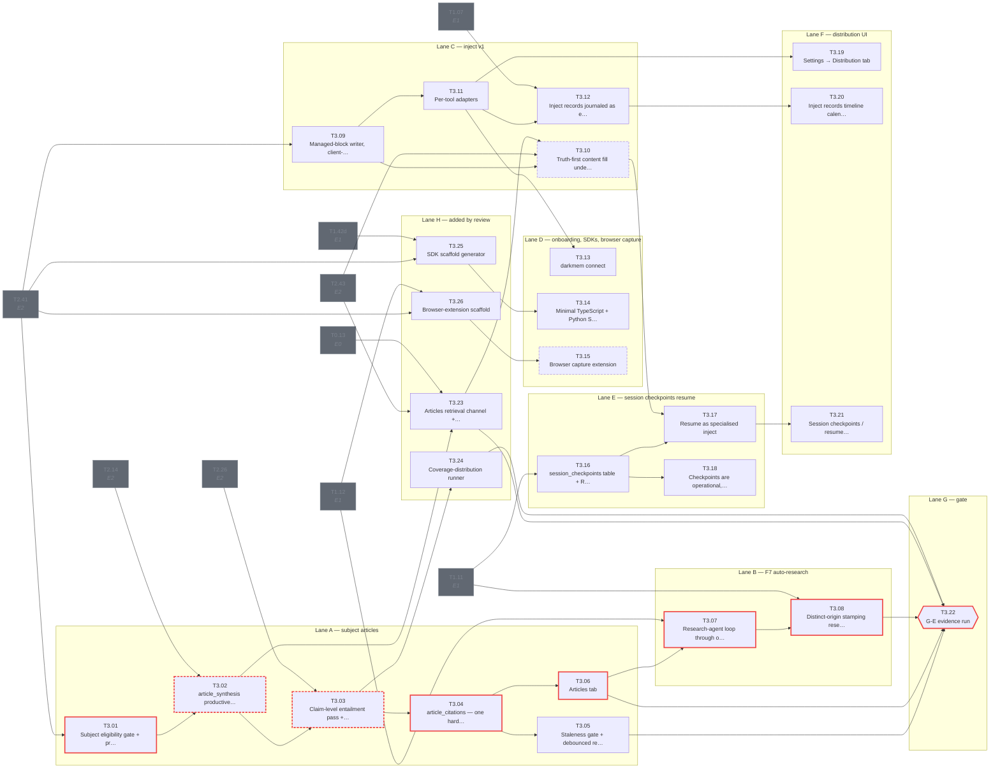
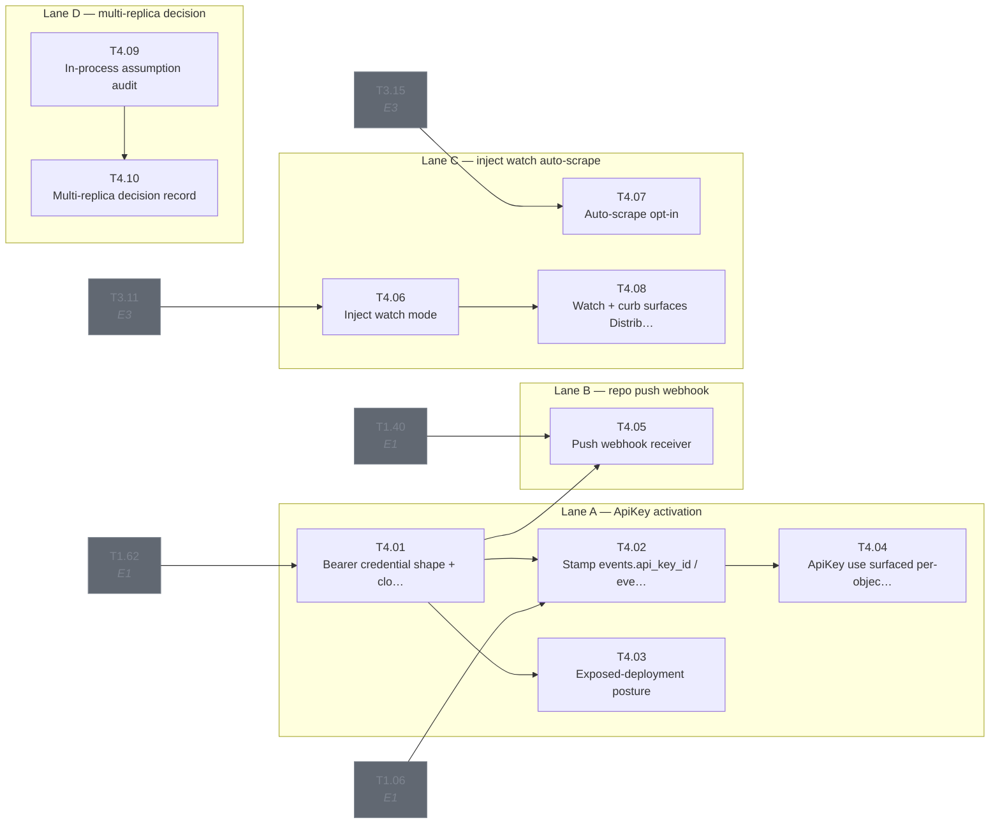
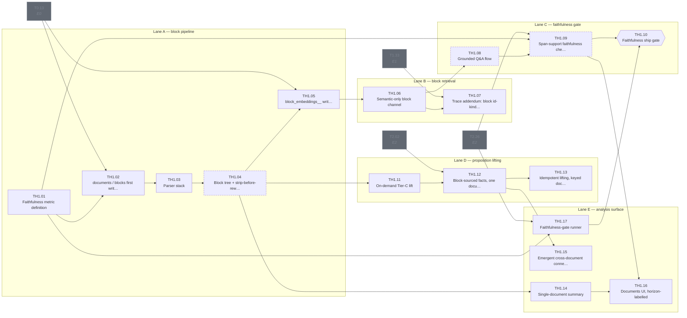

# Dependency lanes and risk register

Two questions this file answers: **what can run at the same time**, and **what is most
likely to go wrong**.

---

## Part 1 — Dependency lanes

### The hard serialisation

Only four things in the whole plan strictly serialise. Everything else is a lane.

```
T0.12a→c (baseline migration) ──> most of E1
G-A  (T0.17) ──> E1 starts
G-B  (T1.50) ──> E2 starts
G-C  (T2.40) ──> code deriver lane (T2.27–T2.28)
G-D  (T2.41) ──> E3 starts
G-E  (T3.22) ──> F7 is "done"; Phase 4 opens on appetite
```

Gates are real barriers, not checkpoints to work through. Starting E2 before G-B means
building the truth core on a retrieval layer whose isolation is unproven — and every fact
count in E2 inherits that doubt.

### E0 — three independent lanes

| Lane | Tasks | Can run concurrently with |
|---|---|---|
| A — benchlib completion | T0.01–T0.05 | B, C |
| B — retrieval eval | T0.06–T0.10 | A (after T0.02), C |
| C — baseline migration | T0.11–T0.15 | A, B — **but serialises hard internally** |
| D — gate posture | T0.16–T0.17 | Needs A, B, C |

**Three agents can work E0 concurrently.** Lane C is the long pole and gates most of E1;
start it first.

Two collisions the lane table alone does not show:

| Collision | Files | Consequence |
|---|---|---|
| Lane C ↔ everything | `backend/migrations/versions/` | T0.12a deletes the six brownfield revisions and leaves a deliberately partial baseline until T0.12c completes it. Both `backend/tests/conftest.py` and `backend/scripts/benchlib/bench_db.py` build their databases with `alembic upgrade head`, so that window is a **repo-wide red floor**. T0.12a–c are floor-exempt and atomic: run them on a lane branch and merge only when T0.12c is green (runbook §4, §6) |
| Lane A ↔ Lane B | `backend/scripts/benchlib/tests/conftest.py` | The modules are disjoint (`ledger`/`corpus`/`ingest` vs `retrieval_*`/`twin`), but both lanes add tests under one `tests/` directory sharing a single `conftest.py`. Fixtures there are the flashpoint |

Note also that the red-bordered critical path in the graphs below is an **unweighted hop
count** — `gen_task_graph.py` maximises depth, not effort. It marks Lane B because Lane B's
chain has more nodes; it cannot see that Lane C is entirely Opus-tier and fronted by the
only `Size: L` task in E0. Do not schedule off the red borders alone.

### E1 — foundations first, then five parallel lanes

```
Lane A (LLM orchestrator + events, T1.01–T1.09)
   │  everything below journals to events or calls the orchestrator
   ├──> Lane B  capture + buffer      T1.10–T1.15
   ├──> Lane C  pipeline + graph      T1.16–T1.28
   ├──> Lane D  retrieval             T1.29a–T1.35
   ├──> Lane E  lifecycle             T1.36–T1.37   (needs C: T1.21, T1.27)
   ├──> Lane F  code truth            T1.38–T1.41
   └──> Lane G  contract + UI         T1.42a–T1.49   (each UI task needs its signal)
```

**Do Lane A first, alone.** It is nine tasks and it unblocks everything; running it
concurrently with consumers means rebuilding against a moving orchestrator.

After Lane A: **two to three agents, not four.** The original claim of four was checked
against the real backend layout and does not hold — the lanes are dependency-disjoint but
not *file*-disjoint:

| Collision | Files | Consequence |
|---|---|---|
| Lane C ↔ Lane D | `repositories/vector.py`, `repositories/graph.py` | T1.21/T1.26 and T1.29a–c rewrite the same repos. **Start D after T1.21 lands.** |
| Lane B ↔ D ↔ G | `api/routes/memories.py`, `api/mcp/server.py` | The capture doors, the `memory_reason` fix, and T1.42a–d all edit them |
| Lane B ↔ Lane F | `app/main.py` | T1.13 and T1.40 both register jobs |
| Lane G ↔ Lane J (frontend) | `frontend/src/features/activity/` | T1.45 (stepper/triage/jobs) and T1.61 (feed/day/monitors) share `module-surface.tsx` |
| Lane J internal | `frontend/src/features/settings/` | T1.55, T1.57, T1.63 are tab-disjoint but share `index.ts` / `schemas.ts` |
| Every binding task ↔ T1.58 | `frontend/src/**` | T1.58 leaves the demo lint rule in **warn**; each binding task removes its own surface's imports; T1.64 flips it to error |
| Any schema task | the single baseline revision | Regenerating it concurrently conflicts every time — runbook §9 serialises these through one owner per epic |

Since tasks are commits on one epic branch and this repo has no remote, concurrent agents
need **separate worktrees** (`git worktree add`) and a rebase cadence, not just separate
task rows. Lane E waits on C; Lane G's tasks each wait on their specific backend signal,
so G interleaves rather than running as a block. Lanes I and J (the cutover and the
orphaned surfaces) run late: I is post-G-B by design, J after T1.58 flips demo mode off.

**The critical path through E1** runs Lane A → Lane C (18 tasks after the post-processor split, all
the pipeline surgery) → T1.50. Lane C is where the schedule lives; staffing it first is the highest-leverage
scheduling decision in the epic.

### E2 — the ladder is the spine

```
Lane A (facts + ladder, T2.01–T2.06)  ── the spine, everything else hangs off it
   ├──> Lane C  consolidation jobs   T2.08–T2.14
   ├──> Lane F  review/hygiene       T2.22–T2.24
   ├──> Lane G  judge (G-D)          T2.25–T2.26   ── independent, start early
   └──> Lane J  UI                   T2.36–T2.39
Lane B  projects registry  T2.07     ── independent, tiny, do it any time
Lane D  memory relations   T2.15–T2.17  ── needs Lane C's dream job
Lane E  topics             T2.18–T2.21  ── independent of the ladder entirely
Lane I  arm activations    T2.29–T2.35  ── independent; each is its own measurement
Lane L  missed mechanisms  T2.42–T2.57  ── the retrieval channels, the doc-08 primitives,
                                           the measurement runners and their gold sets
Lane H  code deriver       T2.27–T2.28  ── BLOCKED until G-C clears
```

**Start Lane G early.** The judge qualification (G-D) is on the critical path to E3 and
needs a hand-labelled gold set — the one task in this plan whose duration is a human
labelling bottleneck, not a compute one.

**Lane E (topics) and Lane I (arms) are genuinely independent** and good candidates for a
second agent running alongside the ladder work.

**Lane L is not independent, despite looking like a grab-bag.** T2.45 blocks the dream job
(T2.12) and T2.47 blocks the recompute (T2.09), so the primitives must land before Lane C's
consumers. T2.42/T2.43 rewrite the retrieval composition, so Lane I's arm measurements must
follow them or they measure a moving target.

### E3 — two phases inside the epic

```
Lane A  articles     T3.01–T3.06   ── first
Lane C  inject       T3.09–T3.12   ── concurrent with A (independent)
Lane D  onboarding   T3.13–T3.15   ── concurrent
Lane E  checkpoints  T3.16–T3.18   ── concurrent (store half is Phase-1-capable)
   ↓
Lane B  F7 research  T3.07–T3.08   ── AFTER Lane A ships. Not concurrent.
Lane F  UI           T3.19–T3.21
Lane G  G-E          T3.22
```

**F7 is deliberately last.** See the fast-follow creep risk below.

### E4 and EH1

E4 is demand-gated and mostly serial behind T4.01. EH1 has one hard ordering rule:
**TH1.01 (define the faithfulness metric) precedes every other task in the lane** — that
ordering is doc 20 §4, not a preference.

### Concurrency ceiling

The practical limit is **three to four agents**, set by merge-conflict surface rather than
by dependencies. Two agents in the same lane will conflict; two in different lanes rarely
do. Lane assignment is the unit of parallelism, not the task.

---

## Part 2 — The task graph

<!-- BEGIN GENERATED TASK GRAPHS — regenerate with scripts/gen_task_graph.py -->

### How to read these

Arrows point **prerequisite → dependent**, so work flows left to right. Boxes are
grouped by lane. Shapes and colours carry three facts:

- **`{{hexagon}}` = a gate task.** A barrier, not ordinary work — everything in the
  next epic waits on it regardless of what any `Depends` field says.
- **Thick red border = on the critical path.** 29 tasks long, ending at T3.22.
  Shortening the plan means shortening this chain and nothing else.
- **Dashed border = `Size: L`.** More than a day; needs a reviewed step-level plan
  before any code (runbook §3).
- **Faded nodes** are prerequisites owned by another epic, drawn for context.

Titles are truncated — the full task is in its epic file, the state is in
`progress.md`.

### The whole plan, at gate level



Solid edges are the committed path; dashed edges are appetite-gated. Every gate is a
measured number in [`gate-ledger.md`](gate-ledger.md), never a judgement call.

### E0 — Phase 0 · baseline & harness (20 tasks)



### E1 — Phase 1 · engine core (75 tasks)

```mermaid
flowchart LR
    subgraph LE1A["Lane A — foundations"]
    direction TB
        T1_01["T1.01<br/>Flatten llm_purpose_configs i…"]
        T1_02["T1.02<br/>One shared httpx.AsyncClient…"]
        T1_03["T1.03<br/>api_kind as sole vendor-quirk…"]
        T1_04["T1.04<br/>classifier_kind inline classi…"]
        T1_05["T1.05<br/>Seed synthesis verification p…"]
        T1_06["T1.06<br/>events table, monthly partiti…"]
        T1_07["T1.07<br/>events writer journaling conv…"]
        T1_08["T1.08<br/>GET /events, /events/calendar…"]
        T1_09["T1.09<br/>Retire audit_log reads"]
    end
    subgraph LE1B["Lane B — capture buffer"]
    direction TB
        T1_10["T1.10<br/>memory_buffer table + pre-min…"]
        T1_11["T1.11<br/>origin_key resolution — born…"]
        T1_12["T1.12<br/>Tier-A synchronous accept + 2…"]
        T1_13["T1.13<br/>buffer_flush job FOR UPDATE S…"]
        T1_14["T1.14<br/>wait_process interactive bypa…"]
        T1_15["T1.15<br/>Repo-hint auto-provision hand…"]
    end
    subgraph LE1C["Lane C — five-phase pipeline L1 graph"]
    direction TB
        T1_16["T1.16<br/>Phase 1: content embed + regi…"]
        T1_17["T1.17<br/>Phase 2: merged extract + cla…"]
        T1_18["T1.18<br/>classifier_kind=local narrowi…"]
        T1_19["T1.19<br/>Phase 3: entity embed two-lev…"]
        T1_20["T1.20<br/>Phase 4: type-constrained ded…"]
        T1_21["T1.21<br/>Phase 5: two-savepoint write"]
        T1_22["T1.22<br/>Mid-batch embedder rotation"]
        T1_23["T1.23<br/>Five closed vocabularies + no…"]
        T1_24a["T1.24a<br/>Pass registry, ordering contr…"]
        T1_24b["T1.24b<br/>Stage 1: entity shaping"]
        T1_24c["T1.24c<br/>Stage 2: entity rescue"]
        T1_24d["T1.24d<br/>Stage 4: relation gating dire…"]
        T1_24e["T1.24e<br/>Stage 5: collapse, dedup, fan…"]
        T1_24f["T1.24f<br/>Whole-chain F1 parity against…"]
        T1_25["T1.25<br/>relation_rescue layer"]
        T1_26["T1.26<br/>Strip-before-rewrite: idempot…"]
        T1_27["T1.27<br/>technologies denorm recompute"]
        T1_28["T1.28<br/>graph_orphan_cleanup backstop"]
    end
    subgraph LE1D["Lane D — retrieval"]
    direction TB
        T1_29a["T1.29a<br/>Pushdown semantic channel"]
        T1_29b["T1.29b<br/>Pushdown keyword graph channe…"]
        T1_29c["T1.29c<br/>Pushdown memory_reason code s…"]
        T1_30["T1.30<br/>RRF fusion + unified rank_fus…"]
        T1_31["T1.31<br/>Ranking arms wired at zero"]
        T1_32["T1.32<br/>Reranker wired dormant"]
        T1_33["T1.33<br/>The retrieval trace"]
        T1_34["T1.34<br/>applies_when context-boost sl…"]
        T1_35["T1.35<br/>The isolation probe"]
    end
    subgraph LE1E["Lane E — lifecycle"]
    direction TB
        T1_36["T1.36<br/>Supersession detector, rules…"]
        T1_37["T1.37<br/>TTL sweep, demote before dele…"]
    end
    subgraph LE1F["Lane F — code truth hardening T1–T4"]
    direction TB
        T1_38["T1.38<br/>T1 fail-stale"]
        T1_39["T1.39<br/>T2 index-debt drain"]
        T1_40["T1.40<br/>T3 code_reconcile job"]
        T1_41["T1.41<br/>T4 summary carry-over"]
    end
    subgraph LE1G["Lane G — contract core UI"]
    direction TB
        T1_42a["T1.42a<br/>Payload envelope + source con…"]
        T1_42b["T1.42b<br/>REST surface conformance"]
        T1_42c["T1.42c<br/>MCP surface parity transport…"]
        T1_42d["T1.42d<br/>Two-door parity audit"]
        T1_43["T1.43<br/>Dashboard + contribution cale…"]
        T1_44["T1.44<br/>Memories search + why-retriev…"]
        T1_45["T1.45<br/>Pipeline stepper, failure tri…"]
        T1_46["T1.46<br/>Code fail-stale banner + inde…"]
        T1_47["T1.47<br/>Memory-detail supersession li…"]
        T1_48["T1.48<br/>Detail-level preference honou…"]
        T1_49["T1.49<br/>WebSocket → query-invalidatio…"]
    end
    subgraph LE1H["Lane H — gate"]
    direction TB
        T1_50{{"T1.50<br/>G-B evidence run ledger entry"}}
    end
    subgraph LE1I["Lane I — homelab cutover"]
    direction TB
        T1_51["T1.51<br/>Cutover transform + carried-s…"]
        T1_52["T1.52<br/>Tier-C re-extraction backfill…"]
        T1_53["T1.53<br/>Cutover rehearsal dump copy +…"]
        T1_54["T1.54<br/>Execute cutover, verify, appl…"]
    end
    subgraph LE1J["Lane J — surfaces rebuild orphans"]
    direction TB
        T1_55["T1.55<br/>Settings → LLM: six inline pu…"]
        T1_56["T1.56<br/>Setup wizard finalize against…"]
        T1_57["T1.57<br/>Settings → Flags, bound config"]
        T1_58["T1.58<br/>Retire demo mode as default"]
        T1_59["T1.59<br/>Bind Code section live data"]
        T1_60["T1.60<br/>Bind Chat Memory Graph explor…"]
        T1_61["T1.61<br/>Activity: feed, day view, buf…"]
        T1_62["T1.62<br/>App-as-edge deployment artifa…"]
        T1_63["T1.63<br/>Bind Settings: Security, Main…"]
        T1_64["T1.64<br/>API e2e suite + honesty specs"]
        T1_65["T1.65<br/>projectStore, contextStore, p…"]
    end
    T0_17["T0.17<br/><i>E0</i>"]
    T0_12c["T0.12c<br/><i>E0</i>"]
    T0_10["T0.10<br/><i>E0</i>"]
    T0_16["T0.16<br/><i>E0</i>"]
    T0_15["T0.15<br/><i>E0</i>"]
    T0_17 --> T1_01
    T0_12c --> T1_01
    T1_01 --> T1_02
    T1_01 --> T1_03
    T1_01 --> T1_04
    T1_01 --> T1_05
    T0_17 --> T1_06
    T0_12c --> T1_06
    T1_06 --> T1_07
    T1_07 --> T1_08
    T1_08 --> T1_09
    T0_17 --> T1_10
    T0_12c --> T1_10
    T1_10 --> T1_11
    T1_11 --> T1_12
    T1_12 --> T1_13
    T1_13 --> T1_14
    T1_12 --> T1_15
    T1_03 --> T1_16
    T1_16 --> T1_17
    T1_04 --> T1_17
    T1_17 --> T1_18
    T1_16 --> T1_19
    T1_19 --> T1_20
    T1_20 --> T1_21
    T1_19 --> T1_22
    T0_17 --> T1_23
    T0_12c --> T1_23
    T1_23 --> T1_24a
    T1_24a --> T1_24b
    T1_24b --> T1_24c
    T1_24c --> T1_24d
    T1_25 --> T1_24d
    T1_24d --> T1_24e
    T1_24e --> T1_24f
    T1_17 --> T1_24f
    T1_24a --> T1_25
    T1_21 --> T1_26
    T1_26 --> T1_27
    T1_26 --> T1_28
    T1_16 --> T1_29a
    T1_29a --> T1_29b
    T1_29b --> T1_29c
    T1_29b --> T1_30
    T1_30 --> T1_31
    T1_30 --> T1_32
    T1_30 --> T1_33
    T1_30 --> T1_34
    T1_29c --> T1_35
    T0_10 --> T1_35
    T1_21 --> T1_36
    T1_27 --> T1_36
    T1_36 --> T1_37
    T1_07 --> T1_38
    T1_38 --> T1_39
    T1_39 --> T1_40
    T1_40 --> T1_41
    T1_12 --> T1_42a
    T1_14 --> T1_42a
    T1_33 --> T1_42a
    T1_42a --> T1_42b
    T1_42a --> T1_42c
    T1_42b --> T1_42d
    T1_42c --> T1_42d
    T1_08 --> T1_43
    T1_33 --> T1_44
    T1_43 --> T1_44
    T1_21 --> T1_45
    T1_13 --> T1_45
    T1_39 --> T1_46
    T1_36 --> T1_47
    T1_44 --> T1_48
    T1_45 --> T1_49
    T0_16 --> T1_50
    T1_24f --> T1_50
    T1_35 --> T1_50
    T1_44 --> T1_50
    T0_12c --> T1_51
    T1_01 --> T1_51
    T1_23 --> T1_51
    T1_51 --> T1_52
    T1_13 --> T1_52
    T1_26 --> T1_52
    T1_52 --> T1_53
    T1_53 --> T1_54
    T1_50 --> T1_54
    T0_15 --> T1_54
    T1_01 --> T1_55
    T1_04 --> T1_55
    T1_01 --> T1_56
    T1_31 --> T1_57
    T1_42a --> T1_58
    T1_42d --> T1_59
    T1_58 --> T1_59
    T1_44 --> T1_60
    T1_58 --> T1_60
    T1_08 --> T1_61
    T1_10 --> T1_61
    T1_42d --> T1_62
    T1_58 --> T1_62
    T1_58 --> T1_63
    T0_16 --> T1_64
    T1_42d --> T1_64
    T1_29c --> T1_65
    T1_34 --> T1_65
    classDef crit stroke:#ef4444,stroke-width:3px
    classDef large stroke-dasharray:6 3
    classDef ext fill:#1f2937,stroke:#4b5563,color:#9ca3af,opacity:0.7
    class T1_01,T1_03,T1_16,T1_29a,T1_29b,T1_30,T1_33,T1_44,T1_50 crit
    class T1_01,T1_17,T1_21,T1_24d,T1_24e,T1_42a,T1_51,T1_52,T1_58,T1_59,T1_60,T1_62,T1_64 large
    class T0_17,T0_12c,T0_10,T0_16,T0_15 ext
```



### E2 — Phase 2 · truth core (57 tasks)



### E3 — Phase 3 · synthesis & reach (26 tasks)



### E4 — Phase 4 · hardening & scale (10 tasks)



### EH1 — H1 · documents / PKM (17 tasks)



<!-- END GENERATED TASK GRAPHS -->

---

## Part 3 — Risk register

### Carried from doc 20 §8 (the roadmap's own named failure modes)

| Risk | Why it bites | Mitigation | Watch for |
|---|---|---|---|
| **Gate starvation** — the gold sets behind G-C/G-D/G-F need human labelling and a solo maintainer is the bottleneck | Whole phases stall on one person's afternoon | Sets are deliberately small (the F1 bench is 26 memories and drove two quality campaigns); bars start conservative; the system **stays useful while gated** — candidates serve labelled, so a delayed promotion costs a label, never availability | T2.25 sitting in `todo` for weeks while E2 code piles up behind it |
| **Gate theatre** — a gate degrades into a checkbox under pressure | Silently reintroduces the intuition-driven shipping the corpus exists to prevent | Gates are numbers with stated bars in `config`, measured by harness runs; hard rules are structurally non-tunable — there is no knob to turn | A gate row in the ledger with a verdict but no measured number; a bar edited on the same day as the run |
| **Rebuild regression** — E1 rebuilds a working engine and drifts silently | The failure is quiet: extraction quality decays, scopes leak, nothing crashes | G-B's F1-parity-within-tolerance plus the zero-count isolation probe make the two highest-value regressions measured rather than reviewed-for | F1 drifting within tolerance repeatedly in the same direction — tolerance is not a budget to spend |
| **Horizon pull** — PKM and .NET are the tempting queue-jumps | Both are more fun than the committed path; both are firewalled precisely so deferring is free | Nothing in Phases 0–4 may depend on EH1/EH2 — a dependency in that direction is a Tier-3 amendment | Any E0–E4 task that references `documents`, `blocks`, or the .NET lane as a prerequisite |
| **Fast-follow creep on F7** | "Committed fast-follow" drifts into v1 scope; F7 is cheap *because* it follows L3 | Sequenced at the tail of E3 with the dependency argument attached; pulled earlier it re-opens the layer argument | T3.07 starting before T3.06 is done |

### Execution risks (this plan's own)

| Risk | Why it bites | Mitigation | Watch for |
|---|---|---|---|
| **`origin_key` gets it wrong in Phase 1** | Every corroboration count in E2 is `COUNT(DISTINCT origin_key)`. A too-generous resolution silently inflates every verification number downstream, and the error is invisible until facts are promoted that should not have been | T1.11 tests the merge-to-one rule explicitly; T2.02's test fails under row-counting | Any change to `origin_key` resolution after E2 starts — it is a Phase-1 decision with Phase-2 consequences |
| **Pushdown declared done without the probe** | Isolation is the one property everyone assumes and nobody measures | T1.29a–c and T1.35 are separate tasks on purpose: building it and proving it are different work, and the probe is Fable-tier and adversarial | T1.29c marked `done` while T1.35 is still `todo` |
| **Plan rot** — the plan and the code diverge silently | 215 tasks written in advance will be wrong in places; an agent that works around a wrong task instead of fixing it makes the plan progressively fictional | The amendment protocol makes updating the plan part of the task, and Tier 1 needs no permission | An empty amendment log after a dozen completed tasks — that is not a good sign, it means fixes are going unrecorded |
| **UI drifts ahead of its signal** | The frontend skeleton already renders demo versions of Phase-1, -2, and -3 surfaces. Shipping a surface over demo data reads as done | Every UI task's acceptance names the live backend signal it must bind to; principle 10 puts the surface in the same phase as its signal, not earlier | A UI task marked `done` whose backend task is still `todo` |
| **Arms activated on a flattering aggregate** | An arm that helps overall while destroying the paraphrase slice looks like a win | Retrieval eval reports per-slice always; the aggregate never replaces slices; activation needs the latency/cost twin | An activation-log row with an aggregate delta and no slice breakdown |
| **The inert set gets written to early** | T0.13 lands seven objects with no writer. A well-meaning task wiring one early breaks the scaffolding-not-substrate invariant and makes an unshipped thing look shipped | Each inert object names its first-writer task; a test asserts no writes | Any write before its named writer: `repo_ids[]` → T2.27, `documents`/`blocks` → TH1.02, `block_embeddings` → TH1.05, `triple_embeddings` → T2.33, `relation_embeddings` → T2.49, `article_embeddings` → T3.23, `events.api_key_id`/`actor` → T4.02 |
| **Three-database confusion** | A harness pointed at `darkmem_test`, or a test at `darkmem`, corrupts data or produces meaningless numbers | The runbook §8 states the rule; benchlib overrides `DATABASE_URL` before the first `app.*` import | Any new script importing `app.*` before setting its database URL |
| **Model tier chosen for cost, not fit** | A cheap model on an invariant-bearing task produces work that is expensive to detect and expensive to unwind | The runbook forbids downgrading a tier to save budget; cut scope instead | A Sonnet-tier commit touching pipeline phases, supersession, or fusion |
| **The cutover destroys data** | T1.51–T1.54 move the real homelab database onto the rebuilt engine. This is the only unrecoverable step in the plan, and the first draft had no task for it at all | Cutover runs **after** G-B, never before; T1.53 rehearses the whole thing on a `pg_dump` copy and proves the restore path, which doubles as the rollback; a fresh dump is taken immediately before the real run | Any attempt to reorder the cutover ahead of G-B "to test with real data" — that inverts the safety property |
| **A gate runner is written by the model that judges it** | Runbook §2 splits measurement design (Fable) from measurement plumbing (Sonnet/Opus) precisely so the number is not marked by its own author | The runners are separate Sonnet tasks: T2.44, T2.51, T2.52, T3.24, TH1.17 | A Fable gate task whose commit also creates its own runner script |
| **The recorded baseline goes stale** | G-B is parity against T0.05's numbers. If that model is deprecated or drifts between G-A and G-B, the tolerance becomes unmeasurable and the gate silently loses meaning | Record model, git sha, and fingerprint with the baseline; the LLM cache pins the outputs | A model deprecation notice, or an F1 delta that moves without a code change |

### Known-issue watchlist (already bitten once)

These are recorded root causes from this repo's history. Each is a regression that has
already cost a debugging session — the rebuild must not reintroduce them.

| Issue | The rule that prevents it | Bound to |
|---|---|---|
| Hybrid search returns string ids; the vector repo returns `UUID` — matches drop silently | Normalize at every boundary | T1.29a, T0.07 |
| RRF and rerank scores computed then dropped at the API boundary | The trace must carry them all the way to the response | T1.33 |
| Mutual supersession made two memories vanish from the default view | The strictly-older `(created_at, id)` tie-break | T1.36 |
| TTL delete aborted the whole batch on the `superseded_by` constraint | Demote dependents before deleting | T1.37 |
| asyncpg `IndeterminateDatatypeError` on variadic ANY / unnest / jsonb | `CAST` every bound param Postgres cannot infer; roll back before mutating ORM objects in an error handler | Any raw-SQL task |
| Dedup merged distinct entities onto stale ghosts | `names_distinct` discriminator + the orphan sweep as backstop | T1.20, T1.28 |
| Prompt changes failed to move nuanced entity typing | Fix in the curated maps and the cleanup passes, not the prompt | T1.24b, T1.27 |
| A LAN `421` "fixed" by disabling DNS-rebinding protection | Extend `MCP_ALLOWED_HOSTS`; never disable the check | T1.42c, T3.13 |
