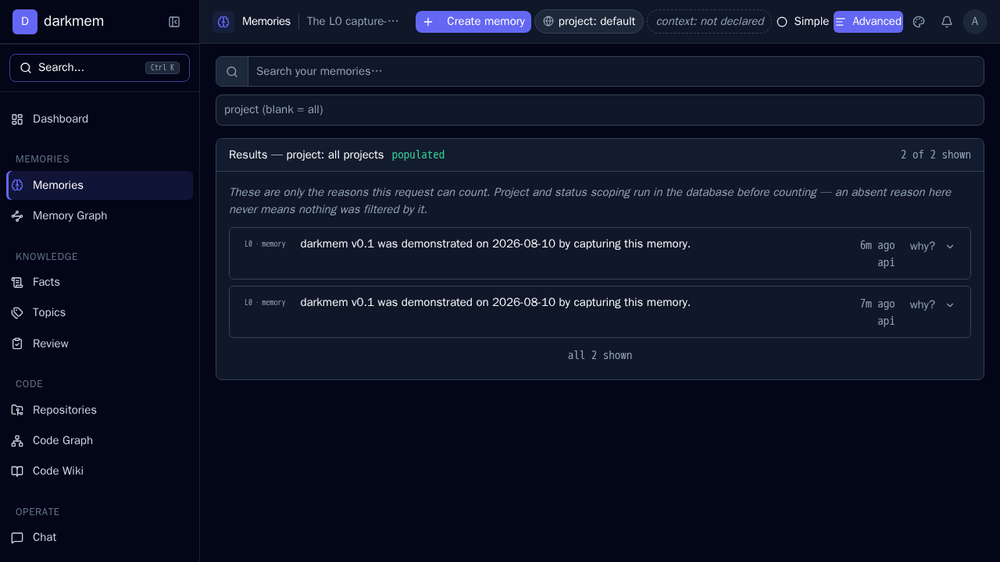

# v0.1 — demonstration

**Date:** 2026-08-10 · **Image:** `darkraise/darkmem-api:0.1.0` ·
**Stack:** production compose (`docker-compose.yml`), host networking, `:8000`

A green suite is not a running system, and the gap between them is what
"232 tasks done, nothing visible" has meant here. Every command below was run
against the deployed image, and its real output is recorded. What did not work
is recorded too, in §7 — an honest demonstration with a stated gap is worth more
than a tidy one.

## 1. Build and stack

The plan's `./scripts/build-push.sh` was run with `DARKMEM_PUSH=0`: spec §10 puts
publishing to any registry out of scope until the repo is published.

```
$ DARKMEM_PUSH=0 bash ./scripts/build-push.sh 0.1.0
```

**The first two attempts failed and the cause was not the code.** BuildKit's
cache was corrupt: the Python builder stage died with
`runc run failed: ... exec: "/bin/sh": stat /bin/sh: no such file or directory`
immediately after a successful `apt-get install`, and on the second attempt the
runtime stage additionally failed with
`failed to compute cache key: "/app/dist": not found` for a web stage that had
just reported `DONE`. Pulling `python:3.12-slim` fresh did not fix it; building
the image with `--no-cache` did, first try. Recorded because both messages read
like a Dockerfile defect and neither is one.

```
$ docker build --no-cache -t darkraise/darkmem-api:0.1.0 -t darkraise/darkmem-api:latest .
#19 2.469 Successfully installed darkmem-0.1.0
#27 [runtime 10/11] RUN set -eu; test -s web/index.html; ...   DONE 0.3s
#29 DONE 14.1s
```

The `0.1.0` in that line is the version reset landing in the built artifact, and
the runtime step is the image asserting its own SPA copy succeeded.

```
$ DARKMEM_VERSION=0.1.0 docker compose up -d
$ docker compose ps --format '{{.Name}} {{.State}} {{.Image}}'
darkmem-prod-darkmem-api-1 running darkraise/darkmem-api:0.1.0
darkmem-prod-postgres-1 running pgvector/pgvector:0.8.2-pg17

$ curl -sS -o /dev/null -w 'health=%{http_code}\n' http://localhost:8000/health
health=200
```

## 2. Setup, over REST, with no browser

```
$ curl -sS -c "$JAR" -X POST http://localhost:8000/api/v1/setup \
    -H 'Content-Type: application/json' -d '{"password":"..."}'
{"password":{"ok":true,"message":null},"llm":{"ok":true,"message":null},
 "repos":{"ok":true,"message":null},"repos_added":[],"repos_failed":[]}
session cookie issued
```

The guard closes behind it — trust-on-first-use, one claim only:

```
$ curl -sS -o /dev/null -w 'setup_guard=%{http_code}\n' -X POST .../api/v1/setup ...
setup_guard=403
```

## 3. LLM configuration

The seeds point at `http://localhost:11434/v1`, which is correct as a default and
wrong on this machine — the Ollama that serves embeddings is on the LAN at
`192.168.0.196`. See §7; the first capture/retrieve attempt failed on exactly
this. Both endpoints were verified reachable first (`/api/tags` listed the
models; DeepSeek's `/v1/models` returned 200), then set through the running API:

```
$ curl -sS -b "$JAR" -X POST http://localhost:8000/api/v1/config/llm ... 
{"embedding":{"base_url":"http://192.168.0.196:11434","model":"qwen3-embedding:0.6b",
 "dimensions":1024,"api_kind":"ollama",...},
 "extraction":{"base_url":"https://api.deepseek.com/v1","model":"deepseek-v4-flash",
 "api_key":"***","api_kind":"deepseek",...}
```

`api_key` comes back masked, which is the settings surface behaving.

## 4. Capture and retrieve through a real door

```
$ curl -sS -b "$JAR" -X POST http://localhost:8000/api/v1/memories \
    -d '{"content":"darkmem v0.1 was demonstrated on 2026-08-10 by capturing this memory.",
         "project":"default","wait_process":true}'
{"schema_version":1,"id":"019fec35-fc70-72b3-9d5a-29a4be47d662","status":"accepted"}
HTTP 202
```

202 with a pre-minted id is the designed buffered accept, not a degradation.
Three seconds later, through the retrieval path:

```
$ curl -sS -b "$JAR" -X POST http://localhost:8000/api/v1/memories/search \
    -d '{"query":"v0.1 demonstrated","limit":3}'
[{"id":"019fec35-fc70-72b3-9d5a-29a4be47d662",
  "content":"darkmem v0.1 was demonstrated on 2026-08-10 by capturing this memory.",
  "source":"api","source_agent":"curl/8.14.1","memory_type":"episodic",
  "created_at":"2026-08-10T15:06:30.013006Z","updated_at":"2026-08-10T15:06:32.777869Z",
  "classified_type":"episodic",
  "summary":"darkmem v0.1 was demonstrated by capturing this memory on 2026-08-10.",
  "project":"default","status":"active","confidence":0.75, ...}, ...]
```

That `summary` was written by the model during Phase 2, and `updated_at` moved
2.7 seconds after `created_at` — so this is the buffer flush, the pipeline and
the enrichment write, not an echo of the request.

## 5. MCP answers

```
$ curl -sS -X POST http://localhost:8000/mcp/ -d '{"jsonrpc":"2.0","id":1,"method":"initialize",...}'
{"jsonrpc":"2.0","id":1,"result":{"protocolVersion":"2025-06-18",
 "capabilities":{"prompts":{...},"resources":{...},"tools":{"listChanged":false}},
 "serverInfo":{"name":"darkmem","version":"1.27.2"},"instructions":"darkmem is a ..."}}
```

No `421`, so the Host allowlist passed localhost as designed.

## 6. The SPA renders — the one claim curl cannot make



```json
{ "url": "http://localhost:8000/memories",
  "rendered_the_captured_memory": true,
  "body_chars": 781,
  "page_errors": [] }
```

That single assertion walks image → SPA bundle → API → Postgres → back to the
screen, which is the whole claim v0.1 makes.

**The plan's method for this step did not work and was replaced.** It injected
the `curl` session cookie into a browser context to skip the login form. The
cookie is valid — it authenticates every REST call above — but the SPA bounced
to `/login` anyway, and the trace says why: the only calls it made were
`200 /api/v1/setup/status` and `200 /api/v1/config/theme`. It never asked the
server who the caller was, so the route guard is deciding from client-side state
the cookie does not populate. The demonstration therefore drives the real login
form, which exercises more of the product than the shortcut would have.

## 7. What did not work

- **The first capture/retrieve attempt failed.** Capture returned 202 and search
  returned **500**: `httpx.ConnectError: All connection attempts failed` at
  `llm.embed`, with `Phase 1 content embedding failed` in the pipeline log. The
  seeded embedder pointed at a `localhost` Ollama that does not exist here. Fixed
  by §3, not worked around; §4 is the re-run. Worth keeping: a fresh install on a
  machine without a local Ollama gets a 500 from search rather than a message
  naming the unreachable embedder, and the failing capture sat in the buffer
  retrying until the config was corrected — which is the buffer working.
- **The production compose collided with the development stack**, and this was
  the one destructive moment of the exercise. Both files defaulted their compose
  project name to the directory, `darkmem`, so `docker compose up -d` *recreated*
  `darkmem-postgres-1` under host networking — moving the development Postgres
  off `:5433`, where `darkmem_test` lives and where the entire backend floor
  points. Nothing was lost only because both files happened to name the same
  volume, which is the other half of the defect rather than a mitigation. Fixed
  at the root: `docker-compose.yml` now declares `name: darkmem-prod`, so
  production gets its own containers and its own volume and both stacks run at
  once. Verified after the fix: `darkmem-postgres-1` back on
  `127.0.0.1:5433->5432/tcp` with `darkmem`, `darkmem_bench`,
  `darkmem_bench_t9af2ba4618` and `darkmem_test` all present.
- **The release commit was mislabelled, and `v0.1` still carries it.**
  `gate.sh --full` runs the retrieval eval, which rewrites
  `docs/eval/2026-08-10-retrieval-eval.md` in place — new run id, new git sha,
  new latency table. `release.sh` then committed with `git commit -a`, so that
  re-stamp shipped inside a commit whose subject reads `chore(release): v0.1`.
  A reader later asking why those numbers moved finds a release commit. It
  happened twice, once per release attempt (`aa17674b`, `35e8668c`).
  `release.sh` now stages the three version fields **by name**, gives anything
  the gate touched its own honest commit, and refuses outright if a dirty path
  falls outside `docs/eval/`. **The `v0.1` tag was left where it is**: its tree
  is exactly what the green `--full` gate ran against and what is deployed, so
  the defect is a misleading commit subject rather than wrong content, and
  rewriting a tag that is already deployed and recorded costs more than it buys.
  Re-cutting cleanly is the owner's call.
- **`scripts/build-push.sh` was mode `100644` in git** while CLAUDE.md tells you
  to run `./scripts/build-push.sh`. The first fix used
  `git update-index --chmod=+x`, which sets the *index* mode only — the next
  `git add` of that path read the working tree's unchanged `0644` and silently
  reverted it. So the release run reached its build step after a clean `--full`
  gate and died on `Permission denied`. All seven scripts under `scripts/` carry
  a shebang; three were non-executable, including `start_dev_server.sh`, which
  CLAUDE.md also tells you to run directly. All are now `100755`, and a test
  asserts the **committed** mode so the index-only fix cannot recur.

## 8. Deliberately not claimed

The verification, groundedness and coverage badges. They serve as `candidate`
with the `verification_unmeasured` reason because G-C, G-D, G-E and G-F are
open, and `T2.95`'s serving boundary refuses an unbacked claim. That is the
system working, and CHANGELOG.md says so under "Known limits".
